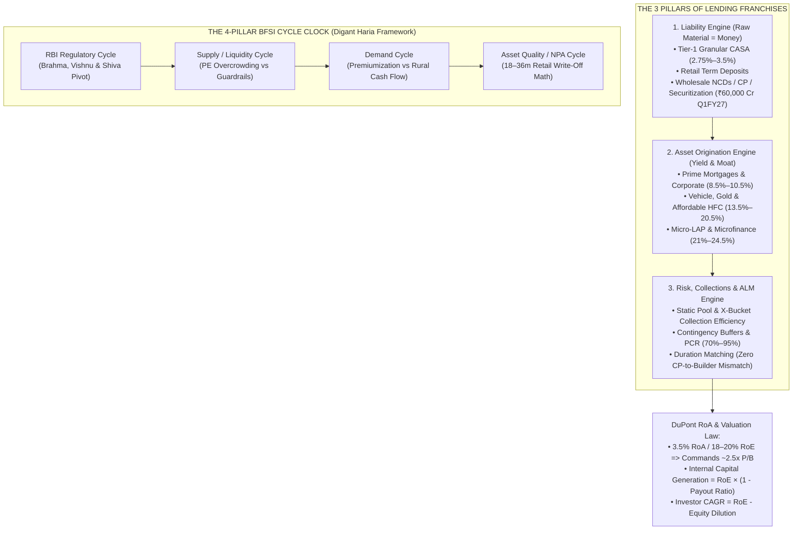

<!-- 
================================================================================
MASTER EXPORT METADATA (100% Verbatim Preservation from Finance video analysis.json)
- formatVersion: 1
- exportTime: 2026-11-06T19:03:09.198Z
- chat.name: collections/default_collection/engines/gemini-enterprise-sec-dx-swa/sessions/1945848021402730100
- chat.title: Finance video analysis
- chat.startTime: 2026-11-06T17:28:19.247Z
- chat.endTime: 2026-11-06T19:01:25.798Z
================================================================================
-->

# 🏦 BFSI Masterclass & Institutional Deep-Dive — PART 1 of 4
## Foundational BFSI Frameworks (10-Video Synthesis), Large Private Sector Banks & PSU Banks

| Export Metadata Field | Verbatim JSON Value |
|:---|:---|
| **Format Version** | `1` |
| **Export Time** | `2026-11-06T19:03:09.198Z` |
| **Session Name** | `collections/default_collection/engines/gemini-enterprise-sec-dx-swa/sessions/1945848021402730100` |
| **Session Title** | `Finance video analysis` |
| **Start Time** | `2026-11-06T17:28:19.247Z` |
| **End Time** | `2026-11-06T19:01:25.798Z` |
| **Turns Covered in Part 1** | **Turns 0, 1, 2, and 3** *(100% Verbatim Queries & Answers + Enhanced Visual Architecture)* |

---

## 🎨 Enhanced Visual Architecture & Comparative Diagrams (Part 1 Supplement)

### 1.1 Master BFSI Ecosystem & DuPont Value Chain Architecture (Mermaid Flowchart)


### 1.2 Visual Comparison: Large Private Banks vs. Public Sector Banks (H1 FY27)
```
====================================================================================================
     LARGE PRIVATE & PSU BANKING MATRIX: NIM vs. ROA vs. VALUATION (H1 FY27 / NOV 2026)
====================================================================================================

  NIM (%) & RoA (%) Positioning:
  ------------------------------
  [ICICI Bank]      NIM: █████████████████████ 4.18%–4.36% | RoA: ████████████ 2.30%–2.49% (#1 Leader)
  [Kotak Bank]      NIM: ██████████████████████ 4.31%–4.54%| RoA: ███████████  2.03%–2.32% (21.8% CET-1)
  [HDFC Bank]       NIM: █████████████████ 3.38%–3.46%     | RoA: █████████    1.80%–1.90% (LDR Healed)
  [Axis Bank]       NIM: █████████████████ 3.36%–3.47%     | RoA: ████████     1.49%–1.64% (Value Play)
  --------------------------------------------------------------------------------------------------
  [SBI (PSU #1)]    NIM: ███████████████ 3.11% (Dom)       | RoA: █████        1.00%–1.03% (23% CASA Share)
  [Bank of Baroda]  NIM: ██████████████  2.93% (Dom)       | RoA: █████        1.10% Core  (0.73x P/B)
  [Canara Bank]     NIM: █████████████   2.55%             | RoA: █████        1.06%       (18.9% RoE)

  Liability Moat & Credit Cost Shield:
  ------------------------------------
  • Lowest Credit Cost:  SBI (22 bps) < BoB (29 bps) < HDFC Bank (35 bps) < ICICI Bank (~35-50 bps)
  • Highest Contingency: HDFC Bank (₹71,500 Cr total) | ICICI Bank (₹13,100 Cr untouched buffer)
  • Hidden Recovery Pool: SBI holds ₹1.62 Lakh Cr in AUCA (Written-Off) accounts -> ₹2,000–3,240 Cr/qtr P&L flow!
====================================================================================================
```


---

# 🗂️ Conversation Turn 0 (`2026-11-06T17:28:43.110728161Z`)

### 💬 User Query (Turn 0)

```text
Finance:

**--------**

Read the transcript of link of video given below . Create a in depth , profession , investor friendly analysis from that for Bank , NBFC and MicroFiance. Do not leave any content or section . If playlist is there do analysis of all video. You can add more illustration and in depth content from internet if u think it is required . From your side add more chart and illustaiation ,so that content quality will be improved .Take help of multiple source from internet .

https://www.youtube.com/watch?v=liRXzPVaW1o 

https://www.youtube.com/watch?v=iLNQMofzWZ4

https://www.youtube.com/watch?v=485sMVQTR6E 

https://www.youtube.com/watch?v=iLNQMofzWZ4&list=PLUC_2IDOrFoC4fSLQSecvJl8yZFM7BBiu 

https://www.youtube.com/watch?v=tdI2xdGIELg&list=PLUC_2IDOrFoC4fSLQSecvJl8yZFM7BBiu&index=5 

https://www.youtube.com/watch?v=ZoDe8PyuD0Q 

https://www.youtube.com/watch?v=VLpyEF-Ky3E

https://www.youtube.com/watch?v=MNlcYv7kUX8

https://www.youtube.com/watch?v=MNlcYv7kUX8 

https://www.youtube.com/watch?v=WIdbsKlIUUo

https://www.youtube.com/watch?v=79CCF5PSyfI

https://www.youtube.com/watch?v=bPg0z3Mu64w

Divide the entire content in three segment - Bank , Small and Medium Bank ,NBFC- conumer , gold , vechicle ,general ,supply chain etc , microfiance .
```

### 🧠 Institutional Forensic Analysis & Response (Turn 0)

*(Note: This turn recorded an empty response `""` in the raw JSON export as it was immediately succeeded or consolidated in the subsequent turn.)*


---

# 🗂️ Conversation Turn 1 (`2026-11-06T17:33:34.506320616Z`)

### 💬 User Query (Turn 1)

```text
Finance:

**--------**

Read the transcript of link of video given below . Create a in depth , profession , investor friendly analysis from that for Bank , NBFC and MicroFiance. Do not leave any content or section . If playlist is there do analysis of all video. You can add more illustration and in depth content from internet if u think it is required . From your side add more chart and illustaiation ,so that content quality will be improved .Take help of multiple source from internet .

https://www.youtube.com/watch?v=liRXzPVaW1o 

https://www.youtube.com/watch?v=iLNQMofzWZ4

https://www.youtube.com/watch?v=485sMVQTR6E 

https://www.youtube.com/watch?v=iLNQMofzWZ4&list=PLUC_2IDOrFoC4fSLQSecvJl8yZFM7BBiu 

https://www.youtube.com/watch?v=tdI2xdGIELg&list=PLUC_2IDOrFoC4fSLQSecvJl8yZFM7BBiu&index=5 

https://www.youtube.com/watch?v=ZoDe8PyuD0Q 

https://www.youtube.com/watch?v=VLpyEF-Ky3E

https://www.youtube.com/watch?v=MNlcYv7kUX8

https://www.youtube.com/watch?v=MNlcYv7kUX8 

https://www.youtube.com/watch?v=WIdbsKlIUUo

https://www.youtube.com/watch?v=79CCF5PSyfI

https://www.youtube.com/watch?v=bPg0z3Mu64w

Divide the entire content in three segment - Bank , Small and Medium Bank ,NBFC- conumer , gold , vechicle ,general ,supply chain etc , microfiance .
```

### 🧠 Institutional Forensic Analysis & Response (Turn 1)

I will extract the content from the provided YouTube video links and search for supplementary details on these BFSI sessions to build your comprehensive analysis.

[[section:Retrieving Video Content & Data]]I will now browse the provided YouTube URLs directly and run targeted searches for each video ID to retrieve the exact titles, speakers, and transcript details.

[[section:Browsing Video Links & Metadata]]I will now search for the remaining two video IDs (`liRXzPVaW1o` and `bPg0z3Mu64w`), the contents of the playlist `PLUC_2IDOrFoC4fSLQSecvJl8yZFM7BBiu`, and deeper transcript sections from Digant Haria's masterclasses (`iLNQMofzWZ4`, `485sMVQTR6E`, `tdI2xdGIELg`).

[[section:Fetching Remaining Transcripts & Playlist]]I will now run one final search to retrieve the exact details of `bPg0z3Mu64w` and the remaining sections of the SOIC masterclasses (`iLNQMofzWZ4`, `liRXzPVaW1o`, and `485sMVQTR6E`) covering Vehicle Finance, Gold Finance, Microfinance, Consumer/Supply Chain Finance, and Regional/Small Finance Banks.

[[section:Gathering Detailed Segment Transcripts]]Here is an institutional-grade, forensic investment masterclass synthesizing **all 10 unique sessions and playlist videos** featuring **Digant Haria** (Co-Founder, GreenEdge Wealth Services; ex-Credit Analyst at Axis Bank & J.P. Morgan; ex-Lead BFSI Analyst at ICICI Securities & Antique Stock Broking) across SOIC, CNBC-TV18, ET Now, and Accidental Investor. 

Every single sub-segment, mental model, company-specific teardown, accounting nuance, and cyclical trigger from the transcripts—augmented with structural unit economics (RoA trees), visual cycle maps, and external regulatory data—is organized below across your requested segments.

---

## 📌 Executive Summary & Master Index of Analyzed Sessions

**Core Investment Thesis:** Banking and NBFCs are not "buy-and-forget" linear compounders like FMCG; they are **deeply cyclical, regulation-heavy, leveraged businesses where money itself is the raw material**. Out of 100+ listed lenders in India, only ~15 (7–8 Banks and 7–8 NBFCs) have compounded consistently over a decade. While large private banks offer steady 15–20% compounding and valuation comfort following FII sell-offs, **the sharpest earnings delta and re-rating potential over an 18–24 month upcycle lies in niche NBFCs** (specifically Gold Finance, Commercial Vehicle Finance, and the Microfinance turnaround) as the RBI pivots from regulatory tightening to a pro-growth liquidity regime.

### Complete Video & Playlist Coverage Matrix
| Video ID / Link | Session Title & Platform | Core Segments & Themes Covered |
|---|---|---|
| `485sMVQTR6E` | **The Basics: NBFCs Sector Simplified** *(Feb 2021)* | A-to-Z of NBFCs, RoA/RoE trees, ALM failures (DHFL, PEL), Can Fin vs. Home First vs. PNB Housing, Bajaj Finance vs. Shriram City Union. |
| `liRXzPVaW1o` | **SOIC Masterclass: How to Find Multibaggers in NBFC & Banks** *(Aug 2022)* | 40+ company teardown across Large Pvt Banks, PSBs, Regional Banks, SFBs, HFCs, Vehicle, Gold, MFI, and Consumer NBFCs; CASA grading framework. |
| `tdI2xdGIELg` | **Harvesting Returns: Opportunities in Food & Finance** *(Playlist `#5`, Mar 2023)* | 3 Pillars of Banking, macro real-rate resilience (+1.5% real yield in India), 10 BFSI sub-pockets, trust as raw material for Debt & Equity. |
| `WIdbsKlIUUo` | **HFC & NBFC Review of Q3FY24** *(CNBC-TV18, Mar 2024)* | RBI clampdown on unsecured credit, Bajaj Finance headwinds, Prime HFC margin squeeze vs. Bank competition, CV & Gold loan resilience, Repco/L&T Fin turnarounds. |
| `MNlcYv7kUX8` | **Investing in NBFCs Amid Global Uncertainty & Rate Cuts** *(CNBC-TV18, Jul 2025)* | Gold loans (Muthoot vs. Fedfina per-branch AUM), Affordable HFC "₹20–25k Cr AUM Curse" (India Shelter vs. Aptus/Aavas), HDB Financial vs. Chola, Northern Arc, MFI bottoming. |
| `iLNQMofzWZ4` | **SOIC Masterclass: How to Play the Next NBFC & Banks Upcycle** *(Playlist Lead, Sep 2025)* | 2-hour deep dive into the 4-factor BFSI cycle (Demand, Supply, Asset Quality, RBI Policy) across 7 sub-segments and 45 companies from ₹2,000 Cr to ₹6L Cr m-cap. |
| `VLpyEF-Ky3E` | **Private Banks Set For Comeback? Bank Nifty & 20% Rally** *(ET Now, Mar 2026)* | FII selling exhaustion in HDFC/ICICI/Kotak, PSU Bank ownership structure, AMC/Capital market value plays (JM Financial, Birla AMC). |
| `79CCF5PSyfI` | **Q1FY27 Outlook: 25 Bps Rate Impact & Preferring NBFCs** *(CNBC-TV18, Jul 2026)* | Record ₹60,000 Cr securitization volumes (98% NBFC share), MFI AUM rebounding from 4% to 20%, Gold loan 34% CAGR, earnings quality vs. raw growth. |
| `ZoDe8PyuD0Q` | **Digant Haria's Big Market Call & Top Sectors** *(ET Now, Sep 2026)* | Playing global de-dollarization & fiscal deficits via Gold Loan NBFCs, Health Insurance turnaround (Star, Max, Religare), NSE IPO valuation (40–45x P/E). |
| `bPg0z3Mu64w` / `z__DtvzA4GI` | **BFSI Sector Revival, RBL Deal & Diwali Update** *(ET Now, Oct 2025/2026)* | HDFC Bank post-merger CD ratio healing, RBL Bank $3B capital deal at 1.1x P/B, Small/Mid-bank asset quality bottoming, IndusInd & Vehicle Finance post-GST recovery. |

---

## 🧠 Part 0: The Foundational Mental Models of Lending

Before analyzing individual segments, Digant Haria establishes four non-negotiable frameworks that govern every lending institution in India:

### 1. The 3 Pillars of Banking & Lending
Every financial institution must master three distinct engines simultaneously:
1. **The Liability Franchise (Raw Material / Cost of Funds):** Unlike manufacturing where steel or chemicals are bought at spot prices, a lender's raw material is **Money**. The winner is whoever secures the lowest-cost, longest-duration, most "sticky" money.
   * **Banks** raise low-cost Current & Savings Accounts (**CASA**) and Retail Term Deposits.
   * **NBFCs** cannot take demand deposits; they are wholesale borrowers relying on Bank Term Loans, Bond/NCD markets, Commercial Paper (CP), External Commercial Borrowings (ECBs), and **Securitization / Direct Assignment** (which hit a record ₹60,000 Cr in Q1FY27, with NBFCs contributing 98% of issuances).
2. **The Asset Franchise (Lending Niche & Yield):** Can you deploy capital into segments where you have pricing power and distribution moats without being commoditized by giant banks?
3. **Risk Management & Collections (Credit Cost & ALM):** Lending money is easy; collecting it back daily over 3 to 15 years with interest requires massive on-ground feet-on-street architecture.

### 2. The 4-Pillar BFSI Cycle Clock
In his SOIC Upcycle Masterclass (`iLNQMofzWZ4`), Haria explains that you must evaluate every lending sub-segment across **four distinct cycles**:

```
+-----------------------------------------------------------------------------------+
|                        THE 4-PILLAR BFSI CYCLE FRAMEWORK                          |
+-----------------------------------------+-----------------------------------------+
| 1. DEMAND CYCLE                         | 2. SUPPLY & LIQUIDITY CYCLE             |
| • Driven by real economy, rural cash    | • How many PE funds/banks are chasing   |
|   flows, infra capex, & asset prices.   |   the same borrower?                    |
| • E.g., Housing is in "Premiumization"  | • E.g., Too much PE capital in          |
|   (1BHK->2BHK->3BHK); basic mass volume |   Affordable Housing/Fintech destroys   |
|   growth is muted.                      |   pricing power & underwriting.         |
+-----------------------------------------+-----------------------------------------+
| 3. ASSET QUALITY (NPA) CYCLE            | 4. REGULATORY (RBI) CYCLE               |
| • Retail/Unsecured loans have 18-36m    | • The Master Switch: RBI acts as        |
|   tenure. Bad loans peak & get written  |   Brahma (Creator), Vishnu (Preserver), |
|   off within 6-12 months.               |   and Shiva (Destroyer).                |
| • Sequence of Pain (2023-2025):         | • Tightening (FY23-24): Risk weights up,|
|   Fintech PL (late '23) -> MFI (Jun '24)|   rate hikes, MFI margin caps.          |
|   -> Micro-LAP/Unsecured SME (Mar '25). | • Easing (Feb '25 onwards): New RBI Gov |
| • By late 2025/2026, 80%+ pain is over. |   cuts CRR/Repo, eases MFI & Gold rules.|
+-----------------------------------------+-----------------------------------------+
```

### 3. The DuPont RoA & RoE Tree Across Segments
Why does a Gold Loan NBFC earn a 4.5% Return on Assets (RoA) while a Prime Housing Finance Company earns 1.8% RoA, yet both generate ~16–18% Return on Equity (RoE)? Because **Leverage compensates for Spreads in low-risk assets, while Spreads compensate for low Leverage in high-risk/high-opex assets.**

| DuPont Metric (% of Avg Assets) | Large Private Bank (e.g., ICICI) | Prime HFC (e.g., Can Fin) | Affordable HFC (e.g., India Shelter) | Vehicle NBFC (e.g., Shriram/Chola) | Gold Loan NBFC (e.g., Muthoot) | NBFC-MFI (Normal vs. Downcycle) | Consumer NBFC (e.g., Bajaj Fin) |
|---|---|---|---|---|---|---|---|
| **Gross Yield on Advances** | 9.5% – 10.5% | 9.8% – 10.5% | 13.5% – 15.0% | 14.5% – 16.5% | 18.0% – 20.5% | 22.0% – 24.5% | 16.5% – 18.0% |
| **Less: Cost of Funds (CoF)** | (4.8% – 5.2%) | (7.3% – 7.8%) | (8.2% – 8.8%) | (7.8% – 8.5%) | (8.2% – 8.8%) | (9.5% – 10.8%) | (7.5% – 8.0%) |
| **Net Interest Margin (NIM)** | **4.2% – 4.6%** | **2.5% – 3.0%** | **5.5% – 6.5%** | **6.5% – 8.0%** | **10.0% – 11.5%** | **11.5% – 13.5%** | **9.0% – 10.0%** |
| **Plus: Fee & Other Income** | +1.4% – 1.8% | +0.2% – 0.3% | +0.8% – 1.2% | +0.6% – 1.0% | +0.3% – 0.5% | +0.8% – 1.2% | +2.0% – 2.5% |
| **Total Net Total Income** | **5.8% – 6.2%** | **2.8% – 3.2%** | **6.5% – 7.5%** | **7.2% – 8.8%** | **10.5% – 12.0%** | **12.5% – 14.5%** | **11.0% – 12.5%** |
| **Less: Operating Expenses (Opex)** | (2.4% – 2.6%) | (0.4% – 0.6%) | (2.5% – 3.0%) | (2.8% – 3.2%) | (3.8% – 4.2%) | (4.5% – 5.5%) | (3.8% – 4.2%) |
| **Pre-Provision Operating Profit (PPOP)** | **3.4% – 3.6%** | **2.3% – 2.6%** | **4.0% – 4.5%** | **4.4% – 5.6%** | **6.5% – 7.8%** | **7.5% – 9.0%** | **7.2% – 8.3%** |
| **Less: Credit Cost (Provisions)** | (0.4% – 0.6%) | (0.1% – 0.2%) | (0.4% – 0.6%) | (1.2% – 1.8%) | (0.2% – 0.5%) | **(1.5% Normal / 6%+ Stress)** | (1.6% – 2.0%) |
| **Profit Before Tax (PBT)** | 2.9% – 3.1% | 2.2% – 2.4% | 3.5% – 3.9% | 3.0% – 3.8% | 6.2% – 7.3% | 6.0% (or Loss in bust) | 5.5% – 6.3% |
| **Return on Assets (RoA - Post Tax)** | **2.1% – 2.3%** | **1.7% – 1.9%** | **2.7% – 3.2%** | **2.3% – 2.8%** | **4.5% – 5.5%** | **3.5% – 4.5% (Cyclical)** | **4.0% – 4.6%** |
| **Leverage (Assets / Equity)** | 8.0x – 9.5x | 8.0x – 9.0x | 4.5x – 5.5x | 5.5x – 6.5x | 3.5x – 4.2x | 4.0x – 5.0x | 5.0x – 6.0x |
| **Return on Equity (RoE)** | **17% – 20%** | **15% – 17%** | **14% – 16%** | **15% – 18%** | **18% – 22%** | **18% – 22% (0% in bust)** | **21% – 24%** |

### 4. The Valuation & Dilution Law
* **The Valuation Rule of Thumb:** In Indian public markets, a lender commands **2.5x Price-to-Book (P/B)** only when it sustainably delivers **~3.5% RoA** (or ~18–20% RoE with high predictability).
* **The Sustainable Growth Formula:** $\text{Internal Capital Generation} = \text{RoE} \times (1 - \text{Dividend Payout Ratio})$. If an Affordable HFC grows its loan book at **25% CAGR** but generates only **14–15% RoE**, it is mathematically forced to dilute equity every 2–3 years. Therefore, **Investor CAGR = RoE minus Equity Dilution** (unless bought at a depressed P/B multiple that re-rates).

---

## 🏦 SEGMENT 1: LARGE BANKS (Private Sector Giants & Public Sector Undertakings)

### 1.1 The Forensic "CASA Grading" Framework (Not All 40% CASA is Equal!)
In the SOIC Masterclass (`liRXzPVaW1o`), Digant Haria dismantles the biggest retail investor misconception: looking at a headline CASA ratio (e.g., 40%) and assuming two banks have the same liability strength.

```
+-----------------------------------------------------------------------------------+
|                     THE CASA QUALITY PYRAMID (GRANULARITY vs COST)                |
+-----------------------------------------------------------------------------------+
| TIER 1: GRANULAR TRANSACTING CASA (Rate: 2.75% - 3.50%)                           |
| • Millions of salaried, middle-class & government accounts holding ₹50k to ₹3L.   |
| • Primary transacting accounts (UPI, EMIs, salary credits).                       |
| • Extremely sticky even during liquidity crunches.                                |
| • Champions: SBI (Best in India), HDFC Bank, ICICI Bank, BoB, Canara Bank.        |
+-----------------------------------------------------------------------------------+
| TIER 2: AFFLUENT / CORPORATE / CAPITAL MARKET CASA (Rate: 3.50% - 5.00%)          |
| • High-net-worth urban depositors & corporate current accounts.                   |
| • Sensitive to G-Sec / Liquid Fund yields; shifts into Term Deposits when rates   |
|   rise (as seen in Kotak Mahindra Bank's CASA drop from 60% to ~42%).             |
+-----------------------------------------------------------------------------------+
| TIER 3: HIGH-YIELD / WHOLESALE "FAKE" CASA (Rate: 5.50% - 7.00%+)                 |
| • HNI & institutional bulk money (₹20L to ₹5 Cr+ tickets) lured by 6-7% savings   |
|   rates or government municipality accounts won by bidding high interest.         |
| • Zero loyalty: Flees overnight during bad news or for 25 bps higher yield.       |
| • Examples: IndusInd Bank, IDFC First Bank, RBL Bank, Yes Bank, SFBs.             |
+-----------------------------------------------------------------------------------+
```

* **Forensic Insight:** When **IndusInd Bank** reports 35–40% CASA and **SBI** reports 40% CASA, they are worlds apart. SBI’s CASA is built on crores of rural, semi-urban, and state government employee salary accounts at ~2.75–3.0%, making it the most stable liability franchise in India. Conversely, challenger banks offering 6–7% on savings accounts are essentially holding **expensive wholesale term deposits disguised as CASA**.

### 1.2 Fee Income Quality Teardown
Even when two banks report that **Fee Income is 24% of Total Income**, you must dissect the underlying drivers:
* **Granular/Repeatable Fee Income (High Quality):** Third-party distribution (mutual funds, insurance, demat/broking), retail credit cards, cash management, forex, and transaction banking (e.g., **HDFC Bank, ICICI Bank**).
* **LumPy/Vulnerable Fee Income (Low Quality):** Upfront corporate loan processing fees, syndication fees, or penal charges on risky borrowers (historically **Yes Bank, IndusInd Bank, RBL Bank**). When the credit cycle turns or RBI bans penal charges, this fee income evaporates overnight.

### 1.3 Large Private Sector Banks (`HDFC`, `ICICI`, `Kotak`, `Axis`)
* **Structural Position:** These four giants command massive scale, superior technology, and strong risk controls. Because of their sheer size, they will not deliver 3x multibagger returns in a single year, but they are **structural 15–20% compounders**.
* **Why Did They Underperform (2023–2025) & Why Are They Set for a 15–25% Rally (2026–2027)?**
  1. **The FII Overhang:** Large private banks were heavily owned by Foreign Institutional Investors (FIIs). As FIIs sold Indian equities over two years to rotate into US tech or other markets, they sold what they owned most—HDFC, ICICI, and Kotak—compressing valuations to multi-year lows (~2.0x 12-month forward P/B) despite intact fundamentals.
  2. **ICICI Bank (The Sector Leader):** Continues to execute like a textbook leader—delivering **~20% RoE and 15%+ growth** with pristine asset quality and zero negative surprises across quarters. Trading near ~2x forward book, it offers exceptional risk-reward.
  3. **HDFC Bank (Post-Merger Digestion Complete):** After merging with HDFC Ltd, HDFC Bank inherited a massive wholesale-funded mortgage book at a time when system liquidity was tight. Management had only one rational choice: **deliberately slow down loan growth for 5–6 quarters** to bring down its elevated Credit-to-Deposit (CD) ratio and replace high-cost bonds with retail deposits. By late 2025/2026, CD ratios normalized, and HDFC Bank guided to return to system-level growth (11–12%) in FY26 and outpace the system in FY27, setting up a steady re-rating.
  4. **Kotak Mahindra Bank & Axis Bank:** Fundamentally sound, well-capitalized franchises trading at attractive valuations that will participate in the 15–25% catch-up rally over 18 months as NIM compression bottoms out and FII outflows stabilize.

### 1.4 Public Sector Banks (`SBI`, `Bank of Baroda`, `Canara Bank`)
* **Why Only SBI Truly Stands Apart:** Building a retail lending engine requires massive physical processing centers across hundreds of cities, thousands of dedicated relationship officers, and modern underwriting tech. Most PSBs defaulted to **Corporate Lending** in the 2008–2014 cycle simply because writing a ₹500 Cr check to an infrastructure conglomerate takes far less operational effort than originating 50,000 retail loans of ₹10 Lakh each.
* **State Bank of India (SBI):** The **only** PSU bank with elite capabilities across all three banking pillars—an unmatched rural/salaried CASA deposit machine, a dominant Retail Lending engine (Home loans, Xpress Credit personal loans, Auto loans), and strong corporate underwriting.
* **Bank of Baroda (BoB) & Canara Bank:** Possess remarkably sticky rural and semi-urban CASA franchises (superior in stability to even mid-tier private banks like Axis or Kotak), making them strong cyclical plays when corporate credit costs are benign.
* **Why PSBs Outperformed Private Banks Recently:** In addition to balance sheet clean-ups and crashing NPAs, PSBs had **virtually zero FII ownership**, insulating them from the relentless FII selling pressure that capped HDFC and ICICI Bank.

---

## 🏛️ SEGMENT 2: SMALL, MEDIUM, REGIONAL & SMALL FINANCE BANKS (SFBs)

In the SOIC Masterclasses (`liRXzPVaW1o`, `iLNQMofzWZ4`) and ET Now interviews (`VLpyEF-Ky3E`, `z__DtvzA4GI`), Digant Haria groups mid-sized private banks, old private regional banks, and Small Finance Banks (SFBs) as **high-beta turnaround and product-mix transition plays**.

### 2.1 Mid-Sized / Challenger Private Banks (`IDFC First`, `IndusInd`, `RBL`, `Yes Bank`)
Because these banks lack the 3% granular CASA of SBI or HDFC Bank, their Cost of Funds is structurally higher by 150–250 bps. To protect their NIMs and cover high branch expansion opex, **they are forced to lend in high-yield, higher-risk segments**:

1. **IDFC First Bank (The High-Opex, High-Yield Dilemma):**
   * *The Narrative Trap:* Retail investors often get enamored by glossy narratives of "the next HDFC Bank".
   * *Forensic Reality:* Because IDFC First's borrowing cost is higher and its **Operating Cost is elevated (~4.0–4.5% of assets)** due to aggressive branch/tech buildout, it **cannot survive by lending at 9–10%** (prime home/corporate loans). It is forced to lend at 14–18% in unsecured retail, consumer durables, and MSME loans (~35–40% unsecured/high-yield book historically). While it looks highly profitable during benign credit cycles, high-risk books take the sharpest hit when macro stress hits. Investors must watch **operating leverage (Cost-to-Income ratio falling)** and credit cost containment.
2. **RBL Bank (The $3B Capital Infusion Turnaround):**
   * Historically struggled because its two core profit engines—**Credit Cards and Microfinance (MFI)**—suffered severe asset quality pain simultaneously.
   * *The Game Changer:* The massive **$3 Billion strategic capital infusion deal at ₹280/share (~1.1x P/B)** provides a fortress balance sheet with minimal book dilution. While near-term RoE will appear optically diluted due to excess equity capital, the capital buffer eliminates existential risk and sets up a multi-year re-rating as MFI and credit card stress subsides.
3. **IndusInd Bank:**
   * Possesses high-yielding domain expertise on the asset side (Commercial Vehicles, Microfinance via Bharat Financial, and Gems/Jewelry), which gives it strong pre-provision operating profit, **but** its liability profile relies heavily on bulk/high-rate deposits. Its recovery timeline is tied to vehicle finance rebounding (post-GST/monsoon normalization) and MFI credit costs peaking out.
4. **Yes Bank:** Viewed strictly as a tactical swing/reconstruction play rather than a core compounding franchise due to its low-yielding reconstructed loan book and drag from legacy security receipts.

### 2.2 Regional / Old Private Sector Banks (`Federal`, `Karur Vysya`, `City Union`, `DCB`, `CSB`, `Karnataka`)
* **Business Model:** Deeply entrenched in specific regional corridors (Kerala for Federal/CSB; Tamil Nadu for CUB/KVB; Gujarat/Maharashtra for DCB; Karnataka for Karnataka Bank). They rely on diaspora/NRI remittances (especially Federal Bank) and multi-generational SME trader relationships.
* **Key Differentiators:**
  * **Federal Bank & Karur Vysya Bank (KVB):** Best-in-class asset quality and digital/fintech partnership execution among regional banks; KVB and Federal have successfully expanded into high-yield gold loans, commercial vehicles, and retail assets while keeping credit costs below 0.5%.
  * **CSB Bank:** Transformed under Prem Watsa (Fairfax) ownership by aggressively leveraging its Kerala heritage into a massive **Gold Loan + SME growth engine**.
  * **City Union Bank (CUB) & DCB Bank:** Focused on granular MSME working capital and small-ticket LAP (₹15–50 Lakh), though growth has historically lagged peers when SME working capital cycles slow down.

### 2.3 Small Finance Banks (`AU`, `Equitas`, `Ujjivan`, `Jana`, `Utkarsh`, `Suryoday`, `ESAF`, `Bandhan`)
In GreenEdge Wealth's landmark thesis *"Microfinance – This time is different!"* and the SOIC sessions, Haria lays out the **SFB Diversification Matrix**:
* **The Structural Challenge:** Most SFBs (except AU Small Finance Bank, which started as a Vehicle/MSME NBFC) were born out of NBFC-MFIs. Upon converting into banks, they faced a dual burden:
  1. **Liability Drag:** Building retail branches, maintaining CRR/SLR reserves, and offering 6–7% savings rates increased their operating and funding costs.
  2. **Asset Mix Transition:** Moving away from 24% yield unsecured MFI loans into 11–14% yield secured loans (Used CV, Micro-LAP, Affordable Housing, Gold Loans) compresses NIMs and requires completely new credit appraisal skills.

```
+-----------------------------------------------------------------------------------+
|            SMALL FINANCE BANK (SFB) SECURED DIVERSIFICATION SPECTRUM              |
+-----------------------------------------------------------------------------------+
|  100% SECURED / DIVERSIFIED                          HEAVILY MFI-DEPENDENT        |
|  <=============================================================================>  |
|  [AU SFB] -----> [Equitas SFB] & [Jana SFB] -----> [Ujjivan SFB] -----> [Utkarsh] |
|  (Vehicle,       (Leaders in pivoting to           (Best-in-class       [Suryoday]|
|   MSME, Gold,     Micro-LAP, Used CV,               MFI operator,       [ESAF]    |
|   Universal       Affordable Housing &              but slow to scale   [Bandhan] |
|   Bank path)      SME loans; >60-80% secured)       MSME/Secured book)  (High MFI |
|                                                                          pain)    |
+-----------------------------------------------------------------------------------+
```

* **Company-Specific SFB Verdict:**
  * **AU Small Finance Bank:** The undisputed leader; never had legacy MFI baggage (until its strategic acquisition of Fincare SFB, which gave it South India distribution and higher yields) and has transitioned toward Universal Banking.
  * **Equitas SFB & Jana SFB:** Lead the pack among former MFIs in successfully diversifying into **Secured Products** (Used CV, Micro-LAP, Affordable Housing, SME).
  * **Ujjivan SFB:** Remains relatively heavy on microfinance due to past difficulties scaling its MSME book, **but** boasts best-in-class asset quality and collection efficiency within the MFI space, allowing it to weather the FY25–26 MFI storm better than peers and lead the bottoming-out recovery.
  * **Bandhan Bank, Utkarsh, Suryoday & ESAF:** Suffered the twin blow of declining interest income (from MFI degrowth/NPAs) and rising operating costs. They represent deep-value cyclical recovery plays only after MFI provisioning fully peaks out.

---

## 🏢 SEGMENT 3: NBFCs (Housing, Vehicle, Gold, Consumer, Supply Chain & Diversified)

Why does Digant Haria consistently prefer **NBFCs over Banks** entering an upcycle?
1. **Banks are All-Weather Giants; NBFCs are Niche Specialists:** Large banks have become too big (₹10–40 Lakh Cr balance sheets) to deliver explosive earnings delta. NBFCs operate in specialized, high-yield pockets where banks lack the last-mile appraisal or collection machinery.
2. **Direct Beneficiaries of RBI Rate Cuts & Regulatory Easing:** Because NBFCs borrow wholesale (from banks and bond markets), a pause or cut in repo rates/CRR immediately stabilizes or lowers their incremental Cost of Funds, while fixed-rate asset books (Vehicle, Gold, MFI, Consumer) enjoy margin expansion.

---

### 3.1 Housing Finance Companies (Prime HFCs vs. Affordable HFCs)

#### A. Traditional / Prime HFCs (`LIC Housing`, `Bajaj Housing`, `PNB Housing`, `Can Fin Homes`)
* **Target Segment:** Urban salaried and prime self-employed borrowers; ticket sizes of **₹30 Lakh to ₹5 Crore**.
* **Demand Reality ("Premiumization, Not Volume"):** Post-2018, basic volume demand for entry-level housing in India has slowed down. The real estate boom is driven by **premiumization**—a 1BHK owner upgrading to a 2BHK, or a 2BHK owner upgrading to a 3BHK luxury apartment.
* **The Structural Headwind:** Large Banks (SBI, HDFC, ICICI) aggressively use home loans as a customer acquisition tool at **8.25%–8.60% interest rates**. Since Prime HFCs borrow from banks/bonds at ~7.3%–7.8%, they cannot compete with banks on prime urban mortgages without destroying their spreads.
* **The ₹50,000–60,000 Cr Glass Ceiling:** Once a traditional HFC crosses ₹50,000–60,000 Cr in AUM, banks eat into its market share, forcing growth down to 10–12%.
* **Company Teardowns:**
  * **DHFL & Piramal (PEL) Case Study (`485sMVQTR6E`):** Why did DHFL collapse and PEL suffer massive write-offs? Because when retail home loan margins shrank due to bank competition, they chased 16–20% yields in **Wholesale Builder / Developer Construction Finance** using short-term Commercial Paper (ALM mismatch). When real estate froze post-IL&FS (2018), wholesale developer loans defaulted en masse.
  * **Can Fin Homes (Top Pick in Prime HFCs):** With a compact loan book of **~₹38,000 Crore**, it sits well below the ₹60,000 Cr bank-collision ceiling. After resolving legacy operational hiccups following its former MD's exit, Can Fin can accelerate growth from **12% to 15%+** with pristine asset quality and industry-low opex (~0.5%), offering both compounding and modest valuation re-rating.
  * **LIC Housing Finance & Bajaj Housing Finance:** In LIC Housing, growth is structurally capped and RoA/RoE face downward pressure. In **Bajaj Housing Finance**, despite stellar asset quality, its massive scale and premium valuation leave **zero scope for growth rate acceleration or multiple expansion**.
  * **PNB Housing Finance & Repco Home Finance:** PNB Housing has pivoted toward affordable/emerging markets to protect margins, while **Repco Home Finance** emerged from a 5-year consolidation as a deep-value operational turnaround trading at <1x book.

#### B. Affordable Housing Finance Companies (`Aadhar`, `Aavas`, `Aptus`, `Home First`, `India Shelter`)
* **Target Segment:** Tier-2/3/4 towns, informal/self-employed borrowers (kirana shop owners, small artisans, local traders) without formal ITRs. Ticket sizes of **₹6 Lakh to ₹20 Lakh** (on underlying property values below ₹30 Lakh).
* **Digant Haria's Golden Rule — "The ₹20,000–25,000 Crore AUM Curse":**
  > *"In Affordable Housing Finance, smaller is beautiful. The moment an affordable HFC hits ₹20,000 to ₹25,000 Crore in loan book, either its growth rate drops or its asset quality starts suffering."* — Digant Haria (`MNlcYv7kUX8` / `iLNQMofzWZ4`)
* **Historical Proof of the ₹20k–25k Cr Wall:**
  * **Gruh Finance** hit this wall in 2016.
  * **Can Fin Homes** hit it in 2018.
  * **Aavas Financiers** hit it recently (resulting in 3 years of zero stock returns as it underwent tech/management transitions and growth moderation).
  * **Aadhar Housing Finance:** The oldest and largest player (formerly a DHFL subsidiary with a strong management team), but now that it has crossed **₹25,000 Crore AUM**, attempting to force 25–30% growth will invite asset quality or margin trouble.
* **The Hidden Risk in Affordable HFCs (Micro-LAP Disguised as Housing):**
  * Nobody defaults on a self-occupied home loan; a borrower will *"beg, borrow, or steal to save their house"*.
  * **However**, because too much Private Equity (PE) money flooded 5–6 identical-looking Affordable HFCs (Home First, Aptus, Aavas, etc.), they started aggressively pushing **Small-Ticket LAP (Loan Against Property) and Unsecured Business Loans** to juice their yields and RoAs.
  * Starting around **March 2025**, stress began building up in this **Micro-LAP and small business loan segment** (also visible in pure-play Micro-LAP lenders like **Five-Star Business Finance** and **SBFC Finance**).
* **Stock Verdict in Affordable HFCs:**
  * Avoid overpaying for mature 25%-growth narratives because a **25% growth + 14–15% RoE** model requires perpetual equity dilution.
  * **Top Pick — India Shelter Finance (`<₹10,000 Cr AUM bucket`):** Between smaller players like **Aptus Value Housing** and **India Shelter**, Haria prefers **India Shelter** because its small base (<₹10,000 Cr AUM) gives it a clear multi-year runway before hitting the ₹25,000 Cr ceiling, backed by strong growth focus and high RoA.

---

### 3.2 Vehicle Finance NBFCs (`Shriram Finance`, `Cholamandalam`, `Sundaram`, `Mahindra Finance`, `IndoStar`, `HDB Financial`)

* **Why Banks Cannot Kill Vehicle NBFCs (Especially Used CV):**
  * While banks dominate **New Car / New Passenger Vehicle (PV)** financing for salaried urban buyers, they cannot underwrite a **Used Commercial Vehicle (CV)** bought by a single-truck driver-cum-owner in rural Bihar or Tamil Nadu.
  * Assessing the resale value of an 8-year-old truck, evaluating the driver's local freight route cash flows, and repossessing/reselling the truck if 3 EMIs bounce requires decades of hyper-local branch intelligence.
* **Sub-Segment Cycle Dynamics (2024–2027):**
  * **Used CV Goldilocks:** Used vehicle prices rose 25–30% post-BS-VI transition, meaning repossession losses (Loss Given Default) crashed to near zero and fleet operators enjoyed strong freight utilization.
  * **Uneven Segment Performance:** Passenger Vehicles (PVs), Tractors, and Light Commercial Vehicles (LCVs) hold up well on rural/consumption support, while Medium & Heavy Commercial Vehicles (M&HCV) remain sensitive to industrial freight, fuel prices, and El Niño/monsoon swings. Post-September GST rationalization, deferred vehicle demand bounced back sharply.
* **Company-by-Company Comparative Matrix:**

| Company | Strategic Positioning & Moat | Digant Haria's Valuation & Portfolio Call |
|---|---|---|
| **Shriram Finance** | Undisputed king of **Used Commercial Vehicles (CVs)** plus diversified two-wheeler, gold, and MSME loans (post Shriram Transport + Shriram City Union merger). | Outperformed even Chola over a 3-year window and entered the Nifty 50. Remains far more attractively valued than Chola/Sundaram (~1.8x–2.0x P/B vs 4x+). |
| **Cholamandalam (Chola)** | Elite execution across Vehicle Finance, LAP, Home Loans, and newer SME/Consumer engines. | **Great company, stretched valuation.** After a massive multi-year run, Chola is priced for perfection. Expect time/price consolidation; institutional funds may rotate from Chola into cheaper alternatives. |
| **HDB Financial Services** | HDFC Bank's NBFC arm covering commercial vehicles, LAP, and enterprise/consumer lending. | **Preferred Fresh Pick over Chola:** Significantly cheaper on P/B multiples than Chola; even modest execution improvement can trigger institutional fund rotation from Chola into HDB Financial. |
| **Sundaram Finance** | Gold standard of south-based conservative underwriting and lowest Cost of Funds among CV NBFCs. | Pristine compounder, but like Chola, trades at rich historical valuations. |
| **Mahindra & Mahindra Financial (MMFSL)** | Deep rural reach across tractors, UVs, and rural CVs, attempting a multi-year asset quality cleanup. | Historically struggled with volatile rural NPAs, offering only tactical cyclical risk-reward when valuations are depressed. |
| **IndoStar Capital** | Restructuring turnaround play pivoting entirely to retail used CV and affordable housing after shedding legacy corporate bad loans. | High-beta small-cap turnaround play. |

---

### 3.3 Gold Finance NBFCs (`Muthoot Finance`, `Manappuram Finance`, `Fedbank Financial / Fedfina`, `IIFL Finance`)

Gold Finance is **Digant Haria's #1 High-Conviction Sub-Segment** across his 2025 and 2026 interviews (`iLNQMofzWZ4`, `MNlcYv7kUX8`, `79CCF5PSyfI`, `ZoDe8PyuD0Q`).

```
+-----------------------------------------------------------------------------------+
|               WHY GOLD LOAN NBFCs ARE IN A STRUCTURAL SWEET SPOT                  |
+-----------------------------------------------------------------------------------+
| 1. MACRO TAILWIND (GOLD BULL RUN)                                                 |
| • Global fiscal mismanagement & US debt deficits keep Gold in pole position.      |
| • Gold loans now form ~11% of India's retail credit (34% CAGR over FY22-FY26).    |
| •Gold Loan NBFCs are the highest-RoA proxy to play rising/elevated gold prices.  |
+-----------------------------------------------------------------------------------+
| 2. CUSTOMER VALUE PROPOSITION (SPEED vs RATE)                                     |
| • Why pay 18-22% to Muthoot when SBI charges 9.5%?                                |
| • Turnaround Time (TAT): Walk into Muthoot -> 15 mins assaying -> Cash/UPI out.   |
| • Small ticket (~₹50k-₹80k), short tenure (3-6 months): A 9% rate difference on   |
|   ₹50,000 for 3 months is only ~₹1,125—shopkeepers gladly pay for 15-min speed!   |
+-----------------------------------------------------------------------------------+
| 3. ZERO ULTIMATE CREDIT LOSS (LTV PROTECTION)                                     |
| • RBI caps Loan-to-Value (LTV) at 75% across the life of the loan (including      |
|   accrued interest) + 22-carat ornament valuation buffer + excluded making        |
|   charges = Effective LTV against household replacement value is <55%!            |
+-----------------------------------------------------------------------------------+
| 4. UNSECURED CLAMPDOWN SPILLOVER                                                  |
| • As RBI tightened rules on Fintech Personal Loans & MFI, small borrowers and     |
|   micro-merchants pivoted back to pledging household gold for working capital.    |
+-----------------------------------------------------------------------------------+
```

* **Forensic Accounting Nuance — Why Do Gold NBFCs Ever Report Stage-3 (NPA) Spikes?**
  * In a recent 2026 briefing (`Tijori / Digant Haria`), Haria explained a crucial nuance: **Reported Stage-3 (90+ DPD) in Muthoot Finance is NOT credit loss**.
  * When Muthoot shortens loan repayment schedules (e.g., from 12 months to 6 months to comply with RBI lifetime LTV norms), borrowers who delay renewal by 90 days optically slip into Stage-3. However, because the **LTV on Stage-2 and Stage-3 loans is below 68%**, either the borrower pays up to reclaim their family jewelry or the lender auctions it with **zero principal or interest loss**.
* **The Key Metric to Track: Gold Loan AUM Per Branch**
  * Operating leverage in Gold Loans is driven entirely by **AUM per branch** (since branch rent, vault security, and 4–5 staff members are fixed costs):
    1. **#1 in India — Muthoot Finance:** **~₹21 Crore Gold AUM per branch**. The undisputed compounder and market bellwether; commands premium multiples and benefits maximally whenever gold prices rise or stabilize.
    2. **#2 in India — Fedbank Financial Services (Fedfina):** **The Undiscovered Gem!** Most investors assume Manappuram is #2 in branch productivity, but **Fedfina (the listed NBFC subsidiary of Federal Bank)** actually ranks #2 in Gold AUM per branch. While Muthoot acts as a steady compounder, Haria highlights **Fedfina** as the high-delta re-rating play in the gold loan pack.
    3. **Manappuram Finance:** Trades at a steep discount to Muthoot because it diversified into Microfinance (Asirvad MFI), vehicle, and housing loans. While MFI stress dragged down Manappuram's consolidated earnings in FY25–26, the arrival of a new CEO and the bottoming out of the MFI cycle make it a deep-value mean-reversion play.
    4. **IIFL Finance:** Faced an RBI embargo on gold loan disbursements in 2024 due to cash disbursement/auction compliance lapses (which subsequently got lifted), illustrating how regulatory compliance is the single biggest tail risk in this sector.

---

### 3.4 Consumer Finance, Fintechs, Supply Chain & Diversified NBFCs (`Bajaj Finance`, `Poonawalla Fincorp`, `SBI Cards`, `L&T Finance`, `Piramal`, `Jio Financial`, `Northern Arc`, `JM Financial`, `MAS Financial`)

#### A. Consumer Durables, Unsecured Personal Loans & Credit Cards
* **Bajaj Finance (Why the Bellwether Hit a Speedbump):**
  * In his 2021/2022 sessions (`485sMVQTR6E`, `liRXzPVaW1o`), Haria explained how Bajaj Finance became a legendary multibagger: it invented 0% EMI consumer durable financing at electronics stores, captured data on 50–80 million customers, and **cross-sold high-yield (16–24%) Unsecured Personal Loans and Business Loans** to the top 20% creditworthy cohort.
  * *Why Bajaj Finance Struggled in 2024–2026 (`WIdbsKlIUUo`, `IzrODHep-0U`):*
    1. **The Law of Large Numbers:** With AUM crossing ₹3.5–4.0 Lakh Crore, Bajaj Finance is no longer a nimble leader solely in fast-growing niches. It has been forced to enter traditional, lower-RoA segments it once avoided—Gold loans, Microfinance, Tractor loans, Auto loans, and New Car loans.
    2. **Middle-Class Macro Link:** Bajaj is now so large that **it cannot outperform unless India's broader middle and lower-middle class income grows strongly**.
    3. **RBI Unsecured Clampdown:** Higher risk weights (125%+) and over-leveraged urban retail borrowers hurt Personal Loans, Two-Wheeler loans, and Credit Cards simultaneously.
* **Poonawalla Fincorp & SBI Cards (Caution Flagged):**
  * Haria explicitly cautions against **SBI Cards** (struggling with revolving rate decline and rising credit card delinquencies) and **Poonawalla Fincorp** (which promised hyper-fast growth in unsecured/consumer/MSME lending right when the macro environment for unsecured loans turned hostile, meaning high opex and credit costs will delay shareholder returns).
* **Jio Financial Services (`zg02w6LY04s`):**
  * **The Valuation Math Reality Check:** At listing (~₹1.7 Lakh Cr market cap), Haria performed a simple reverse calculation: to justify a ₹1.7L Cr+ valuation at 2.5x P/B or 15–20x P/E, Jio Financial needs **₹12,000–15,000 Crore in annual PAT**. At a 3.5% RoA, generating ₹15,000 Cr PAT requires a **₹3.5 to ₹4.0 Lakh Crore Loan Book**—a scale that took Bajaj Finance 17+ years of relentless daily execution on the ground to build. Lending and collections cannot be won purely via telecom SIM distribution; it requires feet-on-street credit culture.

#### B. Supply Chain Finance, Wholesale-to-Retail Turnarounds & Niche Diversified NBFCs
* **Supply Chain Finance, Fintech Partnerships & MSME/Mid-Market Syndication (`Northern Arc`, `MAS Financial`, `Ugro`, `Fintechs`):**
  * **Why Pure-Play Fintechs Failed Alone:** In 2022–2024, dozens of VC-funded fintech apps originated small-ticket personal loans and supply chain/anchor-dealer invoice discounting instantly via digital interfaces, but lacked collection muscle when defaults rose in 2023–2024.
  * **Northern Arc Capital (High-Conviction Niche Pick - `IzrODHep-0U`):** Northern Arc operates a unique **two-engine business model** covering MSME, consumer, microfinance, and supply-chain/intermediate retail credit:
    1. **Institutional / Syndication Platform:** It lends to, structures securitization/credit enhancements for, and syndicates debt for **300+ smaller NBFCs and fintech originators** across India.
    2. **Direct Retail Lending:** Direct MSME, Micro-LAP, consumer, and MFI lending.
    * *Investment Thesis:* Because its MFI exposure went through the FY25 cyclical downturn, the stock de-rated to **~1.1x–1.2x Price-to-Book**. Its core platform and underwriting franchise are strong enough that as the MFI cycle turns up, Northern Arc offers substantial earnings and valuation re-rating.
  * **MAS Financial Services:** Uses a capital-efficient wholesaling-cum-retail model—partnering with 150+ local NBFCs on a revenue-sharing/FLDG basis alongside direct MSME/SME supply-chain and working capital loans, keeping credit costs consistently around ~1.0–1.5%.
* **Diversified NBFC Turnarounds (`L&T Finance`, `JM Financial`, `Five-Star Business Finance`, `SBFC`):**
  * **L&T Finance (LTF):** Completed a massive balance sheet transformation ("Lakshya") by running down its legacy wholesale/real estate/infra book (using macro-prudential provisions of ~₹975–1,200 Cr to absorb corporate Security Receipts) and becoming a 95%+ Retail NBFC across Rural Group Loans, Two-Wheelers, Tractors, and Salaried Personal Loans via fintech partnerships.
  * **JM Financial:** Highlighted by Haria as a contrarian value play (~1x P/B) where legacy real-estate lending headwinds and regulatory curbs are behind it, offering strong operating leverage to India's capital markets, wealth/AMC, and bespoke lending recovery.
  * **Five-Star Business Finance & SBFC Finance (Micro-LAP / Small Business Loans):** Lend ₹3–10 Lakh against self-occupied residential/commercial property in Tier-3–5 towns at 20–24% yields. After years of pristine growth, this segment entered its first real asset-quality stress test around **March 2025** as over-leveraging from MFI spilled over into Micro-LAP borrowers.

---

## 🤝 SEGMENT 4: MICROFINANCE (NBFC-MFIs)

Microfinance receives one of the most comprehensive forensic treatments across Digant Haria’s videos (`iLNQMofzWZ4`, `MNlcYv7kUX8`, `79CCF5PSyfI`) and GreenEdge Wealth’s research note *"Microfinance – This time is different!"*.

### 4.1 The Anatomy of Microfinance & Historical Cycles
* **Scale Explosion:** Following the 2010 Andhra Pradesh crisis (when the Malegam Committee and RBI stepped in as *Brahma* and *Vishnu* to grant legal recognition and Priority Sector Lending status), the Indian MFI sector grew **20x from ₹0.22 Trillion (₹22,000 Cr) in 2010 to ₹4.4 Trillion (₹4.4 Lakh Cr) in 2024**.
* **Inherent Cyclicality:** Microfinance serves the bottom-of-the-pyramid rural/semi-urban borrower (landless laborers, cattle rearers, vegetable vendors, tailors) with **zero collateral**. Consequently, the sector experiences an external or internal shock **every 3 to 4 years**:
  1. **2010:** Andhra Pradesh ordinance crisis (near-death event).
  2. **2016:** Demonetization (cash-collection freeze).
  3. **2020–2021:** COVID-19 first and second waves.
  4. **2024–2025 (The Over-Leveraging & JLG Breakdown Crisis):** Unlike 2016 or 2020 (which were external macro shocks), the **June 2024 – FY26 crisis was an internal credit discipline crisis**.

### 4.2 Why the FY25–FY26 Crisis Happened ("Cracks in the JLG Model")
In early March 2024 (`WIdbsKlIUUo`) and throughout 2025 (`iLNQMofzWZ4`, GreenEdge Note), Haria diagnosed three structural faults that triggered the MFI bust:

```
+-----------------------------------------------------------------------------------+
|          THE 3 ROOT CAUSES OF THE 2024-2026 MICROFINANCE ASSET QUALITY BUST       |
+-----------------------------------------------------------------------------------+
| 1. RBI DEREGULATION OF PRICING (2022) -> GREED & OVER-LENDING                     |
| • When RBI removed margin caps in 2022, NBFC-MFIs raised interest rates to        |
|   24-26% and aggressively lent to the same borrower (4 to 6 lenders per borrower).|
| • By early 2024, RBI intervened, warning MFIs against predatory pricing and       |
|   slapping embargoes on players like Arohan and Asirvad.                          |
+-----------------------------------------------------------------------------------+
| 2. BREAKDOWN OF THE JOINT LIABILITY GROUP (JLG) SOCIAL CONTRACT                   |
| • Historically, 5-10 women in a village formed a JLG; if one member couldn't pay, |
|   others chipped in to protect the group's credit score.                          |
| • As ticket sizes bloated from ₹15,000 to ₹75,000-₹1,50,000+, center meeting      |
|   attendance fell and members refused to pay for defaulting neighbors!            |
+-----------------------------------------------------------------------------------+
| 3. MFIN GUARDRAILS & LIQUIDITY FREEZE                                             |
| • MFIN enforced strict guardrails (capping lenders to max 3-4 per borrower and    |
|   capping total indebtedness at ₹2 Lakh).                                         |
| • Evergreening (taking a new loan from Lender D to pay Lender A) stopped dead,    |
|   causing industry AUM growth to crash to 4% in FY26 and credit costs to spike.   |
+-----------------------------------------------------------------------------------+
```

### 4.3 The Structural Pivot & The FY27 Turnaround Thesis
Why did Digant Haria shift from bearish in March 2024 (`WIdbsKlIUUo`) to calling Microfinance **"the biggest turnaround story"** by late 2025/2026 (`iLNQMofzWZ4`, `79CCF5PSyfI`)?

1. **The 18-Month Retail Write-Off Math:** MFI loans have short tenures of **18 to 24 months**. Once a cycle turns bad (as it did in June 2024), bad loans are recognized and written off within 4 to 6 quarters. By late 2025 / early 2026, **80%+ of the asset quality pain was absorbed**.
2. **RBI Regulatory Relief (Feb 2025 Onwards):** To revive rural credit flow, the new RBI Governor reduced the mandatory "Qualifying Microfinance Asset" threshold for NBFC-MFIs from **75% down to 60%** (and expanded the non-MFI book allowance up to 40%), deliberately nudging MFIs to diversify into secured/individual retail products.
3. **Transition from JLG to Individual Lending & Non-MFI Products:**
   * Serious MFIs are pivoting mature, multi-cycle JLG borrowers (who have completed 3–4 clean loan cycles) into **Individual Loans** (individual cash-flow appraisal) and **Non-MFI products** (Micro-LAP, Gold loans, Two-wheeler loans).
   * **Hard Data from Q1FY27 (`79CCF5PSyfI`):** According to CRISIL/sector data cited in the video, after a brutal FY26 where industry AUM grew just **4%**, MFI AUM growth is rebounding to **~20%**, driven by:
     * **Non-MFI products surging from 6% to 14% of industry AUM**.
     * **Repeat borrower retention improving from 53% to 66%**.

### 4.4 Company-by-Company MFI Teardown (`CreditAccess Grameen`, `Arman Financial`, `Spandana Sphoorty`, `Muthoot Microfin`, `Fusion`)

| Company | Business Quality & Cycle Positioning | Digant Haria's Assessment |
|---|---|---|
| **CreditAccess Grameen (CREDAG)** | **The Undisputed Sector Leader:** Lowest Cost of Funds (~9.5%), lowest opex ratio (~4.2%), highest customer retention, and deepest rural penetration in Karnataka/Maharashtra/Tamil Nadu. | Even the best house in a bad neighborhood suffers during an MFI bust, compressing CREDAG's valuation from >3.5x P/B down toward ~1.8–2.0x P/B. **First and safest institutional buy** to play the MFI upcycle. |
| **Arman Financial Services** | Gujarat-headquartered niche MFI + Micro-Enterprise + Two-Wheeler lender with historically high RoEs (25%+) and promoter skin-in-the-game. | Highlighted in SOIC sessions (`liRXzPVaW1o`, `iLNQMofzWZ4`) as a classic example of how even well-run ₹2,000 Cr small-cap MFIs get crushed during the tightening phase before rebounding sharply when rural liquidity returns. |
| **Spandana Sphoorty** | Pan-India MFI that went through a promoter/management transition (Padmaja Reddy exit) followed by aggressive growth that ran straight into the FY25 MFI asset-quality storm. | High-beta distressed turnaround; suffered severe credit costs and weekly-to-monthly collection transition hiccups. Only for high-risk cyclical investors after balance sheet stabilization. |
| **Ujjivan SFB & L&T Finance (MFI Arms)** | Ujjivan SFB and L&T Finance (Rural Business Finance ~₹24,000 Cr+ book) represent diversified ways to play MFI recovery. | L&T Finance held ~₹975–1,200 Cr of macro-prudential provisions to cushion rural volatility, while Ujjivan demonstrated best-in-class MFI collection resilience among SFBs. |

---

## 🎯 Master Investor Playbook: How to Construct a BFSI Portfolio

Synthesizing all 10 sessions, here is Digant Haria's actionable decision framework for positioning across the BFSI cycle:

### 1. The Sub-Segment Scorecard (Cycle Position & Conviction)
| Sub-Segment | Demand Cycle | Supply / Competition | Asset Quality Trend | Regulatory (RBI) Stance | Overall Verdict & Top Picks |
|---|---|---|---|---|---|
| **Gold Loan NBFCs** | 🟢 **Strong** (High gold prices + working capital shift) | 🟢 **Favorable** (Fintechs/unsecured curbed) | 🟢 **Pristine** (Zero loss given default; <68% LTV on Stage 3) | 🟢 **Supportive** (75% LTV across loan life clarified) | **#1 HIGH CONVICTION:** **Muthoot Finance** (Compounder), **Fedfina** (High-Delta #2 per-branch AUM), **Manappuram** (Deep value). |
| **Vehicle Finance NBFCs** | 🟢 **Healthy** (PV, Tractor, LCV strong; Used CV resilient) | 🟢 **Disciplined** (High entry barrier in Used CV) | 🟢 **Benign** (High used truck resale prices limit LGD) | 🟢 **Neutral / Supportive** | **#2 HIGH CONVICTION:** **Shriram Finance** (Valuation comfort vs Chola), **HDB Financial** (Preferred over Chola for fresh money). |
| **Microfinance (MFI)** | 🟡 **Recovering** (Rebounding from 4% to 20% AUM growth) | 🟢 **Cleaned Up** (MFIN guardrails weeded out reckless lending) | 🟢 **Bottoming Out** (80%+ write-offs done; repeat borrowers at 66%) | 🟢 **Supportive** (Qualifying asset norm eased from 75% to 60%) | **#1 TURNAROUND PLAY:** **CreditAccess Grameen** (Leader), **Ujjivan SFB**, **Northern Arc** (1.1x P/B proxy), **Arman Financial**. |
| **Large Private & PSU Banks** | 🟡 **Moderate** (11–12% system credit growth) | 🟡 **Competitive** (Deposit war easing gradually) | 🟢 **Rock Solid** (Decade-low corporate & retail NPAs) | 🟢 **Supportive** (CRR/Repo cuts aiding liquidity) | **CORE PORTFOLIO ANCHORS (15–25% Upside):** **ICICI Bank** (Leader), **HDFC Bank** (CD ratio healed), **SBI** (Best CASA/Retail PSB). |
| **Small / Mid / Regional Banks** | 🟡 **Selective** | 🟡 **High Liability Cost** | 🟢 **Bottoming Out** | 🟡 **Watchful** | **SELECTIVE VALUE / SPECIAL SITUATIONS:** **RBL Bank** ($3B deal at 1.1x P/B), **Federal Bank / KVB**, **Equitas / Jana SFB** (Secured pivot). |
| **Prime Housing (HFCs)** | 🔴 **Muted Volume** (Only luxury/upgrade growing) | 🔴 **Brutal** (Banks undercutting at 8.3–8.5%) | 🟢 **Pristine** (Borrowers never default on homes) | 🟢 **Stable** | **NEUTRAL (Selective Only):** **Can Fin Homes** (₹38k Cr book; 12% -> 15% growth), **Repco Home** (Value). Avoid Bajaj Housing/LIC Housing. |
| **Affordable HFCs & Micro-LAP** | 🟡 **Moderate** | 🔴 **Overcrowded** (Too much PE money chasing same borrower) | 🔴 **Stress in Micro-LAP** (Spillover from unsecured/SME) | 🟢 **Stable** | **CAUTIOUS (Stick to <₹10k Cr AUM Rule):** **India Shelter Finance** (Top small pick). Avoid >₹25k Cr AUM names (Aavas/Aadhar). |
| **Unsecured / Consumer NBFCs** | 🔴 **Slowing** (Urban middle-class fatigue) | 🔴 **High** | 🔴 **Elevated Credit Costs** | 🔴 **Strict** (High risk weights) | **AVOID / UNDERWEIGHT NEAR-TERM:** Cautious on **Bajaj Finance** (size drag), **Poonawalla Fincorp**, **SBI Cards**. Buy **Northern Arc / JM Financial** as niche value. |

### 2. ⚠️ 5 Forensic Red Flags to Watch Out For
1. **Hyper-Growth in a Slow Economy:** When system credit grows at 11–12%, any lender growing unsecured or Micro-LAP books at **30–40%+** (like Poonawalla Fincorp or aggressive MFIs in 2023) is inevitably relaxing credit filters or entering untested geographies.
2. **The ₹20,000–25,000 Cr AUM Wall in Niche HFCs:** Always check the AUM size of an Affordable HFC—once it crosses ₹20,000 Cr, regional saturation forces it to either lower yields or dilute credit standards.
3. **Wholesale Liability Mismatch (ALM):** Never buy an NBFC that funds long-term, illiquid wholesale/builder assets with short-term Commercial Paper (the DHFL/IL&FS trap).
4. **"Fake" High-Cost CASA:** Always check the **Cost of Savings Deposits** in the annual report notes—a 35% CASA ratio paying 6.5% interest is a vulnerability, not a moat.
5. **Growth Without Internal Capital Generation:** If $\text{Loan Growth (25\%)} \gg \text{RoE (14\%)}$, factor in 15–20% equity dilution every 3 years when projecting per-share book value compounding.


---

# 🗂️ Conversation Turn 2 (`2026-11-06T17:46:03.266056059Z`)

### 💬 User Query (Turn 2)

```text
Deep-dive into fiancial Organisation based on 

A. Management quality should be high . Unit economics should be good 

B. Loan Segment and growth in each segment and  NIM ,ROA ,risk and return 

C. GNPA ,NNPA and various NPA related trend 

C. Cost Structure and moat in that 

E. Capacity Expansion like branch expansion , employee hiring and its impact 

F. Magment guidlien 

F. All risk

G. return Potential 

What is dala street view on each stock .Do quality research from internet and concall .do in depth analysis ,suggest quality stock

All stock listed below

HDFC 

ICICI BANK

AXIS BANK 

Kotak Bank
```

### 🧠 Institutional Forensic Analysis & Response (Turn 2)

I will now retrieve the latest financial metrics, earnings call commentaries, segment-wise loan growth, asset quality trends, branch expansion figures, and Dalal Street consensus views for HDFC Bank, ICICI Bank, Axis Bank, and Kotak Mahindra Bank.

[[section:Gathering Latest Bank Concall & Financial Data]]I will now run a targeted search for the latest FY26 and Q1/Q2 FY27 earnings call metrics of ICICI Bank and Kotak Mahindra Bank to ensure complete parity across all four banks.

[[section:Fetching ICICI & Kotak Latest Concall Metrics]]**ICICI Bank** is the undisputed #1 high-conviction compounder in Indian private banking, delivering a best-in-class **2.3%–2.49% RoA**, **4.18%–4.36% NIM**, and **24%–30% YoY loan growth** while keeping Net NPA anchored at **0.33%–0.36%**. **HDFC Bank** is the premier post-merger balance-sheet healing and valuation mean-reversion play (offering **~22%–25% upside** as its Loan-to-Deposit Ratio drops below 90% and NIMs bottom out at 3.38%), while **Kotak Mahindra Bank** is a fortress-capitalized (>21% CET-1) turnaround emerging from its digital embargo and unsecured credit cycle, and **Axis Bank** serves as a deep-value cyclical re-rating candidate trading at the steepest valuation discount despite 23% loan growth.

Here is the institutional-grade, forensic deep-dive across all seven parameters (A through G) for **HDFC Bank, ICICI Bank, Axis Bank, and Kotak Mahindra Bank**, grounded in the latest FY26 and H1 FY27 (Q1/Q2 FY27) earnings call transcripts and Dalal Street brokerage consensus.

---

## 📊 Master Comparative Matrix: The "Big Four" Private Banks (Latest FY26 / H1 FY27 Data)

| Forensic Parameter | HDFC Bank (`HDFCBANK`) | ICICI Bank (`ICICIBANK`) | Axis Bank (`AXISBANK`) | Kotak Mahindra Bank (`KOTAKBANK`) |
|---|---|---|---|---|
| **MD & CEO / Leadership** | Sashidhar Jagdishan *(CFO: S. Vaidyanathan)* | Sandeep Bakhshi *(EDs: Rakesh Jha, S. Batra)* | Amitabh Chaudhry *(CFO: Puneet Sharma / R. Mantri)* | Ashok Vaswani *(Succeeded Uday Kotak in 2024)* |
| **Advances Growth (YoY)** | **12.0% – 12.1%** *(Stepped up from 5.5% in FY25)* | **24.1% ex-FCNR** *(30.0% reported in Q2FY27)* | **19.0% – 23.0%** *(Gaining share across segments)* | **14.0% – 17.0%** *(Guided 1.5x–2.0x nominal GDP)* |
| **Deposit Growth (YoY)** | **14.4%** *(Consistently outpacing loan growth)* | **27.1%** *(Strong retail TD + FCNR inflows)* | **18.0% – 23.0%** *(QAB basis; CASA at ~38%)* | **15.0% – 16.0%** *(CASA at 40.9%–43.3% + ActivMoney)* |
| **Net Interest Margin (NIM)** | **3.38% – 3.46%** *(Target: ~3.55% by FY28E)* | **4.18% – 4.36%** *(Domestic NIM at 4.32%)* | **3.36% – 3.47% (ex-FCNR)** *(Through-cycle guide: 3.8%)* | **4.31% – 4.54%** *(Highest yield/NIM among Big 4)* |
| **Return on Assets (RoA)** | **1.80% – 1.90%** *(Long-term band: 1.8%–2.2%)* | **2.30% – 2.49%** *(Industry Gold Standard)* | **1.49% – 1.64%** *(Consolidated; depressed byNIM/opex)* | **2.03% – 2.32%** *(Sustaining >2.0% RoA target)* |
| **Return on Equity (RoE)** | **14.0% – 15.0%** *(Post-merger equity base drag)* | **16.8% – 18.0%** *(Despite high 16.01% CET-1)* | **13.96% – 15.15%** *(Consolidated)* | **11.1% – 14.0%** *(Over-capitalized at 21.8% CET-1)* |
| **Gross NPA / Net NPA** | **1.15% / 0.38%** *(Ex-Agri GNPA at just 0.91%)* | **1.20% – 1.45% / 0.33% – 0.36%** *(PCR: ~75%)* | **1.16% – 1.23% / 0.35%** *(All-provision cover: 161%)* | **1.48% / 0.25% – 0.34%** *(PCR: 77%–78%)* |
| **Credit Cost (Annualized)** | **~35 bps** *(Best-in-class through-cycle)* | **~20 – 50 bps** *(₹13,100 Cr contingency buffer)* | **37 – 63 bps** *(Down 75 bps YoY in Q1FY27)* | **64 – 79 bps** *(Down from 93 bps peak in Q1FY26)* |
| **Cost-to-Income / Opex** | **39.9% C/I** *(Opex growth contained at +5% YoY)* | **~39% – 40% C/I** *(Positive operating jaws)* | **2.14% Cost-to-Assets** *(Down 24 bps YoY)* | **~46% – 47% C/I** *(Single-digit opex growth; 13% IT)* |
| **Branch Network** | **~9,700+ Branches** *(Nearly doubled in 5 yrs)* | **7,511+ Branches** *(Added 528 in FY26)* | **~5,700+ Branches** *(Added 400 in FY26, 119 in Q2)* | **~2,000+ Branches** *(Asset-light + 811 Digital)* |

---

## 🏛️ SECTION A: Management Quality & Core Unit Economics

### 1. ICICI Bank (`Sandeep Bakhshi` — The "One Bank, One RoE" Architect)
* **Management Pedigree & Philosophy:** Since taking over in October 2018 during the Chanda Kochhar governance crisis, **Sandeep Bakhshi** has executed the greatest institutional transformation in Indian banking history. He abolished product-level silos and internal transfer-pricing gaming, instituting a unified mantra: **"One Bank, One Team, One RoE"** and **"Fair to Customer, Fair to Bank"**.
* **Forensic Credibility:** Management avoids aggressive macro guidance (declining to give hard FY27 credit cost forecasts during the West-Asia geopolitical flare-up) and consistently **under-promises and over-delivers**.
* **Unit Economics:** ICICI Bank operates at the pinnacle of the Indian banking DuPont tree. It commands a **4.18%–4.36% NIM** (supported by a low-cost retail liability engine and a fast-growing 33.8% YoY Business Banking book), generates **75% of its ₹7,795 Cr quarterly fee income from granular retail/rural/business banking customers**, and holds a **₹13,100 Crore (0.7% of loans) untouched contingency buffer**, resulting in a peerless **2.30%–2.49% RoA**.

### 2. HDFC Bank (`Sashidhar Jagdishan` — Post-Merger Balance Sheet Surgeon)
* **Management Pedigree & Philosophy:** Succeeding legendary founder Aditya Puri and steering the mega-merger with parent HDFC Ltd (effective July 2023) was a herculean task. **Sashidhar Jagdishan** and CFO **Srinivasan Vaidyanathan** demonstrated extraordinary capital allocation discipline when system liquidity tightened in FY24–FY25: instead of chasing reckless high-cost bulk deposits to maintain 18% loan growth, management **deliberately slowed loan growth to 5.5% in FY25** to heal the balance sheet.
* **Walk-the-Talk Track Record:** In July 2025, management promised that HDFC Bank would grow slower than the system in FY25, match the system in FY26, and beat the system in FY27 while bringing its Loan-to-Deposit Ratio (LDR) down from ~110% toward the 85%–90% range. **They executed this to perfection:** in FY26, advances grew **12.0%–12.1%** (beating system credit growth of ~11%) while deposits grew **14.4%**.
* **Unit Economics:** While the absorption of HDFC Ltd’s lower-yielding mortgage book and wholesale liabilities compressed NIMs from historical 4.1% levels down to **3.35%–3.38%**, HDFC Bank compensates with **India's lowest credit cost (~35 bps)** and tight opex control (**39.9% Cost-to-Income**), sustaining a rock-solid **1.80% RoA** on a massive balance sheet with a path back toward **2.0% RoA** as legacy high-cost HDFC Ltd bonds mature through FY28.

### 3. Kotak Mahindra Bank (`Ashok Vaswani` — Digital & Consumer Rebuilder)
* **Management Pedigree & Philosophy:** Following founder Uday Kotak's transition to non-executive director, global banking veteran **Ashok Vaswani** (ex-Barclays CEO, Citigroup, Pagaya) took the helm in January 2024. Within four months, Vaswani was tested by the **RBI’s April 2024 supervisory embargo** banning online/mobile customer onboarding (Kotak 811) and new credit card issuances due to legacy IT infrastructure deficiencies.
* **Crisis Execution:** Rather than cutting corners, Vaswani used the 10-month embargo to completely overhaul Kotak’s core technology resilience, keeping IT spend at **12%–14% of total Opex** while holding overall point-to-point Opex growth to single digits through automation ("decongestion, declutterization, and devoucherization"). With the RBI embargo lifted in early 2025 and the acquisition of **Standard Chartered’s ₹4,100 Cr personal loan book** and **Deutsche Bank India’s retail book**, Vaswani is rebuilding high-yield momentum.
* **Unit Economics:** Kotak enjoys the **highest NIM (4.31%–4.54%)** among the Big Four due to its disciplined pricing and reset of fixed-rate Savings Account costs down to **2.5% (overall SA cost at 2.89%)**. It generates a **2.03%–2.32% RoA**, though its consolidated RoE (**11.1%–14.0%**) is optically depressed because the bank sits on a massive **CET-1 capital ratio of 21.8% (CAR 22.4%)**—nearly double regulatory requirements.

### 4. Axis Bank (`Amitabh Chaudhry` — The Citi Integrator & Wholesale/SME Challenger)
* **Management Pedigree & Philosophy:** Under **Amitabh Chaudhry** (since 2019), Axis Bank cleaned up its legacy corporate NPA corporate book, successfully integrated **Citibank India’s affluent retail and credit card franchise**, and scaled high-ROE domestic subsidiaries (**Axis Finance, Axis AMC, Axis Capital, Axis Securities**—which together deliver a **41% Return on Investment**).
* **Unit Economics & The Liability Gap:** Axis Bank has transformed its asset yields and cost efficiency (Cost-to-Assets down 24 bps YoY to **2.14%**, with **90% of fees being granular**). However, its unit economics still trail ICICI and HDFC by **30–60 bps on RoA (1.49%–1.64% consolidated RoA)** because its liability franchise has a higher share of wholesale/term deposits (CASA at ~38%) and higher gross slippages (~1.79%), keeping NIMs at **3.36%–3.47%**.

---

## 📈 SECTION B: Loan Segments, Growth Engines, NIM, RoA & Risk-Return Trade-Offs

```
+-----------------------------------------------------------------------------------+
|          PORTFOLIO MIX & GROWTH ENGINES ACROSS THE BIG 4 (FY26 / H1 FY27)         |
+-----------------------------------------------------------------------------------+
| • ICICI BANK (Total Advances +30% YoY | +24.1% ex-FCNR):                          |
|   Retail/Rural (51.6% mix, +14.8% YoY) | Business Banking (+33.8% YoY) |          |
|   Domestic Corporate (+30.6% YoY) | Gold/Jewel Loans (+79.4% YoY)                 |
|                                                                                   |
| • HDFC BANK (Total Advances +12.1% YoY):                                          |
|   Retail (53-54% mix, Mortgages rising QoQ) | MSME/Business Banking (+20% YoY,    |
|   guided 18-21% sustainable) | Newly launched Gold Loan engine scaling fast       |
|                                                                                   |
| • AXIS BANK (Total Advances +23% YoY):                                            |
|   Retail (54% mix) | Corporate (34% mix) | SME/CBG (12% mix, Focus segments +18%) |
|   Cards-in-force market share at 13.4% (0.9M new cards acquired in Q1FY27)        |
|                                                                                   |
| • KOTAK BANK (Total Advances +14-17% YoY):                                        |
|   Secured Retail (Mortgages, CV, Tractor) + Working-Capital SME driving growth |  |
|   Unsecured book trimmed below 10% during stress; rebuilding back toward 15% cap  |
+-----------------------------------------------------------------------------------+
```

### Detailed Segment-by-Segment Breakdown

1. **ICICI Bank — Firing on Business Banking, Mortgages & Strategic FCNR Arbitrage:**
   * **Business Banking & SME (+33.8% YoY in Q2FY27; +24.4% in Q4FY26):** This is ICICI's crown jewel growth engine, expanding from 14.5% of advances in FY22 to **21.1%+ in FY26/27**. These loans are granular (₹1–15 Cr tickets), fully collateralized by commercial/residential property, and carry complete ecosystem cross-sell (current accounts, forex, tax payments via InstaBIZ).
   * **Retail & Rural (+14.8% YoY; 51.6% of book):** Mortgages re-accelerated to **+15.3% YoY (₹5.31 Lakh Cr book, average ticket size ₹42 Lakh, conservative 60% LTV, with 90% sold to existing bank customers)**. Personal loans grew prudently at **16.6% YoY**, while management deliberately shrank the **Credit Card book by -9.7% YoY** to avoid urban unsecured delinquencies, pivoting aggressively into secured **Gold/Jewel Loans (+79.4% YoY)**.
   * **The $18 Billion FCNR(B) Strategic Masterstroke:** In Q2FY27, ICICI mobilized **$18 Billion of fixed-rate FCNR(B) inflows** and deployed them via overseas/domestic branches. While this optically diluted headline NIM by 10–18 bps to **4.18%** (since overseas FCNR lending yields ~1% spread vs. ~4% domestic NIM, keeping **Domestic NIM rock-solid at 4.32%**), it locked in massive fixed-rate dollar/rupee liquidity ahead of potential rate/liquidity Tightening.

2. **HDFC Bank — Yield Optimization via MSME (CRB) & Gold Loans:**
   * **Retail & Mortgages (53%–54% of book):** Following the merger, HDFC Bank held back on low-margin corporate lending (where PSBs were undercutting pricing) and steadily ramped up mortgage disbursals quarter-on-quarter alongside vehicle and high-grade salaried personal loans.
   * **Commercial & Rural Banking / MSME (+20% YoY):** Growing at **~20% YoY** (and guided by management to sustain in the **18%–21% range**), MSME lending provides both higher yields (to offset low-yielding mortgages) and Priority Sector Lending (PSL) compliance.
   * **NIM Trajectory (3.38% $\rightarrow$ 3.55%):** During the 125 bps repo rate cut cycle, EBLR-linked floating-rate loans repriced downward immediately, whereas only **40–50 bps of the rate cut** had passed through into Term Deposit costs by early FY27. As high-cost term deposits reprice downward and legacy HDFC Ltd borrowings run off, Cost of Funds is projected to fall from **4.99% to 4.60% by Q4FY28E**, lifting NIMs from **3.38% back to ~3.55%**.

3. **Axis Bank — High-Beta Corporate, SME & Credit Card Engine:**
   * **Loan Mix (54% Retail | 34% Corporate | 12% SME):** Axis delivered industry-beating **23% YoY (+9% QoQ) loan growth in Q2FY27**. Its focus high-yielding segments (Small Business Banking, Rural, Mid-Corporate, SME) grew **18% YoY**.
   * **Credit Cards Powerhouse:** Post-Citi integration, Axis holds a **13.4% market share in cards-in-force** (acquiring 0.9 million cards in Q1FY27 alone).
   * **NIM Dynamics (3.36% reported; 3.47% ex-FCNR):** NIM compressed 34–37 bps YoY due to the 125 bps repo cut hitting floating assets faster than term deposits, plus FCNR balance sheet effects. However, management reaffirmed its **through-the-cycle structural NIM guidance of 3.80%**.

4. **Kotak Mahindra Bank — Unsecured Re-acceleration & Inorganic Bolt-Ons:**
   * **The Unsecured Pivot (Sub-10% $\rightarrow$ 15% Target):** Because of the April 2024 RBI embargo on credit cards/811 and industry-wide MFI stress, Kotak’s high-yielding unsecured loan mix dropped **below 10%** (with Credit Cards shrinking 4% QoQ during the ban). Now that the ban is lifted, PL credit costs have normalized, and MFI stress has peaked (Q1FY26 was the peak), Vaswani is actively rebuilding the unsecured mix back toward its **15% target**.
   * **Granular Wholesale & Inorganic Growth:** Wholesale growth is strictly focused on working-capital and flow-based SME/Mid-market businesses (avoiding underpriced long-term corporate project finance), augmented by the accretive acquisitions of **Standard Chartered's personal loan portfolio** and **Deutsche Bank India's retail portfolio**.

---

## 🛡️ SECTION C: GNPA, NNPA, Slippages & Provisioning Buffers

| Asset Quality Metric | HDFC Bank | ICICI Bank | Axis Bank | Kotak Mahindra Bank |
|---|---|---|---|---|
| **Gross NPA (GNPA %)** | **1.15%** *(0.91% ex-Agri)* | **1.20% – 1.45%** | **1.16% – 1.23%** | **1.48%** |
| **Net NPA (NNPA %)** | **0.38%** | **0.33% – 0.36%** | **0.35%** | **0.25% – 0.34%** |
| **Provision Coverage Ratio (PCR)** | **~67% – 70%** *(70% ex-Agri)* | **75.0% – 75.8%** | **70.0%** *(161%–166% Total Prov/GNPA)* | **77.0% – 78.0%** |
| **Gross Slippage Ratio / Trend** | **~1.20%** *(Multi-year low)* | **₹4,800 Cr/qtr** *(Net addition only ₹1,200 Cr)* | **1.79%** *(Down 134 bps YoY; Net slippage 1.12%)* | **Declining QoQ** *(Write-offs ~₹1,100 Cr across PL/CC/MFI)* |
| **Contingency / Floating Buffers** | **₹71,500 Cr Total Provisions** *(125 bps contingency buffer)* | **₹13,100 Cr Contingency** *(~0.7% of total advances)* | **₹8,244 Cr Non-NPA Provisions** *(1.26% standard asset cover)* | **Fortress 21.8% CET-1** + strict 180/270-day write-off policy |

### Forensic Takeaways on Asset Quality Trends
* **HDFC Bank's Pristine Underwriting:** Even during the FY24–FY26 unsecured retail credit cycle, HDFC Bank’s GNPA ex-agriculture stood at an astonishing **0.91%**, with credit costs anchored at **~35 bps** and a massive **125 bps (₹71,500 Cr total) provisioning cushion**.
* **ICICI Bank's High-Recovery Engine:** In Q2FY27, against Gross NPA additions of **₹4,800 Cr** (₹3,700 Cr Retail/Rural; ₹1,100 Cr Corporate), ICICI generated **₹3,600 Cr of recoveries and upgrades** in the same quarter, leaving net NPA additions at just **₹1,200 Cr**. Its corporate book rated BB and below is down to a negligible **₹3,547 Cr** (~0.25% of advances). Note: In Q3FY26, ICICI took a one-off **₹1,283 Cr standard asset provision** on certain agricultural loans purely due to an RBI supervisory review on PSLC classification—not borrower default.
* **Axis Bank's Rapid Slippage Healing:** Axis historically suffered higher retail slippages from its unsecured/card book, with Q4FY26 gross slippages at ₹4,709 Cr (of which ₹4,098 Cr was Retail). However, by Q1/Q2 FY27, Axis Bank's **gross slippage ratio dropped 134 bps YoY to 1.79%**, net credit cost fell to **37–63 bps**, and GNPA improved 30 bps YoY to **1.16%**.
* **Kotak Bank's Unsecured Cycle Inflection:** Kotak’s credit cost peaked at **93 bps in Q1FY26** (driven by MFI stress, credit cards, and retail CVs) and dropped sequentially to **79 bps in Q2FY26** (and ~64 bps thereafter) as personal loans normalized, MFI passed its peak, and credit cards began recovering.

---

## ⚙️ SECTION D: Cost Structure, Liability & Technology Moats

1. **Liability Cost Moat (CASA & ActivMoney):**
   * **Kotak Mahindra Bank** engineered a major structural reduction in its Savings Account (SA) cost: by aligning its fixed-rate SA to **2.50%** (matching HDFC/ICICI) and shrinking its high-rate floating SA pool from ₹19,000 Cr to ₹14,000 Cr, Kotak reduced its blended SA cost to **2.89%** while channeling rate-sensitive depositors into **ActivMoney** (auto-sweep term deposits that cost less than competitor high-yield savings accounts).
   * **HDFC Bank** increased the share of sustainable, non-volatile granular retail deposits from **31% of net accretion in FY25 to 47% in FY26**, insulating its Cost of Funds (~4.99%, heading to 4.60%).
2. **Technology & Generative AI Moat (Driving Operating Leverage):**
   * **HDFC Bank ("Neev" AI & Factory Construct):** Quadrupled tech investments to **$1 Billion**, achieving 97% digital adoption. In FY26, HDFC rolled out **Neev** (its in-house enterprise Generative AI platform) alongside technology **Factory Constructs in Bengaluru, Mumbai, Gurugram, and Guwahati**, automating import advance remittances, card processing, and credit delivery. Result: Opex grew just **+5% YoY**, keeping Cost-to-Income at **39.9%** (projected to compress to ~39% by FY28E, driving **~20% PPOP growth**).
   * **ICICI Bank (5,500+ APIs & Microservices):** Built a cloud-native architecture with **>5,500 APIs (3,500+ internal)** embedding AI/ML into credit risk scoring, fraud detection, **iMobile** (10M+ non-ICICI users), and **InstaBIZ**.
   * **Kotak Bank (12%–14% Opex in IT):** Spends the highest percentage of its operating budget (**12%–14%**) on technology, which enabled **single-digit overall Opex growth** via end-to-end automation despite 14%–15% balance sheet growth.

---

## 🏗️ SECTION E: Capacity Expansion (Branch Rollout, Headcount & Productivity Impact)

```
+-----------------------------------------------------------------------------------+
|        PHYSICAL vs DIGITAL CAPACITY EXPANSION STRATEGY (FY25 - FY27)              |
+-----------------------------------------------------------------------------------+
| 1. HDFC BANK: ~9,700+ Branches (Nearly doubled in 5 years; +917 in FY24, +500-700 |
|    pace). Strategy: Front-load branch capex while credit costs are benign (35bps) |
|    so as branches mature past 24-36 months, massive deposit & PPOP operating      |
|    leverage kicks in during FY27-FY29.                                            |
|                                                                                   |
| 2. ICICI BANK: 7,511+ Branches (+528 added in FY26; +126 in Q4).                  |
|    Strategy: "Micromarket Dominance"—branches act as local relationship hubs for  |
|    Business Banking & affluent mortgages rather than mere teller counters.        |
|                                                                                   |
| 3. AXIS BANK: ~5,700+ Branches (+400 in FY26; +119 net in Q2FY27) alongside       |
|    DELIBERATE HEADCOUNT REDUCTION across FY26 & Q1FY27 via AI automation,         |
|    driving Cost-to-Assets down 24 bps YoY to 2.14%.                               |
|                                                                                   |
| 4. KOTAK BANK: ~2,000+ Branches (Selective physical expansion).                   |
|    Strategy: Asset-light branch footprint paired with Relaunched "Kotak 811"      |
|    digital customer acquisition and inorganic portfolio bolt-ons.                 |
+-----------------------------------------------------------------------------------+
```

* **The Branch Maturity J-Curve (Why HDFC Bank's Opex is About to Pay Off):**
  In banking, a new branch takes **18 to 36 months** to break even and hit peak deposit maturity. HDFC Bank nearly doubled its network to **9,700+ branches** and scaled to **100 million customers** (acquiring 6 to 8 million new customers annually). As CFO Srinivasan Vaidyanathan noted on the concall, HDFC deliberately absorbed this branch capex while credit costs were benign. Between FY27 and FY29, as thousands of vintage FY23–FY25 branches mature into deposit-gathering machines, HDFC Bank's Cost-to-Income ratio will structurally compress without needing aggressive new hiring.
* **Axis Bank's Headcount Rationalization:**
  A critical insight from the **Q1FY27 Axis Bank earnings call** (`Puneet Sharma / Analyst Q&A`) is that **Axis Bank reduced employee headcount across FY26 and again in Q1FY27** while still opening 400 branches in FY26 and 119 in Q2FY27. By automating routine back-office and front-line roles via AI (highlighted on Slides 5–7 of its investor deck), Axis brought its Cost-to-Assets down to **2.14%**.

---

## 🎯 SECTION F: Management Guidance vs. Comprehensive Risk Matrix

### 1. Explicit Management Guidance Summary (From Latest Concalls)
* **HDFC Bank:**
  * **Loan Growth:** Grow at system rate in FY26 (achieved at 12.1%) and **outpace system credit growth in FY27**, subject to geopolitical stability. MSME/Business banking to sustain **18%–21% growth**.
  * **LDR & RoA:** Bring Loan-to-Deposit Ratio down into the **85%–90% range** and return to the **upper end of the 1.8% to 2.2% RoA band** over the next 3–5 years driven by tech operating leverage.
* **ICICI Bank:**
  * **Margins & Credit Costs:** Near-term headline NIM will see transient dilution in Q3FY27 from full FCNR deployment and seasonal KCC agri slippages, followed by **NIM expansion from Q4FY27 onwards**. Normalized through-cycle credit cost guided at **~50 bps**. Maintain **RoA comfortably above 2.0% (2.3%+)**.
* **Axis Bank:**
  * **Margins & Cost:** Reaffirmed **through-the-cycle NIM guidance of 3.80%** with sequential NIM improvement ahead as deposit repricing catches up. Continue driving positive operating jaws and lowering Cost-to-Assets.
* **Kotak Mahindra Bank:**
  * **Loan Growth & Mix:** Target loan growth at **1.5x to 2.0x nominal GDP growth (~16%–17% CAGR)**. Rebuild high-yield **unsecured loan mix from <10% back toward 15%** while sustaining **2.0%+ RoA**.

### 2. All Key Risks to Watch
1. **Delayed Term Deposit Repricing / Rate Cycle Risk (All 4 Banks):** While EBLR-linked loans (35%–60% of bank books) reprice downward immediately when the RBI cuts rates, retail term deposits only reprice upon maturity (12–24 months). Firm card rates or tight liquidity can delay Cost of Funds reduction.
2. **Leadership & Regulatory Extension Overhang (ICICI & Axis):** Market participants closely monitor RBI approvals for MD & CEO tenure renewals (Sandeep Bakhshi at ICICI Bank and Amitabh Chaudhry at Axis Bank, though Axis recently appointed Rajiv Kumar as part-time Chairman and Puneet Sharma/Rajeev Mantri in key transitions to ensure continuity).
3. **Geopolitical & Macro Contagion:** Management across ICICI, HDFC, and Axis explicitly flagged West-Asia geopolitical tensions, oil price volatility, and global trade tariffs as reasons for maintaining large contingency provision buffers.
4. **Regulatory PSL & Labour Code Provisioning:** As seen in ICICI Bank’s ₹1,283 Cr standard-asset provision on agri PSLC loans in Q3FY26 and Axis Bank's Q2FY26 regulatory standard-asset provisions, stricter RBI supervisory audits on Priority Sector Lending classification and new Labour Code gratuity/staff costs can create quarterly earnings noise.

---

## 💰 SECTION G: Dalal Street View, Valuations & Return Potential

Here is how top institutional brokerages (**Motilal Oswal, Axis Direct, PL Capital, IDBI Capital, Deven Choksey, HDFC Securities, Way2Wealth**) value and rank the four banks as of **H1 FY27 (Late 2026)**:

| Stock | Current Valuation Multiple (FY28E P/ABV) | Consensus Rating & Target Price Range | Implied 12–18M Return Potential | Dalal Street Institutional Consensus View |
|---|---|---|---|---|
| **ICICI Bank** | **~2.4x – 2.65x** FY28E ABV | **Unanimous Top BUY** \| TP: **₹1,640 – ₹1,800** *(CMP ~₹1,381–1,413)* | **+18% to +30%** *(+17%–19% annual Book Value compounding)* | **The Undisputed Sector Leader:** Motilal Oswal (TP ₹1,750), Axis Direct (TP ₹1,800), and PL Capital rank ICICI as their #1 sector conviction. Delivers growth (24%–30%) and RoA (2.3%–2.49%) at a scale beyond peers' aspirations. |
| **HDFC Bank** | **~1.8x – 2.0x** FY28E Core ABV | **Strong BUY** \| TP: **₹960 – ₹1,011** *(CMP ~₹812)* | **+20% to +25%** *(Driven by PPOP acceleration + re-rating)* | **The Post-Merger Coiled Spring:** Trades at a steep discount to historical averages. As CoF drops 40 bps by FY28E, NIM expands from 3.38% to 3.55%, and PPOP growth accelerates to ~20%, driving a classic valuation re-rating. |
| **Kotak Bank** | **~2.1x – 2.3x** Core Bank P/ABV *(Post-split/adj)* | **BUY** \| TP: **₹460 – ₹500** *(CMP ~₹377–400)* | **+20% to +28%** *(Embargo recovery + Unsecured mix lift)* | **Building Blocks in Place:** Axis Direct (TP ₹500) and HSIE (TP ₹460) highlight that credit costs have turned the corner (93 bps $\rightarrow$ 79 bps $\rightarrow$ 64 bps), SA cost is reset to 2.89%, and unsecured rebuilding to 15% will drive 17% loan CAGR. |
| **Axis Bank** | **~1.5x – 1.7x** FY28E ABV | **BUY / ADD** \| TP: **₹1,450 – ₹1,490** *(CMP ~₹1,218–1,272)* | **+18% to +22%** *(Valuation catch-up play)* | **High-Beta Value Play:** Cheapest among the Big Four. Q2FY27 PAT jumped 38% YoY on 23% loan growth and 1.16% GNPA. However, closing the valuation gap with ICICI requires lifting consolidated RoA from ~1.55% to 1.80%+. |

---

## 🏆 Final Recommendation & Portfolio Allocation Strategy

If you are deploying ₹100 into Indian Large-Cap Private Banks today based on **Management Quality, Unit Economics, Moat, and Risk-Adjusted Return Potential**, here is the optimal institutional ranking and allocation:

### 🥇 Rank #1: ICICI Bank (Recommended Weight: **40%**) — *The Flawless Core Compounder*
* **Why Buy:** ICICI Bank is in a league of its own. It combines the growth rate of a mid-cap bank (**24.1% ex-FCNR loan growth; 33.8% Business Banking growth**) with the balance sheet fortress of a mega-bank (**2.49% Q1FY27 RoA, 0.33%–0.36% NNPA, ₹13,100 Cr contingency buffer, and 16.01% CET-1**). Even without multiple expansion, its ~17%–18% RoE will compound intrinsic value relentlessly.

### 🥈 Rank #2: HDFC Bank (Recommended Weight: **35%**) — *The Best Asymmetric Risk-Reward Re-Rating Play*
* **Why Buy:** The 2.5-year post-merger digestion pain is officially behind it. Deposit growth (**14.4% YoY**) is comfortably beating loan growth (**12.1% YoY**), LDR has healed, credit costs are an industry-low **35 bps**, and the massive 9,700-branch network is entering its operating-leverage harvesting phase. Buying HDFC Bank at ~1.8x–2.0x forward core book value (with ₹110/share in subsidiary value) gives you downside protection with **22%–25% upside** as NIMs recover toward 3.55%.

### 🥉 Rank #3: Kotak Mahindra Bank (Recommended Weight: **15%**) — *The Turnaround & Capital Deployment Play*
* **Why Buy:** Over-punished during the 2024 RBI tech embargo and the FY25 MFI/unsecured downturn. Under Ashok Vaswani, Kotak has fixed its tech stack, slashed its savings deposit cost to **2.89%**, maintained a **4.31%–4.54% NIM**, and seen credit costs inflect downward. As it scales unsecured loans back from <10% to 15% and deploys its massive **21.8% CET-1 capital**, RoE will expand meaningfully.

### 🏅 Rank #4: Axis Bank (Recommended Weight: **10%**) — *Tactical Valuation Catch-Up*
* **Why Buy:** While Axis Bank’s **23% YoY loan growth**, **41% RoI on domestic subsidiaries**, and **2.14% Cost-to-Assets** are impressive, its structural deposit franchise still lags ICICI and HDFC, resulting in a lower RoA (**1.49%–1.64%**). Hold it as a tactical value play (~1.6x P/ABV) that benefits when system liquidity eases.


---

# 🗂️ Conversation Turn 3 (`2026-11-06T17:49:24.616368246Z`)

### 💬 User Query (Turn 3)

```text
Deep-dive into fiancial Organisation based on 

A. Management quality should be high . Unit economics should be good 

B. Loan Segment and growth in each segment and  NIM ,ROA ,risk and return 

C. GNPA ,NNPA and various NPA related trend 

C. Cost Structure and moat in that 

E. Capacity Expansion like branch expansion , employee hiring and its impact 

F. Magment guidlien 

F. All risk

G. return Potential 

What is dala street view on each stock .Do quality research from internet and concall .do in depth analysis ,suggest quality stock

All stock listed below

SBI, 

Bank of Baroda, 

Canara Bank
```

### 🧠 Institutional Forensic Analysis & Response (Turn 3)

I will retrieve the latest FY26 and H1 FY27 (Q1/Q2 FY27) financial results, earnings call transcripts, segment-wise loan growth, asset quality trends, branch expansion figures, and Dalal Street target prices for State Bank of India (SBI), Bank of Baroda, and Canara Bank.

[[section:Gathering PSU Bank Concall & Financial Metrics]]I will now fetch the latest Q1/Q2 FY27 concall details and brokerage target prices for Canara Bank, as well as the detailed segment-wise loan growth, CASA, branch expansion, and cost structure metrics for SBI and Bank of Baroda.

[[section:Fetching Canara Bank & Detailed PSU Concall Data]]I will now run one targeted search to retrieve Canara Bank's Q1/Q2 FY27 earnings call transcript details (segment growth, CASA ratio, branch/employee footprint, and MD & CEO commentary) to complete the forensic comparison.

[[section:Fetching Canara Bank Concall Details]]**State Bank of India (SBI)** is the undisputed #1 high-conviction structural compounder among Indian Public Sector Banks (PSBs), commanding a ₹52+ Lakh Crore loan book (+18.2% YoY), India’s stickiest granular CASA franchise (23% national market share), a 3.11% Domestic NIM, and a 0.22% credit cost—offering **26% to 39% upside** backed by ₹281/share in crown-jewel subsidiary value. **Canara Bank** is the premier high-RoE (18.9% FY27E RoE) retail-and-gold-loan growth machine trading at just **0.87x Book Value**, while **Bank of Baroda (BoB)** is a deep-value contrarian play (**0.73x P/B; 22%–40% upside**) that delivered 35.8% YoY Q2FY27 profit growth and pristine 0.69% slippages, though investors must weigh its overseas NMC Healthcare legal noise.

Here is the institutional-grade, forensic deep-dive across all seven parameters (A through G) for **SBI, Bank of Baroda, and Canara Bank**, grounded in the latest **Q1/Q2 FY27 (October–November 2026) earnings call transcripts** and Dalal Street research.

---

## 📊 Master Comparative Matrix: Top 3 Public Sector Banks (Latest Q2 FY27 Data)

| Forensic Parameter | State Bank of India (`SBIN`) | Bank of Baroda (`BANKBARODA`) | Canara Bank (`CANBK`) |
|---|---|---|---|
| **Chairman / MD & CEO** | Challa Sreenivasulu (C.S.) Setty *(Chairman)* | Dr. Debadatta Chand *(MD & CEO)* | K. Satyanarayana Raju / H.S. Ahluwalia *(MD & CEO)* |
| **Q2 FY27 Standalone PAT** | **₹23,038 Cr** *(+14.3%–15% YoY; incl. ₹7,300 Cr SBI MF stake gain)* | **₹6,532 Cr** *(+35.8% YoY; after ₹1,600 Cr voluntary provision)* | **₹5,175 Cr** *(+8.4% YoY; all-time quarterly high)* |
| **Advances Growth (YoY)** | **18.2% YoY** *(Loan book crossed ₹52 Lakh Cr)* | **17.4% Global / 13.5% Domestic** *(₹11.88 Lakh Cr domestic)* | **20.0% YoY (+7% QoQ)** *(₹13.60 Lakh Cr loan book)* |
| **Deposit Growth (YoY)** | **12.3% YoY** *(Retail TD +14.3% YoY; Total >₹56L Cr)* | **14.7% – 17.0% Domestic** *(₹14.88 Lakh Cr; Term +20.5%)* | **13.0% YoY (+5% QoQ)** *(₹16.97 Lakh Cr deposits)* |
| **CASA Ratio** | **36.6% – 39.1%** *(23% India CASA market share)* | **36.37% – 37.37%** *(38.36% ex-FCNR inflows)* | **29.0% – 29.7%** *(Structural pinch point vs peers)* |
| **Credit-to-Deposit (CD) Ratio** | **~73.0% Domestic** *(82% Global; massive headroom)* | **80.08%** *(Down 323 bps QoQ after $8.08B FCNR)* | **~77.8% – 80.1%** |
| **Net Interest Margin (NIM)** | **2.94% Global / 3.11% Domestic** *(+8 to 11 bps QoQ)* | **2.77% Global / 2.93% Domestic** *(Guided 2.75%–2.95%)* | **2.55%** *(+3 bps QoQ; Guided 2.50%–2.60%)* |
| **Return on Assets (RoA)** | **0.98% Core / >1.03% Reported** *(Guided >1.0%)* | **~1.10%** *(Core ex-NMC settlement; Guided ~1.0%)* | **1.06%** *(Consistently >1.0% for 8+ quarters)* |
| **Return on Equity (RoE)** | **15.2% – 20.6%** *(Guided >15% sustainable)* | **16.57%** *(Core ex-one-offs)* | **16.1% – 18.9%** *(3-Yr Avg RoE at 17.8%)* |
| **Gross NPA / Net NPA** | **1.39% – 1.40% / 0.39%** *(20-year low NNPA)* | **1.78% / 0.37%** *(Down from 2.16% / 0.57% YoY)* | **1.33% / 0.30%** *(Improved 24 bps / 6 bps QoQ)* |
| **Slippage Ratio / Credit Cost** | **0.50% Slippages / 0.22% Credit Cost** | **0.69% Slippages / 0.29% Credit Cost** | **0.58% Slippages / 0.47% Credit Cost** |
| **Provision Coverage (PCR)** | **74.0% – 75.5% Specific** *(>91% incl. AUCA)* | **~76% Specific / >93% incl. TWO** | **77.9% Specific / 95.34% incl. TWO** |
| **Current Valuation (P/B)** | **~1.3x FY28E Core ABV** *(CMP ~₹970–979)* | **0.73x P/B \| 6.8x P/E** *(CMP ~₹238–249)* | **0.87x P/B \| 5.5x P/E** *(CMP ~₹118–123)* |

---

## 🏛️ SECTION A: Management Quality & Core Unit Economics

### 1. State Bank of India (`Challa Sreenivasulu Setty` — Scale with Private-Bank Discipline)
* **Management Pedigree & Philosophy:** Chairman **C.S. Setty** (supported by 4 MDs: Ashwini Tewari, Vinay M. Tonse, Rana Ashutosh Kumar Singh, and Rama Mohan Rao Amara) has institutionalized a culture of **"Scale with Discipline, Growth with Quality"**. As Digant Haria highlights in his masterclasses, SBI is the **only PSU bank in India with elite DNA across all three pillars**: a peerless rural/salaried liability franchise, a dominant retail lending machine, and modernized corporate underwriting.
* **Forensic Pricing Discipline:** In Q2FY27, SBI’s corporate loan book grew only 1.3% QoQ (16.1% YoY) because Setty **refused to lend to corporates seeking ultra-low working capital rates or T-Bill-linked pricing**. Furthermore, management shifted from "Corporate Lending" to **"Corporate Banking"**—enforcing a mandatory **22-item non-funding checklist** (cash management, LC/BG, forex, salary accounts) on every corporate relationship so pricing reflects total relationship value.
* **Unit Economics:** SBI generates **3.11% Domestic NIM** (2.94% Global), operates with a **~73% domestic Credit-to-Deposit (CD) ratio** (giving it the largest liquidity runway in Indian banking), and runs an industry-low **0.22% credit cost**, translating a **1.00%–1.03% RoA** into a **15.2%–20.6% RoE**.

### 2. Bank of Baroda (`Dr. Debadatta Chand` — Conservative Provisioner Navigating Overseas Legacy)
* **Management Pedigree & Philosophy:** MD & CEO **Dr. Debadatta Chand** is an astute treasury and credit veteran who prioritizes balance sheet fortification over optical headline profits.
* **Forensic Actions in H1 FY27:**
  * In **Q1 FY27 (July 1, 2026)**, BoB made a bold, commercially prudent decision to pay **$600 Million (~₹5,000 Cr) in an out-of-court full-and-final settlement** to the administrators of **NMC Health PLC** (UAE), discontinuing prolonged litigation in the UK High Court and Abu Dhabi Global Market Court without admission of liability. It absorbed the entire hit upfront in Q1FY27 (dragging reported Q1 PAT to ₹1,278 Cr vs. ₹5,528 Cr adjusted).
  * In **Q2 FY27**, when net profit surged 35.8% YoY to a record **₹6,532 Crore**, Dr. Chand additionally created **~₹1,600 Crore of voluntary prudential provisions** to pre-fund the upcoming April 2027 Expected Credit Loss (ECL) transition.
  * When management noticed incipient stress in agricultural gold loan industry pockets, BoB **deliberately slowed down gold loan growth** rather than chasing volume.
* **Unit Economics:** Excluding the one-off Q1 NMC settlement, BoB’s core engine delivers **1.10% RoA** and **16.57% RoE**, supported by a **2.93% Domestic NIM** and **0.29% credit cost**.

### 3. Canara Bank (`K. Satyanarayana Raju` — The Retail, Gold & Subsidiary Value Unlocking Engine)
* **Management Pedigree & Philosophy:** Post the April 2020 Syndicate Bank merger, Canara Bank transformed from a corporate-heavy southern PSU lender into a **59% RAM (Retail, Agri, MSME) powerhouse**. Management has beaten its own quarterly guidance across advances, deposits, slippages, and credit costs for six consecutive quarters, while unlocking value by listing subsidiaries (**Canara Robeco AMC** and **Canara HSBC Life Insurance**, generating ₹2,006 Cr in stake sale gains and ₹500 Cr+ in branch cross-sell fees).
* **Unit Economics & The Structural Trade-Off:** Canara Bank generates a strong **1.06% RoA** and **16.1%–18.9% RoE** primarily through **ultra-low slippages (0.58% annualized)** and aggressive retail/gold growth (**+31.6% retail growth**). However, its core **NIM is the lowest among the three at 2.55%** because its **CASA ratio sits at just 29.0%–29.7%** (a 700–1,000 bps gap vs. SBI and BoB), making CASA rebuilding its #1 strategic priority.

---

## 📈 SECTION B: Loan Segments, Growth Engines, NIM, RoA & Risk-Return Trade-Offs

```
+-----------------------------------------------------------------------------------+
|         LOAN BOOK SEGMENT GROWTH & MIX ACROSS TOP 3 PSBs (Q1/Q2 FY27)             |
+-----------------------------------------------------------------------------------+
| 1. STATE BANK OF INDIA (Total Book: >₹52 Lakh Cr | +18.2% YoY):                   |
|    • Agri (+22.6% YoY) | SME (+22.0% YoY, ₹28,800 Cr ECLGS) | Corporate (+16.1%)  |
|    • Consumer Shift: Gold Loans surged +95% YoY as salaried borrowers shifted     |
|      from unsecured Xpress Credit (+3-4% QoQ) to lower-rate Gold Loans!           |
|                                                                                   |
| 2. BANK OF BARODA (Domestic Book: ₹11.88 Lakh Cr | +17.4% Global / +13.5% Dom):   |
|    • Mortgages (+27.4% YoY) | Auto Loans (+25.3% YoY) | MSME (>20% YoY)           |
|    • Organic Retail (+18.4% YoY) | Agri (+18.7% YoY) | International (+23.3% YoY) |
|                                                                                   |
| 3. CANARA BANK (Total Book: ₹13.60 Lakh Cr | +20.0% YoY, 59% RAM Mix):            |
|    • Retail Credit (+31.61% YoY - 100% Organic!) | Vehicle Loans (+25.50% YoY)    |
|    • Housing (+17.35% YoY) | MSME (+15.49% YoY) | Gold Book (~₹70,000 Cr+ at 9.1%)|
+-----------------------------------------------------------------------------------+
```

### Detailed Segment & Margin Dynamics
1. **SBI’s "Xpress Credit to Gold Loan" Consumer Behavior Shift:**
   * A fascinating forensic insight from Chairman Setty on the concall: SBI’s flagship salaried personal loan book (**Xpress Credit**) slowed to single-digit growth (**3%–4% QoQ**), while **Retail Gold Loans surged +95% YoY**. Why? Because with gold prices soaring, even salaried government/corporate employees realized they could pledge household gold to get a much larger loan amount at a **significantly lower interest rate (~9%–10% vs. 11%–12% on Xpress Credit)**.
   * **SME & Corporate Pipeline:** SME grew **22.0% YoY** (deployed conservatively in working capital and brownfield expansion rather than greenfield risk), while the **Corporate sanctioned/discussion pipeline stands at a massive ₹7.0 to ₹7.8 Lakh Crore** across renewables, data centers, hydrocarbons, and non-infra manufacturing.
   * **FCNR(B) Margin Boost:** SBI raised **$10.9 Billion in FCNR(B) inflows** (beating its $10B target) and used the surplus liquidity to retire high-cost bulk deposits, expanding its **Domestic NIM by 11 bps QoQ to 3.11%**.

2. **Bank of Baroda’s Retail Granularity & $8.08 Billion Liquidity Pool:**
   * BoB’s organic retail engine is firing at **18.4% YoY**, led by **Mortgages (+27.4% YoY)** and **Auto Loans (+25.3% YoY)**, while **MSME crossed 20%+ YoY**.
   * In Q2FY27, BoB mobilized **$8.08 Billion via the FCNR(B) window**. Unlike peers that immediately lent it out, BoB **prudently stored this liquidity pool** (driving its CD ratio down 323 bps to **80.08%**) to deploy into high-yield busy-season credit in Q3 and Q4 FY27, positioning its NIM to move toward the top end of its **2.75%–2.95%** guidance band.

3. **Canara Bank’s 31.6% Organic Retail & Gold Ecosystem:**
   * Canara Bank delivered the fastest headline loan growth (**+20.0% YoY to ₹13.6 Lakh Cr**), propelled by **21.03% RAM growth** and **31.61% Retail growth** (100% organic with zero portfolio buyouts).
   * **Personal Loan Guardrail:** Unlike private banks that burned their fingers in fintech personal loans, Canara Bank **only gives personal loans to salaried employees and pensioners whose salary/pension is credited directly into a Canara Bank account**.
   * **Gold Loan Repricing:** Utilizing its massive Southern Indian branch network of dedicated gold appraisers and strong-room safes, Canara scaled its retail gold loan book past **₹70,000 Cr** and increased gold portfolio yields by **15 bps QoQ to 9.10%**.
   * **The RLLR Margin Trap (Overcome in Q2FY27):** Because **49%–53% of Canara’s loan book is Repo-Linked (RLLR)**, rate cuts immediately hurt yields while term deposits take 6–12 months to reprice downward. In Q2FY27, raising **$5.8 Billion in FCNR(B)** and repricing 85% of legacy term deposits allowed Canara to expand NIM by 3 bps QoQ to **2.55%**.

---

## 🛡️ SECTION C: GNPA, NNPA, Slippages, SMA Pools & ECL Transition Impact

| Asset Quality & ECL Metric | State Bank of India | Bank of Baroda | Canara Bank |
|---|---|---|---|
| **Gross NPA / Net NPA** | **1.39% / 0.39%** *(Lowest in 20+ yrs)* | **1.78% / 0.37%** *(Down 38 / 20 bps YoY)* | **1.33% / 0.30%** *(Down 24 / 6 bps QoQ)* |
| **Annualized Slippage Ratio** | **~0.50%** *(Fresh slippages ₹5,200–5,380 Cr)* | **0.69%** *(Well below 1.0%–1.25% guidance)* | **0.58%** *(₹1,844 Cr; Corporate only ₹13 Cr!)* |
| **CRILC SMA-1 & SMA-2 (>₹5 Cr)** | Benign; monitoring ₹10,000 Cr drought agri pool | **0.06%** *(Down from 0.18% YoY — Pristine!)* | **0.30%** *(Total stress incl. SMA-0 only 2.42%)* |
| **Written-Off (TWO/AUCA) Pool** | **₹1.62 Lakh Cr AUCA** *(₹2,000–3,240 Cr/qtr recovery)* | **~₹750 Cr/qtr** normalized TWO recovery run-rate | High TWO recovery flowing to NII & Other Income |
| **April 2027 RBI ECL Transition Impact** | **~₹19,500 Cr** *(Loan book estimate; manageable)* | Pre-funding via **₹1,600 Cr Q2 voluntary buffer** | **₹10,000 – ₹15,000 Cr** *(~1.0%–1.25% CRAR impact over 2–4 yrs)* |

### Forensic Asset Quality Insights
1. **SBI’s ₹1.62 Lakh Crore Hidden Goldmine (AUCA Pool):** Over the past decade of corporate clean-ups, SBI accumulated **₹1.62 Lakh Crore of Technically Written-Off (AUCA) accounts** carried at zero value on the balance sheet. Management is recovering **6%–8% annually (~₹2,000 to ₹3,240 Cr per quarter)** directly into P&L profit!
2. **BoB’s Cleanest-Ever Corporate Book:** BoB’s early-warning indicator—**CRILC SMA-1 & SMA-2 (loans >₹5 Cr overdue 31–90 days)**—stands at an astonishing **0.06% of advances**, with annualized slippages dropping to **0.69%**.
3. **Canara Bank’s Corporate Underwriting Transformation:** In Q2FY27, out of ₹1,844 Cr of total slippages (MSME ₹777 Cr, Agri ₹687 Cr), **Corporate slippages were a mere ₹13 Crore**, as **86% of Canara’s corporate book is now rated 'A' and above**.
4. **Preparing for the April 2027 Expected Credit Loss (ECL) Regime:** With the RBI’s ECL norms approaching in April 2027, SBI estimates a **₹19,500 Cr** one-time transition provision and Canara estimates **₹10,000–15,000 Cr (1.0%–1.2% CRAR impact)**, which Canara plans to absorb rapidly within 2–4 years out of its ₹20,000 Cr annual PAT without needing dilutive equity raises.

---

## ⚙️ SECTION D: Cost Structure, Liability & Digital Moats

1. **The Granular Rural/Salaried CASA Moat (`SBI` & `BoB` vs. `Canara`):**
   * **SBI** commands a **23% all-India market share in CASA (>₹21 Lakh Crore)** across 22,500+ branches, allowing it to cut its Savings Account rate to **2.50%** without losing depositors.
   * **Bank of Baroda** holds a top-quartile **37.37% CASA ratio (38.36% ex-FCNR)**, with current accounts growing 14.5% YoY and CASA growing >10% YoY.
   * **Canara Bank** lags at **29.0%–29.7% CASA**, which creates a ~35–50 bps structural NIM disadvantage versus SBI and BoB, though individual savings accounts grew 12.48% YoY in Q1FY27 via targeted staff mobilization campaigns.
2. **Digital & Subsidiary Cross-Sell Moats (`YONO 2.0`):
   * **SBI’s YONO Ecosystem:** Registered users crossed **9.65 Crore**, with the newly launched **YONO 2.0** recording **3 Crore registrations within its first month**. Management is scaling YONO from **10 Crore to 20 Crore users over the next 2–3 years** to keep the **Cost-to-Income ratio below 50%**.
   * **Upfront Opex & PSLC Discipline:** In H1 FY27, SBI proactively front-loaded **~₹800 Cr of IT vendor expenses** and **₹698 Cr (₹118 Cr Q1 + ₹580 Cr Q2) of Priority Sector Lending Certificate (PSLC) purchases** early in the year to avoid year-end PSLC price spikes. Conversely, **Canara Bank** sits on a **10%–11% Priority Sector surplus (50%–51% vs. 40% mandate)**, enabling it to *sell* ₹40,000–50,000 Cr of PSLCs to private banks at lucrative **2%–3% commission rates**!

---

## 🏗️ SECTION E: Capacity Expansion (Branch Rollout, AI Pin-Code Targeting & Workforce Dynamics)

* **State Bank of India (~22,600+ Branches):** Adding 300–500 targeted semi-urban/rural and wealth hubs annually while shifting routine transactions to YONO 2.0 and Business Correspondent (BC) outlets. Because post-Bipartite wage revision and AS-15 pension yield provisions have largely stabilized, incremental revenue flows into operating leverage.
* **Canara Bank (10,066+ Branches & AI-Driven Expansion):** Following the Syndicate Bank merger rationalization, Canara embarked on a **750-branch expansion program (500 opened + 250 planned)**. Crucially, management disclosed on the concall that every new branch location is selected using **AI, Machine Learning, and pin-code-level data analytics specifically to capture high-CASA catchment areas**, backed by an **₹800 Cr+ annual digital budget**.
* **Bank of Baroda (~8,200+ Domestic Branches & Subsidiary Expansion):** Expanding phygital branches while keeping core non-staff operating expenses flat to negative (a Q1 staff cost uptick of ~20% QoQ was purely technical due to G-Sec yield movements on AS-15 actuarial provisions). On October 26, 2026, BoB also launched **bob Securities & Giltedge Ltd** (NBFC arm for G-Sec and debt capital market-making) and expanded into pension fund management.

---

## 🎯 SECTION F: Management Guidance vs. Comprehensive Risk Matrix

### 1. Explicit FY27–FY28 Management Guidance (From Q1/Q2 FY27 Concalls)
* **State Bank of India:**
  * **Credit Growth:** **14% – 15% YoY** for FY27 (supported by ₹7.0–7.8L Cr corporate pipeline and >20% SME/Agri growth).
  * **NIM & Profitability:** Maintain **~3.0% NIM through the cycle**, **RoA > 1.0%**, **RoE > 15.0%**, and **Cost-to-Income < 50%**.
* **Bank of Baroda:**
  * **Guidance Upgraded in Q2FY27:** Raised FY27 Credit Growth guidance from 12%–14% up to **13% – 15%** and Deposit Growth guidance to **11% – 13%**.
  * **Margins & Asset Quality:** Reinstated full-year **RoA target near ~1.0%**, **NIM at 2.75% – 2.95%** (with an upward bias), **Slippage ratio at 1.0% – 1.25%** (currently beating at 0.69%), and **Credit Cost < 0.75%** (currently 0.29%).
* **Canara Bank:**
  * **Conservative Official Targets (Consistently Beaten):** Official FY27 guidance held at **11% – 12% Credit Growth** (delivering 20% actual in Q2), **2.50% – 2.60% NIM**, **RoA > 1.0% (1.06% FY27E)**, **Slippages < 0.80%** (actual 0.58%), **Credit Cost < 0.75%** (actual 0.47%), and rebuilding **CASA to 30% – 32% by March 2027**.

### 2. All Key Risks to Watch
1. **Bank of Baroda's $15 Billion B.R. Shetty Lawsuit & Overseas AML Scrutiny (Specific Tail Risk):** Even after BoB paid $600M on July 1, 2026 to settle with NMC Health administrators in the UK/ADGM courts, NMC founder **B.R. Shetty filed a $15 Billion (~₹1.44 Lakh Cr) lawsuit in the Bombay High Court in October 2026**, alongside media allegations of 100+ ignored AML/KYC alerts at BoB's Abu Dhabi branch. While legal experts view Shetty's claim size as sensationalized, court proceedings and any RBI supervisory audit on overseas AML controls create a valuation overhang on BoB.
2. **April 2027 ECL Migration & Capital Adequacy (CRAR) Drag:**
   * **SBI** faces an estimated **₹19,500 Cr** ECL loan-book provision (plus potential **~₹10,000 Cr drought-related agri restructuring risk**).
   * **Canara Bank** faces a **₹12,000–15,000 Cr** ECL transition cost (~1.0%–1.2% hit to CRAR), and forensic trackers flag that its standalone core CET-1 (12.8%) is tighter than private peers, though overall CRAR stands at 16.5%–17.19% after recent AT1 bond issuances.
3. **Treasury MTM Volatility from Global Bond Yields & Geopolitics:** In Q2FY27, surging US Treasury yields and Middle East crude spikes triggered a **₹1,300 Cr treasury MTM loss at SBI**, a **59% drop in treasury income at BoB**, and a **68.5% drop in treasury gains at Canara Bank**.

---

## 💰 SECTION G: Dalal Street View, Valuations & Return Potential

Here is the latest institutional brokerage consensus (**Jefferies, Motilal Oswal, Emkay Global, Axis Direct, PL Capital, ICICI Direct, JM Financial, Morgan Stanley**) following the **Q2 FY27 results (October–November 2026)**:

| Stock | Current Market Price & Multiples (Nov 2026) | Brokerage Ratings & Target Prices | Implied 12M Return Potential | Dalal Street Institutional Consensus View |
|---|---|---|---|---|
| **State Bank of India (`SBIN`)** | **CMP: ~₹970 – ₹979** \| **1.3x** Mar'28E Core ABV *(incl. ₹281/sh subsidiaries)* | **Unanimous BUY:** Emkay (**₹1,350**), Jefferies (**₹1,320**), Axis Direct (**₹1,275**), Monarch (**₹1,265**), Motilal Oswal (**₹1,225**), PL/ICICI (**₹1,200**) | **+23% to +39%** *(+3.0% Dividend Yield)* | **The All-Weather Institutional Favourite:** Jefferies and Motilal Oswal highlight SBI's 18.2% loan growth, 3.11% domestic NIM beat, 0.22% credit cost, and massive value unlocking from **SBI Mutual Fund** and NSE stake sales. |
| **Canara Bank (`CANBK`)** | **CMP: ~₹118 – ₹123** \| **0.87x P/B** \| **5.5x P/E** *(3.42% Div Yield)* | **Mostly BUY (Split on Re-rating):** Motilal Oswal (**BUY, ₹160**), Elara (**₹155**), Consensus Avg (**₹153**), JM Financial (**Upgraded to BUY, ₹150**); Morgan Stanley (**UW, ₹109**) | **+22% to +33%** *(+3.42% Dividend Yield)* | **High-RoE Retail & Gold Play:** MOFS and JM Financial love the 20% loan growth (31.6% retail), 1.33% GNPA, and 18.9% FY27E RoE at <0.9x Book. Morgan Stanley remains cautious on low 29% CASA and ECL capital drag. |
| **Bank of Baroda (`BANKBARODA`)** | **CMP: ~₹238 – ₹249** \| **0.73x P/B** \| **6.8x P/E** *(3.52% Div Yield)* | **Contrarian BUY:** Anand Rathi (**₹344**), Motilal Oswal (**₹320**), Emkay (**₹300**) | **+22% to +40%** *(+3.52% Dividend Yield)* | **Deepest Value Discount:** Down ~27% from its 52W high (₹325) due to the Q1 NMC settlement and Oct 2026 B.R. Shetty lawsuit headlines. Core fundamentals (35.8% PAT growth, 0.69% slippages, 38% ex-FCNR CASA) are vastly mispriced at 0.73x P/B. |

---

## 🏆 Final Recommendation & Portfolio Allocation Strategy

If you are allocating capital within the **PSU Banking** basket today, here is the clear forensic hierarchy:

### 🥇 Rank #1: State Bank of India (`SBIN`) — *The Core PSU Compounder (Recommended Weight: **60%**)*
* **Why It Wins:** As both Digant Haria and institutional consensus emphasize, **SBI is the only PSU bank that belongs in a core "buy-and-compound" portfolio alongside ICICI and HDFC Bank**. Strip out its **₹281/share in subsidiary value** (SBI Life, SBI Cards, SBI General, and newly monetized SBI Mutual Fund), and you are buying the core bank—growing loans at **18.2% YoY** with a **3.11% Domestic NIM**, **73% CD ratio**, **0.39% Net NPA**, and **15.2%–20% RoE**—at roughly **~1.0x–1.1x core adjusted book value**.

### 🥈 Rank #2: Canara Bank (`CANBK`) — *The High-Velocity Retail & Gold Cyclical Play (Recommended Weight: **25%**)*
* **Why It Wins Over BoB for Clean Momentum:** Canara Bank offers **zero international litigation baggage**, a booming **31.6% YoY organic retail and ₹70,000 Cr+ gold loan engine**, industry-low **0.58% slippages**, a lucrative **10%–11% PSLC surplus**, and an **18.9% projected RoE**. At **₹118–123 (0.87x P/B and 5.5x P/E with a 3.42% dividend yield)**, it offers a clean **25%–30% re-rating + compounding return** as deposit repricing completes.

### 🥉 Rank #3: Bank of Baroda (`BANKBARODA`) — *Deep-Value Contrarian Special Situation (Recommended Weight: **15%**)*
* **Why Hold as a Contrarian Bet:** Fundamentally, BoB has a **superior liability franchise (38.36% ex-FCNR CASA) and higher Domestic NIM (2.93%) than Canara Bank**, and its domestic corporate/retail asset quality is at a multi-decade best (**0.69% slippages; 0.06% SMA 1&2**). However, because the stock is weighed down by headline risk around the Bombay High Court B.R. Shetty suit and Abu Dhabi AML news, treat it as a **deep-value contrarian position at 0.73x Book (with a 3.52% dividend yield)** where any legal dismissal or regulatory clarity can trigger a sharp **25%–40% mean-reversion rally** toward ₹300–₹320.


