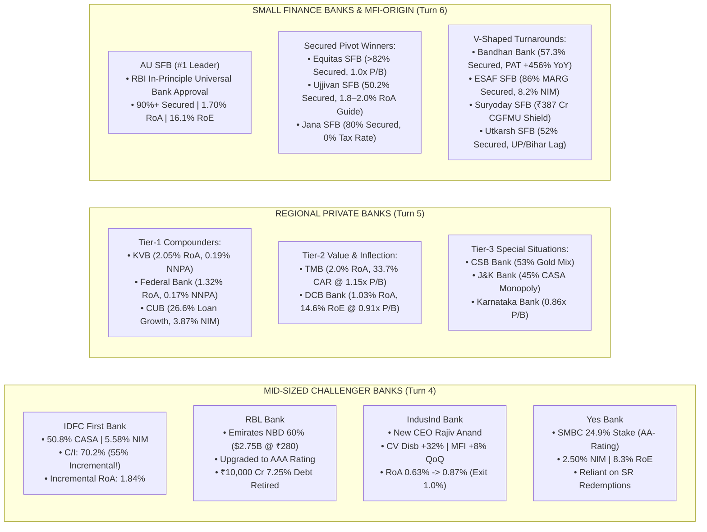

<!-- 
================================================================================
MASTER EXPORT METADATA (100% Verbatim Preservation from Finance video analysis.json)
- formatVersion: 1
- exportTime: 2026-11-06T19:03:09.198Z
- chat.name: collections/default_collection/engines/gemini-enterprise-sec-dx-swa/sessions/1945848021402730100
- chat.title: Finance video analysis
- chat.startTime: 2026-11-06T17:28:19.247Z
- chat.endTime: 2026-11-06T19:01:25.798Z
================================================================================
-->

# 🏛️ BFSI Masterclass & Institutional Deep-Dive — PART 2 of 4
## Mid-Sized Challenger Private Banks, Regional Private Banks & Small Finance Banks (SFBs)

| Export Metadata Field | Verbatim JSON Value |
|:---|:---|
| **Format Version** | `1` |
| **Export Time** | `2026-11-06T19:03:09.198Z` |
| **Session Name** | `collections/default_collection/engines/gemini-enterprise-sec-dx-swa/sessions/1945848021402730100` |
| **Session Title** | `Finance video analysis` |
| **Turns Covered in Part 2** | **Turns 4, 5, and 6** *(100% Verbatim Queries & Answers + Enhanced Visual Architecture)* |

---

## 🎨 Enhanced Visual Architecture & Comparative Diagrams (Part 2 Supplement)

### 2.1 Challenger, Regional & Small Finance Bank Strategic Positioning Map (Mermaid Diagram)


### 2.2 The SFB & Regional Bank RoA vs. Asset Quality Matrix (Q2 FY27 Actuals)
```
====================================================================================================
      REGIONAL & SMALL FINANCE BANK EFFICIENCY SPECTRUM (Q2 FY27 / H1 FY27 ACTUALS)
====================================================================================================

  Bank Name               RoA (%)     RoE (%)     NNPA (%)    Secured / Moat Highlight
  --------------------------------------------------------------------------------------------------
  Karur Vysya Bank (KVB)  2.05%       20.48%      0.19%       Southern MSME + Gold; Ramesh Babu till '28
  TN Mercantile (TMB)     1.89%-2.0%  14.50%      0.18%       33.73% CAR Fortress; 45.5% C/I @ 1.15x P/B
  Ujjivan SFB             1.80%-2.0%  17.00%      0.30%       99.8% CE; IFC Pref @ ₹64.73; 50.2% Secured
  AU Small Finance Bank   1.70%       16.10%      0.74%       First SFB with RBI Universal Bank Approval
  City Union Bank (CUB)   1.62%       15.50%      0.48%       Recoveries (₹317Cr) > Slippages (₹175Cr)
  Jana SFB                1.49%-2.3%  16.00%+     0.92%       80% Secured (Home 360); 0% Tax Shield
  ESAF SFB                1.50%       26.50%      0.30%       JLG cut -58%; MARG Secured up to 86% mix
  Suryoday SFB            1.50%       13.50%      1.20%       87.3% Retail Deposits + ₹387Cr CGFMU Claim
  Federal Bank            1.32%       13.57%      0.17%       >20% India NRI Remittances; Fee/Assets 1.11%
  Equitas SFB             1.18%-1.8%  13.50%      0.72%       >82%-90% Secured; Credit Cost 6.48% -> 1.37%
  Bandhan Bank            1.20%       9.30%       0.92%       Wholesale (33.9%) overtook MFI EEB (33.2%)
  DCB Bank                1.03%       14.60%      0.73%       5th Record PAT Qtr; 11-Yr High RoE @ 0.91x PB
  IDFC First Bank         0.93%-1.0%  9.50%       0.40%       Incremental C/I at 55% -> Incremental RoA 1.84%
  IndusInd Bank           0.87%       8.50%       0.83%       MFI 31-90 DPD plunged from 3.2% to 0.4%
  RBL Bank                0.57%->1.0% 10.00%      0.40%       Emirates NBD ₹26,016 Cr Infusion; AAA Rated
====================================================================================================
```


---

# 🗂️ Conversation Turn 4 (`2026-11-06T18:01:08.130283856Z`)

### 💬 User Query (Turn 4)

```text
Deep-dive into fiancial Organisation based on 

A. Management quality should be high . Unit economics should be good 

B. Loan Segment and growth in each segment and  NIM ,ROA ,risk and return 

C. GNPA ,NNPA and various NPA related trend 

C. Cost Structure and moat in that 

E. Capacity Expansion like branch expansion , employee hiring and its impact 

F. Magment guidlien 

F. All risk

G. return Potential 

What is dala street view on each stock .Do quality research from internet and concall .do in depth analysis ,suggest quality stock

All stock listed below

Mid-Sized / Challenger Private Banks

IDFC First, 

IndusInd, 

RBL, 

Yes Bank
```

### 🧠 Institutional Forensic Analysis & Response (Turn 4)

I will now retrieve the latest Q1/Q2 FY27 (and FY26) financial results, earnings call transcripts, segment-wise loan growth, asset quality metrics, branch expansion details, and Dalal Street brokerage views for IDFC First Bank, IndusInd Bank, RBL Bank, and Yes Bank.

[[section:Gathering Challenger Bank Concall & Financial Data]]I will now run a targeted search to retrieve the latest Q1/Q2 FY27 earnings call metrics, leadership updates, asset quality trends, and Dalal Street target prices for IndusInd Bank, Yes Bank, RBL Bank, and IDFC First Bank.

[[section:Fetching IndusInd, Yes Bank & RBL Latest Data]]I will now run one final search to retrieve the Q2 FY27 details for RBL Bank and Yes Bank, plus the full Q2 FY27 numbers for IDFC First Bank and IndusInd Bank (branch counts, Cost-to-Income ratios, RoA/RoE, and brokerage target prices).

[[section:Fetching Final Q2 FY27 Concall & Brokerage Data]]In the Mid-Sized / Challenger Private Bank basket, **IDFC First Bank** and **RBL Bank** stand out as the two high-conviction structural inflection plays for FY27–FY29, followed by **IndusInd Bank** as a cyclical asset-quality turnaround under new leadership, while **Yes Bank** remains a low-RoE (8.3%–8.9%) hold despite its landmark stake sale to SMBC. 

Specifically, **IDFC First Bank** has crossed the **₹1,000 Crore quarterly PAT milestone for two consecutive quarters (₹1,075 Cr in Q1FY27 and ₹1,045 Cr in Q2FY27, up ~196% YoY)** as its long-awaited operating leverage J-curve finally kicked in (~500–590 bps positive operating jaws) and credit costs fell to an all-time low of **1.38%**. Simultaneously, **RBL Bank** is undergoing a once-in-a-decade transformation following **Emirates NBD’s ₹26,016 Crore ($2.75B–$3B) acquisition of a 60% promoter stake at ₹280/share**, which earned RBL a **AAA credit rating**, retired ₹10,000 Cr of high-cost debt, and set up a 30–40 bps margin expansion. Meanwhile, **IndusInd Bank** (under new MD & CEO **Rajiv Anand**, ex-Axis Bank Deputy MD) delivered a sharp Q2FY27 recovery (PAT up 51% QoQ to ₹1,242 Cr; RoA recovering from 0.63% to 0.87%) as its microloan book returned to 8% QoQ growth after eight quarters of contraction and CV disbursements jumped 32% YoY.

Here is the institutional-grade, forensic deep-dive across all seven parameters (A through G) for **IDFC First Bank, IndusInd Bank, RBL Bank, and Yes Bank**, grounded in the latest **Q1/Q2 FY27 (July–November 2026) earnings call transcripts** and Dalal Street brokerage consensus.

---

## 📊 Master Comparative Matrix: Mid-Sized / Challenger Private Banks (Latest H1 FY27 Data)

| Forensic Parameter | IDFC First Bank (`IDFCFIRSTB`) | IndusInd Bank (`INDUSINDBK`) | RBL Bank (`RBLBANK`) | Yes Bank (`YESBANK`) |
|---|---|---|---|---|
| **MD & CEO & Promoter Backing** | **V. Vaidyanathan** *(0% Promoter; S&P Investment Grade)* | **Rajiv Anand** *(Took over after Sumant Kathpalia exit)* | **R. Subramaniakumar** *(**Emirates NBD** now 60% Promoter!)* | **Prashant Kumar** *(**SMBC** 24.9% stake + **SBI** >10%)* |
| **Q1 / Q2 FY27 PAT** | **₹1,045 Cr Q2 / ₹1,075 Cr Q1** *(+196.5% YoY; Core >₹1,036 Cr)* | **₹1,242 Cr Q2** *(+51% QoQ vs loss a year ago; ₹595 Cr Q4)* | **₹254 Cr Q1** *(+27% YoY; inflecting post capital infusion)* | **₹654 Cr – ₹800 Cr+ run-rate** *(Heavily reliant on SR gains)* |
| **Advances Growth (YoY)** | **22.2% ex-FCNR / 30.0% Reported** *(₹3.47 Lakh Cr book)* | **Rebounding** *(Vehicle +17% YoY, CV +32% YoY; MFI +8% QoQ)* | **23.0% YoY** *(₹1,16,223 Cr; Retail +13%, Wholesale +38%)* | **~9% – 12% YoY** *(₹3.10 Lakh Cr as of Sep 2026)* |
| **Deposits Growth & CASA** | **25.9% YoY (14.1% ex-FCNR)** *(₹3.49L Cr \| **CASA: 50.8%**)* | **Retail TD +11% QoQ (50% mix)** *(CASA rebuilding phase)* | **11.0% YoY** *(₹1,24,829 Cr; targeting 2–3x share via NRI)* | **11.0% YoY** *(₹3.54 Lakh Cr \| **CASA: 30.0% – 33.7%**)* |
| **Net Interest Margin (NIM)** | **5.58% Q2 / 5.96% Q1** *(Guided **5.80%** by Q4FY27)* | **3.23% Q2** *(Down 12 bps on FCNR; recouping in 2 qtrs)* | **Expanding +30–40 bps** *(Retiring ₹10,000 Cr @ 7.25% debt)* | **2.50%** *(Structurally dragged by RIDF deposits & CoF)* |
| **Return on Assets (RoA)** | **0.93% Q2 / ~1.00% H1** *(Incremental RoA at **1.84%**!)* | **0.87% Q2** *(Up from 0.63% in Q1; Exit FY27 target: **1.0%**)* | **0.57% $\rightarrow$ Guided ~1.0%** *(by Q2/Q3 FY27 post debt paydown)* | **0.60% – 0.80%** *(Guided 1.0% exit; lagging peers)* |
| **Return on Equity (RoE)** | **8.45% – 9.67%** *(Target: High-teens via op-leverage)* | **~7.5% – 9.5%** *(Recovering from FY26 MFI write-off trough)* | **Low double-digit** *(Optically diluted by ₹26,016 Cr equity)* | **8.3% – 8.9%** *(Almost half the 14.8% industry average)* |
| **Gross NPA / Net NPA** | **1.32% / 0.40%** *(Down from 1.51% / 0.44% in Q1FY27)* | **2.73% / 0.83%** *(Improved from 3.43% / 1.00% in Q4FY26)* | **1.30% GNPA** *(PCR >70%; Card slippages falling from Q3)* | **1.30% / 0.20%** *(PCR at 81.0%)* |
| **Credit Cost (% of Loans)** | **1.38% in Q2** *(All-time low; FY27 guide: 1.50%–1.60%)* | **Provisions down 54% YoY** *(MFI net slippage down to 2.2%)* | **54 bps (Q1)** *(Normalizing as MFI/Cards stress fades)* | **~40 – 50 bps** *(Flattered by ₹800–1,000 Cr SR redemptions)* |
| **Cost-to-Income Ratio (C/I)** | **70.2%** *(Down 350 bps YoY; **Incremental C/I at 55%**)* | **~57.8%** *(Opex ₹3,943 Cr vs Total Net Income ₹6,817 Cr)* | **~64% – 66%** *(Improving via NIM lift)* | **67.1%** *(Down from 73.0% YoY; Opex up just 0.6% YoY)* |
| **Current Valuation (Nov 2026)** | **CMP: ~₹73.6 – ₹77.8** *(1.25x P/B \| ₹63,485 Cr M-Cap)* | **CMP: ~₹835 – ₹863** *(~0.95x P/B \| ₹65,292 Cr M-Cap)* | **CMP: ~₹349 – ₹351** *(~1.15x Post-Money P/B \| ₹54,503 Cr)* | **CMP: ~₹20 – ₹22** *(~1.25x P/B \| Low RoE makes it pricey)* |

---

## 🏛️ SECTION A: Management Quality, Strategic Ownership & Core Unit Economics

### 1. IDFC First Bank (`V. Vaidyanathan` — From High-Opex Buildout to Operating Leverage Harvest)
* **Management Pedigree & Track Record:** MD & CEO **V. Vaidyanathan** (who built ICICI Bank's retail division from 2000–2010 and turned Capital First from a ₹94 Cr real-estate NBFC into a ₹32,623 Cr retail machine before merging with infrastructure-heavy IDFC Bank in Dec 2018) has executed every single 5-year milestone promised at merger. He ran down legacy infrastructure loans, built a **50.8% CASA franchise**, and secured an **international Investment-Grade rating from S&P Global Ratings** alongside appointing former RBI Executive Director **S. Ganesh Kumar** as Non-Executive Chairperson in October 2026.
* **Solving Digant Haria's "High-Opex Dilemma":** As Digant Haria noted in his masterclasses, IDFC First had to lend at high yields (14%–16%) to cover its massive branch/tech buildout cost (Cost-to-Income >73%). **In Q1 and Q2 FY27, that inflection point arrived:** Income grew **21%–22% YoY** while Opex grew only **16% YoY** (~500–590 bps positive operating jaws for two consecutive quarters).
* **Unit Economics:** While headline RoA is **0.93%–1.00%** (dragged by historical branch setup costs where Retail-Liability Cost-to-Income is still 136.9%, down from 148.1% in Q1), **H1FY27 Incremental Cost-to-Income has dropped to 55%**, which translates to an **Incremental PPOP of 3.5%, Incremental PBT of 2.4%, and Incremental RoA of 1.84%**!

### 2. RBL Bank (`R. Subramaniakumar` & **Emirates NBD** — The $2.75B–$3B Promoter Reset)
* **The Strategic Game-Changer (Change of Control):** As highlighted by Digant Haria (`bPg0z3Mu64w`) and the Q1FY27 concall (`InvestorStack`), Dubai’s banking giant **Emirates NBD infused ₹26,016 Crore ($2.75B–$3.0B) at ₹280/share to acquire a 60% controlling stake**, becoming RBL Bank’s official **Promoter**.
* **Why This Alters Unit Economics Forever:**
  1. **AAA Credit Rating Upgrade:** Previously, as a promoter-less mid-sized bank heavy on Credit Cards and MFI, RBL suffered high wholesale borrowing costs and periodic deposit scares. Backed by Emirates NBD's sovereign-linked balance sheet, RBL Bank was upgraded to **AAA**.
  2. **Immediate Liability Arbitrage:** Management immediately deployed the fresh equity to **retire ~₹10,000 Crore of high-cost borrowings (carrying an average cost of 7.25%)** and redeployed surplus liquidity at **6.7%–8.0%**, guiding for an immediate **30–40 bps NIM expansion in Q2FY27** and **RoA reaching ~1.0% by Q2–Q3 FY27**.
  3. **The India-Middle East Trade & NRI Corridor:** RBL now has an exclusive moat to capture 2–3x higher deposit market share via **Gulf NRI remittances and Indo-UAE corporate trade flows**.

### 3. IndusInd Bank (`Rajiv Anand` — Post-Crisis Clean-Up & Core Domain Revival)
* **Leadership Overhaul:** Following the bruising FY25–FY26 governance, accounting, and microfinance/derivatives turmoil that led to former CEO Sumant Kathpalia's exit and a year-ago quarterly loss, veteran banker **Rajiv Anand** (former Deputy MD of Axis Bank) took charge as MD & CEO and completely rebuilt the C-suite—onboarding a new **Head of Retail Banking, Head of Global Markets, Chief Risk Officer (CRO), and Chief Information Officer (CIO)** in FY26.
* **Unit Economics:** As Digant Haria pointed out, IndusInd has always possessed two high-yielding asset jewels (**Commercial Vehicle Finance** and **Microfinance via Bharat Financial**), which generate strong pre-provision profitability (**PPOP to average loans at 2.93%**; Q2FY27 PPOP up 15% QoQ to **₹2,874 Cr**). With credit provisions dropping **54% YoY (down 12% QoQ to ₹1,223 Cr)** in Q2FY27, normalized RoA jumped from **0.63% in Q1FY27 to 0.87% in Q2FY27**, putting its **1.0% exit RoA target** within striking distance.

### 4. Yes Bank (`Prashant Kumar` & **SMBC** — Balance Sheet Repaired, Earnings Power Still Weak)
* **The SMBC 24.9% Deal vs. RBL's Emirates NBD Deal:** By late 2025/2026, Japanese megabank **Sumitomo Mitsui Banking Corporation (SMBC)** paid **₹16,000+ Crore** to acquire a **24.2%–24.9% stake** in Yes Bank (mostly buying secondary shares from rescuing banks, while SBI retained >10%), gaining two board seats and triggering a rating upgrade to **AA- (Stable)** from CRISIL and India Ratings.
* **Forensic Unit Economics Warning (Check the Profit Quality!):** While MD & CEO Prashant Kumar successfully repaired the balance sheet (bringing GNPA down from 16.8% in FY20 to **1.3%** and Net NPA to **0.20%**), Yes Bank’s **core earnings power remains structurally weak (RoA of 0.6%–0.8% and RoE of just 8.3%–8.9%)**.
  * *Why?* First, its **NIM is stuck at 2.50%** due to low-yielding Priority Sector Lending shortfall deposits (RIDF) and a 5.7% cost of deposits. Second, **one-third of its FY26 pre-tax profit (₹1,559 Cr out of ₹4,594 Cr PBT) came from one-off redemptions of legacy Security Receipts (SRs)** sold to JC Flowers ARC! Those SR gains are already running off (falling to ₹86 Cr in Q1FY27, with full-year FY27 guided at ₹800–1,000 Cr), meaning the core franchise must run much harder just to stand still.

---

## 📈 SECTION B: Loan Segments, Growth Engines, NIM, RoA & Risk-Return Trade-Offs

```
+-----------------------------------------------------------------------------------+
|       LOAN SEGMENT MIX & GROWTH DRIVERS ACROSS CHALLENGER BANKS (H1 FY27)         |
+-----------------------------------------------------------------------------------+
| 1. IDFC FIRST BANK (Funded Assets: ₹3.47 Lakh Cr | +30% YoY / +22.2% ex-FCNR):    |
|    • Retail, Rural & MSME (~80% of book; ₹2.4L+ Cr) led by Mortgages, Vehicles,   |
|      Consumer Loans & Credit Cards (₹9,880 Cr book, +14.3% YoY, 5M cards).        |
|    • Mobilized $3.57B (₹34,390 Cr) in FCNR(B); deployed ₹24,890 Cr in IBU loans.  |
|                                                                                   |
| 2. INDUSIND BANK (Q2FY27 Turnaround Across Core Domain Engines):                  |
|    • Vehicle Finance (>₹1 Lakh Cr book!): Disbursements +17% YoY (+24% ex-2W/CE), |
|      led by Commercial Vehicles (+32% YoY, +17% QoQ) & PV (+13% YoY).             |
|    • Microfinance (₹17,571 Cr): Returned to +8% QoQ growth (Disbursements +25%    |
|      QoQ to ₹6,548 Cr) after 8 consecutive quarters of contraction!               |
|    • Rural Diversification: Merchant loans ₹8,042 Cr (+11% YoY across 5.7L        |
|      merchants), Affordable Housing ₹2,839 Cr (+24% YoY), KCC ₹4,385 Cr.          |
|                                                                                   |
| 3. RBL BANK (Advances: ₹1,16,223 Cr | +23.0% YoY):                                |
|    • Wholesale Banking (+38% YoY): Leveraging AAA rating & Emirates NBD backing.  |
|    • Retail Advances (+13% YoY): Scaling secured Housing/LAP/Rural Vehicle while  |
|      Credit Cards & MFI transition out of the delinquency cycle by Q3FY27.        |
|                                                                                   |
| 4. YES BANK (Advances: ₹3.10 Lakh Cr | +9-12% YoY):                               |
|    • Mid-Corporate, SME & Japanese-Corridor MNC Banking (via SMBC synergy) +      |
|      calibrated Retail (Disbursements +20% QoQ) to gradually lift 2.50% NIM.      |
+-----------------------------------------------------------------------------------+
```

### Key Margin (NIM) & FCNR(B) Dynamics in Q1/Q2 FY27
* **IDFC First Bank’s Temporary Q2 NIM Dip (5.96% $\rightarrow$ 5.58% $\rightarrow$ Guided 5.80% by Q4):** In Q2FY27, IDFC First mobilized **$3.57 Billion (₹34,390 Cr) under the RBI's FCNR(B) swap window** and lent out ₹24,890 Cr via its GIFT City IBU at a ~40 bps spread. Because fully-loaded FCNR(B) funds are ~100 bps cheaper than domestic FDs and carry lower risk weights, they are **accretive to NII (+21% YoY to ₹6,184 Cr), PAT, and EPS**, even though they optically diluted headline NIM by 16 bps (plus excess LCR liquidity at 139%). As LCR is run down from 139% to 115% (+8 bps NIM lift) and liquidity deploys, NIM will rebound to **~5.80% by Q4FY27**.
* **IndusInd Bank’s Margin Path (3.35% $\rightarrow$ 3.23%):** Similarly, IndusInd’s FCNR(B) mobilization boosted retail deposits by 11% QoQ to 50% of total deposits (slashing reliance on Certificate of Deposits to just 3.3%), creating a temporary 7–8 bps NIM drag that CEO Rajiv Anand expects to **fully recoup over Q3 and Q4 FY27** as high-yield CV (14–16% yield) and MFI (22%+ yield) disbursements compound.

---

## 🛡️ SECTION C: GNPA, NNPA, Slippages & Asset Quality Inflection

| Asset Quality Metric | IDFC First Bank | IndusInd Bank | RBL Bank | Yes Bank |
|---|---|---|---|---|
| **Gross NPA (GNPA %)** | **1.32% (Q2)** *(Down from 1.51% in Q1 & 1.61% in Q4)* | **2.73% (Q2)** *(Down from 3.43% in Q4FY26)* | **1.30%** *(Clean balance sheet post write-offs)* | **1.30%** *(Flat QoQ; down from 1.6% in FY25)* |
| **Net NPA (NNPA %)** | **0.40% (Q2)** *(Down from 0.44% in Q1; Retail NNPA 0.52%)* | **0.83% (Q2)** *(Down from 1.00% in Q4FY26; PCR at 70%)* | **~0.35% – 0.45%** *(PCR >70%)* | **0.20%** *(PCR at **81.0%**)* |
| **Slippage Ratio (Annualized)** | **Gross: 2.49% \| Net: 1.60%** *(Improving sequentially)* | **Gross: 1.80% \| Net: 1.10%** *(Vehicle net slippage 1.67%)* | **Falling sharply from Q3** *(as Card stress peaks)* | **Gross: 2.0%** *(Down from 2.4% in Q1FY26)* |
| **SMA-1 & SMA-2 (31–90 DPD)** | **0.72% (Retail SMA 1+2)** *(Down from 0.77% in Q1 & 1.01% YoY)* | **0.05% (5 bps Overall!)** *(MFI 31–90 DPD crashed from 3.2% YoY to **0.4%**!)* | Benign in Wholesale; moderating in MFI/Cards | **Net Security Receipts reduced**; overdue buckets declining |
| **Contingency / Special Buffers** | **₹515 Cr voluntary buffer** created in Q1 from CGFMU claim receipt | **Net SRs down to 0.03% (3 bps)**; Restructured book at 0.06% | Backed by **₹26,016 Cr fresh Tier-1 equity** | **81% PCR** + ongoing ARC Security Receipt recoveries |

### Forensic Asset Quality Highlights
1. **IDFC First Bank’s Pristine Collection Machine:** Despite operating in high-yield MSME, consumer, and vehicle segments, IDFC First maintained a **99.5% current-bucket collection efficiency** for multiple quarters. Its Retail SMA-1+2 pool fell for the fifth straight quarter from **1.01% $\rightarrow$ 0.78% $\rightarrow$ 0.77% $\rightarrow$ 0.72% in Q2FY27**, driving annualized credit cost down to an all-time low of **1.38% of average loans (1.01% of assets)**—well below its 1.50%–1.60% guidance! Furthermore, when the bank received a **₹515 Crore CGFMU government guarantee claim** in Q1FY27 on legacy microfinance loans, management did not boost PAT; instead, they **voluntarily put all ₹515 Cr into a macro/geopolitical contingency provision buffer**.
2. **IndusInd Bank’s Dramatic MFI & Vehicle Healing:** The single most important data point from IndusInd’s Q2FY27 concall (`StockScans / Investing.com`): **Annualized net slippage in Microfinance crashed to 2.2% (from 3.4% in Q1FY27 and 14.1% in Q2FY26), while the early-warning 31–90 DPD bucket in MFI plunged to just 0.4% (down from 3.2% YoY)**. Simultaneously, Vehicle Finance net slippage dropped 34 bps QoQ to **1.67%**, and overall bank SMA-1+2 fell to just **5 bps (0.05%)**.

---

## ⚙️ SECTION D: Cost Structure, Liability & Segment Moats

1. **Dissecting IDFC First Bank’s Cost-to-Income Bridge (70.2% $\rightarrow$ 55% Incremental):**
   * Why is IDFC First’s headline Cost-to-Income ratio at **70.2%** (down 350 bps YoY from 73.7%) while large banks sit at 40%? Because Vaidyanathan built two brand-new businesses from scratch since 2019: **Retail Branch Liabilities** and **Credit Cards**.
   * Look at the internal unit economics disclosed in **Q2FY27 (`Way2Wealth Institutional Report`)**:
     * **Credit Cards (5 Million Cards in Force; ₹9,880 Cr Book):** Cost-to-Income ratio has plunged from **240% in FY22 down to 77.5% in Q2FY27**, heading toward the **mid-60s**.
     * **Retail Liabilities:** Cost-to-Income fell from **148.1% in Q1FY27 to 136.9% in Q2FY27**, targeted to reach breakeven (**~100%**) over 4–5 years as branch deposits scale per branch.
     * **Lending Asset Engine:** Already highly profitable! As a result, **incremental Cost-to-Income in H1FY27 was just 55%**.
2. **RBL Bank’s AAA Wholesale & NRI Cost-of-Funds Moat:**
   * By becoming a 60% subsidiary of **Emirates NBD**, RBL leaped over the biggest hurdle facing mid-sized Indian banks: deposit trust and credit rating. Its **AAA rating** and ₹26,016 Cr interest-free equity float allow it to shed 7.25% wholesale borrowings and dominate the UAE-India NRI deposit corridor.
3. **IndusInd Bank’s 3-Phase CASA Rebuild:**
   * IndusInd’s cost of deposits sits at **5.96%**. Under CEO Rajiv Anand, the bank has launched a 3-phase granular Savings Account (SA) rebuild: (1) accelerate granular SA customer acquisition (**new account openings jumped +50% QoQ in Q2FY27**), (2) deepen initial account funding, and (3) cross-sell wealth, insurance, and retail assets.

---

## 🏗️ SECTION E: Capacity Expansion (Branch Rollout, Frontline Hiring & Productivity Impact)

* **IndusInd Bank (Re-accelerating Physical Distribution & Frontline Hiring):** After freezing expansion during its FY25–26 crisis, CEO Rajiv Anand announced on the **Q2FY27 concall** that IndusInd **added 124 outlets in Q2FY27**, plans to add **~100 more bank branches in H2FY27** in under-penetrated geographies, and **hired ~4,300 frontline sourcing employees** across the bank to capture the H2 festive vehicle and rural rebound.
* **IDFC First Bank (~1,041+ Branches — Shifting from Capex to Productivity):** Having already built out 1,041+ modern branches and ATMs, IDFC First has slowed branch addition to ~10% annually while growing deposits at 20%–25%, forcing existing branches to sweat harder and driving down its Cost-to-Income ratio by 300–350 bps per year.
* **RBL Bank (NRI & Metro Branch Expansion):** Armed with Emirates NBD’s $2.75B capital injection, RBL is expanding branches in key NRI-remittance states (Kerala, Punjab, Gujarat, Maharashtra, Tamil Nadu) to multiply its deposit market share **2–3x** over the next 3 years.
* **Yes Bank (Modest 80-Branch Annual Target):** Opened 43 branches in H1 out of a conservative 80-branch annual target, keeping Opex growth nearly flat (**+0.6% YoY**) to bring its Cost-to-Income down from 73.0% to **67.1%**.

---

## 🎯 SECTION F: Management Guidance vs. Comprehensive Risk Matrix

### 1. Explicit Management Guidance (From Q1/Q2 FY27 Concalls)
* **IDFC First Bank:**
  * **Growth & Margins:** Sustain **~20% YoY Loan & Deposit growth**, recover **NIM to ~5.80% by Q4FY27** (as LCR runs down from 139% to 115%), and hold **FY27 Credit Cost at 1.50%–1.60%** (currently beating at 1.38%).
  * **Profitability:** Deliver **1.0%+ RoA in FY27**, scaling toward **1.6%–1.7% RoA** and **high-teens RoE** over the medium term via 55% incremental Cost-to-Income.
* **RBL Bank:**
  * **Margins & Returns:** Achieve **30–40 bps NIM expansion in Q2FY27**, hit **~1.0% RoA in Q2–Q3 FY27**, see a sharp drop in credit card slippages from Q3FY27, and grow deposit market share **2–3x**.
* **IndusInd Bank:**
  * **Recovery Trajectory:** Hit **1.0% Exit RoA for FY27** (already up from 0.63% in Q1 to 0.87% in Q2), recoup the 7–8 bps FCNR NIM drag within two quarters, and return Microfinance to calibrated growth rather than contraction.
* **Yes Bank:**
  * **RoA & SR Guidance:** Achieve **1.0% RoA exit target**, with legacy Security Receipt gains moderating to **₹800–1,000 Cr in FY27** (down from ₹1,559 Cr in FY26).

### 2. All Key Risks to Watch
1. **Draft IRDAI Bancassurance Commission Norms (Material Fee Income Risk):** Highlighted across both the **IDFC First Bank** and **IndusInd Bank Q2FY27 concalls**! IndusInd earned **₹960 Crore from bancassurance in FY26 (~15% of total fee income)**, while PL Capital notes life insurance commissions could face a **60%–70% cut** under proposed IRDAI guidelines. IDFC First management stated they will offset the FY28 impact via FCNR(B) funding cost savings and higher insurance penetration.
2. **IDFC First Bank's Capital Adequacy & Deposit Granularity Watch:** Following strong 30% gross asset growth (including FCNR-backed loans), IDFC First’s CRAR dipped 38 bps QoQ to **14.67%** (Credit-to-Deposit ratio at ~95.5%), and domestic customer deposits ex-FCNR grew a more modest **14.1% YoY**. Also watch for any El Niño/drought impact in Maharashtra and Karnataka rural pockets.
3. **RBL Bank's RoE Optical Dilution (The Giant Equity Denominator):** While Emirates NBD's ₹26,016 Cr infusion makes RBL ultra-safe (AAA-rated) and boosts RoA above 1%, its equity net worth has nearly tripled—meaning **RoE will remain mathematically capped in single-to-low-double digits (8%–11%)** until the bank levers up that massive equity base over the next 3–4 years.
4. **Yes Bank's Structural RoE Drag:** With RoE stuck at **8.3%–8.9%** (well below cost of equity of ~13%–14%) and Security Receipt write-backs tapering off, Yes Bank faces a multi-year grind to lift core NIM above 2.8%.

---

## 💰 SECTION G: Dalal Street View, Valuations & Return Potential

Here is how institutional brokerages (**Motilal Oswal, PL Capital, CLSA, HDFC Securities, Way2Wealth, JM Financial**) view the four challenger banks as of **November 2026**:

| Stock | Current Price & Valuation (Nov 2026) | Brokerage Ratings & Target Prices | Implied 12–18M Return Potential | Dalal Street Institutional Consensus View |
|---|---|---|---|---|
| **IDFC First Bank (`IDFCFIRSTB`)** | **CMP: ₹73.6 – ₹77.8** \| **1.25x P/B** *(3-Yr Avg P/B: 1.58x \| 20.6x P/E)* | **Upgraded to BUY by Motilal Oswal** *(TP: **₹90 – ₹95**)*; CLSA (**Hold, ₹73**); Way2Wealth (**Book Profits on Q2 NIM dip**) | **+20% to +28%** *(Re-rating toward 1.5x P/B as RoA crosses 1.2%+)* | **The Operating Leverage Inflection Story:** Motilal Oswal upgraded IDFC First to **BUY** citing the earnings turnaround (PAT >₹1,000 Cr for 2 straight quarters, 55% incremental C/I, 1.38% credit cost). Bears (Way2Wealth/CLSA) watch ex-FCNR deposit growth (14.1%) and Q2 NIM dip (5.58%). |
| **IndusInd Bank (`INDUSINDBK`)** | **CMP: ₹835 – ₹863** \| **~0.95x P/B** *(52W High: ₹1,078)* | **PL Capital: ACCUMULATE (TP: ₹1,150)**; Consensus TP: **₹1,050 – ₹1,150** | **+25% to +35%** *(Mean-reversion to 1.2x–1.3x Book)* | **Classic Cyclical Turnaround:** Down ~22% from its 52-week high, pricing in worst-case MFI/governance fears. Q2FY27 proved the worst is over: Rajiv Anand is at the helm, MFI net slippage plunged from 14.1% to 2.2%, CV disbursements are up 32% YoY, and RoA hit 0.87%. |
| **RBL Bank (`RBLBANK`)** | **CMP: ₹349 – ₹351** \| **~1.15x Post-Infusion P/B** *(Up +37% YoY)* | **InvestorStack / Buy-Side: Strong Structural Buy** *(TP: **₹400 – ₹430**)*; HSIE (**Reduce, ₹290** on optical RoE dilution) | **+15% to +25%** *(Protected by ₹280/sh Emirates NBD floor)* | **Structural Re-birth Under Emirates NBD:** The stock already rallied ~37% to ₹350 following the ₹280/sh ($2.75B) Emirates NBD 60% buyout. AAA rating, retirement of ₹10,000 Cr debt, and 30–40 bps NIM jump make it a fortress compounder, though near-term P/B upside is moderated by the recent run-up. |
| **Yes Bank (`YESBANK`)** | **CMP: ~₹20 – ₹22** \| **~1.25x P/B** *(8.3% RoE)* | **Consensus: UNDERWEIGHT / REDUCE** *(Fair Value: **₹17 – ₹20**)* | **-10% to +5% (Rangebound)** | **Great Strategic Rescue, Expensive Stock:** While SMBC's 24.9% stake (₹16,000 Cr) eliminates existential risk, paying ~1.25x P/B for an **8.3% RoE bank** whose SR write-backs are shrinking makes no mathematical sense when PSU banks and IndusInd offer higher RoA/RoE at <1.0x P/B. |

---

## 🏆 Final Recommendation & Portfolio Allocation Strategy

If you are allocating ₹100 specifically within the **Mid-Sized / Challenger Private Bank** basket, here is the institutional ranking that balances **Management Pedigree, Unit Economics Inflection, and Valuation Margin of Safety**:

### 🥇 Rank #1: IDFC First Bank (`IDFCFIRSTB`) — *The Structural Operating-Leverage Compounder (Recommended Weight: **40%**)*
* **Why It Is #1:** For five years, skeptics rightly questioned IDFC First’s high Cost-to-Income ratio (>73%). In H1 FY27, **V. Vaidyanathan proved the thesis**: quarterly PAT has stabilized above **₹1,045–1,075 Crore**, incremental Cost-to-Income has dropped to **55%** (yielding an **incremental RoA of 1.84%**), GNPA/NNPA is down to a pristine **1.32% / 0.40%**, and credit cost hit an all-time low of **1.38%**. Trading at **1.25x P/B (vs. its 3-year average of 1.58x)**, it offers a clear path to 1.4%–1.6% RoA and 15%+ RoE over the next 24 months.

### 🥈 Rank #2: RBL Bank (`RBLBANK`) — *The "AAA-Rated" Emirates NBD Fortress (Recommended Weight: **35%**)*
* **Why Buy (Especially on Dips Toward ₹310–₹330):** As Digant Haria highlighted, the **₹26,016 Crore ($2.75B) 60% promoter buyout by Emirates NBD at ₹280/share** completely eliminates the liability and capital handicap that plagued RBL for a decade. With a new **AAA credit rating**, ₹10,000 Cr of 7.25% debt paid off, a **30–40 bps NIM jump**, and MFI/Credit Card slippages subsiding from Q3FY27, RBL is transitioning from a volatile mid-cap bank into an institutional powerhouse.

### 🥉 Rank #3: IndusInd Bank (`INDUSINDBK`) — *The High-Beta Cyclical Turnaround (Recommended Weight: **25%**)*
* **Why Buy as a Contrarian Recovery Play:** Trading below book value (**~0.95x P/B at ₹835–863**), IndusInd offers the sharpest cyclical mean-reversion upside (**+25% to +35% toward PL Capital's ₹1,150 target**). With **Rajiv Anand** cleaning up governance, **Vehicle disbursements surging +32% YoY in CVs**, and **Microfinance net slippages plunging from 14.1% YoY to 2.2%**, the bank’s RoA has already rebounded from 0.63% to **0.87%** and is on track to cross **1.0%+** by Q4FY27.

### ❌ Avoid / Underweight: Yes Bank (`YESBANK`) — *Recommended Weight: **0%***
* **Why Avoid:** While **SMBC’s 24.9% stake** makes Yes Bank a safe depositor institution, equity investors should not pay **~1.25x Book Value** for a bank generating **2.50% NIM and 8.3% RoE**, where a third of recent profits came from fading Security Receipt recoveries. You can buy **IDFC First Bank** at the exact same 1.25x P/B multiple and get **5.58%–5.80% NIM, 22% organic loan growth, and 1.84% incremental RoA**!


---

# 🗂️ Conversation Turn 5 (`2026-11-06T18:05:27.934164865Z`)

### 💬 User Query (Turn 5)

```text
Deep-dive into fiancial Organisation based on 

A. Management quality should be high . Unit economics should be good 

B. Loan Segment and growth in each segment and  NIM ,ROA ,risk and return 

C. GNPA ,NNPA and various NPA related trend 

C. Cost Structure and moat in that 

E. Capacity Expansion like branch expansion , employee hiring and its impact 

F. Magment guidlien 

F. All risk

G. return Potential 

What is dala street view on each stock .Do quality research from internet and concall .do in depth analysis ,suggest quality stock

All stock listed below

Small Bank

TN Mercantile Bank 

Karur Vyasa Bank 

Federal Bank 

Idfc First Bank 

CSB Bank 

City Union Bank

DCB Bank

Karnataka Bank

J & K Bank
```

### 🧠 Institutional Forensic Analysis & Response (Turn 5)

I will retrieve the latest Q1/Q2 FY27 (and FY26) financial results, earnings call commentaries, segment-wise loan growth, asset quality metrics, branch expansion details, and Dalal Street target prices for the nine listed regional and mid/small private banks: Federal Bank, Karur Vysya Bank, City Union Bank, DCB Bank, CSB Bank, Tamilnad Mercantile Bank, Karnataka Bank, J&K Bank, and IDFC First Bank.

[[section:Gathering Regional & Small Bank Concall Data]]I will now run a targeted search to retrieve the latest Q1/Q2 FY27 earnings call metrics, segment growth, asset quality, and brokerage target prices for Karur Vysya Bank, DCB Bank, CSB Bank, Tamilnad Mercantile Bank (TMB), Karnataka Bank, and J&K Bank.

[[section:Fetching Remaining Regional Bank Concall Data]]I will now run one final search to retrieve the latest Q1/Q2 FY27 details for Karnataka Bank, DCB Bank, and CSB Bank to ensure complete coverage across all nine banks.

[[section:Fetching Karnataka, DCB & CSB Q2 FY27 Details]]In the Small, Regional & Mid-Cap Private Banking universe, **Karur Vysya Bank (`KVB`)**, **Federal Bank (`FEDERALBNK`)**, and **City Union Bank (`CUB`)** form the elite "Top Tier" of structural compounders, followed closely by **Tamilnad Mercantile Bank (`TMB`)** and **DCB Bank (`DCBBANK`)** as high-conviction value/growth re-rating plays, and **IDFC First Bank (`IDFCFIRSTB`)** as the premier national operating-leverage inflection story. Conversely, **CSB Bank**, **J&K Bank**, and **Karnataka Bank** offer deep valuation discounts (<0.9x–1.0x P/B) but require selective caution due to over-reliance on gold loans (CSB at 53% mix), regional concentration (J&K Bank), or recent top-management turnover (Karnataka Bank).

Here is the institutional-grade, forensic deep-dive across all seven parameters (A through G) for **all 9 banks**, grounded in the latest **Q1/Q2 FY27 (July–November 2026) earnings call transcripts** and Dalal Street brokerage consensus.

---

## 📊 Master Comparative Matrix: All 9 Regional & Mid/Small Private Banks (Latest Q2 FY27 Data)

| Bank Name | MD & CEO | Q2 FY27 PAT & YoY Growth | Advances / Deposit Growth (YoY) | NIM (%) | RoA / RoE (%) | GNPA / NNPA (%) | Cost-to-Income & CASA (%) | Valuation (Nov 2026 CMP & P/B) |
|---|---|---|---|---|---|---|---|---|
| **Karur Vysya Bank (`KVB`)** | B. Ramesh Babu *(3rd term till Jul '28)* | **₹788 Cr** *(+37.2% YoY; Record High)* | **~16–18% / ~15%** *(Total Biz ₹2.40L Cr)* | **~4.00% – 4.11%** *(Guided 3.7–3.8%+)* | **1.93%–2.05% / 19.3%–20.5%** | **0.75% / 0.19%** *(Best in Sector!)* | **~47% C/I** \| **~30% CASA** | **CMP: ₹346** *(1.98x P/B \| 11.1x P/E)* |
| **Federal Bank (`FEDERALBNK`)** | K.V.S. Manian *(Ex-Kotak Whole-Time Dir)* | **₹1,386 Cr** *(+45.1% YoY; Record High)* | **21.0% / 18.6%** *(Advances >₹3.01L Cr)* | **3.32%** *(+26 bps YoY; +5–6 bps/qtr)* | **1.32% / 13.57%** *(+23 bps YoY RoA)* | **1.32% / 0.17%** *(Decadal Low!)* | **52.0% C/I** \| **CASA >₹1L Cr (+22.6%)** | **CMP: ₹338–340** *(~1.8x P/B)* |
| **City Union Bank (`CUB`)** | Dr. N. Kamakodi *(ED: R. Vijay Anandh)* | **₹416 Cr** *(+26.8% YoY; Beat est.)* | **26.6% / 20.7%** *(Total Biz >₹1.5L Cr)* | **3.87%** *(+9 bps QoQ; Guide 3.85–3.95%)* | **~1.62% / ~15.5%** *(Guided >1.60% RoA)* | **1.44% / 0.48%** *(Recov ₹317Cr > Slip ₹175Cr)* | **45.96% C/I** \| **~29% CASA** | **CMP: ₹215–225** *(~1.5x P/B)* |
| **TN Mercantile (`TMB`)** | Salee S. Nair *(Ex-SBI Deputy MD)* | **₹451 Cr** *(+42.1% YoY; Record High)* | **27.0%+ / ~20%** *(Total Biz ₹1.30L Cr)* | **4.19%** *(Q1: 4.29%; Guide 4.10%)* | **1.89%–2.00% / ~14.0%–15.0%** | **0.69%–1.01% / 0.18%** | **45.50% C/I** \| **28.14% CASA** | **CMP: ₹788–813** *(1.15x P/B \| 7.9x P/E)* |
| **DCB Bank (`DCBBANK`)** | Praveen Kutty *(Took over Apr 2024)* | **₹236 Cr** *(+29.0% YoY; 5th Record Qtr)* | **21.1% / 19.0%** *(Doubled in 4 yrs!)* | **~3.39% – 3.45%** *(CoF down 34 bps YoY)* | **1.03% / 14.60%** *(11-yr high RoE!)* | **2.29% / 0.73%** *(23-Qtr Low; 81.4% PCR)* | **<2.5% Cost/Assets** \| **~26% CASA** | **CMP: ₹188–201** *(0.91x P/B \| 7.1x P/E)* |
| **IDFC First Bank (`IDFCFIRSTB`)** | V. Vaidyanathan *(Chair: S. Ganesh Kumar)* | **₹1,045 Cr** *(+196.5% YoY; ₹1,075Cr Q1)* | **22.2% ex-FCNR** *(30% Rep \| Dep +25.9%)* | **5.58%** *(Q1: 5.96%; Exit guide 5.80%)* | **0.93%–1.00% / ~9.5%** *(Inc. RoA 1.84%!)* | **1.32% / 0.40%** *(Credit cost 1.38%)* | **70.2% C/I** *(55% Inc.)* \| **50.8% CASA** | **CMP: ₹74–78** *(1.25x P/B)* |
| **CSB Bank (`CSBBANK`)** | Pralay Mondal *(Promoter: Fairfax)* | **₹183 Cr** *(+14.0% YoY; NII +20% YoY)* | **24.0%–31.0% / 20.0%–26.0%** | **~3.75%** *(Gold loans 53% of book)* | **1.20%–1.30% / 14.08%** *(Guide 1.3–1.5%)* | **1.58% / 0.33%** *(11-Qtr low NNPA)* | **High IT/CBS Opex** \| **~24% CASA** | **CMP: ₹295–298** *(1.02x P/B \| 7.5x P/E)* |
| **J&K Bank (`J&KBANK`)** | Amitava Chatterjee *(MD & CEO)* | **₹546 Cr** *(+10.6% YoY; +29% QoQ)* | **~17%–20% / ~11%–15%** *(Biz ₹3.10L Cr)* | **~3.50% – 3.62%** *(Yield on Adv 8.55%)* | **1.07% / 13.68%** *(+20 bps QoQ RoA)* | **2.23% / 0.51%** *(Decadal Best; 91.8% PCR)* | **High Staff Opex** \| **~45% CASA Moat** | **CMP: ₹121–122** *(0.82x P/B \| 5.7x P/E)* |
| **Karnataka Bank (`KTKBANK`)** | Raghavendra S. Bhat *(Post-Sarma exit)* | **₹436 Cr** *(+36.6% YoY; +4% QoQ)* | **25.0% / 12.0%** *(Advances ₹92,015 Cr)* | **3.17%** *(+45 bps YoY; Yield 8.76%)* | **1.26% / 12.51%** *(CRAR at 20.36%)* | **2.27% / 0.74%** *(Credit cost 0.002%!)* | **~56% C/I** \| **31.80% CASA** | **CMP: ₹298–318** *(0.86x P/B \| 7.4x P/E)* |

---

## 🏛️ SECTION A: Management Quality & Core Unit Economics

### Tier 1: The Gold-Standard Execution Leaders (`Karur Vysya Bank`, `Federal Bank`, `City Union Bank`)
1. **Karur Vysya Bank (`B. Ramesh Babu` — The 2.05% RoA Architect):**
   * Since taking charge in July 2020, MD & CEO **B. Ramesh Babu** (whose **third 2-year term from July 29, 2026 was approved by the Board**) has engineered the most remarkable operational turnaround among regional banks. Over six years, he lifted **RoA from 0.59% to 1.93%–2.05%**, **RoE from 6.29% to 19.28%–20.48%**, and slashed **Net NPA from 3.44% to an industry-low 0.19%**.
   * **Unit Economics:** KVB commands a **4.00%–4.11% NIM**, near-zero net credit cost (due to massive recoveries from older written-off accounts), and a granular Tamil Nadu/South Indian trader MSME and gold loan book.
2. **Federal Bank (`K.V.S. Manian` — Kotak-Style Profitability Transformation):**
   * After long-serving CEO Shyam Srinivasan retired, former Kotak Mahindra Bank Whole-Time Director **K.V.S. Manian** took over (further strengthening the Board in Q2FY27 by inducting former Kotak Consumer Banking head **Virat Diwanji** and tech veteran **Rajesh Varrier**).
   * **Forensic Shift:** Under Srinivasan, Federal Bank was safe but low-margin (NIM ~3.1%, RoA ~1.15%). Manian immediately pivoted the bank toward **high-yielding granular assets (Commercial Banking +23%, Gold +37%, LAP +32%, CV/CE +21%, Credit Cards +28%)** and self-funded CASA. Result: In Q2FY27, **Fee Income to Average Assets hit an all-time high of 1.11%**, **NIM rose 26 bps YoY to 3.32%**, **NNPA fell to a decadal low of 0.17%**, and **RoA surged 23 bps YoY to 1.32%**!
3. **City Union Bank (`Dr. N. Kamakodi` — The MSME + Gold Turnaround):**
   * After three years of sluggish post-COVID growth (FY21–FY24), CUB revamped its retail and digital leadership (inducting Executive Director **R. Vijay Anandh** and receiving RBI approval for ED **Sankaran G** in Nov 2026) and digitized its MSME underwriting via BCG partnerships.
   * **Unit Economics:** CUB is back in top gear—delivering **26.6% YoY loan growth**, expanding **NIM by 9 bps QoQ to 3.87%**, keeping **Cost-to-Income at a lean 45.96%**, and generating **>1.60% RoA**.

### Tier 2: High-Velocity Value & Inflection Plays (`Tamilnad Mercantile Bank`, `DCB Bank`, `IDFC First Bank`)
4. **Tamilnad Mercantile Bank (`Salee S. Nair` — Awakening a 33.7% CAR Fortress):**
   * Historically bogged down by shareholder disputes and conservative inertia, TMB under veteran ex-SBI Deputy MD **Salee S. Nair** has modernized its tech stack and unleashed growth. In Q2FY27, PAT jumped **42.1% YoY to a record ₹451.14 Cr**, with **4.19% NIM**, **1.89%–2.00% RoA**, **0.18% NNPA**, and an extraordinary **30.96%–33.73% Capital Adequacy Ratio (CAR)**—meaning zero equity dilution risk for a decade!
5. **DCB Bank (`Praveen Kutty` — 5 Consecutive Record Quarters):**
   * Under MD & CEO **Praveen Kutty** (who succeeded Murali Natrajan in April 2024), DCB Bank has doubled both its advances and deposits over the last 4 years. In Q2FY27, it clocked its **fifth consecutive quarter of highest-ever PAT (₹236 Cr, +29% YoY)**, lifting **RoA past the 1.0% threshold to 1.03%** and **RoE across the last 4 quarters from 12.73% $\rightarrow$ 13.53% $\rightarrow$ 13.61% $\rightarrow$ 14.60%** (an 11-year high!).
6. **IDFC First Bank (`V. Vaidyanathan`):** *(Detailed in the Challenger Bank section above)* — Delivering **₹1,045–1,075 Cr quarterly PAT**, **50.8% CASA**, **5.58%–5.96% NIM**, **1.38% credit cost**, and **55% incremental Cost-to-Income (1.84% incremental RoA)**.

### Tier 3: Deep-Value Special Situations with Specific Overhangs (`CSB Bank`, `J&K Bank`, `Karnataka Bank`)
7. **CSB Bank (`Pralay Mondal` — Fairfax-Backed SBS 2030 Transition):**
   * Backed by Prem Watsa’s **Fairfax** (and receiving RBI approval in Sep 2026 for **ICICI Prudential AMC to acquire up to 9.95%**), CEO Pralay Mondal is executing the **"SBS 2030" (Sustain, Build, Scale)** vision. While asset quality is pristine (**0.33% NNPA**) and advances grew 24%–31%, **Gold Loans rose to 53% of gross advances (up from 47% YoY)** because the bank turned cautious on SME/unsecured retail, while heavy IT/Core Banking System (CBS) migration investments capped RoA at **1.20%–1.30%**.
8. **Jammu & Kashmir Bank (`Amitava Chatterjee` — The 45% CASA Monopoly):**
   * Commands a near-monopoly in the UT of J&K and Ladakh (yielding a massive **~45% CASA ratio**), crossing **₹3.10 Lakh Cr in total business in Q2FY27** with **RoA rebounding 20 bps QoQ to 1.07%**, **RoE at 13.68%**, and **GNPA/NNPA at decadal lows of 2.23% / 0.51% (91.76% PCR)**.
9. **Karnataka Bank (`Raghavendra S. Bhat` — Governance Transition Discount):**
   * In mid-2025/2026, former MD & CEO **Srikrishnan H. Sarma stepped down amid a board dispute over unauthorized expenditures** (followed by Chief Product Officer and other executive exits). Under current MD & CEO **Raghavendra S. Bhat**, Q2FY27 operational numbers were strong (PAT +36.6% YoY to ₹436 Cr, Advances +25% YoY, NIM +45 bps YoY to 3.17%, RoA 1.26%, CRAR 20.36%), **but** the leadership turnover explains why it trades at **0.86x Book Value**.

---

## 📈 SECTION B: Loan Segments, Growth Engines, NIM, RoA & Risk-Return Trade-Offs

```
+-----------------------------------------------------------------------------------+
|       HOW REGIONAL & SMALL BANKS GENERATE HIGH NIMs WITHOUT UNSECURED BLOWUPS     |
+-----------------------------------------------------------------------------------+
| 1. SOUTHERN GOLD + TRADER MSME FLYWHEEL (KVB, CUB, TMB, CSB):                     |
|    • Gold Loans: 30% of book at CUB (10.8% yield, 60-65% LTV), 53% at CSB,        |
|      62.35% LTV at TMB, and high-yield Jewel Loans at KVB.                        |
|    • Working Capital MSME/LAP: Granular ₹20L-₹5Cr secured trader loans where      |
|      local branch managers know the family & collateral for generations.          |
|                                                                                   |
| 2. NATIONAL MID-MARKET & HIGH-YIELD PIVOT (Federal Bank):                         |
|    • Shifted mix from low-yield Corporate/Housing to Commercial Banking (+23%),   |
|      Gold (+37.1%), LAP (+32.2%), Credit Cards (+28.3%), and CV/CE (+21.1%).      |
|                                                                                   |
| 3. MICRO-MORTGAGES & CO-LENDING ENGINE (DCB Bank):                                |
|    • Self-employed Mortgages/LAP (₹20L-₹40L ticket), Gold, Tractor & Co-lending   |
|      driving 21.1% YoY loan growth and 34 bps drop in Cost of Funds.              |
+-----------------------------------------------------------------------------------+
```

* **Interest Rate Cycle Tailwind (The October 2026 Repo Hike Impact):**
  As highlighted on the **Federal Bank (`KVS Manian`)**, **City Union Bank**, and **J&K Bank Q2FY27 concalls**: when the RBI MPC raised the repo rate by 25 bps to 5.50% on October 7, 2026 due to food inflation, banks with high **EBLR (Externally Benchmarked) and short-tenure Gold loan books** gained an immediate margin tailwind! EBLR loans and rolling 6-month Gold loans reprice upward immediately in Q3FY27, whereas fixed term deposits only reprice upon maturity. That is why **City Union Bank raised its FY27 NIM guidance from 3.65%–3.75% up to 3.85%–3.95%**, and **Federal Bank guided for 5–6 bps average quarterly NIM expansion**.

---

## 🛡️ SECTION C: GNPA, NNPA, Slippages, Recoveries & ECL Transition

* **"Negative Net Slippages" (Live Recoveries Exceeding Fresh Bad Loans):**
  The hallmark of great regional banking in FY27 is that **recoveries and upgrades from old written-off accounts are exceeding fresh slippages**:
  * **City Union Bank (Q2FY27):** Total recoveries of **₹317 Crore (₹180 Cr live + TWO recoveries) far exceeded fresh slippages of ₹175 Crore**, driving GNPA down 29 bps QoQ to **1.44%** and NNPA to **0.48%** (PCR at **82%**).
  * **Karur Vysya Bank:** Holds **GNPA at 0.75% and NNPA at 0.19%**—the cleanest balance sheet in the entire mid/small banking sector, with credit costs near zero due to sustained recovery flows.
  * **Federal Bank:** Fresh slippages dropped **37.8% YoY** (slippage ratio down to **0.61% vs 1.11% YoY**), pushing GNPA to **1.32%**, NNPA to **0.17%**, specific PCR (ex-TWO) up 1,300 bps YoY to **86.78% (94.4% incl. TWO)**, and credit cost down to **0.31%**.
  * **DCB Bank:** Recoveries and upgrades hit **86% to 109% of fresh slippages**, bringing GNPA/NNPA to a **23-quarter low of 2.29% / 0.73%** and credit cost to just **0.28%**.
  * **Karnataka Bank:** Reported an almost-zero quarterly credit cost of **0.002% in Q2FY27 (vs 0.03% in Q1)** and slippage of **0.11%**, cutting GNPA by 106 bps YoY to **2.27%** (NNPA **0.74%**, PCR **85.78%**).
* **April 2027 RBI Expected Credit Loss (ECL) Transition Readiness:**
  * **Federal Bank** explicitly quantified on its concall that the one-time April 1, 2027 ECL transition impact will be a highly manageable **1.5% to 2.0% of Net Worth** (easily absorbed by its **16.84% CRAR**).
  * **Karnataka Bank** revised its estimated ECL capital impact upward to **1.00% to 1.75% of CRAR** (comfortable against its **20.36% CRAR**).

---

## ⚙️ SECTION D: Cost Structure, Liability & Regional Moats

1. **The Diaspora Remittance & State-Monopoly Liability Moats:**
   * **Federal Bank:** Captures **>20% of India’s personal inward NRI remittances** from the Gulf/Middle East via its deep Kerala roots, anchoring its **₹1+ Lakh Crore average CASA base (+22.56% YoY in Q2FY27)** and allowing Cost of Funds to drop to **5.25%**.
   * **J&K Bank:** Serves as the sole designated clearing and salary bank for the UT government and regional trade in Jammu, Kashmir, and Ladakh, granting it a **~45% CASA ratio** that peers in Tamil Nadu or Maharashtra can only dream of.
2. **The Southern Trader Operating Efficiency Moat (`CUB`, `TMB`, `KVB`):**
   * Even though **CUB (~29% CASA)**, **TMB (28.14% CASA)**, and **KVB (~30% CASA)** have lower CASA ratios than northern banks, they generate **1.60% to 2.05% RoA**! How?
   * First, their asset yields are higher (**10.5%–11.5%**) because they lend to regional MSMEs and gold borrowers.
   * Second, their branch operating costs in Tier-2/3/4 Tamil Nadu towns are extraordinarily lean—**TMB runs a 45.50% Cost-to-Income ratio**, **CUB runs at 45.96%**, and **KVB runs at ~47%**.

---

## 🏗️ SECTION E: Capacity Expansion (Branch Rollout, CBS Migration & Hiring Impact)

* **Karur Vysya Bank (929 Branches — Aggressive Multi-State Expansion):** Opened 16 branches in a single day on August 31, 2026 across 5 states, taking its network to **929 branches** across Tamil Nadu, Karnataka, Telangana, Andhra Pradesh, and Uttar Pradesh to fuel MSME, retail, and gold growth.
* **Tamilnad Mercantile Bank (Targeting 700+ Branches):** Expanding toward **700+ branches in FY27** (opening metro/semi-urban branches such as Navi Mumbai while upgrading its Internet Banking app and deploying an AI-powered call center).
* **DCB Bank (Crossing the 500-Branch Milestone):** Expanding physical distribution across Tier-2 to Tier-6 towns to cross **500 branches in FY27**, backed by board approval for up to **₹1,500 Cr QIP / ₹2,000 Cr total capital raising** to fund its next leg of 18%–20% compounding. Even with branch expansion, Revenue (+21% YoY) outpaced Cost growth (+18% YoY) in Q2FY27, driving **26% YoY Operating Profit growth**.
* **CSB Bank (CBS Migration Complete for "SBS 2030"):** Completed its heavy Core Banking System (CBS) technology overhaul in FY26/Q1FY27. Management noted that CASA will match deposit growth in FY28 and outpace term deposits from **FY29 onwards** once the new wholesale and retail platforms scale.

---

## 🎯 SECTION F: Management Guidance vs. Comprehensive Risk Matrix

### 1. Explicit FY27–FY28 Management Guidance (From Q1/Q2 FY27 Concalls)
* **Karur Vysya Bank:** Credit growth **1%–2% above industry average (~15%–16%)**, **NIM at 3.70%–3.80%+** (delivering ~4.0%), and sustaining **RoA > 1.85%–2.0%**.
* **Federal Bank:** Mid-teens loan growth (**15%–18%+**; delivered 21% in Q2), **5–6 bps average quarterly NIM expansion**, **3–4 bps annual RoA expansion** (already hit **1.32% RoA**), and **Cost-to-Income steady around ~52%**.
* **City Union Bank:** Upgraded FY27 **NIM guidance to 3.85%–3.95%** (from 3.65%–3.75% in Q1), credit growth **2%–3% above industry (delivered 26.6%)**, **Cost-to-Income at 45%–47%**, and **RoA at 1.60%–1.65%**.
* **Tamilnad Mercantile Bank:** Upgraded FY27 **Advances growth guidance to 22%+**, **Deposit growth to 20%+**, **Total Business to ₹1.40 Lakh Cr**, **NIM at 4.10% (±5 bps)**, **GNPA ~1.0%**, and **RoA at 2.00%**.
* **DCB Bank:** **18%–20% YoY growth** in advances and deposits (doubling balance sheet every 3.5–4 years), **Cost-to-Average Assets < 2.50%**, **GNPA < 2.50%**, **NNPA < 1.0%**, **Credit Cost 45–55 bps** (currently 28 bps), and **RoE of 13.5% in FY27 / 14.5% in FY28** (already hit **14.60% in Q2FY27**!).
* **CSB Bank:** **NIM ~3.75%**, **RoA at 1.30%–1.50%**, gradually reducing Gold Loan share from 53% toward ~30%–35% by 2030 as SME and retail scale up.
* **Karnataka Bank:** Reaffirmed **~15% overall business growth**, revised forward **RoA guidance to 1.10%–1.35%** (down slightly from 1.35%–1.40%), and **NIM at 3.00%–3.40%**.

### 2. All Key Risks to Watch
1. **Gold Price Correction & RBI Gold Loan LTV Audits (`CSB`, `CUB`, `TMB`, `KVB`):** Gold loans represent **53% of advances at CSB Bank** and **30% at City Union Bank**. While LTVs are conservatively kept at **60%–65% (62.35% at TMB)** with no top-up loans, any sharp 20%+ correction in global gold prices or stricter RBI scrutiny on agricultural gold loan renewals would slow loan growth.
2. **Governance & Executive Attrition (`Karnataka Bank`):** The May 2025/2026 resignation of former CEO Srikrishnan Sarma over an expenditure dispute with the Board, alongside product-head exits and missed C/I targets (56.34% vs 55% guide), underscores governance fragility in board-run old private banks without an anchor promoter.
3. **IDBI Bank Merger Speculation Overhang (`CSB Bank`):** Because **Fairfax (Prem Watsa)** is the promoter of CSB Bank and a leading bidder for **IDBI Bank**, market participants worry about how a potential future merger structure or swap ratio would impact minority shareholders of CSB Bank.
4. **Unionized Old-Private Workforce Strikes (`KVB`, `CUB`, `TMB`, `KTKBANK`):** Legacy IBA-linked unionized staff in old private banks can trigger periodic strike calls (such as the UFBU strike notice in Sep 2026) and actuarial pension/leave encashment spikes (e.g., CUB’s ₹32 Cr actuarial provision in Q2FY27).

---

## 💰 SECTION G: Dalal Street View, Valuations & Return Potential

Here is how institutional brokerages (**PL Capital, Axis Direct, ICICI Direct, Motilal Oswal, Nirmal Bang / NBIE**) rate and value all nine banks as of **November 2026**:

| Stock | Current Market Price & Valuation (Nov 2026) | Brokerage Ratings & Target Prices | Implied 12–18M Return Potential | Dalal Street Institutional Consensus View |
|---|---|---|---|---|
| **Federal Bank (`FEDERALBNK`)** | **CMP: ₹338 – ₹340** \| **~1.8x P/B** *(BVPS: ₹166.32)* | **PL Capital: BUY (TP: ₹400)**; NBIE (**Hold, ₹375**); Consensus: **₹395 – ₹420** | **+18% to +25%** *(Structural re-rating toward 2.0x+ P/B)* | **The Next Large-Cap Challenger:** Under KVS Manian, Federal Bank is executing a Kotak-like shift to high-RoA banking (Q2 PAT +45% YoY, RoA 1.32%, NNPA 0.17%). Unanimous institutional core holding. |
| **Karur Vysya Bank (`KVB`)** | **CMP: ₹346** \| **1.98x P/B** \| **11.1x P/E** | **PL Capital: BUY (TP: ₹380)**; Consensus: **₹380 – ₹415** | **+15% to +22%** *(Driven by 20% RoE compounding)* | **Best-in-Class RoA (2.05%) & Asset Quality (0.19% NNPA):** Already re-rated from 0.5x P/B in 2022 to ~2.0x P/B today. Now compounds book value steadily at ~19%–20% per year with Ramesh Babu reappointed till 2028. |
| **City Union Bank (`CUB`)** | **CMP: ₹215 – ₹225** \| **~1.5x P/B** | **PL Capital: BUY (TP: ₹250)**; **Axis Direct: BUY (TP: ₹263)**; NBIE (**Hold, ₹255**) | **+17% to +23%** | **Growth Engine Ignited:** After lagging KVB for 3 years, CUB surprised the Street in Q2FY27 with **26.6% loan growth, 3.87% NIM (guidance raised to 3.85–3.95%), and negative net slippages**. |
| **DCB Bank (`DCBBANK`)** | **CMP: ₹188 – ₹201** \| **0.91x P/B** \| **7.1x P/E** | **Axis Direct: BUY (TP: ₹240)**; **NBIE: BUY (TP: ₹230)**; **PL Capital: BUY (TP: ₹215)** | **+20% to +27%** *(Re-rating from 0.9x to 1.2x P/B)* | **Top Small-Cap Re-Rating Pick:** Crossed the magical **1.03% RoA and 14.60% RoE** mark in Q2FY27 with 21% loan growth and 23-quarter low NPAs, yet still trades below book value (0.91x P/B)! |
| **TN Mercantile (`TMB`)** | **CMP: ₹788 – ₹813** \| **1.15x P/B** \| **7.9x P/E** | **Buy-Side / Value Consensus: Strong BUY** *(Fair Value: **₹980 – ₹1,050**)* | **+24% to +32%** | **Most Mispriced 2% RoA Bank in India:** Where else can you find a bank delivering **42% PAT growth, 27% loan growth, 4.19% NIM, 1.89%–2.0% RoA, 0.18% NNPA, and 33.7% CAR** trading at just **1.15x Book and 7.9x P/E**? |
| **IDFC First Bank (`IDFCFIRSTB`)** | **CMP: ₹74 – ₹78** \| **1.25x P/B** | **Motilal Oswal: Upgraded to BUY (TP: ₹90 – ₹95)** | **+20% to +28%** | **Operating Leverage J-Curve:** Two straight quarters of >₹1,045 Cr PAT, 50.8% CASA, 55% incremental C/I, and 1.38% credit cost. |
| **CSB Bank (`CSBBANK`)** | **CMP: ₹295 – ₹298** \| **1.02x P/B** \| **7.5x P/E** | **Institutional Stance: ACCUMULATE** *(ICICI Pru AMC approved for 9.95% stake)* | **+15% to +22%** | **Gold Loan Proxy + Fairfax Optionality:** Effectively acting as a high-growth Gold Loan bank (53% mix) with 0.33% NNPA while building out SME/Retail for 2030. |
| **J&K Bank (`J&KBANK`)** | **CMP: ₹121 – ₹122** \| **0.82x P/B** \| **5.7x P/E** | **Tactical Value Buy** *(Fair Value: **₹145 – ₹155**)* | **+20% to +27%** | **Deep Value Liability Play:** 45% CASA moat, decadal-low 0.51% NNPA, and 13.7% RoE at 0.82x Book, though PSU-like governance caps its P/B multiple around 1.0x. |
| **Karnataka Bank (`KTKBANK`)** | **CMP: ₹298 – ₹318** \| **0.86x P/B** \| **7.4x P/E** | **Neutral / Hold** *(Wait for leadership stability)* | **+10% to +15%** | **Cheap for a Reason:** Despite 37% Q2 PAT growth and 0.002% credit cost, the abrupt exit of its former CEO over an expenditure dispute keeps institutional buyers on the sidelines. |

---

## 🏆 Final Recommendation: Model Portfolio of Top Quality Picks

Out of all 9 banks, you do **not** need to own all nine. By combining Digant Haria’s framework with the latest Q2FY27 concall evidence, here are the **Top 4 High-Conviction Stocks** to own from this basket (allocating ₹100):

### 🥇 1. Federal Bank (`FEDERALBNK` — Weight: **30%**) — *The Structural Mid-to-Large Cap Compounder*
* **Why It Wins:** Under KVS Manian, Federal Bank combines the **lowest Net NPA in the sector (0.17%)** and a **₹1+ Lakh Crore NRI/Kerala CASA moat** with a newly turbocharged high-yield asset and fee engine (**Fee/Assets at 1.11%, RoA up to 1.32%, PAT +45% YoY**). It is the safest, most liquid structural compounder in this list.

### 🥈 2. Karur Vysya Bank (`KVB` — Weight: **25%**) & City Union Bank (`CUB` — Weight: **15%**) — *The Southern MSME + Gold Twins*
* **Why KVB:** **2.05% RoA, 20.48% RoE, 4.0%+ NIM, and 0.19% NNPA** with MD & CEO Ramesh Babu locked in until July 2028. It is the gold standard of regional banking quality.
* **Why Pair with CUB:** While KVB is already discovered at ~1.98x P/B, **City Union Bank** is at an earlier stage of its growth re-acceleration (**26.6% loan growth, 3.87% NIM, negative net slippages**) at a cheaper **~1.5x P/B** multiple.

### 🥉 3. Tamilnad Mercantile Bank (`TMB` — Weight: **15%**) — *The Deep-Value 2% RoA Gem*
* **Why It Wins:** Under ex-SBI DMD Salee S. Nair, TMB is growing advances at **27% YoY** and PAT at **42% YoY**, generating a **4.19% NIM and 1.89%–2.00% RoA** with **0.18% NNPA** and an unmatched **33.73% Capital Adequacy Ratio**—yet trades at just **1.15x Book Value and 7.9x P/E**!

### 🏅 4. DCB Bank (`DCBBANK` — Weight: **15%**) *(or `IDFC First Bank`)* — *The Sub-1x Book RoE Inflection Play*
* **Why DCB Wins:** Five consecutive quarters of record profit, loan book doubling every 4 years (**+21.1% YoY**), **RoA crossing 1.03%**, and **RoE hitting an 11-year high of 14.60%**—all available below book value at **0.91x P/B (Axis Direct TP: ₹240)**. *(If you prefer national scale and a 50.8% CASA franchise over regional SME mortgages, allocate this 15% to **IDFC First Bank**).*


---

# 🗂️ Conversation Turn 6 (`2026-11-06T18:12:31.079263980Z`)

### 💬 User Query (Turn 6)

```text
Deep-dive into fiancial Organisation based on 

A. Management quality should be high . Unit economics should be good 

B. Loan Segment and growth in each segment and  NIM ,ROA ,risk and return 

C. GNPA ,NNPA and various NPA related trend 

C. Cost Structure and moat in that 

E. Capacity Expansion like branch expansion , employee hiring and its impact 

F. Magment guidlien 

F. All risk

G. return Potential 

What is dala street view on each stock .Do quality research from internet and concall .do in depth analysis ,suggest quality stock

All stock listed below

Small Finance Banks

 AU, 

 Equitas, 

 Ujjivan, 

 Jana, 

 Utkarsh, 

 Suryoday, 

 ESAF, 

 Bandha
```

### 🧠 Institutional Forensic Analysis & Response (Turn 6)

I will now retrieve the latest Q1/Q2 FY27 (and FY26) financial results, earnings call transcripts, segment-wise loan mixes (secured vs. microfinance), asset quality metrics, Universal Bank transition updates, and Dalal Street brokerage views for all eight listed institutions: AU Small Finance Bank, Equitas SFB, Ujjivan SFB, Jana SFB, Utkarsh SFB, Suryoday SFB, ESAF SFB, and Bandhan Bank.

[[section:Gathering Small Finance Bank Concall & Financial Data]]I will now run a targeted search to retrieve the latest Q1/Q2 FY27 earnings call metrics, Universal Banking license updates, secured vs. MFI portfolio mixes, and brokerage target prices for AU Small Finance Bank, Equitas SFB, Jana SFB, Utkarsh SFB, Suryoday SFB, and ESAF SFB.

[[section:Fetching Detailed SFB Q2 FY27 Concall Metrics]]I will now run one final search to retrieve the latest Q1/Q2 FY27 details for Utkarsh Small Finance Bank, Suryoday Small Finance Bank, and ESAF Small Finance Bank (including MD & CEOs, PAT, GNPA/NNPA, and secured mix shifts).

[[section:Fetching Utkarsh, Suryoday & ESAF Q2 FY27 Metrics]]I will now run one last search to pull the exact Q1/Q2 FY27 numbers for Utkarsh Small Finance Bank to complete the eight-bank comparison.

[[section:Fetching Utkarsh SFB Q2 FY27 Details]]In the Small Finance Bank (SFB) and Microfinance-origin Universal Bank universe, **H1 FY27 (Q1 & Q2 FY27)** marks the definitive **V-shaped earnings inflection** following the brutal FY25–FY26 Microfinance (JLG) asset quality crisis. 

As Digant Haria’s framework predicted, the winners are cleanly separated by their **Secured Asset Diversification**, **Universal Banking License readiness**, and **Collection Efficiency**:
1. **AU Small Finance Bank (`AUBANK`)** is the undisputed #1 structural compounder—becoming the **first SFB in India to receive RBI in-principle approval to transition into a Universal Bank** (filing its final license application in March 2026) and delivering a **53% YoY jump in Q2FY27 PAT to ₹858 Cr (1.7% RoA, 16.1% RoE)**.
2. **Ujjivan SFB (`UJJIVANSFB`)**, **Equitas SFB (`EQUITASBNK`)**, and **Jana SFB (`JSFB`)** are the three high-conviction turnaround and re-rating plays: **Ujjivan** raised its FY27 RoA guidance to **1.8%–2.0%** after Q1 PAT surged **207% YoY to ₹317 Cr** and IFC invested via a preferential issue at ₹64.73/share; **Equitas** slashed credit costs from **6.48% down to 1.37%** (Axis Direct BUY, **+42% upside** to ₹93); and **Jana SFB** grew Q2FY27 PAT **127% YoY to ₹170.4 Cr** with 80%+ secured assets and tax-shielded earnings.
3. **Bandhan Bank (`BANDHANBNK`)** delivered a **5.5x (456% YoY) Q2FY27 profit rebound to ₹622 Cr (1.2% RoA)** as its Wholesale/Secured book (57.3% secured) overtook its MFI (EEB) book, while **ESAF SFB** and **Suryoday SFB** executed dramatic operational turnarounds, and **Utkarsh SFB** remains the sole laggard still reporting net losses (₹69.9 Cr loss in Q2FY27) due to UP/Bihar JLG pain.

Here is the institutional-grade, forensic deep-dive across all seven parameters (A through G) for **all 8 banks**, grounded in the latest **Q1/Q2 FY27 (July–November 2026) earnings call transcripts** and Dalal Street brokerage consensus.

---

## 📊 Master Comparative Matrix: All 8 Small Finance & MFI-Origin Banks (Latest Q1/Q2 FY27 Data)

| Bank Name | MD & CEO | Q1 / Q2 FY27 PAT & Turnaround | Advances / Deposit Growth (YoY) | Secured Book Mix (%) | NIM (%) | RoA / RoE (%) | GNPA / NNPA (%) | Valuation (Nov 2026 CMP & P/B) |
|---|---|---|---|---|---|---|---|---|
| **AU SFB (`AUBANK`)** | Sanjay Agarwal *(Reappointed till Apr 2029)* | **₹858 Cr Q2 / ₹796 Cr Q1** *(+52.9% YoY in Q2)* | **~22%–24% / ~23%–25%** *(Loans >₹1.44L Cr)* | **~90%+ Secured** *(Vehicles, MSME, Gold, Housing)* | **5.80%** *(+33 bps YoY in Q2FY27)* | **1.70% / 16.1%** *(Guided 1.8% RoA)* | **~2.2%–2.3% / 0.74%** *(Credit cost guide 90bps)* | **CMP: ₹879–954** *(~2.9x P/B \| M-Cap ₹71k Cr)* |
| **Ujjivan SFB (`UJJIVANSFB`)** | Sanjeev Nautiyal *(MD & CEO)* | **₹317 Cr Q1** *(+207% YoY; Q4 was ₹282 Cr +238%)* | **28.9% Q1 / 25.1% Dep** *(Q2 GLP: **₹45,699 Cr**)* | **50.2% in Q1** *(Guided **>56% in FY27**, 65–70% 5-yr)* | **~8.2% – 8.6%** *(Target CoF ~7.0%)* | **~2.0%–2.4% / ~16%–18%** *(FY27 Guide: **1.8–2.0% RoA**)* | **2.17% / ~0.25%–0.4%** *(99.8% collection eff.!)* | **CMP: ₹60.45** *(~1.5x P/B \| IFC pref @ ₹64.73)* |
| **Equitas SFB (`EQUITASBNK`)** | P.N. Vasudevan *(MD & CEO)* | **₹200+ Cr Q2 / ₹184 Cr Q1** *(Swung from ₹224Cr loss YoY)* | **27.0% / ~25%** *(Loans ₹46,751 Cr \| Dep ₹52,483 Cr)* | **>82%–90% Secured** *(Used CV, Micro-LAP, Housing)* | **7.24%** *(6.57%–7.24% range)* | **1.18%–1.84% / 11.8%–14.4%** *(Recovering fast)* | **2.36%–2.60% / 0.72%–0.98%** *(Credit cost down to 1.37%)* | **CMP: ₹54–67** *(0.96x–1.03x P/B \| M-Cap ₹6,153 Cr)* |
| **Jana SFB (`JSFB`)** | Ajay Kanwal *(MD & CEO)* | **₹170.4 Cr Q2 / ₹155 Cr Q1** *(+127.2% YoY in Q2; 0% Tax)* | **~22%–25% / ~24%** *(H1 Total Inc ₹3,557 Cr)* | **~80% Secured** *(Home 360, Micro-LAP, Gold, SME)* | **~7.5% – 8.0%** *(Healthy interest suspense recov)* | **1.49%–2.37% / 10.8%–16%+** *(CRAR at 20.18%)* | **2.39%–2.46% / 0.92%** *(Down from 2.91% YoY)* | **CMP: ₹385–418** *(~1.0x P/B \| 8.6x P/E \| ₹4,075 Cr)* |
| **Bandhan Bank (`BANDHANBNK`)** | Partha Pratim Sengupta *(Took over Nov 2024)* | **₹622 Cr Q2 / ₹501 Cr Q1** *(+456% / 5.5x YoY in Q2!)* | **13.1% / ~10%–11%** *(Loans ₹1.58L Cr \| Dep ₹1.73L Cr)* | **57.3% Secured** *(Wholesale 33.9% > EEB MFI!)* | **6.10% – 6.20%** *(Guided 6.1%–6.2%)* | **1.20% / 9.30%** *(Up from 0.2% / 1.8% YoY)* | **3.11% / 0.92%** *(PCR 86.7% incl TWO; CE 99.4%)* | **CMP: ₹162** *(~1.0x P/B \| M-Cap ₹25,031 Cr)* |
| **Suryoday SFB (`SURYODAY`)** | Baskar Babu Ramachandran *(Co-Founder & CEO)* | **₹75.2 Cr Q1** *(+113.1% YoY; CGFMU-backed recovery)* | **32.5% / 29.4%** *(Loans ₹14,376 Cr \| Dep ₹14,634 Cr)* | **~48%–52%+** *(Shifting JLG to Individual Vikas Loans)* | **7.20%** *(CoF guided stable at 7.5%)* | **~1.50% / 13.0%–14.0%** *(Guided +0.5–1% RoE/yr)* | **6.50% / 1.20%** *(NNPA cut from 4.2% via ₹387Cr CGFMU)* | **CMP: ₹143** *(~0.85x P/B)* |
| **ESAF SFB (`ESAFSFB`)** | Dr. K. Paul Thomas *(MD & CEO)* | **₹160.2 Cr Q2 / ₹80.1 Cr Q1** *(Doubled QoQ vs ₹116Cr loss YoY)* | **25.1% / 24.3% Q2** *(Loans ₹23,934 Cr \| Dep ₹28,466 Cr)* | **~86% Secured ("MARG")** *(MFI group cut -58% YoY!)* | **8.20% Q2** *(Up from 7.9% Q1 & 5.9% YoY)* | **1.50% / 26.5% Q2** *(Q1: 1.0% / 17.5%; CRAR 24.1%)* | **2.84% / 0.30% Q2** *(Down from 5.40%/0.8% Q1; 94% PCR)* | **CMP: ₹41.7–42.5** *(~0.9x P/B \| 8.2x P/E \| ₹2,191 Cr)* |
| **Utkarsh SFB (`UTKARSHBNK`)** | Govind Singh *(MD & CEO)* | **-₹69.9 Cr Loss Q2 / -₹34 Cr Loss Q1** *(FY26 loss: -₹1,151 Cr)* | **~5%–8% / 7.0% Dep** *(GLP ₹19,610 Cr \| Dep ₹21,654 Cr)* | **52.0% Secured Q2** *(Up from 43% in Mar '25)* | **~7.5% – 8.0%** *(Yield 15.7%, CoD 7.6%)* | **Negative RoA/RoE** *(Target ~15% RoE by FY28)* | **5.90% / 2.79%** *(Down from 12.2% YoY via ARC/write-offs)* | **CMP: ₹11.7–12.5** *(~0.7x P/B \| M-Cap ₹2,086 Cr)* |

---

## 🏛️ SECTION A: Management Quality, Universal Bank License & Core Unit Economics

### 1. The Universal Bank License Divide (`AU SFB` vs. `Ujjivan` & `Jana`)
Under the RBI's April 2024 voluntary conversion framework (requiring ₹1,000 Cr+ net worth, 5+ years of satisfactory track record, GNPA < 3% & NNPA < 1% for two years, and a **diversified loan portfolio**), a massive regulatory divergence occurred in 2025–2026:
* **AU Small Finance Bank (`Sanjay Agarwal` — The Winner):**
  * On **August 7, 2025**, AU SFB made history as the **first SFB in India to receive RBI in-principle approval to transition into a Universal Bank**.
  * On **February 12, 2026**, the RBI reappointed Founder & CEO **Sanjay Agarwal for his third consecutive 3-year term (effective April 19, 2026 to April 2029)**, and in July 2026, AU elevated 16-year veteran **Yogesh Jain as Deputy CEO**. After structuring its Non-Operative Financial Holding Company (NOFHC) compliance, **AU filed its final Universal Bank license application in March 2026**.
  * *Why Universal Banking Transforms Unit Economics:* Dropping "Small Finance" from its name lowers deposit cost by 30–50 bps (attracting corporate, PSU, NRI, and affluent salary accounts), lowers Priority Sector Lending (PSL) mandates from **75% down to 40%**, and removes the rule requiring 50% of loans to have ticket sizes below ₹25 Lakh.
* **Ujjivan SFB (`Sanjeev Nautiyal` — Returned on Diversification, Not Governance):**
  * In early 2026, the **RBI returned Ujjivan SFB’s Universal Bank license application**, citing only **loan portfolio diversification requirements** (as its secured book had just reached ~49–50%) while identifying **zero governance or asset quality issues**.
  * Management responded swiftly: secured loans crossed **50.2% in Q1FY27** (targeting **>56% in FY27 and 65%–70% over 5 years**), Q1 PAT jumped **207% YoY to ₹317 Cr**, FY27 RoA guidance was raised to **1.8%–2.0%**, and the **International Finance Corporation (IFC)** anchored a ₹409 Cr preferential equity issue at **₹64.73/share** (above current market price!).
* **Equitas SFB (`P.N. Vasudevan`) & Jana SFB (`Ajay Kanwal`):**
  * **Equitas** already has **>82%–90% secured assets** (Used CV, Small Business Loans/Micro-LAP, Affordable Housing). After taking a kitchen-sink provisioning hit in Q1FY26 (its first quarterly loss since 2008 to clean up MFI and adopt stricter provisioning norms), Equitas rebounded to **₹184 Cr PAT in Q1FY27 and >₹200 Cr in Q2FY27**.
  * **Jana SFB** under CEO Ajay Kanwal has built an **80% secured asset book** and enjoys a massive unit-economics superpower: **accumulated historical tax losses shield Jana from income tax (0% effective tax rate, so PBT = PAT!)**, propelling Q2FY27 PAT up **127.2% YoY to ₹170.36 Cr**.

### 2. Bandhan Bank (`Partha Pratim Sengupta` — De-Risking the East-India MFI Giant)
* Taking over as MD & CEO on **November 1, 2024** (former IOB CEO and SBI DMD), **Partha Pratim Sengupta** (alongside EDs Ratan Kumar Kesh and Rajinder Kumar Babbar) has executed a textbook structural pivot.
* **Milestone Achieved in Q2FY27:** For the first time in Bandhan Bank’s history, its **Secured Book reached 57.3% of total advances**, and its **Wholesale Banking book (33.9% of advances) officially overtook the Emerging Entrepreneurs Business (EEB / Microfinance) book (₹52,616 Cr, ~33.2% of advances)**. With EEB collection efficiency improving to **99.3% (99.4% bank-wide)**, Q2FY27 PAT surged **5.5x (456% YoY) to ₹622 Crore**, lifting RoA from 0.2% a year ago to **1.20%**.

---

## 📈 SECTION B: Loan Segments, Growth Engines, NIM, RoA & Risk-Return Trade-Offs

```
+-----------------------------------------------------------------------------------+
|      THE GREAT SFB PORTFOLIO PIVOT: FROM JLG MICROFINANCE TO SECURED RETAIL       |
+-----------------------------------------------------------------------------------+
| 1. AU SFB (GLP: ₹1.44+ Lakh Cr | +22-24% YoY | NIM: 5.80% | RoA: 1.70%):          |
|    • Wheels/Vehicle Finance (~32%), Micro-Business/MSME LAP (~30%), Commercial    |
|      Banking (Wholesale revenue +35.5% YoY in Q2FY27), Housing & Gold Loans.      |
|    • Fincare SFB merger absorbed; MFI/Credit Card stress arrested.                |
|                                                                                   |
| 2. UJJIVAN SFB (GLP: ₹45,699 Cr in Q2FY27 | +28.9% YoY | RoA Guide: 1.8%-2.0%):   |
|    • Secured Mix crossed 50.2% in Q1FY27 (up from 30% two years ago; +63% YoY),   |
|      led by Affordable Housing, Micro-Mortgages, Gold Loans & Vehicle Finance.    |
|                                                                                   |
| 3. EQUITAS SFB (Advances: ₹46,751 Cr | +27.0% YoY | NIM: 7.24%):                  |
|    • Small Business Loans / Micro-LAP (~40%), Vehicle Finance / Used CV (~25%),   |
|      Affordable Housing (~12%), Wholesale (+215% YoY from low base), MFI (<15%).  |
|                                                                                   |
| 4. JANA SFB (Advances: +22-25% YoY | 80% Secured):                                |
|    • "Home 360" Affordable/Micro-Housing (LTVs in early 30s!), Micro-LAP,         |
|      Two-Wheeler, Gold, and BC-originated MFI backed by guarantee schemes.        |
|                                                                                   |
| 5. ESAF SFB (Advances: ₹23,934 Cr | +25.1% YoY | NIM: 8.20% | RoA: 1.50%):        |
|    • Radical Pivot to "MARG" (MSME, Agri, Retail, Gold) which grew +42% YoY to    |
|      86% Secured Mix, while JLG Group MFI was slashed by -58% YoY!                |
|                                                                                   |
| 6. SURYODAY SFB (Advances: ₹14,376 Cr | +32.5% YoY | NIM: 7.20%):                 |
|    • Graduating JLG borrowers into Individual "Vikas Loans" backed by CGFMU       |
|      sovereign credit guarantee + Commercial Vehicles, Mortgages & UPI Credit.    |
|                                                                                   |
| 7. UTKARSH SFB (GLP: ₹19,610 Cr | Secured Mix: 52.0%):                            |
|    • Shrinking UP/Bihar JLG disbursements while scaling Micro-Banking Business    |
|      Loans (MBBL +146% YoY to 35% of micro-banking), MSME, Housing & Gold.        |
+-----------------------------------------------------------------------------------+
```

### Forensic Analysis of Segment pivots (`ESAF's MARG` & `Suryoday's CGFMU Vikas Loans`)
* **ESAF SFB’s "MARG" Miracle (`32, 33`):** In FY25–26, Kerala-headquartered ESAF SFB suffered massive MFI losses. In H1 FY27, Dr. K. Paul Thomas executed a surgical pivot: **Group Microfinance loans were cut by -58% YoY (-26% QoQ)** while eligible customers were graduated into the **MARG (MSME, Agriculture, Retail, and Gold) secured portfolio (+42% YoY to 86% of total advances)**. Result: Yield on advances rose from 15.4% to **17.5%**, Cost of Deposits fell from 7.3% to **7.0%**, **NIM expanded 230 bps YoY to 8.20%**, and **Q2FY27 RoA/RoE hit 1.50% / 26.5%**!
* **Suryoday SFB’s CGFMU Insurance Shield & Digital UPI Engine (`37, 40`):** Co-founder Baskar Babu protected Suryoday’s balance sheet by insuring its individual micro-loans (**Vikas Loans**) under the central government’s **CGFMU (Credit Guarantee Fund for Micro Units)** scheme. In Q1FY27 alone, Suryoday received **₹387 Crore in CGFMU guarantee claims**, which wiped out stressed assets and slashed **Net NPA from 4.2% down to 1.2%**! Additionally, Suryoday onboarded **9–10 Lakh customers onto its monthly "Credit on UPI" product** (6 Lakh active users).

---

## 🛡️ SECTION C: GNPA, NNPA, Slippages, ARC Sales & ECL Transition

| Bank | GNPA (%) | NNPA (%) | Provision Coverage (PCR) | Credit Cost & Key Forensic Asset Quality Driver (Q1/Q2 FY27) |
|---|---|---|---|---|
| **AU SFB** | **~2.2% – 2.3%** | **0.74%** | **~75%+** | Credit cost guided at **90 bps for FY27**; credit card & Fincare MFI stress arrested. |
| **Ujjivan SFB** | **2.17%** | **~0.25% – 0.35%** | **>85%** | **99.8% collection efficiency**; FY27 credit cost guidance cut down to **0.90%–1.00%**! |
| **Equitas SFB** | **2.36% – 2.60%** | **0.72% – 0.98%** | **~72%+** | Credit cost plunged from **6.48% down to 1.37%**; Q2 provisions down **44.5% YoY (-28.4% QoQ)**. |
| **Jana SFB** | **2.39% – 2.46%** | **0.92%** | **>63%** | GNPA down from 2.91% YoY; Home 360 LTVs in early 30s provide massive collateral cover. |
| **Bandhan Bank** | **3.11%** *(vs 5.0% YoY)* | **0.92%** *(vs 1.4% YoY)* | **71.2% (86.7% incl TWO)** | EEB collection efficiency up to **99.3%**, DPD pool down from 3.5% to **2.9%**; Credit cost **1.8% $\rightarrow$ 1.7% in H2**. |
| **ESAF SFB** | **2.84%** *(vs 8.54% YoY)* | **0.30%** *(vs 0.80% Q1)* | **94.0%** *(vs 74.4% YoY)* | GNPA halved QoQ from **5.40% in Q1 to 2.84% in Q2**; NNPA down to **₹80 Cr (0.30%)**. |
| **Suryoday SFB** | **6.50%** | **1.20%** *(vs 4.20% QoQ)* | **>80% (CGFMU-backed)** | Received **₹387 Cr in CGFMU claims in Q1FY27**, insulating net worth from JLG defaults. |
| **Utkarsh SFB** | **5.90%** *(vs 12.2% YoY)* | **2.79%** *(vs 3.22% Q4)* | **~55%** | Micro-banking GNPA still high at **10.08%**; sold **₹1,737 Cr in FY26 + ₹727 Cr in Q1FY27 to ARCs**. |

* **Bandhan Bank’s April 2027 ECL Impact Quantified (`23, 27`):** On its October 28, 2026 concall, Bandhan Bank management explicitly disclosed that the one-time **Expected Credit Loss (ECL) transition impact on Net Worth is estimated at ₹2,200 Crore** (which will be adjusted against capital, not P&L, where CAR is a healthy **18.3%**), while steady-state ongoing credit costs under ECL will increase by just **15–20 bps**.

---

## ⚙️ SECTION D: Cost Structure, Liability Granularity & Funding Moats

1. **Retail Deposit Granularity (CASA + Retail Term Deposits):**
   * Because SFBs historically lacked high CASA (ranging from 20% to 29%), they survived the FY25–26 liquidity squeeze by shifting from institutional bulk deposits to **sticky Retail Term Deposits (RTDs)**:
     * **Suryoday SFB:** Retail deposits form **87.3% of total deposits**, supported by **₹2,222 Cr of digital deposits** sourced at ₹6 Cr/day via Video KYC.
     * **Utkarsh SFB:** Raised its **CASA + Retail TD ratio to 82%–83%** (up from 70%–71% a year ago) by slashing bulk deposits by 40% YoY, while total deposit funding of advances reached **93%**.
     * **Bandhan Bank:** **CASA + Retail TD stands at 73% of its ₹1.73 Lakh Cr deposit base** (CASA at 26.7%–27.0% after saving rate recalibration).
     * **AU SFB:** Scaled CASA from 18% in FY19 to **28% in FY26/27** across a **₹1.58+ Lakh Cr deposit base**, keeping Cost of Funds anchored near **6.83%**.
     * **Ujjivan SFB:** Growing deposits **25.1% YoY to ₹48,307 Cr** (CASA +12.6% YoY) and targeting an exit **Cost of Funds of ~7.0%**.
2. **Operating Leverage Inflection:**
   * **ESAF SFB’s Cost-to-Income Crash:** As NII surged 73% YoY in Q2FY27 while operating expenses grew just 7.8%, ESAF’s **Cost-to-Income ratio plummeted from 81.7% in Q2FY26 down to 57.7% in Q2FY27**!
   * **Jana SFB’s Lean Opex Structure:** Runs one of the lowest Cost-to-Income ratios in the SFB pack (**38.8%** reported in Q1FY27 segment metrics) by utilizing Business Correspondents (BCs) for rural MFI and digital "Home 360" underwriting.

---

## 🏗️ SECTION E: Capacity Expansion (Branch Network, Headcount & Universal Banking Reach)

* **AU Small Finance Bank (2,920 Touchpoints & 58,400+ Employees):** Following the Fincare SFB integration, AU operates **2,920 banking touchpoints across 21 States and 4 UTs**, serving **1.2 Crore+ customers** with **58,400+ employees**. Cross-selling AU’s wheels, MSME, and wealth products through legacy Fincare southern branches provides a multi-year productivity runway without needing heavy greenfield capex.
* **Bandhan Bank (~6,400 Outlets & ~75,000 Employees + Credit Card Launch):** Operates nearly **6,400 banking outlets** and employs **~75,000 staff**. In Q2FY27, CEO Partha Pratim Sengupta **officially launched Bandhan Bank’s in-house Credit Card business** with four variants (*Spark, Ignite, Flare, and Lumina*) to deepen retail cross-sell.
* **Utkarsh SFB (1,110 Branches Across 27 States/UTs):** Having expanded rapidly to **1,110 branches**, Utkarsh’s Cost-to-Income spiked to 97% in FY26 when JLG revenues shrank; it has now frozen aggressive JLG branch expansion to focus on sweating existing branches via secured MBBL and MSME products.

---

## 🎯 SECTION F: Management Guidance vs. Comprehensive Risk Matrix

### 1. Explicit FY27–FY28 Management Guidance (From Q1/Q2 FY27 Concalls)
* **AU Small Finance Bank:** Retain **FY27 credit cost at ~90 bps**, deliver **~1.8% RoA** (already at 1.7% in H1FY27), grow loans at **22%–25%**, and complete final transition to a **Universal Bank**.
* **Ujjivan Small Finance Bank:** **Upgraded FY27 RoA guidance to 1.8%–2.0%** (from 1.6% earlier) and **lowered FY27 credit cost guidance to 0.90%–1.00%**! Guided **~25% loan growth**, exit **Cost of Funds at ~7.0%**, and **Secured Book >56% in FY27 (65%–70% in 5 years)**.
* **Equitas Small Finance Bank:** Sustain **~25% advances growth**, keep non-MFI book **90% secured**, and expand RoA from 1.18% in Q1 toward **1.6%–1.8%+** as credit costs stay normalized around **~1.2%–1.4%**.
* **Bandhan Bank:** **14%–15% full-year loan growth** (with EEB microfinance returning to **8%–10% growth in H2FY27** and Non-EEB growing 20%+), **NIM at 6.1%–6.2%**, **H2 credit cost tapering to 1.7%**, **Q4FY27 exit RoA at 1.2%–1.4%**, and medium-term **RoA of 1.6%–1.8%** with **58% secured mix**.
* **Suryoday Small Finance Bank:** Maintain **Cost of Funds at ~7.5%**, **NIM ~7.2%**, and steadily expand **RoE by 50–100 bps per year from 13%–14% base**.
* **Utkarsh Small Finance Bank:** Target **55% secured loan share and ~15% RoE by FY28** once legacy UP/Bihar JLG slippages fully clear.

### 2. All Key Risks to Watch
1. **Universal Bank License Timing & NOFHC Structuring (`AU SFB` & `Ujjivan`):** While AU SFB has in-principle approval and filed its final application in March 2026, it must complete its Non-Operative Financial Holding Company (NOFHC) promoter shareholding transfer within the 18-month window. Meanwhile, **Ujjivan** must prove 55%–60%+ secured asset diversification before re-applying.
2. **Third-Party SaaS / Cyber Data Breach Incident (`AU SFB`):** In October 2026, AU SFB investigated an alleged data breach linked to a third-party Salesforce-managed SaaS platform (though core banking systems remained completely safe).
3. **CGFMU Claim Reliance & ARC Sale Optical Clean-ups (`Suryoday`, `ESAF`, `Utkarsh`):** Investors must note that **Suryoday’s** NNPA drop to 1.2% relied heavily on **₹387 Cr of CGFMU government guarantee claims**, and **Utkarsh’s** GNPA drop from 12.2% to 5.9% was assisted by selling **₹2,159+ Cr of bad loans to ARCs**.
4. **Geographic Weather & Flood Shocks (`Bandhan` & `Utkarsh`):** Bandhan had to take a 5% provision on ₹406 Cr of Assam flood-hit loans in Q2FY27, while Utkarsh remains heavily exposed to UP and Bihar micro-banking.

---

## 💰 SECTION G: Dalal Street View, Valuations & Return Potential

Here is how institutional brokerages (**Jefferies, Axis Direct, Kotak Institutional Equities, Motilal Oswal, CLSA, JPMorgan**) rate and value all eight banks as of **November 2026**:

| Stock | Current Price & Valuation (Nov 2026) | Brokerage Ratings & Target Prices | Implied 12–18M Return Potential | Dalal Street Institutional Consensus View |
|---|---|---|---|---|
| **AU SFB (`AUBANK`)** | **CMP: ₹879 – ₹954** \| **~2.9x P/B** | **Jefferies: BUY (TP: ₹1,250)**; **Axis Direct: BUY (TP: ₹1,180)** | **+24% to +34%** | **Premium Universal Bank Compounder:** Jefferies & Axis Direct justify AU's premium valuation on 53% Q2 PAT growth, 1.7% RoA (heading to 1.8%), 90 bps credit cost, and imminent final Universal Bank license. |
| **Equitas SFB (`EQUITASBNK`)** | **CMP: ₹54 – ₹67** \| **0.96x – 1.03x P/B** | **Axis Direct: High-Conviction BUY (TP: ₹93)**; **Motilal Oswal: BUY** | **+38% to +42%** | **Best Risk-Reward Secured Turnaround:** Trading near 1.0x Book despite >82%–90% secured assets, 27% loan growth, and credit costs crashing from 6.48% to 1.37%. |
| **Ujjivan SFB (`UJJIVANSFB`)** | **CMP: ₹60.45** \| **~1.5x P/B** | **Axis Capital: BUY (TP: ₹77)**; **Kotak Institutional: BUY (TP: ₹72)** | **+20% to +27%** | **Best-in-Class RoA (1.8%–2.0%) + IFC Backing:** 99.8% collection efficiency, 207% Q1 PAT jump, 50.2% secured book, and IFC buying preferential shares at ₹64.73. |
| **Jana SFB (`JSFB`)** | **CMP: ₹385 – ₹418** \| **~1.0x P/B \| 8.6x P/E** | **ICICI Securities: BUY (+20%–30% Upside \| TP: ₹500+)** | **+22% to +30%** | **Tax-Free Earnings Compounder:** 80% secured book, Q2 PAT up 127% YoY to ₹170.4 Cr (EPS ₹30.86 in H1 alone!), and zero tax outgo make it dirt cheap at ~6.5x annualized FY27 P/E. |
| **Bandhan Bank (`BANDHANBNK`)** | **CMP: ₹162** \| **~1.0x P/B** | **CLSA: Outperform (TP: ₹195)**; **Axis Direct: BUY (TP: ₹190)**; JPM/Nomura (**Neutral, ₹175**) | **+17% to +20%** | **From Stabilization to Recovery:** 456% Q2 PAT jump to ₹622 Cr, GNPA down from 5.0% to 3.1%, and 57.3% secured mix. Axis Direct models **52% Earnings CAGR over FY26–29E**. |
| **ESAF SFB (`ESAFSFB`)** | **CMP: ₹41.7 – ₹42.5** \| **~0.9x P/B \| 8.2x P/E** | **Tactical Turnaround Buy** *(Stock already up +64% in 6M)* | **+18% to +25%** | **Sharpest Operational V-Recovery:** Q2 PAT doubled QoQ to ₹160 Cr, NIM hit 8.2%, RoA 1.5% / RoE 26.5%, and NNPA fell to 0.30% after pivoting to 86% MARG secured loans. |
| **Suryoday SFB (`SURYODAY`)** | **CMP: ₹143** \| **~0.85x P/B** | **Asian Markets / Buy-Side: Accumulate** *(TP: **₹175 – ₹185**)* | **+22% to +28%** | **High-Growth CGFMU-Insured Niche Play:** 32.5% loan growth, 87.3% retail deposits, and ₹387 Cr CGFMU claim shield driving NNPA down to 1.2%. |
| **Utkarsh SFB (`UTKARSHBNK`)** | **CMP: ₹11.7 – ₹12.5** \| **~0.7x P/B** | **CARE A- / Consensus: AVOID / WAIT** *(Still loss-making)* | **High Risk / Unclear** | **Wait for Profitability:** Despite lifting secured mix to 52% and cutting GNPA from 12.2% to 5.9%, it posted a ₹69.9 Cr loss in Q2FY27 (double Q1's ₹34 Cr loss). |

---

## 🏆 Final Recommendation & Portfolio Allocation Strategy

To capture both **structural Universal Bank compounding** and **40%+ valuation re-rating from the MFI-to-Secured turnaround**, deploy ₹100 across the **Top 4 High-Conviction Stocks** below (and strictly avoid Utkarsh SFB):

### 🥇 Rank #1: AU Small Finance Bank (`AUBANK` — Weight: **35%**) — *The First New Universal Bank in a Decade*
* **Why Buy:** Founder **Sanjay Agarwal** is locked in till 2029, the **RBI Universal Bank in-principle approval** is in hand, Q2FY27 PAT jumped **53% YoY to ₹858 Cr**, NIM expanded 33 bps YoY to **5.80%**, and RoA/RoE stood at **1.70% / 16.1%**. It is the highest-pedigree structural compounder in the space (**Jefferies TP: ₹1,250; Axis Direct TP: ₹1,180**).

### 🥈 Rank #2: Equitas SFB (`EQUITASBNK` — Weight: **25%**) — *The Best 1.0x P/B Secured Re-Rating Play*
* **Why Buy:** As Digant Haria highlighted in his SFB matrix, Equitas is the leader among former MFIs in pivoting to **Secured Retail (>82%–90% secured in Used CV and Micro-LAP)**. With credit costs collapsing from **6.48% to 1.37%**, Q2 provisions down **44.5% YoY**, and advances growing **27% YoY**, buying Equitas at **~1.0x Book Value** offers **+42% upside (Axis Direct TP: ₹93)**.

### 🥉 Rank #3: Ujjivan SFB (`UJJIVANSFB` — Weight: **25%**) *(Paired with `Jana SFB`)* — *The 1.8%–2.0% RoA & Zero-Tax Powerhouses*
* **Why Buy Ujjivan (15%):** Best-in-class **99.8% collection efficiency**, **28.9% loan growth**, secured mix crossing **50.2%**, FY27 RoA guidance upgraded to **1.8%–2.0%**, and **IFC subscribing to preferential shares at ₹64.73** (above CMP of ₹60.45!).
* **Why Pair with Jana SFB (10%):** **80% secured book**, **127% YoY Q2 PAT growth to ₹170.4 Cr**, and **0% tax rate (H1 EPS of ₹30.86 on a ₹385–418 stock = ~6.5x P/E!)**.

### 🏅 Rank #4: Bandhan Bank (`BANDHANBNK` — Weight: **15%**) — *High-Liquidity Cyclical Mean-Reversion*
* **Why Buy:** Under **Partha Pratim Sengupta**, Bandhan has crossed the rubicon: **Secured loans are now 57.3% of the book**, EEB collection efficiency is up to **99.3%**, Q2FY27 PAT rose **456% YoY to ₹622 Cr**, and RoA recovered to **1.20%**. At **~1.0x Book Value (₹162)**, it offers steady **18%–20% upside to ₹190–₹195**.


