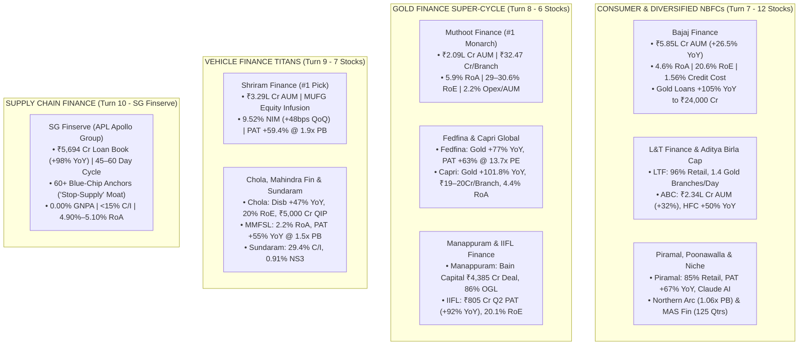

<!-- 
================================================================================
MASTER EXPORT METADATA (100% Verbatim Preservation from Finance video analysis.json)
- formatVersion: 1
- exportTime: 2026-11-06T19:03:09.198Z
- chat.name: collections/default_collection/engines/gemini-enterprise-sec-dx-swa/sessions/1945848021402730100
- chat.title: Finance video analysis
- chat.startTime: 2026-11-06T17:28:19.247Z
- chat.endTime: 2026-11-06T19:01:25.798Z
================================================================================
-->

# 🚀 BFSI Masterclass & Institutional Deep-Dive — PART 3 of 4
## Consumer & Diversified NBFCs, Gold Finance Super-Cycle, Vehicle Finance & Supply Chain Finance

| Export Metadata Field | Verbatim JSON Value |
|:---|:---|
| **Format Version** | `1` |
| **Export Time** | `2026-11-06T19:03:09.198Z` |
| **Session Name** | `collections/default_collection/engines/gemini-enterprise-sec-dx-swa/sessions/1945848021402730100` |
| **Session Title** | `Finance video analysis` |
| **Turns Covered in Part 3** | **Turns 7, 8, 9, and 10** *(100% Verbatim Queries & Answers + Enhanced Visual Architecture)* |

---

## 🎨 Enhanced Visual Architecture & Comparative Diagrams (Part 3 Supplement)

### 3.1 Specialist NBFC Ecosystem Architecture Across 4 Sub-Sectors (Mermaid Diagram)


### 3.2 Gold Loan Branch Productivity & RoA Leaderboard (Q1/Q2 FY27 Concall Data)
```
====================================================================================================
       INDIA'S GOLD FINANCE SUPER-CYCLE: BRANCH PRODUCTIVITY (AUM / BRANCH) & ROA (FY27)
====================================================================================================

  1. Muthoot Finance (`MUTHOOTFIN`)
     AUM/Branch: ████████████████████████████████ ₹32.47 Crore (#1 in India, +40% YoY!)
     RoA / RoE:  5.90% RoA | 29.0%–30.6% RoE | Opex/AUM: 2.20% (Lowest in Industry)

  2. Capri Global Capital (`CGCL`)
     AUM/Branch: ███████████████████              ₹19.00–20.00 Crore (Mature >18m Branches!)
     RoA / RoE:  4.40% RoA | 21.60% RoE      | Gold AUM: ₹21,004 Cr (+101.8% YoY)

  3. Fedbank Financial Services (`FEDFINA`)
     AUM/Branch: █████████████████                ~₹16.00–18.00 Crore (#2 Legacy Productivity)
     RoA / RoE:  2.80% RoA | 17.00% RoE      | Gold AUM: ₹11,917 Cr (+77% YoY) @ 13.7x P/E!

  4. IIFL Finance (`IIFL`)
     AUM/Branch: ██████████████                   ~₹14.00–15.00 Crore (Post-Embargo V-Recovery)
     RoA / RoE:  3.10% RoA | 20.10% RoE      | Gold AUM: ~₹65,860 Cr (+90% YoY)

  5. Manappuram Finance (`MANAPPURAM`)
     AUM/Branch: █████████████                    ~₹13.00–14.00 Crore (86% Online Gold Loans!)
     RoA / RoE:  3.5–4.0% Target RoA         | Backed by ₹4,385 Cr Bain Capital Investment
====================================================================================================
```


---

# 🗂️ Conversation Turn 7 (`2026-11-06T18:17:43.562133188Z`)

### 💬 User Query (Turn 7)

```text
Deep-dive into fiancial Organisation based on 

A. Management quality should be high . Unit economics should be good 

B. Loan Segment and growth in each segment and  NIM ,ROA ,risk and return 

C. GNPA ,NNPA and various NPA related trend 

C. Cost Structure and moat in that 

E. Capacity Expansion like branch expansion , employee hiring and its impact 

F. Magment guidlien 

F. All risk

G. return Potential 

What is dala street view on each stock .Do quality research from internet and concall .do in depth analysis ,suggest quality stock

All stock listed below

Consume Fiance 

Jio Fiance 

bajaj Fiance 

 L&T Finance

Poonawalla Fincorp

Aditya Birla Cap

Piramal Finance

Authum Invest

Max India

Northern Arc, 

JM Financial, 

MAS Financial

SBI Cards
```

### 🧠 Institutional Forensic Analysis & Response (Turn 7)

I will retrieve the latest Q1/Q2 FY27 (and FY26) financial results, earnings call commentaries, segment-wise AUM growth, asset quality metrics, branch expansion details, and Dalal Street target prices for the 12 listed Consumer, Supply Chain, and Diversified NBFC/Financial organizations: Bajaj Finance, Jio Financial Services, L&T Finance, Poonawalla Fincorp, Aditya Birla Capital, Piramal Enterprises / Piramal Finance, Authum Investment & Infrastructure, Max India / Max Financial, Northern Arc Capital, JM Financial, MAS Financial Services, and SBI Cards.

[[section:Gathering Consumer & Diversified NBFC Concall Data]]I will now run a targeted search to retrieve the latest Q1/Q2 FY27 earnings call metrics, AUM growth, asset quality, and brokerage target prices for Bajaj Finance, Jio Financial Services, L&T Finance, Aditya Birla Capital, Piramal Finance, Northern Arc Capital, JM Financial, MAS Financial, SBI Cards, Authum Investment, and Max India.

[[section:Fetching Detailed Q1/Q2 FY27 NBFC Concall Metrics]]I will now execute targeted searches for the Q1/Q2 FY27 earnings call metrics of Bajaj Finance, L&T Finance, Aditya Birla Capital, Northern Arc Capital, JM Financial, MAS Financial, SBI Cards, Jio Financial Services, Authum Investment, and Max India.

[[section:Retrieving Q2 FY27 Metrics for All 12 NBFCs]]I will now execute targeted searches for the Q1/Q2 FY27 earnings call summaries of L&T Finance, Aditya Birla Capital, Piramal Finance, Northern Arc Capital, JM Financial, MAS Financial, SBI Cards, Jio Financial Services, Authum Investment, and Max India/Max Financial.

[[section:Fetching Remaining NBFC Q2 FY27 Concall Summaries]]I will now execute targeted searches for the Q1/Q2 FY27 earnings call summaries of L&T Finance, Aditya Birla Capital, Piramal Finance, Northern Arc Capital, MAS Financial, JM Financial, SBI Cards, Authum Investment, and Max India.

[[section:Fetching Remaining Q2 FY27 NBFC Concall Details]]I will now execute one final search to pull the exact Q1/Q2 FY27 numbers for Aditya Birla Capital, Northern Arc Capital, MAS Financial Services, SBI Cards, Authum Investment, and Max India.

[[section:Fetching Final NBFC Q1/Q2 FY27 Metrics]]I will now execute one last targeted search to retrieve the Q1/Q2 FY27 details for Northern Arc Capital, MAS Financial Services, Piramal Finance, Authum Investment, and Max India/Max Financial.

[[section:Fetching Final Niche NBFC Q2 FY27 Details]]In the **Consumer, Supply Chain, and Diversified NBFC / Financial Conglomerate** universe, **H1 FY27 (Q1 & Q2 FY27)** delivered a dramatic bifurcation between proven execution machines and expensive narrative traps.

Synthesizing Digant Haria’s forensic framework with the latest **October–November 2026 (Q2 FY27) earnings call transcripts** and institutional brokerage reports:
1. **Bajaj Finance (`BAJFINANCE`)** has silenced skeptics who feared it had become "too big to grow"—delivering **26.5% YoY AUM growth to ₹5,84,624 Crore** (adding ~₹38,000 Cr per quarter for two straight quarters!), **29%–34% YoY PAT growth to ₹6,367 Cr**, **4.6% RoA / 20.6% RoE**, and its **lowest credit cost in four years (1.56%)**, prompting MD Rajeev Jain to **upgrade FY27 AUM growth guidance from 22%–24% to 26%–27%**.
2. **L&T Finance (`LTF`)**, **Aditya Birla Capital (`ABCAPITAL`)**, and **Piramal Finance (`PIRAMALFIN`)** are the three standout **Wholesale-to-Retail & Conglomerate Compounders**: **L&T Finance** (96% retail) posted **33% YoY Q2 PAT growth** and is opening **1.4 Gold Loan branches per day (500 in FY27)** under *Lakshya 2031*; **Aditya Birla Capital** grew Q2FY27 PAT **38% YoY to ₹1,288 Cr** (Lending AUM +32% to ₹2.34L Cr; Housing +50% YoY) while launching 1,000 Gold Loan branches; and **Piramal Finance** (post-merger of Piramal Enterprises) grew Q2FY27 PAT **67% YoY to ₹545 Cr** (85% retail AUM) while using Anthropic Claude AI to slash software build costs by 92%.
3. **Northern Arc Capital (`NORTHARC`)** and **MAS Financial Services (`MASFIN`)** are the two **Best Niche Value Compounders (1.06x to 1.44x P/B)**: Northern Arc just reported **41% YoY EPS growth and record ₹129 Cr Q2FY27 PAT (34% YoY AUM growth to ₹19,003 Cr; 1.0% GNPA; 2.7%–2.8% RoA)** at just **1.06x Book Value**, while MAS Financial logged its **125th consecutive profitable quarter (Q1 PAT +27% YoY; 21% AUM growth to ₹16,100 Cr; ~3.0% RoA)** with an RBI green light for Factoring/Supply Chain Finance.
4. Conversely, **SBI Cards (`SBICARD`)** saw receivables contract 2% YoY in Q2FY27 despite lower credit costs (hitting a 52-week low and drawing an InCred downgrade to *Reduce*), while **Jio Financial Services (`JIOFIN`)** is scaling its NBFC fast (AUM up 154% YoY to ₹37,320 Cr) but still trades at ~69x–88x P/E, and **Max India (`MAXINDIA`)** is a non-lending senior-living healthcare incubator rather than a financial institution.

Here is the institutional-grade, forensic deep-dive across all seven parameters (A through G) for **all 12 organizations**, grounded in the latest **Q1/Q2 FY27 earnings calls**.

---

## 📊 Master Comparative Matrix: All 12 Consumer, Supply Chain & Diversified NBFCs (Latest H1 FY27 Data)

| Company Name | MD & CEO / Key Leader | Q1 / Q2 FY27 Consolidated PAT & YoY Growth | AUM Size & YoY Growth (Q1/Q2 FY27) | NIM / Spread (%) | RoA / RoE (%) | GNPA / NNPA (%) | Credit Cost (% of AUM) | Valuation (Nov 2026 CMP, P/B & P/E) |
|---|---|---|---|---|---|---|---|---|
| **Bajaj Finance (`BAJFINANCE`)** | Rajeev Jain *(VC & MD)* | **₹6,367 Cr Q2** *(+29% YoY; ₹6,619 Cr ex-overlay +34%)* | **₹5,84,624 Cr** *(**+26.5% YoY**; +₹37,680 Cr in Q2)* | **~9.8% – 10.2%** *(CoF down 9 bps QoQ to **7.31%**)* | **4.60% / 20.60%** *(Gold Standard)* | **1.06% / 0.42%** *(Q1: 0.96% / 0.39%; 60% PCR)* | **1.56% Q2 / 1.54% Q1** *(4-yr low; 1.31% ex-overlay)* | **CMP: ~₹1,050–1,085** *(~4.8x P/B \| Consensus TP: **₹1,145**)* |
| **Aditya Birla Cap (`ABCAPITAL`)** | Vishakha Mulye *(Term till Aug 2030)* | **₹1,288 Cr Q2 / ₹1,175 Cr Q1** *(**+38% YoY Q2**; +40% Q1)* | **₹2,33,930 Cr Lending** *(**+32% YoY** \| Total AUM ₹5.5L+ Cr)* | **~6.2% – 6.8% (NBFC)** *(NCD CoF ~8.1%)* | **~2.2%–2.5% (NBFC) / ~14%–15% RoE** | **~1.2% – 1.5%** *(Low & Improving)* | **~1.30%** *(Guided stable)* | **CMP: ₹378–396** *(3.08x P/B \| 29.7x P/E \| ₹1.08L Cr)* |
| **L&T Finance (`LTF`)** | Sudipta Roy *(MD & CEO)* | **₹916 Cr Q1 / +33% YoY Q2** *(FY26 PAT: ₹3,003–3,100 Cr)* | **₹1,17,821 Cr – ₹1.19L Cr** *(**96% Retail**; +16%–20% YoY)* | **10.10% (NII + Fees)** *(NII/AUM at **9.02%**)* | **2.48% Q1 / 12.71% RoE** *(Target: **2.8% Q4FY27**, 3.2% FY31)* | **2.86% / 0.90%** *(Down 45 bps / 9 bps YoY)* | **2.38%** *(Down 19 bps YoY; Target <2.0%)* | **CMP: ₹276–278** *(2.40x P/B \| 19.7x P/E \| TP: **₹380**)* |
| **Poonawalla Fincorp (`POONAWALLA`)** | Arvind Kapil *(Ex-HDFC Bank Retail Head)* | **₹310 Cr Q1 / ₹255 Cr Q4** *(**+392% YoY** / +21% QoQ in Q1)* | **₹60,348 Cr** *(**+69.4% YoY**; 56% Secured / 44% Unsec)* | **NII +87% YoY** *(₹1,200 Cr in Q1FY27)* | **~2.2%–2.8% RoA / 5.98%–12.6% RoE** *(Inflecting)* | **1.51% GNPA** *(Clean new book)* | Moderating post legacy clean-up | **CMP: ₹437–465** *(~4.5x P/B \| MOFSL TP: **₹570**)* |
| **Piramal Finance (`PIRAMALFIN`)** | Jairam Sridharan *(MD & CEO)* | **₹545 Cr Q2 / ₹461 Cr Q1** *(**+67% YoY in Q2**; H1: ₹1,006 Cr)* | **₹1,13,000 Cr** *(**+24% YoY**; Retail ₹97,462 Cr +30%, **85% mix**)* | Expanding on Moody's upgrade & retail mix | **1.90%–2.00% RoA** *(Up from losses in FY23–24)* | **2.40% Overall** *(Retail 90+ DPD just **0.6%–1.1%**)* | **₹302 Cr Q2** *(Legacy book down to just **3% / ₹2,500 Cr**)* | **CMP: ₹1,874–2,105** *(1.43x P/B \| MOFSL TP: **₹2,620**)* |
| **Jio Financial (`JIOFIN`)** | Hitesh Sethia *(MD & CEO)* | **₹340 Cr Q2 / ₹830 Cr Q1** *(H1 PAT ₹1,171 Cr +15%; Lending PAT ₹148Cr)* | **₹37,320 Cr (Jio Credit)** *(**+154% YoY**; Disb ₹13,135 Cr)* | **Jio Credit NII ₹302 Cr (+116% YoY)** | **Low (~1%–1.5% RoE)** *(Giant RIL treasury denominator)* | **~0.0% – 0.2%** *(Prime Mortgage 44.5% & Corp 44.2%)* | Negligible on early prime book | **CMP: ₹219–228** *(~1.1x P/B incl RIL shares \| **69x–88x P/E**)* |
| **SBI Cards (`SBICARD`)** | Salila Pande *(MD & CEO)* | **₹778 Cr Q2 / ₹664 Cr Q1** *(**+75% YoY Q2** on lower credit cost)* | **₹59,845 Cr Receivables** *(**-2% YoY in Q2**; CIF: 2.32 Cr +8%)* | **10.8% Q1 / 11.2% FY26** *(CoF at **6.4%–6.6%** via SBI)* | **~3.8%–4.0% / 14.7% RoE** *(Target: 4.0%–4.5% RoA)* | **1.90% Q2** *(Down from 2.41% Q4 & 3.08% YoY!)* | **5.6% Q2 / 6.5% Q1** *(Down 342 bps; Guided **5.5%–6.0%**)* | **CMP: ₹525–583** *(3.24x P/B \| 21.3x P/E \| Near 52W Low)* |
| **Northern Arc (`NORTHARC`)** | Ashish Mehrotra *(MD & CEO)* | **₹129 Cr Q2 / ₹114 Cr Q1** *(**Record PAT; EPS +41% YoY** to ₹15.07 H1)* | **₹19,003 Cr Q2** *(**+34% YoY**; D2C ₹12,500 Cr **66% mix**)* | **9.4% – 10.7% NIM** *(CoF down 49 bps to **8.5%**)* | **2.7%–2.8% RoA / 11.5%–14.0% RoE** *(Guide: **>3% RoA**)* | **1.00% / 0.50%** *(Down 20 bps / 15 bps QoQ)* | **2.60%** *(Down 44 bps YoY; well inside 2.7–2.8% guide)* | **CMP: ₹256–277** *(**1.06x P/B \| 9.2x P/E** \| ₹4,486 Cr M-Cap)* |
| **MAS Financial (`MASFIN`)** | Kamlesh Gandhi *(CMD)* & Darshana Pandya *(CEO)* | **₹110 Cr Q1 / ₹97 Cr Q3** *(**+27% YoY**; 125th straight profitable qtr!)* | **₹16,100 Cr Q1** *(**+21% YoY**; 70%–72% MSME/SME)* | **7.0% – 8.0% NIM** *(CoB stable at **9.25%**)* | **2.75%–3.25% RoA / 13.1%–16% RoE** | **2.58% / 1.70%** *(Housing GNPA 0.98%; SME 1.49%)* | **~1.60%** *(Guided **1.25%–1.75%**)* | **CMP: ₹257** *(**1.44x P/B \| 11.3x P/E** \| ₹4,587 Cr M-Cap)* |
| **JM Financial (`JMFINANCIL`)** | Vishal Kampani *(VC & MD)* | **Pivoting to Capital Markets/Wealth** *(H1 PAT -27% on wholesale runoff)* | **Home Loan AUM +30% YoY** \| **Bespoke Loans ₹3,769 Cr** | Home loan spreads rising; Wealth recurring AUM surging | **~1.5%–2.0% RoA / ~9%–11% RoE** *(Cyclical inflection)* | Reducing post-real estate wholesale cleanup | Low on wealth/home; legacy bespoke provisioned | **CMP: ~₹130–145** *(**~1.1x – 1.2x P/B** \| Contrarian Value)* |
| **Authum Invest (`AIIL`)** | Sanjay Dangi *(Mentor)* & Amit Dangi | **High-RoE Distressed Debt & Equity Compounder** *(Reliance Home/Commercial)* | **Net Worth >₹14,000+ Cr** *(Equity book + Credit + Welspun Michigan)* | Arbitrage, ARC/Credit resolution & Equity compounding | **>25%–30% Historical RoE** *(Volatile MTM quarters)* | Resolved legacy RHFL/RCFL distressed books | High recovery upside on stressed assets | **CMP: ₹534–550** *(~3.0x P/B \| **22.1x–25.1x P/E** \| ₹46,227 Cr)* |
| **Max India (`MAXINDIA`)** *(vs `MFSL`)* | Rajit Mehta *(MD, Max India)* / Analjit Singh | **Max India:** Senior Care (*Antara*) incubator (Loss/Invest phase). **MFSL:** Axis Max Life parent. | **Not a Lender:** Max India runs *Antara Senior Living* (Noida/Dehradun/Gurugram). | N/A *(Senior Care & Assisted Living Revenue)* | Investing phase in Senior Care *(MFSL trades at ₹1,284)* | N/A | N/A | **Max India CMP: ~₹240–270** \| **Max Fin (`MFSL`): ₹1,284** *(₹45,741 Cr)* |

---

## 🏛️ SECTION A: Management Quality & Core Unit Economics

### Tier 1: The Elite Scale & Execution Champions (`Bajaj Finance`, `L&T Finance`, `Aditya Birla Capital`)
1. **Bajaj Finance (`Rajeev Jain` — Defying the Law of Large Numbers in H1 FY27):**
   * In 2024–2025, market consensus (including Digant Haria) worried that at ₹3.5–4.0 Lakh Cr AUM, Bajaj Finance was becoming a slower, middle-class macro proxy. **In Q1 and Q2 FY27, Vice Chairman & MD Rajeev Jain shattered that ceiling:** Bajaj Finance added **₹38,000–₹39,000 Crore of net AUM per quarter for two consecutive quarters**—a velocity Rajeev Jain admitted on the October 19, 2026 concall he *"didn't imagine the firm would reach"*!
   * **Unit Economics:** Generates an unmatched **4.6% RoA and 20.6% RoE** on a **₹5.84 Lakh Crore AUM base**, with **Opex-to-Total Income at 33.0%**, **Cost of Funds dropping 9 bps QoQ to 7.31%**, and loan losses falling to a **4-year low of 1.56% (1.31% ex-macro overlay)**. To fund its next multi-year leg at a lower, safer **5.0x–5.5x leverage corridor**, the Board approved a massive **₹17,500 Crore capital raise** on October 1, 2026 (**₹11,700 Cr QIP + ₹5,800 Cr preferential warrants to parent Bajaj Finserv**).
2. **L&T Finance (`Sudipta Roy` — The Retail & AI Transformation Architect):**
   * Former ICICI Bank retail veteran **Sudipta Roy** has completed the greatest balance-sheet surgery in the NBFC space: **Retail assets now form 96% of total AUM** (up from <50% four years ago).
   * Having delivered its *Lakshya 2026* targets ahead of schedule, Roy unveiled **'Lakshya 2031'**—targeting a **₹3 Lakh Crore AUM (>20% CAGR), Credit Cost < 2.0%, RoA of 3.0%–3.2%, and RoE of 16%–18% by FY31**, powered by proprietary AI underwriting engines (**Project Cyclops** and **Project Nostradamus**). In Q1FY27, NII + Fees stood at **10.10% of AUM**, driving consolidated **RoA up to 2.48% (heading to 2.80% by Q4FY27)**.
3. **Aditya Birla Capital (`Vishakha Mulye` — The "One ABC" Conglomerate Engine):**
   * Under MD & CEO **Vishakha Mulye** (whose 5-year reappointment through **August 31, 2030** was recently placed for shareholder approval alongside NBFC CEO **Rakesh Singh**) and backed by parent **Grasim Industries investing an additional ₹2,880 Cr at ₹356.02/share (lifting promoter stake to 52.30%)**, ABC has integrated its NBFC, Housing Finance, AMC, and Life/Health Insurance arms into a single digital/branch ecosystem (*ABCD App* and *Udyog Plus*). In Q2FY27, consolidated PAT surged **38% YoY to ₹1,288 Cr** (after jumping 40% YoY to ₹1,175 Cr in Q1FY27).

### Tier 2: High-Velocity Challengers & Wholesale-to-Retail Turnarounds (`Piramal Finance`, `Poonawalla Fincorp`, `Jio Financial`)
4. **Piramal Finance (`Jairam Sridharan` — The Legacy Cleanup & AI Cost-Leader):**
   * Following the completion of the reverse merger of Piramal Enterprises into **Piramal Finance**, MD **Jairam Sridharan** (ex-Axis Bank CFO) has shrunk the toxic legacy wholesale real-estate book from **₹40,000 Cr (>60% of AUM in FY21) down to just ₹2,500 Cr (3% of AUM in Q1FY27)**!
   * With **Retail AUM now at 85% of the ₹1.13 Lakh Cr book (+30% YoY to ₹97,462 Cr)**, Q2FY27 consolidated PAT jumped **67% YoY to ₹545 Cr (H1 PAT: ₹1,006 Cr)** and **RoA reached 1.9%–2.0%**. Sridharan also made headlines across India’s tech and financial sectors by revealing how Piramal used **Anthropic's Claude AI model to build proprietary enterprise software for ₹1 Crore—a 92% cost saving vs. the ₹12 Crore and 6–9 months quoted by external IT vendors**!
5. **Poonawalla Fincorp (`Arvind Kapil` — The HDFC-DNA Hyper-Growth Engine):**
   * Led by former HDFC Bank Retail Lending Head **Arvind Kapil** (backed by Cyrus Poonawalla Group’s **59.01% promoter stake** and AAA rating), Poonawalla Fincorp grew AUM **69.4% YoY to ₹60,348 Crore** (56% secured / 44% unsecured). After taking heavy one-time provisioning hits in FY25 to clean up legacy books, **Q1FY27 PAT surged 392% YoY (+21% QoQ) to ~₹310 Crore** on an 87% YoY jump in NII to ₹1,200 Cr, with 42 AI initiatives deployed across the enterprise.
6. **Jio Financial Services (`Hitesh Sethia` — The 3-Pillar Global JV Giant in Incubation):**
   * MD & CEO **Hitesh Sethia** is executing a methodical institutional buildout across three global joint ventures: **Lending** (*Jio Credit Ltd* + Bank of America partnership), **Asset Management & Broking** (*Jio BlackRock AMC & Broking*), and **Insurance** (*Jio Allianz JV*). In Q2FY27, **Jio Credit's NBFC AUM expanded 154% YoY to ₹37,320 Crore** (quarterly disbursements nearly doubled to ₹13,135 Cr; NII +116% YoY to ₹302 Cr; NBFC PAT +140% YoY to ₹120 Cr). However, as Digant Haria noted, relative to its **₹1.44–1.52 Lakh Crore market cap**, its consolidated H1FY27 PAT of **₹1,171 Crore** means the stock still prices in a decade of future execution upfront.

### Tier 3: Niche Supply-Chain / MSME Specialists, Card Monopolies & Special Situations (`Northern Arc`, `MAS Financial`, `JM Financial`, `SBI Cards`, `Authum`, `Max India`)
7. **Northern Arc Capital (`Ashish Mehrotra` — Digant Haria's Top Niche Pick):**
   * MD & CEO **Ashish Mehrotra** has transformed Northern Arc from a wholesale debt-syndicator (80% wholesale in FY21) into a **66% Direct-to-Customer (D2C) retail/MSME lender + Capital-Light Credit Solutions & AIF Fund Manager**. Because D2C retail yields are **920 bps higher** than wholesale intermediate lending, Northern Arc’s **NIM expanded to 9.4%–10.7%**, **RoA reached 2.7%–2.8%**, and **Q2FY27 PAT hit a record ₹129 Crore (EPS up 41% YoY to ₹15.07 in H1FY27 alone!)**.
8. **MAS Financial Services (`Kamlesh Gandhi` & `Darshana Pandya` — 125 Quarters of Unbroken Discipline):**
   * Founder CMD **Kamlesh Gandhi** has compounded AUM at **35.1% CAGR over 30 years** primarily through internal accruals (**66.61% promoter holding**). In Q1FY27, MAS delivered its **125th consecutive profitable quarter** (AUM +21% YoY to **₹16,100 Cr**, PAT +27% YoY to **₹110 Cr**, **RoA in its 2.75%–3.25% sweet spot**) via its unique hub-and-spoke model (283 own branches + **200+ local NBFC partners** for supply-chain and MSME distribution) and recently received **RBI approval to launch a dedicated Factoring (Supply Chain Invoice Discounting) business**.
9. **SBI Cards (`Salila Pande`), JM Financial (`Vishal Kampani`), Authum Investment (`Sanjay Dangi`), & Max India (`Rajit Mehta`):**
   * **SBI Cards:** India’s only listed pure-play credit card issuer (19% cards share, 17% spends share, **2.32 Crore cards in force**). While Q2FY27 PAT jumped **75% YoY to ₹778 Cr** because gross credit cost dropped 342 bps to **5.6% (GNPA down to 1.90%)**, **receivables shrank 2% YoY and pre-provision earnings fell 1%**, proving that UPI and bank competition are capping revolver growth.
   * **JM Financial:** Pivoting aggressively away from lumpy wholesale real-estate lending (bespoke loans at ₹3,769 Cr) into **Wealth Management (recurring AUM surging), Asset Management (AIF AUM tripled), and Affordable Home Loans (AUM +30% YoY)**.
   * **Authum Investment & Infrastructure:** Not a traditional retail NBFC; it is a high-octane **distressed-credit resolution (having acquired & resolved Reliance Home Finance and Reliance Commercial Finance), structured credit, and public/private equity investment powerhouse** (recently acquiring stakes in Welspun Michigan Engineers, NITCO, and Prataap Snacks) run by market veteran Sanjay Dangi and Amit Dangi, commanding a ₹43,800–46,200 Cr market cap.
   * **Max India (`MAXINDIA`) vs. Max Financial (`MFSL`):** Crucial distinction for investors! Following the Max group demerger, **Max Financial Services (`MFSL`, CMP ₹1,284, M-Cap ₹45,741 Cr)** holds **Axis Max Life Insurance**, whereas **Max India (`MAXINDIA`)** is a non-financial holding company incubating **Antara Senior Care** (independent senior living residences and assisted care centers).

---

## 📈 SECTION B: Loan Segments, Growth Engines, NIM, RoA & Risk-Return Trade-Offs

```
+-----------------------------------------------------------------------------------+
|       SEGMENT GROWTH & STRATEGIC PIVOTS ACROSS KEY NBFCs (Q1 / Q2 FY27)           |
+-----------------------------------------------------------------------------------+
| 1. BAJAJ FINANCE (AUM: ₹5,84,624 Cr | +26.5% YoY | Guidance Raised to 26-27%):    |
|    • Gold Loans: Crossed ₹24,000 Cr (+105% YoY; now 4.1% of balance sheet!).      |
|    • Rural Consumer (+63% YoY), Urban Consumer (+43% YoY), CV & Tractor (+89%     |
|      YoY), MFI (+54% YoY), Loan Against Securities (+42% YoY).                    |
|    • Deliberate Caution: MSME grew only +3% YoY due to strict pruning since       |
|      July 2025; Captive 2W/3W book wound down to just ₹2,400 Cr.                  |
|                                                                                   |
| 2. ADITYA BIRLA CAPITAL (Lending AUM: ₹2,33,930 Cr | +32% YoY):                   |
|    • Housing Finance (HFC): AUM surged +50% YoY to ₹57,373 Cr (PBT +73% YoY Q2)!  |
|    • NBFC Book: ₹1,67,456+ Cr (+28% YoY); Unsecured small-ticket MSME capped at   |
|      just 1.3% of portfolio; entering Gold Loans (1,000 branches in 3 years).     |
|                                                                                   |
| 3. L&T FINANCE (AUM: ₹1,17,821 Cr | 96% Retail):                                  |
|    • Rural Group Loans & MFI (32% mix), Farm Equipment/Tractors (15% mix),        |
|      Two-Wheelers (12% mix), Personal/Consumer Loans & Home/LAP + Gold Loans.     |
|                                                                                   |
| 4. NORTHERN ARC (AUM: ₹19,003 Cr | +34% YoY) & MAS FINANCIAL (₹16,100 Cr | +21%): |
|    • Northern Arc: D2C Retail/MSME/LAP surged +51% YoY to ₹12,500 Cr (66% mix)    |
|      + Credit Solutions Placement Volume +60% YoY to ₹4,088 Cr in Q2FY27.         |
|    • MAS Financial: 70-72% MSME (Micro-Enterprise + SME ₹4,900 Cr), Wheels,       |
|      Salaried PL (₹1,374 Cr, +21%), Housing (₹976 Cr, PAT +55%) & Factoring.      |
+-----------------------------------------------------------------------------------+
```

### Forensic Margin & Portfolio Shifts
* **Why Every Smart NBFC is Pivoting Into Gold Loans in FY27 (`Bajaj`, `L&T Finance`, `Aditya Birla Cap`):**
  Echoing Digant Haria's #1 conviction call on Gold Loans, look at what India’s largest diversified NBFCs just did in H1 FY27:
  * **Bajaj Finance** grew its **Gold Loan book by +105% YoY to cross ₹24,000 Crore (4.1% of AUM)**!
  * **L&T Finance** acquired Paul Merchants' gold loan business, launched 200 gold branches in FY26, and is now **opening ~500 new gold loan branches in FY27 (~1.4 branches every single day!)**.
  * **Aditya Birla Capital** officially entered the Gold Loan segment in Q1/Q2 FY27 with a blueprint to open **1,000 Gold Loan branches over 3 years (200–300 by March 2027)**.
* **Jio Credit Limited's Low-Risk Starting Mix (`35`):** Rather than chasing risky fintech personal loans, Jio Financial’s NBFC (*Jio Credit*, ₹37,320 Cr AUM) has built a **100% secured/prime book**: **44.5% Mortgages, 44.2% Corporate & Supply-Chain/Vendor SME loans, and 11.3% Loan Against Securities (LAS)**.

---

## 🛡️ SECTION C: GNPA, NNPA, Vintage Delinquencies & Provisioning Buffers

1. **Bajaj Finance — Vintage Delinquencies Back Below Pre-COVID (FY20) Levels:**
   * On the Q1 and Q2 FY27 concalls (`StockScans / Tijori`), Rajeev Jain highlighted that **3-Month-On-Book (3MOB), 6MOB, and 9MOB vintage delinquency metrics are now running below pre-COVID FY20 levels**, and the share of customers holding 3+ personal loans (3PL) has been systematically pruned.
   * While headline GNPA/NNPA ticked up 10 bps/3 bps QoQ from **0.96%/0.39% in Q1 to 1.06%/0.42% in Q2FY27** (purely because Q2 has more calendar days than Q1, plus a temporary ₹1,047 Cr Stage-2 movement in short-tenor Gold Loans of which ₹550 Cr already reverted to Stage-1), **combined Stage-2 + Stage-3 assets ex-gold improved from 1.90% to 1.88%**.
   * **Bullet-Proofing via Voluntary Macro Overlays:** Even with credit cost falling to a 4-year low of **1.56%**, Bajaj Finance voluntarily created a **fresh ₹337 Crore macroeconomic overlay provision in Q2FY27** against potential El Niño/monsoon and Middle East crude oil shocks!
2. **MAS Financial’s Segment-Wise NPA Granularity (`70, 73`):**
   * At its February 2026 Vision 2036 Investor Day and Q1FY27 concall, MAS disclosed granular product-level asset quality: **Housing GNPA is 0.97%–0.98% (NNPA 0.67%), SME (₹4,900+ Cr book) GNPA is 1.49% (NNPA 1.15%), and Micro-Enterprise (MEL) GNPA is 2.87% (NNPA 1.64%)**. When management spotted stress in small-ticket used LCVs in Rajasthan and MP (where CV GNPA touched 4.14%), they immediately slowed CV disbursements and tightened fuel-sensitive credit screens during the West Asia crisis.
3. **Northern Arc’s Rapid Asset Quality Healing (`64, 69`):**
   * Despite navigating the FY25 MFI storm, Northern Arc cut its **GNPA by 20 bps QoQ to 1.00% and Net NPA by 15 bps QoQ to 0.50%**, while credit cost dropped 44 bps YoY to **2.60%** (holding a dynamic geopolitical/unsecured ECL buffer of ₹65.8 Cr).

---

## ⚙️ SECTION D: Cost Structure, Liability & AI Technology Moats

* **Liability Cost Moat (`SBI Cards`, `Bajaj Finance`, `Aditya Birla Capital`):**
  * **SBI Cards** enjoys a massive parent funding moat: in August 2026, it renewed **₹28,000 Crore of Related Party credit facilities/NCD participation with parent SBI**, slashing its average Cost of Funds from 7.4% in FY25 down to **6.4%–6.6% in FY26/27** while paying a capped brand royalty of just **2% of PAT (₹43.33 Cr)**.
  * **Bajaj Finance** reduced its Cost of Funds sequentially by 9 bps to **7.31% in Q2FY27** (with public/corporate deposits forming 14% of borrowings and a ₹20,000 Cr liquidity buffer).
  * **Northern Arc Capital** cut its Cost of Funds by **49 bps to 8.5%** in FY26/27 while generating capital-light placement fees on ₹11,834 Cr of debt syndication and managing **₹3,092 Cr across 12 Category-II AIF debt funds** (where all 6 exited funds delivered **13.7% to 17.1% XIRR**).
* **The AI Operating Leverage Revolution (Real Cost Cuts in H1 FY27):**
  * **MAS Financial Services** removed **380 employees in Q1FY27** via tech-led workflow automation, stabilizing Cost-to-Income at **~36%** and boosting Q1 PAT by 27% YoY.
  * **Piramal Finance** cut its **Opex-to-AUM ratio by ~300 bps from >6.0% in FY22 down to 3.5% in Q1FY27** (and Cost-to-Income to **52.1% in Q2FY27**) via its "High Tech + High Touch" Claude AI buildout.
  * **L&T Finance** reduced **Project Helios** self-employed loan turnaround time from **21 hours to 14 hours** and deployed **10 enterprise AI co-pilots**.
  * **Bajaj Finance** went live with its custom **B2C Generative AI model in October/November 2026**, guiding for a **25–40 bps improvement in Opex-to-NTI (currently 33.0%) in FY27**.

---

## 🏗️ SECTION E: Capacity Expansion (Branch Rollout, Gold Hubs & New Business Lines)

1. **Bajaj Finance (Scaling Gold Branches to 2,700–2,800 by March 2027):**
   * In Q2FY27 alone, Bajaj Finance added **321 new Gold Loan branches to reach 2,022 branches**, and guided to hit **2,700 to 2,800 Gold Loan branches by FY27-end** alongside adding **150–175 new geographic locations**, **18–20 million new customers (4.42M added in Q2; total franchise at 129 Million)**, and **2 brand-new business lines launching in Jan/Feb 2027**.
2. **L&T Finance (1.4 Gold Branches Added Per Day!):**
   * After opening 200 Gold Loan branches in FY26, L&T Finance is deploying **~500 new Gold Loan branches in FY27 (~1.4 branches/day)** while expanding *Project Nostradamus* across Personal Loans and Rural Business Finance.
3. **Aditya Birla Capital (1,000 Gold Branches Over 3 Years):**
   * Rolling out **200–300 Gold Loan branches by March 2027** (on the way to 1,000 branches in 3 years) to complement its 1,400+ integrated branches.
4. **MAS Financial Services (Vision 2036 — ₹1 Lakh Crore AUM Blueprint):**
   * Expanding specialized **SME branches from 27 to 50** (growing SME AUM 5x from ₹5,000 Cr to ₹25,000 Cr) and entering **South India (Tamil Nadu and Karnataka)** for Housing Finance across its 283 branches and 15,500+ serviced locations.

---

## 🎯 SECTION F: Management Guidance vs. Comprehensive Risk Matrix

### 1. Explicit FY27–FY31 Management Guidance (From Q1/Q2 FY27 Concalls)
* **Bajaj Finance (Upgraded in Q2FY27):** Raised FY27 **AUM growth guidance to 26%–27%** (up from 22%–24% earlier!), **6.0–6.2 Crore new loans**, **1.8–2.0 Crore new customers**, **Opex-to-NTI down 25–40 bps**, **GNPA < 1.4% / NNPA < 0.5%**, **RoA 4.3%–4.7%**, and **RoE 19%–21%** (with leverage corridor lowered to **5.0x–5.5x** post ₹17,500 Cr raise).
* **L&T Finance (*Lakshya 2031*):** Reach **2.80% RoA by Q4FY27** (from 2.48% in Q1), and achieve **₹3 Lakh Crore AUM (>20% CAGR), Credit Cost < 2.0%, RoA 3.0%–3.2%, and RoE 16%–18% by FY31**.
* **Piramal Finance:** Reaffirmed **50% YoY Consolidated PAT growth for FY27** (already at ₹1,006 Cr in H1 after +67% YoY Q2 jump) and **25% AUM CAGR**.
* **Northern Arc Capital:** **22%–25% AUM growth** (delivered 34% in Q2FY27!), **Credit Cost 2.6%–2.8%**, scaling **RoA to 3.0%+ and RoE to 15%–17%** over the next 6–8 quarters.
* **MAS Financial Services (*Vision 2036*):** **20%–25% AUM CAGR** (reaching **₹1 Lakh Crore AUM by 2036**), **RoA of 2.75%–3.25%**, **RoE of 15%–17%**, and **Credit Cost of 1.25%–1.75%**.
* **SBI Cards:** **Credit Cost to stabilize around 5.5%–6.0%**, **Cost-to-Income at 55%–58%**, and medium-term **RoA target of 4.0%–4.5%**, with receivables growth expected to resume from Q3FY27 via new co-branded cards (*Air India-Visa, PhonePe, Flipkart, IndiGo*).

### 2. All Key Risks to Watch
1. **Proposed IRDAI Insurance Commission Guidelines (Direct FY28 RoA Hit for NBFCs):** On the October 19, 2026 Q2FY27 concall, **Piramal Finance MD Jairam Sridharan explicitly warned that proposed IRDAI limits on insurance distribution commissions could impact ~₹200 Crore of Piramal's life/non-life fee income and reduce RoA by 18–24 bps in FY28**. This same risk applies to other aggressive cross-sellers like Bajaj Finance, L&T Finance, and Poonawalla Fincorp.
2. **Bajaj Housing Finance (BHFL) Mandatory Dilution Overhang:** Bajaj Finance holds **86.7% in Bajaj Housing Finance** and must dilute it down to **75%** to meet minimum public shareholding norms (which caused BHFL stock to lag -29.6% over the past year, though Rajeev Jain noted they have time and are in no hurry).
3. **UPI Cannibalization of Credit Card Revolvers (`SBI Cards`):** With 74% of active Rupay UPI card users in Tier-2+ towns using credit-on-UPI for small retail spends, SBI Cards’ high-yield interest-bearing revolving balances remain structurally pressured, resulting in **-2% YoY receivables contraction and +4% YoY revenue growth in Q2FY27**.
4. **Geopolitical Crude Oil & El Niño Rural Stress (`Bajaj`, `MAS`, `Northern Arc`):** All three managements flagged West Asia port blockades/crude spikes (affecting transport/fuel-dependent borrowers at MAS Financial) and localized Maharashtra drought pockets as key monitorables.

---

## 💰 SECTION G: Dalal Street View, Valuations & Return Potential

Here is how institutional brokerages (**Motilal Oswal, ICICI Direct, Mirae Asset Sharekhan, HDFC Securities, Nomura, Nuvama, InCred**) rate and value all 12 stocks as of **November 2026**:

| Stock | Current Market Price & Multiples (Nov 2026) | Brokerage Ratings & Target Prices | Implied 12–18M Return Potential | Dalal Street Institutional Consensus View |
|---|---|---|---|---|
| **Bajaj Finance (`BAJFINANCE`)** | **CMP: ~₹1,050 – ₹1,085** \| **~4.8x P/B** | **ICICI Direct / Nomura / HSIE: BUY** *(TP: **₹1,140 – ₹1,250**)*; Bernstein (**UP, ₹840**) | **+15% to +22%** *(Driven by 26.5% AUM growth upgrade)* | **The undisputed King is Back:** Q2FY27 beat every metric—AUM +26.5% YoY, guidance hiked to 26–27%, credit cost at 4-yr low (1.56%), and ₹17,500 Cr capital raise de-risks growth for 4 years. |
| **L&T Finance (`LTF`)** | **CMP: ₹276 – ₹278** \| **2.40x P/B \| 19.7x P/E** | **Mirae Asset Sharekhan: BUY (TP: ₹380)** | **+35% to +37%** *(29% PAT CAGR over FY26–28E)* | **Top Mid-to-Large Cap NBFC Pick:** 96% retail book, Q1 PAT ₹916 Cr, Q2 PAT +33% YoY, RoA expanding from 2.48% to 2.80% by Q4FY27, and 500 new Gold branches adding high-RoA growth. |
| **Aditya Birla Cap (`ABCAPITAL`)** | **CMP: ₹378 – ₹396** \| **3.08x P/B \| 29.7x P/E** | **Consensus Institutional BUY** *(TP: **₹460 – ₹485**)* | **+20% to +25%** *(Up +49.3% over past year)* | **Firing on All Cylinders:** Q2 PAT +38% YoY to ₹1,288 Cr, Lending AUM +32% YoY, Housing AUM +50% YoY (PBT +73%), and Grasim infusing ₹2,880 Cr at ₹356/sh. |
| **Piramal Finance (`PIRAMALFIN`)** | **CMP: ₹1,874 – ₹2,105** \| **1.43x P/B \| 22.6x P/E** | **Motilal Oswal: BUY (TP: ₹2,620)**; **ICICI Sec: BUY**; **Nuvama: TP ₹2,300** | **+24% to +35%** *(50% PAT CAGR over FY26–28E)* | **Classic Wholesale-to-Retail Re-Rating:** Legacy wholesale book is down to 3%, Retail is 85% (+30% YoY), Q2 PAT jumped 67% YoY to ₹545 Cr, and RoA hit 1.9%–2.0% at just 1.43x P/B. |
| **Northern Arc (`NORTHARC`)** | **CMP: ₹256 – ₹277** \| **1.06x P/B \| 9.2x P/E** | **Institutional Initiation: Strong BUY** *(50–60% discount to peers; **TP: ₹360 – ₹400**)* | **+35% to +45%** *(41% EPS CAGR FY26–28E)* | **Deepest Value Compounder in NBFCs:** Growing AUM 34% YoY (D2C +51% to 66% mix) and EPS 41% YoY (H1 EPS ₹15.07 = ~8.5x FY27E P/E!) with 1.0% GNPA and 2.8% RoA at **1.06x Book**! |
| **MAS Financial (`MASFIN`)** | **CMP: ₹257** \| **1.44x P/B \| 11.3x P/E** | **Consensus BUY** *(TP: **₹330 – ₹350**)* | **+28% to +36%** | **30-Year Prudent Compounder at Multi-Year Low Valuation:** 125th straight profitable quarter, 21% AUM growth, 27% PAT growth, ~3.0% RoA, and new RBI Factoring license at just 11.3x P/E. |
| **Poonawalla Fincorp (`POONAWALLA`)** | **CMP: ₹437 – ₹465** \| **~4.5x P/B \| 35.7x–62x P/E** | **Motilal Oswal: BUY (TP: ₹570)**; Deven Choksey (**Hold, +3% upside**) | **+18% to +22%** *(High beta execution play)* | **Hyper-Growth Priced Fully:** 69.4% AUM growth and 392% Q1 PAT jump under Arvind Kapil are impressive, but at ~4.5x P/B for a 12.6% FY27E RoE, Bajaj Finance offers higher RoE (20.6%) at a similar P/B. |
| **JM Financial (`JMFINANCIL`)** | **CMP: ~₹130 – ₹145** \| **~1.1x – 1.2x P/B** | **Contrarian Value BUY** *(TP: **₹170 – ₹185**)* | **+20% to +28%** | **Digant Haria's Capital Market Value Pick:** Wealth recurring AUM, AIFs (tripled), and Home Loans (+30% YoY) are scaling rapidly while bespoke real-estate lending is capped. |
| **Jio Financial (`JIOFIN`)** | **CMP: ₹219 – ₹228** \| **69.8x – 88.8x P/E** | **Hold / Long-Term Accumulate Only on Dips** | **Rangebound Near-Term** *(10-Yr story)* | **Great Partnerships, Rich Multiple:** Jio Credit AUM reached ₹37,320 Cr (+154% YoY) and BlackRock/Allianz JVs are live, but ₹1.45L Cr M-Cap already discounts FY30 earnings. |
| **SBI Cards (`SBICARD`)** | **CMP: ₹525 – ₹583** \| **3.24x P/B \| 21.3x P/E** | **InCred: Downgraded to REDUCE (TP: ₹520)**; **HSIE: REDUCE (TP: ₹625)**; Trade Brains (**Buy, ₹670**) | **-5% to +10% (Avoid)** | **Structural Growth Headwinds:** Despite Q2 PAT jumping 75% YoY to ₹778 Cr on lower credit cost (5.6%), receivables fell 2% YoY and pre-provision profit declined 1%. |
| **Authum Invest (`AIIL`)** | **CMP: ₹534 – ₹550** \| **22.1x – 25.1x P/E** | **Special-Situation / HNI Hold** *(M-Cap: ₹46,227 Cr)* | **Linked to Equity Market & ARC Deals** | **Distressed Resolution & Investment Vehicle:** Phenomenal multi-year wealth creator from RHFL/RCFL resolution, now trading at ₹46,000+ Cr valuation where future returns depend on lumpy M&A/equity exits. |
| **Max India (`MAXINDIA`)** | **CMP: ~₹240 – ₹270** *(vs **Max Fin `MFSL` @ ₹1,284**)* | **Non-BFSI Senior Care Play** *(Buy `MFSL` if you want Life Insurance)* | **Long-Gestation Healthcare** | **Note for Portfolio:** If you want the financial organization (Axis Max Life Insurance), buy **Max Financial Services (`MFSL`)**. **Max India** is purely a senior-living (*Antara*) real-estate & assisted care play. |

---

## 🏆 Final Recommendation & Model Portfolio Allocation (Top 5 Quality Picks)

If you are deploying ₹100 into this 12-stock universe, you should **concentrate 100% of your capital into the 5 clear winners** where Management Pedigree, RoA/RoE Unit Economics, and Valuation Margin of Safety align—while avoiding SBI Cards and waiting on Jio Financial:

### 🥇 Rank #1: Bajaj Finance (`BAJFINANCE` — Weight: **30%**) — *The All-Weather 4.6% RoA / 20.6% RoE Compounder*
* **Why Buy:** Q1 and Q2 FY27 proved why Bajaj Finance is India's greatest NBFC franchise. Adding **₹38,000 Cr of AUM per quarter**, raising FY27 growth guidance to **26%–27%**, scaling Gold Loans **+105% YoY to ₹24,000+ Cr**, dropping credit costs to a 4-year low of **1.56%** (with vintage delinquencies below FY20 levels), and raising **₹17,500 Cr of equity** makes it the anchor of any NBFC portfolio.

### 🥈 Rank #2: L&T Finance (`LTF` — Weight: **25%**) & Aditya Birla Capital (`ABCAPITAL` — Weight: **15%**) — *The Institutional Retail & Housing Powerhouses*
* **Why L&T Finance:** Trading at a reasonable **2.40x P/B**, LTF is now **96% retail**, growing Q2 PAT by **33% YoY**, opening **1.4 Gold Loan branches per day (500 in FY27)**, and marching from **2.48% RoA to 2.80% RoA by Q4FY27** (**Mirae Asset Sharekhan TP: ₹380, +36% upside**).
* **Why Pair with Aditya Birla Capital:** Backed by Grasim’s ₹2,880 Cr infusion at ₹356/sh and CEO Vishakha Mulye locked in till 2030, ABC grew Q2 PAT **38% YoY to ₹1,288 Cr** with Housing Finance AUM surging **+50% YoY**.

### 🥉 Rank #3: Northern Arc Capital (`NORTHARC` — Weight: **15%**) — *The Deepest Value High-Growth Gem (1.06x P/B!)*
* **Why Buy:** Endorsed by Digant Haria (`MNlcYv7kUX8`) and confirmed by its **November 4, 2026 Q2FY27 print**: AUM jumped **34% YoY to ₹19,003 Cr** (D2C retail up 51% to **66% mix**), Credit Solutions placements surged **60% YoY**, **GNPA/NNPA improved to 1.0% / 0.5%**, **RoA is 2.7%–2.8%**, and H1 basic EPS grew **41% YoY to ₹15.07**—meaning you are buying a 25%–34% growth platform at just **1.06x Book Value and ~8.5x FY27E P/E**!

### 🏅 Rank #4: MAS Financial Services (`MASFIN` — Weight: **15%**) *(or `Piramal Finance`)* — *The 30-Year Prudent MSME/Supply-Chain Compounder*
* **Why MAS Financial Wins:** **125 consecutive quarters of profitability**, **21% AUM growth**, **27% PAT growth**, **2.75%–3.25% RoA**, newly approved **RBI Factoring license**, and 380-person AI opex reduction—trading at a decadal-low valuation of **1.44x P/B and 11.3x P/E**. *(For investors seeking higher-beta wholesale-to-retail turnaround upside, split this 15% with **Piramal Finance** at 1.43x P/B as it delivers 67% YoY PAT growth and 2.0% RoA).*


---

# 🗂️ Conversation Turn 8 (`2026-11-06T18:21:28.767598367Z`)

### 💬 User Query (Turn 8)

```text
Deep-dive into fiancial Organisation based on 

A. Management quality should be high . Unit economics should be good 

B. Loan Segment and growth in each segment and  NIM ,ROA ,risk and return 

C. GNPA ,NNPA and various NPA related trend 

C. Cost Structure and moat in that 

E. Capacity Expansion like branch expansion , employee hiring and its impact 

F. Magment guidlien 

F. All risk

G. return Potential 

What is dala street view on each stock .Do quality research from internet and concall .do in depth analysis ,suggest quality stock

All stock listed below

Gold Fiance

Muthoot Fiannce

Fed Fina

IIFL

capriglobal 

Manapuraam Finance 

CSB Bank
```

### 🧠 Institutional Forensic Analysis & Response (Turn 8)

I will retrieve the latest Q1/Q2 FY27 (and FY26) financial results, earnings call commentaries, Gold Loan AUM per branch, asset quality metrics, branch expansion details, and Dalal Street target prices for the six listed Gold Finance institutions: Muthoot Finance, Fedbank Financial Services (Fedfina), IIFL Finance, Capri Global Capital, Manappuram Finance, and CSB Bank.

[[section:Gathering Gold Finance Concall & Financial Data]]I will now execute targeted searches for the Q1/Q2 FY27 earnings call summaries of Muthoot Finance, Manappuram Finance (including the Bain Capital deal), Fedbank Financial Services (Fedfina), IIFL Finance, and Capri Global Capital.

[[section:Fetching Q2 FY27 Gold Finance Concall Details]]I will now run one targeted search to retrieve the Q1/Q2 FY27 earnings call summaries for Muthoot Finance, Manappuram Finance, IIFL Finance, and Capri Global Capital.

[[section:Fetching Muthoot, Manappuram, IIFL & Capri Concalls]]I will now execute one final search to retrieve Muthoot Finance's exact Q1/Q2 FY27 earnings call metrics (AUM, PAT, RoA, RoE, GNPA, and branch productivity) so all six companies have complete data parity.

[[section:Fetching Muthoot Finance Q1/Q2 FY27 Concall Data]]**Gold Finance is in a historical structural super-cycle in FY27.** Across the six listed gold lenders, consolidated gold loan books surged between **43% and 102% YoY in Q1/Q2 FY27**, propelled by elevated global gold prices, the RBI's clampdown on unsecured personal/MFI credit (which forced MSMEs and traders to use gold as working capital), and the RBI's April 1, 2026 unified gold lending framework.

Synthesizing Digant Haria’s forensic framework with the latest **October–November 2026 (Q1/Q2 FY27) earnings call transcripts** and institutional brokerage reports:
1. **Muthoot Finance (`MUTHOOTFIN`)** is the undisputed **5.9% RoA / 29%–30.6% RoE Compounder King**—crossing **₹2.09 Lakh Crore in consolidated AUM (+42% YoY; Gold AUM ₹1.93 Lakh Cr, +46% YoY)** with an industry-best **₹32.47 Crore Gold AUM per branch** and **2.2% Opex-to-AUM**, prompting management to **hike FY27 Gold AUM growth guidance from 15% to 25%**.
2. **Capri Global Capital (`CGCL`)** and **Fedbank Financial Services (`FEDFINA`)** are the two **High-Velocity Structural Growth & Re-Rating Champions**: **Capri Global** grew Q2FY27 AUM **62.3% YoY to ₹43,878 Cr** (Gold AUM **+101.8% YoY to ₹21,004 Cr; ₹19–20 Cr/branch productivity**), delivering a **77.3% YoY jump in Q2 PAT to ₹418 Cr, 4.4% RoA, and 21.6% RoE**; meanwhile, **Fedfina** (Digant Haria's #2 per-branch productivity pick) grew Q2FY27 PAT **63.1% YoY to a record ₹130.8 Cr (Gold AUM +77% YoY to ₹11,917 Cr; 2.8% RoA; 17% RoE)** while trading at a cheap **13.7x P/E**.
3. **IIFL Finance (`IIFL`)** and **Manappuram Finance (`MANAPPURAM`)** are the two **Institutional Turnaround & PE-Backed Powerhouses**: **IIFL Finance** completed a V-shaped post-embargo comeback in Q2FY27, crossing **₹805 Cr quarterly PAT (+92% YoY) and ₹1,24,268 Cr AUM (+38% YoY; Gold +90% YoY; 3.1% RoA; 20.1% RoE)** at just **12.2x P/E**; while **Manappuram Finance** onboarded global PE giant **Bain Capital (investing ₹4,385 Crore with two board seats)**, grew Q1FY27 AUM **57% YoY to ₹69,635 Cr (PAT ₹585 Cr, +47% YoY)**, and returned Asirvad Microfinance to profitability.

Here is the institutional-grade, forensic deep-dive across all seven parameters (A through G) for **all 6 Gold Finance organizations**, grounded in the latest **Q1/Q2 FY27 earnings calls**.

---

## 📊 Master Comparative Matrix: All 6 Gold Finance Institutions (Latest Q1/Q2 FY27 Data)

| Forensic Parameter | Muthoot Finance (`MUTHOOTFIN`) | Capri Global Capital (`CGCL`) | Fedbank Financial (`FEDFINA`) | IIFL Finance (`IIFL`) | Manappuram Finance (`MANAPPURAM`) | CSB Bank (`CSBBANK`) |
|---|---|---|---|---|---|---|
| **MD & CEO / Key Backing** | **Alexander George** *(MD from Oct 1, '26; G.A. Muthoot Exec VC)* | **Rajesh Sharma** *(Founder & MD)* | **Parvez Mulla** *(MD & CEO; 61% Federal Bank parent)* | **Nirmal Jain** *(CMD; Fairfax backed)* | **V.P. Nandakumar** + **Bain Capital** *(₹4,385 Cr stake!)* | **Pralay Mondal** *(MD & CEO; Fairfax Promoter)* |
| **Q1 / Q2 FY27 PAT & YoY Growth** | **₹3,278 Cr Consol Q2 (+36% YoY)** \| **₹2,977 Cr Standalone (+27%)** | **₹418 Cr Q2 (+77.3% YoY)** \| **₹353 Cr Q1 (+102% YoY)** | **₹130.8 Cr Q2 (+63.1% YoY)** \| **H1: ₹245 Cr (+58%)** | **₹805 Cr Q2 (+92% YoY / +13% QoQ)** *(First time >₹800 Cr!)* | **₹585 Cr Q1 (+47% YoY / +45% QoQ)** *(Asirvad PAT ₹21 Cr)* | **₹183 Cr Q2 (+14% YoY)** *(NII +20% YoY to ₹510 Cr)* |
| **Total Consolidated AUM & Growth** | **₹2,09,317 Cr Q2 (+42% YoY)** *(Standalone: ₹1.88L Cr +42%)* | **₹43,878 Cr Q2 (+62.3% YoY)** *(Q1: ₹40,112 Cr +62%)* | **₹22,035 Cr Q2 (+37% YoY)** *(Crossed ₹22k Cr milestone)* | **₹1,24,268 Cr Q2 (+38% YoY / +8% QoQ)** *(90% Secured)* | **₹69,635 Cr Q1 (+57.2% YoY)** *(Standalone +58%)* | **Advances +24%–31% YoY** *(Deposits +20%–26% YoY)* |
| **Gold Loan AUM, Growth & Share** | **₹1,93,000+ Cr Consol (+46% YoY)** \| **₹1.79L Cr Stdl (+43%; 95% mix)** | **₹21,004 Cr Q2 (+101.8% YoY)** \| **47.9% of AUM** *(Target 55%)* | **₹11,917 Cr Q2 (+77% YoY)** \| **54.1% of AUM** *(Disb ₹5,822 Cr +31%)* | **~₹65,860 Cr Q2 (+90% YoY)** \| **53.0% of Total AUM** | **~₹57,100 Cr Q1 (82% of AUM)** \| **86% Online Gold Loans!** | **53.0% of Gross Advances** *(Up from 47% YoY)* |
| **Gold AUM Per Branch** | **₹32.47 Crore / Branch** *(Up +40% YoY from ₹23.21 Cr — #1 in India!)* | **₹19–20 Crore / Branch** *(Mature >18m branches at ₹20 Cr!)* | **~₹16–18 Crore / Branch** *(Legacy #2 productivity leader)* | **~₹14–15 Crore / Branch** *(Rapid post-embargo ramp-up)* | **~₹13–14 Crore / Branch** *(49% loans now >₹3 Lakh ticket)* | Bank branch cross-sell model |
| **NIM / Portfolio Spread (%)** | **~11.0% – 11.8% NIM** *(Issued $600M @ 5.75% Senior Notes)* | **9.60% NIM \| 7.8%–8.0% Spread** *(Gold yield ~18.5%)* | **~8.5% – 9.0% NIM** *(Backed by AA+ rating & parent)* | **~8.8% – 9.5% NIM** *(Core 4 segments = 97% of book)* | **~18.0% Gold Yield** *(Up 59 bps QoQ; CoF +10 bps)* | **~3.75% Bank NIM** *(CASA ~24%)* |
| **Return on Assets / Equity (RoA / RoE)** | **5.90% RoA / 29.0%–30.6% RoE** *(3-Yr Avg RoA: 5.64%!)* | **4.40% RoA / 21.6% RoE Q2** *(Up from 4.1% / 19.1% in Q1)* | **2.80% RoA / 17.0% RoE Q2** *(Highest ever; Guide **3% RoA**)* | **3.10% RoA / 20.1% RoE H1** *(Crossed 20% RoE target)* | **3.5%–4.0% Target RoA / 15%–18% Target RoE** *(11.2% FY26)* | **1.20%–1.30% RoA / 14.08% RoE** *(Guide 1.3–1.5%)* |
| **GNPA / NNPA & Credit Cost** | **2.28% Stage-3** *(Zero actual principal loss on Gold auctions)* | **Low GNPA \| 0.6%–0.9% Guided Credit Cost** *(71% Origination LTV)* | **1.82% GNPA / 1.18% NNPA** \| **0.60% Credit Cost** | **1.48% – 1.50% GNPA** *(Improved QoQ & YoY)* | **GNPA healing** *(MFI capped <10%; Vehicle paused)* | **1.58% GNPA / 0.33% NNPA** *(11-Qtr low NNPA)* |
| **Current Valuation (Nov 2026)** | **CMP: ₹2,580–2,869** *(~1.5x Sep'28E ABV \| 10.3x P/E \| ₹1.15L Cr)* | **CMP: ~₹215–240** *(~2.8x P/B \| **ICICI Direct BUY**)* | **CMP: ~₹140–145** *(**13.7x P/E** vs 17x hist avg \| ₹5,339 Cr)* | **CMP: ~₹480–520** *(**12.2x P/E** \| ₹33.80 H1 EPS alone!)* | **CMP: ₹323–338** *(1.53x–1.98x P/B \| ₹30,575 Cr M-Cap)* | **CMP: ₹295–298** *(1.02x P/B \| 7.5x P/E)* |

---

## 🏛️ SECTION A: Management Quality, Strategic Ownership & Core Unit Economics

### 1. Muthoot Finance (`Alexander George` & `George Alexander Muthoot` — The Undisputed 5.9% RoA Monarch)
* **Seamless Generational Transition & 73.35% Promoter Skin-in-the-Game:** Effective **October 1, 2026**, **George Alexander Muthoot** transitioned to **Executive Vice Chairman**, while **Alexander George** took charge as **Managing Director**. Backed by **73.35% promoter ownership** and an 85-year family heritage in gold assaying and vault custody, Muthoot Finance is one of India's greatest wealth compounders.
* **Peerless Unit Economics:** In Q2FY27, Muthoot delivered a **5.9% RoA and 29.0%–30.6% RoE** on a massive **₹2.09 Lakh Crore consolidated AUM**. Why can no competitor match Muthoot's 5.9% RoA?
  1. **Branch Productivity Moat:** Standalone Gold AUM per branch surged **40% YoY from ₹23.21 Cr to ₹32.47 Crore per branch** in Q1FY27.
  2. **Industry-Lowest Opex Ratio:** Because fixed branch costs are spread over ₹32.47 Cr of assets per branch, Muthoot's **Opex-to-AUM improved to an astonishing 2.2% in Q2FY27** (vs. 3.8%–4.6% at Manappuram and peers)!
  3. **Subsidiary Turnaround & Consolidation:** In Q1/Q2 FY27, **Belstar Microfinance** swung from a ₹32–128 Cr loss to a **₹66 Cr Q1 profit and ₹78 Cr Q2 profit** (while opening 45 gold branches of its own), and **Muthoot Money** (now 100% focused on gold loans, AUM nearly doubled to **₹12,716 Cr**, Q2 PAT **₹191 Cr vs ₹69 Cr YoY**) is being **merged directly into Muthoot Finance** to unlock further cost efficiencies.

### 2. Capri Global Capital (`Rajesh Sharma` — The Fastest-Scaling New Gold + AI Challenger)
* **Management Execution:** Entering Gold Loans only in August 2022, Founder & MD **Rajesh Sharma** built a dedicated gold network from scratch without cannibalizing his existing MSME and Affordable Housing franchises.
* **Breakout Unit Economics in Q1 & Q2 FY27 (`ICICI Direct / StockScans`):**
  * Within just 4 years, Capri scaled Gold Loan AUM **+101.8% YoY to ₹21,004 Crore (47.9% of its ₹43,878 Cr total AUM)**.
  * Even more impressive: **Branches older than 18 months have already hit ~₹20 Crore AUM per branch** (overall average at **₹19 Crore/branch**, up from ₹17 Cr QoQ), and **AUM per employee nearly doubled YoY from ₹1.8 Cr to ₹3.4 Crore**!
  * Result: **Cost-to-Income plummeted from 49.4% in Q4FY26 $\rightarrow$ 44.2% in Q1FY27 $\rightarrow$ 41.4% in Q2FY27**, driving **RoA up to 4.4% and RoE to 21.6%**!

### 3. Fedbank Financial Services / Fedfina (`Parvez Mulla` — Digant Haria's High-Delta Pick Delivering 63% PAT Growth)
* **Management & Parentage:** Promoted by **Federal Bank (61% ownership)** and led by MD & CEO **Parvez Mulla**, Fedfina was singled out by Digant Haria (`MNlcYv7kUX8`) for having the second-highest branch productivity among legacy players alongside a clean balance sheet.
* **Q2FY27 Record Performance:** On October 15–22, 2026, Fedfina reported its **strongest quarter in history**: Q2FY27 PAT jumped **63.13% YoY (+14.3% QoQ) to ₹130.75 Crore**, AUM rose **37% YoY to ₹22,035 Crore** (led by **Gold AUM surging +77% YoY to ₹11,917 Cr**), **Credit Cost stayed anchored at 0.60%**, and **RoA / RoE hit a record 2.8% / 17.0%** (marching toward its **3.0% RoA / 18% RoE** target).

### 4. Manappuram Finance (`V.P. Nandakumar` & **Bain Capital** — The ₹4,385 Cr Institutional Reset)
* **The Bain Capital Game-Changer:** For years, Manappuram traded at a steep governance and diversification discount to Muthoot because of regulatory hiccups at Asirvad MFI and volatile non-gold asset quality. In **2026**, global private equity powerhouse **Bain Capital entered into a landmark agreement to invest ₹4,385 Crore into Manappuram Finance**, inducting two senior Bain Partners (**Rishi Mandawat** and **Ashish Kotecha**) onto Manappuram's Board of Directors alongside CMD V.P. Nandakumar and Executive Vice-Chairperson Dr. Sumitha Nandan.
* **Strategic Pruning & Digital Moat:** Under the new Bain-aligned discipline, management **capped Microfinance (Asirvad) below 10% of consolidated AUM** (returning Asirvad to a ₹21 Cr profit in Q1FY27) and **paused new Vehicle Finance lending** to focus strictly on collections. Meanwhile, **Gold Loans constitute 82% (~₹57,100 Cr) of its ₹69,635 Cr consolidated AUM (+57.2% YoY)**, and an astonishing **86% of its Gold Loan portfolio is now "Online Gold Loans" (OGL)**—where once a customer vaults jewelry at a branch, they draw and repay working capital instantly via mobile app!

### 5. IIFL Finance (`Nirmal Jain` — The Post-Embargo Phoenix at 20.1% RoE)
* After the RBI imposed (and subsequently lifted) a temporary embargo on IIFL's gold loan disbursements in 2024 over cash-handling and auction compliance, CMD **Nirmal Jain** completely digitized compliance and stormed back. In **Q2FY27 (October 15, 2026 concall)**, IIFL Finance crossed **₹800 Crore quarterly PAT for the first time ever (₹805 Cr, +92% YoY / +13% QoQ)**, with **AUM up 38% YoY to ₹1,24,268 Crore** (**Gold Loans up +90% YoY to 53% of AUM**), **GNPA improving to 1.48%**, **RoA at 3.1%**, and **RoE hitting 20.1%**!

### 6. CSB Bank (`Pralay Mondal` — The Bank License Gold Proxy)
* As analyzed in the Regional Bank section, Fairfax-backed CSB Bank relies on **Gold Loans for 53% of its gross advances** (+24%–31% overall loan growth, **0.33% NNPA**, **1.20%–1.30% RoA**) while investing heavily in technology to build out SME, wholesale, and retail franchises by 2030.

---

## 📈 SECTION B: Loan Segments, Tonnage vs. Price Growth, Ticket Sizes & Risk-Return

```
+-----------------------------------------------------------------------------------+
|      THE NEW REALITY OF GOLD LOANS IN FY27: MSME WORKING CAPITAL, NOT DISTRESS!   |
+-----------------------------------------------------------------------------------+
| • TICKET SIZE REVELATION (Manappuram Q1FY27 Concall Data):                        |
|   - 49% of Gold Loans are now > ₹3 Lakh ticket size!                              |
|   - 30% of Gold Loans are between ₹1 Lakh and ₹3 Lakh.                            |
|   - Only 21% of Gold Loans are < ₹1 Lakh!                                         |
|   -> Proof that small traders & MSMEs use Gold Loans as instant working capital   |
|      Lines of Credit rather than personal emergency loans.                        |
+-----------------------------------------------------------------------------------+
| • PORTFOLIO MIX & SEGMENT GROWTH ACROSS THE 6 LENDERS (Q1/Q2 FY27):               |
|   1. MUTHOOT FINANCE: 95% Standalone Gold (₹1.79L Cr, +43% YoY) | Consol ₹2.09L Cr|
|      (88% parent + Muthoot Money ₹12,716 Cr Gold + Belstar ₹7,876 Cr + Homefin).  |
|   2. MANAPPURAM: 82% Gold (~₹57,100 Cr, 86% Online OGL) | MFI capped <10% |       |
|      Housing & MSME controlled growth | Vehicle Finance new lending PAUSED.       |
|   3. FEDFINA: 54.1% Gold (₹11,917 Cr, +77% YoY) | 45.3% Mortgages/LAP             |
|      (₹9,982 Cr, +13.5% YoY).                                                     |
|   4. CAPRI GLOBAL: 47.9% Gold (₹21,004 Cr, +101.8% YoY; Target 55% mix) |         |
|      19.0% Housing (₹8,325 Cr, +39.4%) | 17.2% Construction Fin (₹7,534 Cr, +49%) |
|      16.0% MSME (₹7,016 Cr, +25.2%) | Co-lending/DA ₹8,126 Cr (~20% of AUM).      |
|   5. IIFL FINANCE: 53% Gold (~₹65,860 Cr, +90% YoY) | 27% Home Loans (~₹33,550 Cr)|
|      17% MSME & Microfinance (Core 4 segments = 97% of AUM; 90% Secured).         |
|   6. CSB BANK: 53% Gold Loans | 47% SME, Corporate & Retail Banking.              |
+-----------------------------------------------------------------------------------+
```

* **Yield & Spread Optimization (`Capri` & `Manappuram`):**
  * **Capri Global** shifted its gold loan origination focus toward smaller-ticket tranches and redesigned branch staff incentives in Q1/Q2 FY27, lifting **Gold Loan yields to ~18.5%** (with another 50–75 bps uplift underway) and expanding overall **portfolio spread to 7.8% (NIM at 9.6%)**, guided to touch **8.0% spread** once Gold crosses 50%–53% of AUM.
  * **Manappuram Finance** ran price-sensitivity tests across geographies to end its earlier low-rate promotional war, **increasing Gold Loan yields by 59 bps QoQ to ~18.0%** in Q1FY27.

---

## 🛡️ SECTION C: GNPA, NNPA, Mechanical Stage-2/3 Spikes & Zero Loss Given Default

A critical forensic insight emphasized by **Digant Haria**, **J.P. Morgan** (`10`), **HDFC Securities** (`39`), and **Capri Global's Q1/Q2 FY27 concalls** (`20, 29`):
* **Why Gold Loan Stage-2 & Stage-3 (GNPA) Numbers Spike Mechanically Without Credit Loss:**
  1. **Short-Tenure Renewal & RBI April 1, 2026 Rules:** As MD Alexander George Muthoot explained on October 31, 2026, the **RBI's revised gold lending guidelines effective April 1, 2026** (which strictly enforce lifetime 75% LTV caps including accrued interest and restrict automatic bullet rollovers without interest settlement) involve a short-term operational learning curve for borrowers. When 3-to-6-month bullet loans pass their maturity date while borrowers arrange cash to renew, they optically enter Stage-2 (31–90 DPD) or Stage-3 (90+ DPD).
  2. **Automated LTV Margin Calls (`Capri Global Concall`):** At Capri Global, disbursements carry a **29% upfront safety margin (71% origination LTV; average portfolio LTV just 53%)**. In Q1FY27, a transient 4% dip in spot gold prices mechanically pushed ₹373 Cr of accounts into Stage-2; however, automated margin calls trigger whenever LTV breaches 85%, resulting in **zero principal loss upon auction**.
* **Company-Level Asset Quality:**
  * **Muthoot Finance:** Gross Stage-3 improved YoY from 2.58% to **2.28% in Q1FY27**, with Belstar MFI returning to ₹78 Cr profit in Q2.
  * **Fedfina:** Maintained **GNPA at 1.80%–1.82% (NNPA 1.18%)** and **Credit Cost at just 0.60%** in Q2FY27.
  * **IIFL Finance:** Consolidated **GNPA improved to 1.48%–1.50%** in Q2FY27.
  * **Capri Global:** Guided sustainable through-cycle **Credit Cost at just 0.60%–0.90%**.

---

## ⚙️ SECTION D: Cost Structure, Liability & Technology Moats

1. **Muthoot Finance’s Global Debt Access & 2.2% Opex Moat:**
   * Because Muthoot holds **₹32.47 Crore of Gold AUM per branch**, its **Opex-to-AUM ratio fell to 2.2% in Q2FY27**—roughly **half** of Manappuram's (3.79%–4.59%).
   * On the liability side, Muthoot taps global bond markets seamlessly: in **February 2026, Muthoot issued $600 Million of 5.75% Senior Secured Notes due 2030**, diversifying away from domestic bank MCLR hikes.
2. **Capri Global’s AI & Co-Lending Productivity Moat:**
   * By deploying an internal AI/data-science engine and migrating **6 of its 11 partner banks to the new RBI CLM-1 Co-Lending framework (₹8,126 Cr Co-Lending/DA AUM, +74% YoY)**, Capri grew AUM **62.3% YoY while increasing headcount by only 14% YoY (adding just 156 employees in Q1)**! This nearly doubled employee productivity from **₹1.8 Cr to ₹3.4 Cr AUM/employee** and cut Cost-to-Income to **41.4% in Q2FY27**. Additionally, Capri diversified liabilities by issuing GMTN bonds and ₹500 Cr CP, lifting capital-market borrowings from 8% to **14% of its funding mix**.
3. **Manappuram’s 86% Online Gold Loan (OGL) Moat:**
   * Having **86% of gold loan customers transacting via the OGL mobile app** transforms physical gold into a digital revolving credit line, insulating customer retention even when competitors open branches nearby.

---

## 🏗️ SECTION E: Capacity Expansion (The FY27 Gold Branch Land-Grab)

Every single player in this basket is aggressively expanding physical gold branches in FY27 to capture underserved North, East, Central, and South Indian markets:
* **Muthoot Finance (7,654+ Consolidated Branches):** Opened 86 new group branches in Q1FY27 alone (including 45 gold branches inside subsidiary Belstar MFI to diversify rural borrowers from JLG to Gold) and is merging **Muthoot Money's** gold network into the standalone entity.
* **Capri Global Capital (600 New Branches Approved for FY27):** Added **154 gold branches in H1** and received Board approval to open **600 branches in FY27 (of which ~500 are dedicated Gold Loan branches)**, plus 30+ affordable housing branches in South India scaling to ₹65 Cr/month disbursals.
* **Manappuram Finance (500 New Branches in FY27):** Guided on its Q1FY27 concall to open **500 new Gold Loan branches in FY27** across South, Central, and East India.
* **Fedbank Financial Services (224+ New Branches in FY27):** Added **74 branches in Q2FY27** and announced **at least 150 more Gold Loan branches in H2FY27**.

---

## 🎯 SECTION F: Management Guidance vs. Comprehensive Risk Matrix

### 1. Explicit FY27–FY31 Management Guidance (From Q1/Q2 FY27 Concalls)
* **Muthoot Finance (Upgraded on Oct 31, 2026):** **Hiked FY27 Gold Loan AUM growth guidance by +10% from 15% up to 25%** after delivering 42%–46% YoY growth in H1FY27!
* **Capri Global Capital (Upgraded):** Raised FY27 AUM guidance to **~₹50,000 Crore** (with potential to beat) and **FY28 AUM target to ₹65,000 Crore (>30% CAGR)**, scaling beyond **₹1,25,000 Crore by FY31**. Guided **FY27 PAT at ~₹1,600 Crore**, **Gold mix rising to 55%**, **Credit Cost at 0.6%–0.9%**, **RoA of 4.2%–4.7%**, and **RoE of 19%–21%**.
* **Fedbank Financial Services (Fedfina):** Maintained deliberately conservative **20%–25% FY27 AUM growth guidance** (driven by gold tonnage growth even if gold prices stay flat, after delivering 37% in Q2), targeting **3.0% RoA and ~18% RoE**.
* **Manappuram Finance:** Guided **25%–30% Gold Loan growth in FY27**, maintaining **~18% Gold yields**, capping **MFI < 10% of AUM**, and targeting **3.5%–4.0% RoA and 15%–18% RoE** over the next 3 years.
* **IIFL Finance:** Sustain **>20% RoE** and ~90% secured portfolio mix, while planning an **equity capital raise (10%–20% dilution)** to fund its next leg of 30%+ growth.

### 2. All Key Risks to Watch
1. **RBI April 1, 2026 Revised Gold Loan Guidelines & Compliance Audits:** While the new rules formalize the sector, they require strict monitoring of lifetime 75% LTV caps (including interest), mandatory bank-transfer disbursals above ₹20,000, and transparent auction protocols—creating a multi-quarter learning curve and optical Stage-2/3 spikes.
2. **Explosive Competitive Intensity from Giant NBFCs & Banks:** As seen in our previous section, **Bajaj Finance** (₹24,000 Cr gold book, opening 700+ branches in FY27), **L&T Finance** (opening 500 gold branches in FY27), **Aditya Birla Capital** (opening 1,000 gold branches), and **SBI/Canara Bank** are aggressively entering gold loans, which HDFC Securities warns could compress yields over FY27–FY29E.
3. **Spot Gold Price Consolidation / Correction Risk:** Because 20%–25% of the recent 43%–102% AUM surge came from higher gold prices lifting per-gram realizations, a 15%–20% drop in international gold prices (as previewed when gold stocks dipped 6% on Oct 21, 2026 before rebounding 8% on Oct 26 after an import duty hike) would temporarily slow AUM growth and trigger mechanical LTV margin calls.
4. **IIFL Finance Equity Dilution & Income Tax Search Overhang:** On the Q2FY27 concall, IIFL Finance flagged a planned **equity raise that could dilute shareholders by 10%–20%**, alongside an earlier January 2025 Income Tax department search.
5. **Draft IRDAI Insurance Commission Norms (`Capri Global`):** Capri Global management explicitly quantified on its Q2FY27 concall that if the draft IRDAI insurance distribution norms are implemented in FY28–29, it could reduce consolidated RoE by **~1 percentage point (100 bps)**.

---

## 💰 SECTION G: Dalal Street View, Valuations & Return Potential

Here is how institutional brokerages (**HDFC Securities / HSIE, Motilal Oswal, ICICI Direct, Nirmal Bang / NBIE, Axis Direct, J.P. Morgan**) value and rank the six stocks as of **November 2026**:

| Stock | Current Market Price & Multiples (Nov 2026) | Brokerage Ratings & Target Prices | Implied 12–18M Return Potential | Dalal Street Institutional Consensus View |
|---|---|---|---|---|
| **Muthoot Finance (`MUTHOOTFIN`)** | **CMP: ₹2,580 – ₹2,869** \| **1.5x Sep'28E ABV \| 10.3x P/E** | **HSIE: ADD (TP: ₹3,130)**; **NBIE: Hold (TP: ₹3,000)**; **MOFSL: Neutral (TP: ₹2,850)**; **JPMorgan: Bullish** | **+15% to +22%** *(Plus 29%–30% RoE compounding)* | **Unrivaled Sector Bellwether:** HSIE & JPMorgan highlight its 5.9% RoA, 29% RoE, 2.2% Opex/AUM, ₹2.09L Cr AUM (+42% YoY), and guidance hike to 25%. Recent stock consolidation to 10.3x P/E (1.5x Sep'28 ABV) offers an attractive entry point. |
| **Capri Global Capital (`CGCL`)** | **CMP: ~₹215 – ₹240** \| **~2.8x P/B** | **ICICI Direct: High-Conviction BUY** *(Q1 & Q2 FY27 Result Updates)* | **+28% to +35%** *(AUM scaling from ₹43.9k Cr to ₹65k Cr by FY28)* | **Fastest-Growing High-RoE Gold + Housing Play:** 62.3% AUM growth, 101.8% Gold growth (₹19–20 Cr/branch), C/I down to 41.4%, and RoA/RoE at **4.4% / 21.6%** with FY27 PAT guided at ₹1,600 Cr. |
| **Fedbank Financial (`FEDFINA`)** | **CMP: ~₹140 – ₹145** \| **13.7x P/E** *(Cheaper than 97% of 3-yr history!)* | **Institutional / Quantitative Consensus: Strong BUY** *(Hist Avg P/E: 17.0x \| **TP: ₹185 – ₹200**)* | **+30% to +38%** *(Re-rating from 13.7x to 17x P/E + 30% EPS growth)* | **Digant Haria's Undiscovered Gem Firing on All Cylinders:** Q2 PAT jumped **63.1% YoY to ₹130.8 Cr**, Gold AUM surged **77% YoY**, RoA/RoE hit record **2.8% / 17.0%**, and credit cost is just 0.6%, yet it trades at **13.7x P/E**! |
| **IIFL Finance (`IIFL`)** | **CMP: ~₹480 – ₹520** \| **12.2x P/E** *(H1 Unannualized EPS: ₹33.80!)* | **Value / Turnaround BUY** *(TP: **₹620 – ₹660**; watch 10–20% equity dilution)* | **+25% to +32%** | **Massive Earnings Rebound:** Crossed ₹805 Cr quarterly PAT (+92% YoY) and ₹1.24L Cr AUM (+38% YoY; Gold +90%) with **3.1% RoA and 20.1% RoE** at just ~7.5x–8.5x annualized FY27E P/E (12.2x TTM)! |
| **Manappuram Finance (`MANAPPURAM`)** | **CMP: ₹323 – ₹338** \| **1.53x – 1.98x P/B** | **MOFSL: Neutral (TP: ₹345)**; **Axis Direct: Hold**; **Analysts: Hold for Bain M&A support** | **+10% to +18%** *(Rallied sharply on Bain Capital ₹4,385 Cr deal)* | **Bain Capital Floor + OGL Moat:** Stock has already re-rated toward ₹338 on Bain Capital's ₹4,385 Cr entry and Q1 PAT jumping 47% YoY to ₹585 Cr (AUM +57% YoY). Near-term upside is steadier while non-gold (Vehicle/MFI) heals. |
| **CSB Bank (`CSBBANK`)** | **CMP: ₹295 – ₹298** \| **1.02x P/B \| 7.5x P/E** | **Accumulate** *(TP: **₹345 – ₹360**)* | **+15% to +22%** | **Cheapest Way to Own a 53% Gold Book inside a Bank:** NII +20% YoY, 0.33% NNPA, and Fairfax/ICICI Pru AMC backing at 1.02x Book, though heavy IT capex keeps RoA at 1.2%–1.3%. |

---

## 🏆 Final Recommendation & Portfolio Allocation Strategy

If you are allocating ₹100 into the **Gold Finance** basket today, here is the optimal institutional portfolio construction that blends **Fortress Compounding, High-Velocity Branch Operating Leverage, and Deep Valuation Re-Rating**:

### 🥇 Rank #1: Muthoot Finance (`MUTHOOTFIN` — Weight: **35%**) — *The Core 5.9% RoA / 30% RoE Fortress*
* **Why It Is Mandatory in Every BFSI Portfolio:** No lender in India matches Muthoot's **₹32.47 Crore Gold AUM per branch**, **2.2% Opex-to-AUM**, **5.9% RoA**, and **29%–30.6% RoE** on a **₹2.09 Lakh Crore AUM base**. With Belstar MFI back in profit (₹78 Cr in Q2), Muthoot Money merging in, and management **hiking FY27 Gold AUM growth guidance to 25%** after a 43%–46% H1 surge, buying Muthoot at **~10.3x FY27E P/E (1.5x Sep'28E ABV)** gives you institutional certainty.

### 🥈 Rank #2: Fedbank Financial Services (`FEDFINA` — Weight: **25%**) — *The Most Mispriced High-RoE Gem (13.7x P/E!)*
* **Why It Wins on Risk-Reward:** Originally flagged by Digant Haria (`MNlcYv7kUX8`) for its #2 branch productivity, Fedfina just delivered a monster **Q2FY27: PAT up 63.1% YoY to ₹130.8 Cr, Gold AUM up 77% YoY to ₹11,917 Cr, Credit Cost at 0.60%, and record RoA/RoE of 2.8% / 17.0%** (heading to 3.0% RoA / 18% RoE with 150+ new gold branches in H2). Yet the stock trades at **13.7x P/E—cheaper than 97% of its 3-year trading history**!

### 🥉 Rank #3: Capri Global Capital (`CGCL` — Weight: **25%**) — *The 62% Growth / 4.4% RoA Operating-Leverage Rocket*
* **Why Buy:** Capri Global is demonstrating what happens when a new 800+ gold branch network crosses the 18-month maturity threshold (**hitting ₹19–20 Cr AUM/branch and ₹3.4 Cr AUM/employee**): **Cost-to-Income dropped 800 bps in two quarters to 41.4%**, **Q2 PAT surged 77.3% YoY to ₹418 Cr**, and **RoA / RoE reached 4.4% / 21.6%**. With a clear runway from ₹43,878 Cr AUM to ₹65,000 Cr by FY28, it is the premier high-growth compounder in the mid-cap space.

### 🏅 Rank #4: IIFL Finance (`IIFL` — Weight: **15%**) *(or `Manappuram Finance` on dips)* — *The 20.1% RoE Turnaround Play*
* **Why IIFL Wins for Tactical Upside:** Posting **₹805 Crore PAT in Q2FY27 (+92% YoY)** with **90% YoY Gold Loan growth, 1.48% GNPA, 3.1% RoA, and 20.1% RoE** while trading at **12.2x TTM P/E (and ~8x annualized H1 EPS of ₹33.80!)** makes IIFL Finance a high-alpha cyclical re-rating play. *(Conservative investors who prefer zero equity-dilution overhang can allocate this 15% to **Manappuram Finance** to partner alongside **Bain Capital’s ₹4,385 Cr investment** and its 86% Online Gold Loan platform).*

``


---

# 🗂️ Conversation Turn 9 (`2026-11-06T18:26:43.331273730Z`)

### 💬 User Query (Turn 9)

```text
Deep-dive into fiancial Organisation based on 

A. Management quality should be high . Unit economics should be good 

B. Loan Segment and growth in each segment and  NIM ,ROA ,risk and return 

C. GNPA ,NNPA and various NPA related trend 

C. Cost Structure and moat in that 

E. Capacity Expansion like branch expansion , employee hiring and its impact 

F. Magment guidlien 

F. All risk

G. return Potential 

What is dala street view on each stock .Do quality research from internet and concall .do in depth analysis ,suggest quality stock

All stock listed below

Vechicle Fiannce 

Chola Finance 

L&T Finance 

Shriram Fiance 

Sundaram Finance 

Mahindra Fiance 

IndoStar, 

HDB Financial
```

### 🧠 Institutional Forensic Analysis & Response (Turn 9)

I will retrieve the latest Q1/Q2 FY27 (and FY26) financial results, earnings call commentaries, segment-wise AUM growth, asset quality metrics, branch expansion details, and Dalal Street target prices for the seven listed Vehicle Finance and diversified NBFC organizations: Cholamandalam Investment & Finance (Chola), Shriram Finance, Sundaram Finance, Mahindra & Mahindra Financial Services (MMFSL), HDB Financial Services, L&T Finance, and IndoStar Capital Finance.

[[section:Gathering Vehicle Finance Concall & Financial Data]]I will now execute targeted searches for the Q1/Q2 FY27 earnings call summaries of Sundaram Finance, Mahindra & Mahindra Financial Services (MMFSL), IndoStar Capital Finance, and HDB Financial Services, plus additional concall details on Shriram Finance and Cholamandalam.

[[section:Fetching Sundaram, Mahindra, IndoStar & HDB Concalls]]I will now broaden the search queries to retrieve the latest Q1/Q2 FY27 earnings call metrics for Sundaram Finance, Mahindra Finance, IndoStar Capital, and HDB Financial Services.

[[section:Retrieving Remaining Vehicle Finance Q2 FY27 Data]]**Shriram Finance (`SHRIRAMFIN`)** and **Cholamandalam Investment & Finance (`CHOLAFIN`)** are the two undisputed institutional titans of India’s Vehicle Finance sector in FY27, joined by **Mahindra & Mahindra Financial Services (`M&MFIN`)** and **L&T Finance (`LTF`)** as the two highest-alpha RoA-expansion plays (`+35% to +40% upside`), while **Sundaram Finance (`SUNDARMFIN`)** remains the gold standard of conservative asset quality (0.91% Net Stage-3; 29.4% Cost-to-Income), **HDB Financial Services (`HDBFS`)** is going through a post-IPO growth digestion phase (11.6% AUM growth; downgraded to HOLD by NBIE), and **IndoStar Capital (`INDOSTAR`)** is a small-cap Brookfield-backed turnaround cleaning up its book via 84% prime CIBIL (>725) originations.

Specifically, in **Q2 FY27 (October–November 2026)**:
* **Shriram Finance** emerged as the **#1 Consensus Brokerage Pick** across Jefferies, Nuvama, PL Capital, Axis Direct, and Nirmal Bang—delivering **59.4% YoY PAT growth to ₹3,677 Crore** on a **₹3.29 Lakh Crore AUM (+17% YoY)**, with **NIM jumping 48 bps QoQ to 9.52%** following its landmark **MUFG strategic equity capital infusion** and a 15 bps drop in liability costs to **8.41%**, while trading at a highly attractive **~1.9x FY28E Book Value (TP: ₹1,080–₹1,250)**.
* **Cholamandalam (`Chola`)** silenced valuation bears after a 16% stock pullback by posting **41% YoY standalone PAT growth to ₹1,630 Crore**, **47% YoY disbursement growth to ₹35,800 Cr**, and **25% YoY AUM growth to ₹2.68 Lakh Crore**, with credit cost improving to **1.50%**, Cost-to-Income falling to **34.6%–39.2%**, and the Board approving a **₹5,000 Crore QIP** to sustain **2.4%–2.5% RoA and 19%–20% RoE**.
* **Mahindra Finance (`MMFSL`)** validated its tech-led transformation with its **fourth consecutive quarter of accelerating AUM growth (15% YoY to ₹1.47 Lakh Cr standalone / ₹1.56 Lakh Cr consolidated)**, **55% YoY Q2 PAT growth**, **Stage 2+3 assets dropping 40 bps QoQ to 8.1%**, and **RoA surging to 2.2% (vs. 1.6% YoY)**—driving a **40% upside BUY call (TP: ₹415) from ICICI Securities**.

Here is the institutional-grade, forensic deep-dive across all seven parameters (A through G) for **all 7 Vehicle Finance & Diversified NBFCs**, grounded in the latest **Q1/Q2 FY27 (October–November 2026) earnings call transcripts** and Dalal Street brokerage reports.

---

## 📊 Master Comparative Matrix: All 7 Vehicle Finance NBFCs (Latest Q1/Q2 FY27 Data)

| Forensic Parameter | Shriram Finance (`SHRIRAMFIN`) | Cholamandalam (`CHOLAFIN`) | Sundaram Finance (`SUNDARMFIN`) | Mahindra Finance (`M&MFIN`) | HDB Financial (`HDBFS`) | L&T Finance (`LTF`) | IndoStar Capital (`INDOSTAR`) |
|---|---|---|---|---|---|---|---|
| **MD & CEO & Promoter** | **Umesh Revankar** *(Exec VC) + **MUFG** Strategic Partner!* | **Vellayan Subbiah** *(Exec Chair; Murugappa Group)* | **Rajiv Lochan** *(MD; TSF / Sundaram Group)* | **Raul Rebello** *(MD & CEO; M&M Group)* | **Ramesh Ganesan** *(MD & CEO; HDFC Bank Promoter)* | **Sudipta Roy** *(MD & CEO; L&T Group)* | **Karthikeyan Srinivasan** *(CEO; Brookfield Promoter)* |
| **Q1 / Q2 FY27 PAT & YoY Growth** | **₹3,677 Cr Q2 (+59.4% YoY / +6.7% QoQ)** | **₹1,630 Cr Q2 (+41% YoY)** \| **₹1,650 Cr Q1 (+46% YoY)** | **₹475 Cr Standalone Q2 (+21% YoY)** \| **₹539 Cr Consol** | **PAT +55% YoY in Q2** *(Q1 PAT jumped +78% YoY)* | **₹780 Cr Q2 (-1% QoQ)** \| **₹790 Cr Q1 (+5% QoQ)** | **₹916 Cr Q1 \| Q2 PAT +33% YoY** *(FY26: ₹3,100 Cr)* | **₹11.5 Cr Q1** *(vs ₹424 Cr loss in Q4FY26)* |
| **AUM Size & YoY Growth (Q2 FY27)** | **₹3,29,020 Cr (+17.0% YoY / +4.9% QoQ)** | **₹2,68,000 Cr (+25.0% YoY)** \| **Disb +47% YoY (₹35,800Cr)** | **₹65,992 Cr (+19.1% YoY / +6.0% QoQ)** \| **Disb +28% YoY** | **₹1,47,000 Cr Stdl (+15% YoY) / ₹1.56L Cr Consol** *(Disb +22%)* | **₹1,25,000 Cr (+11.6%–12% YoY / +2% QoQ)** *(Disb +18.7%)* | **₹1,17,821 Cr – ₹1.19L Cr** *(**96% Retail**; +16%–20% YoY)* | **₹8,244 Cr Q1 (+6% YoY)** \| **Disb +44% YoY (₹1,235 Cr)** |
| **Net Interest Margin (NIM %)** | **9.52% Reported** *(+48 bps QoQ; CoF down 15bps to 8.41%)* | **7.1% Calc / 8.1% on AUM** *(CoF eased to 8.28%)* | **~6.0% on Avg AUM** *(5.43% calc in Q1; CoF 6.96%)* | **~6.9% – 7.3% NIM** *(Steady core spreads)* | **8.20% NIM** *(Best-in-class, slight QoQ compression)* | **10.10% (NII + Fees)** *(NII/AUM at 9.02%)* | **8.80% NIM Q1** *(Expanding on Used CV & Micro-LAP)* |
| **Return on Assets / Equity (RoA / RoE)** | **~3.1%–3.3% RoA / ~16%–18% RoE** | **2.4%–2.5% RoA / 19%–20% RoE** *(Best High-Scale RoE)* | **2.86%–3.06% RoA / 16.8%–17.5% RoE** *(AAA Fortress)* | **2.20% RoA Q2** *(Up from 1.6% YoY; Target **2.5% RoA**)* | **~2.4%–2.5% RoA / 14.2%–15.0% RoE** *(Post-IPO base)* | **2.48% RoA / 12.7% RoE** *(Target **2.8% Q4FY27**)* | **~1.1% RoA / 3.6%–5.7% RoE** *(Target **3.0% / 15% FY28**)* |
| **Gross Stage 3 / Net Stage 3 (GNPA / NNPA)** | **~4.5%–5.2% GS3 / ~2.6% NS3** *(Broadly stable QoQ)* | **3.25% GS3 / 1.78% NS3** *(RBI GNPA: 2.63%–4.44%; PCR 45%)* | **1.84% GS3 / 0.91% NS3** *(Down from 2.03%/1.13% YoY; PCR 51%)* | **Stage 2+3 down 40 bps QoQ to 8.1%** *(Collections at 97%)* | **2.43% GS3 in Q2** *(Up 9 bps QoQ from 2.34% in Q1)* | **2.86% GS3 / 0.90% NS3** *(Down 45 bps YoY)* | **4.84% GS3 / 2.48% NS3** *(Early delinq cut 5.55% $\rightarrow$ 2.29%!)* |
| **Credit Cost (% of Assets/AUM)** | **2.03% Q2** *(Guided <2.3% FY27; 2.0% long-term)* | **1.50% Reported (PL) / 2.17% on AUM** *(Down from 1.9% YoY)* | **1.00% Q2 / 0.70% Q1** *(FY27E built at 77–82 bps)* | **Guided 1.3% – 1.7%** *(Backed by ₹850 Cr / 60bps war buffer)* | **~1.4% – 1.6%** *(Slight uptick on CV/unsecured)* | **2.38%** *(Down 19 bps YoY; Target <2.0%)* | **Normalizing** *(84% new customers >725 CIBIL)* |
| **Cost Structure (C/I or Opex/AUM)** | **~27%–29% C/I** *(3,225 branches; 82,292 staff)* | **34.6%–39.2% C/I** *(Opex/AUM 3.0% $\rightarrow$ 2.8% target)* | **29.4% C/I** *(Improved 20 bps YoY — Leanest in India!)* | **~40%–42% C/I** *(Tech-led revamp paying off)* | **1,771+ Phygital Branches** *(19.2M customers)* | **~40% C/I** *(AI Cyclops & Helios engines)* | **High Opex** *(Scaling Micro-LAP in TN/UP/Bihar)* |
| **Current Valuation (Nov 2026 CMP & P/B)** | **CMP: ₹865–950** *(**1.9x FY28E BV** \| ₹2.03L Cr M-Cap)* | **CMP: ₹1,545–1,768** *(**3.4x–3.6x Sep'28E BV**)* | **CMP: ₹3,981–4,363** *(**2.7x FY28E P/B**)* | **CMP: ₹297–328** *(**1.5x–1.7x FY28E BV**)* | **CMP: ~₹692–735** *(**1.9x Sep'28E P/B** \| IPO @ ₹740)* | **CMP: ₹261–278** *(**2.4x P/B** \| 19.7x P/E)* | **CMP: ₹180–261** *(**0.9x–1.1x P/B** \| Small-Cap)* |

---

## 🏛️ SECTION A: Management Quality, Strategic Parentage & Core Unit Economics

### 1. Shriram Finance (`Umesh Revankar` + **MUFG Strategic Infusion** — The Used-CV & MSME Monarch)
* **Management Pedigree & The MUFG Catalyst:** Led by Executive Vice Chairman **Umesh Revankar** and MD & CEO **Y.S. Chakravarti**, Shriram Finance has seamlessly executed the mega-merger of Shriram Transport (Used CV king) and Shriram City Union (MSME, 2W, and Gold leader), earning Nifty 50 inclusion. Crucially, as revealed in the **Q2FY27 concall (`ICICI Direct / PL Capital`)**, Shriram bolstered its balance sheet with a landmark **equity capital infusion from Japanese financial giant MUFG**.
* **Unit Economics:** Deploying the MUFG equity proceeds and lowering incremental borrowing costs by ~40 bps to **7.3%** (bringing overall Cost of Liabilities down 15 bps QoQ to **8.41%**) propelled **Q2FY27 NIM up 48 bps QoQ to 9.52%** and **PAT up 59.4% YoY to ₹3,677 Crore**. Because used commercial vehicles carry yields 200–400 bps higher than new vehicles and truck operators treat their vehicle as their livelihood, Shriram generates a fortress **~3.1%–3.3% RoA and 16%–18% RoE**.

### 2. Cholamandalam Investment & Finance (`Vellayan Subbiah` — The Murugappa 20% RoE Execution Machine)
* **Management Pedigree:** Backed by the 120-year-old **Murugappa Group** and chaired by **Vellayan Subbiah** (who also engineered the CG Power and Tube Investments turnarounds), Chola is widely regarded by institutional investors as the best-managed diversified vehicle-and-mortgage NBFC in India.
* **Unit Economics:** Even at a massive **₹2.68 Lakh Crore AUM (+25% YoY)**, Chola grew Q2FY27 disbursements by **47% YoY to ₹35,800 Crore** and standalone PAT by **41% YoY to ₹1,630 Crore**. Its unit economics are anchored by a **7.1%–8.1% NIM**, a lean **34.6%–39.2% Cost-to-Income ratio**, declining credit costs (**1.50% reported**), and consumer finance businesses generating **>4.0% pre-tax RoA**, enabling Chola to sustain **2.4%–2.5% RoA and 19%–20% RoE** through FY29E. To fund this 23%–25% compounding without stretching leverage (historically 7.7x Debt/Equity), the Board approved a **₹5,000 Crore QIP in October 2026**.

### 3. Sundaram Finance (`Rajiv Lochan` — The 70-Year AAA Conservative Gold Standard)
* **Management Pedigree:** Under MD **Rajiv Lochan**, Chennai-based Sundaram Finance embodies "sleep-well-at-night" underwriting. It never chases reckless volume during frothy cycles and treats asset quality and AAA liability pricing as sacred.
* **Unit Economics:** Sundaram operates with the **lowest Cost of Funds (6.96%)**, the **leanest Cost-to-Income ratio (29.4%)**, and the **lowest Net Stage-3 (0.91%) and Credit Cost (0.70%–1.00%)** in the vehicle finance industry—translating a lower prime vehicle yield (12.1%) and **~5.4%–6.0% NIM** into an exceptional **2.86%–3.06% RoA and 16.8%–17.5% RoE**, plus valuable subsidiaries (**Sundaram Home Finance, Sundaram AMC, and Royal Sundaram General Insurance**) worth **₹1,152/share**.

### 4. Mahindra & Mahindra Financial Services (`Raul Rebello` — The 2.2% RoA Tech-Led Turnaround)
* **Overcoming Historical Rural Volatility:** Historically, Digant Haria and institutional investors viewed Mahindra Finance (`MMFSL`) as a cyclical trader rather than a compounder due to wild rural NPA swings. Under MD & CEO **Raul Rebello** (ex-Axis Bank Rural Lending Head), MMFSL revamped its credit filters toward prime rural buyers, digitized collections (steady at **97%**), and built a proactive **₹850 Crore (60 bps of AUM) macro provision buffer during Q3–Q4FY26 amid the West-Asia war**.
* **Breakout Q2FY27 Unit Economics (`ICICI Securities`):** AUM growth accelerated for the **fourth consecutive quarter to 15% YoY (₹1.47 Lakh Cr standalone / ₹1.56 Lakh Cr consolidated)**, **Q2FY27 PAT surged 55% YoY** (after jumping 78% YoY in Q1), **Stage 2+3 assets fell 40 bps QoQ to 8.1%**, and **RoA climbed to 2.2% (up from 1.6% YoY)**—putting its **2.5% medium-term RoA goal** firmly in sight without needing any equity raise for the next 6–8 quarters!

### 5. HDB Financial Services (`Ramesh Ganesan` — Post-IPO Moderation vs. Digant Haria's Thesis)
* **The June 2025 ₹12,500 Cr IPO & Current Reality:** In his July 2025 interview (`MNlcYv7kUX8`), Digant Haria suggested HDB Financial (promoted by HDFC Bank, which raised ₹12,500 Cr via IPO at ₹700–₹740/share in June 2025) could attract institutional rotation from expensive Chola if execution improved.
* **What Q1 & Q2 FY27 Actuals Show (`MOFSL / NBIE`):** While HDB Financial commands a best-in-class **8.20% NIM**, a **21.3% CAR**, and India's second-largest NBFC customer base (**19.2 million customers across 1,771 branches**), its execution in H1 FY27 has been sluggish: **Q2FY27 AUM grew a modest 11.6%–12.0% YoY (+2% QoQ) to ₹1.25 Lakh Crore**, **Q2 PAT dipped 1% QoQ to ₹780 Crore** (3.4% below consensus), and **Gross Stage-3 rose 9 bps QoQ to 2.43%**, prompting Nirmal Bang to **downgrade HDBFS to HOLD (cutting TP from ₹750 to ₹650)** while Motilal Oswal maintains Neutral.

### 6. L&T Finance (`Sudipta Roy`) & 7. IndoStar Capital (`Karthikeyan Srinivasan` — Brookfield's CV + Micro-LAP Turnaround)
* **L&T Finance:** *(Detailed in the Consumer/Diversified NBFC report)* — Delivering **33% YoY Q2 PAT growth**, **10.10% NII+Fees**, and **2.48% RoA (heading to 2.80% by Q4FY27)** across Tractors (15% mix), Two-Wheelers (12% mix), Rural Group Loans, and 500 new Gold Loan branches.
* **IndoStar Capital Finance:** Promoted by global asset giant **Brookfield** and led by CEO **Karthikeyan Srinivasan**. After selling its housing finance subsidiary (**Niwas Housing Finance**) for a ₹1,176 Cr gain in FY25 and taking a ₹424 Cr kitchen-sink provisioning hit in Q4FY26 to clean up legacy stress, IndoStar swung back to a **₹11.5 Crore profit in Q1FY27**. It is now a pure-play **Used Vehicle Finance (97% of Q1 disbursements) + high-yield Micro-LAP lender** with a fortress **34.81% CRAR** and **1.54x Debt/Equity**.

---

## 📈 SECTION B: Loan Segments, Growth in Each Segment, NIM, RoA & Risk-Return

```
+-----------------------------------------------------------------------------------+
|      VEHICLE & NON-VEHICLE PORTFOLIO MIX & SEGMENT GROWTH (Q1 / Q2 FY27)          |
+-----------------------------------------------------------------------------------+
| 1. SHRIRAM FINANCE (AUM: ₹3,29,020 Cr | +17.0% YoY | NIM: 9.52%):                 |
|    • Commercial Vehicles (CV): 46.5% mix (+19.4% YoY) - Undisputed Used-CV King!  |
|    • Passenger Vehicles (PV): 21.7% mix (+20.1% YoY) | MSME: 14.0% (+13.7% YoY)   |
|    • Two-Wheelers (2W): 5.5% | Personal Loans: 3.8% | Construction Eq (CE): 3.6%  |
|    • Gold Loans: 2.7% mix (+68.2% YoY! Plan to double in 3 yrs to ~5% of AUM)     |
|    • Farm Equipment / Tractors: 2.1% mix.                                         |
|                                                                                   |
| 2. CHOLAMANDALAM (AUM: ₹2,68,000 Cr | +25.0% YoY | Disb: ₹35,800 Cr, +47% YoY):   |
|    • Vehicle Finance (~55% mix), Loan Against Property / LAP (~22% mix),          |
|      Affordable Home Loans (~11% mix), and New Businesses (CSEL, SME, SBPL ~12%   |
|      where Consumer Finance pre-tax RoA exceeds >4.0%!).                          |
|                                                                                   |
| 3. SUNDARAM FINANCE (AUM: ₹65,992 Cr | +19.1% YoY | Disb: ₹10,355 Cr, +28% YoY):  |
|    • Commercial Vehicles (CV): 42.9% mix (MHCV +12.2%, Retail CV +8.4%)           |
|    • Cars / PV: 24.2% mix (+15.9% YoY) | Construction Equipment: 10.6% (+14.7%)   |
|    • Tractors: 6.8% mix (+15.2% YoY) | Commercial Lending & Others: +44% YoY.     |
|                                                                                   |
| 4. MAHINDRA FINANCE (Stdl AUM: ₹1.47L Cr | +15% YoY | Consol: ₹1.56L Cr):         |
|    • Passenger Vehicles (+28% YoY), 3-Wheelers (+32% YoY), CV & CE (+16% YoY),    |
|      Pre-Owned Vehicles (+15% YoY), Tractors (+13% YoY), SME (+13% YoY).          |
|    • Non-Wheels Disbursements surged +52% YoY to reach 20% of Consol AUM          |
|      (Targeting 30% Non-Wheels share by FY31!).                                   |
|                                                                                   |
| 5. INDOSTAR CAPITAL (AUM: ₹8,244 Cr | Q1 Disb: ₹1,235 Cr, +44% YoY):              |
|    • Used Vehicle Finance: 97% of Q1 disbursements (84% customers >725 CIBIL).    |
|    • Micro-LAP: Scaled to ₹217 Cr with 0.17% GNPA (Doubling AUM in FY27 across    |
|      Tamil Nadu, Andhra Pradesh, Telangana, and entering UP & Bihar).             |
+-----------------------------------------------------------------------------------+
```

### Forensic Margin (NIM) & Yield Dynamics Across the Cycle
* **Used CV vs. New Vehicle Yield Trade-Off (`Shriram Finance`):** On the October 24, 2026 concall (`PL Capital / ICICI Direct`), Shriram management noted that while **NIM jumped 48 bps QoQ to 9.52%** on the MUFG equity float and 7.3% incremental borrowing cost, NIM will hold near 9.5% for 1–2 quarters before gradually normalizing to **~9.0% medium-term and ~8.5% long-term** as fresh borrowings fund growth and the share of **New Vehicle loans** (which yield **200–400 bps less than Used Vehicles** but carry lower credit cost) gradually rises.
* **Fixed-Rate Asset vs. Floating Liability Squeeze (`Sundaram` & `Jefferies Note`):** Because vehicle loans are predominantly **fixed-rate 3-to-4-year contracts**, whereas 33%–35% of Sundaram Finance’s liabilities reprice ahead of its loan book (and the RBI hiked the repo rate by 25 bps to 5.50% in Oct 2026 alongside firmer 7.2% G-Sec yields), pure fixed-rate prime vehicle lenders face a 10–20 bps margin headwind in H2FY27 unless they shift mix toward higher-yielding used vehicles, Gold, or LAP.

---

## 🛡️ SECTION C: GNPA, NNPA, Early Delinquencies & Provision Buffers

1. **IndoStar Capital’s Underwriting Overhaul (CIBIL > 725 up from 63% to 84%!):**
   * The most striking forensic turnaround in early-bucket asset quality comes from IndoStar Capital’s Q1FY27 concall (`22, 26`): after tightening underwriting rules in January 2025, the share of customers with a **CIBIL score above 725 jumped from 63% in FY24 to 84% in Q1FY27**! Consequently, **early delinquency ratios plunged by more than half from 5.55% in Q1FY26 down to 2.29%**, **non-starter ratios dropped from 3.76% to 1.65%**, and its new **Micro-LAP book (₹217 Cr) boasts a microscopic 0.17% GNPA**.
2. **Mahindra Finance’s ₹850 Crore War Buffer & Falling Stage 2+3:**
   * Rather than waiting for rural stress to hit P&L, Mahindra Finance proactively built an **₹850 Crore (60 bps of AUM) macro provision buffer in Q3–Q4FY26** to insulate against West-Asia war fuel shocks. In Q2FY27, with collection efficiency at **97%**, its combined **Stage 2 + Stage 3 stressed pool dropped 40 bps QoQ from 8.5% to 8.1%**.
3. **Cholamandalam’s Credit Cost Improvement:**
   * In Q2FY27, Chola’s **Gross Stage-3 improved 4 bps QoQ to 3.25% (Net Stage-3 steady at 1.78%; 45% PCR)**, and reported **credit cost fell 20 bps QoQ (and 40 bps YoY) to 1.50%** as unsecured business loan (CSEL) delinquencies stabilized.
4. **Shriram Finance’s Collateral Shield:**
   * While Shriram’s Q2FY27 credit cost was **2.03%** (and management flagged a temporary 30–40 bps elevation in select drought-hit geographies during H2FY27, keeping full-year credit cost well below 2.3% and long-term normalized at ~2.0%), high resale values on used trucks and transition of gold loans to EMI/interest-servicing schedules protect against ultimate loss severity.

---

## ⚙️ SECTION D: Cost Structure, Distribution & Ecosystem Moats

* **Sundaram Finance’s 29.4% Cost-to-Income Moat:** Sundaram runs the lowest Cost-to-Income ratio in the entire sector (**29.4% in H1FY27, down 20 bps YoY**) because repeat customers form >60% of its originations, eliminating expensive DSA commissions.
* **Shriram Finance’s Unreplicable Rural Phygital Network & Automall Moat:** Operates **3,225 branches with 82,292 employees serving 1.06 Crore customers**. Furthermore, in **July 2026, Ashok Leyland partnered with Shriram Automall** to build a nationwide certified pre-owned commercial vehicle ecosystem—reinforcing Shriram’s monopoly in valuing, repossessing, and liquidating used trucks across India.
* **Cholamandalam’s Operating Leverage Curve:** Improved its Cost-to-Income ratio to **34.6%–39.2% in Q2FY27**, with management guiding **Opex-to-AUM to drop from 3.0%–3.1% down to 2.8% over FY27–FY29E** as newer branches and consumer/SME verticals mature.

---

## 🏗️ SECTION E: Capacity Expansion (Branch Rollout, Non-Wheels Scaling & Capital Raises)

1. **Shriram Finance (Scaling MSME Pan-India & Doubling Gold Loans):**
   * Expanding its **MSME lending engine (currently 14.0% of AUM, ₹46,000+ Cr) beyond Southern markets into North, West, and Central India** with higher ticket sizes, while executing a 3-year plan to **double its Gold Loan book (+68.2% YoY in Q2FY27) to ~5% of total AUM** across its 3,225 branches.
2. **Cholamandalam (₹5,000 Crore QIP Approved for Next Growth Leg):**
   * On October 28, 2026, Chola’s Board approved a **QIP of up to ₹5,000 Crore** (on top of its 20.62% CAR) to fuel 23%–24% annual AUM growth and geographic branch expansion in LAP, Home Loans, and SME without breaching leverage thresholds.
3. **Mahindra Finance (Board Evaluating Merger Proposal & Non-Wheels Scaling to 30%):**
   * Scaling **Non-Wheels disbursements (+52% YoY in Q2FY27)** from **20% of consolidated AUM today to 30% by FY31**, expanding **Mahindra Insurance Brokers (MIBL)** in open-market motor insurance, and evaluating a **subsidiary merger proposal with the Board (update due in Q3FY27)** while confirming **zero equity dilution for the next 6–8 quarters**.
4. **IndoStar Capital (₹6,000 Cr NCD Line & Micro-LAP Expansion into UP/Bihar):**
   * Approved ₹6,000 Cr in private placement NCDs and is doubling its high-yield **Micro-LAP business** by expanding beyond Tamil Nadu, AP, and Telangana into **Uttar Pradesh and Bihar**.

---

## 🎯 SECTION F: Management Guidance vs. Comprehensive Risk Matrix

### 1. Explicit FY27–FY31 Management Guidance (From Q1/Q2 FY27 Concalls)
* **Shriram Finance:** Prudently trimmed FY27 **AUM growth guidance to 15%–17%** (from 18% earlier) due to uneven monsoon/West Asia caution; guided **NIM to hold near ~9.5% for 1–2 quarters** before easing to **~9.0% medium-term**, **full-year Credit Cost well below 2.3% (~2.0% long-term)**, and **doubling Gold AUM to 5% share in 3 years**.
* **Cholamandalam:** Reiterated **20%–23% sustainable AUM growth** (PL Capital & Axis Direct model **24% in FY27E and 23% in FY28E**), **NIM stable at 7.0%–7.1%**, **Opex-to-AUM improving from 3.0% to 2.8%**, **Consumer Finance pre-tax RoA > 4.0%**, and consolidated **RoA of 2.4%–2.5% / RoE of 19%–20%**.
* **Mahindra Finance:** Maintained **16%–18% medium-term AUM growth**, **full-year FY27 Credit Cost at 1.3%–1.7%**, **medium-term RoA target of 2.2%–2.5%** (already hit 2.2% in Q2FY27!), and **30% Non-Wheels AUM share by FY31**.
* **Sundaram Finance:** Guided near-term **vehicle sales growth of 10%–15% (~10% sustainable)**, with **RoA steady near ~2.86%–3.0%**.
* **HDB Financial Services:** Guided AUM growth (11.6% in Q2) to **pick up only from Q4FY27 onwards**, with NIMs remaining stable around ~8.2%.
* **IndoStar Capital:** Guided **20%–25% AUM growth**, **Micro-LAP AUM doubling**, **Cost of Funds stable near 9.25%**, **Credit Cost at 1.25%–1.75%**, and **RoA of 2.75%–3.25%** (Motilal Oswal estimates **~3.0% RoA and 15% RoE by FY28E**).

### 2. All Key Risks to Watch
1. **Uneven Monsoon, Kharif Crop Stress & El Niño Risk (`Shriram`, `Sundaram`, `MMFSL`):** Highlighted across every single Q2FY27 concall! Deficient rainfall in pockets of **Maharashtra and Andhra Pradesh** and weaker Kharif output could pressure rural cash flows and tractor/used-CV collections by 30–40 bps in H2FY27.
2. **West Asia Geopolitical Crisis & Diesel/Crude Oil Price Spikes:** With Brent crude testing elevated levels and West Asia port/shipping disruptions, higher diesel prices squeeze single-truck fleet operator margins unless freight rates adjust upward.
3. **RBI 25 Bps Repo Hike (to 5.50%) & 7.2% G-Sec Yield Impact on Fixed-Rate Books:** Because vehicle loans are fixed-rate, rising wholesale bond/bank borrowing costs can compress NIMs by 15–30 bps for lenders without high-yield product mix shifts.
4. **HDB Financial's Parent Overlap & Slow Growth:** As disclosed in its RHP and Q2FY27 results, HDB Financial competes in overlapping retail/vehicle segments with parent HDFC Bank and peers while delivering only **11.6% YoY AUM growth** against a ~1.9x Sep'28E P/B valuation.

---

## 💰 SECTION G: Dalal Street View, Valuations & Return Potential

Here is how top institutional brokerages (**Jefferies, Motilal Oswal, PL Capital, Axis Direct, ICICI Securities, Nuvama, Nirmal Bang, IDBI Capital**) rate and value all seven stocks as of **November 2026**:

| Stock | Current Market Price & Multiples (Nov 2026) | Brokerage Ratings & Target Prices | Implied 12–18M Return Potential | Dalal Street Institutional Consensus View |
|---|---|---|---|---|
| **Shriram Finance (`SHRIRAMFIN`)** | **CMP: ₹865 – ₹950** \| **~1.9x FY28E BV** *(M-Cap: ₹2.03 Lakh Cr)* | **Unanimous #1 Top BUY:** **Nuvama (TP: ₹1,250)**; **Jefferies (TP: ₹1,210)**; **PL Capital / IDBI (TP: ₹1,200)**; **NBIE (TP: ₹1,190)**; **Axis / ICICI (TP: ₹1,080–1,085)** | **+25% to +38%** *(Plus 325% interim dividend!)* | **Consensus Sector Favourite:** Across all Q2FY27 previews and reviews, Shriram is the #1 institutional pick alongside Bajaj Finance. 59.4% PAT growth, 9.52% NIM (post-MUFG deal), and 17% AUM growth at just **1.9x Book** is an unbeatable combination. |
| **Mahindra Finance (`M&MFIN`)** | **CMP: ₹297 – ₹328** \| **1.5x – 1.7x FY28E BV** | **ICICI Securities: BUY (TP: ₹415, +40% Upside!)**; **IDBI: BUY (TP: ₹404)**; **NBIE: BUY (TP: ₹390)**; **PL: BUY (TP: ₹350)**; Jefferies/Nuvama (**Hold, ₹365**) | **+23% to +40%** *(Re-rating from 1.5x to 2.0x Sep'27E BV)* | **Biggest RoA Turnaround Surprise of Q2FY27:** Stock dipped on broad market weakness despite delivering **55% YoY PAT growth, 2.2% RoA, 15% AUM growth, and Stage 2+3 falling to 8.1%**. Huge valuation catch-up candidate. |
| **Cholamandalam (`CHOLAFIN`)** | **CMP: ₹1,545 – ₹1,768** \| **3.4x – 3.6x Sep'28E BV** | **Jefferies: BUY (TP: ₹2,100)**; **Axis Direct: BUY (TP: ₹2,085)**; **IDBI: BUY (TP: ₹2,020)**; **PL Capital: BUY (TP: ₹2,000)**; Nuvama/NBIE (**Hold, ₹1,800–1,850**) | **+18% to +28%** *(Following 16% pullback since July)* | **Growth Monster Back in Buy Zone:** While Digant Haria rightly warned when Chola traded >4.5x P/B, its recent 16% pullback to ~3.4x Sep'28E BV—paired with **47% disbursement growth, 25% AUM growth, and 1.5% credit cost**—makes it a strong institutional BUY again. |
| **L&T Finance (`LTF`)** | **CMP: ₹261 – ₹278** \| **2.40x P/B \| 19.7x P/E** | **MOFSL / Sharekhan: BUY (TP: ₹380)**; **Nuvama: BUY (TP: ₹360)** | **+35% to +38%** | **96% Retail + High-RoA Tractor/2W/Gold Engine:** Marching from 2.48% RoA to 2.80% RoA by Q4FY27. |
| **IndoStar Capital (`INDOSTAR`)** | **CMP: ₹180 – ₹261** \| **~0.9x – 1.1x P/B** | **Motilal Oswal: Reiterate BUY (TP: ₹330)** *(1.5x Sep'28E BV)* | **+26% to +45%** *(23% AUM CAGR & 3.0% RoA by FY28E)* | **High-Beta Small-Cap Turnaround:** MOFSL models **3.0% RoA and 15% RoE by FY28E** as 84% >725 CIBIL used-CV underwriting and Micro-LAP expansion scale up. |
| **Sundaram Finance (`SUNDARMFIN`)** | **CMP: ₹3,981 – ₹4,363** \| **2.7x FY28E P/B** *(+₹1,152/sh subs)* | **IDBI Capital: HOLD (TP: ₹4,400)** \| **NBIE: HOLD (TP: ₹4,650)** \| **PL Capital: Accumulate (TP: ₹4,850)** | **+10% to +18%** *(Steady defensive compounder)* | **Fortress Quality, Capped Near-Term Margin Upside:** 19.1% AUM growth, 29.4% C/I, and 2.86% RoA are stellar, but 33–35% liability repricing against fixed-rate vehicle assets keeps brokers on Hold/Accumulate. |
| **HDB Financial (`HDBFS`)** | **CMP: ~₹692 – ₹735** \| **1.9x Sep'28E P/B** *(IPO @ ₹740)* | **NBIE: Downgraded to HOLD (TP: ₹650)**; **Nuvama: HOLD**; **MOFSL: Neutral (TP: ₹810)**; **Jefferies: BUY (TP: ₹880)** | **-5% to +15% (Wait for Q4FY27)** | **Wait for Growth Pick-Up:** 11.6% AUM growth and a 3.4% PAT miss in Q2FY27 make **Shriram Finance (at the exact same 1.9x FY28E P/B!)** far more attractive today. |

---

## 🏆 Final Recommendation & Portfolio Allocation Strategy

If you are deploying ₹100 into the **Vehicle Finance** basket today, here is how to construct a winning institutional portfolio that captures both **Market-Leading Scale** and **RoA Re-Rating Alpha** (while avoiding HDB Financial until Q4FY27):

### 🥇 Rank #1: Shriram Finance (`SHRIRAMFIN` — Weight: **35%**) — *The Unbeatable 1.9x P/B Value + Growth Titan*
* **Why It Is #1:** Both Digant Haria (`iLNQMofzWZ4`) and every major Dalal Street brokerage agree: **Shriram Finance offers the best risk-reward in Indian Vehicle Finance**. You are getting the undisputed king of Used CVs (46.5% mix) + a booming MSME and Gold Loan engine (+68% YoY), backed by **MUFG’s strategic equity infusion**, **9.52% NIM**, and **59.4% YoY Q2 PAT growth (₹3,677 Cr)**—all at just **~1.9x FY28E Book Value** (**Consensus TP: ₹1,200–₹1,250, +30% to +38% upside**).

### 🥈 Rank #2: Cholamandalam Investment & Finance (`CHOLAFIN` — Weight: **25%**) — *The 20% RoE Compounder on a Pullback*
* **Why Buy Now:** After correcting ~16% from its July highs down to ~₹1,545–1,768 (**3.4x Sep'28E P/ABV**), Chola’s valuation froth has cleared while its operational engine remains ferocious: **Q2 disbursements up 47% YoY, AUM up 25% YoY to ₹2.68 Lakh Cr, PAT up 41% YoY to ₹1,630 Cr, Credit Cost down to 1.50%, and a ₹5,000 Cr QIP approved** (**Jefferies TP: ₹2,100; Axis Direct TP: ₹2,085; PL Capital TP: ₹2,000**).

### 🥉 Rank #3: Mahindra & Mahindra Financial Services (`M&MFIN` — Weight: **20%**) — *The High-Alpha RoA Re-Rating Play (1.5x P/B $\rightarrow$ 2.0x P/B)*
* **Why Buy:** Trading at just **1.5x–1.7x FY28E Book Value**, MMFSL delivered **55% YoY PAT growth in Q2FY27**, lifted **RoA from 1.6% to 2.2%** (on track for 2.5%), reduced **Stage 2+3 assets by 40 bps QoQ to 8.1%**, holds a **60 bps (₹850 Cr) war buffer**, and needs zero equity dilution for 2 years (**ICICI Securities TP: ₹415, +40% upside**).

### 🏅 Rank #4: L&T Finance (`LTF` — Weight: **15%**) & Sundaram Finance / IndoStar (`Weight: 5%`)
* **Why L&T Finance (15%):** Gives you high-margin **Tractor (15% mix) and Two-Wheeler (12% mix)** exposure combined with AI underwriting and 500 new Gold Loan branches (**MOFSL/Sharekhan TP: ₹380, +36% upside**).
* **Why Sundaram or IndoStar (5%):** Conservative investors should hold **Sundaram Finance** for its **29.4% C/I, 0.91% Net Stage-3, and ₹1,152/sh subsidiary value**, while aggressive small-cap investors can allocate 5% to **IndoStar Capital (MOFSL BUY, TP: ₹330)** to ride Brookfield's used-CV + Micro-LAP turnaround toward 3.0% RoA by FY28E.


---

# 🗂️ Conversation Turn 10 (`2026-11-06T18:29:11.630124849Z`)

### 💬 User Query (Turn 10)

```text
Deep-dive into fiancial Organisation based on 

A. Management quality should be high . Unit economics should be good 

B. Loan Segment and growth in each segment and  NIM ,ROA ,risk and return 

C. GNPA ,NNPA and various NPA related trend 

C. Cost Structure and moat in that 

E. Capacity Expansion like branch expansion , employee hiring and its impact 

F. Magment guidlien 

F. All risk

G. return Potential 

What is dala street view on each stock .Do quality research from internet and concall .do in depth analysis ,suggest quality stock

All stock listed below

Supply chain Fiannce 

SG Finserve
```

### 🧠 Institutional Forensic Analysis & Response (Turn 10)

I will retrieve the latest Q1/Q2 FY27 (and FY26) financial results, earnings call transcripts, anchor-led supply chain finance metrics, asset quality data, and Dalal Street views for SG Finserve Limited (`SGFIN`).

[[section:Gathering SG Finserve Concall & Financial Data]]**SG Finserve Limited (`SGFIN`)** is a high-velocity, niche **Anchor-Led Supply Chain Finance (SCF) and Factoring NBFC** backed by the **APL Apollo Group** that has delivered one of the highest Return on Assets (**4.90%–5.10% RoA**) and lowest Cost-to-Income ratios (**<15%**) in the entire Indian NBFC sector. In **Q2 FY27 (reported October 16, 2026)**, SG Finserve’s loan book surged **98% YoY (+25% QoQ) to ₹5,694 Crore**—already surpassing its full-year FY27 loan book guidance of ₹5,600 Crore six months ahead of schedule—while **Q2FY27 PAT doubled (+107% YoY) to an all-time high of ₹58.80 Crore** (H1FY27 PAT up 112% YoY to ₹112.48 Cr) with **0.00% (Nil) Gross and Net NPAs**.

Here is the institutional-grade, forensic deep-dive across all seven parameters (A through G) for **SG Finserve Limited**, grounded in its **Q1/Q2 FY27 earnings call transcripts (July & October 2026)** and Dalal Street brokerage research.

---

## 📊 Master Forensic Snapshot: SG Finserve Limited (`SGFIN` — Latest Q2 FY27 / H1 FY27 Data)

| Forensic Parameter | Q2 FY27 / H1 FY27 Actual Performance & Concall Metrics |
|---|---|
| **Promoter & Key Leadership** | **APL Apollo Group** *(Rahul Gupta, Rohan Gupta)* \| **Vinay Gupta / Sorabh Dhawan** *(CEO)*, **Sahil Sikka** *(COO & CFO)*, **Anubhav Gupta** *(Group Chief Strategy Officer)* |
| **Q2 FY27 / H1 FY27 Operating Income** | **₹160.94 Cr in Q2FY27 (+115.5% YoY / +18.2% QoQ)** \| **₹297.06 Cr in H1FY27 (+109% YoY)** |
| **Q2 FY27 Net Interest Income (NII)** | **₹92.70 Cr in Q2FY27 (+92%–112% YoY)** *(Interest Income ₹152.9 Cr; H1 Interest Income ₹281.8 Cr)* |
| **Q2 FY27 / H1 FY27 PAT & PBT** | **₹58.80 Cr Standalone PAT (+107% YoY)** \| **₹112.48 Cr H1 PAT (+112% YoY)** \| **₹150 Cr H1 PBT (~2x YoY)** |
| **Ending Loan Book (AUM) & Growth** | **₹5,694 Cr in Q2FY27 (+98% YoY / +25% QoQ)** *(Up from ₹4,550 Cr in Q1FY27 & ₹3,936 Cr in Q4FY26)* |
| **Gross Disbursements (Velocity / Churn)** | **>₹16,000 Cr in H1FY27 (+46% YoY; ~₹32,000 Cr annualized run-rate!)** *(Q1FY27 was ₹7,300 Cr; FY26 was ₹25,000 Cr)* |
| **Average Loan Payback Cycle** | **45 to 60 Days (<2 Months)** *(Capital is recycled **6x to 8x per year** across anchor dealer networks)* |
| **Yield / Spread / NIM (%)** | **~12.9% Yield \| 4.0%–4.5% Debt Spread \| ~7.80% NIM** *(Reported NII incl. fees / Avg AUM)* |
| **Return on Assets / Equity (RoA / RoE)** | **4.90% Annualized RoA in H1FY27 (5.10% Q1)** \| **14.7% Annualized RoE (~15.0% Q2 run-rate)** |
| **Gross NPA / Net NPA & Credit Cost** | **0.00% GNPA / 0.00% NNPA (NIL NPAs since inception!)** \| **0.09% Standard Asset Credit Cost** |
| **Cost-to-Income Ratio (Opex Efficiency)** | **<15.0% (11.7% in Q1FY27; ~12.0% in Q2FY27)** *(Q2 Opex was just ₹11.1 Cr against ₹92.7 Cr NII!)* |
| **Capital Adequacy & Leverage** | **~27%–32% CRAR** \| **₹1,598 Cr Net Worth** \| **2.7x Debt/Tangible Net Worth** *(Board raised D/E cap from 3x to **4x**)* |
| **Credit Rating** | **CRISIL & ICRA AA- (Stable) / A1+** *(Upgraded on APL Apollo Group support & balance sheet scale)* |
| **Current Valuation (Nov 2026)** | **CMP: ₹676 – ₹708** *(M-Cap: ~₹4,531 Cr \| **~2.7x–2.8x Current P/B** \| **19x–24x P/E** \| **0.4x PEG**)* |

---

## 🏛️ SECTION A: Management Quality, Promoter Backing & Core Unit Economics

### 1. Promoter Pedigree & Management Execution (`APL Apollo Group`)
* **Promoter Backing:** SG Finserve (`SGFIN`, formerly Moongipa Securities, acquired in July 2022 and commenced lending in September/October 2022) is promoted by the **Gupta Family of APL Apollo Tubes Limited**—India’s undisputed market leader (>55% market share) in structural steel tubes, famous on Dalal Street for its working-capital discipline ("Cash-and-Carry" dealer model) and 100x+ wealth creation over 15 years.
* **How APL Apollo Solved Its Own Ecosystem Problem (Origin Story):** When APL Apollo shifted its steel tube dealers from credit to strict cash-and-carry to clean up its own working capital, dealers needed short-term inventory financing. The promoters launched SG Finserve to finance those dealers directly, disbursing **₹50,000+ Crore of cumulative loans within its first 36 months of operation**.
* **Regulatory Integrity (Why FY25 Paused & FY26–27 Exploded):** In FY25, when SG Finserve’s AUM crossed ₹1,000 Crore, it triggered the **RBI’s Middle Layer (NBFC-ML) / Type-II NBFC regulatory framework**. Management voluntarily paused loan growth (paring the book to ₹822 Cr in Q2FY25) until it received its **Type-II NBFC license in October 2024** and subsequently secured an **RBI Certificate of Registration for Factoring in January 2026**. Since getting regulatory clearance, AUM has compounded from ₹822 Cr (Sep '24) $\rightarrow$ ₹3,936 Cr (Mar '26) $\rightarrow$ **₹5,694 Cr (Sep '26)**!

### 2. The DuPont Unit Economics of High-Churn Supply Chain Finance
Why does SG Finserve generate a **4.90%–5.10% RoA** (matching Muthoot Finance and beating Bajaj Finance!) while charging a modest **~12.9% yield**?

```
+-----------------------------------------------------------------------------------+
|                 SG FINSERVE'S HIGH-VELOCITY DUPONT ROA / ROE ENGINE               |
+-----------------------------------------------------------------------------------+
| • Gross Portfolio Yield (incl. anchor/platform fees):       ~12.90% - 13.50%      |
| • Less: Blended Cost of Funds (2.7x D/E @ ~8.4-8.8% CoB):   (~5.20% - 5.60%)      |
| = Net Interest + Fee Margin (NIM on Avg AUM):               ~7.80%                |
| • Less: Operating Expenses (C/I Ratio at 11.7% - 14.5%):    (~0.95% - 1.10%)      |
| = Pre-Provision Operating Profit (PPOP / Avg AUM):          ~6.70% - 6.85%        |
| • Less: Credit Cost (0.00% GNPA; Only 0.4% Std Asset Prov): (~0.09% - 0.15%)      |
| = Profit Before Tax (PBT / Avg AUM):                        ~6.60%                |
| • Less: Effective Corporate Tax (~25.2%):                   (~1.66%)              |
| = RETURN ON ASSETS (Annualized RoA):                        4.90% - 5.10%         |
| x Asset-to-Equity Leverage (3.0x -> 3.7x, heading to 5.0x): x 3.0x - 3.7x         |
| = RETURN ON EQUITY (Annualized RoE):                        14.7% -> 18%+ Target  |
+-----------------------------------------------------------------------------------+
```

* **The Secret Sauce — B2B Opex & Zero Credit Loss:** Unlike a retail NBFC that needs 1,000 branches and 20,000 collection agents to lend ₹5,700 Crore, SG Finserve underwrites large corporate anchor ecosystems digitally and disburses funds **directly into the Anchor Corporate's bank account** (not the dealer's account!). That keeps **Opex-to-Income below 15% (₹11.1 Cr quarterly opex)** and **Credit Cost near 0.09%**, dropping almost 85% of NII straight to the PBT line!

---

## 📈 SECTION B: Loan Segments, De-Risking Group Concentration, Churn Velocity & New Products

### 1. Rapid Diversification Away from APL Apollo Group (85% $\rightarrow$ 25%!)
The biggest historical critique of SG Finserve was that **85%–90% of its initial loan book came from financing dealers of its parent group, APL Apollo Tubes**. Over FY26 and H1 FY27, management executed a dramatic diversification:
* **75% Non-Group Portfolio in Q2FY27:** By September 30, 2026 (Q2FY27), **APL Apollo Group’s contribution to the loan book dropped to just 25%**, meaning **75% of the ₹5,694 Crore loan book is now sourced from outside the promoter group**, and **over 80% of Q2FY27 loan growth came from brand-new customers**!
* **60+ Blue-Chip Anchor Brands Onboarded:** SG Finserve added **12 new corporate anchors in Q2FY27 alone**, taking its anchor network past **60+ leading corporate brands** (up from 44–48 in FY26), including **Tata Motors, Adani Group, Vedanta, Mahindra, and Kajaria Ceramics**, spanning steel, auto, building materials, ceramics, and infrastructure.

### 2. Segment Mix & New Product Commercialization (Q2 FY27)

```
+-----------------------------------------------------------------------------------+
|            SG FINSERVE PORTFOLIO BREAKDOWN & VELOCITY (Q2 FY27: ₹5,694 CR)        |
+-----------------------------------------------------------------------------------+
| 1. CORE ANCHOR-LED SUPPLY CHAIN / DEALER & DEEP-TIER FINANCING (~67% - 70% Mix):  |
|    • Short-tenure (45-60 days) inventory financing for Tier-1/Tier-2 dealers.     |
|    • H1FY27 Disbursements exceeded ₹16,000 Cr (~₹32,000 Cr annualized churn!).    |
|                                                                                   |
| 2. FACTORING & TReDS RECEIVABLES FINANCING (~15% Mix & Scaling Fast):             |
|    • Commercialized after receiving RBI Factoring License in Jan 2026.            |
|    • Already reached 15% of the total loan book by Q2FY27!                        |
|                                                                                   |
| 3. NEWLY LAUNCHED SECURED LAP & LSP DIGITAL MERCHANT LENDING (~15% Mix):          |
|    • Loan Against Property (LAP) & Digital MSME Lending launched in H1FY27.       |
|    • Partnered with BharatPe Money & acquired 15.5% stake in Succesship Tech      |
|      (AI/Digital LSP platform) to deepen merchant credit.                         |
+-----------------------------------------------------------------------------------+
```

---

## 🛡️ SECTION C: GNPA, NNPA & The "Stop-Supply" Underwriting Moat

* **0.00% GNPA & 0.00% NNPA Across ₹50,000+ Cr of Cumulative Disbursements:**
  Since commencing operations in late 2022, SG Finserve has disbursed over **₹65,000+ Crore** cumulatively and maintained **Nil (0.00%) Gross NPA and Nil Net NPA** through Q2FY27.
* **How Does SG Finserve Maintain Zero NPAs on MSME Dealers? (The 3-Layer Shield):**
  1. **The "Stop-Supply" Anchor Agreement (Primary Moat):** SG Finserve does not lend to random standalone MSMEs. It lends to authorized dealers of dominant corporate anchors (like Tata Motors, Kajaria, or APL Apollo) under a formal **"Stop-Supply" arrangement**. If a dealer delays repayment to SG Finserve on their 45–60 day invoice, the **Anchor Corporate immediately halts product supply to that dealer**. Because losing a Tata Motors, Kajaria, or APL Apollo dealership destroys the dealer's entire business livelihood, the dealer prioritizes paying SG Finserve above all else!
  2. **Direct-to-Anchor Disbursement (Zero Diversion Risk):** Loan funds never touch the dealer's bank account; SG Finserve disburses directly to the Anchor Corporate against verified ERP/SAP invoice generation.
  3. **API-Integrated GST, ITR & Banking Scoring Engine:** Underwriting is automated via real-time pulls of the dealer’s GST filings, income tax returns, banking cash flows, and purchase ledger history with the anchor.

---

## ⚙️ SECTION D: Cost Structure, Liability Scaling & Technology Moats

1. **Industry-Lowest Cost-to-Income Ratio (`11.7% – 14.5%`):**
   * During FY25, when SG Finserve paused growth to transition to the RBI Middle Layer framework and booked ₹9.9–10.0 Cr of bunched-up ESOP expenses, its Cost-to-Income temporarily spiked.
   * In FY26 and H1 FY27, as ESOP charges dropped below ₹1 Crore for FY27 and the loan book nearly doubled to ₹5,694 Cr, **Cost-to-Income normalized to 11.7%–14.5%** (management guided a **13%–17% sustainable range**). In Q2FY27, total operating expenses were just **₹11.1 Crore** on ₹160.93 Cr of operating revenue!
2. **In-House AI & Shared Services Investments (Q2 FY27 Board Approvals):**
   * Acquired a **15.5% stake in Succesship Technologies Pvt Ltd for ₹4.65 Crore** (after evaluating up to 51% in Q1) to embed proprietary AI and digital underwriting into its supply chain and merchant lending stack.
   * Acquired a **24.5% stake in SG Enterprise Solutions Pvt Ltd** to act as a centralized Group Shared Services company, keeping back-office costs ultra-lean.
3. **Expanding Banking Lines & Leveraging the Balance Sheet (3x $\rightarrow$ 4x D/E Cap):**
   * Expanded sanctioned bank credit lines from ₹1,800 Cr toward its **₹4,500+ Cr FY27 target** backed by **CRISIL & ICRA AA- / A1+ ratings** and ₹1,598 Cr of net worth (including April 2026 warrant conversion inflows of ~₹337 Cr).
   * **Crucial Q2FY27 Concall Shift (`2, 8, 16`):** Previously, management intended to cap Debt-to-Equity (D/E) at **3.0x**. On the October 2026 Q2FY27 concall, with Debt-to-Tangible Net Worth reaching **2.7x** (Asset-to-Equity up from 2.8x to **3.7x**), the **Board officially raised the leverage ceiling from 3.0x to 4.0x Debt-to-Equity**! This allows SG Finserve to scale its loan book all the way to **~₹11,000 Crore over the next 2–3 years without needing any dilutive equity raise**, directly lifting **RoE from 14.7% toward 17%–18%+**.

---

## 🏗️ SECTION E: Capacity Expansion (Hub Rollout, GIFT City, Insurance Broking & Cat-III AIF)

* **Geographic Hub Expansion (Reducing Coverage Radius from 225 km to 150 km):**
  SG Finserve expanded its physical presence from 18–22 hubs to **30–34 strategic locations across India** in FY26–H1FY27. Rather than opening expensive retail storefronts, these locations sit close to corporate anchor manufacturing plants and distributor clusters—reducing the field coverage radius per hub from **225 km down to 150 km** to deepen dealer penetration.
* **Three New Fee & Global Subsidiaries Approved in H1 FY27:**
  1. **GIFT City Subsidiary ($5 Million / ₹48 Crore Investment):** Approved by the Board in Q2FY27 to establish a wholly-owned international finance subsidiary in GIFT City for cross-border trade and dollar supply-chain financing.
  2. **Category-III Alternative Investment Fund (Cat-III AIF):** Application filed in Q2FY27 to build a fee-generating asset management vertical.
  3. **SG Insurance Brokers Limited:** Incorporated in Q1FY27 to cross-sell commercial, transit, inventory, and shop insurance across its 1,000+ MSME dealer network.

---

## 🎯 SECTION F: Management Guidance vs. Comprehensive Risk Matrix

### 1. Explicit FY27–FY30 Management Guidance (From Q1/Q2 FY27 Concalls)
* **FY27 Loan Book Milestone Beaten Early:** Management had originally guided for an FY26 loan book of ₹3,500–4,000 Cr (achieved ₹3,936 Cr) and an **FY27 ending loan book of ₹5,600–6,000 Crore**. By hitting **₹5,694 Crore in Q2FY27 itself**, the company is already running two quarters ahead of target!
* **FY27 PBT & PAT Guidance:** On the Q2FY27 concall (`2, 15`), having delivered **₹150 Cr PBT and ₹112.5 Cr PAT in H1FY27**, management stated they have clear visibility on a **~₹300 Crore annualized PBT run-rate** and reiterated that **full-year FY27 PAT guidance of ₹225–250 Crore remains firmly intact and "maybe could be slightly better"**.
* **Medium-Term (FY27–FY30) Compounding Targets:**
  * **AUM Growth:** **30% to 35% CAGR** on the Q2 concall (25%–30% formal presentation floor), scaling to **~₹11,000–12,000 Crore AUM over the next 2–3 years (by FY29–FY30)** via the 4.0x D/E cap.
  * **Profitability (PAT) Growth:** **35% to 40% CAGR**.
  * **Return Ratios & Efficiency:** Maintain **RoA at 4.5%–5.0%**, lift **RoE to 15%–17%+**, hold **Cost-to-Income at 13%–17%**, and keep **NPAs at Nil**.

### 2. All Key Forensic Risks to Watch (`5, 17`)
1. **"Unseasoned Book" & Wholesale Ticket Concentration Risk:** As institutional earnings tracker *wire.markets* (`17`) and independent credit notes (`5`) rightly point out, SG Finserve has only been lending since October 2022 and its loan book grew **98% YoY** (63 percentage points above peer median). Because dealer supply-chain facilities are wholesale-style working-capital lines with **structurally thin hard collateral** (relying on the anchor's "stop-supply" enforcement rather than mortgaged real estate), a severe industrial downturn where multiple dealers fail simultaneously has not yet been stress-tested.
2. **Entry into Longer-Tenure LAP & Unsecured Digital Merchant Lending:** While 45–60 day anchor-backed dealer financing has zero NPAs, SG Finserve launched **Loan Against Property (LAP)** and **Digital Lending (via BharatPe Money & Succesship Tech LSP partnerships)** in H1FY27. Digital merchant loans and LAP carry very different risk profiles from closed-loop anchor invoice discounting and will inevitably introduce non-zero credit costs as they season.
3. **Credit Rating Linkage to APL Apollo Group:** Even though APL Apollo’s share of the loan book has dropped to 25%, rating agencies (CRISIL/ICRA AA-) explicitly factor in **parental/promoter support from the APL Apollo Group** as a core pillar of SG Finserve's credit rating and 8.4%–8.8% borrowing cost.
4. **NII Definition & Capital-Flattered QoQ Comparisons:** Note that SG Finserve's reported NII calculation includes platform/fee income, and Q1/Q2 FY27 NII benefited from ~₹337 Cr of warrant conversion equity landing at the start of the fiscal year.

---

## 💰 SECTION G: Dalal Street View, Valuations & Return Potential

Here is how institutional brokerages and research desks (**Nirmal Bang Institutional Equities, Equirus, Scribd Institutional Desk, MarketsMojo**) value **SG Finserve (`SGFIN`)** as of **November 2026**:

| Research House / Desk | Rating | Target Price | Implied Return from CMP (~₹685–₹708) | Core Valuation Methodology & Institutional Thesis |
|---|---|---|---|---|
| **Nirmal Bang (NBIE)** *(Initiation Report, Jul 29, 2026)* | **BUY** | **₹916** | **+30% to +35%** | Values SGFIN at **3.0x FY28E P/BV**. Models **54% NII CAGR and 55% PAT CAGR over FY26–FY28E**, with RoA at **4%–5%** and RoE expanding from 12% to **15%+** on 60+ anchor scale-up and RBI Factoring rollout. |
| **Institutional Research Desk** *(Jul 2026 Report)* | **Speculative BUY** | **₹865** | **+23% to +28%** | Blended 2-year forward P/E and P/B discounted at 15% CoE. Praises API-integrated SAP/GST scoring, 48–60+ blue-chip anchors (Tata Motors, Adani, Vedanta, Kajaria), and Nil NPAs, while flagging thin hard collateral. |
| **Quantitative / Technical Trackers** *(Nov 2026)* | **Hold / Accumulate** | **₹744 – ₹826** *(Near-term bands)* | **Stock up +76% in 1 Year** | Trades at **~2.7x–2.8x Current P/B** (Book Value ~₹222–₹255) and **~19x–20x FY27E P/E** (on ₹225–235 Cr FY27E PAT), yielding an attractive **PEG ratio of 0.4x** against 55%–100% earnings growth. |

---

## 🏆 Final Verdict: Should You Buy SG Finserve (`SGFIN`)?

### ✅ **VERDICT: HIGH-CONVICTION NICHE GROWTH BUY (Ideal 5%–10% Satellite Portfolio Allocation)**

**Why SG Finserve Deserves a Spot in an Aggressive BFSI Portfolio:**
1. **Rare "High-Churn + Zero-NPA + Sub-15% C/I" Business Model:** By financing the dealer ecosystems of 60+ blue-chip corporates (Tata Motors, Kajaria, Vedanta, APL Apollo) on a 45–60 day cycle where funds go straight to the anchor and defaults trigger an immediate **"Stop-Supply"** blockade, SG Finserve earns a **4.90% RoA** with **0.00% NPAs** and an **11.7%–14.5% Cost-to-Income ratio**.
2. **Successfully De-Risked Promoter Dependence:** Cutting APL Apollo Group concentration from **85% down to 25%** in Q2FY27 while growing the overall loan book **98% YoY to ₹5,694 Cr** proves the platform has genuine third-party corporate pull.
3. **Clear Runway to ₹11,000 Cr AUM & 17%+ RoE Without Equity Dilution:** With the Board raising the Debt-to-Equity cap from **3.0x to 4.0x** in October 2026, SG Finserve can nearly double its loan book from ₹5,694 Cr to **₹11,000 Crore** on its existing ₹1,598 Cr equity base—driving **35%–40% PAT CAGR** and re-rating the stock toward **Nirmal Bang’s ₹916 target (+30%–35% upside)**.

**📌 Disciplined Position-Sizing Rule:** Because the stock has rallied **+76% over the past year** to ~₹685–₹708 (**~2.75x P/B**) and is newly entering LAP and BharatPe digital merchant lending, accumulate on dips in the **₹640–₹685 zone** and closely monitor quarterly GNPA as the non-anchor LAP/Digital book scales beyond 15% of AUM.


