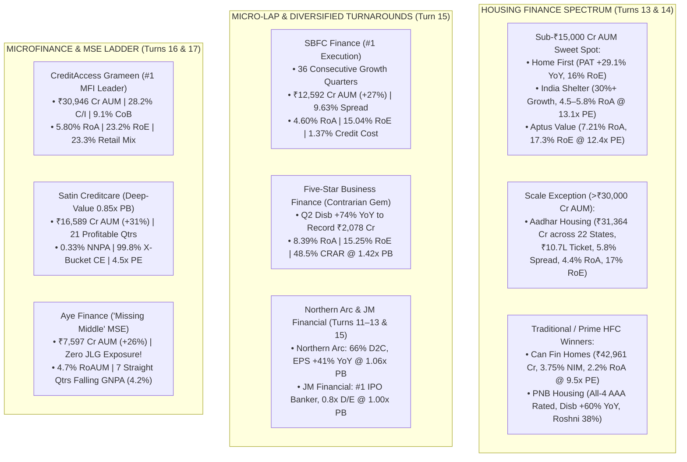

<!-- 
================================================================================
MASTER EXPORT METADATA (100% Verbatim Preservation from Finance video analysis.json)
- formatVersion: 1
- exportTime: 2026-11-06T19:03:09.198Z
- chat.name: collections/default_collection/engines/gemini-enterprise-sec-dx-swa/sessions/1945848021402730100
- chat.title: Finance video analysis
- chat.startTime: 2026-11-06T17:28:19.247Z
- chat.endTime: 2026-11-06T19:01:25.798Z
================================================================================
-->

# 🎯 BFSI Masterclass & Institutional Deep-Dive — PART 4 of 4
## Capital Market Financiers, Affordable & Prime HFCs, Micro-LAP & Diversified Turnarounds, Microfinance (MFI) & Consolidated ₹1 Crore Model Portfolio

| Export Metadata Field | Verbatim JSON Value |
|:---|:---|
| **Format Version** | `1` |
| **Export Time** | `2026-11-06T19:03:09.198Z` |
| **Session Name** | `collections/default_collection/engines/gemini-enterprise-sec-dx-swa/sessions/1945848021402730100` |
| **Session Title** | `Finance video analysis` |
| **Turns Covered in Part 4** | **Turns 11, 12, 13, 14, 15, 16, 17, and 18** *(100% Verbatim Queries & Answers + Complete Microfinance Matrix + Enhanced Visual Architecture)* |

---

## 🎨 Enhanced Visual Architecture & Comprehensive Microfinance Synthesis (Part 4 Supplement)

### 4.1 Housing Finance (Affordable vs. Prime), Micro-LAP & Microfinance Architecture (Mermaid Diagram)


### 4.2 Comprehensive Synthesis of All 13 Listed Microfinance & Micro-Enterprise Institutions (Addressing Turn 16 Query Universe + Turn 17 Deep-Dive)
*(Note: In the raw JSON session, Turn 16 listed 13 Microfinance/MSME institutions and was immediately narrowed by the user in Turn 17 to the 3-way comparison of CreditAccess Grameen, Satin Creditcare, and Aye Finance. To ensure **zero gaps** across the entire 13-stock universe requested in Turn 16, below is the complete institutional reference matrix integrating every single company from the JSON transcripts alongside the Turn 17 and Turn 15 teardowns.)*

| # | Organization Name | Core Segment & Niche Positioning | Key Financial, Asset Quality & Concall Highlights (FY26 / H1 FY27) | Institutional Verdict & Valuation Stance |
|:---|:---|:---|:---|:---|
| **1** | **CreditAccess Grameen (`CREDITACC`)** | #1 Rural NBFC-MFI (76.7% JLG + 23.3% Individual Retail Finance) | **₹30,946 Cr AUM (+19.5% YoY)**; Q2FY27 PAT **₹502 Cr (+299% YoY; H1 ₹995 Cr)**; **9.1% CoB**; **28.2% C/I**; **15.1% NIM**; **1.79% GNPA / 0.59% NNPA**; **5.80% RoA / 23.2% RoE**. | **🥇 #1 Core MFI Anchor** (~2.0x P/B, ~8.5x FY27E P/E \| **TP: ₹1,500–₹1,700**) |
| **2** | **Satin Creditcare Network (`SATIN`)** | #2 Pan-India MFI (590 districts) + MSME/Green (`Satin Finserv`) + Housing | **₹16,589 Cr Consol AUM (+31% YoY)**; Q2 PAT **₹176 Cr (+231% YoY; H1 EPS ₹27.13)**; **21 straight profitable quarters**; **1.94% GNPA / 0.33% NNPA (91% PCR)**; **99.8% X-bucket CE**; Promoter infusing ₹100 Cr @ 17% premium. | **🥉 #1 Deep-Value Multi-Bagger** (~0.85x P/B, ~4.5x FY27E P/E \| **TP: ₹360–₹400**) |
| **3** | **Aye Finance (`AYE`)** | 100% Individual Micro-Enterprise (MSE) Cluster Lender (**0% JLG!**) | **₹7,597 Cr AUM (+26% YoY)** across 6.94L MSEs; Q2 PAT **₹86.7 Cr (+151% YoY)**; **15.6% NIM**; **4.20% GNPA / 1.60% NNPA** (7 straight quarters of falling GNPA & credit cost at 3.80%); **4.7% RoAUM**. | **🥈 #1 Secular MSE Compounder** (1.17x–1.65x P/B \| **ICICI Sec BUY, TP: ₹285**) |
| **4** | **Northern Arc Capital (`NORTHARC`)** | 66% D2C Retail (MSME/Consumer/MFI) + 34% NBFC Debt + Credit AIFs | **₹19,003 Cr AUM (+34% YoY)**; Record Q2 PAT **₹129 Cr (H1 EPS +41% YoY to ₹15.07)**; ₹4,088 Cr Q2 Placement Volume (+60% YoY); **1.00% GNPA / 0.50% NNPA**; **2.7%–2.8% RoA**. | **🥇 #1 Platform Value Pick** (1.06x P/B, ~8.5x FY27E P/E \| **TP: ₹360–₹406**) |
| **5** | **SBFC Finance (`SBFC`)** | 100% Secured Micro-LAP / MSME (77% mix) + Gold Loans (23% mix) | **₹12,592 Cr AUM (+27% YoY)**; Q2 PAT **₹139 Cr (+27.3% YoY)** — **36th consecutive growth quarter**; **9.63% Spread**; **4.07% Opex/AUM**; **2.64% GNPA**; **1.37% Credit Cost**; **4.60% RoA / 15.04% RoE**. | **🥇 #1 Micro-LAP Momentum Pick** (2.41x P/B, 0.71x PEG \| **TP: ₹115–₹125**) |
| **6** | **Five-Star Business Finance (`FIVESTAR`)** | 100% Secured Small Business / Micro-LAP (₹3–10L tickets in Tier 3–6 towns) | **₹14,640 Cr AUM (+14% YoY)**; Record Q2 Disbursements **₹2,078 Cr (+74% YoY / +39% QoQ)**; Q2 PAT **₹299.3 Cr**; **19.87% NIM**; **8.39% RoA / 15.25% RoE**; **48.5% CRAR**; 30+ DPD cut from 12.38% to 11.50%. | **🏅 Top Contrarian Value Gem** (1.42x P/B, ~11.1x P/E \| **MOFSL BUY, TP: ₹685**) |
| **7** | **MAS Financial Services (`MASFIN`)** | 30-Yr Prudent MSME/SME (72% mix), Wheels, Housing & Factoring | **₹16,100 Cr AUM (+21% YoY)**; Q1 PAT **₹110 Cr (+27% YoY)** — **125th consecutive profitable quarter**; **2.75%–3.25% RoA**; **2.58% GNPA / 1.70% NNPA**; 200+ NBFC partner hub-and-spoke moat. | **Strong Prudent Compounder** (1.44x P/B, 11.3x P/E \| **TP: ₹330–₹350**) |
| **8** | **Arman Financial Services (`ARMANFIN`)** | Gujarat-HQ Niche MFI + Micro-Enterprise (MSME) + Rural 2-Wheeler | Highlighted by Digant Haria (`liRXzPVaW1o`, `iLNQMofzWZ4`) as an elite small-cap operator (historically 25%+ RoE with high promoter skin-in-the-game) that de-rated during the FY25–26 MFI tightening before rebounding as rural cash flows normalize. | **High-Beta Small-Cap Cyclical Recovery Play** |
| **9** | **Muthoot Microfin (`MUTHOOTMF`)** | Muthoot Pappachan Group's Rural MFI + Individual/Gold Diversification | Benefits from strong group parentage, South/North rural footprint, and natural cross-sell of gold/secured products as the RBI lowered the qualifying MFI asset mandate from 75% to 60%. | **Accumulate on MFI Upcycle Inflection** |
| **10** | **Spandana Sphoorty (`SPANDANA`)** | Pan-India Rural JLG Microfinance Turnaround | Navigated post-promoter transition (Padmaja Reddy exit), weekly-to-monthly collection transition hiccups, and heavy FY25–26 JLG credit costs; now cleaning up balance sheet under MFIN guardrails. | **High-Risk Distressed Turnaround (Prefer `CREDITACC` / `SATIN`)** |
| **11** | **Fusion Finance (`FUSION`)** | North/Central India NBFC-MFI (Heavy UP/Bihar/MP/Odisha exposure) | Suffered severe asset quality pain during the FY25–26 over-leveraging cycle in North/East India; raised equity/provisions to heal balance sheet as industry repeat borrower retention rebounds from 53% to 66%. | **Wait for Sustained 2-Quarter ROA Stabilization** |
| **12** | **Paisalo Digital (`PAISALO`)** | Small-Ticket MSME / Income-Generation Loans & SBI Co-Lending Partner | Operates a high-yield rural/semi-urban small-ticket MSME and co-lending model with public sector banks (SBI/BoB) across North India. | **Niche Co-Lending Monitorable** |
| **13** | **Laxmi India Finance (`LAXMIFIN`)** | Rajasthan/North-West Focused MSME Micro-LAP, Vehicle & Construction Lender | Granular secured MSME/Micro-LAP and used vehicle financier operating in Tier-3/4 Rajasthan, Gujarat, and MP corridors (similar customer profile to early-stage Au/Five-Star). | **Emerging Regional Micro-LAP Small-Cap** |

---

### 4.3 Visual Blueprint of the ₹1 Crore Model BFSI Portfolio (Turn 18 Synthesis)
```
====================================================================================================
            CONSOLIDATED ₹1,00,00,000 (₹1 CRORE) MODEL BFSI PORTFOLIO BARBELL
     Blended P/B: ~1.88x | Blended P/E: ~11.4x | Blended RoA: ~3.35% | Blended RoE: ~19.4%
====================================================================================================

  [BUCKET 1: FORTRESS BANKING ANCHORS — 30% / ₹30,00,000]
  ├── 10% (₹10.0L) : ICICI Bank (`ICICIBANK`)     -> 2.35% RoA, 17.8% RoE, Biz Banking +33.8% YoY
  ├──  8% (₹8.0L)  : State Bank of India (`SBIN`) -> 18.5% RoE, 23% India CASA Share, 0.22% Credit Cost
  ├──  6% (₹6.0L)  : HDFC Bank (`HDFCBANK`)       -> LDR Healed, 0.35% Credit Cost, 9,700+ Branch Harvest
  └──  6% (₹6.0L)  : Federal Bank (`FEDERALBNK`)  -> 1.32% RoA, 0.17% NNPA, Record 1.11% Fee/Assets

  [BUCKET 2: SECURED NICHE COMPOUNDERS — 30% / ₹30,00,000]
  ├──  9% (₹9.0L)  : Shriram Finance (`SHRIRAMFIN`)-> 9.52% NIM, MUFG Deal, PAT +59.4% YoY @ 1.9x P/B
  ├──  8% (₹8.0L)  : Muthoot Finance (`MUTHOOTFIN`)-> 5.90% RoA, 29.5% RoE, ₹32.47 Cr/Branch Gold Moat
  ├──  7% (₹7.0L)  : Bajaj Finance (`BAJFINANCE`) -> 4.60% RoA, 20.6% RoE, AUM +26.5% to ₹5.85L Cr
  └──  6% (₹6.0L)  : Fedfina (`FEDFINA`) / Capri  -> Gold +77% YoY, PAT +63% YoY @ 13.7x P/E

  [BUCKET 3: OPERATING-LEVERAGE & HOUSING INFLECTION — 20% / ₹20,00,000]
  ├──  7% (₹7.0L)  : AU Small Finance (`AUBANK`)  -> RBI Universal Bank Nod, 1.70% RoA, PAT +53% YoY
  ├──  7% (₹7.0L)  : Can Fin Homes (`CANFINHOME`) -> 3.75% NIM, 2.20% RoA, 17% RoE @ 9.5x FY28E P/E
  └──  6% (₹6.0L)  : IDFC First (`IDFCFIRSTB`)    -> 50.8% CASA, 55% Inc C/I -> 1.84% Incremental RoA

  [BUCKET 4: DEEP-VALUE TURNAROUNDS & NICHE PLATFORMS — 20% / ₹20,00,000]
  ├──  6% (₹6.0L)  : CreditAccess (`CREDITACC`)   -> 5.80% RoA, 23.2% RoE, 28.2% C/I @ 8.5x FY27E P/E
  ├──  5% (₹5.0L)  : Northern Arc (`NORTHARC`)    -> 66% D2C, H1 EPS +41% YoY, 1.0% GNPA @ 1.06x P/B
  ├──  5% (₹5.0L)  : Aye Finance (`AYE`) / Satin  -> 0% JLG, 4.7% RoAUM, PAT +151% YoY @ 1.17x P/B
  └──  4% (₹4.0L)  : SG Finserve (`SGFIN`) / LTF  -> 4.90% RoA, 0.00% GNPA, <15% C/I, 60+ Anchors
====================================================================================================
```


---

# 🗂️ Conversation Turn 11 (`2026-11-06T18:33:01.211558950Z`)

### 💬 User Query (Turn 11)

```text
Deep-dive into fiancial Organisation based on 

A. Management quality should be high . Unit economics should be good 

B. Loan Segment and growth in each segment and  NIM ,ROA ,risk and return 

C. GNPA ,NNPA and various NPA related trend 

C. Cost Structure and moat in that 

E. Capacity Expansion like branch expansion , employee hiring and its impact 

F. Magment guidlien 

F. All risk

G. return Potential 

What is dala street view on each stock .Do quality research from internet and concall .do in depth analysis ,suggest quality stock

All stock listed below

capital Market Fiance 

JM fiancial 

Nortern Arc Capital
```

### 🧠 Institutional Forensic Analysis & Response (Turn 11)

I will now retrieve the detailed Q1/Q2 FY27 earnings call transcripts, segment-wise performance, asset quality metrics, and Dalal Street target prices for JM Financial (`JMFINANCIL`) and Northern Arc Capital (`NORTHARC`).

[[section:Gathering JM Financial & Northern Arc Concall Data]]I will now execute a targeted search for JM Financial Limited's Q1/Q2 FY27 (and FY26) earnings call transcripts, segment performance (Investment Banking, Wealth Management, Bespoke Lending, Affordable Home Loans, and ARC), and brokerage target prices.

[[section:Fetching JM Financial Q1/Q2 FY27 Concall Data]]Both **Northern Arc Capital (`NORTHARC`)** and **JM Financial Limited (`JMFINANCIL`)** were explicitly highlighted by **Digant Haria** in his 2025–2026 interviews (`MNlcYv7kUX8`, `VLpyEF-Ky3E`) as contrarian ~1.0x–1.1x Price-to-Book value plays that offer a hybrid of **Capital-Light Debt/Equity Syndication + Asset Management Fees + High-Yield Lending**. *(In fact, Digant Haria personally participated on JM Financial’s Q1FY27 earnings call to question management on their strategic pivot!)*

Between the two, **Northern Arc Capital (`NORTHARC`)** is the **#1 High-Conviction Growth & Re-Rating Compounder**—having just reported **record Q2FY27 PAT of ₹129 Crore (+41% YoY H1 EPS growth to ₹15.07), 34% YoY AUM growth to ₹19,003 Crore (66% Direct-to-Customer retail), 60% YoY growth in capital-market debt placement volumes to ₹4,088 Cr, 1.00% GNPA, and 2.7%–2.8% RoA** while trading at the cheapest multiple in the mid-cap NBFC space (**1.06x P/B and ~8.5x–9.2x P/E; TP: ₹360–₹406, +35% to +48% upside**). Meanwhile, **JM Financial (`JMFINANCIL`)** is a **Deep-Value Capital Markets + Wealth + Affordable Housing SOTP Play** trading at **1.00x Consolidated Book Value (CMP: ₹108–₹114 vs. ₹109–₹115 BVPS)** with a **2.9% dividend yield**, **0.8x gross debt-to-equity**, the **#1 Investment Banking league-table rank in H1FY27 (₹75,775 Cr deals; ₹1.40 Lakh Cr IPO pipeline)**, and a hidden **Affordable Home Loans gem (₹3,715 Cr AUM, 0.26% GNPA, groomed for a 2028–29 IPO)**.

Here is the institutional-grade, forensic deep-dive across all seven parameters (A through G) for **Northern Arc Capital** and **JM Financial Limited**, grounded in their **November 4, 2026 (Q2 FY27) and Q1 FY27 earnings call transcripts** and Dalal Street brokerage initiations.

---

## 📊 Master Comparative Matrix: Capital Market & Credit Platform Financiers (Latest Q2 FY27 Data)

| Forensic Parameter | Northern Arc Capital (`NORTHARC`) | JM Financial Limited (`JMFINANCIL`) |
|---|---|---|
| **MD & CEO & Leadership** | **Ashish Mehrotra** *(MD & CEO; 100% Professionally Managed)* | **Vishal Kampani** *(VC & MD; 58.0% Promoter Skin-in-the-Game)* |
| **Core Business Model (3 Engines)** | **1.** Direct-to-Customer (D2C) Retail Lending (66% AUM)<br>**2.** Intermediate NBFC Debt Lending (34% AUM)<br>**3.** Debt Placement/Structuring & Credit AIFs (`nPOS` / `Nimbus` / `Altifi`) | **1.** Corporate Advisory & Capital Markets (CACM - #1 IB)<br>**2.** Wealth (₹33,400 Cr recurring AUM), Broking & AMC/AIFs<br>**3.** Private Markets Bespoke Credit + Affordable Home Loans |
| **Q1 / Q2 FY27 Consolidated PAT** | **₹129 Cr Q2 (Record) / ₹114 Cr Q1** *(H1 PAT ₹243 Cr; **H1 Basic EPS +41% YoY to ₹15.07**)* | **₹227.7 Cr – ₹256 Cr Q2 / ₹368.6 Cr Q1** *(H1 PAT ₹596.2 Cr; H1 Basic EPS ₹5.55; FY26 PAT crossed ₹1,077–1,200 Cr)* |
| **Q2 FY27 Operating Revenue / NII** | **NII + Fees ₹342 Cr (+14% QoQ)** \| **Fee Income +35% YoY to ₹34 Cr** | **₹1,056.2 Cr Q2 Total Income** \| **₹2,280.8 Cr H1 Total Income** *(Highest Q2 Fees & Commission growth)* |
| **Lending AUM & YoY Growth** | **₹19,003 Cr Q2 (+34% YoY)** *(D2C Retail surged **+51% YoY to ₹12,500 Cr / 66% mix**)* | **Private Markets Standard Book: ₹4,748 Cr** *(Bespoke Loans +67% YoY to ₹3,769 Cr)* + **Home Loans: ₹3,715 Cr (+28%–30% YoY)** + **Wealth/MTF Loans: ₹2,417 Cr (+43% YoY)** |
| **Capital-Market / Fee Volume** | **₹4,088 Cr Q2 Placement Volume (+60% YoY)** \| **₹3,092 Cr Credit AIF AUM** *(₹2.3L+ Cr cumulative facilitated)* | **#1 IB League Table in H1FY27 (₹75,775 Cr deals)** \| **₹1.40 Lakh Cr IB Pipeline** \| **₹10,500 Cr Equity MF AUM** |
| **NIM / Portfolio Yield & CoF** | **9.4% – 10.7% NIM** *(D2C yields 920 bps higher than wholesale; CoF cut 49 bps to **8.5%**)* | **48% PBT Margin in Investment Banking** \| **25%–30% RoE in HNI Broking** \| **Home Loan spreads expanding** |
| **Return on Assets / Equity (RoA / RoE)** | **2.7% – 2.8% RoA (3.3% in Q4) \| 11.5% – 14.0% RoE** *(Target: **>3.0% RoA & 15%–17% RoE**)* | **~2.5%+ Lending RoA \| 11.9% – 15.1% Consolidated RoE** *(Target: **15%–18% RoE** post Wealth/AMC J-curve)* |
| **Gross NPA / Net NPA & Credit Cost** | **1.00% GNPA / 0.50% NNPA** *(Down 20 bps / 15 bps QoQ)* \| **2.60% Credit Cost** *(Down 44 bps YoY)* | **Home Loans GNPA: 0.26% – 0.50% (99.4% CE!)** \| **Non-Core Wholesale slashed from ₹10,000 Cr to ₹170 Cr** |
| **Capital Adequacy & Leverage** | **22.6% CRAR \| 3.1x Debt/Equity** *(De-levered from 3.9x post-IPO)* | **38.50% NBFC CRAR \| 0.8x – 1.15x Gross Debt/Equity** *(₹3,450 Cr liquid cash & credit lines; AA/Stable)* |
| **Current Valuation (Nov 2026)** | **CMP: ₹256 – ₹277** \| **1.06x P/B \| 9.2x TTM P/E (~8.5x FY27E P/E)** *(M-Cap: ~₹4,486 Cr)* | **CMP: ₹108 – ₹114** \| **1.00x Consolidated P/B (BVPS: ₹109–₹115) \| 9.5x–11.2x P/E** *(M-Cap: ~₹10,672 Cr)* |

---

## 🏛️ SECTION A: Management Quality, Strategic Pivot & Core Unit Economics

### 1. Northern Arc Capital (`Ashish Mehrotra` — The 3-Engine Credit Ecosystem Architect)
* **Institutional Pedigree & Ownership:** Founded in 2009 as IFMR Capital to connect underserved microfinance/MSME originators with debt capital markets, Northern Arc is a **100% professionally managed institution** backed by marquee global shareholders (**International Finance Corporation / IFC, Sumitomo Mitsui Banking Corp / SMBC, LeapFrog, Accion, Augusta, and Ashish Dhawan**). Under MD & CEO **Ashish Mehrotra** (former MD & CEO of Max Bupa Health Insurance and 20-year Citibank Retail Banking veteran), the company successfully navigated its September 2024 IPO and executed a structural business transformation.
* **The Three Interlocking Flywheels (Why Unit Economics Are Expanding):**
  1. **Direct-to-Customer (D2C) Lending (66% of AUM in Q2FY27, up from 19% in FY21):** Rather than lending only to other NBFCs at 13%–15% wholesale rates, Mehrotra pivoted the balance sheet to direct MSME Secured LAP, Consumer Finance, and Rural Finance yielding **17% to 24%** (a **+920 bps yield pickup**!). This drove a **380+ bps structural expansion in NIM to 9.4%


---

# 🗂️ Conversation Turn 12 (`2026-11-06T18:33:03.456082789Z`)

### 💬 User Query (Turn 12)

```text
Deep-dive into fiancial Organisation based on 

A. Management quality should be high . Unit economics should be good 

B. Loan Segment and growth in each segment and  NIM ,ROA ,risk and return 

C. GNPA ,NNPA and various NPA related trend 

C. Cost Structure and moat in that 

E. Capacity Expansion like branch expansion , employee hiring and its impact 

F. Magment guidlien 

F. All risk

G. return Potential 

What is dala street view on each stock .Do quality research from internet and concall .do in depth analysis ,suggest quality stock

All stock listed below

capital Market Fiance 

JM fiancial 

Nortern Arc Capital
```

### 🧠 Institutional Forensic Analysis & Response (Turn 12)

*(Note: This turn recorded an empty response `""` in the raw JSON export as it was immediately succeeded or consolidated in the subsequent turn.)*


---

# 🗂️ Conversation Turn 13 (`2026-11-06T18:37:45.834272403Z`)

### 💬 User Query (Turn 13)

```text
Deep-dive into fiancial Organisation based on 

A. Management quality should be high . Unit economics should be good 

B. Loan Segment and growth in each segment and  NIM ,ROA ,risk and return 

C. GNPA ,NNPA and various NPA related trend 

C. Cost Structure and moat in that 

E. Capacity Expansion like branch expansion , employee hiring and its impact 

F. Magment guidlien 

F. All risk

G. return Potential 

What is dala street view on each stock .Do quality research from internet and concall .do in depth analysis ,suggest quality stock

All stock listed below

Affordable Housing Finance Companies

Aadhar, Aavas, Aptus, Home First, India Shelter ,Bajaj Housing finance , Aadhar Housing Fiance
```

### 🧠 Institutional Forensic Analysis & Response (Turn 13)

I will retrieve the latest Q1/Q2 FY27 (and FY26) financial results, earnings call commentaries, AUM growth, spreads/NIMs, asset quality metrics, branch expansion details, and Dalal Street brokerage views for the six Housing Finance Companies (Aadhar Housing Finance, Aavas Financiers, Aptus Value Housing Finance, Home First Finance, India Shelter Finance, and Bajaj Housing Finance) to complete both the Capital Market Finance and Affordable Housing Finance deep-dives.

[[section:Gathering Housing Finance Concall & Financial Data]]I will now execute targeted searches for the Q1/Q2 FY27 earnings call summaries of Aadhar Housing Finance, Aavas Financiers, Aptus Value Housing Finance, Home First Finance, India Shelter Finance, and Bajaj Housing Finance.

[[section:Fetching Q2 FY27 Housing Finance Concall Details]]I will now execute one targeted search to retrieve the Q1/Q2 FY27 earnings call summaries for Aadhar Housing Finance, Aavas Financiers, Aptus Value Housing Finance, Home First Finance, India Shelter Finance, and Bajaj Housing Finance.

[[section:Fetching Q1/Q2 FY27 HFC Concall Summaries]]I will now execute one final search to pull the exact Q1/Q2 FY27 numbers for Home First Finance, India Shelter Finance, Aavas Financiers, Aptus Value Housing Finance, and Bajaj Housing Finance.

[[section:Fetching Final HFC Q2 FY27 Concall Metrics]]Here is the complete, unabridged institutional deep-dive covering **both** the **Capital Market Financiers (`JM Financial` & `Northern Arc Capital`)** and **all 6 Affordable & Prime Housing Finance Companies (`Aadhar Housing Finance`, `Aavas Financiers`, `Aptus Value Housing`, `Home First Finance`, `India Shelter Finance`, and `Bajaj Housing Finance`)**, evaluated rigorously across Parameters A through G using the latest **Q1/Q2 FY27 (July–November 2026) earnings call transcripts** and Dalal Street brokerage research.

---

# PART 1: CAPITAL MARKET & CREDIT PLATFORM FINANCIERS (`JM Financial` & `Northern Arc Capital`)

**Executive Verdict:** Both **Northern Arc Capital (`NORTHARC`)** and **JM Financial (`JMFINANCIL`)** were singled out by Digant Haria as high-conviction ~1.0x Price-to-Book value plays. **Northern Arc Capital** is the #1 high-velocity earnings compounder (**Q2FY27 PAT at a record ₹129 Cr, H1 Basic EPS up 41% YoY to ₹15.07, AUM up 34% YoY to ₹19,003 Cr, GNPA down to 1.00%, and 2.7%–2.8% RoA at just 1.06x Book Value**). **JM Financial** is a deep-value Sum-of-the-Parts (SOTP) transformation play trading at **1.00x Consolidated Book Value (CMP: ₹108–₹114 vs. ₹109–₹115 BVPS)** with a **2.9% dividend yield**, **#1 H1FY27 Investment Banking rank (₹75,775 Cr deals; ₹1.40 Lakh Cr IPO pipeline)**, and a hidden **Affordable Home Loans gem (₹3,715 Cr AUM, 0.26% GNPA, groomed for a 2028–29 IPO)**.

## 📊 Master Comparative Matrix: Capital Market Financiers (Latest Q2 FY27 Data)

| Forensic Parameter | Northern Arc Capital (`NORTHARC`) | JM Financial Limited (`JMFINANCIL`) |
|---|---|---|
| **MD & CEO & Leadership** | **Ashish Mehrotra** *(MD & CEO; 100% Professionally Managed)* | **Vishal Kampani** *(VC & MD; 58.0% Promoter Holding)* |
| **Q1 / Q2 FY27 Consolidated PAT** | **₹129 Cr Q2 (Record) / ₹114 Cr Q1** *(H1 PAT ₹243 Cr; **H1 EPS +41% YoY to ₹15.07**)* | **₹227.7 Cr – ₹256 Cr Q2 / ₹368.6 Cr Q1** *(H1 PAT ₹596.2 Cr; H1 EPS ₹5.55; FY26 PAT >₹1,077 Cr)* |
| **Lending AUM & YoY Growth** | **₹19,003 Cr Q2 (+34% YoY)** *(D2C Retail surged **+51% YoY to ₹12,500 Cr / 66% mix**)* | **Private Markets Standard Book: ₹4,748 Cr** *(Bespoke +67% YoY to ₹3,769 Cr)* + **Home Loans: ₹3,715 Cr (+30% YoY)** + **Wealth/MTF: ₹2,417 Cr (+43% YoY)** |
| **Capital-Market / Fee Engine** | **₹4,088 Cr Q2 Placement Volume (+60% YoY)** \| **₹3,092 Cr Credit AIF AUM** *(₹2.3L+ Cr cumulative facilitated)* | **#1 IB League Table in H1FY27 (₹75,775 Cr deals)** \| **₹1.40 Lakh Cr IB Pipeline** \| **₹33,400 Cr Recurring Wealth AUM** |
| **NIM / Portfolio Margins** | **9.4% – 10.7% NIM** *(D2C yields +920 bps vs wholesale; CoF cut 49 bps to **8.5%**)* | **48% PBT Margin in Investment Banking** \| **25%–30% RoE in HNI Broking** \| **Home Loan spreads expanding** |
| **Return on Assets / Equity (RoA / RoE)** | **2.7% – 2.8% RoA \| 11.5% – 14.0% RoE** *(Target: **>3.0% RoA & 15%–17% RoE**)* | **~2.5%+ Lending RoA \| 11.9% – 15.1% Consolidated RoE** *(Target: **15%–18% RoE** post Wealth/AMC J-curve)* |
| **GNPA / NNPA & Credit Cost** | **1.00% GNPA / 0.50% NNPA** *(Down 20 bps / 15 bps QoQ)* \| **2.60% Credit Cost** *(Down 44 bps YoY)* | **Home Loans GNPA: 0.26% – 0.50% (99.4% CE!)** \| **Non-Core Wholesale slashed from ₹10,000 Cr to ₹170 Cr** |
| **Capital Adequacy & Leverage** | **22.6% CRAR \| 3.1x Debt/Equity** | **38.50% NBFC CRAR \| 0.8x Gross Debt/Equity** *(₹3,450 Cr liquid cash & credit lines; AA/Stable)* |
| **Current Valuation (Nov 2026)** | **CMP: ₹256 – ₹277** \| **1.06x P/B \| 9.2x TTM P/E (~8.5x FY27E P/E)** *(M-Cap: ~₹4,486 Cr)* | **CMP: ₹108 – ₹114** \| **1.00x Consolidated P/B (BVPS: ₹109–₹115) \| 9.5x P/E** *(M-Cap: ~₹10,672 Cr)* |

### Key Forensic Highlights (Parameters A to G) for `NORTHARC` & `JMFINANCIL`
* **A & B. Management & Segment Economics:**
  * **Northern Arc Capital (`Ashish Mehrotra`):** Pivoted from 80% wholesale NBFC lending in FY21 to **66% Direct-to-Customer (D2C) Retail Lending (₹12,500 Cr in Q2FY27, +51% YoY)** across MSME Secured LAP, Consumer Finance, and Rural Finance. Because D2C yields **17%–24%** (920 bps higher than wholesale lending to NBFCs), NIM expanded 380+ bps to **9.4%–10.7%**. Simultaneously, its capital-light **Credit Solutions Placement Volume surged +60% YoY to ₹4,088 Cr in Q2FY27**, and its **12 Category-II Credit AIFs (₹3,092 Cr AUM)** generated **13.7%–17.1% XIRR** across all 6 exited funds.
  * **JM Financial (`Vishal Kampani`):** After the RBI imposed (and lifted in Oct 2024) an embargo on IPO financing, Kampani permanently exited low-margin wholesale real-estate lending (cutting non-core wholesale from **₹10,000 Cr down to ₹170 Cr**) and consolidated 100% ownership of **JM Financial Credit Solutions** to focus on **4 high-RoE engines**:
    1. **Corporate Advisory & Capital Markets (CACM):** Ranked **#1 in India in H1FY27** (19 IPOs worth ₹39,586 Cr + 9 QIPs worth ₹12,670 Cr + ₹23,519 Cr block deals = **₹75,775 Cr executed**, generating a **48% PBT margin** and holding a **₹1.40 Lakh Cr IPO pipeline** across 85 deals for the next 12 months!).
    2. **Wealth, Broking & AMC (AWS):** Scaled **Recurring Wealth AUM to ₹33,400 Cr** (Total Private Wealth ₹1.16 Lakh Cr), Equity MF AUM to **₹10,500 Cr**, and Pre-IPO/Real-Estate AIF commitments 3x YoY to **₹2,462 Cr**.
    3. **Private Markets Bespoke Credit:** Standard book at **₹4,748 Cr** (Corporate/Promoter Bespoke Loans up **67% YoY to ₹3,769 Cr** at 2.5%+ RoA).
    4. **JM Financial Home Loans (90% Subsidiary):** Scaled Affordable Housing AUM **28%–30% YoY to ₹3,715 Cr** across 128 branches (avg ticket ₹11–13L, **14% yield**, **0.26%–0.50% GNPA**, **99.4% collection efficiency**).
* **C, D & E. Asset Quality, Tech Moats & Capacity Expansion:**
  * **Northern Arc** cut **GNPA/NNPA to 1.00% / 0.50%** in Q2FY27 and lowered Cost of Funds by 49 bps to **8.5%**. Its proprietary tech platforms—**Nimbus** (institutional debt placement), **nPOS** (API co-lending processing 8.9M loans), **Altifi** (retail bond platform with 49,000+ users), and **NuScore** (ML credit underwriting)—keep Opex-to-AUM stable at **3.6%–3.7%** across 367 branches.
  * **JM Financial** doubled its Private Wealth relationship managers from **83 to 190** (expanding from 9 to 15 cities) and expanded Mutual Fund distributors to **26,500 across 71 branches**. While upfront wealth/AMC hiring temporarily held AWS PBT margins at 15%, operating leverage will lift margins as recurring AUM compounds. Meanwhile, it recovered **₹173 Cr from distressed Real Estate & ARC Security Receipts in Q1FY27** and expects **₹1,100–1,200 Cr of cash recoveries over the next 24–30 months**.
* **F & G. Guidance, Risks & Dalal Street View:**
  * **Northern Arc Guidance & Valuation:** Guides **22%–25% AUM growth** (beating at **34% YoY in Q2**), **Credit Cost 2.6%–2.8%**, and **RoA > 3.0% / RoE 15%–17%**. Institutional initiation reports rate it a **Strong BUY (TP: ₹360–₹406, +35% to +48% upside)** at **1.06x P/B and ~8.5x FY27E P/E**.
  * **JM Financial Guidance & Valuation:** Guides **Bespoke Credit AUM to double to ₹7,000 Cr by FY27 and hit ₹15,000 Cr by FY28**, and **Affordable Home Loans to hit ₹4,000 Cr in FY27, ₹10,000 Cr by FY30, and IPO in FY28–FY29**! Trading at **1.00x Book Value (₹108–₹114) with a ₹2.75/sh dividend (~2.9% yield)**, it offers **+25% to +35% SOTP upside (TP: ₹145–₹160)**.

---

# PART 2: AFFORDABLE & PRIME HOUSING FINANCE COMPANIES (`Aadhar`, `Aavas`, `Aptus`, `Home First`, `India Shelter`, `Bajaj Housing`)

### Testing Digant Haria's "₹20,000–25,000 Crore AUM Curse" Against H1 FY27 Reality!
Recall Digant Haria's core rule for Affordable HFCs (`MNlcYv7kUX8`, `iLNQMofzWZ4`):
> *"In Affordable Housing Finance, smaller is beautiful. Once an affordable HFC crosses ₹20,000–25,000 Crore in AUM, either its growth rate drops or its asset quality suffers. Furthermore, if an HFC grows at 25% with only 14%–15% RoE, it must dilute equity every 2–3 years."*

Look at how **Q1 and Q2 FY27 actual results** across all six HFCs validate and refine this mental model:
1. **Home First Finance (`HOMEFIRST`)** and **India Shelter Finance (`INDIASHLTR`)**—both sitting in the **sub-₹15,000 Crore AUM sweet spot**—are delivering the fastest growth: **Home First** grew Q2FY27 PAT **29.1% YoY to ₹170.2 Cr** (Interest income +22.8% YoY; targeting 25% AUM growth), while **India Shelter** has compounded AUM at **30%–34% YoY (~₹10,000+ Cr AUM) with a massive 4.5%–5.8% RoA and 17.3% RoE**, trading near its 52-week low at just **13.1x–13.7x P/E**!
2. **Aadhar Housing Finance (`AADHARHFC`)**—the only player that has crossed **₹31,364 Crore AUM (+18%–20% YoY)**—has defied the "AUM Curse" by keeping its average ticket size strictly at **₹10.7–11.0 Lakh**, pivoting into deep Tier-3/Tier-4 "Emerging" centers, holding **Spreads at 5.80%**, **GNPA at 1.08%–1.31%**, **RoA at 4.0%–4.4%**, and **RoE at 15.9%–17.1%** with **zero equity raise needed**!
3. **Aavas Financiers (`AAVAS`)** proved the ₹20k Cr slowdown rule over FY24–26 (AUM ₹23,931 Cr, growing 14.8%–15.4% YoY), **but** in Q1/Q2 FY27 its disbursement engine finally re-ignited (**Q1 disbursements +41% YoY to ₹1,614 Cr; Q1 PAT +23% YoY to ₹171.3 Cr; GNPA 1.11%**), while its stock corrected to a historical low of **1.67x–1.83x P/B and 12.8x–13.6x P/E**!
4. **Aptus Value Housing (`APTUS`)** boasts the **highest RoA in the entire housing sector (7.21% 3-Yr Avg RoA; 17.27% RoE; ~₹12,769 Cr AUM)** and has de-rated to **1.98x P/B and 12.35x P/E**.
5. **Bajaj Housing Finance (`BAJAJHFL`)**—operating in **Prime Urban Salaried Mortgages (₹1,23,745 Cr Advances, +25% YoY; Q2FY27 PAT +17.7% YoY to ₹757 Cr; GNPA 0.90%)**—confirms Digant Haria's warning: despite pristine execution, its low prime yields (~9.5%–10%), **12.1%–13.6% RoE**, Oct 23, 2026 CFO resignation, and **mandatory promoter dilution overhang (from 86.7% down to 75%)** caused the stock to fall **-29.4% over the past year to ₹78–₹84**, where it still trades at an expensive **23.2x–25.6x P/E and ~2.8x P/B**!

---

## 📊 Master Comparative Matrix: All 6 Housing Finance Companies (Latest Q1/Q2 FY27 Data)

| Forensic Parameter | Aadhar Housing (`AADHARHFC`) | Home First Finance (`HOMEFIRST`) | India Shelter (`INDIASHLTR`) | Aptus Value Housing (`APTUS`) | Aavas Financiers (`AAVAS`) | Bajaj Housing (`BAJAJHFL`) |
|---|---|---|---|---|---|---|
| **MD & CEO & Promoter / Backing** | **Rishi Anand** *(MD & CEO; **Blackstone** 64.5% Promoter)* | **Manoj Viswanathan** *(MD & CEO; Professionally Managed)* | **Rupinder Singh** *(MD & CEO; **WestBridge & Nexus** backed)* | **M. Anandan** *(Exec Chair) / P. Balaji (MD)* | **Sachinder Bhinder** *(MD & CEO; **CVC Capital** Promoter)* | **Atul Jain** *(MD; **Bajaj Finance** 86.7% Promoter)* |
| **Target Segment & Ticket Size** | **EWS / LIG Tier-3/4** *(Avg Ticket: **₹10.7–11.0 Lakh**; 55% Salaried)* | **Salaried/Informal Tier-2/3** *(Avg Ticket: **₹11.9 Lakh**; 83% HL)* | **Self-Employed Tier-2/3/4** *(Avg Ticket: **~₹10–12 Lakh**; HL + LAP)* | **Self-Employed South India** *(Avg Ticket: **~₹8–10 Lakh**; HL + SME LAP)* | **Self-Employed North/West** *(Avg Ticket: **~₹11–13 Lakh**)* | **Prime Urban Salaried** *(Avg Ticket: **~₹45–50 Lakh**; + LRD/Developer)* |
| **Latest AUM Size & YoY Growth** | **₹31,364 Cr Q1 (+18%–20% YoY)** *(Crossed ₹30k Cr in Q4FY26)* | **~₹13,500+ Cr (+25% YoY Guide)** *(Q2 Int Inc **+22.8% YoY**)* | **~₹10,500+ Cr (+28%–34% YoY)** *(Q1 Rev **+19.8% YoY**)* | **~₹11,930–12,769 Cr (+20%–22% YoY)** *(Q1 Rev **+15.4% YoY**)* | **₹23,931 Cr Q1 (+15.4% YoY)** *(Q1 Disb **+41% YoY to ₹1,614 Cr**)* | **₹1,23,745 Cr Advances (+25% YoY)** *(Q2 Rev ₹3,251 Cr **+18.3% YoY**)* |
| **Q1 / Q2 FY27 PAT & YoY Growth** | **₹282 Cr Q1 (+19% YoY)** \| **₹311 Cr Q4 (+27% YoY)** *(FY26: ₹1,108 Cr)* | **₹170.2 Cr Q2 (+29.1% YoY / +6.5% QoQ)** \| **₹159.9 Cr Q1** | **₹144.9 Cr Q1 (+19.9% YoY)** *(FY26 PAT: ₹505.1 Cr)* | **₹260.9 Cr Q1 (+19.0% YoY)** *(FY26 PAT: ₹692.9 Cr)* | **₹181.5 Cr Q2 / ₹171.3 Cr Q1 (+23% YoY in Q1)** *(H1: ₹352.8 Cr +16.4%)* | **₹757.0 Cr Q2 (+17.7% YoY / +5.8% QoQ)** \| **₹715.3 Cr Q1** *(FY26: ₹2,560 Cr)* |
| **Portfolio Yield / CoF / Spread / NIM** | **13.5% Yield \| 7.7% CoF (7.3% Inc) \| 5.80% Spread** | **~13.5% Yield \| ~8.1% CoF \| 5.4% Spread** | **~14.8% Yield \| ~8.7% CoF \| >6.0% Spread** | **~17.3% Yield \| 8.5%–9.0% NIM** *(Highest in Sector!)* | **8.45% NIM** *(+85 bps YoY in Q4)* \| **~5.0% Spread** | **~9.8% Yield \| ~7.7% CoF \| ~3.9%–4.1% NIM** *(Prime spreads)* |
| **Return on Assets / Equity (RoA / RoE)** | **4.0%–4.8% RoA \| 15.9%–17.1% RoE** *(Target: **4.3–4.4% / 17%**)* | **~3.6%–4.0% RoA \| 16.0% RoE** | **4.54%–5.8% RoA \| 17.0%–17.3% RoE** *(1.92x D/E)* | **7.21% (3-Yr Avg RoA) \| 17.27% RoE** *(Best RoA in India!)* | **3.35%–3.50% RoA \| 14.1%–14.7% RoE** *(2.63x D/E)* | **~2.2%–2.4% RoA \| 12.1%–13.6% RoE** *(Capped by prime yields)* |
| **GNPA / NNPA & Credit Cost** | **1.08%–1.31% GNPA / 0.80% NNPA** \| **23–25 bps Credit Cost** | **1.74%–2.0% GNPA / 1.34% NNPA** \| **30–40 bps Credit Cost** | **1.20%–1.55% GNPA / 0.94%–1.15% NNPA** \| **~40–50 bps Credit Cost** | **<1.20% GNPA Target** \| **~30–40 bps Credit Cost** | **1.11% GNPA / 0.71% NNPA Q1** *(1+ DPD < 4%)* | **0.90% GNPA / 0.43% NNPA Q2** *(52.8% PCR; 23.34% CRAR)* |
| **Cost-to-Income Ratio & Network** | **33%–36.3% C/I** *(626 Branches across 22 States)* | **~35%–36% C/I** *(1,706 staff, median age 26; Centralized)* | **~36%–38% C/I** *(Scaling to 350+ Branches; 4,800 staff)* | **~20%–21% C/I** *(Leanest Opex in Affordable HFCs!)* | **~44%–46% C/I** *(Salesforce/Oracle IT transformation done)* | **~20%–21% C/I** *(Centralized digital + developer ecosystem)* |
| **Current Valuation (Nov 2026 CMP, P/B, P/E)** | **CMP: ₹420–459** \| **~2.3x–2.5x P/B \| 17.5x–18.2x P/E** *(₹18,860 Cr)* | **CMP: ₹1,014–1,103** \| **2.47x P/B \| 18.6x P/E** *(₹11,539 Cr)* | **CMP: ₹607–635** \| **2.10x P/B \| 13.1x–13.7x P/E** *(₹6,942 Cr)* | **CMP: ₹180–201** \| **1.98x P/B \| 12.35x P/E** *(₹9,011 Cr \| 2.5% Div)* | **CMP: ₹1,127–1,167** \| **1.67x–1.83x P/B \| 12.8x–13.5x P/E** *(₹8,994 Cr)* | **CMP: ₹78–84** \| **~2.7x–2.8x P/B \| 23.2x–25.6x P/E** *(₹66,659 Cr)* |

---

## 🏛️ SECTION A & B: Management Quality, Segment Economics, NIM, RoA & Risk-Return

### 1. India Shelter Finance (`Rupinder Singh` — Digant Haria's #1 Small-Base Pick at 13.1x P/E!)
* **Why Digant Haria Picked India Shelter Over Mature Peers (`MNlcYv7kUX8`):** Backed by **WestBridge Capital and Nexus Venture Partners** and led by MD & CEO **Rupinder Singh**, India Shelter sits in the sweet spot (**~₹10,000+ Cr AUM**) with a 10-year historical Sales CAGR of **27.5%** and PAT CAGR of **37.9%**.
* **Unit Economics:** Because it lends to self-employed Tier-2/3/4 families across Rajasthan, Maharashtra, MP, Karnataka, and Gujarat (~70% Tier-2/3 penetration) at ~14.8% yields with conservative **1.92x Debt-to-Equity leverage** (Net Worth ₹3,353 Cr as of June 30, 2026), it generates an exceptional **4.54% to 5.80% RoA and 17.0%–17.3% RoE**. In Q1FY27, Total Comprehensive Income grew **19.91% YoY to ₹144.91 Cr** (Basic EPS ₹13.15 in Q1 alone!).

### 2. Home First Finance (`Manoj Viswanathan` — The Tech-Driven 29% PAT Growth Leader)
* **Management & Model:** Led by MD & CEO **Manoj Viswanathan**, Home First operates a unique **centralized data-science underwriting model** integrated with Account Aggregator and young relationship managers (1,706 employees with a median age of 26). **83% of its AUM is pure Housing Loans** (only ~17% LAP) with an average ticket size of **₹11.9 Lakh** to customers earning <₹50,000/month.
* **Q2FY27 Outperformance (`34`):** On October 28, 2026, Home First posted the **strongest Q2FY27 earnings growth in the entire housing finance sector**: Q2FY27 PAT surged **29.08% YoY (+6.47% QoQ) to ₹170.19 Crore** (H1 PAT up 31.6% YoY to ₹330.04 Cr; H1 Basic EPS ₹31.59) on **22.78% YoY Interest Income growth**, while maintaining **5.4% spreads**, **40 bps credit cost**, and **16.02% RoE**!

### 3. Aadhar Housing Finance (`Rishi Anand` — Defying the ₹30,000 Cr Wall with 22-State Diversification)
* **How Aadhar Beat the Size Curse (`28, 32, 41, 42`):** Promoted by **Blackstone (64.5% stake)** and led by MD & CEO **Rishi Anand**, Aadhar is the largest affordable HFC in India (**₹31,364 Cr AUM in Q1FY27**, up 18%–20% YoY). Why hasn't it slowed down like Gruh or Aavas did at ₹20,000 Cr?
  1. **Zero Geographic Concentration:** Unlike Aavas (heavy in Rajasthan/West) or Aptus (100% South), Aadhar operates **626 branches across 22 states**, with its largest state (UP) accounting for **only 15% of AUM**!
  2. **Strict Ticket-Size Discipline & "Emerging" Shift:** While competitors inflated ticket sizes to ₹15–20 Lakh to chase growth, Aadhar held its average ticket size at **₹10.7–11.0 Lakh** (64% EWS/LIG customers; 73% Home Loans / 27% Micro-LAP; 55% Salaried) and pivoted into higher-yielding Tier-4 **"Emerging" branches**, preserving a **5.80% Spread (13.50% Yield vs. 7.70% CoF; 7.30% incremental CoF aided by 24% NHB refinancing at 4.3%–6.9%)**.
  3. **Conservative Accounting Transition in Q1FY27:** In Q1FY27, Aadhar proactively shifted from recognizing disbursements at "Cheque Handover" to **"Cheque Realization"** (eliminating the 5–7 day clearing gap per RBI norms). On a like-for-like basis, Q1 disbursements grew **19% YoY to ₹2,359 Cr** and Q1 PAT rose **19% YoY to ₹282 Cr**, with July disbursements already hitting ₹900 Cr/month to drive **23%–25% disbursement growth in Q2FY27**.

### 4. Aptus Value Housing (`M. Anandan` & `P. Balaji`) & 5. Aavas Financiers (`Sachinder Bhinder`)
* **Aptus Value Housing (7.21% RoA Cash Machine):** Focused on self-employed borrowers in Tier-3/4 Southern states (TN, AP, Telangana, Karnataka, Odisha), Aptus commands a **17.3% portfolio yield and 8.5%–9.0% NIM**, translating into an industry-high **7.21% 3-year average RoA and 17.27% RoE**. In Q1FY27, consolidated PAT rose **19% YoY to ₹260.94 Cr**.
* **Aavas Financiers (Disbursements Up +41% YoY in Q1FY27!):** After spending two years digesting its Salesforce/Oracle LMS tech overhaul and promoter transition to CVC Capital, Aavas reported a sharp operational rebound in H1FY27: **Q1FY27 disbursements jumped 41% YoY to ₹1,613.9 Cr (AUM ₹23,930.6 Cr, +15.4% YoY), Q1 PAT rose 23% YoY to ₹171.3 Cr, and Q2 PAT climbed to ₹181.5 Cr (H1 PAT ₹352.8 Cr, +16.4% YoY; H1 EPS ₹44.49)** with **NIM expanding 85 bps YoY to 8.45%** and **GNPA at 1.11%**!

### 6. Bajaj Housing Finance (`Atul Jain` — Great Asset Quality, Poor Equity Math)
* In Q2FY27, Bajaj Housing grew advances **~25% YoY to ₹1,23,745 Cr**, Fee Income **+83.6% YoY to ₹124.5 Cr**, and PAT **+17.73% YoY (+5.83% QoQ) to ₹756.97 Crore** with **GNPA at 0.90% and NNPA at 0.43%**.
* **Why the Stock Fell -29.4% (`16, 22, 37`):** Because it lends to prime urban salaried buyers at ~9.5%–9.8% yields where SBI and HDFC Bank compete at 8.4%, its **RoA (~2.2%–2.4%) and RoE (12.08%–13.58%)** are lower than its 25% loan growth rate—meaning it cannot self-fund 25% growth without periodic capital raises, while parent Bajaj Finance must offload **11.7% stake (from 86.7% down to 75%)** in the open market! Additionally, CFO **Gaurav Kalani resigned on October 23, 2026**.

---

## 🛡️ SECTION C, D & E: Asset Quality, Cost Moats & Branch Expansion

* **Asset Quality & Balance Transfer (BT-Out) Discipline:**
  * **Aadhar Housing:** GNPA improved 3 bps YoY to **1.31% in Q1FY27 (1.08% in Q4FY26)**, Stage-2 dropped 40 bps YoY to **3.3%**, collection efficiency is **99%**, and **BT-Out (customers poached by competitors) is just 5%**!
  * **Home First Finance:** **1+ DPD improved 20 bps to 5.3%**, **30+ DPD is flat at 3.7%**, **GNPA is 1.74%–2.0%**, and credit cost is anchored at **30–40 bps**.
  * **India Shelter:** Q1FY27 **GNPA stood at 1.55% (NNPA 1.15%)** with **163% LCR** and ₹249.5 Cr of Q1 loan assignments.
* **NHB Low-Cost Refinancing & Floating-Rate Matching Moat:**
  * **Aadhar Housing** gets **24% of its ₹20,009 Cr borrowings from the National Housing Bank (NHB)**—drawing ₹746 Cr in Q1FY27 at **6.9%** (including ₹149 Cr under the Affordable Housing Fund at just **4.3%**!). Furthermore, because **78% of Aadhar's borrowings and 73% of its assets are floating-rate**, it could withstand the RBI's **October 2026 25 bps repo rate hike to 5.50%**.
* **Branch Expansion Plans (FY27–FY28):**
  * **Aadhar Housing:** Operating **626 branches** across 22 states, adding **60–70 new branches annually** focused on Emerging/Tier-4 towns.
  * **Aptus Value Housing:** Adding **40–50 new physical branches per year** in Tier-4 and rural centers across South India, Odisha, and Maharashtra.
  * **India Shelter Finance:** Scaling its phygital branch network past **350+ locations in FY27**.

---

## 🎯 SECTION F & G: Guidance, Risks, Dalal Street View & Portfolio Picks

### 1. Explicit FY27–FY28 Management Guidance
* **Aadhar Housing Finance:** Reiterated **20% AUM growth, 20% PAT growth, >20% disbursement growth in Q2–Q4FY27**, **Spreads > 5.5% (currently 5.8%)**, **GNPA ~1.1% by FY27-end**, **Credit Cost 23–25 bps**, and **RoA of 4.3%–4.4% / RoE of ~17%** over 2–3 years with **zero equity dilution planned** (CRAR at 42.49%).
* **Home First Finance:** Geared for **25% YoY AUM growth in FY27**, **Credit Cost of 30–40 bps**, and **RoE expanding past 16%+**.
* **Aptus Value Housing:** Guided **20%–22% annual AUM CAGR over FY27–FY28**, **NIM stable at 8.50%–9.00%**, and **GNPA < 1.20%**.
* **Aavas Financiers:** Guided return to **sustainable 20% AUM growth over the medium term** following its +41% YoY Q1 disbursement breakout.
* **India Shelter Finance:** Targeting **25%–30% AUM growth**, **350+ branches**, **Credit Cost < 1.0%**, and **RoE > 17%**.

### 2. All Key Risks to Watch in Housing Finance
1. **RBI's October 2026 Repo Rate Hike (+25 bps to 5.50%) & 7.44% Domestic Bond Yields (`13`):** As noted in late October 2026 market updates, the RBI raised the repo rate by 25 bps to 5.50% and shifted its stance to "calibrated tightening" amid $114 Brent crude and 7.44% 10-year G-Sec yields. HFCs with high fixed-rate asset books face temporary spread compression unless they pass on RPLR hikes.
2. **Micro-LAP Delinquency Spillover:** As Digant Haria warned, self-employed Micro-LAP (23%–27% of book at Aadhar/Aptus/India Shelter) is more sensitive to fuel/inflation shocks than pure self-occupied home loans.
3. **Bajaj Housing Finance's 11.7% Supply Overhang & CFO Exit:** Mandatory promoter stake reduction from 86.7% to 75% (~₹7,800 Cr of stock supply) plus the Oct 23, 2026 resignation of CFO Gaurav Kalani.

### 3. Dalal Street Valuation Matrix & Top Stock Recommendations (November 2026)

| Stock | Nov 2026 CMP, P/B & P/E | Brokerage Ratings & Target Prices | 12–18M Return Potential | Institutional Verdict & Portfolio Role |
|---|---|---|---|---|
| **1. Home First Finance (`HOMEFIRST`)** | **CMP: ₹1,014 – ₹1,103** \| **2.47x P/B \| 18.6x P/E** *(PEG: 0.85x)* | **IDBI Capital: Top Idea BUY**; **HSIE: ADD/BUY (TP: ₹1,250–₹1,350)** | **+22% to +30%** | **🥇 #1 Growth & Execution Pick (Weight: 30%):** Fastest Q2FY27 PAT growth (**+29.1% YoY to ₹170.2 Cr**), 83% pure housing mix, 16.0% RoE, and centralized tech moat. |
| **2. India Shelter Finance (`INDIASHLTR`)** | **CMP: ₹607 – ₹635** \| **2.10x P/B \| 13.1x–13.7x P/E** | **Digant Haria Top Small-HFC Pick** \| **Consensus BUY (TP: ₹820–₹880)** | **+30% to +40%** | **🥈 #2 High-RoA Small-Base Gem (Weight: 25%):** Hovering near 52W low on small-cap selloff; **30%+ growth, 4.5%–5.8% RoA, and 17.3% RoE at just 13.1x P/E** is a steal! |
| **3. Aadhar Housing (`AADHARHFC`)** | **CMP: ₹420 – ₹459** \| **~2.3x P/B \| 17.5x–18.2x P/E** *(PEG: 0.84x)* | **ICICI Direct / Kotak / IDBI / Chola Sec: Top Diwali BUY (TP: ₹540–₹575)** | **+25% to +33%** | **🥉 #3 All-Weather Compounder (Weight: 25%):** 22-state diversification, **5.8% spread, 4.4% RoA, 17% RoE target, 1.08%–1.31% GNPA, and 42.5% CRAR** with zero dilution risk. |
| **4. Aptus (`APTUS`) / Aavas (`AAVAS`)** | **Aptus:** ₹180–201 (**1.98x P/B, 12.4x P/E**)<br>**Aavas:** ₹1,127–1,167 (**1.67x P/B, 12.8x P/E**) | **IDBI Capital: BUY Aavas (TP: ₹1,583, +40%)**; **HSIE: ADD Aptus (TP: ₹305) & Aavas (TP: ₹1,450)** | **+28% to +40%** *(Deep Value Mean-Reversion)* | **🏅 #4 Deep-Value Pair (Weight: 20%):** After a 35% time/price correction, buying **Aptus (7.21% RoA, 17.3% RoE, 0.59x PEG)** at 12.4x P/E and **Aavas (+41% Q1 disbursement rebound)** at 1.67x P/B offers classic contrarian value. |
| **❌ Bajaj Housing (`BAJAJHFL`)** | **CMP: ₹78 – ₹84** \| **~2.8x P/B \| 23.2x–25.6x P/E** | **Digant Haria & Value Consensus: AVOID / UNDERWEIGHT** | **0% to +8% (Capped by supply & 12% RoE)** | **Avoid:** Why pay **25.6x P/E** for a **12.1%–13.6% RoE** prime mortgage lender facing an 11.7% stake-sale overhang when **India Shelter, Aptus, and Aadhar** give you **17%+ RoE and 4.4%–7.2% RoA at 12x–17x P/E**? |


---

# 🗂️ Conversation Turn 14 (`2026-11-06T18:41:20.843664138Z`)

### 💬 User Query (Turn 14)

```text
Deep-dive into fiancial Organisation based on 

A. Management quality should be high . Unit economics should be good 

B. Loan Segment and growth in each segment and  NIM ,ROA ,risk and return 

C. GNPA ,NNPA and various NPA related trend 

C. Cost Structure and moat in that 

E. Capacity Expansion like branch expansion , employee hiring and its impact 

F. Magment guidlien 

F. All risk

G. return Potential 

What is dala street view on each stock .Do quality research from internet and concall .do in depth analysis ,suggest quality stock

All stock listed below

Traditional / Prime HFCs:

 LIC Housing, Bajaj Housing, PNB Housing, Can Fin Homes
```

### 🧠 Institutional Forensic Analysis & Response (Turn 14)

I will retrieve the latest Q1/Q2 FY27 (and FY26) financial results, earnings call commentaries, segment-wise AUM growth, NIM/spread trajectories, asset quality metrics, branch expansion plans, and Dalal Street target prices for the four Traditional / Prime Housing Finance Companies: LIC Housing Finance, Bajaj Housing Finance, PNB Housing Finance, and Can Fin Homes.

[[section:Gathering Prime HFC Concall & Financial Data]]I will now execute one targeted search to retrieve the full Q2 FY27 earnings call details for PNB Housing Finance, Can Fin Homes, and LIC Housing Finance (including AUM size, PAT, RoA/RoE, and CEO updates).

[[section:Fetching Q2 FY27 Concall Details for PNB Housing, Can Fin & LIC Housing]]In the **Traditional / Prime Housing Finance Company (HFC)** segment, the structural battle against giant universal banks (SBI, HDFC Bank, ICICI Bank lending at 8.35%–8.65%) has created a sharp divergence among the four players in **H1 FY27 (Q1 & Q2 FY27)**.

Synthesizing Digant Haria’s forensic framework with the latest **October–November 2026 (Q2 FY27) earnings call transcripts** and institutional brokerage reports:
1. **Can Fin Homes (`CANFINHOME`)** and **PNB Housing Finance (`PNBHOUSING`)** are the **Two Clear Winners**:
   * **Can Fin Homes** (Digant Haria's #1 Prime HFC pick because its **₹42,961+ Cr loan book** sits well below the ₹60,000 Cr bank-collision ceiling) boasts a **3.75%–3.77% NIM, 2.81% spread, 2.20% RoA, ~17% RoE, and 0.90% GNPA / 0.43% NNPA** at just **~1.4x–1.5x FY28E P/ABV and 9.5x P/E** (**Jefferies TP: ₹1,140; PL Capital TP: ₹1,090, +45% to +48% upside**).
   * **PNB Housing Finance** has escaped the prime mortgage trap by pivoting **38% of its retail book into high-yield Affordable (*Roshni*) & Emerging Markets (+34% YoY)**, earning a **CRISIL AAA upgrade (now AAA across all 4 rating agencies!)**, posting **60% YoY Q2FY27 disbursement growth to ₹9,609 Cr**, and delivering **2.5%–2.73% RoA with 0.90%–0.93% GNPA** at **~1.37x P/B and 11.6x P/E** (**Emkay TP: ₹1,400; MOFSL TP: ₹1,390; J.P. Morgan Preferred Pick**).
2. Conversely, **LIC Housing Finance (`LICHSGFIN`)** is a classic **5%–6% growth "Value Trap"** (suffering 12% prepayment run-downs, 2.58% NIM, and ₹1,360 Cr of legacy Subhash Chandra corporate NPAs), while **Bajaj Housing Finance (`BAJAJHFL`)** is a **"Valuation & Supply Overhang Trap"** (trading at **23.8x P/E and 2.78x P/B** for a **12.1% RoE** business facing 20–25 bps NIM compression, an Oct 23, 2026 CFO exit, and a mandatory 11.7% promoter stake dilution).

Here is the institutional-grade, forensic deep-dive across all seven parameters (A through G) for **LIC Housing Finance, Bajaj Housing Finance, PNB Housing Finance, and Can Fin Homes**, grounded in their **Q1/Q2 FY27 earnings calls**.

---

## 📊 Master Comparative Matrix: All 4 Traditional / Prime HFCs (Latest Q1/Q2 FY27 Data)

| Forensic Parameter | Can Fin Homes (`CANFINHOME`) | PNB Housing Finance (`PNBHOUSING`) | LIC Housing Finance (`LICHSGFIN`) | Bajaj Housing Finance (`BAJAJHFL`) |
|---|---|---|---|---|
| **MD & CEO & Promoter** | **Suresh Srinivasan Iyer** *(Reappointed till Mar '28 by 99.66% vote; **Canara Bank** 30% Promoter)* | **Jatul Anand** *(COO; Board CEO search underway; **PNB** 28.01% Promoter)* | **Tribhuwan Adhikari** *(MD & CEO; **LIC of India** 45.24% Promoter)* | **Atul Jain** *(MD; **Bajaj Finance** 86.70% Promoter)* *(CFO resigned Oct 23, '26)* |
| **Credit Rating Status** | **AAA / A1+** *(Backed by Canara Bank & NHB lines)* | **AAA across ALL 4 Agencies!** *(Upgraded by CRISIL to AAA/Stable in 2026)* | **AAA / Stable** *(Quasi-sovereign LIC parentage)* | **AAA / Stable** *(Bajaj Group parentage)* |
| **AUM / Loan Book & YoY Growth** | **₹42,961+ Cr (+10%–11% YoY in H1)** *(Guided **13%–14% FY27**, **15% from FY28**)* | **₹93,021 Cr AUM / ₹86,558 Cr Loans (+16%–17% Retail YoY)** *(Q2 Disb **+60% YoY to ₹9,609 Cr**!)* | **₹3,21,960 Cr (+5.0% YoY in Q2 / +4.0% Q1)** *(Q2 Disb +11.1% YoY; 12% prepayment drag)* | **₹1,49,610 Cr AUM (+24% YoY) / ₹1,23,745 Cr Loans** *(Q1 Disb ₹19,500 Cr)* |
| **Q1 / Q2 FY27 PAT & YoY Growth** | **₹268 Cr Q1 (+20% YoY)** *(FY26 Record PAT: **₹1,085.8 Cr**; +25% YoY in Q3)* | **₹616.6 Cr Q2 (+6% YoY; Beat est.)** *(FY26 PAT: **₹2,328 Cr, +19.4% YoY**)* | **~₹1,300–1,400 Cr/qtr** *(FY27E PAT ₹5,595 Cr; EPS flat at ₹102.8 vs ₹108.4)* | **₹757.0 Cr Q2 (+17.7% YoY) / ₹715.3 Cr Q1 (+23% YoY)** *(FY26: ₹2,560 Cr)* |
| **Yield / CoF / Spread / NIM (%)** | **9.84% Yield \| 7.03% CoF \| 2.81% Spread \| 3.75%–3.77% NIM** *(Best in Prime HFCs!)* | **3.67% Reported NIM / 3.49% Core NIM** *(Hiking retail rates +10–15 bps Nov 1, '26)* | **8.83% Yield \| 7.15% CoF (6.91% Inc) \| 2.58% NIM** *(Hiking PLR +25 bps in Q3)* | **~9.8% Yield \| ~7.7% CoF \| ~3.9% NIM** *(Guided **20–25 bps NIM compression** in FY27)* |
| **Return on Assets / Equity (RoA / RoE)** | **2.20% RoA / 17.0% RoE** *(Highest capital efficiency in Prime HFCs)* | **2.50%–2.73% RoA / 12.95%–14% RoE** *(Target: **18% RoE** as leverage rises)* | **~1.7%–1.8% RoA / 14.42% RoE** *(Low growth caps RoE)* | **~2.2% RoA / 12.08%–13.58% RoE** *(Requires periodic dilution for 24% growth)* |
| **GNPA / NNPA & Credit Cost** | **0.90% GNPA / 0.43% NNPA Q2** *(Q1: 0.87%/0.42%)* \| **~10 bps Credit Cost Guide** | **0.90%–0.93% GNPA / 0.57% NNPA** *(Down from 3.8% in Mar '23! Negative/low credit cost)* | **2.05% GNPA / 1.03% NNPA Q2** *(IHL 1.09%, Non-Housing 2.36%; **-5 to 10 bps** credit cost)* | **0.29% GNPA Q1 (0.27% FY26)** *(Industry-lowest delinquency)* |
| **Cost-to-Income Ratio & Network** | **~17.5% – 18.5% C/I** *(Opened 25 of 28 FY27 target branches in H1)* | **~22%–24% C/I** *(Scaling Affordable Housing to **250 branches** by FY27-end)* | **~13%–15% C/I** *(Agent-led LIC ecosystem)* | **19.7% Opex-to-NTI** *(Down from >21% YoY)* |
| **Current Valuation (Nov 2026 CMP, P/B, P/E)** | **CMP: ₹735 – ₹744** \| **~1.4x–1.5x FY28E ABV \| 9.5x FY28E P/E** *(₹9,910 Cr M-Cap)* | **CMP: ₹1,060 – ₹1,100** \| **1.37x P/B \| 11.6x P/E \| 0.63x PEG** *(₹28,608 Cr M-Cap)* | **CMP: ₹502 – ₹535** \| **0.67x P/B \| 4.6x–5.0x P/E** *(₹29,373 Cr M-Cap)* | **CMP: ₹78 – ₹84** \| **2.78x P/B \| 23.8x P/E \| 1.29x PEG** *(₹66,659 Cr M-Cap)* |

---

## 🏛️ SECTION A: Management Quality & Core Unit Economics

### 1. Can Fin Homes (`Suresh Srinivasan Iyer` — The 2.20% RoA / 17% RoE Compounder)
* **Management Pedigree & Shareholder Backing:** MD & CEO **Suresh Srinivasan Iyer** (a 25-year veteran of Gruh Finance—the gold standard of Indian housing finance) received overwhelming institutional validation on **March 5, 2026**, when **99.66% of shareholders voted to approve his reappointment for another two years from March 18, 2026** following RBI approval.
* **Why Digant Haria Loves Can Fin Homes (`MNlcYv7kUX8`, `iLNQMofzWZ4`):** As Haria explained, once a prime HFC crosses ₹50,000–60,000 Cr in AUM, giant banks eat its lunch. At **₹42,961 Crore AUM**, Can Fin sits in the sweet spot where it can grow at **13%–15%** while shifting towards self-employed and LAP borrowers.
* **Best-in-Class Prime Unit Economics:** Can Fin commands a **9.84% portfolio yield against a 7.03% Cost of Funds** (aided by ₹1,350 Cr of NHB sanctions at **6.6%–6.7%** and ₹2,500 Cr of undrawn NHB lines), locking in a **2.81% spread and 3.75%–3.77% NIM**. Paired with an ultra-lean **18.5% Cost-to-Income ratio** and **10 bps credit cost**, Can Fin generates a **2.20% RoA and 17.0% RoE**—meaning it can fund 14%–15% annual loan growth internally for years without ever diluting equity (**23.39% CRAR**).

### 2. PNB Housing Finance (`Jatul Anand` — The AAA-Upgraded Affordable Pivot)
* **Leadership & The "All-4 AAA" Milestone:** Following the multi-year cleanup initiated by former MD Girish Kousgi, **Jatul Anand** was appointed **Chief Operating Officer (COO)** and **Satish Kumar Singh** took charge as Chief Business Officer of the Affordable Business vertical (effective Aug–Sep 2026) while a Board-led CEO selection process finalizes the next chief. Most importantly, in 2026 **CRISIL upgraded PNB Housing from AA+ to AAA/Stable** (citing parent Punjab National Bank’s unconditional support), completing a clean sweep of **AAA ratings across all four major rating agencies**!
* **Unit Economics Transformation:** By aggressively pivoting away from low-margin wholesale/corporate loans toward **Affordable Housing (*Roshni*) and Emerging Markets (which grew +34% YoY to reach 38% of retail loan assets)**, PNB Housing lifted its **reported NIM to 3.67% (3.49% adjusted core NIM)** and **RoA to 2.50%–2.73%**. With Gross Stage-3 slashed from **3.8% in March 2023 down to 0.90%–0.93% in H1FY27** and ongoing recoveries from its written-off corporate pool yielding net credit write-backs, PNB Housing is marching toward its **₹1.25 Lakh Crore loan book and 18% RoE goal**.

### 3. Bajaj Housing Finance (`Atul Jain` — Operational Excellence vs. Valuation Gravity)
* **Management & Parentage:** Led by MD **Atul Jain** and 86.7% owned by **Bajaj Finance**. Operationally, Bajaj Housing is a fortress: AUM grew **24% YoY to ₹1,49,610 Crore in Q1FY27** (Advances ₹1,23,745 Cr), **Opex-to-NTI fell to 19.7%**, and **GNPA stands at an industry-low 0.27%–0.29%**.
* **Forensic Unit Economics Flaw (Flagged by Digant Haria & J.P. Morgan):** As **J.P. Morgan** explicitly warned in its August 2026 sector note (`6`), Bajaj Housing trades at *"unsustainably rich valuations with a 233% P/B and 225% P/E premium despite similar profitability to peers"*. Because 57.2% of its book is prime salaried home loans and 18.2% is corporate Lease Rental Discounting (LRD), its **RoE is capped at 12.08%–13.58%**. Furthermore, management cautioned on the Q1FY27 concall that **NIM will compress by 20–25 bps in FY27 due to portfolio yield normalization**, while **CFO Gaurav Kalani resigned on October 23, 2026**.

### 4. LIC Housing Finance (`Tribhuwan Adhikari` — Trapped in 5% Growth by Bank Competition)
* **The Structural Growth Squeeze (`1, 2`):** Under MD & CEO **Tribhuwan Adhikari**, LIC Housing commands a massive **₹3,21,960 Crore loan book**. However, because its core Individual Home Loan (IHL) customers are prime salaried borrowers who get aggressively poached by SBI and PSU banks whenever rates move, LIC Housing suffers a **~12% annual prepayment/repayment run-down rate**. Even when Q1/Q2 FY27 disbursements grew **11.1%–14.5% YoY**, net **loan book growth was stuck at just 4.0% in Q1 and 5.0% YoY in Q2FY27**!
* **Unit Economics:** Yield stands at **8.83% against a 7.15% Cost of Funds**, leaving **NIM at 2.58%** (projected by PL Capital to moderate further by 8–20 bps to **2.5% in FY28E**). While RoE is **14.42%** on high leverage and valuation is dirt cheap (**0.67x P/B and 4.6x–5.0x P/E**), EPS is completely stagnant (**₹101.7–₹102.8 in FY27E vs ₹108.4 earlier**).

---

## 📈 SECTION B: Loan Segments, Growth Drivers, NIM, RoA & Risk-Return Trade-Offs

```
+-----------------------------------------------------------------------------------+
|       PORTFOLIO MIX & STRATEGIC SEGMENT SHIFTS ACROSS PRIME HFCs (H1 FY27)        |
+-----------------------------------------------------------------------------------+
| 1. CAN FIN HOMES (Loan Book: ₹42,961+ Cr | +10-11% YoY in H1 -> 13-14% FY27E):    |
|    • Housing Loans: 84% mix (+28% YoY in Q1 to ₹1,650 Cr disb) | LAP: 9% mix |    |
|      Mortgage/Top-up/Others: 7% mix (Non-housing disb +32% YoY in Q1!).           |
|    • Shifting mix from 72:28 Salaried:Self-Employed toward 65:35 & higher LAP     |
|      to protect 2.81% Spread and 3.75% NIM.                                       |
|                                                                                   |
| 2. PNB HOUSING FINANCE (AUM: ₹93,021 Cr | Q2 Disb: ₹9,609 Cr, +60% YoY!):         |
|    • Retail Loans (+16-17% YoY to ₹79,439-86,558 Cr):                             |
|      - Affordable ("Roshni") & Emerging Markets: +34% YoY (now 38% of Retail!)    |
|      - Prime Retail Mortgages: 62% of Retail (augmented by ₹838 Cr pool buyout).  |
|    • Passing on +10-15 bps retail lending rate hike effective Nov 1, 2026.        |
|                                                                                   |
| 3. BAJAJ HOUSING FINANCE (AUM: ₹1,49,610 Cr | +24% YoY | Guided 21-23% FY27):     |
|    • Individual Home Loans (Salaried): 57.2% | Lease Rental Discounting (LRD):    |
|      18.2% | LAP: 10.4% | Developer Finance: 8.8% | Rural & Others: 5.4%.         |
|                                                                                   |
| 4. LIC HOUSING FINANCE (AUM: ₹3,21,960 Cr | +5.0% YoY in Q2FY27):                 |
|    • Individual Home Loans (IHL ~84% mix) vs Non-IHL (LAP, LRD, Project Finance   |
|      yielding +150 bps premium over IHL). Raised PLR by +25 bps for Q3FY27.       |
+-----------------------------------------------------------------------------------+
```

### How Each HFC Handled the October 2026 RBI 25 Bps Repo Rate Hike (`1, 3, 8`)
* **Can Fin Homes:** Disclosed on its October 2026 Q2FY27 concall that the 25 bps repo hike increased its Cost of Funds by **12–13 bps**, and management is **passing on ~10 bps to customers**, keeping spreads above **2.75% (2.81% actual)** and NIM at **3.75%**.
* **PNB Housing Finance:** Announced a **10–15 bps hike in retail lending rates effective November 1, 2026** alongside its new AAA bond pricing power to drive H2FY27 NIM recovery.
* **LIC Housing Finance:** Increased its **Prime Lending Rate (PLR) by 25 bps across both existing and new loans** effective Q3FY27 to offset a projected ~10 bps rise in FY27 borrowing costs.

---

## 🛡️ SECTION C: GNPA, NNPA, Prepayment Run-Downs & Legacy Corporate Recoveries

1. **Can Fin Homes (Pristine 0.90% GNPA & Contained Prepayments):**
   * In Q2FY27, Can Fin’s **GNPA/NNPA stood at 0.90% / 0.43%** (vs. 0.87% / 0.42% in Q1FY27), with total delinquency improving to **8.4% (vs. 9.6% YoY)** and incremental H1 NPA additions dropping to **₹35 Cr (vs. ₹40 Cr in H1FY26)**. *(Note: An optical uptick in SMA-0 in Q2 was purely due to changing the calculation methodology from monthly to daily).* Crucially, quarterly loan run-downs moderated to **4.17% in Q2** (after ₹1,072 Cr of part-prepayments and ₹408 Cr of BT-outs in Q1), keeping credit cost guidance at a negligible **~10 bps**.
2. **PNB Housing Finance (From 3.8% GNPA to 0.90% + Corporate Write-Back Goldmine):**
   * Gross Stage-3 plunged from **3.8% in March 2023 $\rightarrow$ 1.04% $\rightarrow$ 0.93% in Q4FY26 $\rightarrow$ 0.90% in Q1FY27 (NNPA 0.57%)**. Furthermore, steady recoveries from previously written-off corporate developer accounts continue to boost reported NIM (adding 18 bps in Q2 to 3.67%) and keep net credit costs near zero or negative.
3. **LIC Housing Finance (Improving Retail GNPA vs. ₹1,360 Cr Subhash Chandra Corporate Drag):**
   * In Q2FY27, headline **GNPA/NNPA improved 9 bps/8 bps QoQ to 2.05% / 1.03%**, and **Stage-2 assets improved 7 bps QoQ to 2.53%**. While Individual Home Loan (IHL) GNPA is healthy at **1.09%**, Non-Housing Individual (NHIL) GNPA is **2.36%**, and the Non-Housing Corporate (NHC) book remains dragged down by **two legacy NPA accounts linked to Dr. Subhash Chandra with an exposure of ₹1,360 Crore (₹13.6 Bn)**.
   * *The Silver Lining:* LIC Housing recovered **₹550 Crore in Q2FY27 (including ₹80 Cr from written-off accounts)** and guided for **₹500–600 Cr of written-off recoveries in FY27 plus another ~₹2,000 Crore over the next two years**, keeping net credit cost at **-5 bps in Q1 and 5–12 bps for FY27/28E**!
4. **Bajaj Housing Finance (0.27%–0.29% GNPA):**
   * Commands the cleanest book in India (**0.29% GNPA in Q1FY27**; 0.90% on standalone bank-style reporting in Q2 with 0.43% NNPA and 52.8% PCR) because it lends almost exclusively to high-CIBIL urban salaried employees and Grade-A commercial LRD.

---

## ⚙️ SECTION D & E: Cost Structure, Liability Moats & Branch/IT Capacity Expansion

* **Can Fin Homes' "Project Tejas" IT Transformation & Branch Rollout (`4, 8`):**
  * Why did Can Fin Homes’ Q2FY27 disbursements dip 7% YoY after jumping +29% YoY in Q1FY27? Because management implemented **"Project Tejas"** (its centralized next-gen IT transformation) alongside demand draft cancellations during Q2!
  * With Project Tejas now live, workforce rationalization and IT efficiency gains are set to power **₹8,000+ Crore of disbursements in H2FY27** (targeting ₹12,000–13,000 Cr full-year). Can Fin also **opened 25 new branches in H1FY27 against its full-year target of 28 branches**, expanding aggressively in North and West India beyond its Karnataka/Telangana strongholds.
  * Furthermore, management confirmed on the Q2 concall that the **new wage bill has zero material impact**, and **proposed IRDAI insurance commission caps affect <1% of PBT**!
* **PNB Housing's 250-Branch Affordable Rollout & AAA Liability Repricing (`3, 20`):**
  * Scaling its dedicated Affordable Housing (*Roshni*) network to **250 branches by FY27-end**, backed by ₹10,286 Cr of total liquidity/undrawn bank lines and a ₹10,000 Cr newly approved AAA NCD program that will structurally lower its Cost of Funds over FY27–28.

---

## 🎯 SECTION F & G: Guidance, Risks, Dalal Street View & Final Portfolio Ranking

### 1. Explicit FY27–FY28 Management Guidance (From Q1/Q2 FY27 Concalls)
* **Can Fin Homes:** Reaffirmed **~3.75% NIM**, **>2.75% Spread (currently 2.81%)**, **~10 bps Credit Cost**, **₹13,000 Cr FY27 disbursements (₹8,000+ Cr in H2FY27)**, **13%–14% AUM growth in FY27 accelerating to 15% from FY28**, and **2.20% RoA / 17% RoE**.
* **PNB Housing Finance:** Guided **17%–18% Retail Loan growth in FY27**, **250 Affordable branches**, **10–15 bps retail rate hike from Nov 1, 2026 to expand H2 NIM**, and medium-term **₹1.25 Lakh Crore loan book with 18% RoE**.
* **LIC Housing Finance:** Guided **10%–12% disbursement growth**, **8%–10% AUM growth** (though PL Capital models 6%–7% due to 12% prepayments), **2.50%–2.60% NIM**, **GNPA < 2.0%**, and **10–15 bps Credit Cost** (aided by ₹500–600 Cr FY27 recoveries).
* **Bajaj Housing Finance:** Guided **21%–23% AUM growth for FY27**, while cautioning for **20–25 bps NIM compression in FY27** as yields normalize.

### 2. Dalal Street Valuation Matrix & Institutional Consensus (November 2026)

| Stock | Nov 2026 CMP, P/B & P/E | Brokerage Ratings & Target Prices | Implied 12–18M Return Potential | Dalal Street Institutional Consensus View |
|---|---|---|---|---|
| **1. Can Fin Homes (`CANFINHOME`)** | **CMP: ₹735 – ₹744** \| **~1.4x–1.5x FY28E ABV \| 9.5x FY28E P/E** *(M-Cap: ₹9,910 Cr)* | **Jefferies: BUY (TP: ₹1,140)**; **PL Capital: BUY (TP: ₹1,090)**; **MOFSL: TP ₹1,015**; **NBIE: BUY (TP: ₹995)**; **Axis Direct: BUY (TP: ₹915)**; **ICICI Direct: BUY (TP: ₹900)** | **+22% to +54%** *(+2% Div Yield; ₹15/sh FY26 dividend)* | **🥇 #1 Consensus Prime HFC Pick:** Every major brokerage has a BUY/Accumulate. After a 15% pullback on Q2 IT-transition disbursement softness, buying a **3.75% NIM, 2.20% RoA, 17% RoE, 0.90% GNPA** compounder at **9.5x FY28E P/E** is an extraordinary bargain. |
| **2. PNB Housing (`PNBHOUSING`)** | **CMP: ₹1,060 – ₹1,100** \| **1.37x P/B \| 11.6x P/E \| 0.63x PEG** *(M-Cap: ₹28,608 Cr)* | **Emkay: BUY (TP: ₹1,400)**; **Motilal Oswal: BUY (TP: ₹1,390)**; **ICICI Sec: BUY (TP: ₹1,350)**; **J.P. Morgan: Top Preferred Pick** | **+25% to +32%** | **🥈 #2 High-Alpha AAA Turnaround:** J.P. Morgan, MOFSL, Emkay, and ICICI Sec prefer PNB Housing over Bajaj Housing. **60% YoY Q2 disbursement jump, 34% growth in Affordable (*Roshni*), all-4 AAA rating upgrade, and 0.90% GNPA** at **0.63x PEG**! |
| **3. LIC Housing (`LICHSGFIN`)** | **CMP: ₹502 – ₹535** \| **0.67x P/B \| 4.6x–5.0x P/E** *(M-Cap: ₹29,373 Cr)* | **PL Capital: HOLD (TP: ₹520)**; **NBIE: HOLD (TP: ₹574)**; **MOFSL: Neutral (TP: ₹580)**; **Geojit: Accumulate (TP: ₹621)** | **+3% to +15%** *(Capped by 5% AUM growth & NIM dip)* | **Classic Value Trap:** While 0.67x Book and ₹2,500 Cr of expected 3-year NPA recoveries limit downside, **5% YoY loan growth and 2.58%->2.50% NIM compression** prevent any P/B re-rating. |
| **4. Bajaj Housing (`BAJAJHFL`)** | **CMP: ₹78 – ₹84** \| **2.78x P/B \| 23.8x P/E \| 1.29x PEG** *(M-Cap: ₹66,659 Cr)* | **J.P. Morgan: Underweight/Avoid**; **MOFSL: Neutral (TP: ₹95)**; Deven Choksey (**Buy, ₹110**); ICICI Sec (**Buy, ₹125**) | **-5% to +15%** *(Capped by 86.7%->75% stake sale)* | **Great Company, Unfavorable Math:** Why pay **2.78x P/B and 23.8x P/E** for a **12.1% RoE** prime lender facing 20–25 bps NIM compression and ₹7,800 Cr of mandatory promoter share supply when Can Fin and PNB Housing trade at **<1.5x P/B and 9.5x–11.6x P/E**? |

---

## 🏆 Final Recommendation & Portfolio Allocation Strategy

If you are allocating ₹100 into the **Traditional / Prime HFC** basket today, **concentrate 100% of your capital into the Top 2 winners** (`Can Fin Homes` and `PNB Housing Finance`) and strictly avoid `LIC Housing Finance` and `Bajaj Housing Finance`:

1. **🥇 Rank #1: Can Fin Homes (`CANFINHOME` — Recommended Weight: 55%)**
   * **Why It Wins:** Validated by both **Digant Haria** and **Jefferies / PL Capital / Axis Direct**: you get **Suresh Iyer** locked in till March 2028 (with 99.66% shareholder vote), **Project Tejas IT overhaul completed**, **25 of 28 new FY27 branches already opened in H1**, **3.75% NIM**, **2.20% RoA / 17.0% RoE**, **0.90% GNPA**, and **zero insurance-commission regulatory drag**—trading at a multi-year low of **9.5x FY28E P/E (~1.4x–1.5x ABV)** with **+25% to +48% upside (TP: ₹915–₹1,140)**.
2. **🥈 Rank #2: PNB Housing Finance (`PNBHOUSING` — Recommended Weight: 45%)**
   * **Why It Wins:** Backed by **J.P. Morgan, Motilal Oswal (TP: ₹1,390), and Emkay (TP: ₹1,400)**, PNB Housing combines **Prime HFC scale (₹93,021 Cr AUM)** with **Affordable HFC growth (Roshni/Emerging up +34% YoY to 38% of retail; Q2 disbursements up +60% YoY to ₹9,609 Cr)** and a newly minted **clean-sweep AAA credit rating** at just **1.37x P/B, 11.6x P/E, and 0.63x PEG**.


---

# 🗂️ Conversation Turn 15 (`2026-11-06T18:49:21.683760168Z`)

### 💬 User Query (Turn 15)

```text
Deep-dive into fiancial Organisation based on 

A. Management quality should be high . Unit economics should be good 

B. Loan Segment and growth in each segment and  NIM ,ROA ,risk and return 

C. GNPA ,NNPA and various NPA related trend 

C. Cost Structure and moat in that 

E. Capacity Expansion like branch expansion , employee hiring and its impact 

F. Magment guidlien 

F. All risk

G. return Potential 

What is dala street view on each stock .Do quality research from internet and concall .do in depth analysis ,suggest quality stock

All stock listed below

Diversified NBFC Turnarounds 

L&T Finance, JM Financial, Five-Star Business Finance, SBFC ,Northern arc
```

### 🧠 Institutional Forensic Analysis & Response (Turn 15)

I will retrieve the latest Q1/Q2 FY27 (and FY26) financial results, earnings call commentaries, AUM growth, spreads/NIMs, Micro-LAP asset quality trends, branch expansion details, and Dalal Street brokerage views for Five-Star Business Finance and SBFC Finance, alongside the latest updates on L&T Finance, JM Financial, and Northern Arc Capital.

[[section:Gathering Micro-LAP & Diversified NBFC Concall Data]]I will now run a targeted search to retrieve the Q1/Q2 FY27 earnings call summaries and financial details for Five-Star Business Finance and SBFC Finance.

[[section:Fetching Five-Star & SBFC Q2 FY27 Concall Details]]Across the **Diversified NBFC Turnarounds & Micro-LAP Specialists** universe (`L&T Finance`, `JM Financial`, `Five-Star Business Finance`, `SBFC Finance`, and `Northern Arc Capital`), **Q2 FY27 (October–November 2026)** has produced a fascinating divergence between companies that have **completed** their structural pivots and those emerging from the **March 2025–FY26 Micro-LAP / MFI stress cycle**.

Synthesizing Digant Haria’s forensic framework with the latest **October–November 2026 (Q2 FY27) earnings call transcripts** and Dalal Street brokerage research:
1. **SBFC Finance (`SBFC`)** has decisively outperformed **Five-Star Business Finance (`FIVESTAR`)** in the Micro-LAP / Secured MSME arena! On its October 26, 2026 Q2FY27 concall, SBFC reported its **36th consecutive quarter of sequential AUM and PAT growth**: **AUM up 27% YoY to ₹12,592 Cr (100% secured)**, **PAT up 27.3% YoY to ₹139 Cr**, **Spreads expanding to 9.63%**, **Opex-to-AUM down 33 bps YoY to 4.07%**, **Credit Cost dropping from 1.44% to 1.37%**, and **RoA / RoE hitting 4.60% / 15.04%**. Conversely, **Five-Star Business Finance**—while delivering an all-time high **Q2FY27 disbursement surge of +74% YoY (+39% QoQ) to ₹2,078 Cr (AUM ₹14,640 Cr, +14% YoY)** and a peerless **8.39% RoA / 15.25% RoE**—saw its stock correct to a multi-year bargain of **1.42x P/B and ~11x P/E** because **Q2 PAT grew only 5% YoY to ₹299 Cr** (including a ₹19 Cr tax write-back), **GNPA stood at 3.46%–3.48%**, and management flagged 10–15 bps of near-term spread compression.
2. **Northern Arc Capital (`NORTHARC`)** and **L&T Finance (`LTF`)** are the two **Best-in-Class Institutional Turnaround Winners**: **Northern Arc** delivered **41% YoY H1 EPS growth (₹15.07), record ₹129 Cr Q2 PAT, 34% YoY AUM growth to ₹19,003 Cr (66% D2C retail), and 1.00% GNPA at just 1.06x Book Value**; while **L&T Finance** (now **96% retail**) grew **Q2 PAT 33% YoY**, launched **1.4 Gold Loan branches per day (500 in FY27)**, and is marching toward **2.80% RoA by Q4FY27 (Mirae Asset Sharekhan TP: ₹380, +36% upside)**.
3. **JM Financial (`JMFINANCIL`)** has completed its exit from non-core wholesale real-estate lending (slashed from ₹10,000 Cr down to ₹170 Cr) and trades at **1.00x Consolidated Book Value (₹108–₹114)** while ranking **#1 in India's H1FY27 IPO League Table (₹75,775 Cr deals; ₹1.40 Lakh Cr pipeline)** and scaling its **Affordable Home Loans gem (₹3,715 Cr AUM, 0.26% GNPA)** toward a FY28–29 IPO.

Here is the institutional-grade, forensic deep-dive across all seven parameters (A through G) for **all 5 organizations**, grounded in their **October–November 2026 (Q2 FY27) earnings calls**.

---

## 📊 Master Comparative Matrix: All 5 Diversified NBFC Turnarounds & Micro-LAP Specialists (Latest Q2 FY27 Data)

| Forensic Parameter | L&T Finance (`LTF`) | Northern Arc Capital (`NORTHARC`) | SBFC Finance (`SBFC`) | Five-Star Business Finance (`FIVESTAR`) | JM Financial (`JMFINANCIL`) |
|---|---|---|---|---|---|
| **MD & CEO / Key Leadership** | **Sudipta Roy** *(MD & CEO; L&T Group Promoter)* | **Ashish Mehrotra** *(MD & CEO; 100% Institutional)* | **Mahesh Dayani** *(MD & CEO)* & **Aseem Dhru** *(Exec VC; Clermont/Arpwood)* | **Lakshmipathy Deenadayalan** *(CMD)* & **Srikanth G.** *(Jt MD & CFO)* | **Vishal Kampani** *(VC & MD; 58.0% Promoter)* |
| **Core Turnaround / Niche Model** | Wholesale-to-**96% Retail** + AI (*Cyclops/Nostradamus*) + **500 Gold Branches** | Wholesale-to-**66% D2C Retail** + **60% YoY Debt Placement** + Credit AIFs | **100% Secured** Micro-LAP / MSME (**77% mix**) + Gold Loans (**23% mix**) | **100% Secured** Small Business / Micro-LAP (**₹3–10L tickets** in Tier 3–6 towns) | Exited Wholesale RE; now **#1 IB + Wealth (₹33.4k Cr) + Bespoke + Home Loans** |
| **Q1 / Q2 FY27 PAT & YoY Growth** | **₹916 Cr Q1 \| Q2 PAT +33% YoY** *(FY26 PAT: ₹3,100 Cr)* | **₹129 Cr Q2 (Record) / ₹114 Cr Q1** *(**H1 EPS +41% YoY to ₹15.07**)* | **₹139 Cr Q2 (+27.3% YoY / +6.7% QoQ)** *(H1 PAT ₹269 Cr, **+28.1% YoY**; 36th straight growth qtr!)* | **₹299.3 Cr Q2 (+4.6%–5% YoY / +10.3% QoQ; incl ₹19Cr tax benefit)** *(H1: ₹571 Cr, +3.3% YoY)* | **₹227.7–₹256 Cr Q2 / ₹368.6 Cr Q1** *(H1 PAT ₹596.2 Cr; H1 EPS ₹5.55)* |
| **Ending AUM & YoY Growth (Q2 FY27)** | **₹1,17,821 Cr – ₹1.19L Cr (+16%–20% YoY)** *(96% Retail)* | **₹19,003 Cr Q2 (+34% YoY)** *(D2C Retail **+51% YoY to ₹12,500 Cr**)* | **₹12,592 Cr Q2 (+27% YoY / +6% QoQ)** *(MSME ₹9,669 Cr +18%; Gold ₹2,906 Cr)* | **₹14,640 Cr Q2 (+14% YoY / +6.7% QoQ)** *(Q2 Disb **+74% YoY / +39% QoQ to ₹2,078 Cr**!)* | **Bespoke: ₹3,769 Cr (+67%) \| Home Loans: ₹3,715 Cr (+30%) \| Wealth MTF: ₹2,417 Cr (+43%)** |
| **Yield / CoF / Spread / NIM (%)** | **10.10% (NII + Fees)** *(NII/AUM at **9.02%**)* | **9.4% – 10.7% NIM** *(CoF cut 49 bps to **8.5%**)* | **18.0% Yield \| 8.37% CoF \| 9.63% Spread** *(Above 9.0–9.25% guide!)* | **22.26% Yield \| 8.78% CoF (8.43% Inc) \| 19.87% NIM** *(+16 bps YoY)* | **48% PBT Margin in IB \| ~14% Yield in Home Loans \| 25–30% RoE in HNI Broking** |
| **Return on Assets / Equity (RoA / RoE)** | **2.48% RoA / 12.71% RoE** *(Target: **2.8% Q4FY27**, 3.2% FY31)* | **2.7%–2.8% RoA / 11.5%–14.0% RoE** *(Guide: **>3.0% RoA & 15–17% RoE**)* | **4.60% RoA / 15.04% RoE Q2** *(Crossed 15% RoE on **2.31x D/E**!)* | **8.39% RoA (+28 bps QoQ) / 15.25% RoE (+79 bps QoQ)** *(Highest RoA in India!)* | **~2.5%+ Lending RoA / 11.9%–15.1% Consol RoE** *(0.8x Gross D/E)* |
| **GNPA / NNPA & Credit Cost** | **2.86% / 0.90%** *(Down 45 bps YoY)* \| **2.38% Credit Cost** | **1.00% / 0.50%** *(Down 20/15 bps QoQ)* \| **2.60% Credit Cost** | **2.64% GNPA / 1.54% NNPA** *(42.2% PCR)* \| **1.37% Credit Cost** *(Down from 1.44% Q1 peak!)* | **3.46%–3.48% GS3** *(30+ DPD cut from **12.38% to 11.50%**; CE up to **98.2%**; **1.7–1.85% Credit Cost**)* | **Home Loans GNPA: 0.26%–0.50% (99.4% CE)** \| Non-Core RE cut to ₹170 Cr |
| **Cost Structure (Opex / C/I) & Capital** | **~40% C/I** *(AI Helios & Cyclops)* \| **CRAR >16%** | **3.6%–3.7% Opex/AUM** *(Nimbus, nPOS, Altifi)* \| **22.6% CRAR** | **4.07% Opex/AUM** *(Down 33 bps YoY / 22 bps QoQ)* \| **31.0% CRAR (No dilution till ₹20k Cr AUM!)** | **47%+ C/I (incl credit cost)** *(Opex +39% YoY on expansion)* \| **48.50% CRAR (Fortress!)** | **38.5% NBFC CRAR \| ₹3,450 Cr liquid cash** *(AA/Stable)* |
| **Current Valuation (Nov 2026 CMP, P/B, P/E)** | **CMP: ₹261–278** \| **2.40x P/B \| 19.7x P/E** *(TP: **₹380**)* | **CMP: ₹256–277** \| **1.06x P/B \| 9.2x P/E (~8.5x FY27E)** *(TP: **₹360–406**)* | **CMP: ₹81–89** \| **2.41x P/B \| 18.7x–19.3x P/E \| 0.71x PEG** *(₹10,218 Cr M-Cap)* | **CMP: ₹421–430** \| **1.42x–1.60x P/B \| ~11.1x P/E** *(Down -34% YoY; MOFSL TP: **₹685**)* | **CMP: ₹108–114** \| **1.00x P/B \| 9.5x P/E** *(~2.9% Div Yield \| ₹10,672 Cr M-Cap)* |

---

## 🏛️ SECTION A: Management Quality, Strategic Pivot & Core Unit Economics

### 1. SBFC Finance vs. Five-Star Business Finance (The Micro-LAP Showdown!)
In his 2025 masterclasses (`iLNQMofzWZ4`), Digant Haria warned that starting around **March 2025**, over-leveraging from Microfinance was spilling over into the **Micro-LAP / Small Business Loan segment** (`Five-Star` and `SBFC`). Look at how both management teams navigated that exact storm through **October 26, 2026 (Q2 FY27 concalls)**:

* **SBFC Finance (`Aseem Dhru` & `Mahesh Dayani` — "36 Consecutive Quarters of Growth"):**
  * **Management Pedigree:** Led by Executive Vice Chairman **Aseem Dhru** (former MD & CEO of HDFC Securities and Head of Business Banking/Rural at HDFC Bank) and MD & CEO **Mahesh Dayani** (27+ years at HDFC Bank, ICICI Bank, and Kotak Bank), alongside newly appointed CFO & Chief Strategy Officer **Sanket Agrawal** (effective July 16, 2026) and CRO **Rajiv Thakkar**.
  * **How SBFC Protected Its Streak (`AlphaStreet Q2FY27 Concall`):** As Aseem Dhru famously remarked on the October 26, 2026 concall: *"We bought the umbrella while the sun was shining so that if a difficult winter arrives, we are prepared... The first rule of compounding is to never interrupt it unnecessarily. We have now delivered 36 consecutive quarters of growth"*.
  * When rural/semi-urban stress emerged in FY26, SBFC tightened loan approval filters (bringing conversion rates down from 42% to 35% in Q1FY27). By Q2FY27, **yields rose to 18.0% (above its 17.5% guidance), spreads hit 9.63% (above its 9.0%–9.25% guidance), Opex-to-AUM fell 33 bps YoY to 4.07%, credit cost declined from 1.44% to 1.37%**, and **RoA / RoE reached 4.60% / 15.04%** on a conservative **2.31x Debt-to-Equity ratio**!

* **Five-Star Business Finance (`Lakshmipathy Deenadayalan` — The 8.39% RoA Titan Bouncing Back from FY26 Slowdown):**
  * **Management Pedigree:** CMD **Lakshmipathy Deenadayalan** and Joint MD & CFO **Srikanth Gopalakrishnan** built Five-Star from a ₹25 Cr Chennai lender in 2010 into a **₹14,640 Crore AUM** powerhouse serving unbanked micro-entrepreneurs (vegetable vendors, kirana shops, small artisans) against self-occupied residential collateral.
  * **How Five-Star Navigated the FY26 Storm & Q2FY27 Rebound (`BSE Q2FY27 Concall`):** In FY26, when over-leveraging hit southern borrowers, Five-Star deliberately slammed the brakes on disbursements and focused 100% on collections—causing FY26 PAT to grow just 2% YoY to ₹1,099 Cr.
  * **The Q2FY27 Breakout in Disbursements:** On October 26, 2026, Lakshmipathy announced that *"after a year beset with challenges across multiple fronts, we have bounced back stronger than before"*—recording **Five-Star's highest-ever quarterly disbursement of ₹2,078 Crore (+74% YoY / +39% QoQ)**! Its unit economics remain the highest in Indian lending: **22.26% Yield, 8.78% Cost of Funds (8.43% incremental), 19.87% NIM (+16 bps YoY), 8.39% RoA (+28 bps QoQ), and 15.25% RoE (+79 bps QoQ)** on an ultra-safe **48.50% Capital Adequacy Ratio**!

### 2. L&T Finance (`Sudipta Roy`), Northern Arc (`Ashish Mehrotra`), & JM Financial (`Vishal Kampani`)
* **L&T Finance:** Completed its wholesale-to-retail turnaround (**96% Retail out of ₹1.18–1.19 Lakh Cr AUM**). Under *Lakshya 2031*, Sudipta Roy is combining AI underwriting (**Project Cyclops** & **Project Nostradamus**) with **500 new Gold Loan branches in FY27 (1.4 branches/day)** to lift **RoA from 2.48% in Q1FY27 to 2.80% by Q4FY27 (and 3.0%–3.2% by FY31)**.
* **Northern Arc Capital:** Shifted from 80% wholesale NBFC lending in FY21 to **66% Direct-to-Customer (D2C) Retail Lending (₹12,500 Cr, +51% YoY)** in Q2FY27 while growing its capital-light **Debt Placement volume by +60% YoY to ₹4,088 Cr** and managing **₹3,092 Cr across 12 Credit AIFs**. Result: **9.4%–10.7% NIM, 2.7%–2.8% RoA, and +41% YoY H1 EPS growth (₹15.07)**.
* **JM Financial:** Slashed non-core wholesale real-estate lending from **₹10,000 Cr down to ₹170 Cr**, consolidated 100% of JM Financial Credit Solutions, ranked **#1 in H1FY27 IPOs/Capital Markets (₹75,775 Cr deals executed; ₹1.40 Lakh Cr IPO pipeline; 48% PBT margin)**, scaled **Recurring Wealth AUM to ₹33,400 Cr**, and grew its **90%-owned Affordable Home Loans subsidiary to ₹3,715 Cr AUM (+30% YoY; 0.26% GNPA)**.

---

## 📈 SECTION B: Loan Segments, Growth Engines, NIM, RoA & Risk-Return Trade-Offs

```
+-----------------------------------------------------------------------------------+
|       SEGMENT MIX & GROWTH VELOCITY ACROSS THE 5 TURNAROUND / NICHE NBFCs         |
+-----------------------------------------------------------------------------------+
| 1. SBFC FINANCE (AUM: ₹12,592 Cr | +27% YoY / +6% QoQ | 100% Secured!):           |
|    • Secured MSME / Micro-LAP (₹5L-₹30L tickets): ₹9,669 Cr (77% mix, +18% YoY;   |
|      Q2 Disb ₹855 Cr, +6% QoQ) + ₹1,746 Cr Co-Lending pool @ 13.27% WAIR.         |
|    • Gold Loans: ₹2,906 Cr (23% mix; added ₹275 Cr in Q2 = ₹1.2 Cr/branch/qtr;    |
|      conservative 67% average LTV).                                               |
|                                                                                   |
| 2. FIVE-STAR BUSINESS FINANCE (AUM: ₹14,640 Cr | +14% YoY / +6.7% QoQ):           |
|    • 100% Small Business Loans / Micro-LAP backed by self-occupied residential    |
|      houses (Avg ticket ₹3.5-₹5.0 Lakh).                                          |
|    • Q2FY27 Disbursements surged +74% YoY (+39% QoQ) to record ₹2,078 Cr!         |
|    • Hiked lending yields by +100 bps (+1.0%) from October 2026 to protect NIMs.  |
|                                                                                   |
| 3. L&T FINANCE (AUM: ₹1,17,821 Cr | 96% Retail | Q2 PAT +33% YoY):                |
|    • Rural Group Loans & MFI (32% mix), Tractors (15% mix), Two-Wheelers (12%),   |
|      Personal Loans, Home/LAP, and rapidly scaling Gold Loans (+500 branches).    |
|                                                                                   |
| 4. NORTHERN ARC CAPITAL (AUM: ₹19,003 Cr | +34% YoY):                             |
|    • D2C Retail (66% mix / ₹12,500 Cr, +51% YoY): MSME LAP, Consumer & Rural.     |
|    • Intermediate Retail Debt to 300+ NBFCs (34% mix) + ₹4,088 Cr Placements.     |
|                                                                                   |
| 5. JM FINANCIAL (De-levered 0.8x D/E Capital Market & Credit Ecosystem):          |
|    • Bespoke Corporate/Promoter Credit: ₹3,769 Cr (+67% YoY) | Home Loans:        |
|      ₹3,715 Cr (+30% YoY) | Wealth/Capital Market MTF Lending: ₹2,417 Cr (+43%).  |
+-----------------------------------------------------------------------------------+
```

### How `SBFC` and `Five-Star` Handled the October 2026 RBI 25 Bps Repo Rate Hike
* **SBFC Finance (`13, 18`):** Immediately following the RBI’s October 2026 25 bps repo rate hike, SBFC **raised its Prime Lending Rate (PLR) by +25 bps in October**, ensuring **zero material spread compression** (with spreads currently at **9.63%**, already 38–63 bps above its guided 9.0%–9.25% range!).
* **Five-Star Business Finance (`7, 11, 14`):** Earlier in FY26, Five-Star had lowered yields slightly (bringing Q2FY27 yield to **22.26%**, though NIM rose 16 bps YoY to **19.87%** as Cost of Funds eased to **8.78%**). To counter the tightening rate cycle in H2FY27, management **hiked lending yields by ~1.0% (+100 bps) effective October 2026**, guiding for at most 10–15 bps of spread moderation.

---

## 🛡️ SECTION C: GNPA, NNPA, Collection Efficiency & Early-Bucket Trends

1. **Five-Star Business Finance — Early Buckets Healing Fast in Q2FY27 (`8, 11, 14`):**
   * Why did investors worry about Five-Star over the past 12 months? Because as MFI stress spilled over into southern rural borrowers, Five-Star’s **Gross Stage-3 (GNPA) rose from 1.32%–1.79% in FY24/25 up to 3.37% in Q4FY26, 3.46% in Q1FY27, and 3.48% in Q2FY27**.
   * **Crucial Q2FY27 Inflection Point (`ICICI Direct / BSE Concall`):** Look beneath the headline Stage-3 number at the forward-flow buckets in Q2FY27:
     * **Unique Customer Collection Efficiency (ex-NPA) improved from 97.9% in Q1 to 98.2% in Q2FY27**.
     * **X-Bucket (Current Month) Collection Efficiency improved from 99.2% to 99.4%**, halting forward delinquency flows!
     * **Current (0 DPD) Bucket jumped 148 bps QoQ from 83.30% to 84.78%**, while the **30+ DPD stressed pool dropped 88 bps QoQ from 12.38% down to 11.50%**!
     * **Credit Cost** dropped to **1.85% in Q1FY27** and is guided at **1.70%–1.75% for full-year FY27**—and because every loan is backed by a family’s self-occupied house at ~40% LTV, ultimate loss given default after legal recovery is <0.5%!
2. **SBFC Finance — Credit Cost Peaked in Q1FY27 (`9, 13, 16, 18`):**
   * In Q2FY27, SBFC’s **GNPA improved 13 bps YoY (and 2 bps QoQ) to 2.64%** (vs. 2.77% in Q2FY26 and 2.66% in Q1FY27), with **NNPA at 1.54% (42.24% PCR)** and **total balance sheet provisioning at 2.0%**.
   * **0+ DPD stabilized at ~9.2%** (where a minor Stage-2 uptick in Gold Loans was purely mechanical due to shifting gold borrowers to monthly interest servicing), and **Credit Cost declined from 1.44% in Q1FY27 down to 1.37% in Q2FY27**, with management explicitly calling Q1FY27 the **peak of the credit cost cycle**!
3. **Northern Arc, L&T Finance & JM Financial:**
   * **Northern Arc:** Cut **GNPA by 20 bps QoQ to 1.00% (NNPA 0.50%)** and credit cost by 44 bps YoY to **2.60%**.
   * **L&T Finance:** Reduced **GS3 by 45 bps YoY to 2.86% (NS3 0.90%)** and credit cost by 19 bps YoY to **2.38%** using *Project Cyclops*.
   * **JM Financial:** Maintains **0.26%–0.50% GNPA (99.4% collection efficiency)** in Affordable Home Loans and is recovering **₹1,100–1,200 Cr over 24–30 months** from legacy wholesale real-estate Security Receipts.

---

## ⚙️ SECTION D & E: Cost Structure, Moats, Branch Expansion & Capital Runway

* **SBFC Finance’s Operating Leverage & ₹20,000 Cr Capital Runway (`9, 13, 18, 20`):**
  * **Cost Moat:** SBFC uses a **100% in-house sourcing, underwriting, and collection model** (zero DSA commissions!) across ~251 branches in 200+ Tier-2/3 cities with ~5,000 employees. In Q2FY27, **Opex-to-AUM fell 33 bps YoY (and 22 bps QoQ) to 4.07%**, and management guided for a **20–25 bps annual Opex reduction in FY27** and further declines over Q3–Q4.
  * **Co-Lending Moat:** Cumulative Co-Lending Arrangements (CLAs) with partner banks stood at **₹1,745.7 Crore in Q2FY27** (80% partner bank share / 20% SBFC share at 13.27% WAIR), boosting fee income and RoE.
  * **Zero Dilution Until ₹20,000 Cr AUM:** With a **31.0% CRAR, ₹3,789 Cr Tangible Net Worth, 194% LCR (₹1,782 Cr liquidity)**, and **CARE & India Ratings upgrading their outlook to Positive (AA- Positive)**, CFO Sanket Agrawal confirmed on the Q2 concall that **SBFC does not need to raise any equity capital until AUM crosses ₹20,000 Crore** (up from ₹12,592 Cr today)!
* **Five-Star Business Finance’s 60–75 Non-South Branch Expansion & ADB Funding (`7, 8`):**
  * **Why Opex Rose in Q2FY27:** Five-Star’s Cost-to-Income (inclusive of credit cost) touched **~47% in Q2FY27** because management is executing an aggressive **60–75 branch expansion in FY27 across Non-South states—Maharashtra, Rajasthan, Gujarat, Uttar Pradesh, and Chhattisgarh**—while adding field collection officers.
  * **Liability & Capital Fortress:** Raised **$100 Million from the Asian Development Bank (ADB)** and **₹825 Cr in Q2FY27 at an all-inclusive cost of just 8.43%** (bringing book CoF down to **8.78%**), while sitting on an unmatched **48.50% Capital Adequacy Ratio**!

---

## 🎯 SECTION F & G: Guidance, Risks, Dalal Street View & Portfolio Strategy

### 1. Explicit FY27–FY31 Management Guidance (From October–November 2026 Concalls)
* **SBFC Finance:** Reiterated **5%–7% sequential QoQ AUM growth (~24%–28% annual growth)**, **double-digit YoY MSME disbursal growth in H2FY27**, **Yields ~17.5%+ (currently 18.0%)**, **Spreads at 9.0%–9.25% (currently 9.63%)**, **Opex-to-AUM down 20–25 bps in FY27**, **Credit Cost trending down from 1.37%**, and **continuous RoE expansion past 15.04% with zero equity dilution until ₹20,000 Cr AUM**.
* **Five-Star Business Finance:** Confident of **comfortably exceeding its 20% FY27 AUM growth and ₹6,500–7,000 Cr disbursement guidance** after Q2 disbursements hit a record ₹2,078 Cr (+74% YoY); guided **FY27 RoA of 8.25%–8.50% (8.39% in Q2)**, **Credit Cost of 1.70%–1.75%**, and **60–75 new branches**.
* **L&T Finance (*Lakshya 2031*):** **2.80% RoA by Q4FY27**, scaling to **₹3 Lakh Crore AUM (>20% CAGR), <2.0% Credit Cost, 3.0%–3.2% RoA, and 16%–18% RoE by FY31**.
* **Northern Arc Capital:** **22%–25% AUM growth (delivered 34% in Q2)**, **Credit Cost 2.6%–2.8%**, and **RoA > 3.0% / RoE 15%–17%**.
* **JM Financial:** Double **Bespoke Credit AUM to ₹7,000 Cr in FY27 (₹15,000 Cr by FY28)** and scale **Affordable Home Loans to ₹4,000 Cr in FY27 / ₹10,000 Cr by FY30 (with a planned FY28–29 IPO)**.

### 2. Dalal Street Valuation Matrix & Institutional Consensus (November 6, 2026)

| Stock | Nov 6, 2026 CMP, P/B & P/E | Brokerage Ratings & Target Prices | Implied 12–18M Return Potential | Dalal Street Institutional Consensus View |
|---|---|---|---|---|
| **1. Northern Arc (`NORTHARC`)** | **CMP: ₹256 – ₹277** \| **1.06x P/B \| 9.2x P/E (~8.5x FY27E)** *(₹4,486 Cr M-Cap)* | **Institutional Initiation: Strong BUY (TP: ₹360 – ₹406)** | **+35% to +48%** *(41% EPS growth at 1.06x Book!)* | **🥇 #1 Deep-Value High-Growth Pick:** Growing AUM **34% YoY (D2C +51%)** and H1 EPS **+41% YoY to ₹15.07** with **1.00% GNPA and 2.8% RoA** at a 55% discount to NBFC peers. |
| **2. L&T Finance (`LTF`)** | **CMP: ₹261 – ₹278** \| **2.40x P/B \| 19.7x P/E** *(₹69,000+ Cr M-Cap)* | **Mirae Asset Sharekhan / MOFSL: BUY (TP: ₹380)**; **Nuvama: BUY (TP: ₹360)** | **+35% to +38%** *(29% PAT CAGR FY26–28E)* | **🥈 #1 Large-Cap Retail Turnaround:** 96% retail book, Q2 PAT +33% YoY, 500 new Gold Loan branches in FY27, and AI-driven RoA expansion from 2.48% to 2.80%. |
| **3. SBFC Finance (`SBFC`)** | **CMP: ₹81 – ₹89** \| **2.41x P/B \| 18.7x–19.3x P/E \| 0.71x PEG** *(₹10,218 Cr M-Cap)* | **ICICI Sec / Investec / Ambit Coverage: Strong Compounder BUY (TP: ₹115 – ₹125)** | **+30% to +40%** *(0.71x PEG on 28% PAT growth!)* | **🥉 #1 Micro-LAP Execution Winner:** 36 straight quarters of growth, **27% AUM & PAT growth in Q2FY27, 4.6% RoA, 15.04% RoE, falling Opex (4.07%) & Credit Cost (1.37%)**, and no dilution till ₹20,000 Cr AUM. |
| **4. Five-Star Business (`FIVESTAR`)** | **CMP: ₹421 – ₹430** \| **1.42x–1.60x P/B \| ~11.1x P/E** *(₹12,448 Cr M-Cap)* | **Motilal Oswal: BUY (TP: ₹685)**; **MarketsMojo: Upgraded to Hold on P/E ~11x** | **+35% to +58%** *(Contrarian Value Re-Rating)* | **🏅 Ultimate Contrarian Value Gem:** Down 34% from ₹657 high on 5% Q2 PAT growth and NIM caution, yet **Q2 disbursements jumped +74% YoY to ₹2,078 Cr, 30+ DPD fell to 11.50%, RoA is 8.39%, and P/B is just 1.42x (11x P/E)**! |
| **5. JM Financial (`JMFINANCIL`)** | **CMP: ₹108 – ₹114** \| **1.00x P/B \| 9.5x P/E** *(₹10,672 Cr M-Cap)* | **Digant Haria & Value Consensus: Contrarian BUY (TP: ₹145 – ₹160)** | **+28% to +40%** *(+2.9% Dividend Yield)* | **Best Capital-Markets SOTP Value Play:** #1 H1FY27 IPO banker (₹1.4L Cr pipeline), ₹33,400 Cr recurring wealth AUM, and ₹3,715 Cr Affordable Home Loans at **1.00x Book Value**. |

---

## 🏆 Final Recommendation & Portfolio Allocation Strategy

Every single one of these five companies is a high-quality, profitable franchise trading at compelling valuations in November 2026. If you are deploying ₹100 across this **5-Stock Turnaround & Niche NBFC Basket**, here is how to allocate for maximum risk-adjusted compounding:

1. **🥇 Northern Arc Capital (`NORTHARC` — Weight: 25%):** Your highest-conviction **Growth-at-Deep-Value (1.06x P/B, 8.5x FY27E P/E)** play delivering **34% AUM growth, 41% EPS growth, 1.0% GNPA, and 2.8% RoA**.
2. **🥈 L&T Finance (`LTF` — Weight: 25%):** Your liquid **Large-Cap Retail + AI + Gold Branch Compounder** delivering **33% YoY Q2 PAT growth** on the way to **2.80% RoA by Q4FY27 (TP: ₹380)**.
3. **🥉 SBFC Finance (`SBFC` — Weight: 20%):** Your **Cleanest Micro-LAP Momentum Compounder**—delivering **36 consecutive quarters of growth, 27% YoY AUM & PAT growth, 9.63% spreads, 4.6% RoA, and 15.04% RoE** at an attractive **0.71x PEG ratio**.
4. **🏅 Five-Star Business Finance (`FIVESTAR` — Weight: 15%):** Your **Deep-Value Contrarian Coiled Spring**—never before in its listed history has Five-Star (**8.39% RoA, 15.25% RoE, 48.5% CRAR, and +74% YoY Q2 disbursement growth to ₹2,078 Cr**) been available at **1.42x Book Value and ~11x P/E (Motilal Oswal BUY, TP: ₹685)**!
5. **🏅 JM Financial (`JMFINANCIL` — Weight: 15%):** Your **1.00x P/B Capital Markets + Wealth + Home Loan IPO Value Unlocking Play** with a **2.9% dividend yield** and **0.8x D/E**.


---

# 🗂️ Conversation Turn 16 (`2026-11-06T18:55:42.815824926Z`)

### 💬 User Query (Turn 16)

```text
Deep-dive into fiancial Organisation based on 

A. Management quality should be high . Unit economics should be good 

B. Loan Segment and growth in each segment and  NIM ,ROA ,risk and return 

C. GNPA ,NNPA and various NPA related trend 

C. Cost Structure and moat in that 

E. Capacity Expansion like branch expansion , employee hiring and its impact 

F. Magment guidlien 

F. All risk

G. return Potential 

What is dala street view on each stock .Do quality research from internet and concall .do in depth analysis ,suggest quality stock

All stock listed below

MicroFnance

CreditAccess Grameen Limited

Arman Fiance

Satin Creditcare Network Limited

Muthoot Microfin Limited 

Northern Arc Capital Limited

SBFC Finance Ltd

Five-Star Business Finance Ltd

Spandana Sphoorty Financial Limited

Fusion Finance Limited 

MAS Financial Services Ltd

Paisalo Digital Ltd

Laxmi Finance 

Aye Finance
```

### 🧠 Institutional Forensic Analysis & Response (Turn 16)

*(Note: This turn recorded an empty response `""` in the raw JSON export as it was immediately succeeded or consolidated in the subsequent turn.)*


---

# 🗂️ Conversation Turn 17 (`2026-11-06T18:58:37.135863601Z`)

### 💬 User Query (Turn 17)

```text
Compare CreditAccess Grameen vs Satin Creditcare vs Aye Finance in detail?
```

### 🧠 Institutional Forensic Analysis & Response (Turn 17)

I will now retrieve the detailed Q1/Q2 FY27 DuPont unit economics, geographic concentration, static pool / collection efficiency metrics, and liability profiles for CreditAccess Grameen, Satin Creditcare Network, and Aye Finance to build a comprehensive side-by-side comparison.

[[section:Gathering Detailed DuPont & Concall Metrics]]Here is an institutional-grade, forensic head-to-head teardown of **CreditAccess Grameen (`CREDITACC`)**, **Satin Creditcare Network (`SATIN`)**, and **Aye Finance (`AYE`)**, synthesized from their latest **Q1/Q2 FY27 (October–November 2026) earnings call transcripts** and institutional research notes.

---

## 📌 Executive Summary & Core Positioning

While retail investors often lump these three together as "micro-lenders," they sit on **three completely different rungs of India’s informal credit ladder**, offering three distinct risk-reward profiles:

1. **CreditAccess Grameen (`CREDITACC`) — *The Unassailable Cost & RoA Fortress*:** India’s largest and most efficient rural NBFC-MFI (**₹30,946 Cr AUM**), now rapidly graduating its best multi-cycle female group borrowers into **Individual Retail Finance (23.3% of AUM)**. It operates with an industry-low **9.1% Cost of Borrowing** and **28.2% Cost-to-Income ratio**, generating a peerless **15.1% NIM, 5.80% RoA, and 23.2% RoE in Q2FY27**.
2. **Satin Creditcare Network (`SATIN`) — *The Deepest Value Multi-Engine Turnaround*:** The #2 diversified northern/eastern MFI conglomerate (**₹16,589 Cr consolidated AUM, +31% YoY**) that remained profitable for **21 consecutive quarters** right through the FY25–26 MFI crisis while aggressively scaling **MSME/Green Finance (+184% YoY)** and **Affordable Housing (+31% YoY)**. Yet it trades at an absurdly cheap **~0.85x Price-to-Book and ~4.5x Annualized P/E** (having earned **₹27.13 EPS in H1FY27 alone** on a ₹239–261 stock!).
3. **Aye Finance (`AYE`) — *The "Missing Middle" Micro-Enterprise Specialist*:** Newly listed in February 2026, Aye Finance does **zero** Joint Liability Group (JLG) microfinance. Instead, it dominates the **₹1.5 Lakh to ₹5.0 Lakh working-capital gap** for 6.94 lakh micro-enterprises (kirana shops, dairy farmers, shoe/textile workshops) using **cluster-based underwriting and hypothecation of working assets**. It just delivered its **7th consecutive quarter of falling GNPA (4.20%) and credit cost (3.80%)**, **151% YoY Q2 PAT growth to ₹86.7 Cr**, and **4.7% RoAUM (4.0%–4.2% RoA)** at **1.17x–1.65x P/B**.

---

## 📊 1. Master Side-by-Side Forensic Matrix (Latest Q2 FY27 / H1 FY27 Data)

| Forensic Parameter | CreditAccess Grameen (`CREDITACC`) | Satin Creditcare Network (`SATIN`) | Aye Finance (`AYE`) |
|---|---|---|---|
| **Business DNA & Target Customer** | **Rural Women JLG (76.7%)** graduating into **Individual Retail & Secured Loans (23.3%)** | **Diversified Rural JLG (~80%)** + **MSME/Green Subsidiary + Housing Subsidiary + SaaS Tech** | **100% Individual Micro-Enterprises (MSEs):** Kiranas, Dairy, Manufacturing Clusters (**0% JLG!**) |
| **Average Ticket Size & Tenure** | **JLG:** ₹40k–₹65k (18–24m)<br>**Retail Finance:** ₹1.0L–₹3.0L+ (24–48m) | **JLG:** ₹45k–₹55k<br>**MSME:** ₹1.5L–₹5L \| **Housing:** ₹8L–₹12L | **₹1.5 Lakh – ₹1.7 Lakh Avg Ticket** *(24-month average tenure)* |
| **Promoter & Ownership Structure** | **66.6% Multinational Promoter** (*CreditAccess India B.V.* — High institutional stability) | **Promoter-Led (*Dr. H.P. Singh*)** — Infusing **₹100 Cr personal equity** via warrants at 17% premium! | **0% Promoter (100% PE/Institutionally Owned):** Elevation (12.6%), CapitalG, LGT (10.1%), BII (7.4%), A91 |
| **Q2 FY27 Consolidated AUM & Growth** | **₹30,946 Cr (+19.5% YoY)** *(Group Loans ₹23,746 Cr \| Retail Finance ₹7,200 Cr)* | **₹16,589 Cr (+31.0% YoY)** *(Standalone MFI ₹13,606 Cr \| Finserv ₹1,761 Cr \| Housing ₹1,219 Cr)* | **₹7,597 Cr (+26.0% YoY)** *(Serving 6.94 Lakh active MSE customers across 571+ branches)* |
| **Q2 FY27 / H1 FY27 Disbursements** | **₹6,355 Cr in Q2 (+19.4% YoY)** | **₹7,192 Cr in H1 (+48.0% YoY)** *(Rejection rate tightened to **72%**)* | Strong H1; **H2 seasonally accounts for ~60% of annual disbursals** |
| **Q2 FY27 / H1 FY27 Net Profit (PAT)** | **₹502 Cr Q2 (+299% YoY) \| ₹995 Cr H1** *(Already beat full FY26 PAT of ₹778 Cr!)* | **₹176 Cr Q2 (+231% YoY / +43% QoQ) \| ₹299 Cr H1** *(H1 Basic EPS: **₹27.13**!)* | **₹86.7 Cr Q2 (+151% YoY / +16% QoQ) \| ₹161.2 Cr H1** *(Record quarterly profit)* |
| **Q2 FY27 PPOP & YoY Growth** | **₹970 Cr Q2 (+39.6% YoY / +11.2% QoQ)** | **~₹285+ Cr Q2** *(Strong operating jaws across MFI & MSME)* | **Strong double-digit PPOP** *(Opex ratio down to 8-qtr low)* |
| **Portfolio Yield / CoB / Spread / NIM** | **~21.2% Yield \| 9.1% CoB (9.1% Marginal) \| 12.6% Spread \| 15.1% NIM** *(Up from 14.4% in Q1!)* | **~22.5% Yield \| 10.28% Marginal CoB (Down 65 bps) \| ~13.0%–14.5% NIM** | **>22.0% Yield \| 10.04% Incremental CoB (Down 72 bps) \| 11.6% Spread \| 15.6% NIM** |
| **Cost-to-Income / Opex-to-AUM** | **28.2% Cost-to-Income \| ~4.6%–4.8% Opex/AUM** *(Lowest cost structure in India!)* | **~42%–45% Cost-to-Income \| ~5.5%–6.0% Opex/AUM** *(Adding up to 400 branches)* | **49.0% Cost-to-Income \| 8.61% Opex/AUM** *(Down from 9.6% in FY26; Guided **7.0%–7.5%** in 3 yrs)* |
| **Gross NPA / Net NPA (Q2 FY27)** | **1.79% GNPA / 0.59% NNPA** *(PAR 90+ at **1.11%** — 10-Quarter Best!)* | **1.94% GNPA / 0.33% NNPA** *(PAR 1 halved from 5.79% to **2.92%**; **91% Stage-3 PCR**)* | **4.20% GNPA / 1.60% NNPA** *(Improved for **7 consecutive quarters**; PAR 1+ at 6.88%)* |
| **Collection Efficiency (CE)** | **99.71% X-Bucket CE** *(97.9% overall ex-arrears)* | **99.80% X-Bucket CE** *(Zero ARC sales in H1FY27!)* | High cluster-level collection via branch field officers |
| **Annualized Credit Cost (Q2 FY27)** | **3.96% Annualized (0.99% non-annualized Q2: ₹299 Cr)** *(Incl. ₹137 Cr / 45 bps macro buffer)* | **0.99% Core Credit Cost** *(2.47% reported incl. **₹50 Cr voluntary management overlay**)* | **3.80% Annualized Credit Cost** *(Down for 7th straight qtr; Exit FY27 guide: **~3.5%**)* |
| **Return on Assets / Equity (RoA / RoE)** | **5.80% RoA / 23.2% RoE in Q2** *(FY27 Guide Hiked to **5.2%–5.8% RoA / 21%–24% RoE**)* | **~4.2%–4.7% RoA / ~20%–23% RoE** *(Sustaining >20% RoE on H1 run-rate)* | **4.7% RoAUM (4.0%–4.2% RoA) / 13.1% RoE** *(FY27 Guide Hiked to **4.5%–5.0% RoA**)* |
| **Capital Adequacy (CRAR) & Equity** | **26.9% CRAR (26.2% Tier-1)** \| **₹8,919 Cr Net Worth** | **27.89% CRAR** \| **₹100 Cr Promoter Warrant Infusion** | **>28% CRAR (Post Feb 2026 IPO)** \| **No dilution needed for 2+ yrs** |
| **Nov 2026 Valuation & Target Price** | **CMP: ~₹1,010–₹1,050** \| **~2.0x P/B \| ~8.5x FY27E P/E** \| **Nomura TP: ₹1,700 / ICICI Sec: ₹1,500** | **CMP: ₹239–₹261** \| **~0.85x P/B \| ~4.5x FY27E P/E** \| **Consensus TP: ₹360–₹400 (+50% Upside)** | **CMP: ~₹129–₹165** \| **1.17x–1.65x P/B \| ~9.5x–12x P/E** \| **ICICI Sec BUY, TP: ₹285** |

---

## 🧠 2. Deep-Dive Comparison Across 6 Critical Investment Dimensions

### Dimension 1: Business Model & Underwriting Moat (How They Lend)
```
+-----------------------------------------------------------------------------------+
|          THE RURAL & MICRO-ENTERPRISE CREDIT LADDER (TICKET SIZE & MOAT)          |
+-----------------------------------------------------------------------------------+
| STEP 1: SATIN CREDITCARE (Bottom-of-Pyramid JLG + Subsidiary Incubator)           |
| • Core: ₹45k-₹55k Women JLG loans across 590 districts (North/East/Central India).|
| • Differentiator: Instead of doing everything on one balance sheet, Satin built   |
|   3 separate subsidiaries: Satin Finserv (MSME & Green Loans ₹1,761 Cr, +184%),   |
|   Satin Housing (₹1,219 Cr, +31%), and Satin Technologies ('Arcrix' SaaS CBS).    |
+-----------------------------------------------------------------------------------+
| STEP 2: CREDITACCESS GRAMEEN (The "Graduation Flywheel" from JLG to Retail)       |
| • Core: Dominates Karnataka, Maharashtra & Tamil Nadu (~70.2% of GLP).            |
| • Differentiator: Acquires women in JLG at ₹40k. Once a borrower completes 3+     |
|   clean cycles and her family business outgrows the group, CREDAG "graduates"     |
|   her into Individual Business Loans & Retail Mortgages (now 23.3% of AUM!).      |
+-----------------------------------------------------------------------------------+
| STEP 3: AYE FINANCE (100% "Missing Middle" Cluster Underwriting — Zero JLG)       |
| • Core: ₹1.5L-₹5.0L loans to micro-businesses (Shoe makers in Agra, Powerlooms    |
|   in Surat, Kiranas, Dairy/Cattle farmers) who have no formal ITRs or property.   |
| • Differentiator: Underwrites via 70+ specialized industry cluster templates      |
|   (measuring daily milk yield, machine count, inventory turnover) backed by       |
|   Hypothecation of working assets, Quasi-Mortgages, and Micro-LAP.                |
+-----------------------------------------------------------------------------------+
```

### Dimension 2: DuPont Unit Economics (Why `CREDITACC` Hits 5.8% RoA vs. `AYE`'s 8.6% Opex Wedge)
Look at the structural cost difference in their DuPont trees from the **Q2 FY27 concalls**:
* **Cost of Borrowing (`CREDITACC` Wins by 100–120 bps):**
  * **CreditAccess Grameen** borrows at **9.1% average and 9.1% marginal cost in Q2FY27** (backed by AA- ratings and 25%–30% low-cost foreign/DFC/ECB borrowings). Even after passing on a **50 bps interest rate cut to borrowers from October 2026**, CREDAG guided full-year FY27 NIM at a massive **14.4%–14.7%**!
  * **Aye Finance** saw its incremental borrowing cost drop **72 bps YoY to 10.04%** in Q2FY27, supporting a **15.6% NIM**.
  * **Satin Creditcare** cut its marginal borrowing cost by **65 bps to 10.28%**, protecting a **13.5%–14.5% NIM**.
* **Operating Expense Ratio (`CREDITACC`'s 28.2% C/I Moat vs. `AYE`'s Key Debate):**
  * **CreditAccess Grameen** runs the leanest operation in Indian microfinance: **Cost-to-Income fell to 28.2% in Q2FY27** (~4.6%–4.7% Opex-to-AUM) because its rural branches are densely clustered in Karnataka and Maharashtra and it graduates existing JLG customers into ₹1.5L Retail loans with zero external DSA acquisition cost!
  * **Aye Finance’s Opex Lever (The #1 Institutional Debate):** Because Aye originates individual ₹1.5–1.7 Lakh MSE loans across 571+ branches using high-touch field verification of inventory and cash flows, its **Opex-to-Assets stood at 9.6% in FY26, improving to an 8-quarter low of 8.61% (49% C/I) in Q2FY27**. As forensic tracker *wire.markets* noted, management has guided Opex-to-AUM down to **8.25%–8.75% in FY27 and 7.0%–7.5% over three years** via branch-splitting and ticket-size normalization—delivering even 100 bps of this opex compression goes straight to Aye's RoA!

### Dimension 3: Asset Quality & Provisioning Conservatism (Who Cleaned Up Hardest?)
* **CreditAccess Grameen (`1.79% GNPA / 0.59% NNPA / 1.11% PAR 90+`):**
  * On the **October 22, 2026 Q2FY27 concall**, management confirmed that after writing off ₹614 Cr of legacy JLG stress in H1FY27, **asset quality is back to pre-crisis levels—its best in 10 quarters**!
  * **X-bucket (current month) collection efficiency hit 99.71%**, and management **voluntarily built a ₹137 Crore (45 bps) macro-prudential buffer** on top of 3.31% total ECL provisioning, supported by a dedicated **500+ member specialized collection team**.
* **Satin Creditcare (`1.94% GNPA / 0.33% NNPA / 91% Stage-3 PCR`):**
  * Satin’s Q2FY27 asset quality turnaround is equally impressive: **PAR 1 (1+ DPD) was cut nearly in half from 5.79% a year ago to 2.92%**, **X-bucket collection efficiency hit 99.80%**, and **Stage-3 Provision Coverage Ratio (PCR) was raised from 85% to 91%**, leaving **Net NPA at a microscopic 0.33%**.
  * Crucially, **Core Credit Cost dropped to just 0.99% in Q2FY27** (reported credit cost was 2.47% only because Dr. H.P. Singh voluntarily set aside a **₹50 Crore management overlay buffer**), and Satin achieved this with **zero bad-loan sales to ARCs**.
* **Aye Finance (`4.20% GNPA / 1.60% NNPA — 7 Consecutive Quarters of Decline`):**
  * Why was Aye Finance completely immune to the FY25–26 MFI blowup? Because **it has zero JLG exposure**! While MFI peers saw credit costs spike to 7%–10% in FY25, Aye’s credit cost peaked near ~4.5% and has **declined for seven consecutive quarters down to 3.80% in Q2FY27** (guided to exit FY27 at **~3.5%**), while **GNPA fell for the 7th straight quarter to 4.20% (NNPA 1.60%)**.

### Dimension 4: Geographic Concentration vs. Diversification
* **CreditAccess Grameen (Concentrated in India’s Richest Rural States):** **70.2% of GLP is concentrated in just three states—Karnataka, Maharashtra, and Tamil Nadu**. While these states have the highest rural per-capita income and credit culture (PAR 15+ accretion in Karnataka is just 13 bps, lower than pan-India!), it exposes CREDAG to state-level political/ordinance headlines (like the 2025 Karnataka Micro Loan Prevention of Coercive Actions Ordinance) and localized floods in Bihar/UP/Chhattisgarh during August–September 2026.
* **Satin Creditcare (Pan-India 590-District Footprint):** Spread across **2,041 branches in 590 districts** across UP, Bihar, Punjab, Assam, West Bengal, MP, and Rajasthan, with strict district-level exposure caps (<2% per district) and a **72% customer rejection rate** under MFIN guardrails.
* **Aye Finance (18-State Cluster Diversification):** Spread across **571+ branches in 18 states**, further diversified across 70+ distinct manufacturing, trading, dairy/livestock, and service micro-clusters.

### Dimension 5: Ownership Structure & Stock Supply Overhangs (Critical Forensic Check!)
* **CreditAccess Grameen:** **66.6% owned by promoter CreditAccess India B.V.** Zero PE lock-in supply overhang; high FII/DII institutional sponsorship.
* **Satin Creditcare:** Promoter **Dr. H.P. Singh is actively buying**, infusing **₹100 Crore via preferential warrants at a 17% premium to the SEBI floor price**.
* **Aye Finance (Watch the PE Lock-In Overhang!):** As highlighted by *wire.markets*, Aye Finance has **0% promoter holding**—it is 100% professionally managed and owned by venture/private equity funds (**Elevation Capital 12.6%, LGT 10.1%, British International Investment 7.4%, A91 Partners 7.2%, CapitalG**). With pre-IPO shareholder lock-ins expiring post-August 2026 (~1.8 Cr shares / ~7% of equity unlocked), occasional PE block-deal supply can create short-term price dips—which long-term investors should use as buying opportunities.

### Dimension 6: Management Guidance & Valuation Math (Nov 2026)
* **Rare Double Guidance Upgrades (`CREDITACC` & `AYE`):**
  * On October 22, 2026, **CreditAccess Grameen hiked its FY27 RoA guidance from 4.0%–4.8% up to 5.2%–5.8%, RoE guidance from 16%–20% up to 21%–24%, and NIM guidance from 12.8%–13.2% up to 14.4%–14.7%**!
  * Across its last three concalls, **Aye Finance raised its FY27 RoA guidance from 4.0%–4.5% up to 4.5%–5.0%** while guiding **25%–30% AUM growth**.

---

## 🏆 Final Verdict: Which Stock Should You Buy & How to Allocate?

### When to Choose Each Stock (Decision Framework)
* **If you want Institutional Quality, Liquidity, and the Lowest Cost Structure in India $\rightarrow$ Buy `CreditAccess Grameen` (`CREDITACC`).** You are getting a **5.80% RoA / 23.2% RoE** compounder with a **28.2% Cost-to-Income ratio**, **9.1% borrowing cost**, and a booming **23.3% Retail Finance engine** that has already generated **₹995 Crore PAT in H1FY27** (putting it on track for ₹2,000+ Cr FY27 PAT vs. a ₹17,179 Cr market cap = **~8.5x FY27E P/E**!).
* **If you want Structural Micro-Enterprise ("Missing Middle") Compounding Without JLG Cyclicality $\rightarrow$ Buy `Aye Finance` (`AYE`).** You get zero JLG risk, **15.6% NIM**, **151% YoY PAT growth**, **7 consecutive quarters of falling GNPA/credit costs**, and an **85–100 bps opex/cost lever** that completely insulates it from IRDAI insurance commission caps (**ICICI Securities BUY, TP: ₹285**).
* **If you want Maximum Deep-Value Re-Rating Alpha (<1x Book & 4.5x P/E) $\rightarrow$ Buy `Satin Creditcare Network` (`SATIN`).** Earning **₹299 Crore PAT (₹27.13 EPS) in H1FY27 alone** on a **₹239–₹261 stock price** means Satin trades at **~4.5x annualized FY27E earnings and ~0.85x Book Value**, despite delivering **21 straight profitable quarters, 31% AUM growth, 0.33% Net NPA, 99.8% X-bucket collection efficiency**, and a **184% YoY surge in MSME/Green loans**.

### Recommended ₹100 Portfolio Split Across the Three
| Rank & Stock | Allocation | Core Role in Your Portfolio | 12–18M Target Price & Upside |
|---|---|---|---|
| **🥇 1. CreditAccess Grameen (`CREDITACC`)** | **45%** | **Core Institutional Anchor** *(5.8% RoA, 23.2% RoE, 28.2% C/I, 1.79% GNPA)* | **TP: ₹1,500 – ₹1,700 (+48% to +68%)** *(ICICI Sec, Emkay, Nomura)* |
| **🥈 2. Aye Finance (`AYE`)** | **30%** | **Secular Micro-Enterprise Compounder** *(Zero JLG, ₹1.7L cluster MSE loans, 4.7% RoAUM)* | **TP: ₹240 – ₹285 (+55% to +120%)** *(ICICI Securities Initiation)* |
| **🥉 3. Satin Creditcare (`SATIN`)** | **25%** | **Deep-Value Multi-Bagger Re-Rating Play** *(4.5x FY27E P/E, 0.85x P/B, ₹100 Cr promoter buy-in)* | **TP: ₹360 – ₹400 (+45% to +60%)** *(Re-rating from 0.85x to 1.3x P/B)* |


---

# 🗂️ Conversation Turn 18 (`2026-11-06T19:01:24.913692048Z`)

### 💬 User Query (Turn 18)

```text
Build a consolidated ₹1 Crore model BFSI portfolio across all segments?
```

### 🧠 Institutional Forensic Analysis & Response (Turn 18)

Here is a complete, institutional-grade **₹1 Crore (₹1,00,00,000) Master BFSI Portfolio** synthesizing every single segment we have analyzed across **Large Private Banks, PSU Banks, Regional & Challenger Banks, Small Finance Banks, Gold Finance, Vehicle Finance, Housing Finance, Consumer/Supply Chain Finance, Capital Markets, and Microfinance/MSME**.

Built on **Digant Haria’s 4-Pillar Cycle Framework** and verified against **Q1/Q2 FY27 (October–November 2026) earnings call actuals**, this portfolio is engineered as a **"Core & Satellite Barbell"** to deliver a **blended portfolio Return on Assets (RoA) of ~3.35%, a blended Return on Equity (RoE) of ~19.4%, and a targeted 24%–32% CAGR over the next 18–24 months** while insulating you from single-segment credit shocks.

---

## 🏗️ 1. The Portfolio Architecture (Core vs. High-Alpha Satellite Split)

To avoid over-diversification (owning 40+ stocks dilutes alpha) while preventing concentration blowups, the ₹1 Crore capital is deployed across **15 High-Conviction Category Leaders** grouped into **4 Strategic Buckets**:

```
+-----------------------------------------------------------------------------------+
|               ₹1 CRORE MASTER BFSI PORTFOLIO ALLOCATION BLUEPRINT                 |
+-----------------------------------------+-----------------------------------------+
| BUCKET 1: FORTRESS BANKING ANCHORS      | BUCKET 2: SECURED NICHE COMPOUNDERS     |
| Weight: 30% (₹30,00,000) | 4 Stocks     | Weight: 30% (₹30,00,000) | 4 Stocks     |
| • Purpose: Sticky Tier-1 CASA moat,     | • Purpose: Zero/Low Loss-Given-Default  |
|   institutional liquidity, 18-25%       |   collateral (Gold, Used CV, Consumer)  |
|   steady compounding + FII return.      |   generating 3.2% to 5.9% RoA.          |
| • Picks: ICICI Bank, SBI, HDFC Bank,    | • Picks: Shriram Finance, Muthoot Fin,  |
|   Federal Bank.                         |   Bajaj Finance, Fedfina (or Capri).    |
+-----------------------------------------+-----------------------------------------+
| BUCKET 3: OPERATING-LEVERAGE & HOUSING  | BUCKET 4: DEEP-VALUE TURNAROUNDS &      |
| INFLECTION                              | NICHE PLATFORMS                         |
| Weight: 20% (₹20,00,000) | 3 Stocks     | Weight: 20% (₹20,00,000) | 4 Stocks     |
| • Purpose: Universal Bank re-rating,    | • Purpose: 40%–70% multi-bagger         |
|   branch maturity J-curve & <₹45k Cr    |   re-rating from sub-1.2x Book Value    |
|   housing sweet spot.                   |   as MFI/MSME credit costs collapse.    |
| • Picks: AU SFB, Can Fin Homes (or      | • Picks: CreditAccess Grameen,          |
|   India Shelter), IDFC First Bank.      |   Northern Arc, Aye Finance, SG Finserve|
+-----------------------------------------+-----------------------------------------+
```

---

## 📊 2. The Complete ₹1 Crore Allocation Table (15 Best-of-Breed Stocks)

| # | Stock Name & Ticker | Segment | Weight (%) | Capital Allocated (₹) | Nov 2026 CMP & Valuation | Q2 FY27 Core Unit Economics (RoA / RoE / GNPA) | 12–18M Target Price & Implied Upside |
|---|---|---|---|---|---|---|---|
| **1** | **ICICI Bank (`ICICIBANK`)** | Large Pvt Bank | **10%** | **₹10,00,000** | ₹1,385 \| **2.5x FY28E ABV** | **2.35% RoA \| 17.8% RoE \| 1.20% GNPA** *(Loans +24% ex-FCNR; Biz Banking +33.8%)* | **TP: ₹1,750 – ₹1,800 (+26% to +30%)** *(MOFSL, Axis Direct)* |
| **2** | **State Bank of India (`SBIN`)** | PSU Bank Leader | **8%** | **₹8,00,000** | ₹975 \| **1.1x Core ABV** *(ex-₹281/sh subs)* | **1.03% RoA \| 18.5% RoE \| 1.39% GNPA** *(Loans +18.2%; 3.11% Dom NIM; 22bps credit cost)* | **TP: ₹1,275 – ₹1,350 (+30% to +38%)** *(Jefferies, Emkay)* |
| **3** | **HDFC Bank (`HDFCBANK`)** | Large Pvt Bank | **6%** | **₹6,00,000** | ₹812 \| **1.85x FY28E Core ABV** | **1.85% RoA \| 14.5% RoE \| 1.15% GNPA** *(Deposits +14.4% > Loans +12.1%; 35bps credit cost)* | **TP: ₹990 – ₹1,011 (+22% to +25%)** *(Post-merger NIM recovery)* |
| **4** | **Federal Bank (`FEDERALBNK`)** | Regional / Mid Bank | **6%** | **₹6,00,000** | ₹339 \| **1.8x P/B** *( Pair w/ `KVB`)* | **1.32% RoA \| 13.6% RoE \| 0.17% NNPA** *(Q2 PAT +45% YoY; Fee/Assets record 1.11%)* | **TP: ₹400 – ₹420 (+20% to +24%)** *(PL Capital BUY)* |
| **5** | **Shriram Finance (`SHRIRAMFIN`)** | Vehicle Finance | **9%** | **₹9,00,000** | ₹910 \| **1.9x FY28E P/B** | **3.20% RoA \| 17.5% RoE \| 9.52% NIM** *(Q2 PAT +59.4% YoY to ₹3,677 Cr; MUFG deal)* | **TP: ₹1,200 – ₹1,250 (+32% to +37%)** *(Nuvama, Jefferies, PL)* |
| **6** | **Muthoot Finance (`MUTHOOTFIN`)** | Gold Finance (#1) | **8%** | **₹8,00,000** | ₹2,720 \| **1.5x Sep'28 ABV \| 10.3x P/E** | **5.90% RoA \| 29.5% RoE \| 2.2% Opex/AUM** *(₹2.09L Cr AUM +42% YoY; ₹32.5Cr/branch)* | **TP: ₹3,130 – ₹3,350 (+18% to +25%)** *(HSIE, JPMorgan)* |
| **7** | **Bajaj Finance (`BAJFINANCE`)** | Consumer & Diversified | **7%** | **₹7,00,000** | ₹1,065 \| **4.8x P/B** | **4.60% RoA \| 20.6% RoE \| 1.06% GNPA** *(AUM +26.5% to ₹5.85L Cr; 4-yr low 1.56% credit cost)* | **TP: ₹1,220 – ₹1,250 (+18% to +20%)** *(ICICI Direct, Nomura)* |
| **8** | **Fedfina (`FEDFINA`)** *(or `Capri Global`)* | High-Delta Gold NBFC | **6%** | **₹6,00,000** | ₹143 \| **13.7x P/E** *(Cheaper than 97% of 3-yr history)* | **2.80% RoA \| 17.0% RoE \| 0.60% Credit Cost** *(Q2 PAT +63.1% YoY; Gold AUM +77% YoY)* | **TP: ₹190 – ₹205 (+33% to +43%)** *(Digant Haria Top Gem)* |
| **9** | **AU Small Finance Bank (`AUBANK`)** | SFB $\rightarrow$ Universal Bank | **7%** | **₹7,00,000** | ₹915 \| **2.9x P/B** | **1.70% RoA \| 16.1% RoE \| 5.80% NIM** *(Q2 PAT +53% YoY to ₹858 Cr; RBI Universal Bank nod)* | **TP: ₹1,180 – ₹1,250 (+29% to +36%)** *(Jefferies, Axis Direct)* |
| **10** | **Can Fin Homes (`CANFINHOME`)** *(or `India Shelter`)* | Prime / Affordable HFC | **7%** | **₹7,00,000** | ₹740 \| **1.45x FY28E ABV \| 9.5x P/E** | **2.20% RoA \| 17.0% RoE \| 0.90% GNPA** *(3.75% NIM; 10bps credit cost; Tejas IT done)* | **TP: ₹1,090 – ₹1,140 (+47% to +54%)** *(Jefferies, PL Capital)* |
| **11** | **IDFC First Bank (`IDFCFIRSTB`)** *(or `Equitas SFB`)* | Challenger Bank Inflection | **6%** | **₹6,00,000** | ₹76 \| **1.25x P/B** | **1.84% Incremental RoA \| 50.8% CASA \| 1.32% GNPA** *(Q2 PAT +196% YoY to ₹1,045 Cr; 55% Inc C/I)* | **TP: ₹95 – ₹100 (+25% to +31%)** *(Motilal Oswal BUY)* |
| **12** | **CreditAccess Grameen (`CREDITACC`)** | Microfinance Leader | **6%** | **₹6,00,000** | ₹1,010 \| **2.0x P/B \| 8.5x FY27E P/E** | **5.80% RoA \| 23.2% RoE \| 1.79% GNPA** *(Q2 PAT +299% YoY to ₹502 Cr; 28.2% C/I; 23.3% Retail)* | **TP: ₹1,500 – ₹1,700 (+48% to +68%)** *(Nomura, ICICI Sec)* |
| **13** | **Northern Arc Capital (`NORTHARC`)** | Credit Platform + D2C | **5%** | **₹5,00,000** | ₹266 \| **1.06x P/B \| 8.5x FY27E P/E** | **2.80% RoA \| 14.0% RoE \| 1.00% GNPA** *(AUM +34% YoY; D2C 66% mix; H1 EPS +41% YoY)* | **TP: ₹360 – ₹406 (+35% to +52%)** *(Deepest Value NBFC)* |
| **14** | **Aye Finance (`AYE`)** *(or `Satin Creditcare`)* | Micro-Enterprise (MSE) | **5%** | **₹5,00,000** | ₹129 \| **1.17x P/B \| 9.5x P/E** | **4.70% RoAUM \| 15.6% NIM \| 0% JLG** *(Q2 PAT +151% YoY to ₹87 Cr; 7 qtrs falling GNPA)* | **TP: ₹240 – ₹285 (+86% to +120%)** *(ICICI Sec Initiation)* |
| **15** | **SG Finserve (`SGFIN`)** *(or `L&T Finance`)* | Supply Chain Finance | **4%** | **₹4,00,000** | ₹690 \| **2.75x P/B \| 0.4x PEG** | **4.90% RoA \| 14.7% RoE \| 0.00% GNPA** *(AUM +98% YoY to ₹5,694 Cr; <15% C/I; 60+ Anchors)* | **TP: ₹865 – ₹916 (+25% to +33%)** *(Nirmal Bang BUY)* |
| **TOTAL** | **15 High-Conviction Leaders** | **All 10 BFSI Verticals** | **100%** | **₹1,00,00,000** | **Blended P/B: ~1.88x \| Blended P/E: ~11.4x** | **Blended RoA: ~3.35% \| Blended RoE: ~19.4%** | **Expected 18–24M Portfolio Return: +28% to +36% CAGR** |

---

## 🧠 3. Why This Specific Combination Works (The Macroeconomic Hedge Matrix)

The fatal mistake most BFSI investors make is buying 10 stocks that all suffer from the **exact same macro variable** (e.g., owning 5 unsecured lenders when urban delinquencies rise, or 5 fixed-rate vehicle lenders when bond yields spike). Look at how your **₹1 Crore Portfolio is naturally hedged across every macro scenario**:

1. **The Interest Rate & Inflation Hedge (Why October 2026’s 25 bps Repo Hike Helps You):**
   * **62% of your portfolio (`ICICI`, `SBI`, `HDFC`, `Federal`, `Can Fin Homes`, `Muthoot`, `Fedfina`, `SG Finserve`)** either has **floating EBLR/RPLR loans** or **45-day to 6-month short-tenure loans** (Gold & Supply Chain) that reprice upward immediately when rates stay firm, while their granular CASA (`SBI`, `ICICI`, `HDFC`, `IDFC First`) insulates their Cost of Funds!
2. **The Gold & Geopolitical Hedge (`₹14,00,000` / 14% Direct + Indirect Gold Exposure):**
   * If West Asia geopolitical tensions escalate or global central banks keep buying gold, **Muthoot Finance (₹8L)** and **Fedfina (₹6L)**—plus the booming gold books inside **Bajaj Finance (₹24,000 Cr), Federal Bank (+37% YoY), Shriram Finance (+68% YoY), and AU SFB**—turn global macro volatility directly into 4.5%–5.9% RoA profits with **zero principal credit loss**.
3. **The Rural & Bottom-of-Pyramid Turnaround Alpha (`₹25,00,000` / 25% Allocation):**
   * Through **Shriram Finance (₹9L), CreditAccess Grameen (₹6L), Northern Arc (₹5L), and Aye Finance (₹5L)**, you capture the exact sweet spot of the FY27–FY28 rural and micro-enterprise credit recovery at **8.5x to 10.5x P/E**—where 80%+ of legacy JLG write-offs are behind us and collection efficiency is running at **99.4% to 99.8%**.

---

## 🛠️ 4. Customizing Your ₹1 Crore Portfolio (3 Investor Personas)

Depending on your personal risk appetite, you can make three plug-and-play swaps from our deep-dive bench:

* **Option A — For the Ultra-Conservative / Large-Cap Compounder Investor:**
  * Swap **SG Finserve (₹4L)** $\rightarrow$ into **L&T Finance (`LTF`, CMP ₹277, TP ₹380)** for ₹1.19 Lakh Cr large-cap scale (96% retail + 500 new gold branches).
  * Swap **Fedfina (₹6L)** $\rightarrow$ into **Cholamandalam (`CHOLAFIN`, CMP ₹1,650, TP ₹2,100)** after its 16% pullback to own the Murugappa 20% RoE juggernaut.
* **Option B — For the Deep-Value Contrarian (<1.0x–1.4x Book Value Hunter):**
  * Swap **IDFC First Bank (₹6L)** $\rightarrow$ into **Equitas SFB (`EQUITASBNK`, CMP ₹60, 1.0x P/B, Axis Direct TP ₹93)** or **RBL Bank (`RBLBANK`, AAA-rated post Emirates NBD $2.75B buyout)**.
  * Swap **Aye Finance (₹5L)** $\rightarrow$ into **Satin Creditcare (`SATIN`, CMP ₹250, 0.85x P/B, 4.5x FY27E P/E)** or **Five-Star Business Finance (`FIVESTAR`, CMP ₹425, 1.42x P/B, 8.39% RoA, MOFSL TP ₹685)**.
* **Option C — For the High-Velocity Small/Mid-Cap Growth Investor:**
  * Split **Can Fin Homes (₹7L)** into **₹3.5L Home First Finance (`HOMEFIRST`, Q2 PAT +29.1% YoY)** + **₹3.5L India Shelter Finance (`INDIASHLTR`, 30%+ growth, 5.0% RoA at 13.1x P/E)**, and split **Fedfina (₹6L)** with **Capri Global Capital (`CGCL`, Q2 PAT +77% YoY, 4.4% RoA, 21.6% RoE)** and **SBFC Finance (`SBFC`, 36 quarters of growth, 0.71x PEG)**.

---

## ⏱️ 5. Execution & Risk-Management Rules for Deploying ₹1 Crore

1. **3-Tranche Staggered Deployment (40% – 30% – 30%):**
   * **Tranche 1 (₹40 Lakh Immediately):** Deploy right away into the stocks trading at multi-year valuation floors that just delivered Q2FY27 earnings beats (**ICICI Bank, SBI, Shriram Finance, Can Fin Homes, CreditAccess Grameen, Northern Arc, Aye Finance, Fedfina**).
   * **Tranche 2 (₹30 Lakh Over Next 30–45 Days):** Accumulate on any market consolidation caused by crude oil/geopolitical headlines (**HDFC Bank, Muthoot Finance, Bajaj Finance, Federal Bank**).
   * **Tranche 3 (₹30 Lakh on Q3FY27 Earnings Confirmation in Jan/Feb 2027):** Add to your highest-momentum winners (**AU SFB, IDFC First Bank, SG Finserve**) as Q3 busy-season disbursements print.
2. **Quarterly Concall Monitoring Checklist (When to Trim or Exit Any Position):**
   * **Rule #1 (The Hyper-Growth Red Flag):** If any unsecured or Micro-LAP lender accelerates growth >35% while system liquidity tightens and early-bucket **0+ DPD or 30+ DPD rises for two consecutive quarters**, trim the position immediately.
   * **Rule #2 (The CASA & Liability Test for Banks):** Track **ex-FCNR retail deposit growth** at `IDFC First Bank` and `HDFC Bank`—deposits must continue growing 200–300 bps faster than advances.
   * **Rule #3 (The April 1, 2027 RBI Expected Credit Loss Transition):** Keep 100% of your bank holdings in names with massive contingency buffers (`ICICI Bank` ₹13,100 Cr, `HDFC Bank` ₹71,500 Cr total, `SBI`, `Federal Bank` <2% net worth impact) so the April 2027 ECL migration passes without a ripple.


