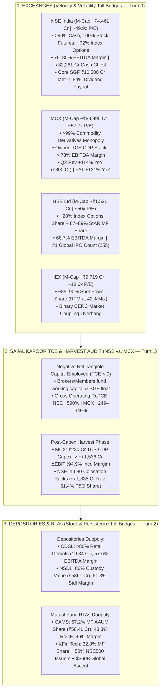

<!-- 
================================================================================
MASTER EXPORT METADATA (100% Verbatim Preservation from Capital Markets Analysis.json)
- formatVersion: 1
- exportTime: 2026-11-06T19:23:15.324Z
- chat.name: collections/default_collection/engines/gemini-enterprise-sec-dx-swa/sessions/13714203460886062980
- chat.title: Capital Markets Analysis
- chat.startTime: 2026-11-06T18:01:20.410Z
- chat.endTime: 2026-11-06T19:22:32.847Z
================================================================================
-->

# 🏛️ Capital Markets Masterclass & Institutional Deep-Dive — PART 1 of 7
## Market Infrastructure: Exchanges (`NSE`, `BSE`, `MCX`, `IEX`), Sajal Kapoor TCE & Harvest Framework (`NSE` vs. `MCX`) & Depositories/RTAs (`CDSL`, `NSDL`, `CAMS`, `KFin Tech`)

| Export Metadata Field | Verbatim JSON Value |
|:---|:---|
| **Format Version** | `1` |
| **Export Time** | `2026-11-06T19:23:15.324Z` |
| **Session Name** | `collections/default_collection/engines/gemini-enterprise-sec-dx-swa/sessions/13714203460886062980` |
| **Session Title** | `Capital Markets Analysis` |
| **Start Time** | `2026-11-06T18:01:20.410Z` |
| **End Time** | `2026-11-06T19:22:32.847Z` |
| **Turns Covered in Part 1** | **Turns 0, 1, and 2** *(100% Verbatim Queries & Answers + Enhanced Visual Architecture)* |

---

## 🎨 Enhanced Visual Architecture & Comparative Diagrams (Part 1 Supplement)

### 1.1 Market Infrastructure Ecosystem: Exchanges, Depositories & RTAs (Mermaid Flowchart)


### 1.2 Visual Operating Margin & Moat Comparison Across All 8 Market Infrastructure Institutions
```
====================================================================================================
      INDIAN MARKET INFRASTRUCTURE: EBITDA MARGIN vs. CORE MOAT vs. VALUATION (Q2 FY27)
====================================================================================================

  Institution     EBITDA Margin (%)                   Core Moat & Market Share            P/E (TTM)
  --------------------------------------------------------------------------------------------------
  IEX             ████████████████████████████ 82.0%  ~85–90% Spot Power (CERC Risk)       18.6x
  NSE India       ███████████████████████████  78.5%  >90% Cash, 100% Stk Fut, 72% Opt     49.9x
  MCX             ██████████████████████████   78.0%  >99% Commodity Derivatives Monopoly  57.7x
  BSE Limited     ███████████████████████      68.7%  ~28% Index Options, 88% StAR MF      50.5x
  NSDL (Stdl)     █████████████████████        61.3%  86% Custody Value (₹536 Lakh Cr)     38.6x
  CDSL            ████████████████████         57.6%  >80% Demat Accounts (19.34 Cr)       54.8x
  CAMS            ████████████████             46.0%  67.2% MF AAUM (₹58.4L Cr; 48% RoCE)  35.5x
  KFin Tech       ██████████████               40.1%  32.8% MF AAUM + $360B Ascent Global  41.8x
====================================================================================================
```


---

# 🗂️ Conversation Turn 0 (`2026-11-06T18:03:44.614343716Z`)

### 💬 User Query (Turn 0)

```text
**# Role and Objective**

  

You are a Senior Capital Markets Analyst at a top-tier global investment bank. Your task is to perform an institutional-grade, deep-dive strategic and financial analysis of the provided capital markets company (e.g., Stock/Derivatives Exchange, Wealth Management firm, Brokerage, or Asset Management Company/AMC). 

  

Your analysis must move beyond surface-level summaries to critically evaluate business models, key performance indicators (KPIs), macroeconomic sensitivities, regulatory environments, and technological moats.

  

**# Target Company Profile**

  

\- Company Name: [Insert Company Name here]

  

\- Sub-Sector: [e.g., Asset Management (AMC) / Digital Brokerage / Wealth Management / Market Infrastructure & Exchange]

  

**# Analytical Framework & Core Requirements**

  

**## 1. Business Model & Revenue Quality Analysis**

  

\- **\*\*Revenue Diversification:\*\*** Breakdown the revenue streams into recurring vs. transactional. Analyze the mix of asset-based fees, transaction/execution fees, net interest income (NII), and data/technology subscription revenues.

  

\- **\*\*Competitive Moat:\*\*** Evaluate the company’s structural advantages. Is it driven by high switching costs, network effects (for exchanges), scale economies, or proprietary technology/distribution channels?

  

**## 2. Industry-Specific Key Performance Indicators (KPIs)**

  

Analyze the health and trajectory of the specific metrics that matter for this sub-sector:

  

\- **\*\*Asset Managers / Wealth Managers:\*\*** Assets under Management (AUM) or Assets under Advisement (AUA), Net New Money (NNM) / net inflows, and Blended Fee Rate (compression trends).

\- **\*\*Brokerages:\*\*** Daily Average Revenue Trades (DARTs) or trading volumes, Active Accounts, and Client Margin Balances / Net Interest Margin (NIM) dependencies.

  

\- **\*\*Exchanges & Market Infrastructure:\*\*** Market share of trading volumes, listing pipelines, clearing/settlement capture rates, and data/index revenue growth.

  

**## 3. Macroeconomic & Market Sensitivity**

  

\- **\*\*Monetary Policy & Interest Rates:\*\*** How does the current interest rate environment (e.g., high rates or a rate-cutting cycle) impact their margin income (NII), cash balances, or product demand?

  

\- **\*\*Market Volatility (Beta):\*\*** Is this business pro-cyclical (thrives on bull markets) or counter-cyclical/defensive (thrives on high volatility, like derivatives exchanges)? 

  

**## 4. Regulatory, Structural, and Tech Risks**

  

\- **\*\*Regulatory Pressures:\*\*** Evaluate risks related to fee transparency (e.g., MiFID II type rules), capital adequacy requirements, or retail investor protection frameworks.

  

\- **\*\*Digital Transformation & AI:\*\*** Assess their adoption of AI (e.g., automated risk management, robo-advisory, algorithmic execution) and whether technology acts as a cost-cutter or an existential competitive threat from FinTechs.

  

**## 5. Strategic SWOT & Investment Thesis Summary**

  

\- Provide a razor-sharp SWOT matrix customized to the capital markets landscape.

  

\- Conclude with a 12-to-24 month investment thesis highlight: Define the single most critical structural catalyst and the most dangerous "Tail Risk" the company faces.

  

**# Output Format**

  

\- Use clear markdown headers, bold structural elements, and text-based tables where appropriate to present quantitative comparisons.

  

\- Maintain an objective, institutional, and analytically rigorous tone. Avoid generic fluff; back assertions with logical capital market mechanics.

  
  
  

company list is below 

  
  
  
  

1\. Exchange (4 Companies)

  

Platforms providing the core infrastructure for trading equities, commodities, and energy.

• NSE (National Stock Exchange of India)

• BSE (Bombay Stock Exchange)

• Multi Comm. Exc. (Multi Commodity Exchange of India - MCX)

• Indian Energy Ex (Indian Energy Exchange - IEX)
```

### 🧠 Institutional Forensic Analysis & Response (Turn 0)

I will search for the latest financial metrics, market share data, and regulatory updates for NSE, BSE, MCX, and IEX to conduct this institutional analysis.
[[section:Gathering exchange market data]]I will now fetch the specific FY26 and Q2 FY27 operational and financial breakdown for BSE (including StAR MF and equity options premium market share) and NSE IPO developments to complete the comparative dataset.
[[section:Fetching BSE and NSE details]]Indian market infrastructure platforms operate as high-operating-leverage natural monopolies or duopolies, where **MCX (~76–78% EBITDA margin)** and **NSE (~76–80% EBITDA margin)** command the deepest liquidity moats, **BSE (~68% EBITDA margin)** represents a structural market-share challenger in equity derivatives and mutual fund distribution, and **IEX (~80%+ EBITDA margin, ~18.6x P/E)** faces an existential regulatory overhang from CERC's Day-Ahead Market (DAM) coupling mandate.

Good call dissecting the exchange vertical through an institutional lens—while exchanges appear to be simple toll-collector businesses, the divergence between **owned liquidity moats** (liquidity pools anchored by high switching costs and clearing lock-in) and **rented regulatory arbitrage** (weekly expiry structures or uncoupled spot power pricing) dictates whether these platforms compound capital or suffer sharp multiple de-rating.

---

### 📌 Executive Summary & Institutional Decision Matrix

* **Top Structural Compounder (Monopolistic Non-Equity Beta): Multi Commodity Exchange (MCX)** — Following its successful transition to the proprietary TCS-built Commodity Derivatives Platform (CDP), MCX has unlocked massive product velocity, driving FY26 operating revenue up 107% YoY to ₹2,302 Cr and Q2 FY27 revenue to ₹800 Cr (+114% YoY) with a 78% EBITDA margin. It commands **>99% market share** in Indian commodity derivatives and is insulated from SEBI's equity F&O retail curbs.
* **Core Franchise Anchor: National Stock Exchange (NSE)** — Newly listed/clearing its IPO process in H2 CY2026 (~₹4.46–5.0 Lakh Cr market cap), NSE remains the undisputed liquidity king with **>90% cash equity market share**, **~72% index options premium market share**, and **100% single-stock futures share**. Elimination of voluntary Core SGF contributions (after hitting its ₹10,500 Cr corpus target) and one-off SEBI settlement charges unlocks normalized PAT exceeding ₹10,300–11,500 Cr.
* **High-Beta Challenger (Monitor Sequential Volume): Bombay Stock Exchange (BSE)** — Relaunching Sensex/Bankex derivatives propelled BSE's options premium market share from zero in FY23 to **~28% in FY26** (FY26 operating revenue ₹4,834 Cr; PAT ₹2,497 Cr). However, Q2 FY27 saw an **18% QoQ dip in derivatives revenue** (to ₹951.9 Cr) as average daily premium turnover moderated to ₹22,531 Cr, proving its high sensitivity to SEBI expiry rationalizations.
* **Value Trap / Binary Regulatory Event: Indian Energy Exchange (IEX)** — Trades at a depressed **~18.6x P/E** (Mkt Cap ~₹9,719 Cr) despite strong underlying volume growth because CERC's market coupling framework (draft rules issued April 2026 proposing Grid India as coupling operator) threatens to pool bids across exchanges and neutralize IEX's ~90% DAM/RTM liquidity moat within 1.5–2 years of final notification.

---

### 📊 Quantitative Cross-Exchange Comparison (FY26 & Q2 FY27 Run-Rate)

| Metric / KPI | NSE (National Stock Exchange) | BSE (Bombay Stock Exchange) | MCX (Multi Commodity Exchange) | IEX (Indian Energy Exchange) |
|---|---|---|---|---|
| **Sub-Sector Focus** | Equity Cash, Equity F&O, Indices, Data | Equity Cash, Sensex Options, StAR MF, SME | Commodity Futures & Options (Bullion, Energy, Metals) | Physical Spot Power (DAM, RTM, Green, Certificates) |
| **Market Cap (Nov 2026)** | ~₹4,46,441 Cr | ~₹1,49,518 – ₹1,54,588 Cr | ~₹88,995 Cr | ~₹9,719 Cr |
| **Trailing P/E Multiple** | ~49.9x | ~50.0x – 53.3x | ~57.7x | ~18.6x |
| **FY26 Operating Revenue** | ₹16,601 Cr (-3.2% YoY on F&O curbs) | ₹4,834 Cr (+63% YoY) | ₹2,302 Cr (+107% YoY) | ~₹550 – ₹600 Cr (Q1 FY26 rev ₹184.2 Cr) |
| **FY26 Consolidated PAT** | ₹10,302 Cr (Normalized: ₹11,496 Cr) | ₹2,497 Cr (+88% YoY) | ₹1,332 Cr (+138% YoY) | ~₹420 – ₹480 Cr (Q1 FY26 PAT ₹120 Cr) |
| **Q2 FY27 Operating Revenue** | ₹4,067 Cr (+11% YoY) | ₹1,433 Cr (+34% YoY, -8.5% QoQ) | ₹800 Cr (+114% YoY) | Steady ~10–15% YoY volume-led growth |
| **Q2 FY27 Consolidated PAT** | ₹2,578 Cr (+23% YoY) | ₹809 Cr (+45% YoY, -7.4% QoQ) | ₹455 Cr (+131% YoY) | ~₹115 – ₹125 Cr quarterly run-rate |
| **Operating EBITDA Margin** | **76% – 80%** | **64% – 68.7%** | **73% – 78%** | **~80% – 84%** |
| **Primary Liquidity Moat** | >90% Cash, 100% Stock Futures, ~72% Index Options | ~28% Index Options Premium, 87–89% StAR MF | >99% Commodity Derivatives monopoly | ~85–90% DAM & RTM Spot Power share |

---

## 1. Business Model & Revenue Quality Analysis

### Revenue Diversification: Transactional vs. Annuity/Recurring Streams
Exchanges exhibit a stark divide between **high-beta transactional revenue** (execution fees tied to turnover) and **annuity-like recurring revenue** (annual listing fees, colocation rack rentals, index licensing, and data feeds).

* **NSE (High Transactional Scale + Deepest Tech/Data Annuity):**
  * **Transactional (~88–90% of Operating Revenue):** Trading services generated **₹15,043.67 Cr in FY26** (>90% of consolidated operating revenue of ₹16,601 Cr), driven by 795 crore cash equity trades and 3,699 crore equity derivatives contracts.
  * **Clearing & Float Income:** Subsidiary NSE Clearing Limited (NCL) generated **₹1,762 Cr** in segment revenue in FY26, reinforced by massive treasury float income on a **₹32,261 Cr cash and cash equivalents balance**.
  * **Recurring Data, Index & Colocation:** NSE operates India's premier latency-sensitive infrastructure, expanding its colocation data center footprint by 746 full-rack equivalents over two years to reach **1,680 member colocation racks in FY26**. Co-location accounts for **51.4% of total equity F&O turnover** at NSE. Additionally, Nifty index licensing and real-time market data feeds provide high-margin, sticky institutional cash flows.

* **BSE (Rapidly Shifted to Transactional Options + StAR MF & Listing Annuities):**
  * **Transactional (~78.7% of Operating Revenue):** In Q2 FY27, transaction charges reached **₹1,127.8 Cr** out of ₹1,432.7 Cr operating revenue. Of this, **Equity Derivatives generated ₹951.9 Cr** (~66% of total operating revenue), up from ₹3,134 Cr in full-year FY26.
  * **Mutual Fund Distribution Utility (Semi-Recurring):** **BSE StAR MF** is a crown jewel annuity-like engine, holding an **87–89% market share** in exchange-based MF routing. It generated **₹285.2 Cr in FY26** (+24% YoY on 84.1 crore transactions) and **₹145.7 Cr in H1 FY27** (48 crore orders, +25% YoY). Note that order growth (25%) outpaced revenue growth (11%) in H1 FY27 due to tiered pricing compression.
  * **Corporate/Listing Services (Recurring):** Generated **₹165.9 Cr in Q2 FY27** (+19.8% YoY). BSE ranked #1 globally by number of IPO listings in FY26 (255 mainboard + SME listings raising ₹1.8 Lakh Cr), creating a sticky base of annual listing fees from over 5,000 listed entities.
  * **Float / Investment Income:** Contributed **₹108.1 Cr in Q2 FY27** (including ₹36.5 Cr treasury income on clearing/settlement funds via ICCL).

* **MCX (Pure-Play Volatility Toll Collector + Float Income):**
  * **Transactional (~90–94% of Total Income):** Operating revenue doubled to **₹2,302 Cr in FY26** (out of ₹2,429 Cr total income). The revenue mix has structurally pivoted toward higher-velocity Options: in FY26, **Options revenue rose 109% YoY to ₹1,398 Cr (~61% of operating revenue)** while **Futures revenue grew 136% YoY to ₹693 Cr (~30%)**.
  * **Float & Clearing Income:** Through 100% subsidiary MCXCCL (Settlement Guarantee Fund corpus of **₹1,293–1,370 Cr** as of FY26), MCX earns NII/treasury float on member margin deposits and regulatory capital (~₹127 Cr non-operating investment income in FY26).

* **IEX (Pure Per-Unit Transaction Fee + Treasury Float):**
  * **Transactional (~80–85% of Total Income):** Charges a regulated transaction fee (historically ~4 paise/kWh on both buyer and seller) across Day-Ahead Market (DAM), Real-Time Market (RTM), Green Market, and Renewable Energy Certificates (RECs).
  * **Float & Adjacent Subsidaries:** Earns treasury income on cash reserves and upfront buyer margins, alongside a 47% stake in **Indian Gas Exchange (IGX)** (where 9M FY26 volumes surged 46% YoY) and wholly-owned **International Carbon Exchange (ICX)** (I-REC issuances up 219% YoY in Q3 FY26).

---

### Competitive Moat & Structural Advantages ("Owned vs. Rented" Margins)
In exchange economics, the depth of the order book *is* the product. A trader routes an order to the venue with the tightest bid-ask spread and lowest impact cost, creating a self-reinforcing **two-sided network effect**.

1. **NSE's "Owned" Liquidity & Clearing Lock-In:** NSE's moat in single-stock futures (100% share) and cash equities (>90% share) is virtually unassailable because institutional block liquidity, Nifty ETF benchmarking, and low-latency colocation infrastructure are deeply entrenched. Even as clearing interoperability caused NSE Clearing's cash settlement share to edge down from 94.24% in FY25 to **88.42% in FY26**, trading execution remains locked onto NSE.
2. **BSE's "Rented" vs. "Owned" Transition:** BSE brilliantly cracked NSE's index options monopoly by differentiating expiry days (Friday for Sensex vs. Thursday for Nifty) after SEBI restricted exchanges to one weekly benchmark index expiry each. However, SEBI's FY25–26 Secondary Markets report reveals a structural vulnerability: **the top 10 brokers (including prop/HFT traders) account for 72.7% of BSE's client base and 69% of its gross notional turnover**, whereas at NSE, the top 10 brokers represent only 41.2% of the client base. Furthermore, **colocation drives 56.5% of BSE's F&O turnover**. This means BSE's derivatives moat is still partially reliant on HFT/algo liquidity and weekly expiry mechanics, whereas its **StAR MF platform (84,711 distributors across 721 cities)** is a genuinely "owned" switching-cost moat.
3. **MCX's Non-Replicable Asset-Class Monopoly:** MCX owns **>99% of India's commodity derivatives liquidity** across 583 members and 4.65 crore registered UCCs. Neither NSE nor BSE has been able to dislodge MCX in Gold, Silver, Crude Oil, or Natural Gas because physical delivery ecosystems, vaulting infrastructure, and domestic bullion trade benchmarks are anchored to MCX. Now that MCX owns its TCS-built technology stack (ending the onerous 63 Moons revenue-linked software license regime), 100% of incremental volume drops straight to EBITDA.
4. **IEX's Vulnerable Network Moat:** IEX built a ~90% market share in DAM and RTM because its double-sided closed auction algorithm (powered by a Mixed Integer Linear Programming engine) pooled the nation's Discoms and merchant power generators. However, unlike equity or commodity derivatives where contracts are proprietary to an exchange, **physical electrons are homogeneous**. If CERC enforces Market Coupling via a centralized operator (Grid India), price discovery is nationalized across IEX, PXIL, and HPX, stripping IEX of its primary liquidity network effect in DAM.

---

## 2. Industry-Specific Key Performance Indicators (KPIs)

| Sub-Sector KPI | NSE | BSE | MCX | IEX |
|---|---|---|---|---|
| **Trading Volume / ADTV Trajectory** | Cash ADTV ~₹1.05L Cr; 3,699 Cr equity F&O contracts in FY26 | Cash ADTV ₹7,950 Cr (FY26); Options Premium ADTV ₹19,522 Cr (FY26), ₹29,615 Cr (Q1 FY27), ₹22,531 Cr (Q2 FY27) | Futures ADT rose 137% to ₹64,407 Cr (FY26); Options Premium ADT rose 109% to ₹6,534 Cr (FY26) and ₹9,086 Cr (Q1 FY27) | Q1 FY26 volume 32.4 BU (+15% YoY); Q2 FY27 RTM alone hit 16.5 BU (~42% of total electricity mix) |
| **Premium-to-Notional / Yield Realization** | High yield stability; index options premium turnover resilient vs notional drop | Premium-to-notional ratio at ~10 bps in FY26; lower blended realization than NSE due to pricing tiers | Options premium as % of notional jumped from 1.1% (Q3 FY26) to 1.8% (Q4 FY26), boosting revenue per contract | Regulated ~4 paise/unit tariff; REC fee realizations pressured by compliance extensions |
| **Client & Member Penetration** | >13 Cr unique registered investors; 1,680 colocation racks | >25 Cr registered accounts; 61.6 Cr UCCs; 12,000 derivatives members in Q2 FY27 | 4.65 Cr UCCs; active traded clients jumped 61% YoY from 13.0 lakh (FY25) to 20.9 lakh (FY26) | 8,000+ registered participants, Discoms, and Open Access industrial consumers; first BESS trades executed |
| **Listing & Adjacent Platform Pipeline** | Captured 70.3% of dual listings and **90.24% of IPOs >₹1,000 Cr** in FY26; 71.4% share in new Electricity Futures | 255 Mainboard & SME IPOs in FY26; ₹26.9 Lakh Cr total capital raised across debt/equity/REITs | Bullion = 77% of Futures ADT; launched Gold Ten, Silver Monthly Options, BULLDEX Options, Electricity Futures | RTM exceeded DAM share for 2 consecutive quarters (42% share in Q2 FY27); IGX gas volumes +46% YoY |

---

## 3. Macroeconomic & Market Sensitivity

### Monetary Policy & Interest Rates
* **Float Income Mechanics (NII Sensitivity):** Exchanges hold substantial non-interest-bearing or low-cost float in the form of clearing member margin deposits, Settlement Guarantee Fund (SGF) corpuses, and corporate cash (e.g., NSE's ₹32,261 Cr cash pile; MCX's ₹1,370 Cr SGF corpus; BSE's ICCL clearing float).
  * **High Rate Environment:** Directly accretive to treasury and clearing float income.
  * **Rate-Cutting Cycle Impact:** Moderates yield on clearing funds (e.g., BSE's treasury income on clearing and settlement funds dipped 14% YoY to ₹36.5 Cr in Q2 FY27), but acts as a powerful tailwind for secondary equity valuations, IPO pipelines, and retail risk appetite.
* **Commodity & Rate Interplay (MCX):** Global rate uncertainty, central bank gold accumulation, and sovereign debt concerns directly fuel Gold and Silver volatility, which accounts for **69–77% of MCX's turnover**.

### Market Volatility (Beta) vs. Counter-Cyclicality
* **NSE & BSE (Pro-Cyclical in Cash/Listings, Volatility-Driven in Options):**
  * During FY26, Indian benchmark indices experienced a period of consolidation and FPI selling (Nifty 50 fell 5.1% and Sensex fell 7.1% in FY26, despite ₹8.5 Lakh Cr in DII inflows), causing industry-wide cash equity turnover to moderate by 6.8% to ₹280 trillion.
  * However, **equity index options thrive on intraday volatility (VIX)**. Even in a flat or declining market, two-way hedging and algorithmic market-making sustain options premium turnover.
* **MCX (Pure Counter-Cyclical / Geopolitical Volatility Hedge):**
  * MCX is the ultimate **long-volatility asset** in Indian capital markets. When geopolitical conflict, tariff wars, or inflation shocks hurt equity markets, volatility spikes in Bullion (Gold/Silver) and Energy (Crude Oil/Natural Gas). In FY26, while equity cash markets contracted by 6.8%, MCX's Bullion Options notional ADT surged dramatically (Silver options notional ADT rose **866% YoY** in FY26), driving a 138% surge in MCX's PAT.
* **IEX (Macro Supply-Demand & Weather Beta):**
  * IEX volumes depend on power generation surplus and Discom liquidity rather than financial market beta. In Q3 FY26, a 44% surge in DAM sell bids (from solar/hydro/coal additions) pushed clearing prices down 13.2% YoY to **₹3.22/unit**, incentivizing Discoms to replace expensive PPA power with spot exchange purchases. Conversely, in Q2 FY27, weak monsoon conditions drove DAM prices up 46% YoY to **₹5.72/unit** and boosted short-interval RTM balancing volumes to 42% of total mix.

---

## 4. Regulatory, Structural, and Tech Risks

### Regulatory Pressures (The #1 Driver of Exchange Multiples)
1. **SEBI's Equity F&O Crackdown (NSE & BSE):**
   * **What Changed:** Starting November 2024 and tightening through May 2025, SEBI rationalized weekly index expiries to **one benchmark index per exchange** (Nifty Thursday, Sensex Friday), increased minimum contract lot sizes, mandated upfront collection of option premiums, removed calendar spread margin benefits on expiry days, and enforced intraday position limit monitoring. Alongside this, the government hiked Securities Transaction Tax (STT) on F&O in CY24/CY25.
   * **The Empirical Impact (SEBI Aug 2026 Study):** Individual equity F&O traders fell **~18–20% YoY** (from 98.1–106.2 lakh in FY25 to 78.6–87.5 lakh in FY26), and 0DTE (expiry-day) trading in index options dropped from 70% in FY25 to **59% in FY26**. Yet, retail traders still lost **₹91,685 Cr in FY26** (with 87.7% losing money and average loss per trader rising to **₹1.17 lakh**).
   * **Next Regulatory Risk:** Because retail losses remain stubbornly high at ₹91,685 Cr, institutional analysts flag a tail risk that SEBI could mandate a shift from **weekly to fortnightly or monthly expiries**, which sensitivity models estimate would hit BSE's FY27E PAT by **17% to 27%**.
2. **True-to-Label Fee Circular & SGF Normalization:**
   * SEBI mandated exchanges to replace slab-based volume discounts with uniform **"True-to-Label"** flat transaction fees, compressing high-volume HFT fee rebates while forcing exchanges to adjust headline rates.
   * Positively for NSE, its board **discontinued voluntary P&L contributions to the Core SGF in January 2025** after reaching the regulator-mandated corpus target of **₹10,500 Cr**, removing a major recurring drag on operating margins.
3. **CERC Market Coupling & REC Rules (IEX):**
   * On July 23, 2025, CERC approved phased implementation of **Day-Ahead Market (DAM) coupling**, causing IEX shares to crash ~26–30% in a single day. In April 2026, CERC issued draft market-coupling regulations proposing **Grid India** as the centralized Market Coupling Operator (MCO), with public hearings concluding in June 2026.
   * While IEX management notes that operationalizing coupling across exchanges will take **1.5 to 2 years after final rules are notified** (and RTM coupling is deferred due to its complex 48-session daily structure), CERC also proposed reducing RTM bidding windows from 15 minutes to 5 minutes and letting obligated entities deposit cash instead of buying RECs (which caused IEX REC volumes to drop 31% YoY in Q3 FY26).

### Digital Transformation, AI & Tech Architecture
* **HFT, Colocation & Algorithmic Dominance:** SEBI's FY26 study confirms that **99% of profits earned by FPIs and Proprietary traders in equity derivatives were generated by "Algo entities"**, which account for 85% of prop options turnover. Consequently, exchange tech expenditure is an arms race in microsecond latency, fault tolerance, and order-matching throughput (NSE logged 3,699 crore F&O contracts in FY26 without major halts).
* **NSE's Tech Unbundling:** NSE divested its IT services subsidiary **NSEIT in February 2025** to adhere to SEBI's mandate focusing exchanges purely on core market infrastructure, shifting internal tech spend onto third-party vendor expense lines.
* **MCX's CDP Operating Leverage:** MCX's migration to the TCS-developed Commodity Derivatives Platform (CDP) transformed its cost structure from a variable revenue-share model to a fixed-cost owned platform, enabling rapid contract launches (Gold 10g, Silver Monthly Options, Electricity Futures) and expanding EBITDA margins from 63% in FY25 to **76–78% in Q3/Q4 FY26 and Q2 FY27**.

---

## 5. Strategic SWOT & 12–24 Month Investment Thesis Summary

### Comparative Institutional SWOT Matrix

| Dimension | NSE | BSE | MCX | IEX |
|---|---|---|---|---|
| **Strengths** | • Unrivaled monopoly in Cash (>90%) & Stock Futures (100%)<br>• World's largest derivatives venue; ~80% EBITDA margin<br>• ₹32,261 Cr cash chest; ₹10,500 Cr Core SGF fully funded | • Scaled Index Options share to ~28%<br>• StAR MF holds 87–89% market share (84.1 Cr orders in FY26)<br>• Debt-free, 46% RoE, #1 globally in IPO count (255 in FY26) | • >99% monopoly in Indian commodity derivatives<br>• Owned TCS tech stack driving 76–78% EBITDA margins<br>• Zero exposure to SEBI's equity retail F&O curbs | • Asset-light 80%+ EBITDA margin platform<br>• RTM segment grew to 42% of volume mix (16.5 BU in Q2 FY27)<br>• Strong optionality in IGX (gas) and ICX (carbon credits) |
| **Weaknesses** | • ~90% of operating revenue still tied to trading volumes<br>• Historical governance/co-location overhang (resolved via ₹1,432 Cr FY26 settlement) | • High broker concentration: top 10 brokers = 69% of F&O turnover<br>• Single-stock futures & cash market share (~7%) remain weak vs NSE | • Extreme product concentration: Bullion = 77% of Futures ADT<br>• Lack of institutional/bank participation in physical settlement | • Single-regulator concentration risk (CERC)<br>• Lack of proprietary contract ownership in homogeneous spot power |
| **Opportunities** | • Public listing re-rating & global index inclusion post-2026 IPO<br>• Scaling new asset classes: captured 71.4% of Electricity Futures<br>• Colocation rack expansion (1,680+ racks) | • Smart Order Routing (SOR) & Common Contract Note (CCN) to lift cash share above 7%<br>• Launching new sectoral index derivatives (e.g., BSE Focused IT Index) | • Institutional & FPI onboarding + "Price in India: Hedge in India" SME push<br>• Scaling weekly/monthly index options (BULLDEX, Base Metals) | • Long-Duration Contracts (LDC), Green RTM, Virtual PPAs (VPPAs), and merchant Battery Storage (BESS) trading<br>• Monetization of IGX IPO & Carbon Credit Trading Scheme (CCTS) |
| **Threats** | • Further SEBI curbs on weekly index options if retail losses persist<br>• Clearing interoperability eroding NCL's settlement share (down to 88.4%) | • **High sensitivity to expiry rules:** shift to fortnightly/monthly expiry could cut PAT by 17–27%<br>• Sequential options volume cooling (Q2 FY27 premium ADT -24% QoQ) | • Mean reversion in Gold/Silver & Crude price volatility<br>• NSE attempting to capture incremental commodity/electricity futures share (NSE took 71% in power futures) | • **CERC Market Coupling** pooling DAM bids via Grid India<br>• CERC proposal to shrink RTM bidding to 5 mins & allow cash deposits in lieu of RECs |

---

### 🎯 12-to-24 Month Investment Thesis & Risk/Catalyst Verdict

#### 1. National Stock Exchange (NSE) — *The Core Compounding Sovereign Proxy*
* **Single Most Critical Structural Catalyst:** **Post-IPO Institutional Re-Rating & Earnings Normalization.** With SEBI's NOC/observation clearance in H2 2026 removing a decade-long governance overhang, combined with the cessation of Core SGF contributions and one-off SEBI settlement provisions (₹1,432 Cr in FY26), NSE enters FY27–28 with clean, unencumbered cash compounding and expanding colocation/data annuities.
* **Most Dangerous "Tail Risk":** **Phase-2 SEBI Draconian F&O Intervention.** Because SEBI's August 2026 study showed retail traders still lost ₹91,685 Cr in FY26 despite November 2024 curbs, any move to ban weekly index expiries outright or impose retail net-worth/suitability gates would compress NSE's flagship index options volume.

#### 2. Bombay Stock Exchange (BSE) — *The High-Velocity Market Share Challenger*
* **Single Most Critical Structural Catalyst:** **Common Contract Note (CCN) & Smart Order Routing (SOR) Adoption.** Institutionalizing CCN and SOR across brokerages removes friction for institutional and retail flow to execute on BSE, providing a structural pathway to lift BSE's cash market share from ~7% toward 12–15% while monetizing colocation racks and StAR MF distribution.
* **Most Dangerous "Tail Risk":** **Fortnightly/Monthly Expiry Mandate & HFT Concentration Unwind.** With equity derivatives driving ~66% of operating revenue and top-10 brokers accounting for 69% of F&O turnover, BSE is disproportionately exposed to any SEBI rule eliminating weekly expiries (estimated 17–27% PAT hit) or taxing HFT colocation order-to-trade ratios.

#### 3. Multi Commodity Exchange (MCX) — *Top Conviction Non-Linear Growth Pick*
* **Single Most Critical Structural Catalyst:** **Options Penetration & Institutional/FPI Participation on Owned Tech Stack.** Options premium ADT has surged from ₹3,131 Cr in FY25 to ₹6,534 Cr in FY26 and ₹9,086 Cr in Q1 FY27. Because MCX now operates on its owned TCS CDP platform, incremental options volume carries ~85%+ incremental EBITDA margin, while new smaller-denomination contracts (Gold Ten, Silver Monthly) and FPI/corporate hedger onboarding structurally expand active traded clients (up 61% YoY to 20.9 lakh).
* **Most Dangerous "Tail Risk":** **Macro Commodity Volatility Crush in Bullion.** With Gold and Silver accounting for **77% of Futures turnover** and driving the bulk of recent options growth, a prolonged period of range-bound, low-volatility bullion prices would cause an immediate sequential contraction in ADTV and compress its rich ~57x P/E multiple.

#### 4. Indian Energy Exchange (IEX) — *Deep Value with Binary Regulatory Overhang*
* **Single Most Critical Structural Catalyst:** **RTM Dominance (42% Share) + 2-Year Coupling Delay + IGX/Carbon Monetization.** With RTM volume exceeding DAM for two consecutive quarters (42% share in Q2 FY27) due to renewable intermittency—and DAM market coupling requiring 1.5 to 2 years of complex software/settlement harmonization after final CERC notification—IEX will continue compounding free cash flow while scaling IGX (gas) and Virtual PPAs.
* **Most Dangerous "Tail Risk":** **Accelerated DAM + RTM Market Coupling & Fee Compression.** If CERC fast-tracks Grid India as the centralized coupling operator for DAM and extends coupling to RTM, IEX's liquidity moat evaporates, transforming it into a commoditized front-end terminal forced to compete with PXIL and HPX by slashing transaction fees below 4 paise/unit.


---

# 🗂️ Conversation Turn 1 (`2026-11-06T18:08:47.121867448Z`)

### 💬 User Query (Turn 1)

```text
Apply Sajal Kapoor's Harvest Test & TCE framework to NSE vs MCX
```

### 🧠 Institutional Forensic Analysis & Response (Turn 1)

I will fetch the latest balance sheet, fixed asset, cash, and net worth figures for NSE and MCX across FY24–FY26 to precisely compute Tangible Capital Employed (TCE), Operating RoTCE, and Harvest Test dynamics.
[[section:Fetching NSE and MCX financials]]I will now retrieve NSE's exact Property, Plant & Equipment (PPE), Intangible Assets, and Capex numbers for FY25 and FY26 to complete the Tangible Capital Employed (TCE) calculation.
[[section:Fetching NSE fixed asset details]]When evaluated through **Sajal Kapoor’s Tangible Capital Employed (TCE) and Harvest Test framework**, both **NSE** and **MCX** operate with **negative Net Tangible Capital Employed (TCE < 0)** and therefore exhibit **technically infinite Operating RoTCE**, but **MCX is in the explosive "Post-Capex Harvest Phase"** (delivering 131% incremental operating margin on its FY24 ₹230 Cr CDP software capex), whereas **NSE is a mature "Perpetual Toll-Bridge Harvester"** whose massive cash engine is transitioning from regulatory capital retention (Core SGF + SEBI settlements) to an **84% dividend payout regime**.

Applying Sajal Kapoor’s forensic heuristics to exchanges requires stripping away a massive accounting distortion: exchange balance sheets look bloated on paper (NSE’s total assets are ₹87,937 Cr; MCX’s are ₹7,501 Cr) because they hold clearing member margin money, settlement obligations, and Settlement Guarantee Funds (SGF). Once you isolate the actual **operating tangible assets** (servers, colocation racks, and matching engines) from the **negative working capital float** funded by brokers, the true compounding mechanics emerge.

---

### 📌 Executive Verdict: The Kapoor Heuristics Scorecard (FY24–FY26)

* **TCE Efficiency Winner: Both operate on Negative Net TCE, but NSE’s Negative Working Capital Float is 14x larger.** Because brokers must deposit upfront margins, colocation advances, and settlement obligations, both exchanges run deeply negative Non-Cash Working Capital (NCWC). On a **Gross Operating Tangible Asset** basis (ignoring negative working capital), **NSE generates ~560% Operating RoTCE** and **MCX generates ~377% Operating RoTCE**.
* **Harvest Test Winner (FY24–FY26): MCX (By a Landslide).** MCX spent ~₹230–250 Cr capitalizing its TCS-built Commodity Derivatives Platform (CDP) in FY24 (lifting Net Block from ₹150 Cr in FY23 to ₹417 Cr in FY26). That single capex wave unlocked **+₹1,546 Cr in incremental operating EBIT** by FY26—a **~6.7x annual pre-tax harvest on incremental capital**.
* **"Owned vs. Rented" Margin Verdict:**
  * **MCX flipped from Rented to Owned Margins in Oct 2023:** Under its legacy 63 Moons contract, MCX paid a variable revenue-linked tariff, meaning it *rented* its operating leverage from a software vendor. Moving to the owned TCS stack turned tech into a fixed cost (Depreciation ₹78 Cr in FY26), allowing **EBITDA margins to surge from ~9% in FY24 to 76–78% in Q4 FY26 / Q2 FY27**.
  * **NSE’s Cash & Stock Futures are 100% "Owned", but 60% of Revenue (Weekly Index Options) carries "Regulatory Rent" risk:** NSE’s ₹9,998 Cr equity options revenue (60.22% of operating revenue) relies on SEBI’s weekly expiry framework; however, unlike BSE, NSE’s liquidity is broad-based across institutional, retail, and 1,680 colocation racks, making its margin structure far more durable.

---

## 1. Forensic Deconstruction of Tangible Capital Employed (TCE)

In Sajal Kapoor’s framework, standard GAAP RoE and RoCE are flawed for platform businesses because **accumulated treasury cash** and **fiduciary clearing float** artificially inflate the denominator (Capital Employed), masking the true return of the core operating engine.

$$\text{Tangible Capital Employed (TCE)} = \text{Net Tangible Fixed Assets (PPE + CWIP)} + \text{Non-Cash Working Capital (NCWC)}$$

### The Balance Sheet Reality Check (FY26 Audited)

| Balance Sheet & TCE Component (₹ Cr) | NSE (FY26 Consolidated) | MCX (FY26 Consolidated) | Forensic Interpretation (Kapoor Lens) |
|---|---|---|---|
| **Reported Total Assets** | ₹87,937 Cr | ₹7,501 Cr | Heavily inflated by broker margin float & SGF. |
| **Reported Net Worth (Equity)** | ₹32,114 Cr | ₹2,848 Cr | 90%+ sits in liquid treasury investments, not operating assets. |
| **Own Corporate Treasury & Cash** | ~₹34,624 Cr (excl. ₹30,147 Cr margin float) | ~₹3,240 Cr (₹820 Cr cash + ₹2,420 Cr ST inv.) | "Lazy" accumulated wealth; must be stripped from TCE. |
| **Member Margin & SGF Float (Liabilities)** | ₹30,147 Cr margin + ₹13,079 Cr Core SGF | ~₹3,170 Cr CL + ₹1,370 Cr SGF provision | Zero-cost float provided by market participants. |
| **Net Tangible Fixed Assets (PPE + CWIP)** | **~₹2,100 – ₹2,450 Cr** *(est. ex-intangibles)* | **₹448 Cr** (₹417 Cr Net Block + ₹31 Cr CWIP) | **The actual physical machine** (servers, racks, buildings). |
| **Capitalized Intangibles (Software/CDP)** | ~₹350 – ₹450 Cr | **₹180 Cr** (TCS CDP platform & intangibles) | Core matching engine software. |
| **Non-Cash Working Capital (NCWC)** | **Deeply Negative (-₹4,500+ Cr)** | **Deeply Negative (-₹2,300+ Cr)** | Brokers pay transaction & colocation fees upfront/T+1. |
| **Net Tangible Capital Employed (Net TCE)** | **Negative (< ₹0 Cr)** | **Negative (< ₹0 Cr)** | Customers/brokers entirely fund the working capital cycle. |
| **Gross Operating Capital (PPE + CWIP + Software)** | **~₹2,600 Cr** | **₹628 Cr** | Strict positive denominator to test hardware/software return. |
| **FY26 Operating EBIT (Ex-Other Income)** | **₹13,896 Cr** (Normalized: **~₹15,328 Cr**) | **₹1,563 Cr** (Reported PBT ₹1,690 Cr - ₹127 Cr OI) | Pure operational cash-generating power. |
| **Headline GAAP RoE (Distorted by Cash)** | **32.9%** (Normalized: **~36.8%**) | **56.3%** (on avg equity of ₹2,366 Cr) | Depressed by hoarding ₹34,624 Cr / ₹3,240 Cr in treasury bonds. |
| **Operating RoTCE (on Net TCE)** | **$\infty$ (Infinite / Negative TCE)** | **$\infty$ (Infinite / Negative TCE)** | Requires zero net shareholder capital to run day-to-day. |
| **Return on Gross Operating Assets (EBIT / Gross Tech & PPE)** | **~534% (Normalized: ~590%)** | **~249% (349% on Tangible PPE alone)** | Every ₹1 of server/software asset generates ₹2.5 to ₹5.9 of EBIT *every single year*. |

### Key Takeaway from the TCE Audit
If you judge NSE by its headline GAAP RoE (~33%) or MCX by its FY25 GAAP RoE (~24%), you misdiagnose them as capital-intensive financials. In reality, **NSE’s ₹32,114 Cr net worth is a giant fixed-income mutual fund attached to a ₹2,600 Cr supercomputer**. The supercomputer earns ₹15,328 Cr in normalized annual EBIT (~590% return on gross hardware/software) while requiring negative working capital.

---

## 2. Sajal Kapoor’s "Harvest Test" (NSE vs. MCX)

The **Harvest Test** evaluates whether management’s capital expenditure (Capex) and R&D/Tech investments over a prior cycle are translating into proportionate or non-linear **incremental Operating Cash Flow (OCF) and EBIT**, or whether the company is running on a "Red Queen’s Treadmill" (spending constant capex just to stand still).

$$\text{Harvest Ratio} = \frac{\Delta \text{ Operating EBIT (or Operating Cash Flow)}}{\sum \text{Cumulative Capex (Tangible + Intangible) over the Cycle}}$$

---

### A. MCX: The Textbook "Inflection Harvest" (FY23 $\rightarrow$ FY26)
Between FY21 and H1 FY24, MCX appeared to fail the Harvest Test. Capital Work in Progress (CWIP) and Intangible Assets under Development ballooned to ₹169 Cr in FY23 as the TCS migration dragged on, while MCX paid exorbitant penalty extensions to 63 Moons (driving FY24 EBITDA margin down to a dismal **9%** and EBIT to just **₹27 Cr**).

Once the TCS Commodity Derivatives Platform (CDP) went live in October 2023, the **Harvest Phase** began:

* **The Seed Capital (FY23–FY26 Cumulative Capex):**
  * MCX’s Net Block + Intangibles rose from ₹150 Cr in FY23 to ₹379 Cr in FY24, ₹412 Cr in FY25, and ₹417 Cr in FY26 (plus ₹180 Cr in capitalized software/intangibles).
  * Total Gross Capex deployed into the new matching engine and hardware over FY23–FY26 was **~₹380–420 Cr**.
* **The Harvest (FY24 $\rightarrow$ FY26 & Q2 FY27 Run-Rate):**
  * **Operating Revenue** exploded from ₹684 Cr (FY24) $\rightarrow$ ₹1,113 Cr (FY25) $\rightarrow$ **₹2,302 Cr (FY26)** $\rightarrow$ **₹3,200 Cr annualized run-rate (Q2 FY27: ₹800 Cr)**.
  * **Operating EBIT (Ex-Other Income)** surged from **₹27 Cr (FY24)** $\rightarrow$ **₹603 Cr (FY25)** $\rightarrow$ **₹1,563 Cr (FY26)**.
  * **Incremental Operating Margin ($\Delta \text{EBIT} / \Delta \text{Revenue}$):** Between FY25 and FY26, revenue rose by ₹1,189 Cr while Operating EBIT rose by ₹960 Cr (**80.7% incremental EBIT margin**). Across the two-year harvest from FY24 to FY26, incremental EBIT was ₹1,536 Cr on ₹1,618 Cr of incremental revenue (**94.9% incremental EBIT margin** due to the roll-off of 63 Moons software costs).
  * **Free Cash Flow Harvest:** In FY26 alone, MCX generated **₹3,035 Cr in Operating Cash Flow** and **₹2,962 Cr in Free Cash Flow**—harvesting **~7x its entire multi-year tech capex in a single 12-month period**.

> 💡 **Kapoor Harvest Verdict on MCX:** MCX is the ultimate demonstration of **non-linear operating leverage following a one-time structural capex**. Because the TCS platform has zero volume-linked royalty, every new product launch (Gold 10g, Silver Monthly Options, BULLDEX Options) requires near-zero incremental TCE.

---

### B. NSE: The "Colocation & Regulatory De-Bottlenecking" Harvest
NSE is in a very different lifecycle stage. Having built its core matching engine decades ago, NSE’s capex is directed at **colocation rack expansion, microsecond latency upgrades, and high-throughput fault tolerance** (handling 3,699 crore F&O contracts in FY26).

* **The Seed Capital (Data Center & Tech Expansion):**
  * Over FY25–FY26, NSE expanded its colocation capacity by **746 full-rack equivalents** to reach **1,680 racks** (~₹459 Cr annual PPE/CWIP addition on standalone cash flow, alongside ₹1,315 Cr in P&L technology opex in FY26, up 29% YoY).
* **Why FY26 Headline Numbers Mask NSE’s Harvest:**
  * On the surface, NSE’s FY26 operating revenue dipped 3.2% YoY (from ₹17,141 Cr to ₹16,601 Cr) due to SEBI’s F&O curbs, and reported PAT fell 15% (from ₹12,188 Cr to ₹10,302 Cr).
  * However, a forensic Harvest Test looks at **three structural unlocks** beneath the surface:
    1. **Colocation Rack Monetization:** Direct Data Centre Rack & Connectivity revenue reached **~₹1,335 Cr in FY26** (6.80% Data Connectivity + 1.24% Data Centre Racks of ₹16,601 Cr operating revenue), while indirectly facilitating **51.4% of NSE’s total F&O turnover**. Thus, the physical capex in racks pays for itself in <6 months via direct rack fees and colocation order flow.
    2. **End of the Core SGF "Regulatory Tax" (Jan 2025):** For years, a portion of NSE’s cash harvest was diverted into mandatory/voluntary Core SGF contributions until the fund hit ₹10,500 Cr (now standing at ₹13,079 Cr with accrued interest). With voluntary contributions halted in Jan 2025, 100% of future operating cash flow belongs to equity holders.
    3. **Closure of the Co-Location Settlement Overhang (July–Sept 2026):** NSE expensed **₹1,432 Cr** in SEBI settlement fees in FY26 (and paid the final ₹714.74 Cr balance on July 31, 2026, with the Supreme Court disposing of the appeals on September 3, 2026).
* **The Shareholder Cash Harvest:**
  * With the SGF target met and zero debt on the balance sheet, NSE paid out **₹8,662.5 Cr in dividends in FY26** (₹35/share including a ₹10–11.46 special dividend), representing an **84% payout ratio of reported PAT**.

---

## 3. Multiplicative Framework Check: Where Can the Chain Break?

Sajal Kapoor emphasizes **Charlie Munger’s multiplicative model**: if a business’s compounding relies on five variables ($A \times B \times C \times D \times E$), and any single variable hits zero (or suffers a structural haircut), the entire product collapses.

$$\text{Value Compounding} = (\text{TCE Efficiency}) \times (\text{Reinvestment Runway}) \times (\text{Pricing Power}) \times (\text{Volume Velocity}) \times (\text{Regulatory Survival})$$

| Multiplicative Factor | NSE (National Stock Exchange) | MCX (Multi Commodity Exchange) | Winner & Forensic Rationale |
|---|---|---|---|
| **1. TCE Efficiency** | **10/10** (Negative Net TCE; ~590% return on Gross Tech/PPE) | **10/10** (Negative Net TCE; ~250–350% return on Gross Tech/PPE) | **Tie.** Both are supreme capital-light toll bridges. |
| **2. Reinvestment Runway** | **6/10** (Mature in Equity; forced to pay out 84% of PAT as dividends; growing in Power Futures & Passive Indices) | **9/10** (Massive whitespace: FPI onboarding, institutional hedging, bank participation, index/metal options) | **MCX.** NSE is already a $50B+ behemoth; MCX’s options penetration and institutional participation are in early innings. |
| **3. Pricing Power** | **5/10** (Capped by SEBI’s "True-to-Label" flat fee mandate; NSE cut fees to stay "investor-friendly" ahead of IPO) | **7/10** (Also subject to True-to-Label flat fees, but shifting mix from Futures to higher-yield Options expands blended yield) | **MCX.** Mix-shift toward options (where premium-to-notional rose from 1.1% to 1.8%) acts as an organic pricing tailwind. |
| **4. Volume Velocity** | **7/10** (FY26 ADTV fell 7% in cash, 15% in futures, 8% in options premium due to SEBI curbs; rebounded in Q4 FY26/Q2 FY27) | **9.5/10** (FY26 Futures ADT +137%, Options Premium ADT +109%; Q2 FY27 revenue +114% YoY) | **MCX.** Secular financialization of commodities + global macro volatility vs. NSE battling retail F&O saturation. |
| **5. Regulatory Survival (The Zero-Factor Risk)** | **6.5/10** (**60.22% of operating revenue comes from a single product: Equity Options**; retail lost ₹91,685 Cr in FY26) | **8.5/10** (Commodities are viewed by SEBI/Govt as hedging/price-discovery tools; insulated from retail equity F&O crackdown) | **MCX.** NSE has a 60% single-product concentration in the exact crosshairs of SEBI’s retail protection crusade. |

---

### ⚠️ Watch Out For: The 2 Forensic Red Flags / Pitfalls

1. **NSE’s Single-Product Concentration (The ₹10,000 Cr Options Dependency):**
   NSE’s June 2026 DRHP reveals a critical vulnerability: out of ₹16,601 Cr in FY26 operating revenue, **₹9,997.6 Cr (60.22%) came from a single product—Equity Options**. Meanwhile, truly non-volume-linked annuity revenues (Data Connectivity 6.80%, Nifty Licensing 2.83%, Data Feeds 2.83%, Listing 2.12%, Colocation Racks 1.24%) together represent only **16.3% of operating revenue** (or 21.35% if including operating investment income). If SEBI restricts weekly index expiries to fortnightly/monthly to curb the ₹91,685 Cr annual retail loss, NSE’s Harvest Ratio will contract immediately despite its zero-TCE balance sheet.
2. **MCX’s Bullion Volatility Concentration vs. Structural Financialization:**
   While MCX passes the Harvest Test with flying colors, **77% of its Futures ADT and the vast majority of its FY26 Options surge came from Gold and Silver** during an extraordinary global bullion bull run. Under Kapoor’s framework, an investor must distinguish between **structural volume compounding** (active traded clients rising 61% YoY to 20.9 lakh; new contract launches) and **cyclical volatility windfalls**. If bullion enters a multi-quarter low-volatility consolidation, MCX’s 57x P/E multiple leaves little room for sequential ADTV contraction.

---

### 🎯 Final Portfolio Allocation Synthesis

* **Use NSE (~50x P/E) as your "High-Yield Sovereign Core":** You are buying a debt-free monopoly with ₹64,771 Cr in total treasury/margin investments, negative working capital, and an 84% dividend payout ratio whose decade-long legal/regulatory provisioning drag (₹1,432 Cr in FY26) has permanently ended as of September 2026.
* **Use MCX (~57x P/E) as your "High-Velocity Harvest Compounder":** You are buying an unchallenged >99% asset-class monopoly right after its multi-year tech capex cycle has completed, where 80%+ of every incremental rupee of revenue drops straight to EBIT and Free Cash Flow, acting as a natural portfolio hedge against equity market drawdowns and SEBI equity F&O interventions.


---

# 🗂️ Conversation Turn 2 (`2026-11-06T18:13:44.138553510Z`)

### 💬 User Query (Turn 2)

```text
**# Role and Objective**

  

You are a Senior Capital Markets Analyst at a top-tier global investment bank. Your task is to perform an institutional-grade, deep-dive strategic and financial analysis of the provided capital markets company (e.g., Stock/Derivatives Exchange, Wealth Management firm, Brokerage, or Asset Management Company/AMC). 

  

Your analysis must move beyond surface-level summaries to critically evaluate business models, key performance indicators (KPIs), macroeconomic sensitivities, regulatory environments, and technological moats.

  

**# Target Company Profile**

  

\- Company Name: [Insert Company Name here]

  

\- Sub-Sector: [e.g., Asset Management (AMC) / Digital Brokerage / Wealth Management / Market Infrastructure & Exchange]

  

**# Analytical Framework & Core Requirements**

  

**## 1. Business Model & Revenue Quality Analysis**

  

\- **\*\*Revenue Diversification:\*\*** Breakdown the revenue streams into recurring vs. transactional. Analyze the mix of asset-based fees, transaction/execution fees, net interest income (NII), and data/technology subscription revenues.

  

\- **\*\*Competitive Moat:\*\*** Evaluate the company’s structural advantages. Is it driven by high switching costs, network effects (for exchanges), scale economies, or proprietary technology/distribution channels?

  

**## 2. Industry-Specific Key Performance Indicators (KPIs)**

  

Analyze the health and trajectory of the specific metrics that matter for this sub-sector:

  

\- **\*\*Asset Managers / Wealth Managers:\*\*** Assets under Management (AUM) or Assets under Advisement (AUA), Net New Money (NNM) / net inflows, and Blended Fee Rate (compression trends).

  

\- **\*\*Brokerages:\*\*** Daily Average Revenue Trades (DARTs) or trading volumes, Active Accounts, and Client Margin Balances / Net Interest Margin (NIM) dependencies.

  

\- **\*\*Exchanges & Market Infrastructure:\*\*** Market share of trading volumes, listing pipelines, clearing/settlement capture rates, and data/index revenue growth.

  

**## 3. Macroeconomic & Market Sensitivity**

  

\- **\*\*Monetary Policy & Interest Rates:\*\*** How does the current interest rate environment (e.g., high rates or a rate-cutting cycle) impact their margin income (NII), cash balances, or product demand?

  

\- **\*\*Market Volatility (Beta):\*\*** Is this business pro-cyclical (thrives on bull markets) or counter-cyclical/defensive (thrives on high volatility, like derivatives exchanges)? 

  

**## 4. Regulatory, Structural, and Tech Risks**

  

\- **\*\*Regulatory Pressures:\*\*** Evaluate risks related to fee transparency (e.g., MiFID II type rules), capital adequacy requirements, or retail investor protection frameworks.

  

\- **\*\*Digital Transformation & AI:\*\*** Assess their adoption of AI (e.g., automated risk management, robo-advisory, algorithmic execution) and whether technology acts as a cost-cutter or an existential competitive threat from FinTechs.

  

**## 5. Strategic SWOT & Investment Thesis Summary**

  

\- Provide a razor-sharp SWOT matrix customized to the capital markets landscape.

  

\- Conclude with a 12-to-24 month investment thesis highlight: Define the single most critical structural catalyst and the most dangerous "Tail Risk" the company faces.

  

**# Output Format**

  

\- Use clear markdown headers, bold structural elements, and text-based tables where appropriate to present quantitative comparisons.

  

\- Maintain an objective, institutional, and analytically rigorous tone. Avoid generic fluff; back assertions with logical capital market mechanics.

  
  
  

company list is below 

2\. Stock Market Intermediaries (4 Companies)

  

Market infrastructure institutions providing depository services, clearing, and registrar & transfer agent (RTA) services.

• CDSL (Central Depository Services India)

• NSDL (National Securities Depository Limited)

• Cams Services (Computer Age Management Services)

• KFin Technolog. (KFin Technologies)
```

### 🧠 Institutional Forensic Analysis & Response (Turn 2)

I will search for the latest financial results, operational metrics, and regulatory developments for CDSL, NSDL, CAMS, and KFin Technologies across FY26 and Q2 FY27 to construct this comparative institutional analysis.
[[section:Gathering depository and RTA data]]I will now retrieve the full-year FY26 financial figures, market capitalizations, P/E multiples, and NSDL's IPO/listing details and segment revenue breakdown to ensure complete quantitative accuracy across all four intermediaries.
[[section:Fetching FY26 and valuation metrics]]I will perform a quick search to fetch the exact current market capitalizations and full-year FY26 revenue/PAT figures for NSDL, CDSL, CAMS, and KFin Technologies as of November 2026.
[[section:Fetching market caps and multiples]]I will run one last targeted search to confirm the exact November 2026 market capitalizations and P/E ratios of CDSL, CAMS, and KFin Technologies.
[[section:Verifying CDSL CAMS KFin valuations]]India’s stock market intermediaries operate as **regulated duopolies**—**CDSL** and **NSDL** in securities depositories, and **CAMS** and **KFin Technologies** in Mutual Fund Registrar & Transfer Agent (RTA) services—combining deep switching-cost moats with asset-light cash conversion. Across this cohort, **CAMS (~35–38x P/E, 46% EBITDA margin, 48% RoCE)** offers the highest risk-adjusted domestic compounding quality, **CDSL (~55x P/E, >80% demat account share)** dominates retail equity onboarding, **KFin Technologies (~41–45x P/E, +30% YoY Q2 FY27 revenue)** provides the strongest global fund-administration optionality, and **NSDL (~38.6x P/E, 86% custody value share)** is emerging from a two-year catch-up technology capex cycle.

Good call examining these four back-office utilities right after the exchanges—while exchanges monetize *velocity and volatility*, depositories and RTAs monetize **stock (Assets Under Custody / AUM) and account persistence**, giving them a far higher mix of recurring annuity revenues.

---

### 📌 Executive Summary & Institutional Decision Matrix

* **Best Domestic Quality & Valuation Comfort: Computer Age Management Services (CAMS)** — Commands a **67%–68% market share** of Indian mutual fund AAUM (₹58.4 Lakh Cr in Q2 FY27) and serves 9 of the top 15 AMCs with an average top-10 client tenure exceeding 23.5 years. Trading at a reasonable **~35–38x TTM P/E** (post its stock split to ₹2 face value) with a **46.0% EBITDA margin**, **37.8% RoE**, and **73% dividend payout**, CAMS is rapidly scaling non-MF engines like **CAMSPay (+52% YoY)** and **Alternatives (₹3.3 Lakh Cr AUM)**.
* **The Retail Volume Monopoly: Central Depository Services (CDSL)** — Controls **>80% of India’s 24 crore demat accounts** (19.34 crore accounts as of Sept 2026) and captured **83% of incremental account openings** in Q2 FY27 (adding 75 lakh accounts in a single quarter). Q2 FY27 consolidated revenue rose 23.7% YoY to ₹394.5 Cr and PAT jumped 24% YoY (and 47% QoQ) to ₹173.9 Cr at a **57.6% EBITDA margin**, justifying its premium **~55x P/E** multiple.
* **The Global Multi-Asset Challenger: KFin Technologies (KFINTECH)** — Holds the remaining **32.8% domestic MF RTA share** (₹27.3 Lakh Cr AAUM) plus a dominant **50% share of NSE 500 corporate issuers** (11,275 corporate clients). Following its transformative acquisition of Singapore-based **Ascent Fund Services** in FY26, KFin now services ~1,000 global asset managers ($360B AUM across 18 countries). While Ascent integration temporarily compressed consolidated EBITDA margins to **34.2% in Q1 FY27** before recovering to **40.1% in Q2 FY27** (on 30% YoY revenue growth to ₹401.8 Cr), KFin offers the longest international runway.
* **The Institutional Custodian in Tech-Capex Inflection: NSDL** — Listed in late 2025 and trading at **~38.6x P/E** (Mkt Cap ~₹15,476 Cr), NSDL holds just **~19.7% of demat accounts (4.72 crore)** but commands **86% of total Assets Under Custody by value (~₹536 Lakh Cr vs. CDSL’s ₹89 Lakh Cr)**. After tripling annual technology capex from ~₹30 Cr to ₹106.1 Cr in FY26 to modernize APIs—boosting fintech broker sourcing from 9.3% to **23.5% of incremental accounts** in Q2 FY27—management guided on Nov 2, 2026 that tech spending growth will flatten from FY28, setting up an operating leverage inflection.

---

### 📊 Quantitative Cross-Intermediary Comparison (FY26 & Q2 FY27 Audited/Reported)

| Metric / KPI | CDSL | NSDL | CAMS | KFin Technologies |
|---|---|---|---|---|
| **Primary Sub-Sector** | Retail-Dominant Securities Depository & KRA (CVL) | Institutional Depository, Issuer Custody & Payments Bank | Domestic Mutual Fund RTA (#1), Payments & Alternatives | Domestic MF RTA (#2), Corporate Issuer RTA & Global Fund Admin |
| **Market Cap (Nov 6, 2026)** | ~₹27,826 – ₹27,880 Cr (CMP ~₹1,331) | ~₹15,283 – ₹15,476 Cr (CMP ~₹764–774) | ~₹17,678 – ₹17,771 Cr (CMP ~₹709–712; FV ₹2) | ~₹14,781 – ₹14,908 Cr (CMP ~₹855–865) |
| **Trailing P/E Multiple** | **~54.5x – 55.2x** | **~38.2x – 38.7x** | **~34.7x – 38.0x** | **~41.4x – 45.6x** |
| **FY26 Operating Revenue** | ₹1,145 Cr (+5.8% YoY) | ₹1,880 Cr TTM Consolidated (₹704.7 Cr Standalone, +13.9% YoY) | ₹1,516 Cr (+6.6% YoY; 2-yr CAGR 15.5%) | ₹1,301.5 Cr (+19.3% YoY) |
| **FY26 Consolidated PAT** | ~₹470 – ₹505 Cr TTM (-13.5% YoY in FY26 on tech/KYC dip) | ~₹400 – ₹401 Cr TTM | ₹472 – ₹476 Cr (39.0% RoNW) | ₹343.7 Cr (+3.3% YoY; Core PAT ₹353.1 Cr) |
| **Q2 FY27 Operating Revenue** | **₹394.5 Cr** (+23.7% YoY, +34.7% QoQ) | **₹545.9 Cr** Consol (+36.5% YoY) / **₹227.8 Cr** Stdl (+11.6% YoY) | **₹414.5 Cr** (+10.0% YoY, +4.9% QoQ) | **₹401.8 Cr** (+29.9% YoY, +12.7% QoQ) |
| **Q2 FY27 Consolidated PAT** | **₹173.9 Cr** (+24.0% YoY, +47.3% QoQ) | **₹122.5 Cr** Consol (+10.9% YoY) / **₹126.7 Cr** Stdl (+5.2% YoY) | **₹131.5 Cr** (+14.4% YoY, +2.7% QoQ) | **₹100.3 Cr** Consol (+7.5% YoY) / **₹105.8 Cr** Stdl (+16.2% YoY) |
| **Q2 FY27 EBITDA Margin** | **57.6%** (+180 bps YoY) | **61.3% Standalone** / **30.6% Consol** (diluted by Payments Bank) | **46.0%** (+140 bps YoY) | **40.1%** (+590 bps QoQ; 43.5% ex-Ascent in FY26) |
| **RoCE / RoE (%)** | RoCE: **32.0–40.4%** \| RoE: **24.5–31.3%** | RoCE: **22.1–24.3%** \| RoE: **16.0–18.3%** | RoCE: **48.3%** \| RoE: **37.8–39.0%** | RoCE: **29.2%** \| RoE: **21.6–22.7%** |

---

## 1. Business Model & Revenue Quality Analysis

### Revenue Diversification: Annuity/Asset-Based vs. Market-Linked Transactional
Unlike exchanges that rely ~80–90% on daily trading volumes, depositories and RTAs enjoy embedded **annuity stabilizers**—though each company’s revenue quality differs significantly under a forensic lens:

#### A. Depositories: CDSL vs. NSDL
1. **CDSL (High-Margin Retail & Issuer Compounding):**
   * **Annual Issuer Charges (Pure Recurring Annuity — ~36–40% of Revenue):** Every listed and unlisted company using ISINs must pay a mandatory annual fee based on paid-up capital or number of folios. In FY26, CDSL’s annual issuer charges jumped **~40% YoY to ₹456.4 Cr** (and reached **₹129 Cr in Q2 FY27 standalone**) across 51,132 issuers and 1,39,495 ISINs. This revenue is immune to secondary market trading slumps.
   * **Transaction Charges (Market-Velocity Linked — ~18–21% of Revenue):** Earned when investors sell/debit shares from their demat account (DP debit charges) or pledge margins. Stood at ₹239.5 Cr in FY26 (-10% YoY due to cash market consolidation) and **₹68 Cr standalone (+₹54 Cr subsidiary) in Q2 FY27**.
   * **Online Data / KYC Charges via CVL (~13–16% of Revenue):** Wholly-owned subsidiary **CDSL Ventures Ltd (CVL)** is India’s largest KYC Registration Agency (KRA). Generated ₹149.5 Cr in FY26 and **₹68 Cr in Q2 FY27**. However, KRA rack rates have faced regulatory compression (creation charges down to ₹5, fetch charges compressed), while CVL’s H1 FY27 expenses jumped 33% YoY to ₹75.8 Cr, causing H1 CVL PAT to dip 12% to ₹23.74 Cr.
   * **IPO & Corporate Action Income (Cyclical Bull-Market Alpha):** Surged in Q2 FY27 as Indian primary markets raised >$9B, contributing **₹102 Cr at the group level** (and ₹18–42 Cr across standalone IPO/CA/other lines).

2. **NSDL (Institutional Custody Anchor + Low-Margin Payments Bank Distortion):**
   * **The Standalone vs. Consolidated Accounting Split (CRITICAL):** Investors looking only at NSDL’s consolidated EBITDA margin (**30.6% in Q2 FY27**) misread the core business. NSDL’s **Standalone Depository business generated ₹227.8 Cr operating revenue in Q2 FY27 at a 61.3% EBITDA margin** (58.6% ex-dividend income) and ₹126.7 Cr PAT.
   * **The NSDL Payments Bank (NPBL) Dilution:** Consolidated revenue reached ₹545.9 Cr in Q2 FY27 (+36.5% YoY) because **Banking Services (NPBL) surged 62.9% YoY to ₹292.3 Cr** (>53% of group revenue). NPBL operates on thin pass-through payment margins (54.3 lakh retail customers, ₹23,182 Cr UPI acquiring volume, 1.3 crore MSRTC NCMC smartcards), dragging consolidated PAT (₹122.5 Cr) slightly *below* standalone PAT (₹126.7 Cr).
   * **Custody Depth & NDML:** NSDL’s core moat is institutional custody (**₹536 Lakh Cr, or 86% market share**), alongside 52.4% market share in e-voting (3,160 events in Q2 FY27) and subsidiary **NDML** (processing ₹13,036 Cr in payment value).

#### B. Registrars & Transfer Agents (RTAs): CAMS vs. KFin Technologies
1. **CAMS (Pure-Play High-RoCE Domestic Asset Toll-Collector):**
   * **MF Asset-Based Revenue (Recurring Ad-Valorem Fee — 73.2% of Q2 FY27 Revenue):** Charged as a tiered basis-point fee on the daily average AUM (AAUM) of mutual funds serviced. Generated **₹303.36 Cr in Q2 FY27** (+8.1% YoY total MF revenue). Within this, high-yield **Equity AAUM accounts for 56.8% of CAMS’s serviced assets** (₹33.2 Lakh Cr out of ₹58.4 Lakh Cr).
   * **MF Non-Asset-Based Revenue (~10.9% of Revenue):** Call center, paper processing, and value-added charges added **₹45.20 Cr in Q2 FY27**.
   * **Non-MF High-Growth Adjacencies (15.9% of Q2 FY27 Revenue — ₹65.91 Cr, +21.7% YoY):**
     * **CAMSPay (Payments):** Grew **52.2% YoY in Q2 FY27** (and 69.1% in Q1 FY27), crossing **6% of total group revenue** for the first time with 1.3M NACH mandates and 15M bank validations in Q2.
     * **CAMS Alternatives (AIF/PMS RTA):** Grew **22% YoY**, servicing **>₹3.3 Lakh Cr AUM** across 54 new mandates in Q2.
     * **CAMS KRA, Bima Central (Insurance Repository), NPS CRA & Account Aggregator:** CAMS acquired **NSE’s KRA business in January 2026**, making CAMS KRA the #2 KYC agency in India behind CDSL’s CVL.

2. **KFin Technologies (Multi-Pillar Domestic + Global Fund Administrator):**
   * **Domestic MF Investor Solutions (58.4% of Q2 FY27 Revenue vs. 66.2% in FY26):** Generated ₹862.2 Cr in FY26 and ~₹234.6 Cr in Q2 FY27 (+7.7% YoY) with a massive **56.7% segment EBIT margin** in FY26 (₹488.9 Cr result on ₹862.2 Cr revenue).
   * **International & Other Investor Solutions (28% of Q2 FY27 Revenue — +157.8% YoY):** Includes global fund administration (Ascent Fund Services across 18 countries), Southeast Asia RTA (Malaysia, Philippines, Hong Kong, Thailand), and domestic AIF/PWM/NPS. Revenue more than doubled in FY26 to ₹268.0 Cr (+103.4% YoY) and surged **157.8% YoY in Q2 FY27**. However, due to upfront M&A integration and employee costs at Ascent, FY26 segment EBIT margin was just **9.6%** (₹25.6 Cr profit on ₹268 Cr revenue), and Q2 FY27 segment profit fell 51.9% YoY.
   * **Corporate Issuer Solutions (14% of Q2 FY27 Revenue — +16.4% YoY):** Unlike CAMS, KFin is a powerhouse in corporate registry for listed equities, generating ₹171.2 Cr in FY26 (at a **49.2% segment EBIT margin**) across **11,275 corporate issuers** (~50% market share of NSE 500 by market cap).

---

### Competitive Moat & Structural Advantages
1. **Extreme Switching Costs in RTAs (23.5-Year Client Tenures):** Migrating an AMC’s RTA requires transferring millions of live investor folios (CAMS manages **11.41 crore live folios** and **6.70 crore live SIP books**), historical tax/capital-gains ledgers, distributor brokerage matrices, and real-time API pipes without a single minute of downtime. Consequently, CAMS’s top 10 AMC clients have an average tenure of **>23.5 years**.
2. **Broker Integration Lock-In (Depositories):** CDSL captured >80% of retail demat accounts because it built lightweight, plug-and-play cloud APIs early in the discount broking boom (onboarding Zerodha, Groww, Angel One, Upstox). Once a discount broker integrates its back-office with CDSL as its primary depository, switching existing accounts is operationally prohibitive. However, NSDL’s deployment of **68+ modern APIs** over FY25–FY26 has begun cracking this exclusivity, lifting fintech brokers’ share of NSDL’s new account additions from 9.3% in Q2 FY26 to **23.5% in Q2 FY27**.

---

## 2. Industry-Specific Key Performance Indicators (KPIs)

| Sub-Sector Operational KPI | CDSL | NSDL | CAMS | KFin Technologies |
|---|---|---|---|---|
| **Core Asset Base (AUC / Serviced AAUM)** | **₹89 Lakh Cr** Custody Value (+11.3% YoY; ~14% value share) | **₹536 Lakh Cr** Custody Value (**86% value share**) | **₹58.4 Lakh Cr** MF AAUM in Q2 FY27 (+12.1% YoY; **67.2% share**) | **₹27.31 Lakh Cr** Domestic MF AAUM (**32.8% share**) + **$360B** Global Admin AUM |
| **Equity Mix & SIP Book** | High retail cash delivery & IPO allotment velocity | Dominates FPI, institutional, debt & promoter custody | **₹33.2 Lakh Cr Equity AAUM** (+15.5% YoY); **₹61,369 Cr** Q2 SIP inflow (63.9% SIP share) | **~₹15.5 Lakh Cr Equity AAUM** (+14.1% YoY); **₹34,170 Cr** Q1 SIP inflow |
| **Account / Folio / Client Footprint** | **19.34 Cr Demat Accounts** (>80% share); +75 Lakh added in Q2 FY27 | **4.72 Cr Demat Accounts** (~19.7% share); +15.6 Lakh net added in Q2 FY27 | **11.41 Cr Live Folios**; 4.85 Cr Unique Investors; **31 of ~50 AMCs** serviced | **11,275 Corporate Issuers** (50% NSE500 share); ~1,000 global asset managers |
| **Blended Fee / Yield Compression Trends** | KRA rack rates cut (₹5 creation); DP transaction charges cut in FY25/26 | Stable institutional issuer & custody yields; high tech opex absorption | **Telescopic pricing drag:** Q2 FY27 MF AAUM grew +12.1% YoY vs MF revenue +8.1% YoY | Domestic MF yield compression (~3.5–4 bps blended) offset by VAS (~7% of rev) & global fees |

### Forensic Spotlight: Telescopic Pricing Compression in RTAs
A critical institutional nuance from Q2 FY27 is the **300–400 bps divergence between AUM growth and MF revenue growth**. In Q2 FY27, CAMS’s serviced MF AAUM grew **12.1% YoY** (and Equity AAUM grew **15.5% YoY**), yet CAMS’s MF revenue grew only **8.1% YoY**. Similarly, KFin’s domestic MF revenue grew **7.7% YoY**.
* **Why this happens:** RTA contracts with AMCs follow **telescopic (slab-based) pricing**—as an AMC’s AUM crosses higher thresholds (e.g., ₹1 Lakh Cr, ₹5 Lakh Cr), the marginal bps fee paid to the RTA steps down automatically. Furthermore, periodic contract renewals (like CAMS’s early-2025 pricing reset) trade slight bps concessions for multi-year volume lock-ins.
* **The Offset:** Both RTAs offset telescopic fee compression through (a) **Mix shift toward Equity AUM & Specialized Investment Funds (SIFs)** (where CAMS already services 11 live SIFs managing >₹12,000 Cr), and (b) **Non-MF businesses** growing at 22%–158% YoY.

---

## 3. Macroeconomic & Market Sensitivity

### Monetary Policy & Interest Rates
* **Zero Balance-Sheet Leverage:** All four intermediaries are **virtually debt-free** (Debt/Equity ~0.0x) and hold substantial net cash reserves (CAMS holds **₹875.1 Cr cash** as of Sept 2026; KFin holds **₹570.7 Cr cash**; CDSL generated ₹102 Cr standalone investment income in Q2 FY27).
* **Rate Cycle Transmission:**
  * **Rate Cuts:** Slightly reduce treasury yield on corporate cash piles and NSDL Payments Bank float, **but** trigger positive MTM revaluations in equity/debt mutual fund AUM and stimulate IPO/corporate action pipelines (directly boosting CAMS/KFin ad-valorem fees and CDSL/NSDL IPO/corporate action revenues).
  * **High Rates / Tight Liquidity:** Slows retail cash delivery turnover (hurting CDSL DP debit fees) and shifts MF inflows from high-yield Equity funds (where RTAs earn ~5–7 bps) to low-yield Liquid/Debt funds (where RTAs earn ~1–2 bps).

### Market Volatility (Beta) & Cyclicality Profile
* **RTAs (CAMS & KFin) — Medium-Beta Structural Compounders with SIP Cushion:**
  * Because 73% of CAMS’s and ~58% of KFin’s revenue is tied to MF AAUM, a 20% equity market drawdown reduces their asset-based fee base proportionally.
  * **The Structural Buffer:** Monthly SIP collections have become remarkably inelastic—CAMS processed **₹61,369 Cr of SIP inflows in Q2 FY27 (+16.5% YoY)** across 6.72 crore live SIP accounts. Even during flat markets (like FY26 when Nifty dipped 5.1%), relentless ₹20,000+ Cr/month industry SIP inflows keep AAUM expanding.
* **Depositories (CDSL & NSDL) — Barbelled Between Zero-Beta Annuity & High-Beta Retail Activity:**
  * **Zero-Beta Floor (~40% of Revenue):** Annual Issuer Charges (₹456 Cr at CDSL) grow steadily at 12–15%+ p.a. regardless of market crashes, as companies cannot de-dematerialize their shares.
  * **High-Beta Upside (~45–50% of Revenue):** Transaction debit charges, IPO allotment fees, and KRA KYC fetches are sharply pro-cyclical. For example, in FY26, when cash market volumes cooled, CDSL’s revenue grew just 5.8% and PAT dipped 13.5%; when IPOs and retail activity roared back in Q2 FY27 (+75 lakh new accounts), CDSL’s PAT surged **47.3% sequentially**.

---

## 4. Regulatory, Structural, and Tech Risks

### Regulatory Pressures
1. **SEBI TER (Total Expense Ratio) & Pass-Through Pressure (CAMS & KFin):**
   * Whenever SEBI tightens Mutual Fund TER slabs for AMCs, asset managers attempt to pass a portion of that compression onto RTAs during contract renewals. While RTAs are now directly regulated as Qualified RTAs (QRTAs) by SEBI, AMC bargaining power remains high (CAMS derives ~86% of revenue from 31 AMCs).
2. **SEBI Tariff & KRA Interoperability Mandates (CDSL & NSDL):**
   * SEBI periodically mandates reductions in Depository Participant (DP) debit tariffs to lower retail transaction costs and has compressed KRA KYC creation/fetch rack rates (creation charges at CVL fell to ₹5), directly pressuring CDSL’s CVL subsidiary margins.
3. **MII Cybersecurity, Compliance & Penalty Scrutiny:**
   * As SEBI-designated Market Infrastructure Institutions (MIIs), depositories and QRTAs face strict IT resiliency and audit mandates.
   * *Recent Empirical Example:* On **October 30, 2026**, SEBI issued a ₹1 crore penalty order against CDSL regarding regulatory/operational compliance norms. Similarly, both CDSL (+38% YoY IT expense growth to ₹52 Cr in Q2 FY27) and NSDL (tech capex jumping from ₹30 Cr to ₹106.1 Cr in FY26) have had to absorb heavy mandatory cybersecurity and system-redundancy expenditures.
4. **Execution Only Platforms (EOP) & MFCentral:**
   * SEBI’s push for **MFCentral** (jointly built by CAMS and KFin) standardizes industry-wide MF servicing. While it reinforces their duopoly barrier against third-party entrants, regulators closely monitor how RTAs monetize value-added API layers on top of public digital infrastructure.

### Digital Transformation & AI Adoption
* **CAMS’s AI & Cloud Re-Architecture:** CAMS employs 1,000+ tech specialists and is migrating its core RTA platform to cloud-native architecture while deploying AI-driven optical character recognition (OCR), automated grievance triage, and **ConsenPro** (built for India’s DPDP data privacy compliance). This enabled CAMS to expand Q2 FY27 EBITDA margins by 140 bps YoY to 46.0% despite telescopic yield pressure.
* **KFin’s "XAlt" Multi-Asset Platform:** KFin has built a cloud-native, single-stack fund administration engine capable of handling complex multi-currency waterfall calculations for global AIFs and hedge funds—critical to lifting Ascent Fund Services’ EBITDA margin from ~15–20% toward KFin’s domestic 43.5% benchmark.

---

## 5. Strategic SWOT & 12–24 Month Investment Thesis Summary

### Comparative Institutional SWOT Matrix

| Dimension | CDSL | NSDL | CAMS | KFin Technologies |
|---|---|---|---|---|
| **Strengths** | • **>80% retail demat share** (19.34 Cr accounts)<br>• Debt-free, 57.6% EBITDA margin, 40% RoCE<br>• CVL is #1 KRA in India; ₹456 Cr recurring issuer annuity | • **86% Custody Value share** (₹536 Lakh Cr)<br>• 61.3% standalone depository EBITDA margin<br>• Deepest institutional, FPI & unlisted corporate issuer reach | • **67–68% MF RTA market share** (₹58.4 Lakh Cr AAUM)<br>• Industry-best **48.3% RoCE**, 46% EBITDA margin<br>• Won 5 new AMCs in FY26 (31 total) & 11 live SIFs | • Only Indian RTA with **global scale** ($360B AUM across 18 countries via Ascent)<br>• **50% NSE500 market share** in Corporate Issuer RTA<br>• Fastest top-line growth (+30% YoY in Q2 FY27) |
| **Weaknesses** | • Lower custody value share (~14% vs NSDL’s 86%)<br>• High valuation (~55x P/E) leaves zero room for retail slowdown<br>• CVL KRA margin compression | • Low retail demat share (~19.7%)<br>• Consolidated margins (30.6%) diluted by low-margin Payments Bank<br>• ₹1,521 Cr contingent liabilities on balance sheet | • **84.1% of revenue still tied to domestic Mutual Funds**<br>• Telescopic fee compression (AAUM growth > revenue growth)<br>• Minimal presence in listed corporate equity RTA | • **M&A margin dilution:** Ascent dragged Q1/Q2 FY27 consolidated margins down<br>• Employee costs rose to 40.6% of revenue in Q2 FY27<br>• ₹9.0 Cr client claim provision in FY26 |
| **Opportunities** | • Compulsory dematerialization of private/unlisted companies<br>• Insurance policy dematerialization (Centrico repository) & ONDC/Bullion IFSC | • **Tech capex flattening in FY28** unlocking operating leverage<br>• Scaling fintech broker share (up from 9.3% to 23.5% in Q2 FY27)<br>• SEBI’s "Demat 2.0" initiatives | • Scaling **CAMSPay** (+52% YoY, >6% of rev) & **Alternatives** (₹3.3L Cr AUM)<br>• Monetizing **Specialized Investment Funds (SIFs)**<br>• NSE KRA integration & Account Aggregator scale-up | • **Operating leverage in International segment** as Ascent integrates onto KFin tech stack<br>• Winning global asset managers in Europe, GIFT City & SE Asia<br>• Domestic AIF (37.3% fund share) & NPS scaling |
| **Threats** | • Prolonged secondary cash-market or IPO winter<br>• Discount brokers dual-sourcing with NSDL (eroding CDSL’s 83% incremental share) | • Continued market share loss in retail accounts if fintech onboarding stalls<br>• Regulatory fee caps on issuer or custody charges | • Aggressive AMC fee renegotiations if SEBI cuts MF TERs further<br>• Prolonged equity market bear phase compressing Equity AAUM mix | • Execution delays or client churn in international M&A (Ascent)<br>• FX volatility and cross-border regulatory compliance costs |

---

### 🎯 12-to-24 Month Investment Thesis & Risk/Catalyst Verdict

#### 1. Computer Age Management Services (CAMS) — *Top Institutional Conviction Pick*
* **Single Most Critical Structural Catalyst:** **Non-MF Revenue Crossing 20% Mix + SIF Asset Scaling.** As CAMSPay (+52% YoY), Alternatives (+22% YoY), and CAMS KRA (bolstered by the Jan 2026 NSE KRA acquisition) expand from 15.9% toward 20%+ of revenue—combined with higher-yield Specialized Investment Funds (SIFs) scaling rapidly—CAMS will neutralize core MF telescopic fee compression and re-rate from its current ~35–38x P/E.
* **Most Dangerous "Tail Risk":** **Steep AMC Fee Reset / Equity Bear Market.** Because 73.2% of CAMS’s revenue is ad-valorem MF asset fees, a simultaneous 20%+ correction in Indian equity markets paired with a major top-5 AMC demanding a 15–20% bps cut upon contract renewal would compress operating leverage immediately.

#### 2. KFin Technologies (KFINTECH) — *The Global SaaS + Fund Admin Compounder*
* **Single Most Critical Structural Catalyst:** **Ascent Margin Normalization (From ~10% Segment EBIT toward 30%+).** KFin’s international segment grew 157.8% YoY in Q2 FY27 to reach 28% of group revenue, but segment profit dropped 51.9% due to upfront integration costs. Over the next 12–18 months, migrating Ascent’s $360B back-office operations onto KFin’s automated Indian delivery engine will drive a sharp non-linear rebound in consolidated EBITDA margins from 40.1% back toward 44–45%.
* **Most Dangerous "Tail Risk":** **International Integration Drag & Margin Indigestion.** If wage inflation (employee costs hit 40.6% of revenue in Q2 FY27) and overseas client onboarding delays prevent Ascent from achieving margin parity, KFin’s ~41–45x P/E multiple could de-rate toward domestic peer multiples.

#### 3. Central Depository Services (CDSL) — *The High-Beta Retail Proxy*
* **Single Most Critical Structural Catalyst:** **Unlisted Corporate Demat Mandate & Insurance Repository Monetization.** Mandatory dematerialization of shares for private limited companies continues to swell CDSL’s high-margin Annual Issuer Charges (+40% in FY26 to ₹456 Cr across 51,132 issuers), while rising IPO velocity and insurance policy dematerialization (via Centrico) provide multi-year volume triggers.
* **Most Dangerous "Tail Risk":** **Loss of Discount Broker Exclusivity + IT Opex Creep.** CDSL’s IT costs jumped 38% YoY in Q2 FY27, while rival NSDL increased its fintech broker sourcing share from 9.3% to 23.5%. If a top-3 discount broker (Groww, Angel One, or Zerodha) begins routing 30–50% of incremental demat accounts to NSDL for redundancy, CDSL’s 55x P/E multiple faces severe compression.

#### 4. National Securities Depository (NSDL) — *The Post-Capex Turnaround Play*
* **Single Most Critical Structural Catalyst:** **FY28 Tech Capex Flattening + Fintech Broker Market Share Recovery.** Having completed the heavy lifting of its ₹106.1 Cr FY26 tech modernization (deploying 68+ APIs and lifting fintech broker sourcing to 23.5%), management’s Nov 2026 guidance that tech spending growth will flatten from next fiscal year sets the stage for standalone revenue growth (+11.6% YoY) to finally translate into expanding bottom-line margins.
* **Most Dangerous "Tail Risk":** **Capital Allocation Drag from NSDL Payments Bank.** With low-margin Banking Services now representing >53% of consolidated revenue (₹292.3 Cr in Q2 FY27) and dragging consolidated EBITDA margin down to 30.6% (vs. 61.3% standalone), any requirement to infuse fresh equity capital into the Payments Bank would dilute group RoE (currently 16.0–18.3%) and perpetuate its valuation discount to CDSL.


