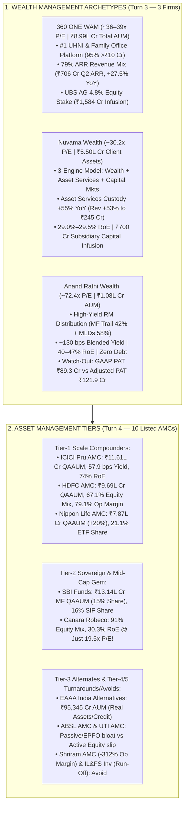

<!-- 
================================================================================
MASTER EXPORT METADATA (100% Verbatim Preservation from Capital Markets Analysis.json)
- formatVersion: 1
- exportTime: 2026-11-06T19:23:15.324Z
- chat.name: collections/default_collection/engines/gemini-enterprise-sec-dx-swa/sessions/13714203460886062980
- chat.title: Capital Markets Analysis
- chat.startTime: 2026-11-06T18:01:20.410Z
- chat.endTime: 2026-11-06T19:22:32.847Z
================================================================================
-->

# 💼 Capital Markets Masterclass & Institutional Deep-Dive — PART 2 of 7
## Wealth Management (`360 ONE WAM`, `Nuvama Wealth`, `Anand Rathi Wealth`) & Asset Management Companies (`10 Listed AMCs`)

| Export Metadata Field | Verbatim JSON Value |
|:---|:---|
| **Format Version** | `1` |
| **Export Time** | `2026-11-06T19:23:15.324Z` |
| **Session Name** | `collections/default_collection/engines/gemini-enterprise-sec-dx-swa/sessions/13714203460886062980` |
| **Session Title** | `Capital Markets Analysis` |
| **Turns Covered in Part 2** | **Turns 3 and 4** *(100% Verbatim Queries & Answers + Enhanced Visual Architecture)* |

---

## 🎨 Enhanced Visual Architecture & Comparative Diagrams (Part 2 Supplement)

### 2.1 Wealth Management & AMC Yield / Margin Architecture (Mermaid Flowchart)


### 2.2 Indian AMC & Wealth Manager Leaderboard: Equity Mix, Operating Margin & Valuation (Q2 FY27)
```
====================================================================================================
      WEALTH & ASSET MANAGEMENT EFFICIENCY SPECTRUM (Q2 FY27 / NOV 2026 ACTUALS)
====================================================================================================

  Company Name            AUM / Assets       Equity / ARR Mix     Op. Margin / RoE      P/E (TTM)
  --------------------------------------------------------------------------------------------------
  ICICI Prudential AMC    ₹11.61 Lakh Cr     57.9 bps Yield       72.6% EBITDA | 74% RoE   37.9x
  HDFC AMC                ₹9.69 Lakh Cr      67.1% Equity Mix     79.1% OpM    | 33% RoE   35.5x
  SBI Funds Management    ₹13.14L Cr (MF)    47.0% Active Eq      75.0% EBITDA | 43% RoE   33.5x
  Nippon Life India AMC   ₹7.87 Lakh Cr      ~50% Eq + 21% ETF    67.3% OpM    | 35% RoE   39.5x
  Canara Robeco AMC       ₹1.24 Lakh Cr      91.0% Equity Mix!    62.4% PBT    | 30% RoE   19.5x (#1 Value)
  EAAA India Alternatives ₹95,345 Cr         100% Alternates      ~38% PBT     | 26% RoNW  33.0x (Q1 Ann.)
  Aditya Birla Sun Life   ₹4.42L Cr (MF)     47.4% Equity Mix     55.4% OpM    | 25% RoE   24.8x
  UTI AMC                 ₹4.02L Cr (MF)     24.6% Active Eq      31.9% PAT    | 19% RoE   21.8x
  --------------------------------------------------------------------------------------------------
  360 ONE WAM             ₹8.99 Lakh Cr      79.0% ARR Mix        48.5% OpPBT  | 17% TRoE  36.5x
  Nuvama Wealth Mgmt      ₹5.47 Lakh Cr      60%+ Wealth ARR      45.9% OpPBT  | 29% RoE   30.2x (#1 GARP)
  Anand Rathi Wealth      ₹1.08 Lakh Cr      42% MF + 58% MLD     33% GAAP PBT | 43% RoE   72.4x
====================================================================================================
```


---

# 🗂️ Conversation Turn 3 (`2026-11-06T18:18:05.259144465Z`)

### 💬 User Query (Turn 3)

```text
**# Role and Objective**

  

You are a Senior Capital Markets Analyst at a top-tier global investment bank. Your task is to perform an institutional-grade, deep-dive strategic and financial analysis of the provided capital markets company (e.g., Stock/Derivatives Exchange, Wealth Management firm, Brokerage, or Asset Management Company/AMC). 

  

Your analysis must move beyond surface-level summaries to critically evaluate business models, key performance indicators (KPIs), macroeconomic sensitivities, regulatory environments, and technological moats.

  

**# Target Company Profile**

  

\- Company Name: [Insert Company Name here]

  

\- Sub-Sector: [e.g., Asset Management (AMC) / Digital Brokerage / Wealth Management / Market Infrastructure & Exchange]

  

**# Analytical Framework & Core Requirements**

  

**## 1. Business Model & Revenue Quality Analysis**

  

\- **\*\*Revenue Diversification:\*\*** Breakdown the revenue streams into recurring vs. transactional. Analyze the mix of asset-based fees, transaction/execution fees, net interest income (NII), and data/technology subscription revenues.

  

\- **\*\*Competitive Moat:\*\*** Evaluate the company’s structural advantages. Is it driven by high switching costs, network effects (for exchanges), scale economies, or proprietary technology/distribution channels?

  

**## 2. Industry-Specific Key Performance Indicators (KPIs)**

  

Analyze the health and trajectory of the specific metrics that matter for this sub-sector:

  

\- **\*\*Asset Managers / Wealth Managers:\*\*** Assets under Management (AUM) or Assets under Advisement (AUA), Net New Money (NNM) / net inflows, and Blended Fee Rate (compression trends).

  

\- **\*\*Brokerages:\*\*** Daily Average Revenue Trades (DARTs) or trading volumes, Active Accounts, and Client Margin Balances / Net Interest Margin (NIM) dependencies.

  

\- **\*\*Exchanges & Market Infrastructure:\*\*** Market share of trading volumes, listing pipelines, clearing/settlement capture rates, and data/index revenue growth.

  

**## 3. Macroeconomic & Market Sensitivity**

  

\- **\*\*Monetary Policy & Interest Rates:\*\*** How does the current interest rate environment (e.g., high rates or a rate-cutting cycle) impact their margin income (NII), cash balances, or product demand?

  

\- **\*\*Market Volatility (Beta):\*\*** Is this business pro-cyclical (thrives on bull markets) or counter-cyclical/defensive (thrives on high volatility, like derivatives exchanges)? 

  

**## 4. Regulatory, Structural, and Tech Risks**

  

\- **\*\*Regulatory Pressures:\*\*** Evaluate risks related to fee transparency (e.g., MiFID II type rules), capital adequacy requirements, or retail investor protection frameworks.

  

\- **\*\*Digital Transformation & AI:\*\*** Assess their adoption of AI (e.g., automated risk management, robo-advisory, algorithmic execution) and whether technology acts as a cost-cutter or an existential competitive threat from FinTechs.

  

**## 5. Strategic SWOT & Investment Thesis Summary**

  

\- Provide a razor-sharp SWOT matrix customized to the capital markets landscape.

  

\- Conclude with a 12-to-24 month investment thesis highlight: Define the single most critical structural catalyst and the most dangerous "Tail Risk" the company faces.

  

**# Output Format**

  

\- Use clear markdown headers, bold structural elements, and text-based tables where appropriate to present quantitative comparisons.

  

\- Maintain an objective, institutional, and analytically rigorous tone. Avoid generic fluff; back assertions with logical capital market mechanics.

  

company list is below 

3\. Wealth mgmt (3 Companies)

  

Specialized wealth management firms catering to High Net-Worth Individuals (HNIs) and Ultra HNIs.

• 360 ONE (Formerly IIFL Wealth)

• Anand Rathi Wea. (Anand Rathi Wealth)

• Nuvama Wealth (Formerly Edelweiss Wealth Management)
```

### 🧠 Institutional Forensic Analysis & Response (Turn 3)

I will search for the latest financial results, AUM/AUA metrics, net inflows, fee retentions, and market capitalizations for 360 ONE WAM, Anand Rathi Wealth, and Nuvama Wealth Management across FY26 and Q2 FY27.
[[section:Gathering wealth management financial data]]I will now fetch the exact full-year FY26 revenue and PAT figures for Nuvama Wealth and Anand Rathi Wealth, as well as the current November 2026 market capitalizations and P/E multiples for all three wealth managers.
[[section:Fetching FY26 and valuation metrics]]India’s listed wealth management trio—**360 ONE WAM**, **Nuvama Wealth Management**, and **Anand Rathi Wealth**—represent three fundamentally distinct operating architectures targeting the financialization of India’s HNI and UHNI pools: **360 ONE WAM (~36–39x P/E, ₹8.99 Lakh Cr total AUM)** is the undisputed UHNI & Alternates advisory titan (**79% ARR revenue mix**), **Nuvama Wealth (~30x P/E, ₹5.50 Lakh Cr client assets, 29% RoE)** is the best-valued integrated wealth-plus-institutional clearing powerhouse, and **Anand Rathi Wealth (~72x P/E, ₹1.08 Lakh Cr AUM, ~40–47% RoE)** is an asset-light, high-margin distributor whose earnings rely heavily on non-principal-protected structured products (Market-Linked Debentures/MLDs) and mutual fund trail fees.

Good call dissecting the wealth managers separately from AMCs and brokerages—while all three claim "recurring wealth compounding," a forensic audit of their **revenue mix, balance-sheet leverage, and accounting adjustments** reveals massive differences in earnings quality.

---

### 📌 Executive Summary & Institutional Decision Matrix

* **Best Institutional Risk-Reward & Valuation Comfort: Nuvama Wealth Management (NUVAMA)** — Trading at **~30.2x P/E** (Mkt Cap ~₹32,200–34,000 Cr) with a **29% RoE**, Nuvama just delivered a stellar Q2 FY27 (reported today, Nov 6, 2026): operating revenue rose **21% YoY to ₹937 Cr** and operating PAT surged **26% YoY to ₹319 Cr** (reported PAT ₹304 Cr after a ₹16 Cr one-time Venture Debt Fund pre-closure charge). Its secret weapon is its **Asset Services (Institutional Custody & Clearing)** engine, which grew revenue **53% YoY to ₹245 Cr** on ₹1.64 Lakh Cr of assets (+55% YoY) alongside its ₹3.71 Lakh Cr Wealth franchise.
* **The Pure-Play UHNI Advisory & Alternates Leader: 360 ONE WAM (360ONE)** — Commands nearly **₹9.0 Lakh Cr in total AUM** (₹8,99,481 Cr as of Sept 2026, +31% YoY), including **₹3,53,382 Cr in Annual Recurring Revenue (ARR) AUM**. In Q2 FY27, ARR revenue jumped **27.5% YoY to ₹706 Cr**, now representing **79% of operating revenue** (₹896 Cr, +17.5% YoY), while Operating PBT rose **19.7% YoY to ₹434 Cr** (headline PAT dipped 4.4% to ₹302 Cr solely due to a -₹44 Cr MTM fair-value hit on pre-IPO NSE treasury shares). With **UBS AG** converting all 2.05 crore warrants into a **4.8% equity stake at ₹1,030/share** (infusing ₹1,584 Cr in Oct 2026) and exchanging $300–325M in cross-border flows within 90 days, 360 ONE owns the ultra-rich segment (>₹10 Cr families = 95% of wealth AUM).
* **High-RoE Distribution Machine with Forensic & Valuation Caveats: Anand Rathi Wealth (ANANDRATHI)** — Crossed **₹1,08,377 Cr in AUM** (+18% YoY despite an 8% Nifty decline) with record Q2 FY27 net inflows of **₹4,186 Cr (+39% YoY)**. However, investors must note a major **forensic divergence in Q2 FY27**: while management’s "Adjusted Business PAT" rose **22.2% YoY to ₹121.9 Cr** (excluding ESOP charges and investment fair-value swings), **statutory GAAP Reported PAT fell 10.7% YoY (and 45.2% QoQ) to ₹89.26 Cr** as total expenses rose 38.5% YoY. At **~72x P/E** (Mkt Cap ~₹33,800 Cr post two consecutive 1:1 bonus issues in March 2025 and April 2026), valuation leaves zero margin of safety.

---

### 📊 Quantitative Cross-Wealth Comparison (FY26 & Q2 FY27 Audited/Reported)

| Metric / KPI | 360 ONE WAM (Formerly IIFL Wealth) | Nuvama Wealth (Formerly Edelweiss WM) | Anand Rathi Wealth |
|---|---|---|---|
| **Core Target Segment** | Ultra-HNI (>₹50 Cr & ₹10–50 Cr families), Family Offices, Alternates AMC | Affluent/Mid-HNI (*Nuvama Wealth*), UHNI (*Nuvama Private*), Institutional Clearing | Mass Affluent & HNI (₹5–50 Cr pool) via RM-led MF & Structured Product distribution |
| **Market Cap (Nov 6, 2026)** | ~₹46,500 – ₹49,032 Cr (CMP ~₹1,141–1,145) | ~₹32,218 – ₹34,001 Cr (CMP ~₹1,733–1,840) | ~₹33,794 Cr (CMP ~₹2,040–2,235; post 1:1 bonuses) |
| **Trailing P/E Multiple** | **~33.8x – 39.3x** | **~30.2x** | **~72.4x** (on GAAP PAT) |
| **Total Client Assets / AUM (Q2 FY27)** | **₹8,99,481 Cr** (+31% YoY)<br>• ARR AUM: **₹3,53,382 Cr** (+19.7% YoY)<br>• Transactional/Custody: **₹5,46,099 Cr** | **₹5,46,964 Cr** (~₹5.50 Lakh Cr, +25% YoY)<br>• Wealth Assets: **₹3,71,129 Cr** (+16% YoY)<br>• Asset Services: **₹1,63,835 Cr** (+55% YoY)<br>• AMC AUM: **₹12,000 Cr** (₹9,775 Cr fee-paying) | **₹1,08,377 Cr** (+18.4% YoY)<br>• Private Wealth AUM: ~₹1,06,000 Cr<br>• Digital Wealth AUM: ~₹2,218+ Cr |
| **FY26 Revenue (Net Operating / Total)** | ₹3,066 Cr Operating (+25.4% YoY); ₹3,144 Cr Total | ~₹3,100+ Cr Net Operating (9M FY26: ₹2,297 Cr) | ₹1,198 Cr Total Revenue (+22% YoY) |
| **FY26 Consolidated PAT** | **₹1,225 Cr** (+20.7% YoY) | **~₹1,030+ Cr** (9M FY26 Operating PAT: ₹780 Cr) | **₹386 Cr** Adjusted (+28% YoY) |
| **Q2 FY27 Operating Revenue** | **₹896 Cr** (+17.5% YoY, +9.0% QoQ); Total Rev ₹853 Cr after -₹44 Cr OI | **₹937 Cr** Net Revenue (+21% YoY) / ₹1,366 Cr Gross (+20.4% YoY) | **₹344.0 Cr** Operating (+15.7% YoY); Total Income ₹356.6 Cr (+16.1% YoY) |
| **Q2 FY27 Consolidated PAT** | **₹302 Cr** (-4.4% YoY due to -₹44 Cr NSE MTM; **Operating PBT +19.7% to ₹434 Cr**) | **₹319 Cr Operating PAT** (+26% YoY) / **₹303.5 Cr Reported PAT** (+19.5% YoY) | **₹121.9 Cr Adjusted PAT** (+22.2% YoY) / **₹89.26 Cr Reported GAAP PAT** (-10.7% YoY) |
| **Return on Equity (RoE)** | **16.9% Tangible RoE** in Q2 (14.4% Headline; targets **20% Tangible RoE** in 3.5 yrs) | **~29.0% – 29.5% RoE** | **39.7% – 46.7% RoE** (Asset-light, zero NBFC book) |
| **Debt-to-Equity & Lending Book** | **D/E: 1.62x – 1.67x** (NBFC Loan Book: **₹13,899 Cr**, +34.4% YoY) | Moderate Leverage (Loan Book: **~₹4,300+ Cr**; infusing ₹400 Cr equity into NWFL) | **D/E: 0.08x** (Virtually debt-free; no balance-sheet lending) |

---

## 1. Business Model & Revenue Quality Analysis

### Revenue Diversification: True Advisory ARR vs. Distribution Trail vs. Transactional Yield
In Indian wealth management, not all "recurring" revenue is created equal. Institutional investors must distinguish between **Advisory/Discretionary ARR** (contractual fee on portfolio value), **Mutual Fund Trail ARR** (commission paid by AMCs out of TER), **Upfront Structured Product/Transactional Brokerage**, and **Balance-Sheet NII**.

#### 1. 360 ONE WAM: The Transition to "360 ONE Plus" Advisory & Alternates AMC
* **Annual Recurring Revenue (ARR — 79% of Operating Revenue in Q2 FY27):** Generated **₹706 Cr in Q2 FY27 (+27.5% YoY)** out of ₹896 Cr operating revenue (up from ₹2,289 Cr ARR out of ₹3,066 Cr in full-year FY26).
  * **Wealth Management ARR (₹503 Cr in Q2 FY27, +40.5% YoY):** Driven by three pillars on ₹2,52,627 Cr of Wealth ARR AUM (+24.3% YoY):
    1. **360 ONE Plus (Discretionary/Non-Discretionary/Corporate Treasury Advisory):** The flagship contractual fee model surged **37.8% YoY to ₹1,02,134 Cr AUM**.
    2. **Financial Product Distribution (Trail Fees):** Earned on **₹1,36,595 Cr of assets (+15.0% YoY)**.
    3. **Net Interest Income (NII) on Lending:** Earned on its **₹13,899 Cr LAS/margin lending book (+34.4% YoY)** via wholly-owned NBFC subsidiary 360 ONE Prime.
  * **Asset Management ARR (₹203 Cr in Q2 FY27, +3.8% YoY):** Earned on **₹1,00,754 Cr of Alternates ARR AUM (+9.4% YoY)** across Private Equity, Private Credit, Real Assets, and Listed Equity PMS/AIFs.
* **Transactional / Brokerage Income (21% of Operating Revenue):** Declined **9.1% YoY to ₹190 Cr in Q2 FY27** as 360 ONE deliberately migrated clients away from upfront syndicate/brokerage fees toward sticky ARR mandates.

#### 2. Nuvama Wealth Management: The Three-Engine Integrated Franchise
In Q2 FY27, Nuvama generated **₹937 Cr in net operating revenue (+21% YoY)** across three distinct, synergistic engines:
* **Engine 1: Wealth Management (53.5% of Net Revenue — ₹501 Cr in Q2 FY27, +14% YoY; PBT ₹184 Cr, +22% YoY):** Divided into two client tiers totaling **₹3,71,129 Cr in client assets (+16% YoY)**:
  * **Nuvama Wealth (Affluent & Mid-HNI — 13+ Lakh clients):** Generated **₹275 Cr revenue (+14% YoY)** and **₹102 Cr PBT (+21% YoY)**. Over **60% of revenue is recurring**, anchored by **MPIS (Managed Products & Investment Solutions)** and NII.
  * **Nuvama Private (UHNI & Family Offices — 4,900+ families):** Generated **₹226 Cr revenue** and **₹82 Cr PBT**. Focused on ARR advisory and alternatives; combined MPIS and ARR assets across both tiers jumped **27% YoY to ~₹1.10 Lakh Cr**.
* **Engine 2: Asset Services / Institutional Clearing & Custody (26.1% of Net Revenue — ₹245 Cr in Q2 FY27, +53% YoY):**
  * **The Hidden Crown Jewel:** Nuvama is a premier clearing and custody partner for FPIs, PMSs, and domestic institutions, overseeing **₹1,63,835 Cr in custody/clearing assets (+55% YoY)**. It earns highly sticky **float interest income and clearing fees** with largely fixed sunk technology costs, driving massive operating leverage.
* **Engine 3: Capital Markets & Asset Management (20.4% of Net Revenue — ₹192 Cr in Q2 FY27):**
  * **Institutional Equities & Investment Banking (Capital Markets):** Generated **₹175 Cr in Q2 FY27 (+9% YoY)**, benefiting from India’s IPO and block-deal boom. Together, Asset Services + Capital Markets delivered **₹259 Cr in Q2 PBT (+34% YoY)**.
  * **Nuvama Asset Management (Alternates):** Generated **₹17 Cr management fees in Q2 (₹39 Cr in H1, +11% YoY)** on ₹12,000 Cr total AUM (₹9,775 Cr fee-paying, down 11% YoY as Commercial Real Estate inflows were offset by planned private-market distributions and public-market redemptions).

#### 3. Anand Rathi Wealth: High-Yield Dual-Product Distribution (MF + Structured Products)
* **Pure Distribution Model (Zero Balance-Sheet Lending):** Generates **₹344 Cr in Q2 FY27 operating revenue (+15.7% YoY)** across 14,309 active HNI families without taking credit risk on its balance sheet (D/E of just 0.08x).
* **The Two Revenue Pillars:**
  1. **Mutual Fund Distribution (Trail Revenue — 42.2% of Operating Revenue):** Generated **₹145 Cr in Q2 FY27 (+18% YoY)** on the back of record quarterly equity MF net inflows of **₹2,867 Cr (+39% YoY)**.
  2. **Non-Principal Protected Structured Products / MLDs & Other Distribution (~57.8% of Operating Revenue — ~₹199 Cr in Q2 FY27):** Anand Rathi distributes proprietary structured notes (typically Nifty-linked debentures issued by group NBFC Anand Rathi Global Finance). These products offer 3-to-5 year maturities that naturally roll over into new issuances, generating high upfront/embedded distribution yields (**blended revenue yield across total AUM is ~125–135 bps**, nearly 60% higher than 360 ONE’s 79 bps retention).

---

### Competitive Moat & Structural Advantages
* **RM Productivity & Zero-Regret Attrition:** In HNI wealth management, the **Relationship Manager (RM)** owns the client trust.
  * **Anand Rathi Wealth** boasts industry-lowest RM attrition (~1–2% historically) by pairing RMs with junior "Account Managers" (apprentices) and standardizing portfolio allocation (Equity MF + Structured Products), scaling to **431 RMs** managing **14,309 families** (~33 families and ~₹251 Cr AUM per RM).
  * **360 ONE WAM** dominates the complex **>₹50 Cr UHNI and Family Office** tier (9,000+ families; 4,100+ families with >₹10 Cr accounting for 95% of ex-custody wealth AUM). Its moat is built on institutional-grade open-architecture advisory (*360 ONE Plus*), exclusive co-investment access in its ₹1 Lakh Cr Alternates AMC, and its global **UBS AG strategic alliance**.
  * **Nuvama Wealth** bridges both worlds while locking in institutional hedge funds and FPIs via its licensed **Asset Services clearing infrastructure**—a business with high regulatory barriers and sticky client float balances.

---

## 2. Industry-Specific Key Performance Indicators (KPIs)

| Wealth Management KPI | 360 ONE WAM | Nuvama Wealth Management | Anand Rathi Wealth |
|---|---|---|---|
| **AUM / Client Asset Trajectory (Q2 FY27)** | **₹8,99,481 Cr Total AUM** (+31% YoY)<br>**₹3,53,382 Cr ARR AUM** (+19.7% YoY) | **₹5,46,964 Cr Client Assets** (+25% YoY)<br>**~₹1,10,000 Cr MPIS + ARR Assets** (+27% YoY) | **₹1,08,377 Cr AUM** (+18.4% YoY vs -8% Nifty move) |
| **Net New Money (NNM) / Net Inflows** | **₹12,482 Cr ARR Net Flows in Q2 FY27** (up from ₹10,815 Cr in Q1 FY27):<br>• Wealth ARR Flows: **₹10,990 Cr**<br>• AMC ARR Flows: **₹1,492 Cr** (rebounded from Q1 redemptions) | Record net flows across Wealth & Private; **9M FY26 MPIS + ARR net flows were ₹13,489 Cr** (₹6,545 Cr MPIS + ₹6,944 Cr ARR) | **Record ₹4,186 Cr Net Inflows in Q2 FY27** (+39% YoY), including **₹2,867 Cr Equity MF flows**. *(Note: H1 FY27 inflows of ₹6,928 Cr were flat vs ₹6,825 Cr in H1 FY26)* |
| **Blended Fee Rate / Retention Yield** | **Combined ARR Retention: 79 bps** in Q2 FY27 (up from 71 bps in Q1 FY27 and 78 bps in FY26):<br>• Wealth ARR Yield: **79 bps**<br>• AMC ARR Yield: **79 bps** | **Private ARR Retention: ~80–90 bps** (90 bps in Q3 FY26 due to Cat-II AIF salience); overall Wealth yield on ₹3.71L Cr assets is **~54 bps** | **Implied Blended Revenue Yield: ~127–135 bps** on average AUM (₹344 Cr Q2 operating rev on ~₹1.04L Cr avg AUM) |
| **Cost-to-Income Ratio (Operating Efficiency)** | **51.5% in Q2 FY27** (improved sequentially as operating PBT rose 19.7% to ₹434 Cr) | **54.1% in Q2 FY27** (Costs of ₹507 Cr grew 16% YoY vs 21% revenue growth to ₹937 Cr) | **53.8% Adjusted** (Adjusted PBT margin ~46% of total income; **Reported GAAP expenses jumped 38.5% YoY to ₹239.7 Cr**) |

---

## 3. Macroeconomic & Market Sensitivity

### Monetary Policy & Interest Rates (NII & Float Transmission)
1. **360 ONE WAM (Leveraged NBFC Carry + MTM Sensitivity):**
   * Operates a **₹13,899 Cr loan book (+34.4% YoY)** backed by total debt of ~₹15,452 Cr (D/E of 1.62x–1.67x). A rate-cutting cycle lowers wholesale borrowing costs (CPs/NCDs) for its NBFC faster than it reprices UHNI Loan-Against-Securities (LAS) rates, expanding Net Interest Margins (NIMs).
   * *Watch Out:* 360 ONE’s P&L is sensitive to treasury fair-value accounting—in Q2 FY27, Other Income swung to **-₹44 Cr** due to mark-to-market adjustments on unlisted/pre-IPO NSE shares, dragging reported PAT down 4.4% despite 19.7% operating PBT growth.
2. **Nuvama Wealth (Float Yield vs. Lending Book Expansion):**
   * **Today’s Capital Allocation Signal (Nov 6, 2026):** Alongside Q2 results, Nuvama’s board approved **₹700 Cr in fresh equity infusions** into its subsidiaries—**up to ₹400 Cr into Nuvama Wealth Finance Ltd (NWFL)** (its NBFC lending arm, where the loan book scaled 38–39% to ₹4,300+ Cr) and **up to ₹300 Cr into Nuvama Wealth & Investment Ltd (NWIL)** (its broking/MTF arm).
   * In its **Asset Services** segment, earnings are a function of `(Client Float Balance) × (Interest Yield)`. While rate cuts slightly compress the yield on float, the **55% YoY surge in Asset Services client assets (to ₹1,63,835 Cr)** overwhelmed yield compression, driving segment revenue up **53% YoY to ₹245 Cr** in Q2 FY27.
3. **Anand Rathi Wealth (Rate-Agnostic Balance Sheet, MLD Spread Sensitivity):**
   * Has zero lending book and virtually zero debt (D/E 0.08x). However, higher volatility and attractive fixed-income spreads help its structured product designers price Nifty-linked debentures with compelling upside participation for HNIs.

### Market Volatility (Beta) & Pro-Cyclicality
* **High Beta to Equity MTM, Insulated by Net New Money (NNM) Velocity:**
  * Q2 FY27 provided a live stress test: amidst FPI outflows, Brent crude spikes ($112–114), and geopolitical tensions, the **Nifty declined ~8% YoY**. Yet all three firms expanded AUM by **18% to 31% YoY** because HNI/UHNI liquidity events (IPO monetizations, promoter stake sales, ESOP cash-outs) channeled record Net New Money into their platforms (₹12,482 Cr ARR flows at 360 ONE; ₹4,186 Cr net inflows at Anand Rathi).

---

## 4. Regulatory, Structural, and Tech Risks

### Regulatory Pressures & Forensic Governance Flags
1. **Promoter Share Pledging Overhang (CRITICAL FORENSIC FLAG):**
   * **Nuvama Wealth:** On **November 3, 2026**, majority promoter **PAGAC Ecstasy Pte. Ltd. (PAG)** pledged an additional **3.51 crore shares** post lock-in expiry, bringing total encumbered promoter shares to **9,69,60,340—representing 52.54% of Nuvama’s total equity capital** (or ~62.8% of promoter holding, against a ₹4,286 Cr facility with a 3.9x security cover). While standard for private equity leveraged buyouts (PAG holds ~55%), high promoter pledging can cap valuation multiples during market sell-offs.
   * **360 ONE WAM:** Following Bain Capital’s stake sales and institutional transitions, classified promoter holding stands at just **5.88%** (with **89.98% of that promoter stake pledged**), though FIIs own 56.0% and UBS AG now holds ~4.8% post its Oct 2026 warrant conversion.
2. **SEBI TER Cuts, Taxation & Product Concentration Risk:**
   * **Anand Rathi’s Related-Party MLD Concentration:** Following the Finance Act 2023 removal of LTCG tax arbitrage on Market-Linked Debentures (taxing MLD gains at marginal slab rates), skeptics expected Anand Rathi’s structured product engine to stall. While Anand Rathi successfully pivoted to unquoted/non-principal-protected debentures designed for alpha rather than tax arbitrage, **~55–58% of its revenue still relies on a single complex product class issued primarily by a related-party group NBFC**. Any RBI/SEBI clampdown on NBFC structured note issuance or distribution commissions would be existential.
   * ** GAAP vs. "Adjusted PAT" Divergence at Anand Rathi:** In Q2 FY27, Anand Rathi excluded **~₹32.6 Cr** of ESOP expenses, fair-value changes, and tax items to report ₹121.9 Cr of "Adjusted Business PAT" (+22% YoY), whereas statutory **Reported PAT fell 10.7% YoY to ₹89.26 Cr** (reported PBT margin fell from 44% to 33%). Institutional analysts must penalize recurring ESOP dilution as a real economic cost.
3. **Specialized Investment Funds (SIF) & New Asset Class Regulation:**
   * Both **Nuvama** (under its SEBI-approved *Numa SIF* license) and **360 ONE** are launching long-short and hybrid SIF strategies in H2 FY27 to bridge the gap between Mutual Funds (₹500 ticket) and PMS/AIFs (₹50 Lakh / ₹1 Crore ticket).

### Digital Transformation & AI Adoption
* **B2B2C SaaS & Mid-Market Tech Scaling:**
  * **Anand Rathi** operates **Omni Financial Advisors (OFA)** (a B2B tech platform with **6,906 IFAs** subscriber base) and **Digital Wealth (DW)** (AUM up 22% YoY to ₹2,218 Cr).
  * **360 ONE** acquired ET Money to build a mass-affluent digital funnel and recently launched a dedicated **Multi-Stage AI Fund** within its AMC, while automating portfolio reporting across its *360 ONE Plus* platform.
  * **Nuvama** leverages automated API risk-management and collateral engines to power its high-margin Asset Services clearing desk for quant/algo FPIs.

---

## 5. Strategic SWOT & 12–24 Month Investment Thesis Summary

### Comparative Institutional SWOT Matrix

| Dimension | 360 ONE WAM | Nuvama Wealth Management | Anand Rathi Wealth |
|---|---|---|---|
| **Strengths** | • **#1 UHNI Platform:** ₹8.99 Lakh Cr total AUM; 9,000+ families<br>• **79% ARR Revenue Mix** (₹706 Cr in Q2, +27.5% YoY)<br>• **UBS Strategic Partnership:** 4.8% equity stake + ₹1,584 Cr capital infusion + global wealth pipeline | • **Most Diversified Engine:** Wealth (₹3.71L Cr) + Asset Services (₹1.64L Cr) + IB/IE<br>• **Cheapest Valuation (~30.2x P/E)** despite 26% YoY operating PAT growth & **29% RoE**<br>• Asset Services revenue surging **+53% YoY** | • **Superior Capital Efficiency:** 40–47% RoE with virtually zero debt (D/E 0.08x)<br>• **Industry-High Blended Yield (~130 bps)** & lowest RM attrition<br>• Record Q2 net inflows of **₹4,186 Cr (+39% YoY)** |
| **Weaknesses** | • **Suppressed Headline RoE (14.4% GAAP / 16.9% Tangible)** due to NBFC capital & goodwill<br>• High balance-sheet debt (**₹15,452 Cr**; D/E 1.62x) & negative FY26 CFO (-₹2,921 Cr from loan growth)<br>• Treasury MTM volatility (-₹44 Cr in Q2) | • **High Promoter Pledging:** PAG has pledged **52.54% of total company equity** as of Nov 3, 2026<br>• **AMC Fee-Paying AUM dipped 11% YoY** to ₹9,775 Cr in Q2 FY27<br>• ₹16 Cr one-off Venture Debt Fund closure hit | • **Rich Valuation (~72.4x P/E)** leaves zero room for error<br>• **Wide GAAP vs Adjusted PAT gap** in Q2 FY27 (₹89.3 Cr reported vs ₹121.9 Cr adjusted)<br>• H1 FY27 net inflows (₹6,928 Cr) were nearly flat YoY (vs ₹6,825 Cr) |
| **Opportunities** | • **UBS Cross-Border Flow Target:** Scaling bidirectional flows to $600–700M in FY27 ($300–325M done in 3 mos)<br>• **Tangible RoE expansion to ~20%** over 3.5 years without equity dilution<br>• New Alternates funds (AI Fund, ARISE, Renewables) | • **Deploying ₹700 Cr Fresh Subsidiary Equity** (₹400 Cr in NWFL lending, ₹300 Cr in NWIL broking) to accelerate NII/MTF<br>• H2 FY27 launch of **Prime Fund II (CRE)**, Private Credit, and **Numa SIF** | • Expanding RM bench (up to 431 RMs) and deepening penetration in Tier-2/3 HNI cities<br>• Scaling Equity MF market share (Q2 equity MF inflows +39% YoY to ₹2,867 Cr) |
| **Threats** | • Rising cost-of-funds or credit defaults in the ₹13,899 Cr LAS/lending book<br>• Intense poaching of senior UHNI private bankers by global & domestic rivals | • Potential PE promoter (PAG) block-deal supply overhang or pledge-related volatility<br>• Prolonged FPI outflow cycle hurting Institutional Equities & Asset Services float | • **Regulatory scrutiny on non-principal-protected MLDs / structured notes** or related-party NBFC concentration<br>• Steep H2 FY27 ask to hit ₹1,20,000 Cr AUM guidance (needs +₹11,600 Cr in 6 mos) |

---

### 🎯 12-to-24 Month Investment Thesis & Risk/Catalyst Verdict

#### 1. Nuvama Wealth Management (NUVAMA) — *Top Conviction Value-to-Growth Compounder*
* **Single Most Critical Structural Catalyst:** **Asset Services Operating Leverage + ₹700 Cr Lending/Broking Capital Deployment.** Nuvama’s Asset Services (custody/clearing) business has completely lapped last year’s single-client exit, growing Q2 FY27 revenue **53% YoY to ₹245 Cr** on fixed sunk tech costs. Combined with today’s (Nov 6, 2026) board approval to inject **₹700 Cr into NWFL and NWIL** to scale its high-NIM wealth lending book and MPIS franchise, Nuvama is poised to compound operating PAT at 22–25%+ while re-rating from its discounted **~30x P/E**.
* **Most Dangerous "Tail Risk":** **Promoter Pledge / PE Overhang & FPI Custody Reversal.** With promoter PAG encumbering **52.54% of Nuvama’s total share capital** (as of Nov 3, 2026) to back offshore debt facilities, any sharp global liquidity crunch or large PE secondary block supply—paired with an FPI exodus reducing Asset Services float balances—could compress multiples.

#### 2. 360 ONE WAM (360ONE) — *The Structural UHNI & Global Alliance Compounder*
* **Single Most Critical Structural Catalyst:** **UBS Flow Monetization + Operating Leverage Driving Tangible RoE from 16.9% to 20%.** Having exchanged **$300–325M of client flows with UBS in just the first 3 months** (already halfway to its full-year $600–650M target) and received **₹1,584 Cr in cash from UBS’s warrant conversion at ₹1,030/share** in October 2026, 360 ONE has fortressed its balance sheet. As *360 ONE Plus* (+37.8% YoY to ₹1.02 Lakh Cr) drives ARR above 80% of revenue and Cost-to-Income compresses below 50%, Tangible RoE will march toward management’s 20% target without further equity dilution.
* **Most Dangerous "Tail Risk":** **Operating Leverage Stress & Alternates Redemption Cycles.** In Q2 FY27, operating expenses grew faster than total revenue (due to RM hiring and -₹44 Cr treasury MTM), while AMC operating PBT slipped 3.7% YoY to ₹108 Cr. If private market realizations slow down or employee retention bonuses inflate the cost-to-income ratio above 52%, the stock’s ~36–39x P/E will face resistance.

#### 3. Anand Rathi Wealth (ANANDRATHI) — *High-Velocity Distribution Machine Priced for Perfection*
* **Single Most Critical Structural Catalyst:** **Sustained ₹4,000+ Cr Quarterly Net Inflow Velocity & Equity MF Share Gains.** Delivering **₹4,186 Cr of net inflows in Q2 FY27 (+39% YoY)** during an 8% Nifty correction proves the remarkable sales execution of its 431 RMs. If it achieves its demanding FY27 target of **₹1,20,000 Cr AUM and ₹460 Cr Adjusted PAT** while closing the gap between GAAP and Adjusted profits, earnings momentum will remain strong.
* **Most Dangerous "Tail Risk":** **Valuation De-Rating (~72x P/E) on GAAP Earnings Divergence or Structured Product Regulation.** Trading at nearly **2.4x the P/E multiple of Nuvama and 1.9x that of 360 ONE**, Anand Rathi’s valuation is highly vulnerable to the **38.5% YoY surge in Q2 GAAP expenses** (which caused GAAP PAT to drop 10.7% YoY to ₹89.26 Cr vs ₹121.9 Cr Adjusted PAT) or any regulatory tightening by SEBI/RBI on non-principal-protected structured notes.


---

# 🗂️ Conversation Turn 4 (`2026-11-06T18:22:02.837547205Z`)

### 💬 User Query (Turn 4)

```text
**# Role and Objective**

  

You are a Senior Capital Markets Analyst at a top-tier global investment bank. Your task is to perform an institutional-grade, deep-dive strategic and financial analysis of the provided capital markets company (e.g., Stock/Derivatives Exchange, Wealth Management firm, Brokerage, or Asset Management Company/AMC). 

  

Your analysis must move beyond surface-level summaries to critically evaluate business models, key performance indicators (KPIs), macroeconomic sensitivities, regulatory environments, and technological moats.

  

**# Target Company Profile**

  

\- Company Name: [Insert Company Name here]

  

\- Sub-Sector: [e.g., Asset Management (AMC) / Digital Brokerage / Wealth Management / Market Infrastructure & Exchange]

  

**# Analytical Framework & Core Requirements**

  

**## 1. Business Model & Revenue Quality Analysis**

  

\- **\*\*Revenue Diversification:\*\*** Breakdown the revenue streams into recurring vs. transactional. Analyze the mix of asset-based fees, transaction/execution fees, net interest income (NII), and data/technology subscription revenues.

  

\- **\*\*Competitive Moat:\*\*** Evaluate the company’s structural advantages. Is it driven by high switching costs, network effects (for exchanges), scale economies, or proprietary technology/distribution channels?

  

**## 2. Industry-Specific Key Performance Indicators (KPIs)**

  

Analyze the health and trajectory of the specific metrics that matter for this sub-sector:

  

\- **\*\*Asset Managers / Wealth Managers:\*\*** Assets under Management (AUM) or Assets under Advisement (AUA), Net New Money (NNM) / net inflows, and Blended Fee Rate (compression trends).

  

\- **\*\*Brokerages:\*\*** Daily Average Revenue Trades (DARTs) or trading volumes, Active Accounts, and Client Margin Balances / Net Interest Margin (NIM) dependencies.

  

\- **\*\*Exchanges & Market Infrastructure:\*\*** Market share of trading volumes, listing pipelines, clearing/settlement capture rates, and data/index revenue growth.

  

**## 3. Macroeconomic & Market Sensitivity**

  

\- **\*\*Monetary Policy & Interest Rates:\*\*** How does the current interest rate environment (e.g., high rates or a rate-cutting cycle) impact their margin income (NII), cash balances, or product demand?

  

\- **\*\*Market Volatility (Beta):\*\*** Is this business pro-cyclical (thrives on bull markets) or counter-cyclical/defensive (thrives on high volatility, like derivatives exchanges)? 

  

**## 4. Regulatory, Structural, and Tech Risks**

  

\- **\*\*Regulatory Pressures:\*\*** Evaluate risks related to fee transparency (e.g., MiFID II type rules), capital adequacy requirements, or retail investor protection frameworks.

  

\- **\*\*Digital Transformation & AI:\*\*** Assess their adoption of AI (e.g., automated risk management, robo-advisory, algorithmic execution) and whether technology acts as a cost-cutter or an existential competitive threat from FinTechs.

  

**## 5. Strategic SWOT & Investment Thesis Summary**

  

\- Provide a razor-sharp SWOT matrix customized to the capital markets landscape.

  

\- Conclude with a 12-to-24 month investment thesis highlight: Define the single most critical structural catalyst and the most dangerous "Tail Risk" the company faces.

  

**# Output Format**

  

\- Use clear markdown headers, bold structural elements, and text-based tables where appropriate to present quantitative comparisons.

  

\- Maintain an objective, institutional, and analytically rigorous tone. Avoid generic fluff; back assertions with logical capital market mechanics.

  

company list is below 

4\. AMC (Asset Management Company - 10 Companies)

  

Firms setting up and managing mutual funds, public funds, or Alternative Investment Funds (AIFs).

• ICICI AMC

• HDFC AMC

• SBI Funds Mgt.

• Nippon Life Ind.

• Aditya AMC (Aditya Birla Sun Life AMC)

• EAAA India (Edelweiss Alternative Asset Advisors)

• UTI AMC

• Canara Robeco

• Shriram AMC

• IL&FS Inv.Manag. (IL&FS Investment Managers - Private Equity & Infrastructure)
```

### 🧠 Institutional Forensic Analysis & Response (Turn 4)

I will search for the latest FY26 and Q2 FY27 financial metrics, Quarterly Average AUM (QAAUM), equity mix, SIP books, IPO updates, and valuations for the 10 listed/filing AMCs (ICICI Prudential AMC, HDFC AMC, SBI Funds Management, Nippon Life India AMC, Aditya Birla Sun Life AMC, EAAA India Alternatives, UTI AMC, Canara Robeco AMC, Shriram AMC, and IL&FS Investment Managers).
[[section:Gathering AMC sector financial data]]I will now fetch the latest FY26 and Q2 FY27 results, AUM, and IPO/listing metrics for SBI Funds Management, Canara Robeco AMC, EAAA India Alternatives (Edelweiss Alternative Asset Advisors), UTI AMC, and Aditya Birla Sun Life AMC.
[[section:Fetching SBI Canara EAAA UTI details]]I will now fetch the Q2 FY27 results and QAAUM details for UTI AMC and Aditya Birla Sun Life AMC, as well as the current market capitalizations of SBI Funds Management and Canara Robeco AMC.
[[section:Fetching UTI and ABSL AMC details]]India’s listed Asset Management Company (AMC) universe—now expanded to **10 listed entities** following the landmark 2025–2026 IPOs of **ICICI Prudential AMC**, **SBI Funds Management (debuted July 21, 2026)**, **Canara Robeco AMC**, and **EAAA India Alternatives (listed Nov 2026)**—operates at an industry scale of **₹87.2–87.5 Lakh Cr Mutual Fund QAAUM** (+13.4% YoY in Q2 FY27) and record monthly SIP inflows of **₹32,490 Cr** (Sept 2026 across >10 crore SIP accounts). Across this 10-company spectrum, **ICICI Prudential AMC (~37.9x P/E, 74.3% RoE, 57.9 bps yield)** and **HDFC AMC (~33.2–37.9x P/E, 67.1% equity mix, 79.1% operating margin)** represent the highest-quality compounding franchises, **Nippon Life India AMC (~35.8–43.4x P/E, +20.9% YoY Q2 revenue)** is the fastest organic market-share gainer, **Canara Robeco AMC (~19.5x P/E, 91% equity mix, 30.3% RoE)** is the most mispriced mid-cap value play, and **EAAA India Alternatives (~33x annualized Q1 FY27 P/E, ₹95,345 Cr AUM)** is the sole pure-play institutional Real Assets & Private Credit compounder. Conversely, **Shriram AMC** (-312% operating margin) and **IL&FS Investment Managers** (legacy liquidation run-off) are structurally impaired micro-caps to avoid.

Good call evaluating the entire 10-company AMC cohort together—by separating the **Top-4 Scale Titans**, the **Mid-Tier Challengers**, the **Pure-Play Alternates Platform**, and the **Sub-Scale Micro-Caps**, you can immediately spot where **AUM growth is translating into operating profit** versus where **passive mix-shifts, EPFO mandate reallocations, or ESOP bloat** are destroying shareholder returns.

---

### 📌 Executive Summary & Institutional Tiering Matrix

* **Tier 1: The High-Yield Active & Hybrid Compounders (Core Portfolio Anchors)**
  * **ICICI Prudential AMC (ICICIAMC):** India’s most profitable AMC by absolute scale (TTM Revenue **₹6,270 Cr**, TTM PAT **₹3,534 Cr**, Market Cap **~₹1.34–1.47 Lakh Cr**, RoE **74.3%–85.8%**). In Q2 FY27, QAAUM rose 14.4% YoY to **₹11.61 Lakh Cr** while blended operating yields expanded 190 bps YoY to **57.9 bps** (MF yield at 48 bps; Alternates at 8.7% of revenue), driving Q2 operating revenue up **16.3% YoY to ₹1,674 Cr** and PAT to **₹889 Cr**.
  * **HDFC AMC (HDFCAMC):** The margin efficiency king (**79.1% operating margin**, **67.7% TTM net profit margin**, Market Cap **~₹98,940–1,13,280 Cr**, P/E **~33.2–37.9x**, RoE **~32.3–33.4%**). Boasts a **67.1% equity-oriented QAAUM mix** (vs 57.5% industry average) across **₹9.69 Lakh Cr QAAUM** (12.7% active equity market share), delivering **36 bps operating margin on AUM** and ₹1,170 Cr Q2 FY27 operating revenue (+13.9% YoY).
  * **Nippon Life India AMC (NAM-INDIA):** Best dual-engine execution across **Retail Active Equity (7.40% share)** and **ETFs (21.12% market share)** on **₹7.87 Lakh Cr MF QAAUM (+20% YoY)**. Q2 FY27 operating revenue surged **20.9% YoY to ₹795.8 Cr** and core operating profit before exceptional items jumped **20.0% YoY to ₹546.6 Cr** (67.3% operating margin, +234 bps YoY). Headline PAT dipped 5.9% to ₹324.4 Cr *solely* due to a one-time **₹96.76 Cr SEBI settlement charge** over legacy Yes Bank AT-1 bonds.

* **Tier 2: The Sovereign Behemoth & The Mispriced Mid-Cap Equity Specialist**
  * **SBI Funds Management (SBIFUNDS):** Listed on July 21, 2026 via a ₹9,795 Cr IPO (Market Cap **~₹1,01,901 Cr**, P/E **~33.3–33.7x**, RoE **43.0%**, RoCE **56.5%**). Commands **15.0% industry market share** with **₹13.14 Lakh Cr MF QAAUM** (and **₹26.5 Lakh Cr total AUM** including PMS/EPFO advisory). However, heavy passive weight (31.6% of MF QAAUM at ₹4.15 Lakh Cr) caps blended yields, and a 24% YoY jump in Q2 expenses (AI/cloud/alternates hiring) plus a 57% drop in other income caused Q2 FY27 consolidated PAT to dip 6% YoY to **₹701.2 Cr** despite 8.9% operating revenue growth (₹1,192.7 Cr).
  * **Canara Robeco AMC (CRAMC):** The hidden gem of the 2025–26 IPO class. Trades at just **~19.5x P/E** (Market Cap **~₹4,463–4,656 Cr**, RoE **30.3%**, RoCE **40.1%**) despite having the **highest equity-oriented QAAUM mix in India at ~91%** (₹1,13,196 Cr equity out of ₹1,24,404 Cr H1 QAAUM). In Q2 FY27, operating revenue rose **17.0% YoY to ₹121.6 Cr** and PAT surged **21.5% YoY to ₹59.2 Cr**.

* **Tier 3: Pure-Play Institutional Alternates (Differentiated Non-Correlated Yield)**
  * **EAAA India Alternatives (EDELALTS):** Newly listed in November 2026 following its ₹1,200 Cr OFS IPO (Market Cap **~₹10,765 Cr**, FY26 P/E **41.3x**, Annualized Q1 FY27 P/E **~33x**, RoNW **26.6%**). Manages **₹95,345 Cr total AUM** and **₹48,623 Cr Fee-Paying AUM (FPAUM)** across 10 Real Asset funds (including 2 InvITs) and 16 Private Credit funds. Delivered **28.4% Total Income CAGR (FY24–26) to ₹964 Cr** (₹579 Cr management fees) and **₹265.2 Cr PAT**, with Q1 FY27 PAT surging **45% YoY** on a record ₹20,380 Cr fundraise.

* **Tier 4: Legacy Turnarounds Battling Market-Share Erosion**
  * **Aditya Birla Sun Life AMC (ABSLAMC):** Trading at **~23.6–25.9x P/E** (Market Cap **~₹23,293–25,871 Cr**, RoE **25.0%**). While overall AUM surged 140% YoY to **₹11.06 Lakh Cr** due to a massive **₹6.53 Lakh Cr low-yield EPFO mandate**, core MF QAAUM grew just **4% YoY to ₹4.42 Lakh Cr** (market share slipped 10 bps to **5.69%**, equity share at **3.92%**). A 20.5% YoY jump in expenses (ESOPs/passive hiring) dragged Q2 FY27 PAT down **8.4% YoY (-28.6% QoQ) to ₹221 Cr**.
  * **UTI AMC (UTIAMC):** Trading at **~20.7–23.0x P/E** with a **4.35–4.79% dividend yield** (90–95% payout policy; Market Cap **~₹10,407–11,813 Cr**, H1 RoE **19%**). Cost discipline drove Q2 FY27 consolidated Core PAT up **22% YoY to ₹131 Cr** (Reported PAT **₹132.3 Cr**, +16.8% YoY). However, MF market share slipped to **4.61%** (₹4.02 Lakh Cr QAAUM) amid persistent active equity/hybrid outflows (-₹1,144 Cr in H1) and an EPFO mandate reallocation that cut total group AUM by 27% to ₹16.28 Lakh Cr.

* **Tier 5: Structurally Impaired / Run-Off Micro-Caps (Avoid)**
  * **Shriram AMC:** Market Cap **₹424 Cr**. In Q2 FY27, revenue was a minuscule **₹2.96 Cr** (AMC management fees just ₹1.02 Cr) while employee costs exploded 53% YoY to **₹7.43 Cr (251% of revenue)**, resulting in an operating margin of **-312.2%** and a widening Q2 net loss of **₹9.42 Cr**.
  * **IL&FS Investment Managers (IVC):** Market Cap **₹250 Cr** (P/E **50.8x**). A legacy PE/infrastructure manager in structural wind-down with **zero new fund mandates**. Q2 FY27 revenue (₹14.6 Cr) and PAT (₹5.3 Cr) spiked solely due to a one-off **₹3.76 Cr legal fee recovery** from NPA accounts in its Infra Debt Fund, while distressed parent IL&FS is actively moving to divest its 50.42% stake.

---

### 📊 Master Quantitative Matrix: All 10 Indian AMCs (FY26 & Q2 FY27 Audited/Reported)

| Company Name | Market Cap (Nov 2026) | Trailing P/E | MF QAAUM / Total AUM (Q2 FY27) | Equity Mix (% of MF QAAUM) | Q2 FY27 Operating Revenue | Q2 FY27 Reported PAT (Core Trend) | Operating Margin (% / bps of AUM) | RoE (%) |
|---|---|---|---|---|---|---|---|---|
| **1. ICICI Pru AMC** | ~₹1,34,053 – ₹1,46,666 Cr | **~37.9x** | **₹11.61 Lakh Cr** (+14.4% YoY) | **~56% – 58%** (Leader in Active/Hybrid) | **₹1,673.8 Cr** (+16.3% YoY) | **₹889.0 Cr** (+6.1% YoY; Op PBT +15.7%) | **72.6% EBITDA** (~41 bps of AUM) | **74.3% – 85.8%** |
| **2. SBI Funds Mgt.** | ~₹1,01,485 – ₹1,01,901 Cr | **~33.3x – 33.7x** | **₹13.14 Lakh Cr MF** (+10% YoY) / **₹26.5L Cr Total** | **47.0% Active Equity** (31.6% Passive) | **₹1,192.7 Cr Consol** (+8.9% YoY) | **₹701.2 Cr Consol** (-6.0% YoY on low OI & +24% costs) | **75.0% EBITDA** (**27 bps** total / **37 bps** ex-passive) | **43.0%** (RoCE 56.5%) |
| **3. HDFC AMC** | ~₹98,940 – ₹1,13,280 Cr | **~33.2x – 37.9x** | **₹9.69 Lakh Cr MF** (+10% YoY; ₹6.09L Cr Active Eq) | **67.1%** (vs 57.5% industry) | **₹1,170.2 Cr** (+13.9% YoY) | **₹748.7 Cr** (+4.2% YoY; **+12% YoY** ex-tax reversal) | **79.1% Op Margin** (**36 bps** of AUM) | **32.3% – 33.4%** |
| **4. Nippon Life AMC** | ~₹57,924 – ₹68,433 Cr | **~35.8x – 43.4x** | **₹7.87 Lakh Cr MF** (+20% YoY) / **₹8.68L Cr Total** | **~50% Equity** + **21.12% ETF Mkt Share** | **₹795.8 Cr** (+20.9% YoY) | **₹324.4 Cr** (-5.9% YoY after **₹96.8 Cr AT-1 charge**; Core PBT +20%) | **67.3% Op Margin** (+234 bps YoY) | **34.7% – 35.8%** |
| **5. Aditya Birla AMC** | ~₹23,293 – ₹25,871 Cr | **~23.6x – 25.9x** | **₹4.42 Lakh Cr MF** (+4% YoY) / **₹11.06L Cr Total** (w/ EPFO) | **47.4%** (+90 bps QoQ; 3.92% Eq share) | **₹483.8 Cr** (+4.9% YoY) | **₹221.0 Cr** (-8.4% YoY, -28.6% QoQ on +20.5% opex) | **55.4% Op Margin** | **25.0%** |
| **6. UTI AMC** | ~₹10,407 – ₹11,813 Cr | **~20.7x – 23.0x** | **₹4.02 Lakh Cr MF** (+6.3% YoY) / **₹16.28L Cr Total** | **~24.6% Active Eq** (46.7% Passive; 72% Eq+Index) | **₹399.9 – ₹414.0 Cr** (+2% Core Sale of Services) | **₹132.3 Cr Reported** (+16.8% YoY) / **₹131 Cr Core** (+22% YoY) | **31.9% PAT Margin** (**16 bps** of AUM, up from 13 bps) | **10.7% – 19.0%** (H1 annualized) |
| **7. EAAA India Alt.** | ~₹10,765 Cr (Listed Nov 2026) | **~41.3x FY26** (~33x Q1 FY27 ann.) | **₹95,345 Cr Total AUM** / **₹48,623 Cr Fee-Paying AUM** | **100% Alternates** (10 Real Asset + 16 Pvt Credit funds) | **₹964 Cr FY26 Total Inc** (₹579 Cr Mgmt Fees; Q1 FY27 +44.4% YoY) | **₹265.2 Cr FY26 PAT** (Q1 FY27 PAT **+45.0% YoY**) | **~36% – 40% PBT Margin** (High GP & carry upside) | **26.0% – 26.6% RoNW** |
| **8. Canara Robeco** | ~₹4,463 – ₹4,656 Cr | **~19.5x** | **₹1.24 Lakh Cr QAAUM** (+3.9% YoY; ₹1.17L Cr closing) | **91.0% Equity Mix** (₹1,13,196 Cr Equity QAAUM) | **₹121.6 Cr** (+17.0% YoY) | **₹59.2 Cr** (+21.5% YoY; H1 PAT +22.9% to ₹134.8 Cr) | **62.4% PBT Margin** (~38 bps of AUM) | **30.3%** (3-yr avg 34.3%) |
| **9. Shriram AMC** | ~₹424 Cr | **Negative (Loss)** | Sub-scale (<₹1,000 Cr MF AUM) | Hybrid / Quant / Multi-asset | **₹2.96 Cr Total Income** (₹1.02 Cr AMC fee in Q2) | **-₹9.42 Cr Net Loss** (widened from -₹4.40 Cr YoY) | **-312.2% Op Margin** (Emp cost = 251% of rev) | **Negative** |
| **10. IL&FS Inv. Mgr.** | ~₹250 Cr | **~50.8x** | Legacy Close-Ended PE / Infra Debt (Run-off) | 100% Legacy Infra/PE | **₹14.6 Cr** (boosted by ₹3.76 Cr legacy NPA recovery) | **₹5.3 Cr** (+51.4% YoY on one-off legal recovery) | **43.8% Op Margin** | Low single-digit |

---

## 1. Business Model & Revenue Quality Analysis

### Revenue Diversification & Yield Mechanics
In asset management, **100% of core operating revenue is recurring ad-valorem management fees** charged daily on the Net Asset Value (NAV) of schemes, supplemented by **PMS/AIF management + performance carry fees** and **treasury mark-to-market (MTM) income** on the AMC’s own balance-sheet cash. However, the **yield per rupee of AUM** varies by up to **10x** depending on asset class:

* **Active Equity & Hybrid Funds (45 to 75 bps net management fee to AMC):** The profit engine of the industry.
  * **ICICI Prudential AMC** leads the peer group with a blended operating yield of **57.9 bps in Q2 FY27** (up from 56.0 bps in Q2 FY26 and 56.1 bps in Q1 FY27), with pure MF yield expanding to **48 bps** and high-margin **AIF/PMS contributing 10.1% of operating revenue** (8.7% AIFs + 1.4% offshore/advisory).
  * **HDFC AMC** commands a **67.1% equity-oriented QAAUM mix** (₹6.09 Lakh Cr active equity), allowing it to convert **~48 bps of revenue yield into 36 bps of operating profit on AUM** (a staggering **79.1% operating margin**).
  * **Canara Robeco AMC** has the purest retail equity concentration (**91% equity QAAUM mix** at ₹1,13,196 Cr out of ₹1,24,404 Cr, with **86% individual investor mix**), generating an annualized operating revenue yield of **~39 bps** across the entire fund house.
* **Passive ETFs, Index Funds & Institutional Debt/Liquid (3 to 15 bps net fee):** High volume, razor-thin yield.
  * **SBI Funds Management** manages **₹13.14 Lakh Cr in MF QAAUM** (15.0% industry share) plus **₹13.33 Lakh Cr in PMS/Advisory** (EPFO/institutional mandates). Because **31.6% of its MF QAAUM is Passive (₹4.15 Lakh Cr, 27.4% market share)** and its ₹13.33 Lakh Cr advisory book earns sub-2 bps fees, its overall MF operating profit margin is **27 bps of AUM** (though **37 bps excluding passives**).
  * **UTI AMC** and **Aditya Birla Sun Life AMC** illustrate the "Hollow AUM" trap: in Q2 FY27, **46.7% of UTI’s MF QAAUM (₹1,87,807 Cr) was in low-yield ETFs/Index funds**, while its high-margin active Equity QAAUM shrank 0.52% YoY to ₹99,036 Cr (market share down to 2.54%). Similarly, Aditya Birla’s headline AUM jumped 140% to ₹11.06 Lakh Cr solely due to a **₹6.53 Lakh Cr EPFO mandate** that adds virtually zero basis-point margin, leaving Q2 revenue growth at a sluggish 4.9% YoY.
* **Illiquid Alternatives — Real Assets & Private Credit (100 to 150 bps on FPAUM + 15–20% Carry + GP Income):**
  * **EAAA India Alternatives** operates on locked-in, close-ended fund structures (7-to-12 year tenures) and perpetual InvITs across **₹48,623 Cr of Fee-Paying AUM**. In FY26, it earned **₹579 Cr in recurring management/advisory fees** (~120 bps on FPAUM) supplemented by **Variable Additional Returns (Carry) and Sponsor GP Commitment income** (bringing Total Income to **₹964 Cr**).

---

### Competitive Moat & Structural Advantages
1. **Bank-Parent Distribution vs. Independent MFD Dominance:**
   * **SBI Funds**, **HDFC AMC**, **ICICI Prudential AMC**, and **Canara Robeco** enjoy captive bancassurance-style distribution through their promoter bank branches, giving them low customer acquisition costs in B-30 (beyond top 30) cities (e.g., B-30 contributes 20% of HDFC AMC’s and 24% of Canara Robeco’s AUM).
   * **Nippon Life India AMC**, lacking a domestic bank parent, built the deepest independent MFD and digital funnel in India—serving **24.3 million unique investors** (nearly 38% of the entire 63.3 million industry investor base!) across **40.6 million folios**.
2. **Track-Record & Vintage Flywheel in Active SMID & Alternates:**
   * In Q2/H1 FY27, Mid- and Small-cap (SMID) schemes captured **36% of industry equity inflows** (up from 22% in FY26). AMCs with top-quartile 3- and 5-year performance in SMID and Multi-Asset/Hybrid categories (**ICICI Pru, Nippon, HDFC**) captured the lion's share of net flows, whereas AMCs suffering flagship scheme underperformance (**UTI’s Flexi Cap redemptions, Aditya Birla’s equity share slip to 3.92%**, and **Canara Robeco’s SIP book moderation**) saw immediate flow deceleration.
   * For **EAAA India Alternatives**, its 17-year vintage and wholly-owned engineering/asset-management subsidiary **Sekura India Management** (which physically operates toll roads, power transmission, and solar assets) create an operational moat that financial-only PE funds cannot replicate.

---

## 2. Industry-Specific Key Performance Indicators (KPIs)

| Key Sector Operational KPI | Top Leaders & Empirical Q2 FY27 Trajectory | Laggards & Structural Watch-Outs |
|---|---|---|
| **1. Active Equity Market Share Trajectory** | • **HDFC AMC:** **12.7% share** (₹6.09 Lakh Cr, +14% YoY)<br>• **SBI Funds:** **12.4% share** (₹8.99 Lakh Cr, +9% YoY)<br>• **ICICI Pru AMC:** Outperformed industry (+14.4% total QAAUM to ₹11.61L Cr)<br>• **Nippon AMC:** **7.40% equity share** (+20% overall QAAUM to ₹7.87L Cr) | • **Aditya Birla AMC:** Equity share slipped 5 bps QoQ to **3.92%** (₹2.09L Cr)<br>• **UTI AMC:** Active equity share fell from 2.93% to **2.54%** (-₹1,144 Cr H1 equity/hybrid outflows) |
| **2. Systematic (SIP) Inflow Book & Persistence** | • **Industry Benchmark:** Record **₹32,490 Cr/month** in Sept 2026 (>10 Cr accounts)<br>• **SBI Funds:** **1.62 Cr live SIPs**; ₹2.07 Lakh Cr SIP AUM<br>• **HDFC AMC:** **₹4,800 Cr/month** (1.89 Cr transactions in Sept 2026)<br>• **Nippon AMC:** **₹11,150 Cr** in Q2 FY27 (~₹3,717 Cr/month) | • **Canara Robeco:** Monthly SIP book fell YoY from ₹768 Cr to **₹676 Cr** (SIP accounts down from 2.13M to 1.96M) due to large-cap bias<br>• **Aditya Birla AMC:** **₹1,094 Cr/month** across 4.17M accounts (7.05L new Q2 registrations) |
| **3. Passive & Adjacent Engines (ETFs, SIFs, NPS, Alternates)** | • **Passive:** **SBI Funds (27.4% share**, ₹4.15L Cr), **Nippon (21.12% ETF share)**, **UTI (12.66% share**, ₹1.88L Cr)<br>• **SIFs (Specialized Investment Funds):** **SBI Funds hit ₹4,400 Cr QAAUM** (+26% QoQ, **16% market share**) via Magnum Ex-Top 100 Long-Short<br>• **NPS:** **UTI PFL manages ₹4.32 Lakh Cr** (**24.01% NPS share**) | • **EPFO Mandate Volatility:** **UTI lost 27% of Group AUM** due to EPFO mandate reallocation, whereas **Aditya Birla onboarded ₹6.53 Lakh Cr** of EPFO funds—proving institutional advisory AUM is low-margin and mercenary. |
| **4. Blended Yield vs. Telescopic Compression** | • **ICICI Pru AMC expanded yield by +190 bps YoY to 57.9 bps** via SMID inflows, AIF scale-up (8.7% of rev), and distributor commission discipline<br>• **HDFC AMC expanded operating margin to 36 bps of AUM** (+151 bps op margin to 79.1%) | • **SBI Funds** saw operating expense jump **24% YoY to ₹297 Cr** in Q2 (60% recurring tech/AI/talent costs)<br>• **Aditya Birla AMC** saw expenses surge **20.5% YoY to ₹230 Cr** on persistent ESOP charges |

---

## 3. Macroeconomic & Market Sensitivity

### Monetary Policy, Interest Rates & Treasury MTM Volatility
* **Debt/Liquid AUM Re-Allocation:** During high interest rate regimes or equity volatility, institutional treasuries park cash in Liquid and Overnight funds (10–15 bps yield). When the RBI cuts rates, yield curves steepen, triggering flows into longer-duration Corporate Bond, Gilt, and Credit Risk funds (25–45 bps yield) as well as Hybrid funds—a key catalyst for **Aditya Birla AMC** and **SBI Funds**, which historically have strong institutional fixed-income franchises.
* **The "Other Income" (Treasury MTM) Trap in Q2 FY27:**
  * Because AMCs require virtually **zero Tangible Capital Employed (TCE)** to operate, they accumulate massive cash and seed-capital investment books on their balance sheets (e.g., **ICICI Pru AMC holds ₹5,190 Cr in investments**; HDFC AMC, SBI Funds, and UTI hold thousands of crores in mutual fund units and bonds).
  * Under Ind-AS fair-value accounting, mark-to-market fluctuations on this treasury book flow directly through **"Other Income"** on the P&L.
  * **Empirical Q2 FY27 Distortion:** In Q2 FY27, rising bond yields and equity consolidation caused **Other Income to plunge across the sector**:
    * **ICICI Pru AMC’s** Other Income fell **76.5% YoY to ₹16.9 Cr** (dragging PAT growth to +6.1% despite +16.3% operating revenue growth).
    * **SBI Funds’** Other Income dropped **57.3% YoY (-81.9% QoQ) to ₹44.7 Cr** (causing PAT to fall 6% YoY despite +8.9% operating revenue growth).
    * **Canara Robeco’s** fair-value gains dropped from ₹29.2 Cr in Q1 to **₹6.4 Cr in Q2** (causing a 21.7% QoQ PAT dip despite +21.5% YoY PAT growth).
  * *Institutional Rule:* Always value AMCs on **Core Operating Profit Before Tax (PBT ex-Other Income)** plus a normalized 6–7% post-tax yield on treasury cash.

### Market Volatility (Beta)
* **Public Market AMCs (High Beta to Equity NAV, Cushioned by ₹32,490 Cr Monthly SIPs):** Every 10% drop in the Nifty/SMID indices automatically trims equity AUM by ~10%, reducing daily ad-valorem fee accruals. However, with annual SIP inflows now running at **~₹3.9 Lakh Cr/year** (₹32,490 Cr in Sept 2026), organic Net New Money offsets moderate market corrections.
* **EAAA India Alternatives (Zero Equity Beta / Counter-Cyclical Deployment):** Because EAAA’s ₹48,623 Cr FPAUM is locked into close-ended 7–12 year Private Credit and Real Asset funds where management fees are charged on committed/invested capital—not daily stock market prices—its fee stream is completely insulated from equity market crashes.

---

## 4. Regulatory, Structural, and Tech Risks

### Regulatory Pressures
1. **SEBI TER (Total Expense Ratio) Slabs & Commission Pass-Through:**
   * Under SEBI’s telescopic TER formula, as flagship funds (like HDFC Flexi Cap, Nippon Small Cap, or ICICI Pru Balanced Advantage) grow past ₹50,000 Cr+, their maximum permissible TER steps down automatically.
   * **How Top AMCs Protect Margins:** **ICICI Prudential AMC** and **HDFC AMC** have demonstrated tremendous bargaining power by passing TER compression onto distributors (cutting trail commissions on bulky schemes) and launching new thematic/SMID NFOs and **Specialized Investment Funds (SIFs)** that start at the highest TER slab. Notably, in October 2026, reports indicated that SEBI’s final fee-structure review outcome was **milder than initially proposed**, providing relief to listed AMCs.
2. **Legacy Fixed-Income Litigation & Governance Overhangs:**
   * **Nippon Life AMC’s ₹96.76 Cr Exceptional Hit (Q2 FY27):** Nippon took a ₹96.76 Cr charge in Q2 FY27 to settle a legacy SEBI matter relating to Yes Bank AT-1 bond valuations—cleaning the slate but depressing headline Q2 PAT.
   * **ICICI Prudential AMC Board Resignation Flag (Q2 FY27):** Automated governance screens flagged a director resignation event in Q2 FY27 alongside a recent acquisition of **ICICI Securities’ PMS business** (a related-party consolidation to scale high-ticket PMS).

### Digital Transformation & AI Adoption
* **Direct Plan Disintermediation via FinTechs:** Direct plans (where investors buy via Zerodha Coin, Groww, Kuvera, or AMC apps without distributor commissions) now account for **28% of Canara Robeco’s total AUM**, while **89–90% of UTI AMC’s gross sales** (and 44.2% of equity/hybrid sales) occur digitally. While Direct plans carry lower headline TERs, **net retention to the AMC is identical or slightly higher** after eliminating distributor trail leakage.
* **AI & Cloud Cost Cycle (SBI Funds):** In Q2 FY27, **SBI Funds Management** saw total expenses jump **24% YoY to ₹297.2 Cr** due to heavy investments in cloud infrastructure, AI analytics, and alternate-asset teams; management explicitly guided that **60% of this elevated cost base will recur permanently**, while 30–40% will moderate.

---

## 5. Strategic SWOT & 12–24 Month Investment Thesis Summary

### Comparative Institutional SWOT Matrix (Grouped by Strategic Archetype)

| Dimension | Scale Leaders (ICICI Pru, HDFC, SBI Funds, Nippon) | Mid-Tier Challengers (Canara Robeco, ABSL AMC, UTI AMC) | Pure Alternates & Micro-Caps (EAAA, Shriram, IL&FS Inv) |
|---|---|---|---|
| **Strengths** | • Control **~47% of India’s ₹87.5L Cr MF QAAUM**<br>• Industry-best Operating Margins (**67% to 79%**) & RoEs (**32% to 74%**)<br>• Dominant in Active Equity, SMID, Hybrid, ETFs & new SIFs | • **Canara Robeco:** 91% equity mix, 30.3% RoE, cheapest growth multiple (**19.5x P/E**)<br>• **UTI AMC:** 24% NPS market share (₹4.32L Cr) & 90–95% dividend payout (~4.5% yield)<br>• **ABSL AMC:** Strong B-30 & 3,800+ new MFD additions in H1 | • **EAAA India:** ₹95,345 Cr AUM across Real Assets/Private Credit; 10–12 yr locked-in capital; Sekura operating moat<br>• **Shriram/IL&FS:** Debt-free liquid balance sheets |
| **Weaknesses** | • **SBI Funds:** 31.6% passive mix dilutes yield to 27 bps; 0% dividend yield listed post-IPO; +24% cost spike<br>• **HDFC & ICICI:** Large base makes >15% active AUM outperformance harder | • **UTI & ABSL:** Chronic active equity market share erosion (down to 2.54% and 3.92% respectively)<br>• **Canara Robeco:** Monthly SIP book contracted 12% YoY to ₹676 Cr<br>• **ABSL:** Persistent ESOP cost inflation (+20.5% opex) | • **EAAA:** 100% OFS IPO; high reliance on lumpy carry/GP income (~40% of total income)<br>• **Shriram AMC:** Catastrophic **-312% operating margin** (staff cost = 251% of rev)<br>• **IL&FS Inv:** Zero new mandates; in liquidation run-off |
| **Opportunities** | • **SIF (Specialized Investment Funds) Rollout:** Capturing HNI long-short flows (SBI already at ₹4,400 Cr QAAUM)<br>• **ICICI Pru AMC** integrating ICICI Sec PMS book & scaling AIFs (already 8.7% of rev) | • **Canara Robeco:** Re-rating from 19.5x toward 28–30x P/E as Canara Bank branch cross-sell deepens<br>• **UTI AMC:** Monetizing ₹4.32L Cr NPS book if PFRDA hikes pension management fee caps | • **EAAA:** Record **₹20,380 Cr Q1 FY27 fundraise** converting from committed AUM into Fee-Paying AUM over FY27–28<br>• **IL&FS Inv:** Potential buyout of IL&FS’s 50.42% stake by a strategic acquirer |
| **Threats** | • SMID market correction triggering retail SIP pauses and equity-to-liquid rotation<br>• Passive ETFs cannibalizing active large-cap TER yields (Nippon CEO flagged industry slowdown toward alternatives) | • Continued flagship scheme underperformance causing MFD Mindshare loss<br>• **UTI & ABSL** becoming value traps as passive/institutional AUM grows while active equity shrinks | • **EAAA:** Credit defaults in special-situations/real-estate credit funds or regulatory tightening on AIFs<br>• **Shriram AMC:** Continuous equity burn requiring further dilutive capital raises |

---

### 🎯 12-to-24 Month Investment Thesis: Catalyst & Tail-Risk Breakdown (All 10 Companies)

#### 1. ICICI Prudential AMC (ICICIAMC) — *Top Large-Cap Conviction Pick*
* **Critical Structural Catalyst:** **Yield Expansion via Alternates (AIF/PMS) & Hybrid Dominance.** Already generating 10.1% of operating revenue from high-margin AIFs/Advisory and expanding blended yields to 57.9 bps, the Oct 2026 acquisition of ICICI Securities’ PMS business will supercharge HNI cross-selling and sustain its industry-leading >70% RoE.
* **Most Dangerous Tail Risk:** **SMID & Hybrid Flow Reversal + Governance Scrutiny.** Any sharp correction in mid/small-cap or balanced-advantage flows—or further board-level turnover following Q2’s director resignation flag—could compress its premium ~38x P/E.

#### 2. HDFC AMC (HDFCAMC) — *The High-Margin Compounding Fortress*
* **Critical Structural Catalyst:** **Operating Leverage at 67.1% Equity Mix + Alternates Scale-Up.** With active equity market share expanding to 12.7% and operating margins hitting 79.1% (36 bps of AUM), HDFC AMC converts every ₹1 Lakh Cr of incremental QAAUM into ~₹360 Cr of pure operating profit.
* **Most Dangerous Tail Risk:** **Telescopic TER Drag on Mega-Schemes.** Because HDFC’s flagship Equity and Hybrid schemes are among the largest in India, marginal inflows enter at the lowest TER slab, requiring constant NFO velocity to prevent blended yield erosion.

#### 3. Nippon Life India AMC (NAM-INDIA) — *The Best Active + Passive Barbell*
* **Critical Structural Catalyst:** **Clean Earnings Base Post AT-1 Settlement + International Distribution.** With the one-off ₹96.76 Cr Yes Bank AT-1 SEBI settlement fully absorbed in Q2 FY27, Nippon’s 20.9% YoY top-line growth and 67.3% operating margin (+234 bps YoY) will shine cleanly in H2 FY27, backed by Japanese parent Nippon Life’s offshore yen inflows.
* **Most Dangerous Tail Risk:** **Valuation De-Rating (~43x P/E) on Industry Flow Deceleration.** On the Q2 FY27 concall, Nippon’s management candidly warned that core MF growth is moderating as affluent investors shift to alternatives—a narrative that could cap its sector-high P/E multiple.

#### 4. SBI Funds Management (SBIFUNDS) — *The Sovereign Giant Digesting Tech Opex*
* **Critical Structural Catalyst:** **Scaling Specialized Investment Funds (SIFs) & Operating Cost Normalization.** SBI Funds has grabbed an early **16% market share in SIFs (₹4,400 Cr QAAUM)**. Once the 30–40% non-recurring portion of its Q2 cloud/AI tech investment rolls off in FY28 and the board initiates a formal post-IPO dividend payout policy, earnings growth will re-align with its ₹13.14 Lakh Cr QAAUM scale.
* **Most Dangerous Tail Risk:** **Structural Passive Dilution & Opex Stickiness.** With Passive funds at 31.6% of MF QAAUM and management confirming 60% of the recent 24% expense surge is permanent, blended operating margins (27 bps) could remain structurally below HDFC/ICICI.

#### 5. Canara Robeco AMC (CRAMC) — *Top Mid-Cap Value & Re-Rating Pick*
* **Critical Structural Catalyst:** **Valuation Re-Rating from 19.5x P/E on 91% Equity Mix.** Trading at nearly half the P/E multiple of large-cap peers despite 21.5% YoY Q2 PAT growth (₹59.2 Cr), 30.3% RoE, and a 91% equity QAAUM mix, accelerating digital engagement (up to 73.3% in H1 FY27) and Canara Bank branch activation can trigger a sharp multiple re-rating to 25–28x.
* **Most Dangerous Tail Risk:** **Continued SIP Book Contraction.** Monthly SIP contributions fell from ₹768 Cr to ₹676 Cr YoY (accounts down to 1.96M); if CRAMC fails to arrest SIP attrition in H2 FY27, the market will treat it as a stagnant single-style manager.

#### 6. EAAA India Alternatives (EDELALTS) — *Top Pure-Play Institutional Alternates Pick*
* **Critical Structural Catalyst:** **Conversion of ₹20,380 Cr Q1 FY27 Fundraise into Fee-Paying AUM.** EAAA’s FPAUM (₹48,623 Cr) currently sits at just 51% of Total AUM (₹95,345 Cr). As the record ₹20,380 Cr raised in Q1 FY27 is deployed across Private Credit and Real Assets over the next 12–18 months, recurring management fees will step up non-linearly without incremental fixed cost.
* **Most Dangerous Tail Risk:** **Parent Group (Edelweiss) Overhang & Lumpy Carry Income.** Because promoter Edelweiss used the Oct 2026 IPO as a 100% OFS exit to pare group debt—and ~40% of EAAA’s total income comes from variable performance carry and GP returns—any delay in fund exits or further promoter supply will weigh on the stock.

#### 7. Aditya Birla Sun Life AMC (ABSLAMC) — *Wait for Equity Share Stabilization*
* **Critical Structural Catalyst:** **Monetizing 85% Benchmark-Beating Scheme Performance.** Management noted 85% of schemes are now beating benchmarks, supported by 3,800+ new MFDs empaneled in H1 FY27 and 7.05 lakh new Q2 SIP registrations. If this reverses its multi-year equity market-share slide (currently 3.92%), the stock offers value at ~24x P/E.
* **Most Dangerous Tail Risk:** **Permanent ESOP & Cost Inflation Crushing Margins.** Management explicitly guided on the Q2 call that elevated Q2 expenses (₹230 Cr, +20.5% YoY) and ESOP charges will persist, threatening further YoY PAT contraction.

#### 8. UTI AMC (UTIAMC) — *High-Yield Dividend Play with Structural Headwinds*
* **Critical Structural Catalyst:** **90–95% Dividend Payout Floor (~4.5% Yield) + Cost Rationalization.** Employee costs dropped from 37.9% to 30.9% of revenue in Q2 FY27, lifting Core PAT 22% YoY to ₹131 Cr and H1 operating margins from 13 bps to 16 bps of AUM.
* **Most Dangerous Tail Risk:** **Unrelenting Active Equity Outflows (-₹1,144 Cr in H1).** Active equity market share has eroded to 2.54% while low-fee Passive ETFs now make up 46.7% of MF AUM—turning UTI into a low-yield passive/pension utility.

#### 9. Shriram AMC — *Forensic Avoid*
* **Critical Structural Catalyst:** **Turnaround Under New Leadership (Vikrant Gugnani appointed Vice-Chairman effective Nov 16, 2026).** Needs a 5x–10x surge in AUM just to cover existing fixed employee overheads.
* **Most Dangerous Tail Risk:** **Unsustainable Cash Burn.** With employee costs at 251% of revenue and quarterly losses doubling to ₹9.42 Cr, shareholder equity (₹152 Cr) is steadily eroding.

#### 10. IL&FS Investment Managers (IVC) — *Event-Driven Liquidation / Avoid*
* **Critical Structural Catalyst:** **Change of Control via IL&FS 50.42% Stake Divestment.** A clean buyout of the parent’s 50.42% stake by a domestic wealth/asset manager looking for a listed AMC shell is the only fundamental upside trigger.
* **Most Dangerous Tail Risk:** **Zero Ongoing Franchise Value.** With existing funds expiring and Q2 profits artificially propped up by ₹3.76 Cr of legacy NPA legal recoveries, core operating cash flow will shrink toward zero.


