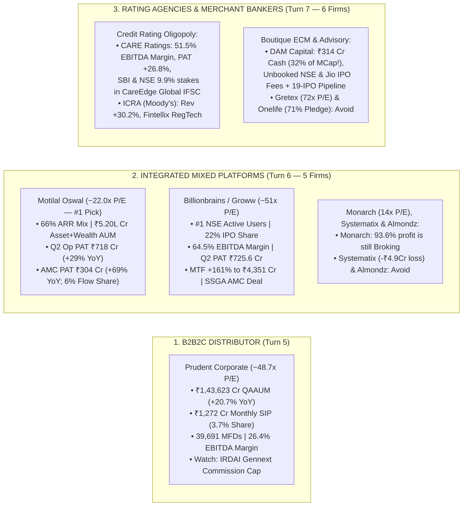

<!-- 
================================================================================
MASTER EXPORT METADATA (100% Verbatim Preservation from Capital Markets Analysis.json)
- formatVersion: 1
- exportTime: 2026-11-06T19:23:15.324Z
- chat.name: collections/default_collection/engines/gemini-enterprise-sec-dx-swa/sessions/13714203460886062980
- chat.title: Capital Markets Analysis
- chat.startTime: 2026-11-06T18:01:20.410Z
- chat.endTime: 2026-11-06T19:22:32.847Z
================================================================================
-->

# 🔗 Capital Markets Masterclass & Institutional Deep-Dive — PART 3 of 7
## Retail Distributors (`Prudent Corporate`), Integrated Mixed Platforms (`Motilal Oswal`, `Groww`, `Monarch`, `Systematix`, `Almondz`), Credit Rating Agencies (`CARE`, `ICRA`) & Boutique Merchant Bankers (`DAM Capital`, `Gretex`, `Onelife`)

| Export Metadata Field | Verbatim JSON Value |
|:---|:---|
| **Format Version** | `1` |
| **Export Time** | `2026-11-06T19:23:15.324Z` |
| **Session Name** | `collections/default_collection/engines/gemini-enterprise-sec-dx-swa/sessions/13714203460886062980` |
| **Session Title** | `Capital Markets Analysis` |
| **Turns Covered in Part 3** | **Turns 5, 6, and 7** *(100% Verbatim Queries & Answers + Enhanced Visual Architecture)* |

---

## 🎨 Enhanced Visual Architecture & Comparative Diagrams (Part 3 Supplement)

### 3.1 Distributors, Integrated Conglomerates, Rating Agencies & Boutique IB Map (Mermaid Flowchart)


### 3.2 Revenue Quality & Recurring Annuity Spectrum Across Part 3 Companies
```
====================================================================================================
      RECURRING / SURVEILLANCE ANNUITY SHARE vs. OPERATING MARGIN vs. VALUATION (Q2 FY27)
====================================================================================================

  Company Name            Core Business Engine              EBITDA / PBT Margin   P/E (TTM)  Verdict
  --------------------------------------------------------------------------------------------------
  CARE Ratings            90.5% Debt Ratings & Surveillance 51.5%–52.0% EBITDA    26.2x      TOP BUY
  ICRA Limited            53.5% Ratings + 46.5% Analytics   37.0% Op. Margin      21.4x      GARP BUY
  Motilal Oswal (MOFSL)   66% ARR (58% OpPAT = AMC+Wealth)  53.0% Op. PBT Margin  22.0x      #1 PICK
  Groww (Billionbrains)   55.2% Non-F&O (MTF +161%, SIPs)   64.5% EBITDA Margin   50.5x      WATCH DIP
  Prudent Corporate       ~82% MF Trail + ~15% Insurance    26.4% EBITDA Margin   48.7x      HOLD/WATCH
  DAM Capital Advisors    63% Institutional ECM + 29% IE    38.1% Q2 EBIT Margin  13.5x FY26 EVENT BUY
  Monarch Networth        93.6% Segment Profit = Broking    58.4% PBT Margin      14.1x      CYCLICAL
  Gretex Corporate        SME IPO Underwriting & Market Mkg 12.7% EBITDA (-27%!)  72.0x      AVOID
  Systematix Corporate    Boutique Mid-Cap IB & Broking     -3.0% Q1 EBIT Margin  Negative   AVOID
  Onelife Capital         Micro-Cap Advisory (71% Pledge)   Erratic (-11.8% RoE)  35.0x+     AVOID
====================================================================================================
```


---

# 🗂️ Conversation Turn 5 (`2026-11-06T18:27:21.990165605Z`)

### 💬 User Query (Turn 5)

```text
**# Role and Objective**

  

You are a Senior Capital Markets Analyst at a top-tier global investment bank. Your task is to perform an institutional-grade, deep-dive strategic and financial analysis of the provided capital markets company (e.g., Stock/Derivatives Exchange, Wealth Management firm, Brokerage, or Asset Management Company/AMC). 

  

Your analysis must move beyond surface-level summaries to critically evaluate business models, key performance indicators (KPIs), macroeconomic sensitivities, regulatory environments, and technological moats.

  

**# Target Company Profile**

  

\- Company Name: [Insert Company Name here]

  

\- Sub-Sector: [e.g., Asset Management (AMC) / Digital Brokerage / Wealth Management / Market Infrastructure & Exchange]

  

**# Analytical Framework & Core Requirements**

  

**## 1. Business Model & Revenue Quality Analysis**

  

\- **\*\*Revenue Diversification:\*\*** Breakdown the revenue streams into recurring vs. transactional. Analyze the mix of asset-based fees, transaction/execution fees, net interest income (NII), and data/technology subscription revenues.

  

\- **\*\*Competitive Moat:\*\*** Evaluate the company’s structural advantages. Is it driven by high switching costs, network effects (for exchanges), scale economies, or proprietary technology/distribution channels?

  

**## 2. Industry-Specific Key Performance Indicators (KPIs)**

  

Analyze the health and trajectory of the specific metrics that matter for this sub-sector:

  

\- **\*\*Asset Managers / Wealth Managers:\*\*** Assets under Management (AUM) or Assets under Advisement (AUA), Net New Money (NNM) / net inflows, and Blended Fee Rate (compression trends).

  

\- **\*\*Brokerages:\*\*** Daily Average Revenue Trades (DARTs) or trading volumes, Active Accounts, and Client Margin Balances / Net Interest Margin (NIM) dependencies.

  

\- **\*\*Exchanges & Market Infrastructure:\*\*** Market share of trading volumes, listing pipelines, clearing/settlement capture rates, and data/index revenue growth.

  

**## 3. Macroeconomic & Market Sensitivity**

  

\- **\*\*Monetary Policy & Interest Rates:\*\*** How does the current interest rate environment (e.g., high rates or a rate-cutting cycle) impact their margin income (NII), cash balances, or product demand?

  

\- **\*\*Market Volatility (Beta):\*\*** Is this business pro-cyclical (thrives on bull markets) or counter-cyclical/defensive (thrives on high volatility, like derivatives exchanges)? 

  

**## 4. Regulatory, Structural, and Tech Risks**

  

\- **\*\*Regulatory Pressures:\*\*** Evaluate risks related to fee transparency (e.g., MiFID II type rules), capital adequacy requirements, or retail investor protection frameworks.

  

\- **\*\*Digital Transformation & AI:\*\*** Assess their adoption of AI (e.g., automated risk management, robo-advisory, algorithmic execution) and whether technology acts as a cost-cutter or an existential competitive threat from FinTechs.

  

**## 5. Strategic SWOT & Investment Thesis Summary**

  

\- Provide a razor-sharp SWOT matrix customized to the capital markets landscape.

  

\- Conclude with a 12-to-24 month investment thesis highlight: Define the single most critical structural catalyst and the most dangerous "Tail Risk" the company faces.

  

**# Output Format**

  

\- Use clear markdown headers, bold structural elements, and text-based tables where appropriate to present quantitative comparisons.

  

\- Maintain an objective, institutional, and analytically rigorous tone. Avoid generic fluff; back assertions with logical capital market mechanics.

  

company list is below 

Distributor (1 Company)

  

Third-party distributors focus exclusively on selling third-party mutual funds, insurance, and other financial products to retail networks.

• Prudent Corp. (Prudent Corporate Advisory Services)
```

### 🧠 Institutional Forensic Analysis & Response (Turn 5)

I will search for the latest FY26 and Q2 FY27 financial results, mutual fund AUM, SIP book, insurance commission mix, and valuation metrics for Prudent Corporate Advisory Services.
[[section:Gathering Prudent Corporate financial data]]I will now fetch the exact breakdown of Prudent Corporate's Mutual Fund vs. Insurance revenue, Gross vs. Net retention yields (commission pass-through to MFDs), and RoE/RoCE metrics for FY26 and Q2 FY27.
[[section:Fetching segment and yield metrics]]**Prudent Corporate Advisory Services (PRUDENT)** is India’s premier listed B2B2C retail wealth and mutual fund aggregator, operating a highly scalable, capital-light sub-broker network (**39,691 Mutual Fund Distributors across 165 locations**) that manages **₹1,43,623 Cr in QAAUM (+20.7% YoY in Q2 FY27)** and generates **₹1,272 Cr in monthly SIP inflows (3.7% national SIP market share)**. While Prudent just delivered a standout Q2 FY27 (reported Oct 28, 2026) with operating profit surging **42.4% YoY to ₹102.8 Cr** (EBITDA margin expanding 390 bps YoY to **26.4%**) and PAT rising **33.9% YoY to ₹71.7 Cr**, its premium **~48.1x–48.7x trailing P/E multiple** (Market Cap **~₹11,900–12,276 Cr**) faces a near-term regulatory stress test from **draft IRDAI insurance commission caps** (estimated by institutional desks to impact FY28/29E PBT by ~9–12%).

Good call isolating Prudent Corporate in its own "Distributor" vertical—unlike AMCs that manufacture schemes or UHNI wealth managers (360 ONE, Nuvama, Anand Rathi) that employ expensive salaried Relationship Managers (RMs), Prudent operates an **asset-light variable-cost platform (FundzBazar + Gennext)** where it pays out ~65% of gross MF trail commissions to independent MFDs only *after* collecting revenue from AMCs, resulting in near-zero fixed customer acquisition cost and superior working capital velocity.

---

### 📌 Executive Summary & Institutional Scorecard (FY26 & Q2 FY27 Audited/Reported)

| Metric / KPI | FY26 Full Year (Sum of 4 Quarters) | Q1 FY27 (Ended June 2026) | Q2 FY27 (Ended Sept 2026) | YoY / QoQ Trajectory & Institutional Verdict |
|---|---|---|---|---|
| **Market Cap & Share Price (Nov 2026)** | — | — | **~₹11,900 – ₹12,276 Cr** (CMP ₹2,849 – ₹2,965) | Down ~28% from Aug 2026 52W high of ₹4,105.50; up ~15.5% YTD. |
| **Trailing P/E Multiple** | — | — | **48.1x – 48.7x** (~37x Sep'28E Core EPS) | Premium B2B2C platform multiple; leaves limited buffer for IRDAI/SEBI yield hits. |
| **Quarterly Average AUM (QAAUM)** | ~₹1,25,730 Cr (Q3 FY26 Eq AUM) | **~₹1,33,100 Cr** (Eq AUM ₹1.34L Cr, +18.3% YoY) | **₹1,43,623 Cr** (+20.7% YoY, +7.9% QoQ) | Outpaced industry equity QAAUM growth (+6.6% QoQ); **Equity MF Market Share rose to 2.70%** (vs 2.59% YoY). |
| **Record Equity Net Sales** | Strong aided by Indus Capital M&A | Strong net equity inflows | **₹4,138 Cr** (Highest-ever quarterly equity net sales) | Driven by sticky SIP book (~50% of gross sales) and low redemption velocity. |
| **Monthly SIP Book (Exit Run-Rate)** | ₹1,135 Cr (Dec 2025) | **₹1,203 Cr** (June 2026, +21% YoY) | **₹1,272 Cr** (Sept 2026, +17% YoY; ₹3,776 Cr Q2 flow) | **National SIP Market Share expanded 20 bps YoY to 3.7%** (from 3.5%). |
| **Revenue from Operations** | **₹1,318 Cr** (₹294+320+343+361 Cr) | **₹353.6 Cr** (+18.0% YoY) | **₹388.7 Cr** (+21.6% YoY, +9.9% QoQ) | Driven by +20.7% MF QAAUM growth and **+46% YoY surge in Insurance segment**. |
| **Operating EBITDA & Margin (%)** | ~23.6% FY26 Operating Margin | **₹89.1 Cr** (+32.4% YoY; **25.6% Margin**, +270 bps YoY) | **₹102.8 Cr** (+42.4% YoY; **26.4% Margin**, +390 bps YoY) | Structural operating leverage as fixed employee/tech costs scale slower than AUM. |
| **Consolidated PAT & Margin (%)** | **₹223 Cr** (₹52+54+58+59 Cr) | **₹74.8 Cr** (+44.4% YoY) | **₹71.7 Cr** (+33.9% YoY; **18.4% Margin**, +170 bps YoY) | Beat consensus (₹68.9 Cr); sequential dip from Q1 due to treasury MTM reversal in Other Income. |
| **Channel Partner (MFD) Network** | ~36,150 MFDs | ~38,000+ MFDs | **39,691 MFDs** (+3,541 added in H1 FY27, +30% YoY pace) | Regulatory tightening on unregistered advisors is accelerating MFD migration to Prudent. |

---

## 1. Business Model & Revenue Quality Analysis

### Revenue Diversification: The Two-Pillar Trail & Insurance Aggregator
Prudent operates as India’s third-largest non-bank retail wealth distributor (and #1 pure-play B2B2C sub-broker platform), generating **₹388.7 Cr in Q2 FY27 operating revenue** (of which ₹385.0 Cr is commission and fee income):

1. **Mutual Fund Distribution (Recurring Ad-Valorem Trail Fees — ~80–83% of Revenue):**
   * **Pure Trail Annuity:** Following SEBI’s 2018 ban on upfront MF commissions, 100% of Prudent’s MF revenue is recurring daily trail commission paid by AMCs out of scheme Total Expense Ratios (TERs).
   * **Gross Yield vs. Net Retention Mechanics:** Prudent earns a **gross trail yield of ~88–91 bps** on its MF QAAUM (gross yield was 88 bps in Q1 FY27 after a 2.8 bps sequential back-book repricing drag). Because Prudent aggregates **₹1.44 Lakh Cr of AUM** across 39,691 sub-distributors (MFDs), it commands top-tier institutional slab rates from AMCs that an individual MFD managing ₹10–50 Cr could never negotiate alone. Prudent passes through ~60–65% of this gross trail to its MFD partners as variable commission expense and retains **~28–32 bps net revenue margin**.
   * **Equity Dominance (>93% of AUM):** Roughly 93–95% of Prudent’s ₹1,43,623 Cr QAAUM is in high-yielding **Equity and Hybrid schemes** (with Mid- and Small-cap funds accounting for a disciplined **23–24% of equity assets** and ~33% of new SIP registrations).

2. **Insurance Distribution via Wholly-Owned Subsidiary *Gennext Insurance Brokers* (~14–16% of Revenue — Fastest Growing Engine):**
   * Cross-sells Life and Health/General Insurance through the same POSP/MFD partner network.
   * In Q2 FY27, the **Insurance segment surged 46% YoY** (accelerating from +20.6% YoY in Q1 FY27), acting as a major driver of Prudent’s 390 bps operating margin expansion because insurance commissions carry higher net retention (~35–45%) than mutual fund trail fees.

3. **Specialized Investment Funds (SIFs), Stockbroking & Fixed Income (~2–4% of Revenue):**
   * **Rapid SIF Scale-Up:** Chairman Sanjay Shah highlighted on Oct 29, 2026 that Prudent has aggressively captured SEBI’s new **Specialized Investment Fund (SIF)** category—scaling SIF AUM to **₹900–1,000 Cr within just six months** as registered SIF channel partners jumped from 1,323 in Q1 FY27 to **1,792 in Q2 FY27**.
   * **De-Risking Non-Core Products:** Management deliberately exited P2P lending products (such as Liquiloans, which previously contributed ~₹6.9 Cr/year) following RBI regulatory tightening, keeping product quality clean.

---

### Competitive Moat & Structural Advantages ("Owned" Network & Switching-Cost Moat)
Why don’t Prudent’s 39,691 MFD partners bypass Prudent and contract directly with AMCs, or defect to rival platforms like NJ India Invest or Bajaj Capital?

* **1. The "Split-ARN" Grandfathering Lock-In (High Switching Cost):** When an MFD onboards clients under Prudent’s master ARN (AMFI Registration Number) via **FundzBazar**, the accumulated historical AUM ("back-book") is legally tagged to Prudent’s ARN. If an MFD leaves Prudent to go independent, regulatory rules generally prevent them from porting the existing trail commission stream without obtaining individual client/AMC NOCs—meaning **leaving Prudent requires forfeiting years of accumulated annuity income**.
* **2. Working Capital & Tech Arbitrage (*FundzBazar* + *PrudentConnect* + *CreditBazar* + *PolicyBazar/Gennext*):** An independent MFD in a Tier-2/3 city (where Prudent has 165 branch offices across 21 states) cannot afford to build a multi-asset mobile app, conduct KYC/FATCA compliance, run a research desk, or hire back-office staff. Prudent provides this entire full-stack technology and compliance infrastructure for free in exchange for its ~30–35% trail retention share.
* **3. Inorganic Consolidation Moat (Karvy & Indus Capital Playbook):** Prudent has repeatedly proven its ability to acquire Mutual Fund distribution books (previously acquiring Karvy’s MF book, and in FY26 acquiring **Indus Capital’s ~₹2,050 Cr AUM book**) and seamlessly plug them into FundzBazar with near-100% retention and immediate EBITDA accretion.

---

## 2. Industry-Specific Key Performance Indicators (KPIs)

| Key Operational KPI | Q2 FY26 (Sept 2025) | Q1 FY27 (June 2026) | Q2 FY27 (Sept 2026) | Forensic Analysis & Underlying Mechanics |
|---|---|---|---|---|
| **Quarterly Average AUM (QAAUM)** | ₹1,18,986 Cr | ~₹1,33,100 Cr | **₹1,43,623 Cr** (+20.7% YoY, +7.9% QoQ) | 100% correlated to MF trail revenue (Q2 AUM grew 7.9% QoQ while MF revenue grew 9.4% QoQ aided by 91 vs 90 calendar days). |
| **Equity MF Market Share** | 2.59% | ~2.65% | **2.70%** (+11 bps YoY) | Gaining share from public-sector banks and standalone IFAs. |
| **Monthly SIP Book & Share** | ₹1,085 Cr (**3.5% Share**) | ₹1,203 Cr (+21% YoY) | **₹1,272 Cr** (+17% YoY; **3.7% Share**) | SIPs contribute **~50% of gross equity sales**, creating an automatic ₹15,260+ Cr annualized gross inflow floor. |
| **SIP Stoppage Ratio (Forensic Metric)** | ~50% | ~55% | **~60% (1.2–1.3 closed per 2 new SIPs)** | Management disclosed on Oct 29, 2026 that range-bound markets pushed SIP stoppage ratios to ~60% (in line with industry), though redemptions remain low. |
| **Quarterly Equity Net Sales** | ₹3,600 Cr (+₹2,050 Cr Indus M&A) | ~₹3,200+ Cr | **₹4,138 Cr** (All-time record) | Despite slower lump-sum inflows in a sideways market, low redemptions kept net sales at record highs. |
| **Active Channel Partners (MFDs)** | ~34,000+ | ~38,000+ | **39,691 Partners** | Added **3,541 gross partners (2,811 net) in H1 FY27**—up **30% YoY** as SEBI rules force unregistered advisors onto institutional platforms. |
| **Blended Gross MF Yield** | ~91 bps | **88.0 bps** (-2.8 bps QoQ) | **~88.0 bps** (Stabilized) | Back-book telescopic repricing from Aug 2025 compressed yield by ~2–3 bps, now largely stabilized. |

---

## 3. Macroeconomic & Market Sensitivity

### Monetary Policy & Interest Rates
* **Zero Debt & Growing Treasury Cash Pile:** Prudent is completely debt-free with high free cash flow conversion (dividend per share doubled from ₹1.00 in FY22 to ₹2.00 in FY24+).
* **Rate Transmission:** Interest rate cuts have a negligible direct impact on operating NII (as Prudent does not run an NBFC lending book), though treasury MTM reversals on its corporate cash book temporarily dampened Other Income in Q2 FY27 (causing PAT growth of +33.9% YoY to slightly lag EBITDA growth of +42.4% YoY). Indirectly, lower deposit rates accelerate household migration from bank fixed deposits into Equity/Hybrid mutual funds and SIFs through Prudent’s Tier-2/3 MFD network.

### Market Volatility (Beta) & Operating Leverage Sensitivity
* **Direct 1:1 Revenue Beta to Equity NAV, Magnified by Fixed Opex Thresholds:**
  * On October 29, 2026, CMD Sanjay Shah gave a remarkably candid forensic breakdown of Prudent’s operating leverage: **Prudent’s fixed operating expenditure (1,712 employees across 165 branches + IT) is currently growing at 15% to 18% YoY** (with employee costs up ~30% YoY during the recent expansion phase).
  * **The Inflection Threshold:** As long as top-line revenue grows at **20%–22%+ YoY** (as in Q2 FY27 at +21.6%), EBITDA margins expand rapidly (+390 bps YoY to 26.4%). However, management explicitly warned that **if a severe market drawdown pushes revenue growth below the 15%–18% fixed-cost growth band, operating profits will take a disproportionate downward hit**.
* **The Rupee-Cost Averaging Buffer:** During previous market pullbacks (when Nifty 500 fell 6.2%), Prudent’s negative MTM impact on equity AUM was contained to just **1.4%** because its ₹1,272 Cr monthly SIP book (~₹3,776 Cr per quarter) continuously buys dips.

---

## 4. Regulatory, Structural, and Tech Risks

### Regulatory Pressures (The #1 Valuation Overhang)
1. **Draft IRDAI Insurance Commission Regulations & GST Restructuring (IMMEDIATE RISK):**
   * While Insurance revenue surged 46% YoY in Q2 FY27, **draft IRDAI regulations proposing caps/reductions on insurance distribution commissions**—combined with GST-driven commission restructuring affecting 70% of health and 30% of life premiums—pose a direct headwind to Gennext Insurance Brokers.
   * **Quantitative Earnings Impact:** Institutional research (PL Capital, Oct 30, 2026) estimates that **draft IRDAI regulations could impact Prudent’s consolidated PBT by ~12%**. Assuming a 75% net impact after partial pass-through to POSP agents (**~9% PBT hit**), analysts have trimmed FY28E/FY29E Core PAT estimates by **~6%**.
2. **SEBI TER (Total Expense Ratio) Consultation & AMC Pass-Through:**
   * SEBI’s consultation proposals (removing GST from base TER and tightening brokerage caps, initially estimated as a 6–7 bps industry TER impact) saw a milder-than-feared final regulatory stance in late 2026. However, as AMCs grow larger, telescopic TER slabs naturally compress gross trail payouts to distributors (causing Prudent’s gross MF yield to drift from ~92 bps down to 88 bps).
3. **Regulatory Tailwind — Crackdown on Unregistered Advisors ("Finfluencers" & Sub-Agents):**
   * Paradoxically, SEBI’s stricter enforcement on unregistered investment advisors and execution platforms has become a **major recruitment tailwind for Prudent**—forcing small, unorganized distributors to affiliate with a compliant master platform and driving Prudent’s H1 FY27 net distributor additions up **67% over H2 FY26** (2,811 net / 3,541 gross additions).

### Digital Transformation & FinTech Competition (Direct-to-Consumer vs. B2B2C)
* **Why Zero-Commission FinTechs (Groww, Zerodha Coin) Haven’t Killed Prudent:**
  * Bearish theses since Prudent’s 2022 IPO argued that zero-commission Direct MF apps would cannibalize Regular Plan MFD distributors.
  * The empirical data proves the opposite: **Prudent’s SIP market share has steadily risen to 3.7% and its Equity MF market share hit 2.70% in Q2 FY27**. In Gujarat, Maharashtra, and Tier-2/3 India, mass-affluent families value **human hand-holding, behavioral coaching during market volatility, and multi-generational family servicing** from a local neighborhood MFD—while Prudent arms that local MFD with **FundzBazar**, a digital app that matches FinTech UX speed.

---

## 5. Strategic SWOT & 12–24 Month Investment Thesis Summary

### Customized Capital Markets SWOT Matrix: Prudent Corporate Advisory

| **Strengths** | **Weaknesses** |
|---|---|
| • **Dominant B2B2C Moat:** 39,691 MFD partners locked in via ARN back-book grandfathering and FundzBazar tech stack.<br>• **Inelastic SIP Flywheel:** ₹1,272 Cr monthly SIP book (3.7% national share) provides ~50% of gross sales and insulates against market dips.<br>• **Superior Operating Leverage:** Q2 FY27 EBITDA rose 42.4% YoY to ₹102.8 Cr as margins expanded 390 bps to 26.4%.<br>• **High Equity Concentration:** >93% of ₹1.44 Lakh Cr QAAUM is in high-yield Equity/Hybrid schemes. | • **Zero Direct Pricing Power:** Acts as a price-taker between AMCs (who set trail commissions) and MFDs (who demand ~65% payout share).<br>• **Gradual Gross Yield Compression:** MF gross trail yield edged down to ~88 bps due to telescopic AMC back-book repricing.<br>• **Fixed-Cost Downside Asymmetry:** With operating expenses growing 15–18% p.a. (employee costs +30%), any AUM slump below 15% growth will sharply compress margins. |
| **Opportunities** | **Threats** |
| • **First-Mover Scale in SIFs (Specialized Investment Funds):** Already scaled SIF AUM to ₹900–1,000 Cr across 1,792 SIF-certified partners within 6 months.<br>• **Regulatory Formalization Tailwind:** SEBI rules forcing unregistered distributors onto compliant platforms (+3,541 MFDs added in H1 FY27).<br>• **Accretive M&A Roll-Ups:** Proven ability to acquire regional IFA/distributor books (like Indus Capital) at 6–8x EBITDA and re-rate them at 35–48x P/E. | • **IRDAI Insurance Commission Caps:** Draft IRDAI regulations and GST changes threaten a **~9–12% PBT cut (~6% FY28/29E PAT trim)** in the high-margin Gennext insurance vertical.<br>• **Rising SIP Stoppage Ratio:** Moved up to ~60% in Q2 FY27 (1.2–1.3 closures per 2 new SIPs) amid range-bound equity markets.<br>• **Rich Valuation Multiple (~48.7x P/E):** Trades at a 25–35% premium to Tier-1 AMCs (HDFC AMC, ICICI Pru AMC at ~33–38x) despite lower EBITDA margins. |

---

### 🎯 12-to-24 Month Investment Thesis & Risk/Catalyst Verdict

* **Single Most Critical Structural Catalyst: Non-Linear Operating Leverage Above ₹1.5 Lakh Cr AUM + SIF & MFD Formalization Boom.**
  Having crossed **₹1,43,623 Cr in QAAUM** and **₹4,138 Cr in quarterly net equity sales** in Q2 FY27, Prudent has passed the fixed-cost inflection point of its 165-branch physical network. As 3,500+ newly onboarded MFDs ramp up productivity and higher-yield **Specialized Investment Funds (SIFs)** scale from ₹1,000 Cr toward ₹5,000+ Cr over the next 18 months, Prudent can sustain **26%–27%+ EBITDA margins** and compound core earnings at 22–25% CAGR, supporting an institutional target price range of **₹3,200+** (~37x Sep'28E EPS).

* **Most Dangerous "Tail Risk": The "Double Whammy" of IRDAI Insurance Commission Cuts + Prolonged Equity Bear Market.**
  If the final IRDAI insurance commission regulations enforce the full **9%–12% PBT haircut** on Gennext Insurance Brokers *at the same time* that a broader SMID equity market correction pushes Prudent’s MF QAAUM growth below management’s **15%–18% fixed-cost growth hurdle** (while SIP stoppage ratios climb above 65%), Prudent would suffer simultaneous margin compression and a multiple de-rating from **~48.7x P/E down toward 32–35x P/E**.


---

# 🗂️ Conversation Turn 6 (`2026-11-06T18:31:22.786899574Z`)

### 💬 User Query (Turn 6)

```text
**# Role and Objective**

  

You are a Senior Capital Markets Analyst at a top-tier global investment bank. Your task is to perform an institutional-grade, deep-dive strategic and financial analysis of the provided capital markets company (e.g., Stock/Derivatives Exchange, Wealth Management firm, Brokerage, or Asset Management Company/AMC). 

  

Your analysis must move beyond surface-level summaries to critically evaluate business models, key performance indicators (KPIs), macroeconomic sensitivities, regulatory environments, and technological moats.

  

**# Target Company Profile**

  

\- Company Name: [Insert Company Name here]

  

\- Sub-Sector: [e.g., Asset Management (AMC) / Digital Brokerage / Wealth Management / Market Infrastructure & Exchange]

  

**# Analytical Framework & Core Requirements**

  

**## 1. Business Model & Revenue Quality Analysis**

  

\- **\*\*Revenue Diversification:\*\*** Breakdown the revenue streams into recurring vs. transactional. Analyze the mix of asset-based fees, transaction/execution fees, net interest income (NII), and data/technology subscription revenues.

  

\- **\*\*Competitive Moat:\*\*** Evaluate the company’s structural advantages. Is it driven by high switching costs, network effects (for exchanges), scale economies, or proprietary technology/distribution channels?

  

**## 2. Industry-Specific Key Performance Indicators (KPIs)**

  

Analyze the health and trajectory of the specific metrics that matter for this sub-sector:

  

\- **\*\*Asset Managers / Wealth Managers:\*\*** Assets under Management (AUM) or Assets under Advisement (AUA), Net New Money (NNM) / net inflows, and Blended Fee Rate (compression trends).

  

\- **\*\*Brokerages:\*\*** Daily Average Revenue Trades (DARTs) or trading volumes, Active Accounts, and Client Margin Balances / Net Interest Margin (NIM) dependencies.

  

\- **\*\*Exchanges & Market Infrastructure:\*\*** Market share of trading volumes, listing pipelines, clearing/settlement capture rates, and data/index revenue growth.

  

**## 3. Macroeconomic & Market Sensitivity**

  

\- **\*\*Monetary Policy & Interest Rates:\*\*** How does the current interest rate environment (e.g., high rates or a rate-cutting cycle) impact their margin income (NII), cash balances, or product demand?

  

\- **\*\*Market Volatility (Beta):\*\*** Is this business pro-cyclical (thrives on bull markets) or counter-cyclical/defensive (thrives on high volatility, like derivatives exchanges)? 

  

**## 4. Regulatory, Structural, and Tech Risks**

  

\- **\*\*Regulatory Pressures:\*\*** Evaluate risks related to fee transparency (e.g., MiFID II type rules), capital adequacy requirements, or retail investor protection frameworks.

  

\- **\*\*Digital Transformation & AI:\*\*** Assess their adoption of AI (e.g., automated risk management, robo-advisory, algorithmic execution) and whether technology acts as a cost-cutter or an existential competitive threat from FinTechs.

  

**## 5. Strategic SWOT & Investment Thesis Summary**

  

\- Provide a razor-sharp SWOT matrix customized to the capital markets landscape.

  

\- Conclude with a 12-to-24 month investment thesis highlight: Define the single most critical structural catalyst and the most dangerous "Tail Risk" the company faces.

  

**# Output Format**

  

\- Use clear markdown headers, bold structural elements, and text-based tables where appropriate to present quantitative comparisons.

  

\- Maintain an objective, institutional, and analytically rigorous tone. Avoid generic fluff; back assertions with logical capital market mechanics.

  

company list is below 

8\. Mixed (5 Companies)

  

Conglomerates or platforms where revenues are tightly integrated across broking, AMC, and wealth distribution.

• Billionbrains (Parent company of Groww – Tech discount broker + mutual fund distributor + growing AMC)

• Motil.Oswal.Fin. (Motilal Oswal Financial Services – Equities broking + strong internal AMC + Wealth management)

• Monarch Networth (Monarch Networth Capital)

• Systematix Corp. (Systematix Corporate Services)

• Almondz Global (Almondz Global Securities)
```

### 🧠 Institutional Forensic Analysis & Response (Turn 6)

I will search for the latest FY26 and Q2 FY27 financial results, operational KPIs (active clients, MTF books, AUM, revenue mix), and valuation multiples for Billionbrains Garage Ventures (Groww), Motilal Oswal Financial Services, Monarch Networth Capital, Systematix Corporate Services, and Almondz Global Securities.
[[section:Gathering integrated platform financial data]]I will now retrieve the latest FY26 and Q2 FY27 results, market capitalizations, and P/E multiples for Systematix Corporate Services, Almondz Global Securities, Monarch Networth Capital, and Motilal Oswal Financial Services to complete our dataset.
[[section:Fetching Systematix Almondz and valuations]]I will do a quick search to confirm Almondz Global Securities' current market capitalization and P/E ratio as well as Billionbrains Garage Ventures' (Groww) trailing P/E ratio.
[[section:Verifying Almondz and Groww valuations]]Integrated ("Mixed") capital markets platforms attempt the hardest feat in financial services: **converting high-velocity, cyclical transaction customers (broking/IB) into sticky, high-multiple annuity assets (AMC, Private Wealth, and Margin Trade Funding/MTF)**. Across this 5-company cohort, **Motilal Oswal Financial Services (~22x P/E, 66% ARR revenue share, ₹5.2 Lakh Cr Asset & Wealth AUM)** is the undisputed institutional value-and-execution champion; **Billionbrains Garage Ventures / Groww (~50–51x P/E, ₹1.35–1.40 Lakh Cr Market Cap, 64.5% EBITDA margin)** is India’s digital customer-acquisition juggernaut rapidly reducing its F&O dependency (down to 44.8% of income) via MTF (+161% YoY), Wealth ("W" + Fisdom), and a State Street-backed AMC; **Monarch Networth Capital (~13.9–14.3x P/E, 20.5% RoE)** is a high-growth boutique broking and merchant-banking proxy where **93% of segment profit still comes from cyclical broking**; while **Systematix Corporate Services (Negative TTM P/E, Q1 FY27 net loss -₹4.89 Cr)** and **Almondz Global Securities (₹347 Cr Market Cap, 11.4% RoE)** are sub-scale micro-caps plagued by extreme quarterly deal lumpiness and non-core infrastructure consulting exposure.

Good call grouping these "Mixed" conglomerates separately—when evaluating a multi-engine financial platform, the primary forensic test is **whether the recurring engines (AMC + Wealth + MTF NII) actually drive consolidated Operating Profit**, or whether management uses "wealth and AMC" buzzwords to dress up volatile F&O brokerage and proprietary treasury gains.

---

### 📌 Executive Summary & Institutional Tiering Matrix

* **Tier 1: The Institutional Twin-Engine Compounder (Top Risk-Reward Pick)**
  * **Motilal Oswal Financial Services (MOTILALOFS):** Trading at just **~22.0x P/E** (Market Cap **~₹58,151 Cr**, CMP ₹964) despite delivering **29% YoY Operating PAT growth to ₹718 Cr in Q2 FY27** (and ₹1,070 Cr Total PAT incl. OCI, up 3.8x YoY). Motilal Oswal has successfully executed the holy grail of capital markets transformation: **Annual Recurring Revenue (ARR) now accounts for 66% of group revenue** (₹1,182 Cr in Q2, +27% YoY), and **Asset & Private Wealth Management contribute 58% of total Operating PAT** (up from 42% in FY25), led by a **69% YoY surge in AMC PAT to ₹304 Cr** (now 43% of group operating profit).
* **Tier 2: The Digital D2C FinTech Monopoly Pivoting to Full-Stack Wealth**
  * **Billionbrains Garage Ventures / Groww (GROWW):** Listed at a massive **₹1,35,077–1,40,481 Cr Market Cap** (CMP ₹215–223, **50.1x–52.1x P/E**, **28.8% RoE**, **37.3% RoCE**). In Q2 FY27, operating revenue jumped **47.4% YoY to ₹1,501.5 Cr** (flat QoQ) and PAT surged **54% YoY to ₹725.6 Cr** at an industry-leading **64.5% EBITDA margin** (+60 bps QoQ). Crucially, Groww slashed its **Equity Derivatives income reliance from 56.9% to 44.8% YoY**, scaling its **MTF book 161% YoY to ₹4,351 Cr** (10.1% of income), crossing **₹10,000 Cr in Wealth AUM** (bolstered by its Fisdom integration), and closing a strategic **State Street Global Advisors (SSGA) deal** on August 4, 2026 (SSGA took a **22.94% diluted economic interest** in Groww AMC, where AUM rose 145% YoY to **₹7,179 Cr**).
* **Tier 3: High-Beta Boutique Broking & Merchant Banking Challenger**
  * **Monarch Networth Capital (MONARCH):** Trades at an attractive **13.9x–14.3x P/E** (Market Cap **~₹2,720–2,751 Cr**, CMP ₹343–345, **20.5% FY26 RoE**, **27.6% RoCE**). Reported all-time record Q2 FY27 consolidated revenue of **₹123.5 Cr (+48.1% YoY, +35.7% QoQ)** and PAT of **₹56.6 Cr (+25.8% YoY)** alongside a proposed **5-for-1 stock split**. However, a forensic segment check reveals that **Broking & Related Services generated ₹71.19 Cr out of ₹76.08 Cr total segment PBIT (93.6%)**, while its fledgling AMC posted a ₹0.80 Cr loss and Insurance posted a ₹0.30 Cr loss.
* **Tier 4: Volatile Boutique IB & Hybrid Infrastructure Micro-Caps (Avoid)**
  * **Systematix Corporate Services (SYSTMTXC):** Market Cap **~₹1,045–1,058 Cr** (CMP ~₹77, **P/B 3.24x**, **Negative TTM P/E** due to H2 FY26/Q1 FY27 losses). While Systematix has built an institutional equities, ECM/merchant banking, and PMS platform, its earnings are violently cyclical: after posting ₹14.5 Cr consolidated PAT in Q2 FY26, deal dry-ups and a **41.8% employee-cost-to-revenue burden** pushed consolidated PAT into losses in **Q4 FY26 (-₹11.79 Cr) and Q1 FY27 (-₹4.89 Cr on ₹58.9 Cr income and ₹60.7 Cr expenses)**.
  * **Almondz Global Securities (ALMONDZ):** Market Cap **~₹347–360 Cr** (CMP ₹18.2, **8.8x–10.7x P/E**, **1.1x P/B**, **11.4% RoE**). Not a pure capital markets play: while it operates debt capital markets, merchant banking, and retail broking, a large portion of consolidated revenue (**₹39.4 Cr in Q2 FY27, +16.8% YoY; PAT ₹8.28–9.09 Cr**) is driven by **infrastructure engineering consultancy JVs** (highways, water, railways) and volatile associate income (**standalone Q2 revenue collapsed 79.2% YoY to ₹7.01 Cr with just ₹0.86 Cr PAT**).

---

### 📊 Master Quantitative Matrix: All 5 "Mixed" Capital Markets Platforms (FY26 & Q2 FY27)

| Metric / KPI | Billionbrains Garage (Groww) | Motilal Oswal Financial (MOFSL) | Monarch Networth Capital | Systematix Corporate Services | Almondz Global Securities |
|---|---|---|---|---|---|
| **Market Cap (Nov 6, 2026)** | **~₹1,35,077 – ₹1,40,481 Cr** (CMP ₹215–223) | **~₹58,151 Cr** (CMP ₹964) | **~₹2,720 – ₹2,751 Cr** (CMP ₹343–345) | **~₹1,045 – ₹1,058 Cr** (CMP ₹76.8) | **~₹347 – ₹360 Cr** (CMP ₹18.2–18.8) |
| **Trailing P/E & P/B** | **50.1x – 52.1x P/E** \| **11.2x – 13.5x P/B** | **~22.0x P/E** \| **4.40x P/B** | **13.9x – 14.3x P/E** \| **2.57x P/B** | **Negative TTM P/E** \| **3.24x – 3.32x P/B** | **8.8x – 10.7x P/E** \| **1.09x – 1.23x P/B** |
| **FY26 Operating Revenue** | **₹5,724 Cr TTM** (H1 FY27: ₹3,003 Cr) | **~₹6,200+ Cr Net Op** (Q2 Gross ₹3,042 Cr) | **₹373 Cr** (6-yr PAT CAGR 108%) | **₹154 Cr Consol** (₹77.4 Cr Stdl) | **₹202 Cr TTM Consol** |
| **FY26 Consolidated PAT** | **₹2,694 Cr TTM** (H1 FY27: ₹1,460 Cr) | **~₹2,200+ Cr Op PAT** (H1 Total ₹2,583 Cr) | **₹181 Cr** (up from ₹2 Cr in FY20) | **₹13.9 Cr Consol** (₹25.0 Cr Stdl) | **₹17.4 – ₹27.0 Cr TTM** |
| **Q2 FY27 Operating Revenue** | **₹1,501.5 Cr** (+47.4% YoY, +0.0% QoQ) | **₹1,757 Cr Net Op** (+20% YoY, +14% QoQ) | **₹123.1 Cr** (+48.2% YoY, +35.5% QoQ) | **₹58.9 Cr** in Q1 FY27 (+49% YoY; Q2 due Nov 14) | **₹39.4 Cr Consol** (+16.8% YoY) / **₹7.01 Cr Stdl** (-79% YoY) |
| **Q2 FY27 Consolidated PAT** | **₹725.6 Cr** (+54.0% YoY, -1.3% QoQ) | **₹718 Cr Operating PAT** (+29% YoY) / **₹1,070 Cr Total** | **₹56.6 Cr** (+25.8% YoY, +25.2% QoQ) | **-₹4.89 Cr Loss** in Q1 FY27 (-₹11.8 Cr in Q4 FY26) | **₹8.28 – ₹9.09 Cr Consol** (+135% YoY) / **₹0.86 Cr Stdl** |
| **Operating / EBITDA Margin** | **64.5% EBITDA Margin** (+60 bps QoQ) | **53.0% Operating PBT Margin** (+200 bps YoY) | **58.4% PBT Margin** (₹72.1 Cr PBT) | **-3.0% EBIT Margin** in Q1 FY27 (-44% in Q4 FY26) | **17.4% Operating Margin** (12.1% PBT margin) |
| **RoE / RoCE (%)** | RoE: **28.8%** \| RoCE: **37.3%** | RoE: **~25% – 28%** (Operating) | RoE: **20.5%** (3-yr 26.1%) \| RoCE: **27.6%** | RoE: **10.9%** (3-yr 17.8%) \| RoCE: **14.8%** | RoE: **11.4%** \| RoCE: **12.2%** |

---

## 1. Business Model & Revenue Quality Analysis

### Revenue Diversification: Dissecting True Multi-Engine Integration vs. Broking Disguise

#### 1. Motilal Oswal Financial Services (MOFSL): The Textbook Transformation to 66% ARR
Motilal Oswal has engineered the most successful structural shift in Indian capital markets—moving from a cyclical retail broker to an **ARR-led Asset & Wealth compounder** where **Annual Recurring Revenue hit ₹1,182 Cr in Q2 FY27 (+27% YoY), representing 66% of group net revenue** (up from 55% in FY24):
* **Engine 1: Asset Management — AMC & MO Alternates (43% of Group Operating PAT — ₹304 Cr PAT in Q2 FY27, +69% YoY):**
  * Total AMC AUM surged **26% YoY to ₹2.23 Lakh Cr** (MF/PMS/AIF at ~₹2.0 Lakh Cr; MO Alternates up 36% YoY to **₹23,091 Cr**).
  * Because **99% of MOFSL’s AUM outperformed benchmarks over 3 years**, its **Mutual Fund Net Flow Market Share hit 6.0% in Sept 2026**—more than **double its 2.7% AUM market share**—while quarterly SIP inflows reached **₹4,170 Cr (4.3–4.4% national SIP share)** across >1 crore unique PANs.
  * **Carry Income Flywheel:** In MO Alternates (revenue +92% YoY), **performance carry income jumped from ~₹65 Cr to ~₹108 Cr in Q2 FY27** as vintage private equity/real estate funds crossed hurdle thresholds.
* **Engine 2: Private Wealth Management (UHNI — 15% of Group Operating PAT — ₹112 Cr PAT in Q2 FY27):**
  * Private Wealth AUM jumped **58% YoY to ₹2.96 Lakh Cr** with Q2 net flows surging **65% QoQ to ₹6,357 Cr** and ARR revenue hitting **₹180 Cr** across 443 RMs (+15% YoY) and a **₹7,333 Cr lending book (+90% YoY)**. Together, **Asset + Private Wealth delivered ₹416 Cr PAT (+43% YoY), or 58% of group operating profit**.
* **Engine 3: Wealth Management (Retail Broking, Distribution & MTF — 24% of Operating PAT — ₹175 Cr PAT in Q2 FY27, +3% YoY):**
  * Even within retail broking/wealth, **non-broking revenue reached 65% in H1 FY27** and **ARR share rose to 58% (₹328 Cr in Q2)**, backed by a **₹47,912 Cr distribution book (+26% YoY)** and a **₹10,197 Cr loan/MTF book (+42% YoY; ~7% MTF market share)**. Retail broking overall ADTO market share rose to **7.9%** (F&O premium share up 120 bps QoQ to **8.8%**; Cash share up 120 bps QoQ to **8.0%**).
* **Engine 4: Capital Markets (IB & Institutional Equities — ₹85 Cr Q2 PAT) & Housing Finance (₹36 Cr Q2 PAT on ₹6,476 Cr AUM):** Ranked **#1 in QIPs and #3 in IPOs** in H1 FY27 (41 deals raising ₹99,000 Cr; Q2 IB fees up 39% QoQ to ₹94 Cr).

#### 2. Billionbrains Garage Ventures (Groww): From F&O Discount Broker to Full-Stack D2C Ecosystem
Groww generated **₹1,501.53 Cr in Q2 FY27 operating revenue (+47.4% YoY)** and **₹1,540.54 Cr total income**, actively diversifying away from single-product regulatory risk:
* **Equity Derivatives (44.8% of Total Income in Q2 FY27 vs. 56.9% in Q2 FY26):** While still the largest contributor, derivatives revenue declined **14.3% QoQ** (causing total revenue to remain flat sequentially at ₹1,501.5 Cr vs ₹1,501.4 Cr in Q1) due to market adjustments to the **Client-Level Activity / Closing Auction System (CAS)** framework.
* **Cash Equities, IPOs & Commodities (~38–40% of Income):** Groww onboarded **11 lakh New Transacting Users (NTUs) in Q2 FY27** via primary markets, with **42 lakh users applying for IPOs**—capturing a staggering **22% national share of all IPO allotments**—while scaling commodity derivatives rapidly.
* **Margin Trading Facility / MTF & Credit (10.1% of Total Income — Fastest Profit Driver):** Groww’s **MTF loan book surged 160.9% YoY to ₹4,351 Cr** (lifting MTF market share from 1.6% to **2.7%**), deploying virtually all of its **₹1,015.98 Cr net IPO proceeds** (₹1,014.99 Cr utilized by Sept 30, 2026) into high-yield margin lending.
* **Groww AMC & "W" Wealth Management (Strategic Seed Engines):**
  * **Groww AMC:** AUM surged **145% YoY to ₹7,179 Cr** (active share up from 47% to **57%**; revenue up 131% YoY, though still in investment phase with a **-₹8.3 Cr Q2 net loss**). On **August 4, 2026**, **State Street Global Advisors (SSGA)** completed its strategic investment, taking **4.85% voting rights and a 22.94% diluted economic interest** in Groww AMC (resulting in an ₹81.1 Cr standalone gain on subsidiary stake sale).
  * **Groww Wealth ("W" + Fisdom Integration):** Following its Fisdom acquisition (currently undergoing a composite restructuring scheme for Finwizard Technology effective April 1, 2027), Groww’s affluent wealth AUM crossed **₹10,000 Cr** in Sept 2026, while total customer assets on the platform reached **~₹3.9 Lakh Cr (+46% YoY)**.

#### 3. Monarch Networth, Systematix & Almondz: The Boutique Reality Check
* **Monarch Networth Capital:** Despite marketing itself as an integrated group across PMS, Cat-III AIFs (*MNCL Capital Compounder Fund*), merchant banking, and NBFC lending, **93.6% of Q2 FY27 segment profit (₹71.19 Cr of ₹76.08 Cr) came from Broking & Related Services** (which includes ₹34.68 Cr of standalone margin/interest income). Its NBFC segment grew profit 62.5% YoY, but **Asset Management lost ₹0.80 Cr** and **Insurance lost ₹0.30 Cr**.
* **Systematix Corporate Services:** Heavily reliant on lumpy mid-market QIP/merchant banking fees and institutional broking. When deal closures paused in Q4 FY26 and Q1 FY27, consolidated revenue fluctuated wildly (₹56.5 Cr in Q2 FY26 $\rightarrow$ ₹33.8 Cr in Q3 $\rightarrow$ ₹24.2 Cr in Q4 $\rightarrow$ ₹58.9 Cr in Q1 FY27) while fixed employee costs (**41.84% of FY26 revenue**) drove consecutive net losses (-₹11.79 Cr in Q4 FY26; -₹4.89 Cr in Q1 FY27).
* **Almondz Global Securities:** A hybrid micro-cap where standalone capital-market operations collapsed in Q2 FY27 (revenue down **79.2% YoY to ₹7.01 Cr**; PAT down 76.4% to **₹0.86 Cr**), while consolidated profit (**₹8.28–9.09 Cr**) was rescued by infrastructure engineering consultancy JVs (*Almondz Global Infra-Consultant JV*, *AGSCL Wash JV*) and associate *Premier Green Innovations*.

---

## 2. Industry-Specific Key Performance Indicators (KPIs)

| Sub-Sector Operational KPI | Billionbrains (Groww) | Motilal Oswal (MOFSL) | Monarch Networth | Systematix & Almondz |
|---|---|---|---|---|
| **Client Base & Broking Market Share** | **#1 on NSE by Active Users**; transacting users **+27% YoY**; +11 Lakh NTUs in Q2; **22% share of all India IPO allotments** | **7.9% Overall ADTO Share**; **8.8% F&O Premium Share** (+120 bps QoQ); **8.0% Cash Share**; >1 Cr unique AMC PANs | Strong West/Gujarat retail HNI & institutional desk; 6-yr PAT CAGR of 108% (FY20–26) | Niche mid-cap institutional & debt/infra advisory desks |
| **Margin Trading (MTF) & Lending Book** | **₹4,351 Cr MTF Book** (**+160.9% YoY**; **2.7% MTF market share**; 10.1% of total income) | **₹17,530 Cr Wealth + Private Loan Book** (₹10,197 Cr Wealth [+42% YoY] + ₹7,333 Cr Pvt Wealth [+90% YoY]; **~7% MTF share** at ₹9,600+ Cr) | **₹34.68 Cr Standalone Q2 Interest Income**; raised ₹60.82 Cr new H1 borrowings to fund MTF/working capital | Minimal NBFC scale; Systematix interest cost is 3.0% of revenue |
| **AMC & Wealth AUM / Net Inflows** | **~₹3.9 Lakh Cr Customer Assets** (+46% YoY); **₹10,000+ Cr Wealth AUM**; **₹7,179 Cr AMC AUM** (+145% YoY) | **₹5.20 Lakh Cr Asset + Pvt Wealth AUM** (+42% YoY; **₹12,477 Cr Q2 Net Inflows**):<br>• AMC: **₹2.23L Cr** (+26% YoY)<br>• Pvt Wealth: **₹2.96L Cr** (+58% YoY)<br>• Retail Dist: **₹47,912 Cr** | PMS & Cat-III AIF AUM (~₹1,500–2,500+ Cr range); AMC segment currently loss-making (-₹0.80 Cr in Q2) | Systematix scales boutique PMS/AIF; Almondz focused on Debt/Infra advisory |
| **Cost-to-Income & Operating Leverage** | **35.5% Opex-to-Operating Revenue** (₹555.9 Cr total expenses [+28.5% YoY] vs +47.4% revenue growth) | **47.0% Operating Cost-to-Income** (53% Operating PBT margin; Only 33% of Pvt Wealth RMs are >3 yrs vintage) | **41.8% Expense Ratio** in Q2 FY27 (Expenses jumped **130.1% YoY to ₹51.67 Cr** on ₹123.5 Cr income) | **Systematix Q1 FY27 Cost-to-Income hit 103%** (₹60.7 Cr cost on ₹58.9 Cr rev) |

---

## 3. Macroeconomic & Market Sensitivity

### Monetary Policy & Interest Rates (The MTF & LAS Spread Engine)
* **MTF as the New Profit Equalizer:** Both **Groww** (MTF up 161% YoY to ₹4,351 Cr) and **Motilal Oswal** (Group MTF up 56% YoY to ₹9,600+ Cr; total Wealth/Private lending at ₹17,530 Cr) have aggressively weaponized **Margin Trading Facilities** to offset SEBI’s F&O curbs.
* **Rate-Cut Tailwind:** Retail MTF loans are priced at a sticky **14% to 18% APR**, whereas funded borrowing costs (commercial paper, bank lines, NCDs) track wholesale money-market rates. A rate-cutting cycle directly widens Net Interest Margins (NIMs) by 50–100 bps across Motilal Oswal’s ₹17,530 Cr loan book and Groww’s ₹4,351 Cr MTF book.
* **Working Capital Cash Drain Watch-Out:** Rapid MTF expansion consumes operating cash flow—for instance, **Monarch Networth** had to raise **₹60.82 Cr in new borrowings in H1 FY27** to cover an operating cash deficit driven by margin funding and high debtor days (**196 debtor days** flagged on consolidated balance sheet).

### Market Volatility (Beta) & Treasury Book Amplification
* **Motilal Oswal’s "Skin-in-the-Game" Treasury Amplifier:**
  * MOFSL invests its accumulated net worth directly into its own equity Mutual Funds, PMS, and PE funds. Under Ind-AS, MTM gains on this giant treasury book flow through **Other Comprehensive Income (OCI) and Total PAT**.
  * In Q2 FY27, while **Operating PAT grew 29% YoY (+18% QoQ) to ₹718 Cr**, **Total PAT (including treasury MTM & OCI) jumped 3.8x YoY to ₹1,070 Cr** (and hit a record **₹2,583 Cr in H1 FY27, +51% YoY**). Conversely, in a bear market, this treasury book creates massive headline GAAP volatility—making **Operating PAT (₹718 Cr)** the only metric institutional analysts should value.
* **Groww’s Sequential Flattening on F&O Rules:** Groww’s Q2 FY27 proved that even a hyper-growth fintech (+47.4% YoY revenue) experiences **0% sequential revenue growth (₹1,501.5 Cr vs ₹1,501.4 Cr)** when regulatory adjustments (like CAS and F&O curbs) trim derivatives revenue by **14.3% QoQ**.

---

## 4. Regulatory, Structural, and Tech Risks

### Regulatory Pressures
1. **SEBI F&O Curbs & CAS (Closing Auction System) Impact (Groww & MOFSL):**
   * In Q2 FY27, Groww explicitly attributed its **14.3% sequential drop in Equity Derivatives revenue** (and 12.2 percentage-point YoY drop in derivatives revenue share to 44.8%) to market adjustments under the new **Client-Level Activity / Closing Auction System (CAS)** framework and SEBI’s F&O tightening. While Groww expects partial recovery once SEBI’s latest consultation paper recommendations take effect, any Phase-2 SEBI curb on weekly index options remains a major headwind for its largest revenue stream.
2. **True-to-Label Exchange Fee Pass-Through:**
   * Discount brokers like Groww previously earned ₹100–200+ Cr annually from the spread between slab-based exchange turnover fees and the flat charges billed to retail clients. SEBI’s "True-to-Label" mandate eliminated this rebate arbitrage, forcing Groww to lean harder on MTF interest income and ₹20/order pricing power.
3. **Forensic Working Capital & Subsidiary Losses (Monarch, Systematix, Almondz):**
   * **Monarch Networth:** Carries **196 debtor days** on screener diagnostics and saw Q2 FY27 operating expenses surge **130.1% YoY to ₹51.67 Cr** (while prior-year Q2 FY26 revenue was flattered by a ₹20.96 Cr fair-value gain).
   * **Almondz Global:** Over the last 3 years, average RoE is just **9.32%**, it pays **0% dividend**, and TTM earnings include ₹22.4 Cr of Other Income alongside complex joint ventures in wash/water and highway consulting.

### Digital Transformation & AI Adoption
* **Groww’s Product Velocity (*915 Terminal*, Algo APIs & Zero-CAC Funnel):** Groww’s moat is its organic D2C funnel—acquiring millions of first-time mutual fund and IPO investors (22% of all IPO allotments in Q2) at near-zero CAC, then graduating active traders onto its specialized **915 Terminal**, algorithmic trading APIs, and MTF lending. Because its tech stack is built in-house, Groww achieved a **64.5% EBITDA margin and 47.1% net profit margin** in Q2 FY27.
* **Motilal Oswal’s Institutional Custody Launch (Q4 FY27 Catalyst):** On its Q2 FY27 earnings call, MOFSL announced plans to launch a dedicated **Institutional Custodian Business in Q4 FY27**—directly challenging Nuvama’s high-margin Asset Services vertical—while deploying quantitative AI models across its ₹50,000+ Cr Passive and active SMID mutual fund schemes.

---

## 5. Strategic SWOT & 12–24 Month Investment Thesis Summary

### Comparative Institutional SWOT Matrix

| Dimension | Billionbrains Garage (Groww) | Motilal Oswal Financial (MOFSL) | Monarch Networth, Systematix & Almondz |
|---|---|---|---|
| **Strengths** | • **#1 Retail Investment App in India** by active NSE clients & **22% IPO allotment share**<br>• **64.5% EBITDA Margin** & **47% PAT Margin**<br>• **State Street (SSGA) Partnership** (22.94% economic stake in Groww AMC) | • **66% ARR Revenue Mix**; Asset + Pvt Wealth = **58% of Operating PAT**<br>• **AMC Powerhouse:** 99% of ₹2.23L Cr AUM beating 3-yr benchmarks; 6% MF flow share (2x AUM share)<br>• Deeply undervalued at **~22x P/E** | • **Monarch:** Cheap **14x P/E**, 20.5% RoE, record ₹56.6 Cr Q2 PAT, 5:1 stock split<br>• **Systematix:** Zero promoter pledge (70.58% stake)<br>• **Almondz:** Trades at 1.1x Book Value (₹16.7 BV) |
| **Weaknesses** | • **Still 44.8% reliant on Equity Derivatives** (down -14.3% QoQ in Q2)<br>• **0% Sequential Revenue Growth** in Q2 FY27 (₹1,501.5 Cr vs ₹1,501.4 Cr)<br>• Groww AMC still loss-making (**-₹8.3 Cr in Q2**)<br>• Rich **50–52x P/E & 11.7x P/B** | • **Treasury MTM Volatility** distorts headline GAAP PAT depending on Nifty moves<br>• **Private Wealth PAT grew only 2% YoY in Q2** as 67% of RMs have <3 yrs vintage (15% <1 yr and un-breakeven) | • **Monarch:** **93.6% of profit is still Broking**; AMC/Insurance loss-making; **196 debtor days**<br>• **Systematix:** **-₹4.89 Cr Q1 FY27 loss**; 41.8% staff cost ratio<br>• **Almondz:** Standalone Q2 rev crashed **-79% YoY to ₹7 Cr** |
| **Opportunities** | • **Scaling MTF Book** (up 161% to ₹4,351 Cr; only 2.7% share vs MOFSL’s 7%)<br>• Monetizing **₹3.9 Lakh Cr customer assets** via "W" Wealth (>₹10,000 Cr) & Fisdom<br>• Leveraging SSGA for global/passive AMC scale | • **H2 FY27 Private Wealth Profit Inflection** as 67% newly hired RMs cross breakeven maturity<br>• **Q4 FY27 Custodian Business Launch**<br>• Recurring **Carry Income** (jumped from ₹65 Cr to ₹108 Cr in Q2) | • **Monarch:** Scaling GIFT City IFSC, PMS/AIFs, and NBFC book (+62.5% segment profit)<br>• **Systematix:** Mid-market IPO/QIP recovery in H2 FY27 |
| **Threats** | • **PE / VC Block-Deal Supply Overhang:** Recent ₹3,708 Cr block deals caused a 7% single-day dip (FIIs hold 57.15%)<br>• Further SEBI curbs on weekly index options<br>• Credit risk in rapid MTF/personal loan scaling | • Sharp correction in Mid/Small-Cap (SMID) equities hurting both AMC net flows (currently 6% share) and the proprietary treasury book | • **Monarch:** Severe earnings drop if retail cash/F&O broking volumes cool<br>• **Systematix:** Continued cash burn if ECM deal closures slip<br>• **Almondz:** Gov infra tender delays |

---

### 🎯 12-to-24 Month Investment Thesis & Risk/Catalyst Verdict

#### 1. Motilal Oswal Financial Services (MOTILALOFS) — *Top Institutional Conviction Pick across the "Mixed" Cohort*
* **Single Most Critical Structural Catalyst:** **Valuation Re-Rating from ~22x to 28–30x P/E Driven by AMC Flow Dominance & H2 Private Wealth RM Operating Leverage.** Motilal Oswal’s AMC is firing on all cylinders (**99% of ₹2.23 Lakh Cr AUM beating 3-year benchmarks**, capturing **6.0% of all Indian MF net inflows** vs its 2.7% AUM share). Simultaneously, Private Wealth AUM surged 58% YoY to ₹2.96 Lakh Cr, but Q2 PAT grew just 2% YoY because **67% of its 443 RMs were hired within the last 3 years**. As this RM cohort crosses the breakeven productivity J-curve in H2 FY27—paired with ₹100+ Cr quarterly Alternates carry income and the Q4 FY27 Custodian launch—MOFSL’s 58% Asset/Wealth profit mix warrants a wealth/AMC multiple rather than a broking multiple.
* **Most Dangerous "Tail Risk":** **SMID Equity Bear Market Triggering a "Double Whammy" on AMC Flows + Proprietary Treasury MTM.** Because Motilal Oswal’s AMC schemes have a high-beta growth/SMID tilt *and* its balance sheet holds a massive proprietary equity treasury book, a 25% SMID correction would simultaneously shrink reported Total PAT (via negative MTM) and cool its 6% mutual fund flow share.

#### 2. Billionbrains Garage Ventures / Groww (GROWW) — *The Digital Compounder Transitioning from F&O to Lending & Wealth*
* **Single Most Critical Structural Catalyst:** **MTF Market Share Expansion (From 2.7% toward 6–8%) + Fisdom/Wealth Cross-Sell Across ₹3.9 Lakh Cr Customer Assets.** Groww’s ability to grow its MTF book **161% YoY to ₹4,351 Cr** while holding operating expenses completely flat QoQ (₹555.9 Cr, **64.5% EBITDA margin**) proves its unmatched platform economics. As it cross-sells MTF, "W" HNI Wealth (>₹10,000 Cr AUM), and State Street-backed active/passive mutual funds to its ₹3.9 Lakh Cr customer asset base, non-F&O revenue (now 55.2%) will cross 65%+ over the next 18 months. Institutional desks (Jefferies, MOFSL) maintain **₹240 target prices**.
* **Most Dangerous "Tail Risk":** **Sequential Earnings Stagnation from Phase-2 SEBI F&O Curbs + FII/VC Block-Deal Supply.** Q2 FY27 proved that a **14.3% QoQ dip in F&O revenue** (from CAS adjustments) stalled sequential top-line growth at 0.0% and caused PAT to dip 1.3% QoQ. At **~51x P/E and 11.7x P/B**—with Foreign Institutions/VCs still holding **57.15% of equity** and executing large block exits (like the recent ₹3,708 Cr block deal)—any further SEBI crackdown on weekly index expiries could trigger a sharp multiple compression toward 35x P/E.

#### 3. Monarch Networth Capital (MONARCH) — *Tactical Bull-Market Broking Proxy*
* **Single Most Critical Structural Catalyst:** **5-for-1 Stock Split Liquidity Boost + NBFC/MTF Book Scaling.** Trading at just **13.9x–14.3x P/E** after delivering record Q2 FY27 PAT of ₹56.6 Cr (+25.8% YoY) and a 62.5% surge in NBFC segment profit, the upcoming 5:1 share subdivision and Gujarat HNI equity momentum provide near-term upside.
* **Most Dangerous "Tail Risk":** **93.6% Broking Profit Concentration & Working Capital Stretch.** Despite "multi-platform" branding, AMC and Insurance are losing money, Q2 expenses rose 130% YoY, debtor days stand at 196, and H1 required ₹60.8 Cr in debt to cover operating cash deficits—making earnings highly vulnerable to a broking downturn.

#### 4. Systematix Corporate Services (SYSTMTXC) & 5. Almondz Global Securities (ALMONDZ) — *Forensic Avoids*
* **Systematix Catalyst vs. Tail Risk:** Needs a sustained H2 FY27 mid-cap QIP/IPO boom to absorb its bloated **41.8% employee cost ratio** and reverse its Q4 FY26 (-₹11.8 Cr) and Q1 FY27 (-₹4.9 Cr) net losses; otherwise, trading at 3.2x P/B with negative TTM earnings offers poor risk-reward.
* **Almondz Catalyst vs. Tail Risk:** While consolidated Q2 PAT rose to ₹8.3–9.1 Cr on infra-consulting JVs and the stock trades at 1.1x Book Value, the **79.2% YoY collapse in standalone capital-markets revenue (to ₹7.01 Cr)** and sub-par 3-year RoE (9.32%) make it an unfocused conglomerate trap.


---

# 🗂️ Conversation Turn 7 (`2026-11-06T18:35:41.162932085Z`)

### 💬 User Query (Turn 7)

```text
**# Role and Objective**

  

You are a Senior Capital Markets Analyst at a top-tier global investment bank. Your task is to perform an institutional-grade, deep-dive strategic and financial analysis of the provided capital markets company (e.g., Stock/Derivatives Exchange, Wealth Management firm, Brokerage, or Asset Management Company/AMC). 

  

Your analysis must move beyond surface-level summaries to critically evaluate business models, key performance indicators (KPIs), macroeconomic sensitivities, regulatory environments, and technological moats.

  

**# Target Company Profile**

  

\- Company Name: [Insert Company Name here]

  

\- Sub-Sector: [e.g., Asset Management (AMC) / Digital Brokerage / Wealth Management / Market Infrastructure & Exchange]

  

**# Analytical Framework & Core Requirements**

  

**## 1. Business Model & Revenue Quality Analysis**

  

\- **\*\*Revenue Diversification:\*\*** Breakdown the revenue streams into recurring vs. transactional. Analyze the mix of asset-based fees, transaction/execution fees, net interest income (NII), and data/technology subscription revenues.

  

\- **\*\*Competitive Moat:\*\*** Evaluate the company’s structural advantages. Is it driven by high switching costs, network effects (for exchanges), scale economies, or proprietary technology/distribution channels?

  

**## 2. Industry-Specific Key Performance Indicators (KPIs)**

  

Analyze the health and trajectory of the specific metrics that matter for this sub-sector:

  

\- **\*\*Asset Managers / Wealth Managers:\*\*** Assets under Management (AUM) or Assets under Advisement (AUA), Net New Money (NNM) / net inflows, and Blended Fee Rate (compression trends).

  

\- **\*\*Brokerages:\*\*** Daily Average Revenue Trades (DARTs) or trading volumes, Active Accounts, and Client Margin Balances / Net Interest Margin (NIM) dependencies.

  

\- **\*\*Exchanges & Market Infrastructure:\*\*** Market share of trading volumes, listing pipelines, clearing/settlement capture rates, and data/index revenue growth.

  

**## 3. Macroeconomic & Market Sensitivity**

  

\- **\*\*Monetary Policy & Interest Rates:\*\*** How does the current interest rate environment (e.g., high rates or a rate-cutting cycle) impact their margin income (NII), cash balances, or product demand?

  

\- **\*\*Market Volatility (Beta):\*\*** Is this business pro-cyclical (thrives on bull markets) or counter-cyclical/defensive (thrives on high volatility, like derivatives exchanges)? 

  

**## 4. Regulatory, Structural, and Tech Risks**

  

\- **\*\*Regulatory Pressures:\*\*** Evaluate risks related to fee transparency (e.g., MiFID II type rules), capital adequacy requirements, or retail investor protection frameworks.

  

\- **\*\*Digital Transformation & AI:\*\*** Assess their adoption of AI (e.g., automated risk management, robo-advisory, algorithmic execution) and whether technology acts as a cost-cutter or an existential competitive threat from FinTechs.

  

**## 5. Strategic SWOT & Investment Thesis Summary**

  

\- Provide a razor-sharp SWOT matrix customized to the capital markets landscape.

  

\- Conclude with a 12-to-24 month investment thesis highlight: Define the single most critical structural catalyst and the most dangerous "Tail Risk" the company faces.

  

**# Output Format**

  

\- Use clear markdown headers, bold structural elements, and text-based tables where appropriate to present quantitative comparisons.

  

\- Maintain an objective, institutional, and analytically rigorous tone. Avoid generic fluff; back assertions with logical capital market mechanics.

  

company list is below 

  

Rating agency (2 Companies)

  

Firms dedicated to assigning credit ratings to corporate debt instruments and bonds.

• CARE Ratings

• ICRA (A Moody’s Investors Service Company)

  

Other (4 Companies)

Firms engaged primarily in Merchant Banking, corporate advisory, corporate finance, or niche SME IPO execution.

• Gretex Corporate (SME IPO and lead management advisory)

• Dam Capital Advi (Dam Capital Advisors - Investment Banking & Institutional Advisory)

• Onelife Capital (Onelife Capital Advisors - Merchant Banking & Corporate Advisory)

• Canara Robeco (Partially mapped to joint corporate services under parent)
```

### 🧠 Institutional Forensic Analysis & Response (Turn 7)

I will search for the latest FY26 and Q2 FY27 financial results, segment revenue splits, and valuation metrics for the Credit Rating Agencies (CARE Ratings and ICRA) and the Merchant Banking/Advisory firms (DAM Capital Advisors, Gretex Corporate Services, Onelife Capital Advisors, and Canara Robeco's joint corporate/parent synergies).
[[section:Gathering rating and advisory data]]I will now retrieve the latest FY26 and Q2 FY27 results, market capitalizations, and P/E ratios for ICRA, Gretex Corporate Services, Onelife Capital Advisors, and DAM Capital Advisors.
[[section:Fetching ICRA Gretex Onelife details]]I will run one quick search to confirm DAM Capital Advisors' current market capitalization and P/E ratio as of November 2026.
[[section:Fetching DAM Capital valuation]]The Credit Rating Agency (CRA) and Boutique Investment Banking/Advisory verticals represent the **two polar extremes of capital markets cyclicality**: **Credit Rating Agencies (CARE Ratings and ICRA)** operate as regulatory-mandated oligopolies with high surveillance annuities, debt-free balance sheets, and 37–52% operating margins, whereas **Merchant Bankers and Corporate Advisors (DAM Capital, Gretex Corporate, Onelife Capital)** operate on hyper-cyclical, milestone-driven transaction fees where a single quarter's IPO deferral can collapse operating margins from 65% to 1%.

Across these two cohorts, **CARE Ratings (~25–27x P/E, 51.5% EBITDA margin, +26.8% YoY Q2 PAT)** is the top institutional conviction pick, outperforming **ICRA (~21.4x P/E, +30.2% Q2 revenue but +9.2% PAT due to Fintellix M&A amortization)** on pure rating operating leverage and GIFT City IFSC strategic alliances. In the Merchant Banking/Other bucket, **DAM Capital Advisors (~13.5x FY26 P/E / ~29x TTM P/E, ₹314 Cr net cash on a ₹987 Cr market cap)** is a high-pedigree institutional ECM play awaiting revenue recognition from the mega **NSE IPO (₹22,563 Cr) and Jio Platforms IPO**, while **Canara Robeco (~19.5x P/E)** benefits from joint bancassurance/corporate synergies with parent Canara Bank, and micro-caps **Gretex Corporate (~72x P/E, Q2 PAT down 51.5% YoY)** and **Onelife Capital (71% promoter pledge, -11.8% 3-yr RoE)** exhibit severe forensic and valuation red flags.

---

### 📌 Executive Summary & Institutional Decision Matrix

#### Cohort A: Credit Rating Agencies (CRAs)
* **Top Conviction CRA Pick: CARE Ratings (CARERATING)** — Delivered a standout Q2 FY27 (reported Oct 29, 2026) with consolidated operating revenue up **20.4% YoY (+47% QoQ) to ₹164.13 Cr**, EBITDA up **24.1% YoY to ₹84.61 Cr (51.5%–52.0% margin, +140 bps YoY)**, and PAT surging **26.8% YoY (+122.7% QoQ) to ₹71.85–72.37 Cr**. Trading at **~25–27.4x P/E** (Market Cap **~₹4,880–4,942 Cr**, FY26 RoE **20.1%**), CARE just signed landmark agreements on **October 19, 2026** selling **9.90% equity stakes each to State Bank of India (SBI) and NSE IFSC Ltd** in its global subsidiary *CareEdge Global IFSC Ltd*.
* **The Global Parent (Moody’s) Analytics Integrator: ICRA Limited (ICRA)** — Backed by Moody’s Investors Service, ICRA grew Q2 FY27 consolidated operating revenue **30.2% YoY to ₹177.86 Cr** (Total Income ₹195.25 Cr), propelled by **19–21.4% bank credit growth, 27% CP growth**, and the consolidation of acquired RegTech firm **Fintellix**. However, acquisition-related depreciation/amortization and a shift toward lower-margin *BankTech/CapTech* products caused Q2 PAT to rise only **9.2% YoY (-7.1% QoQ) to ₹52.44 Cr** (Market Cap **~₹4,290 Cr**, CMP ₹4,446, **~21.4x P/E**, FY26 RoE **16.4%**, RoCE **22.8%**).

#### Cohort B: Merchant Banking, Corporate Advisory & Parent-Synergy Platforms ("Other")
* **The Institutional ECM & Broking Specialist: DAM Capital Advisors (DAMCAPITAL)** — Trades at **₹982–994 Cr Market Cap** (CMP ₹139–141; **13.5x FY26 PAT of ₹72.7 Cr** or **~28.8–29.4x depressed TTM PAT of ₹34 Cr**; FY26 RoE **24.6%**, RoCE **35.6%**) with **₹314 Cr in net cash (32% of market cap!)**. While Q2 FY27 revenue (₹54.3 Cr) and PAT (₹13.54 Cr) fell 49% and 74% YoY against a record Q2 FY26 base, revenue jumped **81% QoQ** (and PAT jumped 90x from ₹0.15 Cr in Q1) as Merchant Banking revenue surged **262% QoQ to ₹34.3 Cr** across 8 ECM deals raising >₹30,500 Cr. Crucially, **fees from the ₹22,563 Cr NSE IPO (Sept 2026) and the Jio Platforms IPO were not yet booked in Q2**, giving DAM Capital massive H2 FY27 earnings visibility alongside **19 IPOs in its pipeline**.
* **The Joint Parent-Corporate Synergy Play: Canara Robeco AMC (CRAMC)** — Mapped under joint corporate services via promoter **Canara Bank (51% parent)** and **Orix Corp Europe/Robeco**. Beyond its pure AMC metrics (**₹4,463–4,656 Cr Market Cap, 19.5x P/E, ₹1.24 Lakh Cr QAAUM, 91% equity mix, Q2 PAT ₹59.2 Cr [+21.5% YoY]**), Canara Robeco leverages Canara Bank’s ~9,600+ branch corporate and treasury network for institutional cash management, corporate salary SIP mandates, and SME treasury cross-selling.
* **The Overvalued SME Merchant Banker: Gretex Corporate Services (GCSL)** — Market Cap **₹1,957 Cr** (CMP ₹786.60) trading at an extreme **~72x P/E and 7.97x P/B**. In Q2 FY27, despite a 101% QoQ revenue rebound to **₹75.6 Cr (-5.0% YoY)**, **EBITDA margin collapsed from 39.92% to 12.72% YoY** and **PAT plunged 51.5% YoY to ₹5.55 Cr** (RoE down to 7.58%), accompanied by a SEBI penalty for due-diligence lapses in the Taurian MPS IPO.
* **The Forensic Micro-Cap Avoid: Onelife Capital Advisors (ONELIFECAP)** — Market Cap **₹211–226 Cr** (CMP ₹58, **22.6x–47.1x P/E**, **3.1x P/B**). Exhibits classic institutional red flags: **low promoter holding (26.0%, down 26.1% over 3 years)**, **71.0% of promoter shares pledged**, a **3-year average RoE of -11.8%**, and ₹21.7 Cr of TTM Other Income propping up a volatile micro-scale advisory book (Q1 FY27 revenue ₹8.70 Cr, PAT ₹3.72 Cr).

---

### 📊 Master Quantitative Matrix: Credit Rating Agencies & Advisory Firms (FY26 & Q2 FY27)

| Metric / KPI | CARE Ratings (CareEdge) | ICRA Limited (Moody's) | DAM Capital Advisors | Gretex Corporate Services | Onelife Capital Advisors | Canara Robeco (Parent Synergy) |
|---|---|---|---|---|---|---|
| **Primary Sub-Sector** | Credit Ratings (#2 Domestic), Risk & ESG Analytics | Credit Ratings, Moody's Offshoring & RegTech (Fintellix) | Institutional Investment Banking (ECM/M&A) & Equities | SME IPO Underwriting, Lead Mgmt & CAT-II AIF | Micro-Cap Merchant Banking & Corporate Advisory | Bank-Sponsored Retail Equity AMC & Corporate Treasury |
| **Market Cap (Nov 6, 2026)** | **~₹4,880 – ₹4,942 Cr** (CMP ₹1,638) | **~₹4,290 Cr** (CMP ₹4,446) | **~₹982 – ₹994 Cr** (CMP ₹139–141) | **₹1,957 Cr** (CMP ₹786.6) | **₹211 – ₹226 Cr** (CMP ₹58.0) | **~₹4,463 – ₹4,656 Cr** |
| **Trailing P/E & P/B** | **25.0x – 27.4x P/E** | **21.4x P/E** | **28.8x – 29.4x TTM P/E** (**13.5x FY26 PAT**) \| **3.0x P/B** | **72.0x P/E** \| **7.97x P/B** | **22.6x – 47.1x P/E** \| **3.10x P/B** | **19.5x P/E** |
| **FY26 Operating Revenue** | **₹473.1 Cr** (+17.6% YoY; Total Inc ₹527.9 Cr) | **₹649.7 Cr Pro-forma** (₹336.5 Cr Ratings + ₹313.2 Cr R&A) | **₹237.1 Cr** (-4.5% YoY; ₹151.2 Cr MB + ₹70.7 Cr Broking) | **₹179.1 Cr** (11 SME IPOs raising ₹495 Cr) | ~₹25 – ₹30 Cr (Lumpy advisory) | **~₹440+ Cr** (H1 FY27 QAAUM ₹1.24L Cr) |
| **FY26 Consolidated PAT** | **₹173.7 Cr** (+24.1% YoY; EPS ₹57.06) | **~₹185 – ₹200 Cr** (H1 FY27 PAT ₹108.9 Cr) | **₹72.7 Cr** (-30.0% YoY vs ₹103.8 Cr in FY25) | **₹13.0 – ₹27.7 Cr** (15.5% PAT margin) | **₹2.0 Cr** (+308% YoY on low base) | **~₹240+ Cr** (H1 FY27 PAT ₹134.8 Cr) |
| **Q2 FY27 Operating Revenue** | **₹164.13 Cr** (+20.4% YoY, +47.0% QoQ) | **₹177.86 Cr** (+30.2% YoY, +8.9% QoQ; Total ₹195.3 Cr) | **₹54.30 Cr** (-49.3% YoY, **+81.0% QoQ**) | **₹75.60 Cr** (-5.0% YoY, **+101.5% QoQ**) | **₹7.20 Cr** (Latest reported Qtr; Q1 ₹8.70 Cr) | **₹121.6 Cr** (+17.0% YoY) |
| **Q2 FY27 Consolidated PAT** | **₹71.85 – ₹72.37 Cr** (+26.8% YoY, **+122.7% QoQ**) | **₹52.44 Cr** (+9.2% YoY, -7.1% QoQ) | **₹13.54 Cr** (-74.1% YoY, **up 90x QoQ** vs ₹0.15 Cr) | **₹5.55 Cr** (**-51.5% YoY**, despite QoQ rev jump) | **₹3.72 – ₹3.89 Cr** (Latest Qtr; prior Qtr -₹4.52 Cr) | **₹59.2 Cr** (+21.5% YoY) |
| **Operating / EBITDA Margin** | **51.5% – 52.0% EBITDA** (+140 bps YoY) | **37.0% Operating Margin** (37.6% in Ratings; R&A diluted by D&A) | **38.1% EBIT Margin** in Q2 (up from 8.2% in Q1; FY26 EBITDA 50.9%) | **12.72% EBITDA Margin** (**down from 39.92% YoY**) | Highly erratic (-94% to +40% across quarters) | **62.4% PBT Margin** |
| **RoE / RoCE (%)** | RoE: **20.1%** | RoE: **16.4% – 18.0%** \| RoCE: **22.8%** | RoE: **24.6%** (3-yr **39.0%**) \| RoCE: **35.6%** | RoE: **7.58%** (vs 5-yr avg 18.5%) | RoE: **9.96%** (**3-yr avg -11.8%**) \| RoCE: **11.4%** | RoE: **30.3%** \| RoCE: **40.1%** |

---

## 1. Business Model & Revenue Quality Analysis

### A. Credit Rating Agencies (CARE Ratings vs. ICRA): The Regulatory Toll-Bridge + Analytics Flywheel
Under RBI and SEBI regulations, no Indian corporate, NBFC, or infrastructure SPV can issue bonds, commercial paper (CP), or raise large bank-loan facilities without a mandatory credit rating, followed by **annual surveillance fees** for the entire life of the debt instrument.

1. **CARE Ratings (CareEdge): High-Margin Core Ratings Dominance (90.5% of Revenue)**
   * **Ratings & Related Services (₹148.51 Cr in Q2 FY27, +20.8% YoY; ₹247.22 Cr in H1 FY27, +20% YoY):** Accounts for **90.5% of Q2 operating revenue**. Generates two distinct cash streams: (i) **Initial Rating Fees** (transactional, tied to fresh bond/CP/bank-loan issuances) and (ii) **Annual Surveillance Fees** (recurring annuity charged every year on the outstanding rated debt stock). Because surveillance requires minimal incremental analyst hours, operating leverage is immense—driving CARE’s consolidated **EBITDA margin to 51.5%–52.0% in Q2 FY27** as employee costs fell from 39.1% to **37.0% of revenue**.
   * **Non-Ratings / Analytics, Consulting & ESG (₹15.62 Cr in Q2 FY27, +15%–18.8% YoY; ₹28.59 Cr in H1 FY27):** Represents **9.5% of revenue** across AI-led risk platforms (*CredEdge, IntelEdge, Kalypto, EdgeAvira.AI*), sustainability/ESG grading, and sovereign/global ratings via GIFT City.
   * **Strategic Milestone (Oct 19, 2026):** CARE signed definitive agreements to sell **9.90% equity stakes each to State Bank of India (SBI) and NSE IFSC Limited** in its wholly-owned subsidiary **CareEdge Global IFSC Limited (CGIL)**—instantly giving its international/sovereign rating arm institutional backing from India’s largest bank and largest exchange.

2. **ICRA Limited: The 53:47 Ratings-to-Analytics Barbell (Trading Margin for Recurring Tech Scale)**
   * **Ratings & Ancillary Services (53.5% of H1 FY27 Revenue — ₹182.6 Cr in H1 FY27, +15.2% YoY):** Delivered a 5-year revenue CAGR of 12.4% (FY21–26) while expanding **segment operating margins from 20.8% in FY21 to 37.6% in FY26** (H1 FY27 segment profit reached ₹69.3 Cr).
   * **Risk & Analytics / Knowledge Services (46.5% of H1 FY27 Revenue — ₹161.0 Cr in H1 FY27, +55.4% YoY; ~₹80 Cr quarterly run-rate):** Includes **ICRA Analytics** (serving parent Moody’s global offshoring needs and domestic mutual fund/risk analytics) and newly acquired **Fintellix India Pvt Ltd** (a global RegTech/BankTech software provider).
   * **The Forensic Margin Trade-Off:** While Fintellix boosted H1 R&A revenue by 55% YoY to ₹161.0 Cr (and R&A EBITDA rose 35% YoY to ₹47.1 Cr), **segment EBIT remained flat at ₹30.3 Cr (vs ₹30.1 Cr YoY)** due to heavy **acquisition-related depreciation and amortization** and a deliberate mix shift toward lower-margin *BankTech* and *CapTech* software implementation over legacy high-margin *KnowTech* offshoring.

---

### B. Merchant Banking & Corporate Advisory (DAM Capital, Gretex, Onelife, Canara Robeco)
Unlike CRAs or AMCs, pure-play investment banks have **almost zero contractual recurring revenue**—they eat what they kill:

1. **DAM Capital Advisors: Institutional ECM Alpha + Cash-Rich Balance Sheet**
   * **Merchant Banking (63.2% of Q2 FY27 Income — ₹34.3 Cr in Q2, +262% QoQ from ₹9.5 Cr in Q1; FY26: ₹151.2 Cr or 63.7% of income):** Pure transactional advisory fees (1.5% to 3.5% gross syndicate fee pool) earned only upon listing/completion of IPOs, QIPs, OFSs, Buybacks, and M&A. In Q2 FY27, DAM executed **8 ECM deals raising >₹30,500 Cr**, including **5 IPOs** (*NSE India ₹22,563 Cr, Hero Motors ₹1,000 Cr, ESDS Software ₹720 Cr, Caliber Mining ₹600 Cr [Sole BRLM], Prasol Chemicals ₹595 Cr [Sole BRLM]*), **2 PSU OFSs** (*Hindustan Copper ₹3,029 Cr, Cochin Shipyard ₹1,705 Cr*), and **1 Buyback** (*PVR Inox ₹300 Cr*).
   * **Institutional Equities & Research (28.7% of Q2 FY27 Income — ₹15.6 Cr in Q2; FY26: ₹70.7 Cr):** Semi-recurring institutional brokerage commissions across **313 active institutional clients** serviced by a research team covering **206 stocks**.
   * **Balance Sheet Cushion & AMC Seed:** Holds **₹314 Cr in net cash** (up from ₹287 Cr YoY) and incorporated **DAM Asset Management Ltd** (July 2024) to build a recurring alternate/asset management pillar.

2. **Gretex Corporate Services: High-Volume SME IPO Underwriter Shifting to Mainboard**
   * **SME IPO Lead Management & Market-Making:** Mobilized ₹495 Cr across 11 SME IPOs in FY26 (generating ₹179.08 Cr revenue and 23.92% EBITDA margin). However, because Gretex frequently acts as an underwriter/market-maker via group entities (*Gretex Share Broking, Bahutex Cat-II AIF*) and relies on SME listing velocity, its Q2 FY27 **EBITDA margin crashed by 2,720 bps YoY (from 39.92% to 12.72%)** even though revenue only dipped 5% YoY to ₹75.6 Cr.

3. **Canara Robeco (Joint Corporate / Parent Mapping):**
   * Operates as a joint venture between state-owned **Canara Bank (51%)** and **ORIX Corporation Europe N.V. (formerly Robeco Groep)**, utilizing Canara Bank’s corporate banking relationships for institutional debt/liquid treasury mobilization while extracting **91% retail equity QAAUM mix** (₹1.13 Lakh Cr of ₹1.24 Lakh Cr) at a 62.4% PBT margin.

---

## 2. Industry-Specific Key Performance Indicators (KPIs)

| Sub-Sector Operational KPI | Credit Rating Agencies (CARE & ICRA) | Merchant Banking & Advisory (DAM Capital, Gretex, Onelife) |
|---|---|---|
| **Core Volume / Origination Drivers (Q2 / H1 FY27)** | • **Bank Credit Growth:** **19.1% – 21.4% YoY** as of Sept 30, 2026<br>• **Commercial Paper (CP) Issuances:** **+24.1% to +27.0% YoY**<br>• **Corporate Bond Issuances:** Modest **+3.4% to +3.7% YoY** in H1 FY27<br>• **NBFC Securitization (PTC/DA):** Surging volume as NBFCs diversify funding away from bank term loans | • **DAM Capital:** **106 ECM deals (₹1.93 Lakh Cr)** since Nov 2019; **8 deals in Q2 FY27 (₹30,500+ Cr)**; **19 IPOs in pipeline** (3 Left-Lead mandates)<br>• **Gretex Corporate:** **14 IPO mandates in pipeline** (10 NSE Emerge/BSE SME + 4 Mainboard DRHPs including *Tenty Ltd*)<br>• **Onelife Capital:** Micro-ticket advisory; working capital days stretched to **161 days** |
| **Revenue Recognition & Deferred Pipeline Nuance** | • **Q2 Seasonal Peak:** Q2 (July–Sept) is seasonally the strongest surveillance renewal quarter for CRAs—driving CARE’s sequential revenue up **+47% QoQ** and PAT up **+122.7% QoQ**.<br>• **Billed Receivables Watch:** CARE’s trade receivables rose from ₹31.3 Cr (Mar 2026) to **₹76.61 Cr (Sept 2026)** on peak Q2 billing. | • **DAM Capital’s Unbooked Mega-Deals (CRITICAL):** DAM Capital’s Q2 FY27 investor presentation (Nov 3, 2026) explicitly discloses that **revenue from the ₹22,563 Cr NSE IPO (completed Sept 2026) and the Jio Platforms IPO was NOT yet recorded in Q2 FY27**—creating a massive revenue recognition tailwind for Q3/Q4 FY27. |
| **Employee Cost Ratio (The #1 Margin Determinant)** | • **CARE Ratings:** Employee cost ratio improved 210 bps YoY from 39.1% to **37.0% of revenue** in Q2 FY27.<br>• **ICRA:** Total expenses jumped **32.4% YoY to ₹123.3 Cr** in Q2 FY27 following the Fintellix tech staff onboarding. | • **DAM Capital:** Employee cost (141 staff) was ₹23.5 Cr in Q2 FY27 (**43.3% of income**, down from **60.6% in Q1 FY27** when deals paused, vs **23.7% in Q2 FY26**). |

---

## 3. Macroeconomic & Market Sensitivity

### Monetary Policy & Interest Rates (The Bond-vs-Loan Arbitrage)
* **For Credit Rating Agencies (CARE & ICRA) — Rate Cuts Are a Major Structural Catalyst:**
  * In H1 FY27, while **Bank Credit grew 19.1%–21.4% YoY** and **Commercial Paper jumped 24–27%**, long-term **Corporate Bond issuances grew a tepid 3.4%–3.7%** because corporate treasurers waited on the sidelines for RBI rate cuts before locking in 5-to-10 year bond coupons.
  * **Why a Rate-Cutting Cycle Supercharges CRA Margins:** When bond yields fall by 50–75 bps, corporates aggressively refinance bank loans into corporate bonds and NCDs. Because bond ratings command higher upfront basis-point realization than bank-loan ratings, a bond issuance wave drives non-linear margin expansion for both CARE and ICRA.
* **For Merchant Bankers (DAM Capital & Gretex) — Oil, FX & Geopolitical Sensitivity:**
  * As DAM Capital’s MD Dharmesh Mehta noted, Q1 FY27 proved how macroeconomic shocks (West Asia/Ukraine geopolitical tensions, crude oil spikes, and a weak Rupee driving FPI outflows) cause issuers to immediately hit "pause" on IPOs—slashing DAM’s quarterly PAT from ₹20.1 Cr in Q3 FY26 to **₹0.15 Cr in Q1 FY27**, before rebounding 90x to **₹13.54 Cr in Q2 FY27** as primary markets reopened.

### Market Volatility (Beta)
* **CRAs (Low-Beta Defensive Compounders):** Protected by annual surveillance fees on historical debt stock and ICRA’s USD-denominated Moody’s/Fintellix analytics revenue (which benefits from Rupee depreciation).
* **Merchant Bankers (Extreme High-Beta to Primary Equity Sentiment):** In bull markets, IPO sizes expand, sole-banker mandates multiply, and DAM Capital earns **48.7% PAT margins** (as in Q2 FY26). In primary market winters, fixed banker salaries (₹85–90 Cr/year at DAM) eat up nearly 100% of revenue.

---

## 4. Regulatory, Structural, and Tech Risks

### Regulatory Pressures & Forensic Governance Flags
1. **SEBI Crackdown on SME IPO Due Diligence (Direct Hit on Gretex Corporate):**
   * SEBI has tightened eligibility, profitability norms, and merchant-banker accountability for SME IPOs to curb retail manipulation.
   * **Empirical Forensic Hit:** In Q2 FY27, SEBI imposed an ₹8 lakh penalty under Section 15HB of the SEBI Act on **Gretex Corporate Services** for **due-diligence lapses in the Taurian MPS Ltd IPO offer document** under ICDR Regulations, 2018. Furthermore, Gretex has engaged in complex warrant issuances (approving ₹69.84 Cr in warrants in May 2026 to non-promoters/Ambition Tie-Up to become Promoter Group, with ₹15 Cr earmarked for related-party *Gretex Industries* warrants and ₹2.5 Cr for *Bahutex Ventures LLP*).
2. **SEBI CRA Norms & Sharp Rating Transition Scrutiny (CARE & ICRA):**
   * SEBI strictly regulates the "Issuer-Pays" conflict of interest, mandatory rating committee rotation, and disclosure of sharp rating downgrades. However, SEBI’s push for **ESG Ratings** (where both ICRA ESG Ratings and CareEdge ESG hold licenses) and **GIFT City IFSC sovereign/global ratings** has created a regulated growth runway.
3. **Severe Governance Red Flags at Onelife Capital Advisors:**
   * Screener forensic diagnostics on **Onelife Capital Advisors** highlight: (i) **Promoter holding has fallen by 26.1% over 3 years to just 26.0%**, (ii) **Promoters have pledged 71.0% of their remaining shares**, (iii) Working capital days deteriorated from -117 days to **+161 days**, and (iv) A new CFO (Shankar Jambhavadekar) was just appointed on October 28, 2026 after volatile quarterly swings (-₹4.52 Cr loss in Sep '25 vs +₹3.72 Cr profit in Jun '26).

### Digital Transformation & AI Adoption
* **CareEdge’s Proprietary AI Suite:** CARE Ratings has embedded AI across its rating and non-rating workflows, commercializing proprietary platforms—**CredEdge, IntelEdge, Kalypto, and EdgeAvira.AI**—for automated credit monitoring and early-warning signals for banks, helping compress employee costs by 210 bps YoY in Q2 FY27.
* **ICRA’s Fintellix RegTech Integration:** ICRA’s FY27 consolidation of **Fintellix** positions it as a full-stack *BankTech* and *CapTech* provider automating Basel/RBI regulatory reporting and expected credit loss (ECL) modeling for global and domestic banks.

---

## 5. Strategic SWOT & 12–24 Month Investment Thesis Summary

### Comparative Institutional SWOT Matrix

| Dimension | CARE Ratings (CareEdge) | ICRA Limited (Moody's) | DAM Capital Advisors | Gretex Corporate & Onelife Capital |
|---|---|---|---|---|
| **Strengths** | • **Industry-best 51.5%–52% EBITDA Margin** & 26.8% YoY PAT growth<br>• **SBI (9.9%) & NSE IFSC (9.9%) equity partnership** in CareEdge Global IFSC<br>• Debt-free, ₹10 interim dividend, 20.1% RoE | • **Moody’s Parentage** provides global credibility & captive KnowTech offshoring<br>• **30.2% YoY Revenue Growth** in Q2 FY27; balanced 53:47 Ratings-to-Analytics mix<br>• 20-year unbroken dividend track record (2.4% yield) | • **Tier-1 Institutional ECM Franchise:** Executed 8 deals (>₹30,500 Cr) in Q2; 19 IPOs in pipeline<br>• **Fortress Balance Sheet:** **₹314 Cr Net Cash** (~32% of ₹987 Cr Market Cap!) & zero debt<br>• 3-Year avg RoE of **39.0%** | • **Gretex:** Strong SME IPO niche (11 SME IPOs in FY26; 14 mandates in pipeline incl. 4 Mainboard)<br>• **Canara Robeco (Parent Map):** 91% equity mix at 19.5x P/E backed by Canara Bank's 9,600+ branches |
| **Weaknesses** | • Non-ratings segment (₹15.6 Cr in Q2) is still only **9.5% of group revenue** vs ICRA’s 46.5%<br>• Billed trade receivables jumped from ₹31.3 Cr to ₹76.6 Cr in H1 FY27 | • **Margin Compression:** Q2 PAT grew only 9.2% YoY (down 7.1% QoQ) as Fintellix D&A and BankTech mix diluted margins from 35.2% to 29.5%<br>• Sub-optimal **16.4% FY26 RoE** due to excess cash & goodwill | • **Extreme Quarterly Earnings Volatility:** PAT swung from ₹52.2 Cr (Q2 FY26) $\rightarrow$ ₹0.15 Cr (Q1 FY27) $\rightarrow$ ₹13.5 Cr (Q2 FY27)<br>• Fixed employee costs (43.3% of Q2 income) crush margins in slow quarters | • **Gretex:** Q2 PAT plunged **51.5% YoY to ₹5.55 Cr**; EBITDA margin collapsed from 39.9% to 12.7%; **72x P/E**<br>• **Onelife:** **71% promoter pledge**, 26% promoter stake, -11.8% 3-yr RoE |
| **Opportunities** | • **Corporate Bond Refinancing Wave** as interest rates peak/decline<br>• Scaling sovereign & global bond ratings via **CareEdge Global IFSC** with SBI & NSE<br>• Monetizing *EdgeAvira.AI* & ESG ratings | • **Fintellix Cross-Sell & Operating Leverage** once upfront M&A amortization stabilizes (R&A EBITDA already +35% YoY)<br>• RBI’s Expected Credit Loss (ECL) transition driving BankTech demand | • **Unbooked Mega-Deal Fees in H2 FY27:** Booking fees from completed **₹22,563 Cr NSE IPO** and **Jio Platforms IPO**<br>• Converting **19-IPO pipeline** (3 Left-Lead mandates) & scaling DAM AMC | • **Gretex:** Transitioning from SME Emerge to **Mainboard IPOs** (filed DRHP for *Tenty Ltd* on Sept 30, 2026) and Cat-II AIF (*Bahutex*) |
| **Threats** | • Slowdown in corporate capex or bank credit growth (currently 19–21%)<br>• Price competition in bank-loan ratings from CRISIL and India Ratings | • Prolonged margin drag in R&A if BankTech/CapTech implementation remains human-intensive<br>• Global Moody’s outsourcing budget cuts | • Secondary market correction causing issuers to defer the 19 pipeline IPOs<br>• Loss of star investment bankers or institutional equity analysts | • **Gretex:** Stricter SEBI SME IPO norms; SEBI penalty for Taurian MPS IPO due-diligence failure; warrant dilution<br>• **Onelife:** Pledge invocation or working capital crunch |

---

### 🎯 12-to-24 Month Investment Thesis & Risk/Catalyst Verdict

#### 1. CARE Ratings (CARERATING) — *Top Conviction Pick in Credit Ratings*
* **Single Most Critical Structural Catalyst:** **Bond Issuance Recovery + SBI/NSE-Backed Global IFSC Expansion.** CARE is firing on all cylinders—delivering 20.4% YoY revenue growth and a 51.5% EBITDA margin in Q2 FY27 purely on bank-loan and CP momentum while corporate bond growth was a muted 3.5%. As interest rates ease and corporate bond issuances accelerate in FY27–28—paired with its **Oct 19, 2026 deal onboarding SBI and NSE IFSC as 9.9% shareholders each in CareEdge Global IFSC**—CARE has a clear runway to compound PAT at 20%+ and re-rate from **~26x P/E toward 32–35x P/E**.
* **Most Dangerous "Tail Risk":** **Receivables Stretch & Non-Ratings Margin Drag.** Trade receivables more than doubled in H1 FY27 from ₹31.3 Cr to ₹76.61 Cr; any spike in bad-debt write-offs from rated SME/mid-corporates or aggressive pricing cuts to defend market share against CRISIL would compress its 51.5% EBITDA margin.

#### 2. ICRA Limited (ICRA) — *The GARP Analytics + Ratings Play (~21.4x P/E)*
* **Single Most Critical Structural Catalyst:** **Fintellix Margin Inflection & RBI Expected Credit Loss (ECL) Implementation.** ICRA trades at a steep discount to historical multiples (**~21.4x P/E**, down ~32% from its 52-week high of ₹6,547) because the market penalized its 9.2% YoY Q2 PAT growth. However, underlying **Risk & Analytics EBITDA actually grew 35% YoY to ₹47.1 Cr in H1 FY27** before non-cash M&A amortization. As Indian banks adopt RBI’s mandatory ECL provisioning norms over the next 18 months, Fintellix’s automated risk software will see high-margin license renewals, driving a sharp rebound in consolidated EPS.
* **Most Dangerous "Tail Risk":** **Structural Margin Dilution from BankTech/CapTech Mix.** Management candidly admitted on Nov 4, 2026 that it is "intentionally trading some margin for scale" as BankTech/CapTech carries lower margins than legacy Moody’s KnowTech offshoring. If consolidated net margins remain stuck below 28–30% and RoE stays around 16–18%, the valuation discount to CRISIL will persist.

#### 3. DAM Capital Advisors (DAMCAPITAL) — *Top Event-Driven Value Pick in Boutique IB*
* **Single Most Critical Structural Catalyst:** **H2 FY27 Revenue Recognition from the ₹22,563 Cr NSE IPO, Jio Platforms IPO & 19-Deal Pipeline.** At **₹987 Cr market cap with ₹314 Cr in net cash (Enterprise Value of just ~₹673 Cr)**, the market is myopically pricing DAM Capital off its depressed H1 FY27 PAT (₹13.7 Cr). Because DAM Capital’s Q2 filing explicitly confirmed that **fees from the massive September 2026 NSE IPO (₹22,563 Cr) and the Jio Platforms listing were not yet booked in Q2**, Q3 and Q4 FY27 will see a dramatic earnings step-up as those mega-mandates—plus its 19-IPO pipeline (3 Left-Lead)—hit the P&L.
* **Most Dangerous "Tail Risk":** **Primary Market Freeze & Operating Leverage Reversal.** As Q1 FY27 proved (when revenue dropped to ₹30 Cr and PAT hit ₹0.15 Cr against ₹27.5 Cr of fixed expenses), DAM Capital has a high fixed-cost floor (141 elite bankers/analysts costing ~₹90 Cr/year). A prolonged secondary market bear phase that freezes IPO listings for 2+ quarters would wipe out operating profits.

#### 4. Canara Robeco AMC (CRAMC) — *High-Conviction Parent-Synergy Compounder*
* **Single Most Critical Structural Catalyst:** **Leveraging Canara Bank’s Corporate & Retail Network at 19.5x P/E.** Combining a 91% equity QAAUM mix and 21.5% YoY Q2 PAT growth (₹59.2 Cr) with parent Canara Bank’s corporate treasury and retail branch network makes it the most attractively valued bank-sponsored asset manager in India.
* **Most Dangerous "Tail Risk":** **Continued SIP Attrition** (monthly SIP book dipped from ₹768 Cr to ₹676 Cr YoY) if Canara Bank branches prioritize fixed deposits over mutual fund cross-selling during tight liquidity cycles.

#### 5. Gretex Corporate Services (GCSL) & 6. Onelife Capital Advisors (ONELIFECAP) — *Forensic Avoids*
* **Gretex Corporate Verdict:** **Avoid at 72x P/E and 7.97x P/B.** While moving into Mainboard IPOs (*Tenty Ltd*) is a positive operational step, a **51.5% YoY plunge in Q2 PAT (to ₹5.55 Cr)**, a **2,720 bps collapse in EBITDA margin (to 12.72%)**, complex related-party warrant allocations, and a SEBI penalty for IPO due-diligence lapses make the risk-reward highly unfavorable at ₹1,957 Cr market cap.
* **Onelife Capital Verdict:** **Strict Institutional Avoid.** A ₹211–226 Cr micro-cap with **26% promoter holding, 71% promoter share pledge, -11.8% 3-year RoE, 161 working capital days**, and recurring operating losses in alternating quarters does not meet institutional investment-grade thresholds.


