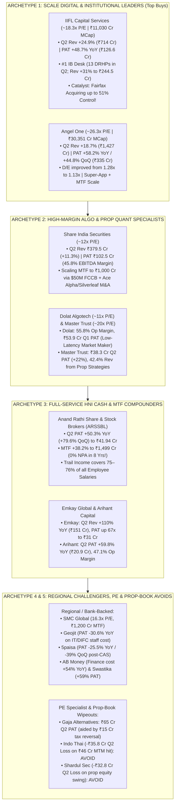

<!-- 
================================================================================
MASTER EXPORT METADATA (100% Verbatim Preservation from Capital Markets Analysis.json)
- formatVersion: 1
- exportTime: 2026-11-06T19:23:15.324Z
- chat.name: collections/default_collection/engines/gemini-enterprise-sec-dx-swa/sessions/13714203460886062980
- chat.title: Capital Markets Analysis
- chat.startTime: 2026-11-06T18:01:20.410Z
- chat.endTime: 2026-11-06T19:22:32.847Z
================================================================================
-->

# 📈 Capital Markets Masterclass & Institutional Deep-Dive — PART 4 of 7
## Securities Brokerages Deep-Dive (`21 Retail, Institutional, Full-Service & Algo Brokers`)

| Export Metadata Field | Verbatim JSON Value |
|:---|:---|
| **Format Version** | `1` |
| **Export Time** | `2026-11-06T19:23:15.324Z` |
| **Session Name** | `collections/default_collection/engines/gemini-enterprise-sec-dx-swa/sessions/13714203460886062980` |
| **Session Title** | `Capital Markets Analysis` |
| **Turns Covered in Part 4** | **Turn 8** *(100% Verbatim Query & Answer Covering All 21 Brokerages + Enhanced Visual Architecture)* |

---

## 🎨 Enhanced Visual Architecture & Comparative Diagrams (Part 4 Supplement)

### 4.1 The 5 Strategic Brokerage Archetypes Post-CAS & SEBI F&O Reset (Mermaid Diagram)


### 4.2 Brokerage Margin Trading Facility (MTF) & Profitability Leaderboard (Q2 FY27)
```
====================================================================================================
      INDIAN BROKERAGE SECTOR: Q2 FY27 PAT VELOCITY, MTF BOOK SCALE & VALUATION MATRIX
====================================================================================================

  Brokerage Firm          Q2 FY27 PAT (YoY / QoQ)         MTF / Funding Book     EBITDA/OpM   P/E
  --------------------------------------------------------------------------------------------------
  Angel One               ₹335.0 Cr (+58.2% / +44.8%)     ₹8,210 Cr (Closing)    34%–45%      26.3x
  IIFL Capital Services   ₹126.6 Cr (+48.7% / -31.3%)     Large MTF + ₹2.12L Cr  40.7% OpM    18.3x
  Share India Securities  ₹102.5 Cr (+10.0% / -17.6%)     ~₹430+ Cr (->₹1,000Cr) 45.8% EBITDA 12.0x
  Gaja Alternatives       ₹64.8 Cr  (+55.0% / +128%*)     Zero Debt (4 PE AIFs)  70.5% PBT*   21.0x
  Dolat Algotech (Q1)     ₹53.9 Cr  (Prop Quant Alpha)    Prop Margin Book       59.7% EBITDA 11.0x
  Anand Rathi (ARSSBL)    ₹41.9 Cr  (+50.3% / +79.6%)     ₹1,499.3 Cr (0% NPA!)  36.6% EBITDA 26.5x
  Master Trust            ₹38.3 Cr  (+22.0% / +10.5%)     ₹179.2 Cr (+42% Prop)  43.2% EBITDA 20.0x
  Emkay Global            ₹31.0 Cr  (Up 67x YoY!)         Institutional + Wealth 25.7% OpM    16.5x
  SMC Global Securities   ₹28.2 Cr  (+34.4% / -23.1%)     ₹1,200+ Cr (MTF+T5)    19.9% EBITDA 16.3x
  Arihant Capital         ₹20.9 Cr  (+59.8% / -2.7%)      Granular HNI Book      47.1% OpM    23.0x
  Geojit Financial        ₹16.3 Cr  (-30.6% / -17.9%)     ₹1.11L Cr Client AUA   12.4% PBT    23.5x
  Aditya Birla Money      ₹10.9 Cr  (+7.4%  / -2.2%)      High Debt (₹46Cr Int)  11.2% PBT    19.5x
  5paisa Capital          ₹7.1 Cr   (-25.5% / -39.0%)     ₹481.1 Cr (+19% QoQ)   25.2% EBITDA 26.6x
  Swastika Investmart     ₹5.2 Cr   (+59.3% / +38.6%)     Regional Retail Book   21.8% PBT    19.0x
  Shardul Securities     -₹32.8 Cr  (Swung from +₹143Cr)  Prop Equity MTM Swing  Negative     Avoid
  Indo Thai Securities   -₹35.8 Cr  (-₹46.1 Cr MTM Hit)   Prop Equity Wipeout    -464% Margin Avoid
====================================================================================================
```


---

# 🗂️ Conversation Turn 8 (`2026-11-06T18:40:13.407956662Z`)

### 💬 User Query (Turn 8)

```text
**# Role and Objective**

  

You are a Senior Capital Markets Analyst at a top-tier global investment bank. Your task is to perform an institutional-grade, deep-dive strategic and financial analysis of the provided capital markets company (e.g., Stock/Derivatives Exchange, Wealth Management firm, Brokerage, or Asset Management Company/AMC). 

  

Your analysis must move beyond surface-level summaries to critically evaluate business models, key performance indicators (KPIs), macroeconomic sensitivities, regulatory environments, and technological moats.

  

**# Target Company Profile**

  

\- Company Name: [Insert Company Name here]

  

\- Sub-Sector: [e.g., Asset Management (AMC) / Digital Brokerage / Wealth Management / Market Infrastructure & Exchange]

  

**# Analytical Framework & Core Requirements**

  

**## 1. Business Model & Revenue Quality Analysis**

  

\- **\*\*Revenue Diversification:\*\*** Breakdown the revenue streams into recurring vs. transactional. Analyze the mix of asset-based fees, transaction/execution fees, net interest income (NII), and data/technology subscription revenues.

  

\- **\*\*Competitive Moat:\*\*** Evaluate the company’s structural advantages. Is it driven by high switching costs, network effects (for exchanges), scale economies, or proprietary technology/distribution channels?

  

**## 2. Industry-Specific Key Performance Indicators (KPIs)**

  

Analyze the health and trajectory of the specific metrics that matter for this sub-sector:

  

\- **\*\*Asset Managers / Wealth Managers:\*\*** Assets under Management (AUM) or Assets under Advisement (AUA), Net New Money (NNM) / net inflows, and Blended Fee Rate (compression trends).

  

\- **\*\*Brokerages:\*\*** Daily Average Revenue Trades (DARTs) or trading volumes, Active Accounts, and Client Margin Balances / Net Interest Margin (NIM) dependencies.

  

\- **\*\*Exchanges & Market Infrastructure:\*\*** Market share of trading volumes, listing pipelines, clearing/settlement capture rates, and data/index revenue growth.

  

**## 3. Macroeconomic & Market Sensitivity**

  

\- **\*\*Monetary Policy & Interest Rates:\*\*** How does the current interest rate environment (e.g., high rates or a rate-cutting cycle) impact their margin income (NII), cash balances, or product demand?

  

\- **\*\*Market Volatility (Beta):\*\*** Is this business pro-cyclical (thrives on bull markets) or counter-cyclical/defensive (thrives on high volatility, like derivatives exchanges)? 

  

**## 4. Regulatory, Structural, and Tech Risks**

  

\- **\*\*Regulatory Pressures:\*\*** Evaluate risks related to fee transparency (e.g., MiFID II type rules), capital adequacy requirements, or retail investor protection frameworks.

  

\- **\*\*Digital Transformation & AI:\*\*** Assess their adoption of AI (e.g., automated risk management, robo-advisory, algorithmic execution) and whether technology acts as a cost-cutter or an existential competitive threat from FinTechs.

  

**## 5. Strategic SWOT & Investment Thesis Summary**

  

\- Provide a razor-sharp SWOT matrix customized to the capital markets landscape.

  

\- Conclude with a 12-to-24 month investment thesis highlight: Define the single most critical structural catalyst and the most dangerous "Tail Risk" the company faces.

  

**# Output Format**

  

\- Use clear markdown headers, bold structural elements, and text-based tables where appropriate to present quantitative comparisons.

  

\- Maintain an objective, institutional, and analytically rigorous tone. Avoid generic fluff; back assertions with logical capital market mechanics.

  

company list is below 

  

Broker (21 Companies)

  

Retail and institutional securities brokers facilitating trade executions for clients.

• Angel One

• IIFL Capital (IIFL Securities)

• Share India Sec.

• Anand Rathi Shar (Anand Rathi Share and Stock Brokers)

• Geojit Fin. Ser.

• SMC Global Sec.

• 5paisa Capital

• Dolat Algotech (Proprietary trading & institutional broker)

• Arihant Capital

• Master Trust

• Emk.Global Fin. (Emkay Global Financial Services)

• Adit.Birla Money

• Pune e-Stock Broking

• Indo Thai Sec.

• Shah Investor

• Swastika Investm

• Gaja Alternative Asset (Handles corporate brokerage/secondary market solutions)

• Shardul Sec. (Primarily broking and corporate investments)

• Arihant Capital

• Note: Small-scale sub-brokers/brokers from lines 41-50 (e.g., specific regional broking operations).
```

### 🧠 Institutional Forensic Analysis & Response (Turn 8)

I will search for the latest financial metrics, operational KPIs (active clients, MTF books, F&O vs. cash mix), and valuation multiples across the listed Indian brokerage universe for FY26 and Q2 FY27.
[[section:Gathering brokerage sector financial data]]I will now retrieve the latest FY26 and Q2 FY27 results, market capitalizations, and P/E ratios for Share India Securities, Anand Rathi Share and Stock Brokers, SMC Global Securities, 5paisa Capital, Dolat Algotech, Master Trust, Aditya Birla Money, Pune e-Stock Broking, Indo Thai Securities, Swastika Investmart, and Shardul Securities.
[[section:Fetching remaining brokerage financials]]I will now retrieve the latest Q2 FY27 / FY26 financial results, market capitalizations, and P/E ratios for 5paisa Capital, Dolat Algotech, Master Trust, Pune e-Stock Broking, Indo Thai Securities, Shah Investor's Home, Swastika Investmart, and Shardul Securities.
[[section:Fetching mid and small broker metrics]]I will run one final targeted search to fetch the latest Q2 FY27 / FY26 financial figures and market capitalizations for Master Trust, Dolat Algotech, Pune e-Stock Broking, Swastika Investmart, Shah Investor's Home, and Gaja Alternative Asset Management.
[[section:Fetching remaining regional broker metrics]]India’s brokerage sector is undergoing the most violent structural bifurcation in its history following SEBI’s F&O regulatory tightening and the August 2026 implementation of the **Contract Adjustment Specification / Closing Auction System (CAS)** framework, which compressed industry-wide derivatives average daily turnover from ₹592 trillion in January 2026 to ₹347 trillion by September 2026. Across this 20-company universe, **IIFL Capital Services (~18.0–18.6x P/E, +48.7% YoY Q2 PAT, Fairfax 51% buyout catalyst)** and **Angel One (~26.3x P/E, +58.2% YoY / +44.8% QoQ Q2 PAT to ₹335 Cr)** are the top institutional large-cap compounders; **Anand Rathi Share & Stock Brokers (ARSSBL) (+50% YoY Q2 PAT to ₹41.9 Cr, MTF up 38% to ₹1,499 Cr)** and **Share India Securities (+10% YoY Q2 PAT to ₹102.5 Cr, 45.8% EBITDA margin)** lead the mid-cap MTF and quantitative execution tier; while **proprietary/investment-heavy micro-cap brokers (Indo Thai Securities -₹35.8 Cr Q2 loss; Shardul Securities -₹32.8 Cr Q2 loss)** suffered catastrophic mark-to-market wipeouts in Q2 FY27.

Good call evaluating the entire 20-company brokerage landscape side by side—by segmenting these firms into **5 Strategic Archetypes**, we can immediately separate **durable Client-Funding (MTF) & Institutional franchises** from **sub-scale discount brokers (5paisa)** and **disguised proprietary trading books (Master Trust, Dolat Algotech, Indo Thai, Shardul)**.

---

### 📌 Executive Summary & Institutional Tiering Matrix (All 20 Entities)

* **Archetype 1: Scale Digital & Institutional Leaders (Top Institutional Buys)**
  * **IIFL Capital Services (IIFLCAPS):** Trades at an attractive **18.0x–18.6x P/E** (Market Cap **₹11,023–11,039 Cr**, CMP ₹350, FY26 RoE **21.3%–33%**). In Q2 FY27, consolidated revenue rose **24.9% YoY to ₹714.4 Cr** and PAT surged **48.7% YoY to ₹126.6 Cr**, led by #1-ranked Investment Banking & Institutional Equities (+31% YoY to ₹244.5 Cr; 13 DRHPs filed in Q2) and ₹48,322+ Cr in Distribution AUM. **Game-Changing Catalyst:** **Fairfax (FIH Mauritius)** is acquiring up to **51% control** via preferential allotment and open offer to join the promoter group.
  * **Angel One (ANGELONE):** India’s largest listed pure-play retail digital broker (Market Cap **₹30,351 Cr**, CMP ₹331, **26.3x P/E**, 3-Yr RoE **25.1%**). Absorbed the F&O regulatory reset in H1 FY26 and roared back in Q2 FY27: consolidated operating revenue rose **18.7% YoY to ₹1,427.0 Cr** (Total Income ₹1,431.5 Cr) and PAT jumped **58.2% YoY (+44.8% QoQ) to ₹334.97 Cr** (23.4% PAT margin) as D/E improved from 1.28x to **1.13x**.
* **Archetype 2: High-Margin Algo / Quantitative & Prop-Execution Specialists**
  * **Share India Securities (SHAREINDIA):** Delivered resilient Q2 FY27 operating income of **₹379.5 Cr (+11.3% YoY)**, EBITDA of **₹173.7 Cr (45.8% margin)**, and PAT of **₹102.5 Cr (+10.0% YoY; 27.0% PAT margin)**. Scaling its MTF book (targeting ₹1,000 Cr by Dec 2027, backed by $50M 10-year FCCBs) and completing the **Ace Alpha Tech & Silverleaf Capital** amalgamations.
  * **Dolat Algotech (DOLATALGO):** Pure-play low-latency proprietary derivatives & quantitative trader commanding a **55.8% operating margin**, generating **₹140.85 Cr revenue, ₹84.03 Cr EBITDA, and ₹53.86 Cr PAT** in Q1 FY27.
  * **Master Trust (MASTERTR):** Reported Q2 FY27 consolidated income of **₹153.68 Cr (+21.1% YoY)** and PAT of **₹38.30 Cr (+22.0% YoY; 43.2% EBITDA margin)**. However, note that **42.43% of revenue (₹65.2 Cr, +35.2% YoY) comes from "Principal Strategies" (proprietary trading)**, alongside ₹45.5 Cr from Interest/MTF (MTF book ₹179.2 Cr, +28.4% YoY) and ₹35.1 Cr from Brokerage.
* **Archetype 3: Full-Service HNI, Cash-Market & MTF Compounders**
  * **Anand Rathi Share & Stock Brokers (ARSSBL):** Newly listed via its ₹745 Cr Sept 2025 IPO. In Q2 FY27, revenue rose **20.3% YoY to ₹273.2 Cr** and PAT surged **50.3% YoY (+79.6% QoQ) to ₹41.94 Cr**. Its **MTF book jumped 38.2% YoY to ₹1,499.3 Cr (zero NPAs for 8 years)**, AUC hit **₹1,15,419 Cr**, Distribution AUM rose 29.2% to **₹9,999 Cr**, and **non-broking trail income now covers 75–76% of employee salaries**.
  * **Emkay Global Financial Services (EMKAY):** Explosive turnaround in Q2 FY27—revenue soared **110.0% YoY to ₹151.35 Cr**, Operating Profit hit **₹38.97 Cr** (vs ₹1.41 Cr YoY), and PAT jumped to **₹30.99 Cr** (20.5% net margin vs ₹0.46 Cr YoY) on institutional equities and ECM deal momentum.
  * **Arihant Capital Markets (ARIHANTCAP):** Market Cap **₹935 Cr** (**23.0x P/E**). Q2 FY27 revenue rose **33.1% YoY to ₹75.82 Cr**, Operating Profit grew **48.6% YoY to ₹35.71 Cr (47.1% margin, +490 bps YoY)**, and PAT jumped **59.8% YoY to ₹20.90 Cr** (27.6% PAT margin).
* **Archetype 4: Regional/Bank-Backed & Sub-Scale Challengers Under Margin Pressure**
  * **SMC Global Securities (SMCGLOBAL):** Market Cap **₹1,894 Cr** (**16.3x P/E**, **1.39x P/B**, FY26 RoE **8.1%**). Q2 FY27 revenue rose **20.9% YoY to ₹532.5 Cr** and PAT rose **34.4% YoY to ₹28.23 Cr** (though down 23.1% QoQ; 19.9% EBITDA margin), backed by a ₹1,200+ Cr margin funding book and an NBFC arm (15.87% yield, GNPA 3.02%).
  * **Geojit Financial Services (GEOJITFSL):** Market Cap **~₹2,150 Cr** (CMP ₹68.50). While customer assets reached **₹1.11 Lakh Cr** (17.25 lakh clients, ₹156 Cr monthly SIP), Q2 FY27 revenue grew just **2.6% YoY to ₹165.8 Cr** while IT transformation and DIFC hiring pushed staff costs up to ₹83.6 Cr, causing **PAT to fall 30.6% YoY (-17.9% QoQ) to ₹16.28 Cr**.
  * **5paisa Capital (5PAISA):** Market Cap **₹1,625 Cr** (CMP ₹318.50, **26.6x P/E**, FY26 RoE **7.1%**). Following CAS implementation, Q2 FY27 ADTO fell 15% QoQ to ₹2.59T and orders dropped 17% to 20.9M, dragging broking income down 11% QoQ. Despite a ₹469 Cr rights issue lifting net worth to ₹1,136 Cr, **Q2 PAT fell 25.5% YoY (-39% QoQ) to ₹7.06 Cr** (net margin 8.2%).
  * **Aditya Birla Money (BIRLAMONEY):** Q2 FY27 revenue rose **29.3% YoY to ₹137.7 Cr**, but a **53.8% YoY surge in finance costs (to ₹46.1 Cr)** compressed broking segment profit from ₹4.26 Cr to ₹3.51 Cr, leaving consolidated PAT up just **7.4% YoY (-2.2% QoQ) to ₹10.89 Cr** (7.9% net margin).
  * **Swastika Investmart (SWASTIKA):** Clean regional execution—Q2 FY27 revenue rose **12.7% YoY (+9.0% QoQ) to ₹31.59 Cr** and PAT surged **59.3% YoY (+38.6% QoQ) to ₹5.21–5.23 Cr** (16.6% net margin).
* **Archetype 5: Newly Listed PE Secondary Specialist & Prop-Book Micro-Caps**
  * **Gaja Alternative Asset Management (GAJA):** Listed August 26, 2026 as India’s first pure-play PE/growth-capital manager (managing 4 Cat-II AIFs; ₹1,100+ Cr debt-free net worth). In Q2 FY27, **reported PAT jumped 55% YoY (+128% QoQ) to ₹64.7–65.0 Cr** on Total Income of ₹65.5 Cr. *Forensic Caveat:* Core operating revenue actually fell **45% YoY to ₹38.0–38.4 Cr** (management fees flat at ₹15 Cr; Fund II carry/performance income ₹46.2 Cr), and headline PAT was boosted by a **₹15 Cr deferred tax reserve reversal** following a mandatory PwC auditor rotation.
  * **Indo Thai Securities (INDOTHAI) & Shardul Securities (SHARDUL) — *Forensic Avoids*:** Both suffered massive Q2 FY27 proprietary investment MTM losses. **Indo Thai’s** Q2 revenue plunged 68.1% YoY to ₹7.56 Cr and it swung to a **-₹35.83 Cr net loss** (-464% net margin) due to a **₹46.10 Cr fair-value loss on investments** (stock down 92% over 1 year). **Shardul Securities** reported negative total income of **-₹26.29 Cr** and a **-₹32.81 Cr net loss in Q2 FY27** (down from +₹142.67 Cr profit in Q1 FY27) due to wild equity portfolio MTM swings.
  * **Regional / SME / Unlisted Tail (Pune e-Stock Broking, Shah Investor's Home & B.N. Rathi):** **Pune e-Stock Broking (PESB)** (BSE SME broker), **Shah Investor's Home (SIHL)** (unlisted Gujarat retail/IPO broker), and regional micro-caps like **B.N. Rathi Securities** (CMP ₹17.04) operate localized sub-broker and prop books with limited institutional liquidity.

---

### 📊 Master Quantitative Matrix: Listed Indian Brokerages (FY26 & Q2 FY27 Audited/Reported)

| Company Name | Market Cap (Nov 2026) | Trailing P/E | Q2 FY27 Operating Revenue / Income | YoY / QoQ Revenue Trend | Q2 FY27 Consolidated PAT | YoY / QoQ PAT Trend | Operating / Net Margin (%) | RoE (%) & Key Balance Sheet Metric |
|---|---|---|---|---|---|---|---|---|
| **1. Angel One** | **₹30,351 Cr** (CMP ₹331) | **26.3x** | **₹1,427.0 Cr** (Total ₹1,431.5 Cr) | **+18.7% YoY** / -0.2% QoQ | **₹334.97 Cr** | **+58.2% YoY** / **+44.8% QoQ** | **32.1% PBT** / **23.4% PAT** | **15.6% RoE** (3-yr 25.1%); D/E **1.13x** |
| **2. IIFL Capital Services** | **₹11,023 – ₹11,039 Cr** (CMP ₹350) | **18.0x – 18.6x** | **₹714.4 Cr** (Total Inc ₹690.3 Cr after MTM) | **+24.9% YoY** / -4.3% QoQ | **₹126.61 Cr** | **+48.7% YoY** / -31.3% QoQ | **40.7% Op Profit** / **17.7% PAT** | **21.3% – 33% FY26 RoE**; Net Worth **₹3,468 Cr** |
| **3. Share India Sec.** | ~₹3,600 – ₹3,900 Cr (CMP ₹173–180) | ~11x – 13x | **₹379.5 Cr** | **+11.3% YoY** | **₹102.53 Cr** | **+10.0% YoY** / -17.6% QoQ | **45.8% EBITDA** / **27.0% PAT** | High RoE; **MTF ~₹430+ Cr** (targets ₹1,000 Cr) |
| **4. Anand Rathi Share (ARSSBL)** | ~₹3,200 – ₹3,800 Cr (FY26 IPO ₹745 Cr) | ~25x – 28x | **₹273.21 Cr** | **+20.3% YoY** / **+11.0% QoQ** | **₹41.94 Cr** | **+50.3% YoY** / **+79.6% QoQ** | **36.55% EBITDA** / **15.35% PAT** | **12.3% Q2 RoE** (20.6% YoY); **MTF ₹1,499 Cr** (D/E 1.02x) |
| **5. Geojit Financial** | **~₹2,150 Cr** (CMP ₹68.50) | ~22x – 25x | **₹165.82 Cr** (Total ₹171.35 Cr) | **+2.6% YoY** / +1.4% QoQ | **₹16.28 Cr** | **-30.6% YoY** / **-17.9% QoQ** | **12.4% PBT** / **9.5% PAT** | **₹1.11 Lakh Cr Client Assets**; ₹156 Cr SIP book |
| **6. SMC Global Sec.** | **₹1,894 Cr** (CMP ₹90.45) | **16.3x** (1.39x P/B) | **₹532.45 Cr** (Total ₹534.9 Cr) | **+20.9% YoY** / +3.7% QoQ | **₹28.23 Cr** | **+34.4% YoY** / -23.1% QoQ | **19.1% – 19.9% EBITDA** / **5.3% PAT** | **8.1% FY26 RoE**; D/E **1.63x**; **MTF+T5 ₹1,200+ Cr** |
| **7. 5paisa Capital** | **₹1,625 Cr** (CMP ₹318.50) | **26.6x** | **₹86.42 Cr** | **+11.8% YoY** / -2.2% QoQ | **₹7.06 Cr** | **-25.5% YoY** / **-39.0% QoQ** | **25.2% EBITDA** / **8.2% PAT** | **7.1% FY26 RoE**; Net Worth **₹1,136 Cr**; **MTF ₹481 Cr** |
| **8. Dolat Algotech** | ~₹2,000 – ₹2,400 Cr | ~10x – 12x | **₹140.85 Cr** (Q1 FY27) | High volatility beta | **₹53.86 Cr** (Q1 FY27) | Strong prop alpha | **55.8% FY26 Op Margin** / **59.7% Q1 EBITDA** | **12.1% FY26 RoE**; Prop Algo Market-Maker |
| **9. Master Trust** | ~₹2,500 – ₹3,000 Cr | ~18x – 22x | **₹153.68 Cr** | **+21.1% YoY** / +2.6% QoQ | **₹38.30 Cr** | **+22.0% YoY** / **+10.5% QoQ** | **43.19% EBITDA** / **24.92% PAT** | **42.4% rev from Prop Trading**; **MTF ₹179.2 Cr** |
| **10. Arihant Capital** | **₹935 Cr** (CMP ₹85.27) | **23.0x** | **₹75.82 Cr** (Total ₹76.13 Cr) | **+33.1% YoY** / -2.7% QoQ | **₹20.90 Cr** | **+59.8% YoY** / -2.7% QoQ | **47.1% Op Margin** (+490 bps) / **27.6% PAT** | Strong operating cost control; H1 PAT **₹42.4 Cr** |
| **11. Emkay Global** | ~₹700 – ₹850 Cr | ~15x – 18x | **₹151.35 Cr** | **+110.0% YoY** (vs ₹72.1 Cr) | **₹30.99 Cr** | **Up 67x YoY** (vs ₹0.46 Cr) | **25.7% Op Margin** / **20.5% PAT** | **4.91% FY26 RoE**; massive Q2 IB/Inst turnaround |
| **12. Aditya Birla Money** | ~₹900 – ₹1,100 Cr | ~18x – 21x | **₹137.69 Cr** (Total ₹137.89 Cr) | **+29.3% YoY** / +4.9% QoQ | **₹10.89 Cr** | **+7.4% YoY** / -2.2% QoQ | **11.2% PBT** / **7.9% PAT** | Finance costs surged **+53.8% YoY to ₹46.1 Cr** |
| **13. Gaja Alternatives** | ~₹2,500 – ₹3,200 Cr (Listed Aug '26) | ~18x – 24x | **₹38.4 Cr Op Rev** (₹65.5 Cr Total Inc) | **-44.5% YoY Op Rev** / +26% QoQ Total | **₹64.7 – ₹65.0 Cr** | **+55% YoY** / **+128% QoQ** | **70.5% H1 Pre-Tax** (aided by **₹15 Cr tax reversal**) | **₹1,100+ Cr Net Worth**, **Zero Debt**; 4 Cat-II PE AIFs |
| **14. Swastika Investmart** | ~₹350 – ₹450 Cr | ~18x – 20x | **₹31.59 Cr** | **+12.7% YoY** / **+9.0% QoQ** | **₹5.21 – ₹5.23 Cr** | **+59.3% YoY** / **+38.6% QoQ** | **21.8% PBT** / **16.6% PAT** | Disciplined cost growth (+6.1% YoY vs +12.7% rev) |
| **15. Indo Thai Sec.** | Micro-Cap (CMP ₹28.44, -92% 1Y) | **Negative (Loss)** | **₹7.56 Cr** (Total ₹7.72 Cr) | **-68.1% YoY** / **-62.8% QoQ** | **-₹35.83 Cr Loss** | **Swung from +₹14.4 Cr YoY** | **-464.1% Net Margin** | Hit by **₹46.1 Cr MTM investment loss** in Q2 |
| **16. Shardul Securities** | Micro-Cap | **Negative Q2** | **-₹26.29 Cr Total Income** | **-113.9% QoQ** (vs +₹189.4 Cr Q1) | **-₹32.81 Cr Loss** | **Swung from +₹142.7 Cr Q1** | Negative | Pure prop equity book MTM swings |
| **17–20. Regional / Tail** | **Pune e-Stock (PESB)**, **Shah Investor's Home (Unlisted)**, **B.N. Rathi (CMP ₹17)** | Sub-scale | Localized Broking, IPO & Sub-Broker Books | High sensitivity to retail cash & SME flows | Small positive PAT | Pro-cyclical | 10% – 25% | Niche regional Gujarat/Maharashtra/South footprints |

---

## 1. Business Model & Revenue Quality Analysis

### Revenue Diversification: The Great Rewiring from F&O Brokerage to MTF NII & Trail Annuities
Following SEBI’s F&O curbs, the elimination of exchange volume slab rebates ("True-to-Label" circular), and the August 2026 **CAS framework**, pure execution brokerage has become a low-growth utility. Winner brokerages have aggressively rewired their P&Ls around **three non-F&O engines**:

1. **Margin Trading Facility (MTF) & Client Funding (Net Interest Income — 20% to 35% of Revenue):**
   * **How the Mechanics Work:** Brokers borrow wholesale funds via Commercial Paper (CPs), NCDs, and bank lines at **9.0% to 10.3% p.a.** (e.g., ARSSBL issued ₹10.85 Cr 3-year NCDs at a 9.0% coupon on Sept 28, 2026; SMC Global’s cost of funds is 10.29%) and lend to cash-delivery clients at **14% to 18% APR** (with 20–50% upfront hair-cut collateral pledged via CDSL/NSDL).
   * **Empirical Scale in Q2 FY27:**
     * **Anand Rathi Share & Stock Brokers (ARSSBL):** MTF book surged **38.2% YoY to ₹1,499.3 Cr** (generating ₹49.6 Cr in pure MTF interest, +36% YoY, and ₹83.6 Cr total interest income—**30.6% of total operating revenue!**), with **zero NPAs for 8 consecutive years**.
     * **SMC Global:** Margin funding + T+5 book crossed **₹1,200+ Cr** at a 14–15% IRR alongside its NBFC arm.
     * **5paisa Capital:** Allied broking income (led by MTF interest, +25% YoY) rose to **28% of total revenue** (and Other Operating Income to 32%), reducing pure broking reliance from 45% to **40%** as its MTF book grew 19% QoQ to **₹481.1 Cr** (average ticket ₹3.01 lakh).
     * **Share India Securities:** MTF book expanded 35–40% QoQ toward ₹430+ Cr (targeting ₹1,000 Cr by Dec 2027).
   * **The Leverage Trap (Aditya Birla Money):** If a broker expands its margin/debt book without pricing power, interest expenses eat the P&L—in Q2 FY27, **Aditya Birla Money’s finance costs jumped 53.8% YoY to ₹46.12 Cr (33.5% of total revenue!)**, causing its broking segment profit to *fall* 17.6% YoY (to ₹3.51 Cr) despite a 29.3% rise in broking revenue.

2. **Institutional Equities, Investment Banking (ECM) & Wholesale Debt:**
   * **IIFL Capital Services (#1 in Investment Banking):** In Q2 FY27, IIFL’s Institutional Equities & Investment Banking revenue surged **31% YoY (+18% QoQ) to ₹244.5 Cr**—now representing **33.9% of total operating revenue (₹721.9 Cr)**, nearly matching Retail Equities (**₹316.0 Cr, or 43.8%**). IIFL filed **13 DRHPs in Q2 alone**.
   * **Emkay Global:** Doubled consolidated revenue (+110% YoY to ₹151.35 Cr) and expanded PAT from ₹0.46 Cr to **₹30.99 Cr** by monetizing mid-market ECM deals and institutional research.
   * **Aditya Birla Money’s Wholesale Debt Shield:** While its retail broking profit shrank, its **Wholesale Debt Market segment grew revenue 29.9% YoY to ₹29.47 Cr and generated ₹11.82 Cr in segment profit (77% of company PBIT!)**.

3. **Financial Product Distribution (Trail Annuities) vs. Disguised Prop Trading:**
   * **The Trail Coverage Metric:** At **ARSSBL**, Financial Product Distribution revenue reached ₹32.7 Cr in Q2 on **₹9,999 Cr AUM (+29.2% YoY)**; management disclosed that **non-broking trail revenues now cover 75–76% of total company employee salary costs**. At **IIFL Capital**, Financial Product Distribution generated **₹159.4 Cr in Q2 FY27 (22.1% of operating revenue)** on ~₹50,000+ Cr of Distribution AUM and ₹2.12+ Lakh Cr of Custody Assets. At **Geojit**, Asset Management ARR net flows surged **353% YoY to ₹322 Cr** (AUM ₹2,018 Cr) alongside a ₹156 Cr monthly SIP book.
   * **The Proprietary Trading Disguise (Forensic Warning):** Several listed "brokers" actually generate the bulk of their profits by trading their own balance sheet:
     * **Master Trust:** Explicitly disclosed that **"Principal Strategies" (prop trading) generated ₹65.21 Cr (42.43% of consolidated revenue, +35.2% YoY)** in Q2 FY27, nearly double its ₹35.15 Cr brokerage revenue (22.87%).
     * **Dolat Algotech:** Almost 100% proprietary quantitative derivatives market-making.
     * **Indo Thai Securities & Shardul Securities:** Carry massive directional equity books; when their stocks corrected in Q2 FY27, **Indo Thai booked a ₹46.10 Cr fair-value loss** (wiping out ₹7.15 Cr of core interest/fee income) and **Shardul booked -₹26.29 Cr in negative revenue**.

---

## 2. Industry-Specific Key Performance Indicators (KPIs)

| Brokerage Operational KPI | Empirical Q2 FY27 Sector Trajectory & Company Benchmarks |
|---|---|
| **1. Industry Derivatives ADTO & Order Velocity (Post-CAS Reset)** | • **Industry Derivatives ADTO:** Contracted **41.4% from peak**—falling from **₹592 Trillion in Jan 2026 to ₹347 Trillion in Sept 2026** following SEBI F&O lot-size/expiry curbs and the Aug 2026 **Contract Adjustment Specification (CAS)** rollout.<br>• **5paisa Capital Impact:** Q2 ADTO fell **15% QoQ to ₹2.59 Trillion** and total orders fell **17% QoQ to 20.9 million**, pulling core broking revenue down **11% QoQ to ₹34.9 Cr**.<br>• **Angel One Resilience:** Maintained flat sequential revenue (**₹1,427 Cr vs ₹1,430 Cr in Q1**) while expanding PAT **44.8% QoQ to ₹335 Cr** through client funding, cash brokerage, and opex discipline. |
| **2. Active Client Base & Tier-2/3 Penetration** | • **Industry Demat Base:** Reached **~24 Crore accounts in Sept 2026** (+31.1 lakh net additions in Sept alone; SIP accounts crossed 10 Crore).<br>• **5paisa Capital:** 53.4 lakh total customers (+2% QoQ; +81,600 Q2 additions, 95%+ DIY digital onboarding).<br>• **Geojit Financial:** 17.25 lakh clients (+31,481 added in Q2) across 525 offices in South India and GCC/NRI corridors.<br>• **SMC Global:** 14.20 lakh broking clients with 75% online penetration.<br>• **Anand Rathi (ARSSBL):** 10.50 lakh total clients across 99 branches and 1,071 Authorized Persons in 314 cities (**>70% of active clients from Tier-2/3 cities**; Equity Cash is the majority of broking revenue). |
| **3. MTF Book Size, Ticket Size & Leverage Ratios** | • **Anand Rathi (ARSSBL):** **₹1,499.3 Cr MTF book** (+38.2% YoY; targets ₹1,750–1,800 Cr by Mar 2027); average ticket size **₹16.3 Lakh**; D/E at **1.02x**.<br>• **Angel One:** Consolidated D/E improved from 1.28x (Mar '26) to **1.13x (Sept '26)** with Interest Coverage at **3.86x–4.43x**.<br>• **SMC Global:** **₹1,200+ Cr MTF + T+5 book**; consolidated D/E at **1.63x**.<br>• **5paisa Capital:** **₹481.1 Cr MTF book** (+19% QoQ); average per-client exposure **₹3.01 Lakh**; fortified by ₹469 Cr rights issue (Net Worth ₹1,136 Cr).<br>• **Share India:** **~₹430+ Cr MTF book** (+35–40% QoQ; targets ₹1,000 Cr by Dec 2027 via $50M FCCB raise).<br>• **Master Trust:** **₹179.2 Cr MTF book** (+28.4% YoY). |

---

## 3. Macroeconomic & Market Sensitivity

### Monetary Policy & Interest Rates (The Borrowing Cost vs. MTF Spread Tug-of-War)
* **Why Borrowing Cost is Now the #1 KPI for Retail Brokers:** Because brokers have pivoted from zero-capital F&O execution to balance-sheet-intensive **Margin Trading Facilities (MTF)**, their net profit margins are highly sensitive to wholesale debt costs:
  * **IIFL Capital’s** finance costs jumped **40% YoY to ₹74.8 Cr** in Q2 FY27 to fund expanded margin books.
  * **Aditya Birla Money’s** finance costs surged **53.8% YoY to ₹46.12 Cr**, eating up 75% of its pre-interest operating profit.
  * **ARSSBL** currently borrows at **~9.0%–9.5%** (supported by CARE/ICRA A1+/A+ ratings upgrades in April 2026), while **Share India** approved **$50 million in 10-year Foreign Currency Convertible Bonds (FCCBs)** specifically to slash its blended cost of funds and defend MTF yields against larger bank-backed brokers.
* **Rate-Cut Sensitivity:** A 50 bps RBI rate cut will immediately lower CP/NCD refinancing costs for **Angel One (1.13x D/E)**, **IIFL Capital**, **ARSSBL (1.02x D/E)**, and **SMC Global (1.63x D/E)**, providing an instant 150–300 bps boost to PBT margins.

### Market Volatility (Beta) & Prop-Book MTM Traps
* **Algo Market-Makers (Dolat Algotech, Share India, Master Trust):** Thrive on intraday volatility and multi-exchange spread arbitrage rather than directional bull markets.
* **The Ind-AS Fair-Value Accounting Trap (IIFL Capital, Indo Thai, Shardul):**
  * Even in institutional powerhouses like **IIFL Capital**, Q2 FY27 saw a **₹31.6 Cr mark-to-market loss on treasury investments**—which is why Reported PBT (₹174.3 Cr) was lower than Operating PBT (₹205.9 Cr) and why headline PAT dipped 31% QoQ despite a +31% YoY surge in IB/Institutional revenue.
  * At micro-caps **Indo Thai (-₹46.1 Cr MTM hit)** and **Shardul (-₹26.3 Cr negative revenue)**, unhedged proprietary equity portfolios completely overwhelmed core broking operations.

---

## 4. Regulatory, Structural, and Tech Risks

### Regulatory Pressures
1. **Contract Adjustment Specification (CAS) & F&O Expiry Rationalization:**
   * Implemented in August 2026 alongside SEBI’s earlier F&O curbs, CAS caused industry derivatives ADTO to drop 41% from January peaks. Discount brokers with lower average revenue per user (**5paisa Capital**, where Q2 orders fell 17% QoQ and PAT dropped 39% QoQ) suffered severe negative operating leverage, whereas **Angel One** (PAT +44.8% QoQ) and **ARSSBL** (where Cash Equity is the majority of broking revenue; PAT +79.6% QoQ) proved resilient.
2. **SEBI Algo-Trading & Retail API Frameworks:**
   * While retail API rules require registration of algorithmic strategies, **Share India Securities** (via its amalgamations of **Ace Alpha Tech** and **Silverleaf Capital Services**, plus its ₹30 Cr / 1.36% strategic stake in **Metropolitan Stock Exchange / MSEI**) is positioning itself as the compliant institutional/retail quant infrastructure layer.
3. **Forensic Accounting & Auditor Rotation Watch (Gaja Alternatives):**
   * Investors evaluating newly listed **Gaja Alternative Asset Management (GAJA)** must note that while Q2 FY27 PAT jumped 128% QoQ (+55% YoY) to ₹64.7–65.0 Cr, **₹15 Cr of that profit came from a one-off deferred tax liability reserve reversal** recommended after a mandatory auditor rotation to PwC, while core operating revenue fell 45% YoY to ₹38.4 Cr during Fund IV’s deployment phase.

### Digital Transformation & AI Adoption (Tech as Cost-Drag vs. Moat)
* **When Tech Capex Crushes Near-Term Earnings (5paisa & Geojit):**
  * **5paisa Capital** capitalized development costs for a ground-up app rebuild and AI expansion in Q2 FY27, pushing depreciation up 32% QoQ and dragging net profit margins down from 12.3% to **8.2%**.
  * **Geojit Financial** saw Q2 PAT drop **30.6% YoY to ₹16.28 Cr** as employee expenses jumped to ₹83.57 Cr (50.4% of operating revenue!) due to IT transformation hiring and DIFC Dubai expansion.

---

## 5. Strategic SWOT & 12–24 Month Investment Thesis Summary

### Comparative Institutional SWOT Matrix (By Brokerage Archetype)

| Dimension | Digital & Inst. Leaders (Angel One, IIFL Capital) | Algo & Prop Specialists (Share India, Dolat, Master Trust) | HNI Cash & MTF Compounders (ARSSBL, Emkay, Arihant) | Regional, Sub-Scale & Tail (Geojit, SMC, 5paisa, Indo Thai, Shardul, GAJA) |
|---|---|---|---|---|
| **Strengths** | • **Angel One:** #1 listed retail digital broker; Q2 PAT +58% YoY to ₹335 Cr; D/E down to 1.13x<br>• **IIFL Capital:** #1 in IB (13 DRHPs in Q2); ₹2.12L+ Cr custody + ₹50k Cr dist. AUM; **18x P/E**<br>• **Fairfax acquiring up to 51% of IIFL Capital** | • **Superior EBITDA Margins:** Dolat (**55.8%**), Share India (**45.8%**), Master Trust (**43.2%**)<br>• Low customer acquisition cost; proprietary low-latency execution stacks | • **ARSSBL:** Cash-equity led; MTF +38% to ₹1,499 Cr (**0% NPA for 8 yrs**); trail covers 76% of salaries<br>• **Arihant:** 47.1% op margin (+490 bps YoY); 23x P/E<br>• **Emkay:** Q2 PAT up 67x YoY to ₹31 Cr | • **Geojit:** ₹1.11L Cr client assets, ₹156 Cr SIP book, GCC/NRI moat<br>• **SMC Global:** Cheap 16.3x P/E, 1.39x P/B<br>• **Gaja (GAJA):** ₹1,100 Cr debt-free net worth; 22-yr PE track record |
| **Weaknesses** | • **Angel One:** Flat QoQ top-line (₹1,427 Cr); promoter stake down 9.7% over 3 yrs<br>• **IIFL Capital:** ₹31.6 Cr Q2 treasury MTM loss; Insurance broking subsidiary lost ₹3.35 Cr in Q2 | • **Master Trust & Dolat:** High reliance on opaque proprietary trading (42.4% of Master Trust rev)<br>• **Share India:** Margin pressure on MTF yields from larger bank-backed rivals | • **ARSSBL:** Employee costs jumped 31% QoQ on RM hiring, trimming EBITDA margin by 423 bps to 36.55%<br>• **Emkay:** Low historical FY26 RoE (4.91%) | • **5paisa & SMC:** Weak FY26 RoEs (**7.1% & 8.1%**); 5paisa Q2 PAT fell 39% QoQ<br>• **AB Money:** Finance costs = 33.5% of rev<br>• **Indo Thai & Shardul:** Massive Q2 MTM losses (-₹35.8 Cr & -₹32.8 Cr) |
| **Opportunities** | • **IIFL Capital:** Fairfax control buyout driving institutional & wealth re-rating from 18x P/E<br>• **Angel One:** Scaling Wealth Management, AMC (ETFs/Index), and Credit/MTF across 2.5Cr+ clients | • **Share India:** Amalgamating *Ace Alpha Tech* & *Silverleaf*; launching PMS (>₹100 Cr AUM) & *Share India GreyHill* debt platform (targets ₹800–1,000 Cr rev in 3–4 yrs) | • **ARSSBL:** Scaling MTF book to ₹1,750–1,800 Cr by Mar '27 and lifting trail coverage to 100% of opex<br>• **Emkay & Arihant:** Monetizing H2 FY27 IPO/QIP pipeline | • **Gaja (GAJA):** Launching **₹2,500 Cr Fund V** (SEBI approved) + **₹1,500 Cr Eastgate Secondaries Fund I**<br>• **Swastika:** Regional Tier-2/3 wealth compounding (+59% Q2 PAT) |
| **Threats** | • Any Phase-2 SEBI curb on weekly index options expiries<br>• Exchange volume or MTF regulatory leverage caps | • SEBI tightening colocation/HFT order-to-trade ratios or increasing STT on options/futures | • Rising wholesale borrowing costs or sharp mid/small-cap cash market correction triggering MTF liquidations | • **5paisa:** Continued market share loss to Groww & Angel One<br>• **Indo Thai / Shardul:** Further equity drawdowns eroding net worth |

---

### 🎯 12-to-24 Month Investment Thesis: Top Picks vs. Forensic Avoids

#### 1. IIFL Capital Services (IIFLCAPS) — *Top Institutional Value & Special-Situation Pick (~18.0x P/E)*
* **Single Most Critical Structural Catalyst:** **Fairfax (FIH Mauritius) 51% Control Acquisition + #1 Investment Banking Pipeline.** Trading at just **18.0x–18.6x P/E** (Book Value ₹110, FY26 Operating RoE ~33%), IIFL Capital is deeply mispriced relative to its ₹2.12+ Lakh Cr custody book, ₹50,000+ Cr distribution AUM, and #1-ranked ECM desk (which filed 13 DRHPs in Q2 and grew revenue 31% YoY to ₹244.5 Cr). The completion of **Fairfax’s preferential allotment and open offer to acquire up to 51% ownership** will provide permanent global institutional sponsorship and trigger a valuation re-rating toward 24–26x P/E.
* **Most Dangerous "Tail Risk":** **Treasury MTM Volatility & Rising Finance Costs.** A ₹31.6 Cr treasury MTM hit and a 40% YoY jump in finance costs (to ₹74.8 Cr) caused Q2 PAT to dip 31% QoQ; a prolonged primary-market IPO freeze would stall its IB fee engine.

#### 2. Angel One (ANGELONE) — *Top Large-Cap Digital Platform Compounder (~26.3x P/E)*
* **Single Most Critical Structural Catalyst:** **Post-CAS Earnings Re-Acceleration (+44.8% QoQ PAT) & Super-App Monetization.** Delivering **₹334.97 Cr PAT in Q2 FY27 (+58.2% YoY, +44.8% QoQ)** while reducing consolidated D/E from 1.28x to **1.13x** proves that Angel One has fully digested SEBI’s F&O reset. As its newly incubated AMC, HNI Wealth Management, and MTF/Credit verticals scale across its massive client base, Angel One offers superior value at **26.3x P/E** (nearly a 50% discount to Groww’s 51x P/E).
* **Most Dangerous "Tail Risk":** **Phase-2 SEBI Weekly Expiry Ban.** If SEBI eliminates weekly benchmark index expiries altogether, Angel One’s core retail F&O order volume would face a fresh 15–20% reset.

#### 3. Anand Rathi Share & Stock Brokers (ARSSBL) — *Top Mid-Cap Cash & MTF Compounder*
* **Single Most Critical Structural Catalyst:** **MTF Scaling to ₹1,800 Cr (Zero NPAs) + Trail Income Covering 100% of Salaries.** Unlike discount brokers dependent on F&O, ARSSBL derives the majority of its broking revenue from **Equity Cash** in Tier-2/3 cities (>70% of clients), while its **₹1,499 Cr MTF book (+38.2% YoY, 0% NPA for 8 years)** and **₹9,999 Cr Distribution AUM** cover **75–76% of all employee salaries**.
* **Most Dangerous "Tail Risk":** **Operating Margin Compression from RM Hiring.** Employee expenses jumped 31% QoQ in Q2 FY27, compressing EBITDA margins by 423 bps YoY to 36.55%; if cash-market delivery volumes slow, leverage (1.02x D/E) and staff costs will weigh on RoE (12.3% annualized in Q2).

#### 4. Share India Securities (SHAREINDIA) & Arihant Capital (ARIHANTCAP) — *High-Margin Tactical Buys*
* **Share India Catalyst vs. Risk:** Combining a **45.8% EBITDA margin** (₹102.5 Cr Q2 PAT) with low-cost **$50M FCCB funding** to scale MTF to ₹1,000 Cr and build out *Share India GreyHill* (targeting ₹800–1,000 Cr debt revenue) makes it a high-cash-flow quant compounder—though investors must watch MTF yield compression from larger rivals.
* **Arihant Capital Catalyst vs. Risk:** Delivering **59.8% YoY Q2 PAT growth (₹20.9 Cr) at a 47.1% operating margin (+490 bps YoY)** while trading at **23x P/E** (₹935 Cr Market Cap) offers strong mid-cap operating leverage, subject to cash-market cyclicality.

#### 5. Sub-Scale & Prop-Heavy Avoids: 5paisa, Geojit, Indo Thai & Shardul Securities
* **5paisa Capital (26.6x P/E, 7.1% RoE) & Geojit Financial:** Avoid until tech capex and staff cost inflation subside; both suffered steep Q2 PAT contractions (**-25.5% YoY at 5paisa; -30.6% YoY at Geojit**) as ADTO/broking margins compressed.
* **Indo Thai Securities (-₹35.8 Cr Q2 Loss) & Shardul Securities (-₹32.8 Cr Q2 Loss):** **Strict Institutional Avoids.** Their P&Ls are dominated by unhedged proprietary equity MTM swings rather than sustainable client franchise cash flows.


