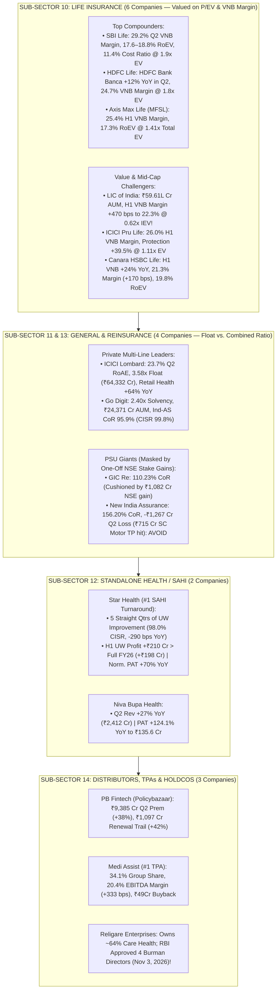

<!-- 
================================================================================
MASTER EXPORT METADATA (100% Verbatim Preservation from Capital Markets Analysis.json)
- formatVersion: 1
- exportTime: 2026-11-06T19:23:15.324Z
- chat.name: collections/default_collection/engines/gemini-enterprise-sec-dx-swa/sessions/13714203460886062980
- chat.title: Capital Markets Analysis
- chat.startTime: 2026-11-06T18:01:20.410Z
- chat.endTime: 2026-11-06T19:22:32.847Z
================================================================================
-->

# 🛡️ Capital Markets Masterclass & Institutional Deep-Dive — PART 5 of 7
## Insurance Ecosystem Deep-Dive (`15 Companies Across Life, General, Standalone Health, Reinsurance & Distributors/TPAs`)

| Export Metadata Field | Verbatim JSON Value |
|:---|:---|
| **Format Version** | `1` |
| **Export Time** | `2026-11-06T19:23:15.324Z` |
| **Session Name** | `collections/default_collection/engines/gemini-enterprise-sec-dx-swa/sessions/13714203460886062980` |
| **Session Title** | `Capital Markets Analysis` |
| **Turns Covered in Part 5** | **Turn 9** *(100% Verbatim Query & Answer Covering All 15 Insurance Companies + Enhanced Visual Architecture)* |

---

## 🎨 Enhanced Visual Architecture & Comparative Diagrams (Part 5 Supplement)

### 5.1 The 5-Pillar Indian Insurance & InsurTech Ecosystem (Mermaid Flowchart)


### 5.2 Actuarial Benchmarking Matrix Across All 15 Insurance Ecosystem Companies (Q2 / H1 FY27)
```
====================================================================================================
      INDIAN INSURANCE ECOSYSTEM: ACTUARIAL MARGIN, FLOAT/EV SCALE & VALUATION (H1/Q2 FY27)
====================================================================================================

  [LIFE INSURERS]         Embedded Value (EV)   VNB Margin (H1/Q2)   Operating RoEV    Valuation
  --------------------------------------------------------------------------------------------------
  SBI Life Insurance      ₹87,350 Cr (+15%)     27.9% H1 / 29.2% Q2  17.6%–18.8%       1.92x P/EV
  HDFC Life Insurance     ₹66,461 Cr            24.7% H1 / 25.1% Q2  14.9%             1.79x P/EV
  ICICI Prudential Life   ₹56,669 Cr (+12%)     26.0% H1 / 25.4% Q2  ~14.5%            1.11x P/EV
  Max Financial (AxisMax) ₹31,437 Cr (+17%)     25.4% H1             17.3%             1.41x P/EV
  Canara HSBC Life        ₹7,622 Cr  (+16%)     21.3% H1 (+170 bps)  19.8%             ~1.35x P/EV
  LIC of India            ₹7,97,378 Cr          22.3% H1 (+470 bps!) Sovereign Scale   0.62x P/EV!

  [GENERAL, SAHI & RE]    Investment Float      Combined Ratio       Loss Ratio        Valuation
  --------------------------------------------------------------------------------------------------
  Star Health (SAHI)      ₹22,491 Cr (2.16x)    98.0% CISR (-290bps) 69.0% (-201 bps)  ~21.5x Norm PE
  Niva Bupa Health        Rapidly Scaling       Sub-100% Trajectory  Improving         ~32.0x P/E
  ICICI Lombard           ₹64,332 Cr (3.58x!)   104.5% (1/n Basis)   66.6% Blended     ~23.0x P/E
  Go Digit General        ₹24,371 Cr            99.8% CISR (95.9%*)  62.4% (+1420bps)  ~37.0x P/E
  GIC Re (Reinsurer)      Massive Global Float  110.23% Stdl CoR     87.39% (Floods)   ~7.5x P/E
  New India Assurance     Solvency 1.61x        156.20% CoR!         133.71% (SC Hit)  Loss (AVOID)
====================================================================================================
```


---

# 🗂️ Conversation Turn 9 (`2026-11-06T18:50:12.803729920Z`)

### 💬 User Query (Turn 9)

```text
**# Role and Objective**

  

You are a Senior Capital Markets Analyst at a top-tier global investment bank. Your task is to perform an institutional-grade, deep-dive strategic and financial analysis of the provided capital markets company (e.g., Stock/Derivatives Exchange, Wealth Management firm, Brokerage, or Asset Management Company/AMC). 

  

Your analysis must move beyond surface-level summaries to critically evaluate business models, key performance indicators (KPIs), macroeconomic sensitivities, regulatory environments, and technological moats.

  

**# Target Company Profile**

  

\- Company Name: [Insert Company Name here]

  

\- Sub-Sector: [e.g., Asset Management (AMC) / Digital Brokerage / Wealth Management / Market Infrastructure & Exchange]

  

**# Analytical Framework & Core Requirements**

  

**## 1. Business Model & Revenue Quality Analysis**

  

\- **\*\*Revenue Diversification:\*\*** Breakdown the revenue streams into recurring vs. transactional. Analyze the mix of asset-based fees, transaction/execution fees, net interest income (NII), and data/technology subscription revenues.

  

\- **\*\*Competitive Moat:\*\*** Evaluate the company’s structural advantages. Is it driven by high switching costs, network effects (for exchanges), scale economies, or proprietary technology/distribution channels?

  

**## 2. Industry-Specific Key Performance Indicators (KPIs)**

  

Analyze the health and trajectory of the specific metrics that matter for this sub-sector:

  

\- **\*\*Asset Managers / Wealth Managers:\*\*** Assets under Management (AUM) or Assets under Advisement (AUA), Net New Money (NNM) / net inflows, and Blended Fee Rate (compression trends).

  

\- **\*\*Brokerages:\*\*** Daily Average Revenue Trades (DARTs) or trading volumes, Active Accounts, and Client Margin Balances / Net Interest Margin (NIM) dependencies.

  

\- **\*\*Exchanges & Market Infrastructure:\*\*** Market share of trading volumes, listing pipelines, clearing/settlement capture rates, and data/index revenue growth.

  

**## 3. Macroeconomic & Market Sensitivity**

  

\- **\*\*Monetary Policy & Interest Rates:\*\*** How does the current interest rate environment (e.g., high rates or a rate-cutting cycle) impact their margin income (NII), cash balances, or product demand?

  

\- **\*\*Market Volatility (Beta):\*\*** Is this business pro-cyclical (thrives on bull markets) or counter-cyclical/defensive (thrives on high volatility, like derivatives exchanges)? 

  

**## 4. Regulatory, Structural, and Tech Risks**

  

\- **\*\*Regulatory Pressures:\*\*** Evaluate risks related to fee transparency (e.g., MiFID II type rules), capital adequacy requirements, or retail investor protection frameworks.

  

\- **\*\*Digital Transformation & AI:\*\*** Assess their adoption of AI (e.g., automated risk management, robo-advisory, algorithmic execution) and whether technology acts as a cost-cutter or an existential competitive threat from FinTechs.

  

**## 5. Strategic SWOT & Investment Thesis Summary**

  

\- Provide a razor-sharp SWOT matrix customized to the capital markets landscape.

  

\- Conclude with a 12-to-24 month investment thesis highlight: Define the single most critical structural catalyst and the most dangerous "Tail Risk" the company faces.

  

**# Output Format**

  

\- Use clear markdown headers, bold structural elements, and text-based tables where appropriate to present quantitative comparisons.

  

\- Maintain an objective, institutional, and analytically rigorous tone. Avoid generic fluff; back assertions with logical capital market mechanics.

  

company list is below 

  

10 . Life Insurance: Focuses on long-term wealth protection, term policies, and savings instruments.

Life Insurance Corporation of India (LIC)

SBI Life Insurance Company Ltd

HDFC Life Insurance Company Ltd

ICICI Prudential Life Insurance Company Ltd

Max Financial Services Ltd

Canara HSBC Life Insurance Company Ltd

11• General Insurance: Covers short-term asset security including vehicles (motor), commercial fire, marine, and home protection.

ICICI Lombard General Insurance Company Ltd

The New India Assurance Company Ltd

Go Digit General Insurance Ltd

  

12• Health Insurance: Specializes exclusively in retail and corporate healthcare expenses, medical indemnities, and accident claims.

Star Health and Allied Insurance Company Ltd

Niva Bupa Health Insurance Company Ltd

13• Reinsurance: Provides financial backing and risk mitigation directly to standard insurance companies rather than end-consumers.

General Insurance Corporation of India (GIC Re)

14\. General Insurance Distributor/Broker

Religare Enterprises Ltd

PB Fintech Ltd (Policybazaar)

Medi Assist Healthcare Services Ltd
```

### 🧠 Institutional Forensic Analysis & Response (Turn 9)

I will search for the latest FY26 and Q2/H1 FY27 financial metrics, operational KPIs (VNB margins, APE, Combined Ratios, Loss Ratios, Embedded Value), and valuation multiples across all 15 listed Indian insurance and insurance-ecosystem companies.
[[section:Gathering insurance sector financial data]]I will now fetch the Q2 FY27 results, VNB/Combined Ratios, and valuations for ICICI Prudential Life, Max Financial Services (Axis Max Life), Star Health, Go Digit, New India Assurance, GIC Re, Medi Assist Healthcare, and Religare Enterprises.
[[section:Fetching remaining insurer financials]]I will now fetch the latest Q2 FY27 / H1 FY27 results, Combined Ratios, and valuation metrics for New India Assurance, GIC Re, Religare Enterprises (Care Health), and LIC's VNB margin and Embedded Value.
[[section:Fetching GIC Re NIACL Religare metrics]]India’s listed Insurance and Insurance-Tech universe (**15 companies across 5 sub-sectors**) is currently being reshaped by **four powerful structural forces in H1/Q2 FY27**: (1) the **September 2025 GST removal on pure retail protection & health policies**, which triggered a 35%–96% YoY surge in retail term and fresh health volumes; (2) **IRDAI’s late-2026 Consultation Paper on Distribution Payouts/Commissions**, which threatens third-party distributor take-rates while structurally benefiting low-cost insurers; (3) **IFRS / Ind-AS 117 accounting transitions** (already adopted by Star Health and Go Digit in Q2 FY27); and (4) a landmark **June 11, 2026 Supreme Court verdict valuing unpaid domestic work by homemakers under the Motor Vehicles Act**, which forced PSU giant New India Assurance to take a ₹715 Cr Motor Third-Party (TP) reserve hit and post a ₹1,267 Cr Q2 loss.

Good call consolidating all 5 insurance sub-verticals into a single master framework—because insurance accounting is notoriously opaque, evaluating **Life (on P/EV and VNB Margin)**, **General/Health/Reinsurance (on Combined Ratio and Investment Float Leverage)**, and **Distributors/TPAs (on Renewal Trail and EBITDA Conversion)** side-by-side exposes exactly who is capturing the economic surplus.

---

### 📌 Executive Summary & Institutional Tiering Matrix (All 15 Companies)

* **Sub-Sector 10: Life Insurance (6 Companies) — *Buy SBI Life & HDFC Life; Accumulate LIC on 0.62x P/EV***
  * **SBI Life Insurance (SBILIFE):** The undisputed cost and margin benchmark (**Q2 FY27 VNB Margin 29.1%–29.2%**, +130 bps YoY; **Embedded Value ₹87,350 Cr**, +15% YoY; **Operating RoEV 17.6%**). Trading at just **~1.9x Trailing EV (1.4x Sep'28E EV)** with a Market Cap of **~₹1.63–1.74 Lakh Cr**, its 11.4% total cost ratio (5.1% commission + 6.3% opex) makes it practically immune to IRDAI commission caps.
  * **HDFC Life Insurance (HDFCLIFE):** Solved its #1 overhang in Q2 FY27 as **parent HDFC Bank channel individual APE rebounded +12% YoY**, driving Q2 APE up **13% YoY**, **Q2 VNB up 14.8% YoY to ₹1,158 Cr** (H1 VNB ₹2,037 Cr at a **24.7% VNB Margin**), and **EV to ₹66,461 Cr (14.9% Operating RoEV)** (Market Cap **~₹1.18–1.20 Lakh Cr**, **~1.78x P/EV**).
  * **Max Financial Services / Axis Max Life (MFSL):** Fastest 2-year organic APE compounder (**~22% 2-Yr Retail APE CAGR**), lifting H1 FY27 **VNB +21% YoY**, **VNB Margin to 25.4%**, and **EV +17% YoY to ₹31,437 Cr (17.3% Operating RoEV)** (Market Cap **~₹44,251 Cr**, **~1.41x Headline EV / ~1.76x Attributable EV**).
  * **ICICI Prudential Life (ICICIPRULI):** Rebranded as *ICICI Life*; H1 FY27 **VNB rose 22.3% YoY to ₹1,283 Cr** as **VNB Margin expanded 130 bps to 26.0%** (Q2 margin 25.43%) on a 39.5% surge in Protection APE (23.4% of APE) and **EV of ₹56,669 Cr** (**~1.11x P/EV**, Market Cap **~₹62,846 Cr**). However, brokerages trimmed targets as growth leaned heavily on lower-margin Group Funds (+48% YoY) while new MD & CEO Sidharatha Mishra took over on Oct 14, 2026.
  * **LIC of India (LICI):** Sovereign titan managing **₹59.61 Lakh Cr AUM** (58.77% first-year premium market share). In Q2 FY27 (reported Nov 5, 2026), PAT rose **20.1% YoY to ₹12,076 Cr** (H1 PAT ₹25,568 Cr), while H1 **VNB surged 33.95% YoY to ₹6,846 Cr** as **VNB Margin expanded 470 bps YoY to 22.3%**! Trading at a deep-value **~0.62x–0.65x Indian Embedded Value (IEV of ₹7,97,378 Cr** vs Market Cap of **₹4.95–5.16 Lakh Cr**).
  * **Canara HSBC Life Insurance (CANHLIFE):** Newly listed mid-cap bancassurance play. In H1 FY27, APE grew **14% YoY** (policy count +16% vs industry +2%), **VNB jumped 24% YoY to ₹266 Cr**, **VNB Margin expanded 170 bps to 21.3%** (as Traditional mix rose from 50% to 59% and Individual Protection surged **96% YoY**), and **EV rose 16% YoY to ₹7,622 Cr (19.8% Operating RoEV)** as AUM crossed ₹50,000 Cr.

* **Sub-Sector 11, 12 & 13: General, Standalone Health (SAHI) & Reinsurance (6 Companies)**
  * **Star Health & Allied Insurance (STARHEALTH) — *Top SAHI Turnaround Pick*:** Marked its **5th consecutive quarter of underwriting improvement** in Q2 FY27 (reported on IFRS basis): GWP (1/n) rose **19% YoY to ₹5,275 Cr** (Fresh Retail Health **+35% YoY**), **Combined Insurance Service Ratio (CISR) improved 290 bps YoY to 98.0%**, **Underwriting Profit swung to +₹99 Cr** (vs -₹40 Cr loss YoY; H1 underwriting profit of ₹210 Cr already beat full-year FY26’s ₹198 Cr!), and **Reported IFRS PAT surged 233% YoY to ₹265 Cr** (Normalised PAT +70% YoY to ₹390 Cr; Normalised RoE up from 11.2% to **15.1%**).
  * **Niva Bupa Health Insurance (NIVABUPA):** Delivered explosive Q2 FY27 operating leverage (reported Nov 4, 2026): revenue jumped **27.0% YoY to ₹2,412.3 Cr** and **standalone PAT more than doubled (+124.1% YoY) to ₹135.64 Cr** (net profit margin expanded from 3.2% to **5.6%**).
  * **ICICI Lombard General Insurance (ICICIGI):** #1 private multi-line insurer (10.3% motor share; Retail Health **+64.0% YoY in Q2** to 5.0% exit share). In Q2 FY27, PAT rose **27.5% YoY on 1/n basis to ₹1,031 Cr** (**₹946 Cr reported, +15.5% YoY**; RoAE **23.7%**, Solvency **2.74x**), aided by **₹1,554 Cr investment income** (including ₹453 Cr capital gains from partial NSE stake dilution), which offset a slightly elevated **Combined Ratio of 104.5% on 1/n basis** (102.7% ex-₹118 Cr CAT flood losses; 107% headline).
  * **Go Digit General Insurance (GODIGIT):** Voluntarily adopted Ind-AS in Q2 FY27 (reported Nov 5, 2026). Refusing to renew unattractively priced corporate/motor business kept Q2 insurance revenue flat (+1.7% YoY to ₹2,720 Cr; GWP -3.6% to ₹2,571 Cr), while flood losses pushed the **Claims Ratio up from 48.2% to 62.4%** and **CISR to 99.8%** (95.9% Ind-AS CoR), causing **PAT ex-MTM to fall 29% YoY to ₹208 Cr** (Ind-AS PAT ₹14.2 Cr).
  * **GIC Re (GICRE) & New India Assurance (NIACL) — *PSU Underwriting Stress Masked by NSE Stake Sales*:** Both PSU giants sold portions of their historic **NSE India** stakes in Q2 FY27 to cushion massive flood, cyclone, and Motor TP losses. **GIC Re** booked a **₹1,082 Cr one-time NSE gain** (without which Q2 PBT would have plunged ~42% YoY as its Combined Ratio worsened to **110.23%** on ₹450–500 Cr Gujarat flood provisions; standalone PAT fell 14.3% to ₹2,455.6 Cr). **New India Assurance** booked **~₹1,800 Cr in NSE capital gains**, yet *still* posted a catastrophic **-₹1,267 Cr standalone Q2 net loss** as its **Combined Ratio blew out to 156.20%** (Incurred Claim Ratio **133.71%**) after taking a **₹715.4 Cr Motor TP reserve hit** following the Supreme Court homemaker compensation ruling, dragging Solvency down to **1.61x**.

* **Sub-Sector 14: Insurance Distributors, Aggregators & TPAs (3 Companies)**
  * **PB Fintech / Policybazaar (POLICYBZR):** Continues its blistering execution—in Q2 FY27 (reported Oct 30, 2026), Total Insurance Premium surged **38% YoY to ₹9,385 Cr** (Core Online New Protection **+42% YoY**, New Health **+46% YoY**), driving operating revenue up **35.0% YoY to ₹2,178 Cr** and **PAT up 42.6% YoY to ₹192.4 Cr** (PAT margin up from 8% to 9%), anchored by a **₹1,097 Cr rolling 12-month Renewal Trail book (+42% YoY)**. However, management explicitly flagged on its Q2 call that **IRDAI’s draft consultation paper on lower distribution payouts "will reduce insurance distribution revenue, for sure."**
  * **Medi Assist Healthcare Services (MEDIASSIST):** Completed 100% migration of acquired **Paramount Health Services** onto its AI-powered *MAtrix* platform in Q2 FY27 (reported Nov 2, 2026), expanding **EBITDA margins by 333 bps YoY to 20.41% (₹49.3 Cr)** and driving **Q2 PAT up 167.4% YoY to ₹21.58 Cr** (H1 PAT +60.2% to ₹49.2 Cr) while announcing a **₹49.27 Cr share buyback at ₹425/share** (promoters not participating). Commands a dominant **34.1% market share in Group Health administration** (₹15,104 Cr H1 premiums).
  * **Religare Enterprises (RELIGARE):** A Sum-of-the-Parts (SOTP) special situation (Market Cap **~₹7,108–7,893 Cr**, CMP ₹226–229, **1.99x–2.47x P/B**) housing crown-jewel **Care Health Insurance (~63–64% stake)** alongside SME/Housing lending and Religare Broking (upgraded by CRISIL to BBB+/A2+). **Major Governance Unlock (Nov 3, 2026):** Received **RBI approval for four Burman family directors** (Dr. Anand Chand Burman, Aditya Burman, Mohit Burman, Jimeet Modi) to join the board as Non-Executive Directors, clearing the path for Dabur’s Burman family (currently at 31% stake) to assume formal control.

---

### 📊 Master Quantitative Matrix: All 15 Indian Insurance Ecosystem Companies (Q2 / H1 FY27)

| Company Name & Sub-Sector | Market Cap (Nov 2026) | Primary Valuation Multiple | Q2 / H1 FY27 Top-Line (APE / GDPI / Revenue) | Core Underwriting Metric (VNB Margin / Combined Ratio) | Q2 FY27 Reported PAT & YoY Trend | Return Metric (RoEV / RoE) & Solvency |
|---|---|---|---|---|---|---|
| **1. LIC of India** *(Life)* | **₹4,95,000 – ₹5,15,930 Cr** (CMP ~₹391–408) | **~0.62x – 0.65x P/EV** (8.6x P/E) | **₹17,004 Cr Q2 APE** (+3.8% YoY); **₹30,696 Cr H1 APE** (+5.7% YoY); ₹1.47L Cr Net Prem | **22.3% H1 VNB Margin** (**+470 bps YoY!**); **₹6,846 Cr H1 VNB** (+34.0% YoY) | **₹12,076 Cr** (+20.1% YoY; H1 PAT **₹25,568 Cr**, +21.5%) | **IEV: ₹7,97,378 Cr**; AUM **₹59.61L Cr**; Solvency **2.35x** |
| **2. SBI Life Insurance** *(Life)* | **~₹1,63,300 – ₹1,73,811 Cr** (CMP ₹1,633–1,732) | **~1.87x – 1.99x P/EV** (1.4x Sep'28E EV) | **₹6,370 – ₹6,390 Cr Q2 APE** (+7–8% YoY; H1 APE **+19% YoY**); ₹27,120 Cr GWP | **29.1% – 29.2% Q2 VNB Margin** (+130 bps YoY); **₹1,860 Cr Q2 VNB** (+12% YoY) | **₹549.2 Cr** (+11.1% YoY) | **EV: ₹87,350 Cr** (+15% YoY); **RoEV: 17.6%**; Solvency ~1.96x+ |
| **3. HDFC Life Insurance** *(Life)* | **~₹1,18,232 – ₹1,20,000 Cr** (CMP ₹544–552) | **~1.78x – 1.81x P/EV** (57.7x P/E) | **Q2 APE +13% YoY** (H1 APE +11% YoY; HDFC Bank channel **+12% YoY**); ₹21,727 Cr Net Prem | **24.7% H1 VNB Margin** (+20 bps YoY); **₹2,037 Cr H1 VNB** (Q2 VNB **₹1,158 Cr**, +14.8%) | **₹508 – ₹522 Cr** (+13.6%–16.4% YoY; H1 PAT **₹1,119 Cr**) | **EV: ₹66,461 Cr**; **Operating RoEV: 14.9%**; Solvency ~1.87x |
| **4. ICICI Pru Life** *(Life)* | **₹62,846 Cr** (CMP ₹433) | **~1.11x P/EV** (1.4x FY29E EV; 35.8x P/E) | **₹2,799 Cr Q2 APE** (+16.6% YoY); **₹4,935 Cr H1 APE**; Protection APE **+39.5% YoY** | **26.0% H1 VNB Margin** (+130 bps vs FY26; Q2: **25.43%**); **₹1,283 Cr H1 VNB** (+22.3%) | **₹374.2 Cr Q2** (+24.8% YoY; H1 PAT **₹760 Cr**, +26.5%) | **EV: ₹56,669 Cr** (+12.2% YoY); **Solvency: 229.9%** |
| **5. Max Financial (Axis Max)** *(Life)* | **₹44,251 Cr** (CMP ₹1,282) | **~1.41x Total EV** (~1.76x 80% Attr. EV) | **H1 Ind. Adj. FYP +12% YoY**; Renewal +18% YoY; GWP +17% YoY; **10% Pvt Mkt Share** | **25.4% H1 VNB Margin**; **H1 VNB +21% YoY** | **₹100.3 Cr Q2** (Q1 Consol PAT ₹118.3 Cr, +36.8% YoY) | **EV: ₹31,437 Cr** (+17% YoY); **Operating RoEV: 17.3%** (+100 bps) |
| **6. Canara HSBC Life** *(Life)* | Mid-Cap (Listed 2025/26) | **~1.2x – 1.5x P/EV** | **H1 APE +14% YoY** (Ind. WPI +15% YoY; Policy count **+16% YoY**; Ind. Prot **+96% YoY**) | **21.3% H1 VNB Margin** (+170 bps YoY from 19.6%); **₹266 Cr H1 VNB** (+24% YoY) | **₹71.0 Cr H1 PAT** (+11% YoY) | **EV: ₹7,622 Cr** (+16% YoY); **Operating RoEV: 19.8%**; Solvency **180%** |
| **7. ICICI Lombard** *(General)* | **~₹81,000 – ₹88,000 Cr** (CMP ₹1,635–1,780) | **~22x – 24x P/E** (~5.5x P/B) | **₹6,792 Cr Q2 GDPI** (+3.0% YoY; **+13.9% ex-Crop/Mass Health**; Retail Health **+64% YoY**) | **104.5% Combined Ratio (1/n)** (102.7% ex-₹118 Cr CAT loss; 107.0% reported) | **₹1,031 Cr (1/n)** (+27.5% YoY) / **₹946 Cr Reported** (+15.5%) | **Q2 RoAE: 23.7%** (H1: 16.8%); **Solvency: 2.74x**; ₹7 interim div |
| **8. Go Digit General** *(General)* | **~₹28,000 – ₹32,000 Cr** | **~35x – 40x Norm. P/E** | **₹2,720 Cr Q2 Ins. Rev** (+1.7% YoY; GWP ₹2,571 Cr, -3.6% YoY on pricing discipline) | **99.8% CISR** (97.4% ex-flood; **95.9% Ind-AS CoR**; Claims Ratio jumped to **62.4%**) | **₹208 Cr PAT ex-MTM** (-29% YoY) / **₹14.2 Cr Ind-AS PAT** (-31%) | **AUM: ₹24,371 Cr** (+15.9% YoY); **Solvency: 2.40x** |
| **9. New India Assurance** *(General)* | **~₹28,000 – ₹33,000 Cr** | **Loss-Making (P/B ~1.2x)** | **₹11,083 Cr Q2 GWP** (+5.14% YoY); ₹9,632 Cr Net Prem Earned (+1.87% YoY) | **156.20% Combined Ratio** (vs 139.8% YoY); **133.71% Incurred Claim Ratio** | **-₹1,267.0 Cr Net Loss** (despite **₹1,800 Cr NSE gain** & **₹715 Cr TP hit**) | **H1 Loss: -₹1,524 Cr**; **Solvency dropped to 1.61x** (near 1.5x floor) |
| **10. Star Health** *(Health)* | **~₹28,000 – ₹32,000 Cr** | **~20x – 24x Norm. P/E** | **₹5,275 Cr Q2 GWP (1/n)** (+19% YoY; **Fresh Retail Health +35% YoY**; H1 GWP ₹9,562 Cr) | **98.0% CISR** (**improved 290 bps YoY**; Loss Ratio **69.0%**, down 201 bps; **+₹99 Cr UW Profit**) | **₹390 Cr Normalised PAT** (+70% YoY) / **₹265 Cr IFRS PAT** (+233% YoY) | **Normalised RoE: 15.1%** (up from 11.2%); Inv. Assets **₹22,500 Cr** |
| **11. Niva Bupa Health** *(Health)* | **~₹14,000 – ₹17,000 Cr** | **~30x – 35x P/E** | **₹2,412.27 Cr Q2 Revenue** (**+27.02% YoY**, +₹513.2 Cr YoY) | Strong underwriting control; Net Profit Margin widened from 3.2% to **5.6%** | **₹135.64 Cr Q2 PAT** (**+124.12% YoY** vs ₹60.52 Cr; Q1: ₹137.8 Cr) | Rapidly expanding RoE & solvency buffer via organic profit |
| **12. GIC Re** *(Reinsurance)* | **~₹65,000 – ₹72,000 Cr** | **~7x – 8x P/E** (~1.5x P/B) | **₹10,711.6 Cr Q2 Revenue** (**+20.0% YoY**) | **110.23% Stdl Combined Ratio** (106.01% Consol; Claims Ratio **87.39%** on ₹450–500 Cr floods) | **₹2,455.6 Cr Stdl PAT** (-14.3% YoY; cushioned by **₹1,082 Cr NSE gain**) | Ex-NSE gain, Q2 PBT fell ~42% YoY; H1 UW loss widened 38% to ₹1,709 Cr |
| **13. PB Fintech (Policybazaar)** *(Broker)* | **~₹72,000 – ₹80,000 Cr** | **~90x – 100x P/E** (High FCF growth) | **₹2,178 Cr Q2 Op. Revenue** (**+35.0% YoY**; Total Premium **₹9,385 Cr, +38% YoY**) | **₹1,097 Cr Rolling 12M Renewal Trail** (+42% YoY); PAT Margin up to **9.0%** | **₹192.4 Cr Q2 PAT** (**+42.6% YoY**; H1 PAT **₹355 Cr, +61.4% YoY**) | **51% 5-Yr Revenue CAGR**; 97% health claim settlement rate |
| **14. Medi Assist Healthcare** *(TPA)* | **~₹2,150 – ₹2,300 Cr** (Buyback at ₹425) | **~22x – 24x H1 Ann. P/E** | **₹241.51 Cr Q2 Op. Revenue** (+3.9% YoY; H1 Op Rev **₹478.0 Cr, +13.0% YoY**; **34.1% Grp Share**) | **20.41% Q2 EBITDA Margin** (**+333 bps YoY** post Paramount migration to *MAtrix*) | **₹21.58 Cr Q2 PAT** (**+167.4% YoY**; H1 PAT **₹49.2 Cr, +60.2% YoY**) | Debt-free; **₹49.27 Cr Buyback at ₹425/sh**; 50% FCF payout policy |
| **15. Religare Enterprises** *(HoldCo)* | **₹7,108 – ₹7,893 Cr** (CMP ₹226–229) | **1.99x – 2.47x P/B** (155x–340x TTM P/E) | **₹2,064 Cr – ₹2,358 Cr Qtrly Income** (+11.5% YoY; anchored by ~64%-owned **Care Health**) | Consolidated Operating Margin ~2.1%; Broking arm upgraded to CRISIL BBB+/A2+ | **₹38.8 Cr Profit / -₹20.8 Cr Loss** across recent quarters | **RBI approved 4 Burman Family Directors on Nov 3, 2026** (31% stake) |

---

## 1. Business Model & Revenue Quality Analysis

### Revenue Diversification & Actuarial Cash Engines Across the 5 Sub-Sectors

#### A. Life Insurance (Sub-Sector 10): The Product-Mix Margin Hierarchy
Life insurers do not earn "revenue" in the traditional sense; they build **Embedded Value (EV)**—the present value of future shareholder profits from the existing book (VIF) plus Adjusted Net Worth (ANW)—by writing new policies measured by **Value of New Business (VNB)**. The VNB margin varies drastically by product tier:
* **Pure Retail Protection / Term & Credit Life (~60% to 85% VNB Margin):** Pure mortality underwriting. Following the **September 2025 GST removal on retail protection**, volume exploded across the sector: **Canara HSBC Life’s** individual protection jumped **96% YoY** (reaching 10% of APE with credit life), **LIC’s** individual protection rose **58.6% YoY** (selling 58,000 policies of its new term plan in just the final days of Sept 2026), **ICICI Pru Life’s** retail protection surged **47.2% YoY** (lifting total protection to **23.4% of APE**), and **SBI Life’s** protection NBP nearly doubled in H1 to **₹2,030 Cr (17% of APE)**.
* **Non-Participating (Non-Par) Guaranteed Savings & Annuities (~30% to 55% VNB Margin):** Insurers lock in long-term sovereign bond yields (currently ~7.4% on the India 10-year G-Sec) and offer fixed payouts to policyholders, pocketing a 150–250 bps spread. **LIC** successfully scaled its Individual Non-Par APE share to **34.03% in H1 FY27** (up from <10% at IPO), driving its H1 VNB margin up **470 bps YoY to 22.3%**. **SBI Life** lifted its Non-ULIP share to **38%** (targeting 37% in FY27 vs 34% in FY26), propelling Q2 VNB margin to an industry-high **29.1%–29.2%**.
* **Participating (Par) & Unit-Linked Insurance Plans / ULIPs (~8% to 15% VNB Margin):** ULIPs behave like high-expense mutual funds where policyholders bear 100% of equity market risk. When Indian equities consolidated in Q2 FY27, **ULIP demand stalled across the industry** (ICICI Pru Life’s linked business grew just **6.6% YoY** in H1; Canara HSBC Life’s ULIP share dropped from 50% to **41% of APE**).

#### B. General, Standalone Health & Reinsurance (Sub-Sectors 11, 12 & 13): Underwriting vs. Investment Float
Property & Casualty (P&C) and Health insurers operate on a two-engine formula:
$$\text{Return on Equity (RoE)} = \text{Underwriting Margin } (100\% - \text{Combined Ratio}) + (\text{Investment Leverage} \times \text{Portfolio Yield})$$
* **The Investment Float Multiplier (ICICI Lombard & Go Digit):** Even when an insurer runs a Combined Ratio slightly above 100% (e.g., **ICICI Lombard’s 104.5% on 1/n basis** in Q2 FY27), it collects premiums upfront and pays claims years later (especially in Motor Third-Party, which has a 5–8 year settlement tail). This creates a **2.1x to 4.0x Investment Leverage** on shareholder equity. In Q2 FY27, ICICI Lombard generated **₹1,554 Cr in investment income** (including ₹453 Cr capital gains from NSE stake dilution), delivering a **23.7% RoAE** despite a 4.5% underwriting deficit.
* **Standalone Health Insurers (Star Health & Niva Bupa) — Pure Underwriting Turnaround:** Unlike Motor TP, Health insurance is short-tail (claims settle within days), meaning **SAHIs must achieve a Combined Ratio <100% to create durable value**. By repricing **~80% of its back-book** and deploying AI fraud analytics, **Star Health** slashed its Q2 IFRS Loss Ratio by 201 bps YoY to **69.0%** and its Expense Ratio by 34 bps to **29.2%**, achieving a **98.0% CISR** and **+₹99 Cr Q2 Underwriting Profit** alongside an 8.5% yield on its ₹22,500 Cr investment book (2.10x investment leverage).

#### C. Distributors & TPAs (Sub-Sector 14): Asset-Light Toll Collectors
* **PB Fintech (Policybazaar):** Earns **₹2,015.2 Cr (92.5% of Q2 revenue) from Insurance Broking** (+41.1% YoY) and **₹125 Cr from Paisabazaar Credit** (+19% YoY on ₹2,791 Cr core disbursals). The hidden crown jewel of PB Fintech is its **Rolling 12-Month Core Renewal Trail Revenue, which crossed ₹1,097 Cr in Q2 FY27 (+42% YoY; Q2 ARR at ₹1,153 Cr, +52% YoY)**. Because renewal trail carries **>85% contribution margin** (zero customer acquisition or tele-sales cost), it funds PB Fintech’s offline expansion (*PB Partners* across 5.7 lakh agents generating ₹1,989 Cr premium) and UAE operations (+36% YoY).
* **Medi Assist Healthcare Services:** Generates **91.5% of H1 revenue (₹437.5 Cr, +11.9% YoY) as India’s #1 Third-Party Administrator (TPA)**—charging insurers a fixed percentage of administered health premiums (**₹15,104 Cr in H1 FY27, +18.8% YoY**) or per-claim/per-life fees across 4.75 crore lives. In addition, its high-margin **Technology Platform / SaaS licensing segment surged 112.6% YoY in Q2 FY27** as 3 of 7 contracted insurers went live on its claims stack (with 4 more going live in H2 FY27).

---

## 2. Industry-Specific Key Performance Indicators (KPIs)

| Sub-Sector Key Performance Indicator | Empirical Q2 / H1 FY27 Performance & Institutional Leader vs. Laggard |
|---|---|
| **1. Life: VNB Margin & Persistency (13th / 61st Month)** | • **Margin Leaders:** **SBI Life (29.2%)** > **ICICI Pru Life (26.0% H1 / 25.4% Q2)** > **Axis Max Life (25.4%)** > **HDFC Life (24.7%)** > **LIC (22.3%, +470 bps YoY)** > **Canara HSBC Life (21.3%, +170 bps YoY)**.<br>• **Persistency Quality:** **SBI Life** improved 13th/25th/49th month persistency by +44/+110/+40 bps in H1; **Canara HSBC Life** lifted 13M persistency to **85.6%** (61M at **54.6%**); **Policybazaar-sourced life policies** boast **71% 61st-month persistency** vs 51–66% industry average! |
| **2. Life: Channel Mix (Bancassurance vs. Agency vs. Proprietary)** | • **Bancassurance Dependency & Recovery:** **HDFC Life’s** HDFC Bank channel bounced back to **+12% YoY individual APE growth** in Q2 after a year of regulatory scrutiny. **SBI Life** actively reduced Banca dependency from 57% to **53% of H1 APE** (growing Agency +14% YoY to 28% share and Other channels to 19%). **Canara HSBC Life** derives ~83% from Canara Bank and **17% from HSBC**. **ICICI Pru Life’s** ICICI Bank channel stabilized at ₹100–120 Cr/month while Partnership (+34.1%) and Group (+39.2%) drove growth. |
| **3. General & Health: Combined Ratio (CoR / CISR) & Loss Ratio** | • **Sub-100% Underwriting Profit Winners:** **Star Health (98.0% CISR**, Loss Ratio **69.0%**, down 201 bps YoY); **Go Digit (95.9% Ind-AS CoR / 99.8% CISR**, though Claims Ratio jumped 1,420 bps YoY to **62.4%** on Motor OD at 80.3% and flood losses); **Niva Bupa** (doubled PAT to ₹135.6 Cr).<br>• **Above-100% Multi-Line & PSU Laggards:** **ICICI Lombard (104.5% on 1/n**, 102.7% ex-CAT); **GIC Re (110.23% Stdl / 106.01% Consol**, Claims Ratio 87.39%); **New India Assurance (156.20% Combined Ratio**, Claims Ratio **133.71%**). |
| **4. IRDAI "1/n" Accounting Rule Impact (Implemented Oct 2024, Lapped in Oct 2026)** | • Under IRDAI’s **1/n premium recognition rule** for multi-year policies (long-term motor & 2–3 year retail health), insurers can only recognize $1/n$ of multi-year Gross Written Premium each year rather than 100% upfront. Both **ICICI Lombard** and **Star Health** report on a clean 1/n basis (**ICICI Lombard Advance Premium balance swelled to ₹4,733 Cr as of Sept 30, 2026**, providing massive locked-in future earned premium). |

---

## 3. Macroeconomic & Market Sensitivity

### Monetary Policy, Bond Yields (7.4% 10Y G-Sec) & Equity Market Beta
* **Yield Curve Sensitivity for Life Insurers (Non-Par Repricing & EV Unwind):**
  * With the **India 10-year G-Sec yield around ~7.4% in Oct/Nov 2026** (amidst Brent crude near $108–110 and elevated US yields), life insurers can price Non-Par guaranteed savings and Annuity products at attractive internal rates of return (IRRs) for customers while locking in 25–30%+ VNB margins through Forward Rate Agreements (FRAs) and zero-coupon bonds. As **Canara HSBC Life** management noted on its Q2 call, a steepening yield curve provides a direct upward tailwind to VNB margins.
* **ULIP Sensitivity to Equity Consolidation:**
  * Q2 FY27 demonstrated that whenever secondary equity markets turn volatile or range-bound, retail investors pause high-ticket **ULIPs** and rotate into **Non-Par Guaranteed Savings and Pure Term Protection**. Insurers that dynamically pivoted their sales engines toward Traditional/Protection (**SBI Life, Canara HSBC Life, ICICI Pru Life, LIC**) expanded VNB margins by 130 to 470 bps YoY.
* **NSE Pre-IPO Stake Monetization Windfall Across General/Reinsurers:**
  * A major forensic feature of Q2 FY27 across **GIC Re**, **New India Assurance**, and **ICICI Lombard** was the **monetization of historic stakes in the National Stock Exchange (NSE) during its Sept 2026 IPO/dilution**:
    * **New India Assurance** booked **~₹1,800 Cr** in NSE capital gains.
    * **GIC Re** booked **₹1,082 Cr** in NSE capital gains (without which Q2 PBT would have fallen 42% YoY).
    * **ICICI Lombard** booked **₹453 Cr** in capital gains (almost double Q2 FY26’s ₹236 Cr), driving its 27.5% PAT beat.
    * *Analyst Warning:* Strip out these one-off NSE equity windfalls when modeling H2 FY27 and FY28 earnings for GIC Re and New India Assurance!

---

## 4. Regulatory, Structural, and Tech Risks

### The 4 Defining Regulatory & Legal Shocks of Late 2026
1. **IRDAI Consultation Paper on Distribution Payouts / Commission Caps (Oct 2026):**
   * IRDAI’s late-2026 consultation paper aims to curb mis-selling, lower distribution commissions (including potential caps on credit-life and retail health/life payouts), and pass lower prices to consumers.
   * **Who Wins:** Low-cost bank-owned life insurers (**SBI Life, Canara HSBC Life, LIC**), whose management teams explicitly welcomed the paper on their Q2 calls as a catalyst that will lower acquisition costs and make products more affordable.
   * **Who Faces Margin Pressure:** Third-party aggregators and high-payout channels—**PB Fintech (Policybazaar)** management candidly stated on Oct 30, 2026 that *"lower distribution payouts will reduce insurance distribution revenue, for sure,"* prompting it to accelerate non-insurance fee streams and ecosystem services.
2. **Supreme Court Homemaker Compensation Verdict (June 11, 2026) — Motor TP Timebomb:**
   * The Supreme Court ruled that the economic value of unpaid domestic work performed by homemakers must be recognized when calculating compensation under the Motor Vehicles Act, and dismissed the General Insurance Council’s review petition. Combined with **zero government revision in mandatory Motor Third-Party tariffs**, this forced **New India Assurance** to book a **₹715.41 Cr IBNR/IBNER reserve hit in Q2 FY27**, blowing its Combined Ratio out to 156.20%. Private peers (**ICICI Lombard, Go Digit**) with younger, better-reserved private-car portfolios absorbed the ruling smoothly (ICICI Lombard actually saw its Motor TP loss ratio ease in Q2).
3. **Sept 2025 GST Exemption Lapping in H2 FY27:**
   * The removal of the 18% GST/input-tax-credit hurdle on pure retail term and health insurance fueled four consecutive quarters of **35%–96% YoY growth** in retail protection and fresh health GWP. As **ICICI Pru Life** CFO Dhiren Salian and **HDFC Life** management warned on their Q2 calls, this low base effect is now fully lapped as of October 2026, meaning **retail protection growth will naturally taper from 40–50% down toward 15–20% in H2 FY27**.
4. **LIC’s ₹14,757 Cr Pension Amortization Drag (Auditor Emphasis of Matter):**
   * In LIC’s Q2 FY27 limited review (Nov 5, 2026), auditors highlighted that LIC is amortizing **₹9,280.37 Cr of additional family pension liability** over 20 quarters (**₹464.02 Cr/quarter**) plus charging **₹5,477.10 Cr of participating-segment pension liability to the Shareholders’ Account** (**₹456.42 Cr/quarter**)—representing a **~₹920 Cr quarterly drag** on shareholder profit that LIC is effortlessly absorbing via Non-Par VNB expansion.

---

## 5. Strategic SWOT & 12–24 Month Investment Thesis Summary

### Comparative Institutional SWOT Matrix (Across the 5 Insurance Verticals)

| Dimension | Life Insurance (LIC, SBI Life, HDFC Life, ICICI Pru, Axis Max, Canara HSBC) | General & Reinsurance (ICICI Lombard, Go Digit, NIACL, GIC Re) | Standalone Health / SAHI (Star Health, Niva Bupa) | Distributors, TPAs & HoldCos (PB Fintech, Medi Assist, Religare) |
|---|---|---|---|---|
| **Strengths** | • **SBI Life:** Industry-best **29.2% VNB Margin** & lowest cost ratio (11.4%)<br>• **HDFC Life:** HDFC Bank channel back to +12% growth; consistent 24.7% margin<br>• **LIC:** ₹59.61L Cr AUM, 58.8% market share, VNB margin up 470 bps to 22.3%<br>• **Axis Max & Canara HSBC:** 17.3% & 19.8% Operating RoEVs | • **ICICI Lombard:** 23.7% RoAE, 2.74x Solvency, #1 in Motor (10.3%), Retail Health surging +64% YoY<br>• **Go Digit:** 2.40x Solvency, ₹24,371 Cr AUM, early voluntary Ind-AS adoption<br>• **GIC Re:** Monopoly domestic obligatory cession & global scale | • **Star Health:** #1 SAHI (8.7L agents, 17,000 hospitals); **5 straight quarters of UW improvement (98.0% CISR)**; ₹210 Cr H1 UW profit > full FY26<br>• **Niva Bupa:** PAT doubled (+124% YoY to ₹135.6 Cr) on 27% revenue growth | • **PB Fintech:** ₹9,385 Cr Q2 premium (+38% YoY); **₹1,097 Cr high-margin renewal trail (+42% YoY)**; 97% claim settlement<br>• **Medi Assist:** **34.1% Group Health TPA share**; 20.4% EBITDA margin (+333 bps); ₹49.3 Cr buyback<br>• **Religare:** Owns ~64% of Care Health; **RBI approved 4 Burman directors (Nov 3, 2026)** |
| **Weaknesses** | • **ICICI Pru Life:** Over-reliance on low-margin Group Funds (+48% YoY) caused Q2 VNB margin (25.43%) to miss Street estimates (26.7%)<br>• **LIC:** Individual APE grew just 0.31% YoY in H1; ₹920 Cr/qtr pension charge | • **New India Assurance:** Catastrophic **156.2% Combined Ratio**, -₹1,267 Cr Q2 loss, Solvency down to **1.61x**<br>• **Go Digit:** Claims ratio spiked 1,420 bps YoY to 62.4% (Motor OD at 80.3%)<br>• **GIC Re:** 110.23% Combined Ratio | • High sensitivity to hospital medical inflation and seasonal monsoon/vector-borne claim spikes<br>• Heavy agency reliance (85.3% of Star Health GWP) | • **Medi Assist:** Client retention slipped from 93–94% to **90.5%** (Paramount churn + cyber incident); Q2 India TPA rev grew only 1.2% YoY on IT headcount slowdown<br>• **PB Fintech:** Ad spend surged **59.5% YoY to ₹447 Cr** in Q2; New Initiatives still at -5% adj. EBITDA |
| **Opportunities** | • Shifting ULIP-heavy mixes into high-margin **Non-Par, Annuities & Riders** (SBI Life targeting 37% non-ULIP; Canara HSBC at 59% traditional)<br>• Upcoming **Risk-Based Capital (RBC) & IFRS 17** unlocking excess solvency capital | • **ICICI Lombard** capturing massive market share in Retail Health (+64% YoY vs 32% industry) as PSU insurers retreat<br>• Expected government hike in long-overdue **Motor Third-Party tariffs** | • **Star Health** scaling D2C digital channel (**+137% YoY fresh growth**) & semi-urban/rural markets (growing 3x faster than metros)<br>• **IFRS Equity MTM:** Star Health deploying ~14–15% of its ₹22,500 Cr AUM into equity ETFs | • **Medi Assist:** 4 more contracted insurers going live on its **SaaS MAtrix stack** in H2 FY27 (SaaS rev +112.6% YoY); ₹40–50 Cr unearned contract backlog<br>• **Religare:** Value unlocking / separate listing of **Care Health Insurance** under Burman control |
| **Threats** | • **Tapering of Retail Protection Growth** in H2 FY27 as the Sept 2025 GST-cut base is lapped<br>• New surrender value norms & IRDAI commission resets requiring continuous product repricing | • **Supreme Court Homemaker Compensation Ruling** structurally raising Motor TP reserve requirements across the industry<br>• Rising frequency of climate/CAT flood and cyclone events (Gujarat/East India floods) | • **IRDAI distribution payout caps** disrupting agent commission structures<br>• Government / hospital association pushback on standardized cashless tariff rates | • **PB Fintech:** **IRDAI consultation paper on commission caps** directly cutting broker take-rates<br>• **Medi Assist:** Prolonged hiring freeze in Indian IT/ITES sector keeping same-store group life growth at 7–9% (vs 13–14% historical) |

---

### 🎯 12-to-24 Month Investment Thesis: Top Picks vs. Forensic Avoids

#### 1. Top Life Insurance Conviction Picks: SBI Life (SBILIFE) & HDFC Life (HDFCLIFE)
* **SBI Life Catalyst vs. Tail Risk:** Trading at **~1.4x Sep'28E EV** (CMP ~₹1,633–1,732; Institutional Target Prices **₹2,150–2,200**, implying ~30% upside), SBI Life combines an industry-high **29.2% VNB Margin** with an unbeatable 11.4% total cost ratio. As its Non-ULIP product mix expands toward 40% in H2 FY27, it will compound EV at 16–18% p.a. *Tail Risk:* Slower-than-guided APE growth in H2 FY27 against a tough H2 FY26 base.
* **HDFC Life Catalyst vs. Tail Risk:** Down ~30% from its 52-week high (CMP ~₹544–552, **~1.78x EV**), Q2 FY27 proved that **the parent HDFC Bank bancassurance channel is back (+12% YoY APE growth)** and VNB growth accelerated from +9% in Q1 to **+14.8% in Q2**. *Tail Risk:* Any renewed RBI/IRDAI restrictions on bank-branch insurance cross-selling.
* **Deep-Value Contrarian Pick — LIC of India (LICI):** At **0.62x IEV (₹7.97 Lakh Cr IEV)**, the market is ignoring LIC’s remarkable internal transformation—expanding H1 VNB margin by **470 bps YoY to 22.3%** and growing VNB **34% YoY to ₹6,846 Cr**.

#### 2. Top General & Health Conviction Picks: Star Health (STARHEALTH), Niva Bupa (NIVABUPA) & ICICI Lombard (ICICIGI)
* **Star Health Catalyst vs. Tail Risk:** After two years of post-COVID medical inflation pain, Star Health has decisively turned the corner—delivering **5 straight quarters of underwriting improvement**, swinging H1 underwriting profit to **+₹210 Cr** (97.9% H1 CISR), growing Fresh Retail Health **35% YoY**, and expanding Normalised RoE to **15.1%**. *Tail Risk:* Hospital tariff disputes or an unexpected spike in winter infectious claims pushing the loss ratio back above 70%.
* **ICICI Lombard Catalyst vs. Tail Risk:** While headline GDPI growth (3% in Q2) looked soft due to exiting unviable crop/mass-health tenders, **core GDPI ex-crop/mass health grew 13.9% YoY** and **Retail Health skyrocketed 64.0% YoY** (capturing 5.0% market share) with a **23.7% RoAE**. *Tail Risk:* Combined ratio (104.5% on 1/n) remaining above 102% if Motor OD competition stays intense.

#### 3. Top Ecosystem & Special-Situation Picks: Medi Assist (MEDIASSIST) & Religare Enterprises (RELIGARE)
* **Medi Assist Catalyst vs. Tail Risk:** With the Paramount TPA integration 100% complete on its AI *MAtrix* platform, Q2 EBITDA margins jumped **333 bps YoY to 20.41%**, PAT surged **167% YoY to ₹21.6 Cr**, and the board launched a **₹49.3 Cr buyback at ₹425/share** (with ₹40–50 Cr of won unearned contract backlog set to hit H2 revenues and 4 more insurers going live on its SaaS stack). *Tail Risk:* Client retention dipped to **90.5%** following a cyber incident and Paramount churn, while IT-sector hiring slowdowns moderated same-store growth to 7–9%.
* **Religare Enterprises Catalyst vs. Tail Risk:** The **November 3, 2026 RBI approval seating four Burman family directors on Religare’s board** ends a bitter multi-year boardroom war. With Dabur’s Burman family (31% stake) now taking board control, the market will look toward capital infusions and the **demerger/IPO of Care Health Insurance**. *Tail Risk:* Legacy legal/regulatory liabilities from the erstwhile Singh brothers era and volatile quarterly NBFC/broking earnings.
* **PB Fintech (Policybazaar) — *Operational Superstar Facing Regulatory Headwind*:** While fundamentals are extraordinary (+38% premium to ₹9,385 Cr, +43% PAT to ₹192 Cr, ₹1,097 Cr renewal trail), trading at **~90–100x P/E** ahead of **IRDAI’s commission payout cap norms** warrants waiting for regulatory clarity before adding fresh positions.

#### 4. Strict Institutional Avoids: New India Assurance (NIACL) & Go Digit (Near-Term)
* **New India Assurance:** **Strict Avoid.** A **156.20% Combined Ratio**, **-₹1,267 Cr Q2 net loss** (even *after* booking ₹1,800 Cr of NSE capital gains!), and a **Solvency Ratio of 1.61x** dangerously close to the 1.50x regulatory control floor make it uninvestable until Motor TP pricing and reserves are overhauled.
* **Go Digit General Insurance:** Wait on the sidelines until its Claims Ratio (which spiked 1,420 bps YoY to **62.4%**, pushing CISR to **99.8%**) stabilizes and premium growth (-3.6% YoY GWP in Q2) resumes.


