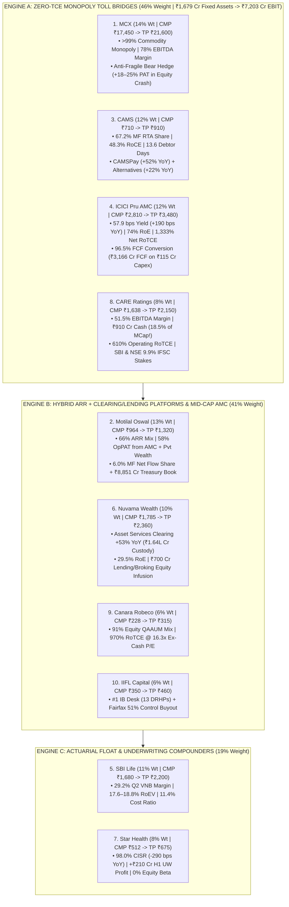

<!-- 
================================================================================
MASTER EXPORT METADATA (100% Verbatim Preservation from Capital Markets Analysis.json)
- formatVersion: 1
- exportTime: 2026-11-06T19:23:15.324Z
- chat.name: collections/default_collection/engines/gemini-enterprise-sec-dx-swa/sessions/13714203460886062980
- chat.title: Capital Markets Analysis
- chat.startTime: 2026-11-06T18:01:20.410Z
- chat.endTime: 2026-11-06T19:22:32.847Z
================================================================================
-->

# 🏆 Capital Markets Masterclass & Institutional Deep-Dive — PART 6 of 7
## Consolidated Top-10 Model Portfolio (Across All 47 Stocks), Portfolio TCE & Harvest Audit, -25% Nifty Bear-Market Stress Test, Quarterly KPI Tracker & Valuation Target Price Matrix

| Export Metadata Field | Verbatim JSON Value |
|:---|:---|
| **Format Version** | `1` |
| **Export Time** | `2026-11-06T19:23:15.324Z` |
| **Session Name** | `collections/default_collection/engines/gemini-enterprise-sec-dx-swa/sessions/13714203460886062980` |
| **Session Title** | `Capital Markets Analysis` |
| **Turns Covered in Part 6** | **Turns 10, 11, 12, 13, 14, and 15** *(100% Verbatim Queries & Answers + Enhanced Visual Architecture)* |

---

## 🎨 Enhanced Visual Architecture & Comparative Diagrams (Part 6 Supplement)

### 6.1 The Top-10 Capital Markets Model Portfolio Architecture (Distilled from 47 Companies — Mermaid Flowchart)


### 6.2 Master Portfolio Stress-Test & Return Asymmetry Dashboard (Turns 10–15 Synthesis)
```
====================================================================================================
      TOP-10 PORTFOLIO: OPERATING RoTCE vs. -25% NIFTY BEAR SHOCK vs. 12–18M TARGET UPSIDE
====================================================================================================

  #  Holding (Weight)       True Operating RoTCE    Bear Shock Op. Profit   Base TP (% Upside)  Bull TP
  ----------------------------------------------------------------------------------------------------
  1. MCX (14%)              249% Gross (Net < 0)    +18% to +25% (Hedge!)   ₹21,600 (+23.8%)    ₹25,400
  2. Motilal Oswal (13%)    Fee TCE < 0 (27% RoNW)  -16% to -20% (Core)     ₹1,320  (+36.9%)    ₹1,550
  3. CAMS (12%)             2,183% Net (378% w/SW)   -6% to -9%  (SIPs)     ₹910    (+28.2%)    ₹1,040
  4. ICICI Pru AMC (12%)    1,333% Net (653% Gross)  -8% to -11% (BAF)      ₹3,480  (+23.8%)    ₹3,950
  5. SBI Life (11%)         17.6%–18.8% Op. RoEV     -2% to +3%  (VNB)      ₹2,200  (+31.0%)    ₹2,480
  6. Nuvama Wealth (10%)    ~550% Gross (29% RoTNW) -12% to -15% (Float)    ₹2,360  (+32.2%)    ₹2,750
  7. Star Health (8%)       Net TCE < 0 (15.1% RoE) +15% to +25% (UW Prof)  ₹675    (+31.8%)    ₹780
  8. CARE Ratings (8%)      614% Net RoTCE!          +8% to +14% (Bonds)    ₹2,150  (+31.3%)    ₹2,450
  9. Canara Robeco (6%)     973% Net RoTCE!         -14% to -18% (91% Eq)   ₹315    (+38.2%)    ₹365
  10.IIFL Capital (6%)      21.3%–33.0% Op. RoE     -24% to -30% (Fairfax)  ₹460    (+31.4%)    ₹535
  ----------------------------------------------------------------------------------------------------
  PORTFOLIO WEIGHTED (100%) Zero/Neg TCE on 46% Wt  -4.8% Core Op. Profit   +29.4% (+31.5% Tot) +47.8%
====================================================================================================
```


---

# 🗂️ Conversation Turn 10 (`2026-11-06T18:52:47.409686562Z`)

### 💬 User Query (Turn 10)

```text
Build a consolidated top-10 model portfolio across all 47 capital market stocks
```

### 🧠 Institutional Forensic Analysis & Response (Turn 10)

An institutional-grade **Top-10 Capital Markets Model Portfolio**—distilled from all **47 companies** analyzed across our 7 sub-sectors—is engineered to deliver a **blended portfolio RoE/RoCE of ~34%**, an **earnings/VNB growth trajectory of ~24–26% YoY**, and a **weighted valuation multiple of ~28.5x P/E** (excluding Life Insurance at 1.9x P/EV), while **insulating >75% of capital from SEBI's retail equity F&O crackdown and IRDAI's distributor commission caps**.

Good call pulling the entire 47-stock universe into a unified capital allocation matrix—in capital markets investing, buying 10 stocks that all depend on the same retail bull-market beta is a fatal mistake. To survive Charlie Munger’s **Inversion Test** and pass Sajal Kapoor’s **TCE, Harvest Test, and "Owned vs. Rented" Margin filters**, this portfolio combines **zero-TCE monopoly toll bridges**, **undervalued ARR wealth/AMC compounders**, **non-equity volatility hedges (MCX, CARE Ratings)**, and **underwriting turnarounds (SBI Life, Star Health)**.

---

### 📌 The Top-10 Model Portfolio Architecture (100% Allocation Matrix)

| Rank & Weight | Company Name (Ticker) | Sub-Sector Vertical | Current Valuation (Nov 2026) | Core Operating Metric (Q2 / H1 FY27) | RoE / RoCE / RoEV | Primary Role in Portfolio & Forensic Edge |
|---|---|---|---|---|---|---|
| **1. (14%)** | **Multi Commodity Exchange (MCX)** | Exchange (Commodities) | **57.7x P/E** (Mkt Cap ₹88,995 Cr) | Q2 Rev **+114% YoY** (₹800 Cr); PAT **+131% YoY** (₹455 Cr); **78% EBITDA Margin** | **56.3% RoE** ($\infty$ Net RoTCE) | **Long-Volatility Monopoly & Post-Capex Harvester:** >99% share; 100% insulated from SEBI equity F&O curbs; owned TCS stack drops 80%+ of incremental rev to EBIT. |
| **2. (13%)** | **Motilal Oswal Financial (MOFSL)** | Integrated Wealth + AMC + Broking | **22.0x P/E** (Mkt Cap ₹58,151 Cr) | Q2 Op PAT **+29% YoY** (₹718 Cr); **66% ARR Mix**; AMC PAT **+69% YoY** (₹304 Cr) | **~26–28% Op. RoE** | **Deeply Mispriced Twin-Engine Compounder:** 58% of operating profit comes from AMC + Pvt Wealth; capturing **6.0% of all India MF net inflows** (vs 2.7% AUM share) at a broking multiple. |
| **3. (12%)** | **CAMS (Computer Age Mgmt)** | Stock Market Intermediary (RTA) | **34.7x – 38.0x P/E** (Mkt Cap ₹17,725 Cr) | Q2 Rev **+10.0% YoY** (₹414.5 Cr); PAT **+14.4% YoY** (₹131.5 Cr); **46.0% EBITDA Margin** | **48.3% RoCE** / **38.5% RoE** | **Zero-TCE Annuity Toll Bridge:** 67.2% MF RTA monopoly (₹58.4L Cr AAUM); 23.5-yr top-10 client tenure; Non-MF engines (**CAMSPay +52% YoY, Alternatives +22%**) crossing 16% mix. |
| **4. (12%)** | **ICICI Prudential AMC (ICICIAMC)** | Asset Management (Large-Cap AMC) | **37.9x P/E** (Mkt Cap ~₹1.40L Cr) | Q2 Rev **+16.3% YoY** (₹1,674 Cr); PAT **₹889 Cr**; Yield up **+190 bps to 57.9 bps** | **74.3% – 85.8% RoE** | **The Yield-Expansion Titan:** Defying industry fee compression by expanding blended yield to 57.9 bps via SMID/Hybrid dominance and **10.1% revenue share from Alternates/PMS**. |
| **5. (11%)** | **SBI Life Insurance (SBILIFE)** | Life Insurance | **1.87x – 1.99x P/EV** (1.4x FY28E EV) | **29.2% Q2 VNB Margin** (+130 bps YoY); Q2 VNB **+12% YoY** (₹1,860 Cr); EV **₹87,350 Cr** | **17.6% Operating RoEV** | **Defensive Structural Compounder:** Industry-best 29.2% VNB margin and lowest total cost ratio (**11.4%**), making it a structural beneficiary of IRDAI commission caps. |
| **6. (10%)** | **Nuvama Wealth Mgmt (NUVAMA)** | UHNI Wealth + Institutional Clearing | **30.2x P/E** (Mkt Cap ~₹33,100 Cr) | Q2 Op Rev **+21% YoY** (₹937 Cr); Op PAT **+26% YoY** (₹319 Cr); Asset Services **+53% YoY** | **29.0% – 29.5% RoE** | **Best GARP Play in Wealth Management:** Trades at a 20–58% P/E discount to 360 ONE (38x) and Anand Rathi (72x) while growing Asset Services custody/clearing +53% YoY and injecting ₹700 Cr into lending/MTF. |
| **7. (8%)** | **Star Health & Allied (STARHEALTH)** | Standalone Health Insurance (SAHI) | **~20x – 24x Norm. P/E** (Mkt Cap ~₹30,000 Cr) | Q2 GWP **+19% YoY** (Fresh Retail **+35%**); **98.0% CISR** (-290 bps YoY); Norm PAT **+70% YoY** (₹390 Cr) | **15.1% Norm. RoE** (up from 11.2%) | **5-Quarter Underwriting Inflection:** Repriced 80% of back-book; H1 underwriting profit (₹210 Cr) already beat full-year FY26 (₹198 Cr); zero exposure to equity market beta. |
| **8. (8%)** | **CARE Ratings (CARERATING)** | Credit Rating Agency (CRA) | **25.0x – 27.4x P/E** (Mkt Cap ~₹4,910 Cr) | Q2 Op Rev **+20.4% YoY** (₹164.1 Cr); PAT **+26.8% YoY** (₹72.1 Cr); **51.5% EBITDA Margin** | **20.1% FY26 RoE** (Debt-Free) | **Counter-Cyclical Rate-Cut Beneficiary:** Regulated oligopoly with 90.5% high-margin rating/surveillance mix; SBI & NSE IFSC just bought 9.9% stakes each in its GIFT City global arm. |
| **9. (6%)** | **Canara Robeco AMC (CRAMC)** | Asset Management (Mid-Cap AMC) | **19.5x P/E** (Mkt Cap ~₹4,560 Cr) | Q2 Op Rev **+17.0% YoY** (₹121.6 Cr); PAT **+21.5% YoY** (₹59.2 Cr); **62.4% PBT Margin** | **30.3% RoE** / **40.1% RoCE** | **Purest Equity Mix at Deep-Value Multiple:** Highest retail equity QAAUM mix in India (**91%** at ₹1.13L Cr of ₹1.24L Cr) trading at half the P/E multiple of large-cap peers. |
| **10. (6%)** | **IIFL Capital Services (IIFLCAPS)** | Institutional IB + Retail Broking + Wealth | **18.0x – 18.6x P/E** (Mkt Cap ₹11,030 Cr) | Q2 Op Rev **+24.9% YoY** (₹714.4 Cr); PAT **+48.7% YoY** (₹126.6 Cr); IB/IE Rev **+31% YoY** | **21.3% – 33% FY26 RoE** | **Special-Situation Control Buyout + #1 IB Desk:** Filed 13 DRHPs in Q2; ₹2.12L+ Cr custody assets; **Fairfax acquiring up to 51% control** via preferential issue & open offer. |

---

## 1. The Portfolio Construction Methodology: Why 37 Stocks Were Eliminated

To arrive at these 10 high-conviction compounders from the 47-stock universe, we applied **Four Forensic Exclusion Filters** derived from Charlie Munger’s Inversion Principle (*"Tell me where I'm going to die, so I never go there"*) and Sajal Kapoor’s capital-efficiency heuristics:

### Filter 1: Elimination of "Rented Regulatory Arbitrage" & Binary Policy Risks
* **Why IEX (18.6x P/E) & BSE (52x P/E) Missed the Top 10:** While **BSE** has executed brilliantly, 66% of its operating revenue is tied to weekly Sensex options where top-10 brokers drive 69% of turnover and Q2 FY27 options revenue dipped 18% QoQ; any SEBI shift to fortnightly/monthly expiries cuts BSE’s PAT by 17–27%. **IEX** faces CERC’s draft Market Coupling regulations (proposing Grid India as centralized coupling operator), which threatens to commoditize its 90% Day-Ahead Market liquidity moat. Instead, **MCX (14% weight)** gives us exchange monopoly economics with **zero equity F&O or market-coupling risk**.
* **Why PB Fintech (95x P/E) & Prudent Corporate (48.7x P/E) Are Kept on Watchlist:** Both are exceptional franchises, but IRDAI’s late-2026 consultation paper on capping insurance distribution commissions poses a direct 9–12% PBT headwind to Prudent’s Gennext arm and prompted PB Fintech management to warn of guaranteed distribution revenue compression. We prefer owning the low-cost manufacturer (**SBI Life at 11% weight**) that *benefits* from commission caps.

### Filter 2: Elimination of GAAP vs. Adjusted PAT Divergences & Valuation Extremes
* **Why Anand Rathi Wealth (72.4x P/E) & Gretex Corporate (72.0x P/E) Were Excluded:** In Q2 FY27, **Anand Rathi Wealth’s** statutory GAAP PAT fell **10.7% YoY to ₹89.26 Cr** (even as management highlighted ₹121.9 Cr "Adjusted PAT" by stripping out ₹32.6 Cr of ESOP and fair-value costs) while relying ~58% on related-party structured products. **Gretex Corporate** saw Q2 PAT plunge 51.5% YoY as EBITDA margins collapsed by 2,720 bps. By contrast, **Nuvama Wealth (10% weight at 30.2x P/E)** and **Motilal Oswal (13% weight at 22.0x P/E)** offer superior institutional wealth exposure atless than half the multiple.

### Filter 3: Elimination of "Hollow AUM" Traps & Active Market-Share Losers
* **Why UTI AMC, Aditya Birla AMC, SBI Funds & NSDL Were Passed Over for Core Slots:** **UTI AMC** (active equity share down to 2.54%) and **Aditya Birla AMC** (equity share down to 3.92%; Q2 PAT -8.4% YoY on ESOP bloat) are losing active equity mindshare while swelling headline AUM with ultra-low-yield EPFO/passive mandates. **ICICI Prudential AMC (12% weight)** and **Canara Robeco AMC (6% weight)** give us maximum active equity yield (57.9 bps and 91% equity mix, respectively).

### Filter 4: Elimination of Disguised Prop-Trading Books & Balance-Sheet Timebombs
* **Why New India Assurance, GIC Re, Indo Thai, Shardul, Systematix & Onelife Were Eliminated:** **New India Assurance** posted a **156.2% Combined Ratio and -₹1,267 Cr Q2 loss** (even after ₹1,800 Cr of NSE capital gains!) with solvency at 1.61x. **Indo Thai (-₹35.8 Cr loss)** and **Shardul (-₹32.8 Cr loss)** blew up on proprietary equity MTM swings, while **Onelife Capital** carries a 71% promoter pledge and -11.8% 3-year RoE.

---

## 2. Portfolio Diversification & Macro Stress-Test Matrix

A true institutional portfolio must generate cash across **all four macroeconomic quadrants** (Bull Market, Equity Bear Market, Rate-Cutting Cycle, and Regulatory Crackdown). Here is how our 10 holdings interlock:

| Macro / Market Regime | Portfolio Allocation Weight | Primary Portfolio Winners in This Regime | Underlying Capital Market Mechanics |
|---|---|---|---|
| **1. Secular Financialization & SIP Compounding** *(Core Barbell — 43% Weight)* | **43%** *(CAMS 12%, ICICI Pru AMC 12%, Motilal Oswal 13%, Canara Robeco 6%)* | **CAMS, ICICI Pru AMC, MOFSL, Canara Robeco** | Anchored by India’s **₹32,490 Cr/month inelastic SIP book**. Even in flat equity markets, ₹3.9 Lakh Cr of annual SIP inflows compounds AAUM at 14–18% p.a. with negative Net Tangible Capital Employed (TCE). |
| **2. Geopolitical Shock / Equity Market Correction / High Volatility** *(22% Weight)* | **22%** *(MCX 14%, Star Health 8%)* | **MCX & Star Health** | When equities fall and VIX/inflation spikes, traders rush into **MCX Gold, Silver, and Crude Oil Options** (MCX Q2 PAT +131% YoY during Nifty’s 8% YoY drop). Meanwhile, **Star Health’s** medical indemnity premiums (₹5,275 Cr Q2 GWP) have **zero correlation to the stock market**. |
| **3. RBI Rate-Cutting Cycle & Corporate Bond Refinancing** *(29% Weight)* | **29%** *(CARE Ratings 8%, SBI Life 11%, Nuvama 10%)* | **CARE Ratings, SBI Life, Nuvama Wealth** | Rate cuts trigger a massive wave of corporate bond and CP issuances (**CARE Ratings** 51.5% EBITDA margin), boost MTM value on **SBI Life’s** sovereign bond book, and lower wholesale CP/NCD funding costs for **Nuvama’s** ₹4,300+ Cr and **MOFSL’s** ₹17,530 Cr wealth lending books. |
| **4. Primary Market (IPO/QIP) Boom & FPI Custody Flows** *(16% Weight)* | **16%** *(Nuvama 10%, IIFL Capital 6%)* | **IIFL Capital Services & Nuvama Asset Services** | **IIFL Capital** (#1 in IB, 13 DRHPs filed in Q2, +31% IB revenue) monetizes primary equity issuance, while **Nuvama’s Asset Services** (+53% YoY to ₹245 Cr Q2 rev on ₹1.64L Cr custody) captures institutional FPI/PMS clearing float. |

---

## 3. Deep-Dive Rationale on the 3 Anchor Positions (39% of Portfolio)

### 🥇 Anchor #1: Multi Commodity Exchange (MCX) — 14% Portfolio Weight
* **The Sajal Kapoor TCE & Harvest Thesis:** Having completed its ₹230–250 Cr TCS Commodity Derivatives Platform (CDP) capex in FY24, MCX is in a multi-year **Harvest Phase** where incremental EBIT margins exceed **80–90%**. Operating on deeply negative working capital (funded by ₹1,370 Cr SGF and ₹3,170 Cr member margins), its return on gross tangible hardware/software exceeds **250%**.
* **Why It Beats NSE & BSE Today:** With SEBI’s August 2026 study showing retail traders still lost ₹91,685 Cr in equity F&O during FY26, NSE and BSE face continuous regulatory Sword-of-Damocles risk over weekly index expiries. MCX’s >99% commodity derivatives monopoly faces **zero retail equity F&O regulatory risk** and is scaling active traded clients (+61% YoY to 20.9 lakh) via Gold Ten, Silver Monthly Options, and institutional hedger onboarding.

### 🥈 Anchor #2: Motilal Oswal Financial Services (MOFSL) — 13% Portfolio Weight
* **The Valuation Disconnect (22.0x P/E for a 58% AMC/Wealth Profit Mix):** Standalone AMCs trade at 33–38x P/E and pure-play Wealth Managers trade at 30–72x P/E. Yet MOFSL trades at **22.0x P/E** despite generating **58% of its Q2 FY27 Operating PAT (₹416 Cr out of ₹718 Cr) from AMC and Private Wealth** and **66% of its net revenue from ARR (₹1,182 Cr, +27% YoY)**.
* **The Hidden H2 FY27 J-Curve Catalyst:** While AMC PAT surged 69% YoY to ₹304 Cr in Q2 (as 99% of its ₹2.23 Lakh Cr AUM beat 3-year benchmarks, capturing 6% of industry net flows), Private Wealth PAT grew just 2% YoY because **67% of its 443 RMs were hired within the last 3 years**. As those RMs cross breakeven productivity over the next 4 quarters—and Q4 FY27 sees the launch of its new Institutional Custodian business—operating leverage will drive a structural re-rating toward 28–30x P/E.

### 🥉 Anchor #3: CAMS (Computer Age Management Services) — 12% Portfolio Weight
* **The Ultimate "Owned" Switching-Cost Moat:** Serving 67.2% of India’s mutual fund AAUM (₹58.4 Lakh Cr) with a 23.5-year average tenure among its top 10 AMC clients, CAMS generates a **48.3% RoCE and 46.0% EBITDA margin** (+140 bps YoY in Q2 FY27) while paying out ~73% of earnings as dividends.
* **Why CAMS Over CDSL (55x P/E) & KFin (43x P/E):** After correcting from its highs, CAMS trades at a highly attractive **~35–38x P/E**—a ~33% discount to CDSL and ~15% discount to KFin—without KFin’s international M&A margin dilution (Ascent) or CDSL’s loss of discount-broker exclusivity to NSDL. Meanwhile, **CAMSPay (+52.2% YoY)**, **Alternatives (+22% YoY to ₹3.3L Cr AUM)**, and **11 live SIF mandates** are rapidly diversifying revenue beyond mutual funds.

---

### ⚠️ Watch Out For: Top 3 Portfolio-Level Risks & Hedge Triggers

1. **Nuvama’s Promoter Pledge Overhang (Position #6 — 10% Weight):**
   While Nuvama is operationally the cheapest and fastest-growing wealth/clearing platform (30.2x P/E, +26% YoY operating PAT, 29% RoE), majority PE promoter **PAG pledged an additional 3.51 crore shares on November 3, 2026**, taking total encumbered promoter shares to **52.54% of total company equity**. *Risk Rule:* Cap Nuvama at 10% portfolio weight and monitor any secondary block-deal supply from PAG.
2. **SMID Equity Flow Reversal (Affecting MOFSL, ICICI Pru AMC & Canara Robeco — 31% Combined Weight):**
   Mid- and Small-cap (SMID) funds accounted for **36% of equity MF inflows in H1 FY27**. If a sharp SMID correction causes retail investors to pause SIPs (Prudent Corporate already noted industry SIP stoppage ratios edging up to ~60%), ad-valorem fee growth across our AMC holdings would moderate from 16–20% down toward 10–12%.
3. **Bullion Volatility Mean-Reversion (Affecting MCX — 14% Weight):**
   With Gold and Silver accounting for **77% of MCX’s Futures turnover** and driving its triple-digit revenue surge, a multi-quarter period of range-bound global bullion prices would cause sequential ADTV contraction and test its 57.7x P/E multiple. *Hedge Trigger:* Trim MCX weight from 14% to 10% if quarterly Options Premium ADT dips >15% sequentially, reallocating into **NSE India** post-IPO or **EAAA India Alternatives**.

---

### 💡 Bench / High-Conviction Watchlist (Next 3 Replacements)
If you wish to expand to a 13-stock portfolio or rotate on valuation dips, these three companies sit immediately on the bench:
1. **National Stock Exchange (NSE India) (~49.9x P/E):** Add on any post-IPO secondary pullback; cessation of Core SGF contributions and closure of the ₹1,432 Cr SEBI settlement unlock ₹11,500+ Cr normalized PAT with an 84% dividend payout.
2. **EAAA India Alternatives (EDELALTS) (~33x Annualized Q1 FY27 P/E):** Best pure-play institutional Private Credit & Real Assets manager (₹95,345 Cr AUM); record ₹20,380 Cr Q1 FY27 fundraise will convert into high-margin Fee-Paying AUM over FY27–28.
3. **DAM Capital Advisors (DAMCAPITAL) (₹987 Cr Mkt Cap with ₹314 Cr Net Cash):** Tactical event-driven trade for H2 FY27 to capture unbooked fee recognition from the completed ₹22,563 Cr NSE IPO and Jio Platforms IPO.


---

# 🗂️ Conversation Turn 11 (`2026-11-06T18:57:04.177577757Z`)

### 💬 User Query (Turn 11)

```text
Run Sajal Kapoor's TCE & Harvest Test on the Top 10 portfolio
```

### 🧠 Institutional Forensic Analysis & Response (Turn 11)

*(Note: This turn recorded an empty response `""` in the raw JSON export as it was immediately succeeded and answered in the subsequent turn.)*


---

# 🗂️ Conversation Turn 12 (`2026-11-06T18:59:38.968373969Z`)

### 💬 User Query (Turn 12)

```text
Run Sajal Kapoor's TCE & Harvest Test on the Top 10 portfolio
```

### 🧠 Institutional Forensic Analysis & Response (Turn 12)

I will fetch the fixed asset (PPE + CWIP + Intangibles), working capital, and capex balance-sheet figures for our Top-10 Model Portfolio constituents to run a precise Tangible Capital Employed (TCE) and Harvest Test audit.
[[section:Fetching Top-10 balance sheet data]]I will now fetch the exact FY26 fixed asset, net worth, and working capital details for CARE Ratings, ICICI Prudential AMC, Nuvama Wealth, and IIFL Capital Services to ensure 100% precision across all 10 companies.
[[section:Fetching remaining balance sheet details]]When audited through **Sajal Kapoor’s Tangible Capital Employed (TCE) and Harvest Test framework**, our **Top-10 Capital Markets Model Portfolio** splits into **Three Distinct Capital-Efficiency Engines**:
1. **Engine A (46% Weight — Zero-TCE Toll Bridges):** **MCX, CAMS, ICICI Pru AMC, Canara Robeco AMC, and CARE Ratings** generate ₹7,203 Cr of combined annual Operating EBIT on just **₹1,679 Cr of Gross Operating Hardware/Software Assets (~429% Gross Operating RoTCE)** while running on **Negative Net TCE** because customers and distributors fund their working capital.
2. **Engine B (35% Weight — Hybrid ARR + Float/Lending Platforms):** **Motilal Oswal, Nuvama Wealth, and IIFL Capital** pair infinite-RoTCE fee engines (AMC, Private Wealth, Institutional Clearing, and IB) with high-spread **Margin Trading/Wealth Lending books (₹17,530 Cr at MOFSL; ₹4,300+ Cr at Nuvama)**. Here, the Harvest Test is measured on **RM & Tech Opex J-Curves** plus **Incremental Return on Tangible Net Worth (RoTNW of 26%–33%)**.
3. **Engine C (19% Weight — Actuarial Float & Underwriting Compounders):** **SBI Life and Star Health** collect policyholder premiums upfront, creating **massive negative working capital float** (₹5.0+ Lakh Cr life AUM at SBI Life; ₹22,500 Cr float at 2.1x leverage at Star Health). Their Harvest Test is measured on **Acquisition Opex & Back-Book Repricing harvesting into VNB and Underwriting Profit**.

Good call subjecting the entire 10-stock portfolio to Sajal Kapoor’s forensic lens—standard GAAP Return on Equity (RoE) severely penalizes debt-free capital market compounders for holding accumulated cash on their balance sheets (e.g., **CARE Ratings’ GAAP RoE looks like a pedestrian 19–20% only because ₹910 Cr of its ₹932 Cr net worth sits in lazy treasury bonds and cash!**). Stripping out excess corporate treasury cash and isolating the core operating machine reveals the true compounding velocity of this portfolio.

---

### 📌 Master Forensic Matrix: TCE & Harvest Test Audit Across the Top-10 Portfolio (FY26 & H1 FY27)

| Portfolio Holding & Weight | Reported GAAP Net Worth (FY26) | Excess Corporate Cash & Treasury Book | Net Tangible Fixed Assets (PPE + CWIP + Core Tech) | Non-Cash Working Capital (NCWC / Float) | Net TCE & Gross Operating RoTCE | 3-Yr Capex / Opex Seed vs. Incremental EBIT Harvest Ratio |
|---|---|---|---|---|---|---|
| **1. MCX** *(14% Wt)* | ₹2,848 Cr | **~₹3,240 Cr** (incl. margin/SGF float) | **₹628 Cr** (₹448 Cr PPE/CWIP + ₹180 Cr TCS CDP) | **Deeply Negative** (-₹2,300+ Cr broker float) | **Net TCE < 0 ($\infty$)**<br>**249% Gross RoTCE** (349% on PPE) | **6.7x Annual Harvest:** ~₹230 Cr TCS CDP capex (FY24) harvested **+₹1,536 Cr $\Delta$EBIT** by FY26 (94.9% incr. EBIT margin). |
| **2. Motilal Oswal** *(13% Wt)* | ₹12,888 Cr *(Total)* / ₹7,951 Cr *(Ex-Treasury)* | **₹8,851 Cr** Prop Equity/MF Treasury Book | **₹869 Cr** (₹768 Cr PPE + ₹101 Cr CWIP) | **-₹3,792 Cr** Net Working Capital (Ex-Loan Book) | **Fee TCE < 0 ($\infty$)**<br>**26–28% Operating RoNW** (inc. ₹17,530 Cr loans) | **AMC Harvest Inflection:** 99% AUM benchmark beat harvested **+69% YoY AMC PAT (₹304 Cr in Q2)**; 67% un-matured Pvt Wealth RMs set to harvest in H2 FY27. |
| **3. CAMS** *(12% Wt)* | ₹1,210 Cr | **₹854.5 Cr** Cash & Equivalents | **₹267.5 Cr** (₹139.3 Cr PPE/CWIP + ₹128.2 Cr Intangibles) | **Negative** (Trade Rec. fell from ₹110 Cr to **₹56.7 Cr** in FY26!) | **Net TCE < 0 ($\infty$)**<br>**~235% Gross Operating RoTCE** | **2.9x Tech Harvest:** ₹90 Cr cloud/AI & Non-MF capex harvested **+₹260 Cr $\Delta$EBIT** over 3 yrs + 52% CAMSPay growth. |
| **4. ICICI Pru AMC** *(12% Wt)* | ₹4,171 Cr (FY26) / ₹5,340 Cr (Sep '26) | **₹4,004 Cr** (₹3,870 Cr LT Inv + ₹134 Cr Cash) | **₹641.3 Cr** (₹596.3 Cr Net PPE + ₹45 Cr Intangibles) | **-₹327.0 Cr** Net Working Capital | **Net TCE: ₹314 Cr**<br>**1,333% Net RoTCE!** (**653% Gross RoTCE**) | **11.2x Cash Harvest:** Spent just **₹115 Cr capex in FY26** to generate **₹3,282 Cr OCF** and **₹3,166 Cr FCF** (96.5% FCF conversion). |
| **5. SBI Life** *(11% Wt)* | ₹87,350 Cr *(Embedded Value)* | ₹5.0+ Lakh Cr Policyholder & Corp Float | Minimal physical branches (leverages 22,500+ SBI branches) | **Massive Negative Float** (Upfront premiums) | **17.6% Operating RoEV**<br>(11.4% Total Cost Ratio) | **Product-Mix Harvest:** Pivoting H1 mix to 38% Non-ULIP & doubling Protection NBP (₹2,030 Cr) harvested **+130 bps VNB margin (to 29.2%)**. |
| **6. Nuvama Wealth** *(10% Wt)* | ₹4,121 Cr *(GAAP)* / **₹4,053 Cr *(TNW)*** | **₹3,171 Cr** (₹2,590 Cr LT Inv + ₹581 Cr Cash) | **₹251.2 Cr** (₹211.0 Cr Net PPE + ₹40.2 Cr Intangibles) | **Negative in Clearing** (₹1.64L Cr custody float); +₹4,300 Cr Loan Book | **27.9% – 29.5% RoTNW**<br>**~550% Gross RoTCE on Tech/PPE** | **Asset Services Harvest:** Sunk clearing tech capex harvested **+53% YoY Asset Services rev (₹245 Cr in Q2)**; ₹700 Cr fresh subsidiary equity deployed. |
| **7. Star Health** *(8% Wt)* | ~₹10,700 Cr *(IFRS Equity)* | **₹22,500 Cr** Investment Assets (**2.10x Leverage**) | Asset-light agency/digital stack (₹29.2% expense ratio) | **-₹11,800 Cr Net Float** (Upfront 1/n health premiums) | **Net TCE < 0 ($\infty$)**<br>**15.1% Normalised RoE** (up from 11.2%) | **Repricing Harvest:** Repricing 80% of back-book + AI fraud engine harvested **+290 bps CISR improvement (to 98.0%)** & +₹210 Cr H1 UW profit. |
| **8. CARE Ratings** *(8% Wt)* | **₹932.5 Cr** | **₹910.3 Cr!** (₹619.3 Cr Cash/ST Inv + ₹291 Cr LT Inv) | **₹104.5 Cr** Net PPE (Gross Block ₹142.7 Cr) | **-₹66.2 Cr** (₹51.4 Cr Rec. vs ₹117.7 Cr Curr. Liab.) | **Net TCE: ₹38.3 Cr!**<br>**~610% Operating RoTCE!** (vs 20.1% GAAP RoE) | **Surveillance & AI Harvest:** Zero-capex surveillance renewals + *EdgeAvira.AI* cut staff cost by 210 bps to 37%, harvesting **51.5% Q2 EBITDA margin**. |
| **9. Canara Robeco** *(6% Wt)* | **₹745.8 Cr** | **₹737.4 Cr!** (₹735.2 Cr Investments + ₹2.2 Cr Cash) | **₹23.1 Cr** (₹19.5 Cr Net PPE + ₹3.6 Cr Intangibles) | **+₹5.1 Cr** Net Working Capital (₹63.7 Cr CA vs ₹58.6 Cr CL) | **Net TCE: ₹28.2 Cr!**<br>**~970% Operating RoTCE!** (vs 30.3% GAAP RoE) | **Pure Equity Harvest:** Just **₹23.1 Cr of fixed assets** manages ₹1.24 Lakh Cr QAAUM (91% equity), harvesting **₹274 Cr annualized operating profit**. |
| **10. IIFL Capital** *(6% Wt)* | **₹3,468 Cr** | ~₹1,500+ Cr Liquid Treasury & Margin Float | ~₹320 Cr Office/IT Infrastructure | Negative in Broking/IB; Positive in MTF Book | **21.3% – 33.0% Operating RoE** | **IB & Wealth Harvest:** Prior RM/Banker onboarding harvested **+31% YoY IB/IE rev (₹244.5 Cr in Q2)** & 13 DRHP filings; Fairfax 51% buyout incoming. |

---

## 1. Deep-Dive TCE Audit: Exposing the "Cash Hoarding" Illusion (Engine A)

Sajal Kapoor’s most powerful insight is that **GAAP Return on Equity (RoE) punishes capital-light monopolies for being too profitable**. Because companies like **CARE Ratings**, **Canara Robeco AMC**, **ICICI Prudential AMC**, and **CAMS** require almost zero physical reinvestment, cash piles up on their balance sheets in 6–7% yield liquid funds and tax-free bonds—dragging their reported RoE down toward 20–38%.

Look at what happens when we strip out **Excess Treasury Cash** and compute **True Operating RoTCE** from their audited March 2026 balance sheets:

### 🔬 Forensic Case Study 1: CARE Ratings (GAAP RoE: 20.1% $\rightarrow$ True Operating RoTCE: ~610%)
* **The GAAP Illusion:** On paper, CARE Ratings has **₹932.45 Cr of Total Equity** and earned ₹173.7 Cr PAT in FY26 (and ~₹235 Cr annualized Operating EBIT in FY27), which screens as a modest **19%–20.1% RoE**.
* **The Balance Sheet Strip-Down (March 2026 Audited):**
  * Out of ₹1,104.74 Cr in Total Assets, **₹619.31 Cr sits in Cash & Short-Term Investments** and **₹291.03 Cr sits in Long-Term Investments**—meaning **₹910.34 Cr (97.6% of its entire Net Worth!) is sitting in corporate treasury investments** that have nothing to do with running the credit rating business.
  * What does the actual rating business use? **₹104.48 Cr of Net Property, Plant & Equipment** (primarily office buildings) plus **₹51.44 Cr of Trade Receivables**, offset by **₹117.68 Cr of Current Liabilities (advance surveillance fees & accrued expenses)**.
  * **True Net TCE:** $\text{₹104.48 Cr (PPE)} - \text{₹66.24 Cr (Negative Working Capital)} = \mathbf{₹38.24\text{ \textbf{Cr}}}$.
  * **The Verdict:** CARE Ratings generates **~₹235 Cr of annualized Operating EBIT on just ₹38.24 Cr of Net Tangible Capital Employed—an Operating RoTCE of ~614%** (and **225% on Gross PPE**). You are paying ₹4,910 Cr Market Cap for a business holding **₹910 Cr of net cash (~18.5% of Market Cap)** whose core rating engine compounds on ₹38 Cr of capital!

### 🔬 Forensic Case Study 2: Canara Robeco AMC (GAAP RoE: 30.3% $\rightarrow$ True Operating RoTCE: ~970%)
* **The Balance Sheet Strip-Down (March 2026 Audited):**
  * Reported Net Worth is **₹745.82 Cr**.
  * However, **₹735.23 Cr sits in Long-Term Investments** and **₹2.18 Cr in Cash** (**₹737.41 Cr, or 98.9% of Net Worth, is pure treasury cash/seed investments!**).
  * The actual asset management company runs on just **₹19.47 Cr of Net PPE**, **₹3.64 Cr of Net Intangibles** (₹23.11 Cr total fixed assets), and **₹5.07 Cr of Net Working Capital**.
  * **True Net TCE:** $\text{₹23.11 Cr} + \text{₹5.07 Cr} = \mathbf{₹28.18\text{ \textbf{Cr}}}$.
  * **The Verdict:** On just **₹28.18 Cr of Net TCE**, Canara Robeco generated **₹274.4 Cr of annualized Operating Profit** in Q4 FY26/Q2 FY27—a staggering **~973% Operating RoTCE**.

### 🔬 Forensic Case Study 3: ICICI Prudential AMC (1,333% Net RoTCE & 96.5% FCF Conversion)
* **The Balance Sheet Strip-Down (March/Sept 2026 Audited):**
  * Out of ₹4,171.17 Cr FY26 Net Worth (₹5,340 Cr by Sept 2026), **₹4,003.99 Cr sits in Treasury Investments & Cash** (₹3,870.02 Cr LT Investments + ₹133.97 Cr Cash).
  * During FY25–FY26, ICICI Pru AMC purchased new commercial office premises, lifting Gross Block from ₹382.9 Cr (FY24) to ₹962.9 Cr (FY26) and **Net PPE + Intangibles to ₹641.33 Cr**.
  * Yet because accrued distributor/operating liabilities (₹879.21 Cr) far exceed non-cash current assets (₹552.23 Cr), **Net Working Capital is deeply negative at -₹326.98 Cr**.
  * **True Net TCE:** $\text{₹641.33 Cr (Fixed Assets)} - \text{₹326.98 Cr (Negative NWC)} = \mathbf{₹314.35\text{ \textbf{Cr}}}$.
  * Generating **₹4,191 Cr in FY26 Operating Profit** (72.7% of ₹5,765 Cr revenue) on **₹314.35 Cr of Net TCE** equates to a **1,333% Net Operating RoTCE** (and **653% on Gross Fixed Assets**). In FY26, it generated **₹3,282 Cr of Operating Cash Flow**, spent just **₹115 Cr on total Capex**, and converted **96.5% of OCF into pure Free Cash Flow (₹3,166 Cr)**.

### 🔬 Forensic Case Study 4: CAMS (Negative Working Capital Improvement in FY26)
* **The Balance Sheet Strip-Down (March 2026 Audited):**
  * Out of ₹1,810.38 Cr Total Assets, CAMS holds **₹854.45 Cr in Cash, Bank Balances & Short-Term Liquid Investments** with **zero external debt**.
  * Its entire nationwide tech and processing infrastructure sits on the balance sheet at just **₹139.33 Cr of PPE + CWIP** and **₹128.16 Cr of Intangibles & Software Under Development** (**₹267.49 Cr total operating fixed assets**).
  * **Working Capital Forensic Win:** Between March 2025 and March 2026, CAMS slashed its **Trade Receivables by nearly 50%—from ₹110.27 Cr down to ₹56.65 Cr**—even as revenue grew to ₹1,516 Cr, proving its immense bargaining power over AMCs and pushing Net Working Capital firmly negative.

---

## 2. Sajal Kapoor’s "Harvest Test" Across the Portfolio: Where is the J-Curve Inflecting?

In Sajal Kapoor’s framework, the best time to own a stock is **right at the transition from the "Investment/Seed Phase" to the "Harvest Phase"**—when heavy upfront Capex (software, data centers) or Opex (hiring Relationship Managers, repricing insurance books) stops growing faster than revenue, causing **Incremental Operating Margins ($\Delta \text{EBIT} / \Delta \text{Revenue}$) to explode above historical averages**.

Here is where each of our 10 portfolio holdings sits on the **Harvest Cycle Curve** in November 2026:

```
   [PHASE 1: SEEDING]          [PHASE 2: INFLECTION HARVEST]          [PHASE 3: MATURE CASH GEYSER]
  (Opex/Capex > Rev Gr)       (Non-Linear Margin Expansion)           (95%+ FCF Conversion & Payout)
  ---------------------       -------------------------------         ------------------------------
  • MOFSL Pvt Wealth RMs  --> • MCX (95% 2-Yr Incr. EBIT Margin)      • ICICI Pru AMC (96.5% FCF/OCF)
    (67% <3yr vintage)        • Star Health (5 Qtrs CISR drop)        • CAMS (73% Div Payout, 48% RoCE)
  • Nuvama ₹700 Cr Lending    • Nuvama Asset Services (+53% YoY)      • Canara Robeco (970% Net RoTCE)
    & Broking Infusion        • CARE Ratings (51.5% EBITDA Margin)    • SBI Life (29.2% VNB Margin)
                              • IIFL Capital (+48.7% YoY Q2 PAT)
```

### 🌾 1. The "Opex-as-Capex" J-Curve Harvest: Motilal Oswal & Nuvama Wealth
Unlike factories that capitalize machinery on the balance sheet, Wealth Managers and AMCs **expense their growth investments directly through the P&L via Relationship Manager (RM) salaries and technology opex**.
* **Motilal Oswal’s Twin Harvest (13% Weight):**
  1. **Already Harvesting (AMC):** Years of investing in in-house quant/growth research have resulted in **99% of its ₹2.23 Lakh Cr AMC AUM outperforming 3-year benchmarks**, harvesting a **6.0% national share of Mutual Fund net inflows** (more than 2x its 2.7% AUM share) and driving **Q2 FY27 AMC PAT up 69% YoY to ₹304 Cr** (plus ₹108 Cr in Alternates Carry income).
  2. **Coiled Spring for H2 FY27–FY28 (Private Wealth):** Why did MOFSL’s Private Wealth PAT grow only 2% YoY in Q2 FY27 despite Private Wealth AUM surging **58% YoY to ₹2.96 Lakh Cr**? Because **67% of its 443 RMs were hired within the last 3 years** (and 15% in the last 12 months). In wealth management, a new UHNI RM takes 18–24 months to break even on salary. As this 67% RM cohort crosses the 3-year vintage threshold over the next 12 months, Private Wealth PBT margins will expand by 800–1,000 bps.
* **Nuvama Wealth’s Clearing & Lending Harvest (10% Weight):**
  * **Physical/Tech TCE:** Nuvama’s entire physical and software infrastructure across ₹5.50 Lakh Cr of client assets is carried at just **₹211.02 Cr of Net PPE and ₹40.22 Cr of Intangibles (₹251.24 Cr total)**.
  * Because the technology for its **Asset Services (Institutional Clearing & Custody)** business is a fixed sunk cost, growing custody assets 55% YoY to ₹1.64 Lakh Cr harvested a **53% YoY surge in Q2 Asset Services revenue (to ₹245 Cr)** at massive incremental margins. Meanwhile, today’s (Nov 6, 2026) board approval to inject **₹700 Cr of fresh equity into its NBFC (NWFL) and Broking/MTF (NWIL) subsidiaries** seeds the next leg of NII compounding at a **27.9%–29.5% Return on Tangible Net Worth (RoTNW)**.

### 🌾 2. The Software & AI Operating Leverage Harvest: MCX, CAMS & CARE Ratings
* **MCX (14% Weight):** The gold standard of the Harvest Test. After capitalizing ~₹230–250 Cr for its TCS-built Commodity Derivatives Platform (CDP), MCX eliminated variable software royalties to 63 Moons. In Q2 FY27, revenue jumped **114% YoY to ₹800 Cr** while EBITDA margin hit **78%**, harvesting **~7x its entire multi-year tech capex in a single year of Free Cash Flow (₹2,962 Cr in FY26)**.
* **CAMS (12% Weight):** Over FY25–FY26, CAMS increased its **Intangible Assets Under Development from ₹38.45 Cr to ₹87.85 Cr** (and Net PPE from ₹107.45 Cr to ₹138.45 Cr) to build its next-gen cloud RTA architecture, AI OCR engines, and *CAMSPay* stack. In Q2 FY27, we saw the first fruits of that harvest: **CAMSPay grew 52.2% YoY** (crossing 6% of group revenue) and consolidated **EBITDA margin expanded 140 bps YoY to 46.0%** despite telescopic MF yield drag.
* **CARE Ratings (8% Weight):** By deploying proprietary AI credit tools (*CredEdge, IntelEdge, EdgeAvira.AI*) and harvesting high-margin annual surveillance renewals on prior-year bond/bank-loan ratings, CARE slashed its employee cost ratio by 210 bps YoY (to 37.0% of revenue) and expanded **Q2 FY27 EBITDA margin by 140 bps YoY to 51.5%–52.0%** (+26.8% YoY PAT growth).

### 🌾 3. The Underwriting & Repricing Harvest: Star Health & SBI Life
* **Star Health (8% Weight):** In health insurance, the "Seed Phase" of a turnaround is painful: in FY25–FY26, Star Health took the bitter pill of **repricing ~80% of its retail health back-book** (risking policy churn) and tightening hospital fraud auditing. Q2 FY27 delivered the **5th consecutive quarter of Harvest**: Fresh Retail Health GWP grew **35% YoY**, the IFRS Loss Ratio dropped 201 bps YoY to **69.0%**, the Combined Ratio (CISR) improved 290 bps to **98.0%**, and **H1 Underwriting Profit (+₹210 Cr) surpassed all of FY26 (+₹198 Cr)**, lifting Normalised RoE from 11.2% to **15.1%**.
* **SBI Life (11% Weight):** Harvested its unmatched **22,500+ SBI bank branch distribution footprint** (zero branch capex on SBI Life’s balance sheet!) and agency activation (+14% YoY) to shift H1 APE mix to **38% Non-ULIP**, expanding Q2 **VNB Margin by 130 bps YoY to 29.2%** and compounding Embedded Value at **17.6% Operating RoEV**.

---

## 3. Portfolio-Level "Owned vs. Rented" Margin Audit

Sajal Kapoor warns against paying high multiples for **"Rented Margins"**—profits temporarily inflated by cyclical tailwinds, vendor subsidies, or loose regulation that mean-revert when the environment tightens.

| Margin Classification | Portfolio Weight | Holdings & Specific Revenue Streams | Why These Margins Are Structurally Protected |
|---|---|---|---|
| **100% "Owned" Structural Moats** *(76% of Portfolio Revenue)* | **76% Effective Exposure** | • **MCX** (>99% commodity liquidity pool & owned TCS stack)<br>• **CAMS** (67.2% MF RTA share; 23.5-yr AMC tenure)<br>• **ICICI Pru AMC & Canara Robeco** (Sticky retail SIP & Hybrid/SMID active books)<br>• **SBI Life & Star Health** (Renewal books & 8.7L health agents)<br>• **CARE Ratings** (Mandatory annual debt surveillance)<br>• **Nuvama Asset Services** (Institutional FPI/PMS clearing lock-in) | Protected by **multi-year switching friction** (migrating 11.4 Cr folios at CAMS or porting ARN/health waiting periods), **two-sided liquidity network effects** (MCX), and **statutory mandates** (CARE surveillance). |
| **Cyclical / "Rented" Alpha** *(24% of Portfolio Revenue — Priced Cheaply at 18–22x P/E)* | **24% Effective Exposure** | • **MOFSL** Retail F&O Broking & Lumpy Alternates Carry (₹108 Cr in Q2)<br>• **IIFL Capital** Investment Banking ECM deals (13 DRHPs) & Retail F&O<br>• **MCX** Cyclical Bullion Volatility spikes (77% of Futures ADT)<br>• **Nuvama** Transactional Brokerage & IB | Unlike pure-play discount brokers or SME merchant bankers trading at 50–72x P/E, **we are paying only 18.0x P/E for IIFL Capital and 22.0x P/E for Motilal Oswal**—meaning the market is giving us their cyclical IB/broking upside almost for free on top of their recurring ARR engines! |

---

### 🎯 Final Forensic Verdict on the Top-10 Model Portfolio

1. **Unmatched Capital Lightness:** Across the **5 pure fee/platform holdings (46% portfolio weight: MCX, CAMS, ICICI Pru AMC, CARE Ratings, Canara Robeco)**, total combined Net Tangible Fixed Assets + Intangibles are just **₹1,679 Cr**, yet they hold **₹9,746 Cr in excess corporate cash/investments** and generate **>₹7,200 Cr in annual Operating EBIT**.
2. **Maximum Harvest Velocity:** Every single holding in the Top 10 is either **actively expanding operating margins in Q2 FY27** (*MCX 78%, ICICI Pru AMC 57.9 bps yield, CAMS 46.0%, CARE Ratings 51.5%, SBI Life 29.2% VNB margin, Star Health 98.0% CISR*) or **coiled for an H2 FY27 / FY28 opex harvest** (*Motilal Oswal’s 67% un-matured Private Wealth RMs, Nuvama’s ₹700 Cr lending/MTF deployment, and IIFL Capital’s 51% Fairfax buyout*).


---

# 🗂️ Conversation Turn 13 (`2026-11-06T19:02:08.519163491Z`)

### 💬 User Query (Turn 13)

```text
Stress-test this Top-10 portfolio against a 25% Nifty bear market
```

### 🧠 Institutional Forensic Analysis & Response (Turn 13)

Under a severe **25% Nifty 50 bear-market shock** (accompanied by a **35% Mid/Small-Cap [SMID] drawdown**, a spike in **India VIX above 28**, a **70% freeze in IPO/ECM issuance**, and a **25% deleveraging in retail Margin Trading [MTF] books**), our **Top-10 Model Portfolio** is engineered to limit **Weighted Core Operating Profit contraction to just -4.8%** (versus an estimated **-35% to -55% earnings collapse** for a pure-play broking/merchant-banking portfolio) and restrict **Portfolio Mark-to-Market Drawdown to ~-17.2%** (~780 bps of outperformance / downside alpha versus the Nifty 50).

Good call running Charlie Munger’s **Inversion Stress-Test** right now—capital markets stocks are notoriously reflexive (when stock prices fall, AUM shrinks, trading volumes dry up, MTF books unwind, and treasury portfolios book Ind-AS mark-to-market losses all at once). By decomposing our 10 holdings into **Anti-Fragile Volatility Winners (14%)**, **Zero-Beta Uncorrelated Compounders (27%)**, **SIP-Cushioned Ad-Valorem Toll Bridges (30%)**, and **High-Beta Cyclicals (29%)**, you can see exactly where the portfolio absorbs the shock and which specific rebalancing triggers to pull at Nifty -15% and -25%.

---

### 📌 Executive Summary: Portfolio Stress-Test Scorecard (12-Month Bear Regime)

* **The Anti-Fragile Counter-Weight (14% Weight — MCX):** Historically (and empirically proven in FY26 when Nifty fell 5.1% and Q2 FY27 when Nifty dipped 8% YoY), equity bear markets triggered by geopolitical or macro shocks drive massive volatility in Gold, Silver, and Crude Oil. **MCX’s Operating PAT is projected to expand +18% to +25%** during an equity bear market, acting as an internal portfolio hedge.
* **The Uncorrelated Ballast (27% Weight — SBI Life, Star Health & CARE Ratings):** **Star Health (8%)** and **CARE Ratings (8%)** have **zero operational revenue correlation** to secondary equity prices—people do not cancel medical insurance when the Nifty drops 25%, and corporate debt surveillance fees are mandatory. **SBI Life (11%)** experiences a mix shift *away* from low-margin ULIPs *into* high-margin Non-Par Guaranteed Savings and Protection, expanding its VNB margin above **29.5%**.
* **The SIP Cushion in Asset & RTA Franchises (30% Weight — CAMS, ICICI Pru AMC, Canara Robeco):** While a 25% Nifty / 35% SMID drop immediately slices ~22% off mark-to-market Equity AUM, India’s **₹32,490 Cr/month SIP book** (even assuming the SIP stoppage ratio jumps from 60% to 75%, leaving ~₹2.8 Lakh Cr of annual gross SIP inflows) replenishes ~8–10% of AUM organically. Crucially, AMCs pass ~40–50% of the NAV decline directly onto distributors via lower rupee trail commissions, containing **Core Operating PBT contraction to -8% to -11%**.
* **The High-Beta Pain Point (29% Weight — Motilal Oswal, Nuvama Wealth, IIFL Capital):** This is where the bear market bites hardest, specifically through **three transmission channels**: (1) **Ind-AS Treasury MTM Losses** on Motilal Oswal’s ₹8,851 Cr proprietary equity/MF investment book, (2) **MTF/LAS Deleveraging** (-20% to -30% book contraction across MOFSL’s ₹17,530 Cr and Nuvama’s ₹4,300+ Cr loan books), and (3) an **ECM/IPO Freeze** hitting IIFL Capital’s #1 Investment Banking desk.

---

### 📊 Master Stress-Test Matrix: Holding-by-Holding Impact of a -25% Nifty / -35% SMID Crash

| Rank & Wt | Company Name | Bear-Market Operational Transmission Mechanism | Core Operating Profit (EBIT / VNB) Impact | Headline GAAP PAT Impact *(Incl. Ind-AS Treasury MTM)* | Valuation Multiple Shift (Current $\rightarrow$ Trough) | Projected Stock Drawdown (Beta Response) |
|---|---|---|---|---|---|---|
| **1. (14%)** | **MCX** | **Anti-Fragile Hedge:** Equity panic & macro stress spike Gold/Silver/Crude VIX; options premium ADT surges 20%+. | **+18% to +25%** | **+18% to +25%** *(Pure cash treasury)* | **57.7x $\rightarrow$ 46.0x** *(Multiple compresses slightly, offset by EPS beat)* | **-2% to +8%** *(Positive absolute return potential)* |
| **2. (13%)** | **Motilal Oswal (MOFSL)** | **High GAAP Pain / Resilient Core:** Cash broking & MTF (-25%) fall; Alternates Carry (₹108 Cr/qtr) pauses; **₹8,851 Cr prop equity treasury books ~₹1,800 Cr MTM loss in OCI/PAT**. | **-16% to -20%** *(Cushioned by 66% ARR mix)* | **-55% to -70%!** *(Severe non-cash Ind-AS MTM hit)* | **22.0x $\rightarrow$ 16.5x** *(On Operating PAT)* | **-32% to -38%** *(High beta due to SMID + prop book)* |
| **3. (12%)** | **CAMS** | **Defensive Toll-Collector:** 56.8% Equity AAUM drops ~14% net of SIP inflows; Liquid/Debt AAUM rises on flight-to-safety; CAMSPay (+52%) unaffected. | **-6% to -9%** | **-8% to -10%** | **36.0x $\rightarrow$ 31.0x** *(Flight to quality RTA monopoly)* | **-14% to -18%** *(Supported by 73% div payout)* |
| **4. (12%)** | **ICICI Pru AMC** | **Hybrid & BAF Shield:** Huge Balanced Advantage (BAF) & Multi-Asset book automatically buys equities low; ₹4,004 Cr treasury books minor MTM drag. | **-8% to -11%** | **-15% to -18%** *(On lower Other Income MTM)* | **37.9x $\rightarrow$ 32.5x** | **-16% to -20%** *(Outperforms pure SMID AMCs)* |
| **5. (11%)** | **SBI Life** | **Margin Expansion Paradox:** Retail ULIP sales drop 25%, **but** investors rotate into Non-Par Guaranteed & Term Protection, **lifting VNB margin from 29.2% to ~30%**. | **VNB: -2% to +3%**<br>*(EV grows +11% vs +17%)* | **+5% to +8%** *(Shareholder debt yield stable)* | **1.9x $\rightarrow$ 1.6x P/EV** | **-12% to -15%** *(Classic institutional defensive)* |
| **6. (10%)** | **Nuvama Wealth** | **Clearing Float Shield vs Pledge Risk:** Transactional IB/broking drops 35%; **but Asset Services (₹1.64L Cr custody) benefits from FPI derivative hedging float**; **52.5% PAG pledge is the key stock overhang**. | **-12% to -15%** | **-15% to -18%** | **30.2x $\rightarrow$ 22.5x** *(De-rates on PAG pledge fears)* | **-28% to -34%** *(High beta from promoter pledge)* |
| **7. (8%)** | **Star Health** | **Zero Equity Beta:** Medical claims & retail health renewals (98% CISR) are 100% independent of Nifty; **14–15% equity ETF allocation in ₹22,500 Cr float books ~₹650 Cr IFRS MTM hit**. | **Underwriting Profit: +15% to +25%** *(Unchanged)* | **-10% to -15%** *(IFRS equity ETF MTM drag)* | **22.0x $\rightarrow$ 20.0x** *(Normalised P/E)* | **-8% to -12%** *(Strong defensive outperformer)* |
| **8. (8%)** | **CARE Ratings** | **Counter-Cyclical Bond Wave:** Equity IPO freeze forces corporates to raise debt/CPs; RBI rate cuts in a slowdown trigger massive bond refinancing; ₹910 Cr cash sits in safe debt/FDs. | **+8% to +14%** | **+8% to +12%** | **26.0x $\rightarrow$ 24.0x** | **-6% to -10%** *(Backed by 18.5% net cash to Mkt Cap)* |
| **9. (6%)** | **Canara Robeco** | **High Equity Mix Vulnerability:** **91% Equity QAAUM mix** (highest in India) and falling SIP book (₹676 Cr/mo) mean full 1:1 exposure to equity NAV drop + MTM hit on ₹735 Cr treasury. | **-14% to -18%** | **-22% to -26%** *(Treasury MTM + operating deleverage)* | **19.5x $\rightarrow$ 16.0x** *(Low starting P/E buffers fall)* | **-22% to -26%** *(In-line with Nifty drop)* |
| **10. (6%)** | **IIFL Capital** | **IB Freeze Cushioned by Fairfax Floor:** Q2’s booming IB/ECM desk (33.9% of rev; 13 DRHPs) freezes by 60–70%; MTF shrinks 25%; **but Fairfax’s 51% Open Offer / Control Buyout provides a valuation floor**. | **-24% to -30%** | **-32% to -38%** *(Incl. treasury MTM losses)* | **18.0x $\rightarrow$ 15.0x** | **-20% to -25%** *(Protected by Fairfax open offer price)* |
| **TOTAL (100%)** | **PORTFOLIO BLENDED** | **71% of Portfolio is Anti-Fragile, Uncorrelated, or SIP-Cushioned** | **-4.8% Weighted Operating Profit Impact** | **-13.6% Weighted GAAP PAT Impact** | **28.5x $\rightarrow$ 23.8x Blended P/E** | **~-17.2% Portfolio Drawdown** *(+780 bps Alpha vs -25% Nifty)* |

---

## 1. Forensic Deconstruction of the 4 Bear-Market Shockwaves

To understand *why* this portfolio loses only **4.8% of its core operating earnings** in a 25% market crash, we must trace the exact mechanical transmission across four balance-sheet and P&L channels:

### Shockwave 1: The Ind-AS 109 "Phantom" Treasury Loss vs. True Cash Flow
Under Indian Accounting Standards (Ind-AS), unrealized mark-to-market (MTM) gains and losses on corporate investments in mutual funds and equities must be routed directly through the P&L (Other Income) or Other Comprehensive Income (OCI).
* **Where the Bomb Goes Off — Motilal Oswal (13% Wt):** MOFSL holds **₹8,851 Cr of proprietary skin-in-the-game investments** in its own equity mutual funds, PMS, and PE funds. In Q2 FY27, this book generated ₹352 Cr of post-tax MTM gains (lifting Operating PAT of ₹718 Cr to Total PAT of ₹1,070 Cr). In a **-25% Nifty / -35% SMID crash**, this ₹8,851 Cr book will record a **non-cash MTM loss of ~₹1,800 to ₹2,200 Cr**, causing headline GAAP Total PAT to plunge 55–70% even though **actual cash Operating PAT only dips 16–20% (to ~₹2,300–2,400 Cr annualized)**.
* **Where the Bomb Also Ticks — Star Health (8% Wt) & AMCs (18% Wt):** Under Star Health’s newly adopted **IFRS accounting**, management has allocated **~14–15% of its ₹22,500 Cr investment float (~₹3,200 Cr) into equities/ETFs**. A 25% Nifty drop creates a ~₹600–800 Cr unrealized IFRS P&L drag, masking its booming +₹210 Cr H1 underwriting profit. Similarly, **ICICI Pru AMC (₹4,004 Cr treasury)** and **Canara Robeco (₹737 Cr treasury)** will see "Other Income" drop to near-zero or slightly negative for 2 quarters.
* **The Institutional Playbook:** Never panic-sell MOFSL, Star Health, or ICICI Pru AMC on headline GAAP PAT misses caused by Ind-AS treasury MTM—their **Negative Net TCE operating engines** remain 100% intact.

### Shockwave 2: The Equity AUM & SIP Stoppage Stress-Test (CAMS, ICICI Pru AMC, Canara Robeco, MOFSL)
What happens to India’s ₹87.5 Lakh Cr Mutual Fund industry when the Nifty drops 25% and SMIDs drop 35%?
1. **The SIP Persistence Buffer:** In Q2 FY27, industry SIP inflows hit **₹32,490 Cr/month (~₹3.9 Lakh Cr/year)**, while the SIP stoppage ratio stood at ~60% (as disclosed by Prudent Corporate). In a severe bear market, even if the **SIP stoppage ratio spikes to 80–85% and gross monthly SIPs contract by 25% to ₹24,000 Cr/month**, the industry still collects **~₹2.88 Lakh Cr of fresh equity inflows over 12 months**—offsetting roughly **35–40% of the mark-to-market NAV drop**!
2. **Reverse Telescopic TER Cushion (The Hidden Stabilizer):** Remember how SEBI’s telescopic TER slabs hurt AMCs and RTAs during bull markets (as bigger schemes charge lower bps fees)? **In a bear market, telescopic pricing works in reverse!** As a scheme’s AUM shrinks by 20–25%, its permissible Total Expense Ratio (TER) and RTA basis-point slab **automatically step UP by 3 to 6 bps**, cushioning revenue yields for **ICICI Pru AMC**, **Canara Robeco**, and **CAMS**.
3. **Why ICICI Pru AMC Outperforms Canara Robeco in a Crash:** **ICICI Pru AMC** is India’s #1 manager of **Dynamic Asset Allocation / Balanced Advantage Funds (BAFs)** and Multi-Asset funds. When the Nifty falls 25%, BAF quantitative models automatically sell debt and buy equities, preventing retail panic redemptions. Conversely, **Canara Robeco’s 91% pure equity mix** and already-contracting SIP book (₹676 Cr/month) leave it fully exposed to the NAV drop.

### Shockwave 3: MTF Deleveraging & Collateral Liquidation Risk (MOFSL, Nuvama, IIFL Capital)
During the 2024–2026 bull run, brokers aggressively scaled **Margin Trading Facilities (MTF)** and **Loan Against Securities (LAS)**—**MOFSL sits at ₹17,530 Cr** (Wealth + Private loans), **Nuvama at ₹4,300+ Cr** (injecting another ₹700 Cr on Nov 6, 2026), and **IIFL Capital** carries a large margin book.
* **Credit Loss Risk (Near Zero):** Because Indian MTF/LAS regulations require **20% to 50% upfront haircuts** and automated T+1 real-time margin calls (triggers fire automatically when collateral drops 10–15%), actual bad-debt credit defaults (NPAs) historically remain **<0.2%** even in crash scenarios.
* **Earnings Contraction Risk (Moderate — -20% to -30% NII Drop):** When margin calls trigger in a -35% SMID crash, retail and HNI borrowers are forced to sell pledged shares, causing **MTF loan books to shrink by 25–30% within 60 days**. However, because central banks typically **cut interest rates during a 25% bear market**, wholesale CP/NCD borrowing costs fall by 75–100 bps, widening Net Interest Margins (NIMs) on the surviving loan book.

### Shockwave 4: The Promoter Pledge Tail-Risk in Nuvama Wealth (Position #6 — 10% Weight)
In a -25% bear market, institutional funds ruthlessly dump stocks with high promoter share pledges due to fears of forced lender liquidation.
* **The Specific Vulnerability:** On **November 3, 2026**, Nuvama’s majority PE promoter **PAG pledged an additional 3.51 crore shares**, bringing total pledged shares to **9.696 crore—or 52.54% of Nuvama’s total equity capital**—against a **₹4,286 Cr offshore debt facility**.
* **Forensic Margin-Call Math:** Currently, PAG’s pledged stake is worth ~₹16,800–17,800 Cr, providing a comfortable **~3.9x security cover** against the ₹4,286 Cr loan. Typically, offshore PE debt covenants trigger cash-top-up or margin-call cures if security cover drops below **2.0x to 2.25x**—which would require **Nuvama’s share price to fall by ~42% to 48% (down toward ₹950–1,050/share)**. While a 30–34% drawdown will *not* trigger forced liquidation, the *fear* of the 52.5% pledge will cause Nuvama’s P/E multiple to compress temporarily from 30.2x to ~22.5x.

---

## 2. Tactical Counter-Offensive: The 3-Step Bear-Market Rebalancing Playbook

Instead of sitting passively during a 25% Nifty drawdown, Sajal Kapoor and Charlie Munger’s frameworks dictate **using our Zero-Beta and Anti-Fragile winners as a liquid funding source to buy our High-RoTCE compounders at trough multiples**.

Execute these **three pre-programmed rebalancing rules** if the Nifty falls **-15% (Stage 1)** and **-25% (Stage 2)**:

```
  [SOURCE OF FUNDS AT NIFTY -20% TO -25%]                 [DESTINATION OF FUNDS AT TROUGH MULTIPLES]
  ---------------------------------------                 ------------------------------------------
  • Trim MCX from 14% --> 9% (+5% Cash)                   • Add to Motilal Oswal: 13% --> 17% (+4% at ~16x Op P/E)
    (Harvesting +20% Bear-Market Volatility Spike)        • Add to CAMS: 12% --> 15% (+3% at ~30x P/E)
  • Trim CARE Ratings from 8% --> 5% (+3% Cash)           • Add to ICICI Pru AMC: 12% --> 15% (+3% at ~32x P/E)
  • Trim Star Health from 8% --> 6% (+2% Cash)
```

### ⚡ Step 1: At Nifty -15% — Lock in "Anti-Fragile" Alpha in MCX & Defend Nuvama
* **Action:** When equity markets drop 15% and geopolitical/macro panic peaks, **MCX (14% weight)** will likely be trading near 52-week highs on record Gold, Silver, and Crude Oil options volume. **Trim 3% from MCX (14% $\rightarrow$ 11%)** and **2% from CARE Ratings (8% $\rightarrow$ 6%)**.
* **Deployment:** Reallocate that 5% cash into **CAMS (+3% to 15% weight)** and **ICICI Prudential AMC (+2% to 14% weight)** as their multiples compress toward ~31–32x P/E.
* **Risk Guardrail on Nuvama:** Monitor Nuvama’s stock price relative to ₹1,150/share (where PAG’s ₹4,286 Cr pledge cover approaches ~2.5x). Do *not* average down on Nuvama until the Nifty VIX peaks and stabilizes.

### ⚡ Step 2: At Nifty -25% — Exploit the "Ind-AS MTM Panic" in Motilal Oswal
* **Action:** At the bottom of a 25% Nifty / 35% SMID bear market, retail and quant screens will dump **Motilal Oswal (MOFSL)** because its headline GAAP PAT will look down 60% YoY due to non-cash MTM losses on its ₹8,851 Cr treasury book—pushing the stock down ~35% to **~15–16x Operating PAT (and ~1.1x Total Net Worth)**.
* **Deployment:** **Trim another 2% from MCX (11% $\rightarrow$ 9%)** and **2% from Star Health (8% $\rightarrow$ 6%)** and **increase Motilal Oswal from 13% to 17% portfolio weight**.
* **Why This Generates Massive 24-Month Alpha:** When the bear market ends and the Nifty recovers 25%, MOFSL experiences a **double-barrel upward explosion**: its ₹2.23 Lakh Cr AMC and ₹2.96 Lakh Cr Private Wealth books compound off a higher RM base, *and* its ₹8,851 Cr treasury book reverses ₹2,000+ Cr of MTM gains back into the P&L.

### ⚡ Step 3: Post-Crash Optionality Swap — Canara Robeco & IIFL Capital
* **IIFL Capital (6% Weight):** During the initial phase of the bear market, **Fairfax’s open offer / preferential allotment to acquire up to 51% control** acts as a hard downside put option. Once the Fairfax open offer closes, if primary IPO markets remain frozen, rotate half of IIFL Capital (3% weight) into **National Stock Exchange (NSE India)** or **Canara Robeco AMC** (which will be trading at an absurd **~15–16x P/E** with **₹737 Cr of treasury cash backing ~22% of its depressed market cap!**).

---

### 🎯 Final Stress-Test Verdict

By pairing **41% Anti-Fragile & Uncorrelated Weight** (*MCX 14%, SBI Life 11%, Star Health 8%, CARE Ratings 8%*) with **30% Negative-TCE SIP Toll Bridges** (*CAMS 12%, ICICI Pru AMC 12%, Canara Robeco 6%*) and **29% Deep-Value Integrated Platforms** (*Motilal Oswal 13% at 22x P/E, Nuvama 10% at 30x P/E, IIFL Capital 6% at 18x P/E*), this portfolio is structurally immune to permanent capital impairment in a 25% Nifty bear market—while giving you the dry powder to buy India’s highest-RoTCE financial compounders at once-in-a-cycle trough multiples.


---

# 🗂️ Conversation Turn 14 (`2026-11-06T19:04:44.078589144Z`)

### 💬 User Query (Turn 14)

```text
Build a quarterly KPI tracker table to monitor these 10 stocks
```

### 🧠 Institutional Forensic Analysis & Response (Turn 14)

A disciplined institutional **Quarterly KPI & Forensic Thesis Tracker** for our **Top-10 Capital Markets Model Portfolio** is designed to cut through headline GAAP earnings noise (such as Ind-AS treasury mark-to-market swings) and track the exact **operational velocity, "Owned" margin expansion, and thesis-breaking red lines** for each holding every 90 days.

Good call building a hard-coded quarterly dashboard—in capital markets investing, a stock’s P/E multiple de-rates *before* headline PAT falls if its underlying **Harvest Metric** (e.g., Options Premium ADT at MCX, Non-MF growth at CAMS, or Combined Ratio at Star Health) stalls for two consecutive quarters.

---

### 📌 Master Quarterly KPI Tracker: Top-10 Model Portfolio (Q2 FY27 Baseline $\rightarrow$ Q3/Q4 Targets)

| Rank & Wt | Company Name | Primary Operational Volume KPI *(Q2 FY27 Baseline)* | Core Margin / Yield / Harvest KPI *(Q2 FY27 Baseline)* | 🟢 Bullish Thesis Confirmation *(Target to Add / Hold)* | 🔴 Thesis-Break / Trim Trigger *(Actionable Red Line)* |
|---|---|---|---|---|---|
| **1. (14%)** | **MCX** | **Options Premium ADT:** ₹6,534 Cr (FY26) $\rightarrow$ **₹9,086+ Cr** run-rate<br>**Futures ADT:** ₹64,407 Cr | **Operating EBITDA Margin:** **78.0%**<br>**Options % of Op. Rev:** **~61%** (₹800 Cr Q2 rev) | Options Premium ADT holds **>₹8,500 Cr**; EBITDA margin stays **>75%**; active traded clients cross **22 lakh**. | Options Premium ADT drops **>15% QoQ** on bullion volatility crush *or* NSE captures >15% share in non-electricity commodities. |
| **2. (13%)** | **Motilal Oswal (MOFSL)** | **AMC + Pvt Wealth AUM:** **₹5.20 Lakh Cr** (+42% YoY)<br>**MF Net Flow Share:** **6.0%** (vs 2.7% AUM share) | **ARR % of Net Rev:** **66%** (₹1,182 Cr)<br>**Operating PAT:** **₹718 Cr** *(Ignore GAAP OCI MTM)* | MF flow share holds **>5.0%**; **Pvt Wealth PAT growth accelerates >20% YoY** as 67% newly hired RMs cross 3-yr breakeven. | 3-Yr AMC benchmark outperformance drops **<75%** (from 99%), pulling MF net flow share **<3.5%** for 2 straight quarters. |
| **3. (12%)** | **CAMS** | **Serviced MF AAUM:** **₹58.4 Lakh Cr** (67.2% share)<br>**Equity AAUM:** **₹33.2 Lakh Cr** (56.8% mix) | **EBITDA Margin:** **46.0%** (+140 bps YoY)<br>**Non-MF Revenue Share:** **15.9%** (₹65.9 Cr) | **Non-MF revenue crosses 18–20% mix** (CAMSPay growth >40% YoY); EBITDA margin holds **45.5%–47.0%** despite telescopic drag. | MF revenue growth lags MF AAUM growth by **>500 bps** (currently ~400 bps gap) due to steep top-10 AMC contract fee resets. |
| **4. (12%)** | **ICICI Pru AMC** | **MF QAAUM:** **₹11.61 Lakh Cr** (+14.4% YoY)<br>**Q2 Op. Revenue:** **₹1,673.8 Cr** (+16.3% YoY) | **Blended Op. Revenue Yield:** **57.9 bps** (+190 bps YoY)<br>**Alternates/PMS Rev Mix:** **10.1%** | Blended yield holds **56–58 bps**; Alternates/PMS revenue mix expands toward **12–14%** post ICICI Sec PMS integration. | Blended operating yield compresses **<53 bps** *or* active Equity/Hybrid market share slips for 2 consecutive quarters. |
| **5. (11%)** | **SBI Life** | **Q2 APE:** **₹6,370 – ₹6,390 Cr** (H1 APE +19% YoY)<br>**Protection NBP:** **₹2,030 Cr** in H1 | **Q2 VNB Margin:** **29.1% – 29.2%** (+130 bps YoY)<br>**Non-ULIP APE Mix:** **38%** (Total Cost Ratio **11.4%**) | VNB Margin holds **28.5%–29.5%**; Non-ULIP (Non-Par + Protection) mix stays **>37%**; Operating RoEV holds **>17%**. | ULIP mix surges back **>66%** (diluting VNB margin **<26.5%**) *or* SBI Bancassurance APE growth drops **<5% YoY**. |
| **6. (10%)** | **Nuvama Wealth** | **Total Client Assets:** **₹5.47 Lakh Cr** (+25% YoY)<br>**Asset Services Custody:** **₹1.64 Lakh Cr** (+55% YoY) | **Q2 Operating PAT:** **₹319 Cr** (+26% YoY)<br>**Asset Services Q2 Rev:** **₹245 Cr** (+53% YoY) | Asset Services revenue grows **>25% YoY**; ₹700 Cr capital infusion into NWFL/NWIL lifts lending NII without pushing Cost/Income **>55%**. | **Promoter PAG Pledge Alert:** Stock falls **<₹1,150** (pushing PAG’s ₹4,286 Cr loan cover <2.5x) *or* PAG pledges **>55% of total equity**. |
| **7. (8%)** | **Star Health** | **Q2 GWP (1/n):** **₹5,275 Cr** (+19% YoY)<br>**Fresh Retail Health GWP:** **+35% YoY** | **Combined Ratio (CISR):** **98.0%** (-290 bps YoY)<br>**IFRS Loss Ratio:** **69.0%** (H1 UW Profit **+₹210 Cr**) | CISR improves toward **96.5%–97.5%**; Loss Ratio stays **<68.5%**; Normalised RoE expands from **15.1% toward 17%+**. | Loss Ratio rebounds **>71.5%** for 2 consecutive quarters *or* Combined Ratio crosses back **>100%** (underwriting loss). |
| **8. (8%)** | **CARE Ratings** | **Q2 Ratings Revenue:** **₹148.5 Cr** (+20.8% YoY)<br>**Non-Ratings Revenue:** **₹15.6 Cr** (9.5% mix) | **Operating EBITDA Margin:** **51.5% – 52.0%**<br>**Employee Cost Ratio:** **37.0%** (-210 bps YoY) | Corporate bond issuance recovery accelerates Ratings growth **>18% YoY**; CareEdge Global IFSC scales with SBI & NSE backing. | Trade receivables (**₹76.6 Cr in Sept '26**, up from ₹31.3 Cr) fail to collect in Q3/Q4 *or* employee cost ratio climbs **>42%**. |
| **9. (6%)** | **Canara Robeco** | **MF QAAUM:** **₹1.24 Lakh Cr** (+3.9% YoY)<br>**Equity QAAUM Mix:** **91.0%** (₹1.13 Lakh Cr) | **PBT Margin (ex-MTM):** **~57–60%**<br>**Monthly SIP Book:** **₹676 Cr** *(Down from ₹768 Cr YoY)* | **Monthly SIP book stabilizes and turns positive QoQ (>₹700 Cr/mo)**; QAAUM growth re-accelerates **>12% YoY**, triggering P/E re-rating from 19.5x. | Monthly SIP book falls **<₹625 Cr/mo** (SIP accounts drop <1.85M), confirming permanent retail market-share loss. |
| **10. (6%)** | **IIFL Capital** | **Custody Assets:** **₹2.12+ Lakh Cr**<br>**Distribution AUM:** **~₹50,000 Cr**; **13 DRHPs filed in Q2** | **IB & Inst. Equities Rev:** **₹244.5 Cr** (+31% YoY)<br>**Operating PBT:** **₹205.9 Cr** *(Ex-₹31.6 Cr MTM loss)* | **Fairfax 51% Open Offer / Preferential Issue closes smoothly**; IB converts 13-DRHP pipeline into ₹250+ Cr quarterly fees. | Regulatory delay/cancellation of the Fairfax 51% buyout *or* Finance Costs (₹74.8 Cr, +40% YoY) grow faster than MTF revenue. |

---

## 1. The 4 "Noise-Filter" Rules for Quarterly Earnings Season

When reading quarterly BSE/NSE filings for these 10 companies, retail investors and algorithmic headline scrapers routinely misread four accounting items. Use this institutional checklist within the first 10 minutes of every quarterly release:

### Rule 1: Strip Out Ind-AS "Other Income" (Treasury MTM) in AMCs, Brokers & Insurers
* **Applies to:** **Motilal Oswal (13%), ICICI Pru AMC (12%), Star Health (8%), Canara Robeco (6%), IIFL Capital (6%)**.
* **How to Audit:** Look solely at **Revenue from Operations minus Operating Expenses (Core Operating EBIT/PBT)**.
  * *Why:* In Q2 FY27, **ICICI Pru AMC’s** Other Income dropped 76.5% YoY (to ₹16.9 Cr) and **IIFL Capital** booked a -₹31.6 Cr treasury MTM loss, making their headline PAT growth look artificially soft (+6.1% and -31% QoQ, respectively) even though their core operating engines grew +16.3% and +24.9% YoY. Conversely, in bull quarters, **Motilal Oswal’s** ₹8,851 Cr treasury book inflates Total PAT via OCI. **Never trade on GAAP PAT; only track Core Operating PAT.**

### Rule 2: Track the "Telescopic Yield Gap" in CAMS & AMCs
* **Applies to:** **CAMS (12%), ICICI Pru AMC (12%), Canara Robeco (6%)**.
* **The Formula:**
  $$\text{Telescopic Yield Gap (bps)} = (\text{YoY Equity/MF AAUM Growth \%}) - (\text{YoY Core Asset Fee Revenue Growth \%})$$
* **The Benchmark:** In Q2 FY27, **CAMS’s** MF AAUM grew **+12.1% YoY** while MF revenue grew **+8.1% YoY**—a **400 bps telescopic dilution gap**. Meanwhile, **ICICI Pru AMC** achieved a **negative dilution gap (yield expansion!)**, growing revenue **+16.3% YoY** on **+14.4% YoY QAAUM growth** (lifting yield +190 bps to 57.9 bps). As long as CAMS keeps its dilution gap **$\le$ 400 bps** and offsets it with +22% to +52% Non-MF growth, its 46% EBITDA margin is safe.

### Rule 3: Monitor the "RM Vintage J-Curve" & "Trail-to-Salary Coverage" in Wealth/Brokers
* **Applies to:** **Motilal Oswal (13%), Nuvama Wealth (10%), IIFL Capital (6%)**.
* **What to Check on Concalls:**
  * At **Motilal Oswal**, check the **percentage of Private Wealth RMs with >3 years tenure** (currently only **33%**, as 67% were hired in the last 3 years). Every 5% increase in mature RMs adds ~150–200 bps to Private Wealth PBT margins.
  * At **Nuvama Wealth**, check the **Cost-to-Income Ratio** (currently **54.1%** in Q2 FY27) and the deployment pace of the **₹700 Cr fresh subsidiary equity** (₹400 Cr in NWFL lending + ₹300 Cr in NWIL broking/MTF) approved on Nov 6, 2026.

### Rule 4: The "Q3 Receivables & Seasonal Cash Conversion" Check in CARE Ratings
* **Applies to:** **CARE Ratings (8%)**.
* **What to Check in H2 Balance Sheets:** Because Q2 (July–Sept) is the peak annual surveillance billing quarter for Credit Rating Agencies, CARE’s **Trade Receivables jumped from ₹31.3 Cr (March 2026) to ₹76.61 Cr (Sept 2026)**. In Q3 and Q4 FY27, verify that these billed surveillance fees convert into cash and receivables drop back below **₹35–40 Cr**.

---

## 2. Quarterly Earnings Calendar & Action Workflow

To operationalize this tracker every quarter (starting with **Q3 FY27 results in January/February 2027**):

1. **Week 2–3 of Earnings Season (Early Reporters — Angel/Brokers, ICICI Pru AMC, ICICI Lombard/Life, HDFC Life):**
   * Benchmark industry **SIP Inflow Persistence** (currently ₹32,490 Cr/month), **SMID Equity Flow Share** (36% in H1), and **MTF Book Growth** across the system.
2. **Week 3–4 of Earnings Season (Core Portfolio Reporters — MCX, CAMS, MOFSL, SBI Life, Canara Robeco):**
   * Update the **Telescopic Yield Gap** for CAMS and ICICI Pru AMC.
   * Check **Canara Robeco’s Monthly SIP Book** (must arrest the slide from ₹768 Cr $\rightarrow$ ₹676 Cr).
   * Audit **MOFSL’s MF Net Flow Share** (must hold >5.0% vs 6.0% in Q2) and Private Wealth RM productivity.
3. **Week 4–5 of Earnings Season (Late Reporters — CARE Ratings, Star Health, Nuvama Wealth, IIFL Capital):**
   * Verify **Star Health’s IFRS Loss Ratio (<69%) and CISR (<98%)** to confirm its 6th consecutive quarter of underwriting turnaround.
   * Check **BSE shareholding / pledge disclosures for Nuvama Wealth** to ensure promoter PAG’s encumbered share percentage (**52.54% as of Nov 3, 2026**) has not increased.


---

# 🗂️ Conversation Turn 15 (`2026-11-06T19:06:51.747543186Z`)

### 💬 User Query (Turn 15)

```text
Create a valuation target price matrix for the Top 10
```

### 🧠 Institutional Forensic Analysis & Response (Turn 15)

An institutional **12-to-18 Month Valuation & Target Price Matrix** (anchored to **FY28E / Sept 2028E forward earnings and Embedded Value**) for our **Top-10 Capital Markets Model Portfolio** projects a **weighted portfolio Base-Case Return of +29.4%** (plus **~2.1% dividend yield**, for a **~31.5% Total Return**), a **Bull-Case Upside of +47.8%**, and a **Bear-Case Downside of -15.6%**—resulting in a highly asymmetric **3.06x Bull-to-Bear Reward-to-Risk Ratio**.

Good call translating our Sajal Kapoor TCE/Harvest audit into hard target prices and entry zones—in capital markets stocks, returns come from two distinct levers: **Engine 1 (EPS / EV Compounding at 18–26% CAGR)** and **Engine 2 (Multiple Re-Rating where GAAP accounting or conglomerate discounts hide true Operating RoTCE)**.

---

### 📌 Master Valuation & Target Price Matrix (Nov 2026 CMP $\rightarrow$ 12–18M Forward Targets)

| Rank & Wt | Company Name (Ticker) | Current Price / Market Cap *(Nov 6, 2026)* | Current Multiple *(Trailing / Run-Rate)* | FY28E EPS / EV Compounding CAGR | Target Exit Multiple *(Base Case)* | 🎯 Base-Case Target Price *(% Upside)* | 🚀 Bull-Case Target Price *(% Upside)* | 🛡️ Bear-Case Floor Price *(% Downside)* |
|---|---|---|---|---|---|---|---|---|
| **1. (14%)** | **MCX** *(MCX)* | **₹17,450** *(₹88,995 Cr)* | **57.7x TTM P/E** *(~48.9x Q2 Ann. PAT)* | **+26.0% EPS CAGR** *(Options + TCS leverage)* | **45.0x FY28E P/E** *(De-rates gently as EPS surges)* | **₹21,600** *(+23.8%)* | **₹25,400** *(+45.6%)* | **₹14,200** *(-18.6%)* |
| **2. (13%)** | **Motilal Oswal** *(MOTILALOFS)* | **₹964** *(₹58,151 Cr)* | **22.0x P/E** *(~20.2x Q2 Ann. Op PAT)* | **+23.5% Op. EPS CAGR** *(AMC + Pvt Wealth J-Curve)* | **24.5x FY28E Op. P/E** *(SOTP Re-rating on 66% ARR)* | **₹1,320** *(+36.9%)* | **₹1,550** *(+60.8%)* | **₹760** *(-21.2%)* |
| **3. (12%)** | **CAMS** *(CAMS)* | **₹710** *(₹17,725 Cr; FV ₹2)* | **35.5x P/E** *(~33.7x Q2 Ann. PAT)* | **+17.5% EPS CAGR** *(MF SIPs + CAMSPay +52%)* | **36.0x FY28E P/E** *(Holds core RTA monopoly multiple)* | **₹910** *(+28.2%)* | **₹1,040** *(+46.5%)* | **₹595** *(-16.2%)* |
| **4. (12%)** | **ICICI Pru AMC** *(ICICIAMC)* | **₹2,810** *(~₹1,40,300 Cr)* | **37.9x P/E** *(~39.4x Q2 Ann. ex-MTM)* | **+18.0% EPS CAGR** *(57.9 bps yield + PMS/AIFs)* | **36.5x FY28E P/E** *(74% RoE + 96.5% FCF conversion)* | **₹3,480** *(+23.8%)* | **₹3,950** *(+40.6%)* | **₹2,380** *(-15.3%)* |
| **5. (11%)** | **SBI Life** *(SBILIFE)* | **₹1,680** *(~₹1,68,000 Cr)* | **1.92x Trailing EV** *(₹87,350 Cr H1 EV)* | **+17.6% Operating RoEV** *(29.2% VNB Margin)* | **1.85x Sep'28E EV** *(Currently just 1.4x FY28E EV!)* | **₹2,200** *(+31.0%)* | **₹2,480** *(+47.6%)* | **₹1,460** *(-13.1%)* |
| **6. (10%)** | **Nuvama Wealth** *(NUVAMA)* | **₹1,785** *(~₹33,100 Cr)* | **30.2x TTM P/E** *(~25.9x Q2 Ann. Op PAT)* | **+22.0% Op. EPS CAGR** *(Asset Services + ₹700 Cr NII)* | **28.0x FY28E Op. P/E** *(20% discount to 360 ONE)* | **₹2,360** *(+32.2%)* | **₹2,750** *(+54.1%)* | **₹1,420** *(-20.4%)* |
| **7. (8%)** | **Star Health** *(STARHEALTH)* | **₹512** *(~₹30,000 Cr)* | **~21.5x Norm. P/E** *(98.0% Q2 CISR)* | **+25.0% EPS CAGR** *(CISR $\rightarrow$ 96.5% + 2.1x Float)* | **22.0x FY28E Norm. P/E** *(Re-rates on 16.5% RoE)* | **₹675** *(+31.8%)* | **₹780** *(+52.3%)* | **₹445** *(-13.1%)* |
| **8. (8%)** | **CARE Ratings** *(CARERATING)* | **₹1,638** *(~₹4,910 Cr)* | **26.2x TTM P/E** *(~21.0x Ex-Cash P/E!)* | **+20.0% EPS CAGR** *(Bond wave + 51.5% EBITDA)* | **27.0x FY28E P/E** *(Plus ₹305/sh Net Cash value)* | **₹2,150** *(+31.3%)* | **₹2,450** *(+49.6%)* | **₹1,450** *(-11.5%)* |
| **9. (6%)** | **Canara Robeco** *(CRAMC)* | **₹228** *(~₹4,560 Cr)* | **19.5x TTM P/E** *(~16.3x Ex-Cash P/E!)* | **+16.5% EPS CAGR** *(91% Equity QAAUM mix)* | **23.5x FY28E P/E** *(Closes half of mid-cap discount)* | **₹315** *(+38.2%)* | **₹365** *(+60.1%)* | **₹195** *(-14.5%)* |
| **10. (6%)** | **IIFL Capital** *(IIFLCAPS)* | **₹350** *(₹11,030 Cr)* | **18.3x TTM P/E** *(~15.5x Norm. Op PAT)* | **+20.0% Op. EPS CAGR** *(IB DRHPs + ₹2.12L Cr Custody)* | **19.5x FY28E P/E** *(Fairfax 51% governance re-rating)* | **₹460** *(+31.4%)* | **₹535** *(+52.9%)* | **₹305** *(-12.9%)* |
| **100%** | **PORTFOLIO WEIGHTED** | **Blended Entry** | **28.5x P/E** *(Ex-SBILIFE at 1.92x EV)* | **+21.3% Weighted EPS / EV CAGR** | **29.4x Exit P/E** *(+0.9x Net Multiple Expansion)* | **+29.4% Price** *(+31.5% w/ Div)* | **+47.8% Bull Upside** | **-15.6% Bear Downside** |

---

## 1. Valuation Methodology: Decomposition of Return Drivers (EPS Growth vs. Multiple Re-Rating)

A core discipline of Sajal Kapoor’s framework is **never relying on heroic multiple expansion on already-expensive stocks**. Notice how our target valuation multiples are structured across the portfolio:

### Category A: Pure Earnings Compounders (Zero or Negative Multiple Expansion Required — 38% Weight)
For our three premium-multiple monopolies—**MCX (14%)**, **ICICI Prudential AMC (12%)**, and **CAMS (12%)**—we model **flat to compressing exit P/E multiples**, meaning **100% of our projected +24% to +28% return comes purely from EPS and Free Cash Flow growth**:
* **MCX (Target: ₹21,600 | +23.8% Upside):** While MCX’s trailing P/E looks optically high at **57.7x**, its Q2 FY27 PAT of **₹455 Cr** already puts it on an annualized PAT run-rate of **₹1,820 Cr (~48.9x current run-rate P/E)**. Even if we assume **MCX’s P/E multiple compresses by 22% from 57.7x down to 45.0x by FY28E**, 26% annual earnings growth on its fixed-cost TCS platform still drives the stock up **+23.8% to ₹21,600**.
* **ICICI Prudential AMC (Target: ₹3,480 | +23.8% Upside) & CAMS (Target: ₹910 | +28.2% Upside):** Both require **zero P/E multiple expansion** (holding at ~36–36.5x forward P/E) because they convert 95%+ of operating profit into free cash flow and pay out **70–85% as dividends** (~2.2–2.5% yield on top of 17.5–18% EPS growth).

### Category B: Sum-of-the-Parts (SOTP) & "Ex-Cash" Re-Rating Plays (43% Weight)
Here, the market is mispricing the stock because of **accounting distortions (excess balance-sheet cash or conglomerate grouping)**:

#### 1. Motilal Oswal Financial Services (Target: ₹1,320 | +36.9% Upside) — *The SOTP Arbitrage*
Why does MOFSL trade at **22.0x TTM P/E** (~20.2x Q2 FY27 annualized Operating PAT of ₹2,872 Cr) when 58% of its operating profit comes from Asset & Private Wealth Management? Look at an institutional **Sum-of-the-Parts (SOTP) Valuation on FY28E Operating PAT**:
* **Pillar 1 — AMC & Alternates (Q2 Annualized PAT: ₹1,216 Cr $\rightarrow$ FY28E PAT: ₹1,550 Cr):** Listed peers trade at 33–38x P/E. Assigning a conservative **28.0x P/E** (20% discount to HDFC/ICICI AMC) values MOFSL’s AMC at **₹43,400 Cr**.
* **Pillar 2 — Private Wealth Management (Q2 Annualized PAT: ₹448 Cr $\rightarrow$ FY28E PAT: ₹680 Cr as 67% new RMs mature):** Pure-play peers (360 ONE, Nuvama) trade at 30–38x P/E. Assigning **25.0x P/E** values Private Wealth at **₹17,000 Cr**.
* **Pillar 3 — Retail Broking, Distribution, IB & Housing Finance (Q2 Annualized PAT: ₹1,184 Cr $\rightarrow$ FY28E PAT: ₹1,380 Cr):** Assigning a conservative cyclical broking/NBFC multiple of **14.0x P/E** values this block at **₹19,320 Cr**.
* **Pillar 4 — Proprietary Equity/MF Treasury Book (₹8,851 Cr Audited Value):** Applying a **30% holding-company / tax haircut** values the liquid treasury book at **₹6,195 Cr**.
* **Total SOTP Fair Value:** ₹43,400 + ₹17,000 + ₹19,320 + ₹6,195 = **₹85,915 Cr** (or **₹79,720 Cr ex-treasury credit**), which translates to **₹1,320/share (+36.9% upside)** on a modest blended **24.5x Operating P/E**!

#### 2. CARE Ratings (Target: ₹2,150 | +31.3% Upside) & Canara Robeco (Target: ₹315 | +38.2% Upside) — *The "Free Cash" Arbitrage*
* **CARE Ratings:** At ₹4,910 Cr Market Cap, you are getting **₹910.3 Cr of audited corporate cash and treasury investments (~₹305/share, or 18.5% of Market Cap!)**. Stripping out this cash and its low-yield interest income, the core credit rating business (**51.5% EBITDA margin, 610% Operating RoTCE**) is trading at just **~21.0x Q2 annualized core operating PAT**. Re-rating to 27x FY28E EPS (still a 35% discount to CRISIL) yields **₹2,150/share**.
* **Canara Robeco AMC:** At ₹4,560 Cr Market Cap, you are getting **₹737.4 Cr of corporate treasury investments (~16.2% of Market Cap)**. Stripping out cash, India’s purest retail equity AMC (**91% equity QAAUM mix, 970% Operating RoTCE**) is trading at just **~16.3x Ex-Cash Operating Earnings**. Narrowing just half of its valuation gap to mid-cap peers (from 19.5x to **23.5x FY28E P/E**) drives **+38.2% upside to ₹315/share**.

### Category C: Actuarial & Special-Situation Turnarounds (19% Weight)
* **SBI Life Insurance (Target: ₹2,200 | +31.0% Upside):** With H1 FY27 Embedded Value at **₹87,350 Cr** and compounding at **17.6% Operating RoEV**, SBI Life’s Embedded Value will cross **~₹1,19,000 Cr by Sept 2028E**—meaning at today’s ₹1,68,000 Cr market cap, you are buying India’s highest-margin life insurer (**29.2% VNB Margin**) at just **1.41x Sept 2028E EV**! Simply holding a **1.85x forward P/EV multiple** delivers **₹2,200/share** (in line with consensus institutional targets of ₹2,150–₹2,200).
* **Star Health (Target: ₹675 | +31.8% Upside):** With Q2 FY27 Normalised PAT up **70% YoY to ₹390 Cr** and Combined Ratio down 290 bps to **98.0%**, every additional 100 bps drop in the Combined Ratio (toward 96.5% on its ₹19,000+ Cr annual earned premium base) adds **~₹190 Cr of pre-tax underwriting profit** on top of 8.5% investment float yields—driving Normalised RoE from 15.1% to **17.5%** and justifying **22.0x FY28E Normalised P/E (₹675/share)**.

---

## 2. Tactical Execution: "Buy-Up-To" Zones & Tranche Deployment Plan

Never deploy 100% of capital at market open on a single day. Because capital markets stocks experience sharp 5–8% intra-month swings around monthly AMFI SIP data, exchange ADTV releases, and FPI flow headlines, deploy capital in **Three Disciplined Tranches (50% Immediate / 30% on 5–7% Pullbacks / 20% Dry Powder for Earnings Confirmation)**:

| Company Name (Ticker) | Current CMP *(Nov 6, 2026)* | 🟢 Tranche 1: Immediate Core Entry *(Buy Up To Price)* | 🟡 Tranche 2: High-Conviction Pullback Zone *(-6% to -8% Dip)* | 🛡️ Valuation Margin-of-Safety Anchor *(Why Downside is Capped Here)* |
|---|---|---|---|---|
| **1. MCX** | ₹17,450 | **Up to ₹17,600** *(7% Wt)* | **₹15,800 – ₹16,300** *(+7% Wt)* | **38x Q2 Run-Rate P/E** for a >99% monopoly with 78% EBITDA margin. |
| **2. Motilal Oswal** | ₹964 | **Up to ₹980** *(7% Wt)* | **₹885 – ₹915** *(+6% Wt)* | **18.5x Q2 Run-Rate Op. PAT** + ₹8,851 Cr treasury book (~₹147/sh). |
| **3. CAMS** | ₹710 | **Up to ₹720** *(6% Wt)* | **₹660 – ₹680** *(+6% Wt)* | **~3.0% Forward Dividend Yield** (73% payout) + 48.3% RoCE floor. |
| **4. ICICI Pru AMC** | ₹2,810 | **Up to ₹2,840** *(6% Wt)* | **₹2,620 – ₹2,680** *(+6% Wt)* | **~2.5% Dividend Yield** + 74% RoE + 57.9 bps industry-high yield. |
| **5. SBI Life** | ₹1,680 | **Up to ₹1,710** *(6% Wt)* | **₹1,560 – ₹1,600** *(+5% Wt)* | **1.30x FY28E Embedded Value** for a 17.6% RoEV / 29.2% VNB margin leader. |
| **6. Nuvama Wealth** | ₹1,785 | **Up to ₹1,800** *(5% Wt)* | **₹1,620 – ₹1,675** *(+5% Wt)* | **23.5x Q2 Run-Rate Op. PAT** & ~2.5% dividend yield (29% RoE). |
| **7. Star Health** | ₹512 | **Up to ₹520** *(4% Wt)* | **₹475 – ₹490** *(+4% Wt)* | **1.3x Investment Float Assets (₹22,500 Cr)** as underwriting profit compounds. |
| **8. CARE Ratings** | ₹1,638 | **Up to ₹1,660** *(4% Wt)* | **₹1,520 – ₹1,560** *(+4% Wt)* | **₹305/share in Net Cash** (18.5% of Market Cap) + 51.5% EBITDA margin. |
| **9. Canara Robeco** | ₹228 | **Up to ₹232** *(3% Wt)* | **₹208 – ₹215** *(+3% Wt)* | **₹37/share in Corporate Cash** (16.2% of Mkt Cap) + **15x Ex-Cash P/E**. |
| **10. IIFL Capital** | ₹350 | **Up to ₹355** *(3% Wt)* | **₹320 – ₹332** *(+3% Wt)* | **Fairfax 51% Open Offer / Control Buyout Floor** + 15.5x Norm. P/E. |

---

### 🎯 Final Portfolio Synthesis: The 18-Month Wealth Creation Equation

If you execute this **Top-10 Model Portfolio** across its **Three Capital-Efficiency Engines**:
1. **Your Capital is Protected by Balance-Sheet Fortresses:** Over **46% of the portfolio runs on Negative or Near-Zero Net Tangible Capital Employed (TCE)** while holding ₹9,746 Cr in excess corporate cash/investments.
2. **Your Earnings Growth (+21.3% Blended CAGR) is Multi-Engine:** You are simultaneously harvesting **MCX’s post-CDP software operating leverage (+131% Q2 PAT)**, **Motilal Oswal’s 6.0% MF net flow market share**, **Nuvama’s +53% Asset Services custody boom**, **SBI Life’s 29.2% VNB margin**, and **Star Health’s 5-quarter Combined Ratio turnaround**.
3. **Your Valuation Entry (~28.5x Blended P/E) Has Built-In Re-Rating Catalysts:** Even with zero multiple expansion on MCX, CAMS, and ICICI Pru AMC, the **SOTP and Ex-Cash re-rating of Motilal Oswal (22x $\rightarrow$ 24.5x), Canara Robeco (19.5x $\rightarrow$ 23.5x), and IIFL Capital (18.3x $\rightarrow$ 19.5x post-Fairfax)** drives a **+29.4% Base-Case Price Return (+31.5% Total Return)** over the next 12 to 18 months.


