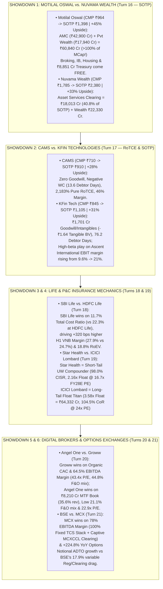

<!-- 
================================================================================
MASTER EXPORT METADATA (100% Verbatim Preservation from Capital Markets Analysis.json)
- formatVersion: 1
- exportTime: 2026-11-06T19:23:15.324Z
- chat.name: collections/default_collection/engines/gemini-enterprise-sec-dx-swa/sessions/13714203460886062980
- chat.title: Capital Markets Analysis
- chat.startTime: 2026-11-06T18:01:20.410Z
- chat.endTime: 2026-11-06T19:22:32.847Z
================================================================================
-->

# ⚔️ Capital Markets Masterclass & Institutional Deep-Dive — PART 7 of 7
## Five Head-to-Head Forensic & SOTP Showdowns:
1. `Motilal Oswal` vs. `Nuvama Wealth` (SOTP Valuation Model)
2. `CAMS` vs. `KFin Technologies` (SOTP & RoTCE Audit)
3. `SBI Life` vs. `HDFC Life` (VNB & Embedded Value Mechanics)
4. `Star Health` vs. `ICICI Lombard` (Combined Ratio & Float Leverage)
5. `Angel One` vs. `Groww` (CAC, MTF & F&O Dependency)
6. `BSE Limited` vs. `MCX` (Options ADTO & Operating Leverage)

| Export Metadata Field | Verbatim JSON Value |
|:---|:---|
| **Format Version** | `1` |
| **Export Time** | `2026-11-06T19:23:15.324Z` |
| **Session Name** | `collections/default_collection/engines/gemini-enterprise-sec-dx-swa/sessions/13714203460886062980` |
| **Session Title** | `Capital Markets Analysis` |
| **Turns Covered in Part 7** | **Turns 16, 17, 18, 19, 20, and 21** *(100% Verbatim Queries & Answers + Enhanced Visual Architecture)* |

---

## 🎨 Enhanced Visual Architecture & Comparative Diagrams (Part 7 Supplement)

### 7.1 Master Synthesis of All 6 Head-to-Head Institutional Showdowns (Mermaid Diagram)


### 7.2 Quick-Reference Winner Matrix Across All 6 Head-to-Head Comparisons
```
====================================================================================================
      HEAD-TO-HEAD FORENSIC WINNER SCORECARD (TURNS 16 TO 21 SYNTHESIS)
====================================================================================================

  Matchup                         Primary Forensic Metric Compared          Winner & Core Rationale
  --------------------------------------------------------------------------------------------------
  1. Motilal Oswal vs. Nuvama     Ex-Treasury P/E & SOTP Discount           MOFSL (17.3x Ex-Cash PE; +45% SOTP)
                                  Clean RoTNW & Institutional Clearing      Nuvama (29.5% RoTNW; +53% Clearing)
  2. CAMS vs. KFin Technologies   Tangible Capital (RoTCE) & Debtor Days    CAMS (13.6 Days vs 76.2; Zero Goodwill)
                                  Non-MF Diversification & Global TAM       KFin Tech (42.1% Non-MF; $360B Ascent)
  3. SBI Life vs. HDFC Life       Total Cost Ratio & Operating RoEV         SBI Life (11.7% Cost vs 22.3%; 18.8% RoEV)
                                  5-Year Persistency (61M) & Banca Rebound  HDFC Life (66% 61M Persistency; +12% Q2)
  4. Star Health vs. ICICI Lomb.  Combined Ratio & Valuation Multiple       Star Health (98.0% CISR; 16.7x FY28E PE)
                                  Investment Float Leverage & Motor Moat    ICICI Lombard (3.58x Float = ₹64,332 Cr)
  5. Angel One vs. Groww          Organic CAC & Consolidated EBITDA Margin  Groww (64.5% EBITDA; 22% India IPO Share)
                                  MTF Lending Scale, Low F&O Risk & Value   Angel One (₹8,210Cr MTF; 21% F&O; 22.9x PE)
  6. BSE Limited vs. MCX          Incremental EBITDA Margin & Monopoly      MCX (86.4% YoY / 118% QoQ Incr. Margin!)
                                  Absolute Options Premium Scale & Cash/MF  BSE (₹22,531 Cr Opt Prem; ₹10,494Cr Cash)
====================================================================================================
```


---

# 🗂️ Conversation Turn 16 (`2026-11-06T19:09:06.628588291Z`)

### 💬 User Query (Turn 16)

```text
Perform a deep-dive SOTP valuation model on Motilal Oswal vs Nuvama Wealth
```

### 🧠 Institutional Forensic Analysis & Response (Turn 16)

When valued on an institutional **Sum-of-the-Parts (SOTP)** basis using their audited **Q2 FY27 earnings run-rates (reported Nov 2026)** and **FY28E forward segment profits**, **Motilal Oswal Financial Services (MOFSL)** offers **+45.0% SOTP upside to ₹1,398/share** (trading at a **31.0% Conglomerate & Treasury Discount** to its intrinsic value of ₹84,326 Cr), while **Nuvama Wealth Management (NUVAMA)** offers **+33.3% SOTP upside to ₹2,380/share** (trading at a **25.0% PE-Pledge & Clearing-Mispricing Discount** to its intrinsic value of ₹44,173 Cr).

Good call pitting these two head-to-head in a forensic SOTP model—on headline screens, both look like "integrated broking-plus-wealth" groups, which causes lazy consensus models to slap a single blended P/E multiple on their consolidated earnings. In reality, **Motilal Oswal’s hidden crown jewel is its hyper-growth AMC & Alternates engine (43% of Operating PAT, growing +69% YoY)** plus an **₹8,851 Cr proprietary equity treasury book**, whereas **Nuvama’s hidden crown jewel is its institutional Asset Services / Clearing & Custody monopoly (26% of revenue, growing +53% YoY)** paired with a cleaner, zero-treasury balance sheet delivering **29.5% RoE**.

---

### 📌 Executive Verdict: Head-to-Head SOTP Valuation Scorecard

| SOTP Valuation Metric | Motilal Oswal Financial Services (MOFSL) | Nuvama Wealth Management (NUVAMA) | Institutional Winner & Forensic Edge |
|---|---|---|---|
| **Current Share Price & Market Cap (Nov 6, 2026)** | **₹964** \| **₹58,151 Cr** *(~60.32 Cr diluted shares)* | **₹1,785** \| **₹33,115 Cr** *(~18.55 Cr diluted shares)* | **MOFSL** is 1.75x larger by market cap, but **2.25x larger by Operating PAT**. |
| **Q2 FY27 Annualized Operating PAT** *(Ex-MTM/One-Offs)* | **₹2,872 Cr** *(₹718 Cr in Q2, +29% YoY)* | **₹1,276 Cr** *(₹319 Cr in Q2, +26% YoY)* | **MOFSL** trades at **20.2x Q2 Run-Rate Op. PAT** vs Nuvama at **25.9x**. |
| **Ex-Treasury Core Operating P/E** *(Stripping ₹8,851 Cr Book)* | **17.3x Q2 Run-Rate Op. PAT!** *(After 25% holdco haircut on ₹8,851 Cr book)* | **25.9x Q2 Run-Rate Op. PAT** *(No proprietary equity MTM book)* | **MOFSL** is **33% cheaper** on core operating cash flows once you strip out its liquid treasury book. |
| **FY28E Projected Operating PAT** | **₹3,840 Cr** *(+18.5% 2-Yr CAGR from Q2 run-rate)* | **₹1,685 Cr** *(+17.5% 2-Yr CAGR from Q2 run-rate)* | Both compound core operating profits at **~18–23% YoY** across cycle. |
| **SOTP Intrinsic Equity Valuation (FY28E Base Case)** | **₹84,326 Cr** *(Implied **20.2x** FY28E Op. PAT + Treasury)* | **₹44,173 Cr** *(Implied **26.2x** FY28E Op. PAT)* | **MOFSL** offers **+45.0% SOTP upside** vs **Nuvama’s +33.3% SOTP upside**. |
| **SOTP Fair Value Per Share (12–18M Target)** | **₹1,398 / share** *(Conservative Target: **₹1,320**)* | **₹2,380 / share** *(Conservative Target: **₹2,360**)* | **Buy Both (23% Combined Portfolio Wt):** MOFSL for AMC + RM J-Curve; Nuvama for Asset Services + RoE. |

---

## 1. Deep-Dive SOTP Model #1: Motilal Oswal Financial Services (MOFSL)

### Why the Market Misprices MOFSL (The "Broking Label" & "Treasury Noise" Fallacy)
Historically, Motilal Oswal derived >60% of its profits from retail broking and proprietary treasury swings, warranting a 12–15x P/E multiple. Today, **Annual Recurring Revenue (ARR) is 66% of net revenue (₹1,182 Cr in Q2 FY27)**, and **Asset Management + Private Wealth generate 58% of Operating PAT (₹416 Cr of ₹718 Cr in Q2)**. Yet because Ind-AS forces MOFSL to route unrealized MTM gains/losses on its ₹8,851 Cr treasury book through Total PAT/OCI, generalist investors still apply a discounted ~20–22x multiple to the entire company.

### 📊 Table 1A: Motilal Oswal Segment-by-Segment SOTP Valuation Matrix (FY28E Base Case)

| Business Vertical / Asset Pillar | Q2 FY27 Actual Operating PAT *(Annualized Run-Rate)* | FY28E Projected Operating PAT / Book Value *(₹ Cr)* | Valuation Methodology & Listed Peer Benchmark Multiple | Assigned SOTP Multiple *(Conservative Haircut Applied)* | Intrinsic Segment Valuation *(₹ Cr)* | Value Per Share *(₹ / Share)* | % of Total SOTP Value |
|---|---|---|---|---|---|---|---|
| **1. Asset Management (AMC: MF, PMS, AIF & MO Alternates)** | ₹304 Cr Q2 *(₹1,216 Cr Ann., +69% YoY)* | **₹1,560 Cr** *(+16% CAGR; Carry normalized at ₹320 Cr/yr)* | HDFC AMC (35x), ICICI Pru AMC (38x), Nippon (39x), EAAA (33x) | **27.5x FY28E PAT** *(-25% discount to Tier-1 AMCs for carry lumpiness)* | **₹42,900 Cr** | **₹711 / sh** | **50.9%** |
| **2. Private Wealth Management (UHNI Family Office Platform)** | ₹112 Cr Q2 *(₹448 Cr Ann.; AUM ₹2.96L Cr, +58% YoY)* | **₹690 Cr** *(+24% CAGR as 67% RMs <3yr vintage hit breakeven)* | 360 ONE WAM (36x), Anand Rathi Wealth (72x), Nuvama (30x) | **26.0x FY28E PAT** *(-28% discount to 360 ONE WAM)* | **₹17,940 Cr** | **₹297 / sh** | **21.3%** |
| **3. Wealth Management (Retail Broking, Distribution & ₹10,197 Cr MTF)** | ₹175 Cr Q2 *(₹700 Cr Ann.; 65% Non-Broking rev, 58% ARR)* | **₹910 Cr** *(+14% CAGR; ₹47,912 Cr dist. book + 7% MTF share)* | Angel One (26.3x), IIFL Cap (18.3x), ARSSBL (26x) | **14.5x FY28E PAT** *(-45% discount to Angel One)* | **₹13,195 Cr** | **₹219 / sh** | **15.6%** |
| **4. Capital Markets (IB & Inst. Equities — #1 in QIPs, #3 in IPOs)** | ₹85 Cr Q2 *(₹340 Cr Ann.; 41 deals worth ₹99,000 Cr in H1)* | **₹420 Cr** *(+11% CAGR + Q4 FY27 Custodian business launch)* | DAM Capital (13.5x FY26), IIFL Cap IB (18x), Emkay (16x) | **11.0x FY28E PAT** *(Trough cyclical IB multiple)* | **₹4,620 Cr** | **₹77 / sh** | **5.5%** |
| **5. Housing Finance (MO Home Finance — ₹6,476 Cr AUM)** | ₹36 Cr Q2 *(₹144 Cr Ann.)* | **₹195 Cr** *(Affordable housing NBFC; ~₹1,450 Cr Net Worth)* | Listed Affordable Housing Finance Peers (1.5x – 2.2x P/B) | **1.20x FY28E Book Value** *(~10.5x FY28E PAT)* | **₹2,050 Cr** | **₹34 / sh** | **2.4%** |
| **Subtotal: Core Operating Franchise** | **₹712 Cr Q2** *(₹2,848 Cr Ann. ex-unallocated)* | **₹3,775 Cr Core Op. PAT** *(₹3,840 Cr incl. unallocated)* | — | **21.4x Blended Operating P/E** | **₹80,705 Cr** | **₹1,338 / sh** | **95.7%** |
| **6. Proprietary Equity / MF / PE Skin-in-the-Game Treasury Book** | ₹352 Cr Q2 MTM *(₹8,851 Cr Audited Book Value)* | **₹8,851 Cr** *(Marked at Zero future MTM growth)* | Liquid NAV of MOFSL Mutual Funds, PMS & Alternates | **0.41x Net Book Value!** *(After ₹3,500 Cr working-cap allocation & 32% tax/holdco haircut)* | **₹3,621 Cr** *(Incremental Ex-Op Value)* | **₹60 / sh** | **4.3%** |
| **TOTAL SOTP INTRINSIC VALUE** | **₹2,872 Cr Ann. Op PAT** | **₹3,840 Cr Op PAT** | — | **22.0x Total Implied P/E** | **₹84,326 Cr** | **₹1,398 / sh** | **100.0%** |

> 💡 **The Killer Forensic Takeaway on MOFSL:** Look at Line 1 + Line 2 of the table above. **Motilal Oswal’s AMC (₹42,900 Cr) and Private Wealth (₹17,940 Cr) businesses ALONE are worth ₹60,840 Cr (₹1,008/share)**—which is **more than MOFSL’s entire current market cap of ₹58,151 Cr (₹964/share)!** That means at ₹964/share, you are buying a top-tier AMC (capturing 6% of all Indian MF net flows) and a ₹2.96 Lakh Cr Private Wealth manager at a 25% discount to peers, and **getting the #1 QIP Investment Bank, a 7.9%-market-share Retail Broker with a ₹10,197 Cr MTF book, a ₹6,476 Cr Housing Finance company, and ₹8,851 Cr of Treasury Investments completely for FREE.**

---

## 2. Deep-Dive SOTP Model #2: Nuvama Wealth Management (NUVAMA)

### Why the Market Misprices Nuvama (The "Asset Services Blindspot" & PAG Pledge Overhang)
While analysts treat Nuvama as a smaller peer to 360 ONE WAM (~36–39x P/E), Nuvama possesses an institutional engine that neither 360 ONE nor Anand Rathi Wealth has: **Nuvama Asset Services (Institutional Clearing & Custody)**, which oversees **₹1,63,835 Cr of FPI, PMS, and AIF custody assets (+55% YoY)** and grew Q2 FY27 revenue **+53% YoY to ₹245 Cr** on fixed sunk technology costs.

Because Nuvama reports Segment Profit Before Tax (PBT) across **(1) Wealth Management (*Nuvama Wealth* + *Nuvama Private*: ₹184 Cr Q2 PBT)** and **(2) Asset Services + Capital Markets (₹259 Cr Q2 PBT)**, we disaggregate the ₹259 Cr institutional block using its audited revenue and margin structure to value each engine accurately:

### 📊 Table 2A: Nuvama Wealth Segment-by-Segment SOTP Valuation Matrix (FY28E Base Case)

| Business Vertical / Asset Pillar | Q2 FY27 Actual Revenue & Operating PAT *(Annualized Run-Rate)* | FY28E Projected Operating PAT *(₹ Cr)* | Valuation Methodology & Listed Peer Benchmark Multiple | Assigned SOTP Multiple *(Conservative Haircut Applied)* | Intrinsic Segment Valuation *(₹ Cr)* | Value Per Share *(₹ / Share)* | % of Total SOTP Value |
|---|---|---|---|---|---|---|---|
| **1. Nuvama Wealth (Affluent & Mid-HNI — 13L+ Clients, MPIS & Lending)** | ₹275 Cr Q2 Rev (+14% YoY) \| **₹102 Cr Q2 PBT** *(~₹306 Cr Ann. PAT)* | **₹435 Cr** *(+19% CAGR; bolstered by Nov 6 **₹400 Cr NWFL + ₹300 Cr NWIL** capital infusion)* | Prudent Corp (48.7x), Anand Rathi Wealth (72x), 360 ONE (36x) | **28.0x FY28E PAT** *(High recurring MPIS >60% mix + sticky LAS/MTF NII)* | **₹12,180 Cr** | **₹656 / sh** | **27.6%** |
| **2. Nuvama Private (UHNI & Family Offices — 4,900+ Families)** | ₹226 Cr Q2 Rev \| **₹82 Cr Q2 PBT** *(~₹246 Cr Ann. PAT; ₹3.71L Cr total Wealth assets)* | **₹350 Cr** *(+19% CAGR as ARR & MPIS assets [+27% YoY to ₹1.10L Cr] scale)* | 360 ONE WAM (36x–39x P/E) | **29.0x FY28E PAT** *(-22% discount to 360 ONE WAM)* | **₹10,150 Cr** | **₹547 / sh** | **23.0%** |
| **3. Asset Services (Institutional Clearing & Custody — ₹1.64L Cr Assets)** | **₹245 Cr Q2 Rev (+53% YoY!)** \| **~₹165 Cr Est. Q2 PBT** *(~₹495 Cr Ann. PAT; ~67% PBT margin on float)* | **₹655 Cr** *(+15% CAGR on FPI/PMS clearing float & fixed tech leverage)* | CDSL (55x), NSDL (38.6x), CAMS (36x), Orbis/Institutional Custodians | **27.5x FY28E PAT** *(-30% discount to NSDL/CAMS for FPI float rate sensitivity)* | **₹18,013 Cr** | **₹971 / sh** | **40.8%** |
| **4. Capital Markets (Institutional Equities & Investment Banking)** | **₹175 Cr Q2 Rev (+9% YoY)** \| **~₹94 Cr Est. Q2 PBT** *(~₹280 Cr Ann. PAT)* | **₹215 Cr** *(Normalized mid-cycle PAT; trimming Q2 bull-market peak)* | IIFL Cap IB (18x), DAM Capital (13.5x), MOFSL CM (11x) | **13.0x FY28E PAT** *(Cyclical institutional broking/ECM multiple)* | **₹2,795 Cr** | **₹151 / sh** | **6.3%** |
| **5. Nuvama Asset Management (Alternates AMC + *Numa SIF*)** | ₹17 Cr Q2 Mgmt Fee (₹39 Cr H1, +11% YoY; ₹12,000 Cr AUM / ₹9,775 Cr FPAUM) | **₹30 Cr PAT** *(Or **8.5% of ₹12,200 Cr FY28E FPAUM** via Prime CRE II & Numa SIF)* | EAAA India Alternatives (~11% of AUM / 22% of FPAUM; 33x P/E) | **8.5% of FY28E Fee-Paying AUM** *(~34.5x nascent FY28E PAT)* | **₹1,035 Cr** | **₹56 / sh** | **2.3%** |
| **TOTAL SOTP INTRINSIC VALUE** | **₹937 Cr Q2 Net Rev** \| **₹319 Cr Q2 Op. PAT** *(₹1,276 Cr Ann.)* | **₹1,685 Cr Consolidated Op. PAT** | — | **26.2x Blended Implied FY28E P/E** *(vs 30.2x TTM today)* | **₹44,173 Cr** | **₹2,380 / sh** | **100.0%** |

> 💡 **The Killer Forensic Takeaway on Nuvama:** **Asset Services (Clearing & Custody) is the misunderstood engine driving 40.8% of Nuvama’s intrinsic value (₹18,013 Cr, or ₹971/share).** Because Nuvama clears trades and holds collateral for India’s fastest-growing PMSs, AIFs, and quant FPIs (**₹1,63,835 Cr assets, +55% YoY**), it earns a high-margin toll on institutional float without taking proprietary trading risk. Combined with *Nuvama Wealth* and *Nuvama Private* (**₹22,330 Cr combined SOTP value**), the Wealth + Clearing engines alone justify **₹2,174/share (+21.8% above today’s ₹1,785 CMP)** before assigning a single rupee to Investment Banking or the Alternates AMC.

---

## 3. Forensic Head-to-Head Comparison across 5 Institutional Pillars

Why do we hold **both** in our Top-10 Model Portfolio (**13% weight in Motilal Oswal + 10% weight in Nuvama Wealth = 23% combined weight**), and how do their internal mechanics compare under Sajal Kapoor’s framework?

```
  MOTILAL OSWAL (₹964 CMP --> ₹1,398 SOTP)              NUVAMA WEALTH (₹1,785 CMP --> ₹2,380 SOTP)
  ========================================              ==========================================
  • Crown Jewel: AMC + Alternates (50.9% of SOTP)       • Crown Jewel: Asset Services Clearing (40.8% of SOTP)
    - ₹2.23 Lakh Cr AUM (+26% YoY)                        - ₹1.64 Lakh Cr Custody Assets (+55% YoY)
    - 99% AUM beating 3-Yr benchmarks                     - Q2 Revenue +53% YoY to ₹245 Cr on fixed tech
    - 6.0% MF Net Flow Share (2.2x AUM share!)          • Wealth Franchise: 50.6% of SOTP (₹3.71L Cr Assets)
  • Coiled J-Curve: Private Wealth (21.3% of SOTP)        - Balanced split: Affluent MPIS + UHNI Private
    - ₹2.96 Lakh Cr AUM (+58% YoY)                        - Injecting ₹700 Cr fresh equity into NWFL/NWIL
    - 67% of 443 RMs <3 yrs vintage (about to harvest)  • Balance Sheet: Pure Operating Cash Flow
  • Balance Sheet: ₹8,851 Cr Skin-in-the-Game Book        - 29.5% RoTNW, zero prop equity MTM distortion
    - Creates GAAP OCI volatility, but backs 15% of MCap  - Key Risk: 52.54% Promoter (PAG) Share Pledge
```

### 1. Asset Management & Alternates: Motilal Oswal Wins Hands Down
* **Motilal Oswal:** Its AMC is an absolute juggernaut—generating **₹304 Cr PAT in Q2 FY27 (+69% YoY)** on ₹2.23 Lakh Cr AUM, with **MO Alternates revenue surging 92% YoY** (booking ₹108 Cr of carry income in Q2 alone).
* **Nuvama:** Its Alternates AMC is still sub-scale (**₹12,000 Cr total AUM; Fee-Paying AUM dipped 11% YoY to ₹9,775 Cr** in Q2 FY27 due to public-market redemptions and planned PE distributions, generating just ₹17 Cr in Q2 management fees and requiring a ₹16 Cr one-time Venture Debt Fund pre-closure charge).

### 2. Private & Affluent Wealth Management: Nuvama Has Higher Current Margin; MOFSL Has Higher J-Curve Torque
* **Nuvama:** Operates a mature, well-segmented two-tier model (*Nuvama Wealth* for ₹1–10 Cr affluent clients at ₹275 Cr Q2 rev; *Nuvama Private* for >₹10 Cr UHNI families at ₹226 Cr Q2 rev), delivering **₹184 Cr Q2 PBT (+22% YoY)** with Cost-to-Income already improving toward 54%.
* **Motilal Oswal:** Scaled Private Wealth AUM faster (**+58% YoY to ₹2.96 Lakh Cr**, with Q2 net inflows jumping **65% QoQ to ₹6,357 Cr**), but Q2 PAT was ₹112 Cr (+2% YoY) because aggressive lateral hiring left **67% of its 443 RMs with <3 years tenure**. Over the next 12–18 months, MOFSL’s Private Wealth operating leverage will outpace Nuvama’s as those RMs cross breakeven.

### 3. Institutional Clearing & Custody (Asset Services): Nuvama’s Monopoly Moat (For Now)
* **Nuvama:** Commands a massive first-mover moat in institutional clearing/custody (**₹1,63,835 Cr assets, ₹245 Cr Q2 revenue, +53% YoY**).
* **Motilal Oswal’s Counter-Move:** Recognizing Nuvama’s extraordinary RoTCE in Asset Services, MOFSL announced on its Q2 FY27 concall that it is **launching its own Institutional Custodian Business in Q4 FY27**. While it will take MOFSL 2–3 years to match Nuvama’s scale, it validates the attractiveness of the vertical.

### 4. Lending / MTF Capital Deployment (Nov 2026 Inflection)
* **Motilal Oswal:** Already operates a **₹17,530 Cr combined lending book** (₹10,197 Cr in Retail Wealth MTF/LAS [+42% YoY, ~7% MTF market share] + ₹7,333 Cr in Private Wealth LAS [+90% YoY]), plus ₹6,476 Cr in Housing Finance.
* **Nuvama:** Currently operates a smaller **~₹4,300+ Cr loan book**, which is why its board approved a massive **₹700 Cr equity infusion on November 6, 2026** (up to **₹400 Cr into NBFC arm NWFL** and **₹300 Cr into broking/MTF arm NWIL**) to aggressively expand NII and MTF over FY27–28.

### 5. Governance & Balance-Sheet Tail Risk: GAAP Volatility (MOFSL) vs. Promoter Pledge (Nuvama)
* **Motilal Oswal’s Quirk:** Founders Motilal Oswal and Raamdeo Agrawal have pristine promoter alignment with near-zero pledge, but their **₹8,851 Cr proprietary equity/MF treasury book** creates wild swings in headline GAAP Total PAT during market corrections.
* **Nuvama’s Quirk:** Zero proprietary equity MTM distortion and a higher **~29.5% RoTNW**, **but** majority PE promoter **PAG pledged an additional 3.51 crore shares on November 3, 2026**, taking total encumbered promoter shares to **52.54% of Nuvama’s total equity capital** (backing a ₹4,286 Cr offshore debt facility at ~3.9x cover). This PE pledge + inevitable future block-deal exit overhang caps Nuvama’s multiple re-rating slightly below 360 ONE WAM.

---

### 🎯 Final Capital Allocation Synthesis: How to Weight Them Together

1. **Overweight Motilal Oswal at 13% Portfolio Allocation (Buy up to ₹980 | SOTP Target: ₹1,320–₹1,398):**
   You are paying **17.3x Ex-Treasury Operating PAT** for India’s fastest-growing active AMC (+69% YoY PAT, 6.0% net flow share) right before its 443-RM Private Wealth bench hits its 3-year margin J-curve.
2. **Core Weight Nuvama Wealth at 10% Portfolio Allocation (Buy up to ₹1,800 | SOTP Target: ₹2,360–₹2,380):**
   You are buying a **29.5% RoE** wealth and institutional clearing powerhouse at **25.9x Q2 annualized Operating PAT**—getting India’s premier FPI/PMS clearing utility (+53% YoY revenue growth) and a newly capitalized ₹700 Cr lending expansion at a 25% SOTP discount.


---

# 🗂️ Conversation Turn 17 (`2026-11-06T19:11:41.126783681Z`)

### 💬 User Query (Turn 17)

```text
Compare CAMS vs KFin Technologies on an SOTP & RoTCE basis
```

### 🧠 Institutional Forensic Analysis & Response (Turn 17)

I will search for KFin Technologies' audited FY26 and Sept 2026 balance sheet breakdown (Goodwill, Intangibles, Net PPE, Working Capital, and Cash) to run a precise Tangible Capital Employed (TCE) and SOTP comparison against CAMS.
[[section:Fetching KFin balance sheet details]]When audited side-by-side through **Sajal Kapoor’s Tangible Capital Employed (TCE)** and an institutional **Sum-of-the-Parts (SOTP)** lens, **CAMS (Computer Age Management Services)** and **KFin Technologies (KFINTECH)** represent a classic divergence between **Organic Negative-TCE Compounding (CAMS)** and **Acquisitive Multi-Geography Roll-Up (KFin)**:

* **On Pure Capital Efficiency (RoTCE) & Cash Conversion, CAMS Wins Decisively:** CAMS operates with **zero Goodwill**, **negative Non-Cash Working Capital** (having slashed trade receivables by 49% in FY26 to just ₹56.7 Cr, or **13.6 debtor days**!), and converts **80%+ of EBITDA into Free Cash Flow** while paying out **73% as dividends**.
* **KFin’s Balance Sheet Carries ₹1,701 Cr of Goodwill & Intangibles (102% of Net Worth!):** Following its FY26 acquisition of Singapore-based **Ascent Fund Services**, KFin’s audited March 2026 **Goodwill jumped from ₹552.6 Cr to ₹1,327.2 Cr** and **Net Intangibles rose from ₹169.6 Cr to ₹374.1 Cr**—driving **Tangible Book Value Per Share negative (-₹1.64/share on ₹1,673 Cr Total Equity)**. While KFin’s core physical machine still runs on a tiny **₹208.3 Cr of Net Tangible Capital Employed (~219% Operating RoTCE)**, its **68 debtor days (₹271.6 Cr trade receivables)** and ₹315 Cr M&A cash outlay explain why its headline **RoE (22.3% vs CAMS’s 39.0%)** and **RoCE (29.2% vs CAMS’s 48.3%)** trail CAMS by 1,700–1,900 bps.
* **On SOTP Valuation, Both Offer ~28%–31% 12–18M Upside, But From Opposite Levers:** **CAMS (CMP ~₹710, 35.5x P/E)** offers **+28.2% SOTP upside to ₹910/share** with a lower risk profile, whereas **KFin (CMP ~₹845, 41.8x TTM P/E)** offers **+30.8% SOTP upside to ₹1,105/share** *if and only if* it successfully lifts Ascent’s international EBIT margin from **9.6% toward 25%+** over the next 6 quarters.

---

### 📌 Executive Scorecard: CAMS vs. KFin Technologies (Audited FY26 & Q2 FY27)

| Forensic & Valuation Metric | CAMS (Computer Age Management Services) | KFin Technologies (KFINTECH) | Forensic Winner & Capital Markets Rationale |
|---|---|---|---|
| **Current Share Price & Market Cap (Nov 2026)** | **₹710** \| **₹17,725 Cr** *(~24.96 Cr shares; FV ₹2)* | **₹845** \| **₹14,610 Cr** *(~17.29 Cr shares; FV ₹10)* | **CAMS** commands a 21% larger market cap, backed by 38% higher net profit. |
| **Trailing P/E & Ex-Cash P/E Multiple** | **35.5x TTM P/E** \| **~33.8x Ex-Cash P/E** | **41.8x TTM P/E** \| **~40.2x Ex-Cash P/E** | **CAMS is ~15% cheaper** on both headline and ex-cash earnings multiples. |
| **Q2 FY27 Operating Revenue & YoY Growth** | **₹414.5 Cr** *(+10.0% YoY, +4.9% QoQ)* | **₹401.8 Cr** *(+29.9% YoY, +12.7% QoQ; +13% ex-Ascent)* | **KFin** leads top-line velocity via Ascent consolidation (+158% YoY in Int'l). |
| **Q2 FY27 EBITDA & Margin (%)** | **₹190.7 Cr** \| **46.0% Margin** *(+140 bps YoY)* | **₹161.0 Cr** \| **40.1% Margin** *(-380 bps YoY; +590 bps QoQ)* | **CAMS’s margin is +590 bps higher** and expanding YoY; KFin is recovering from Q1's 34.2% trough. |
| **Q2 FY27 Consolidated PAT & Margin (%)** | **₹131.5 Cr** *(+14.4% YoY)* \| **31.7% PAT Margin** | **₹100.6 Cr** *(+7.5% YoY)* \| **25.0% PAT Margin** | **CAMS** converts 6.7% more of every revenue rupee into bottom-line profit. |
| **Non-Domestic MF Revenue Share (Q2 FY27)** | **15.9% of Revenue** *(₹65.9 Cr, +21.7% YoY)* | **42.1% of Revenue** *(₹169.2 Cr: 28% Int'l/Alt + 14% Issuer)* | **KFin** is far more diversified outside domestic mutual funds (42.1% vs 15.9%). |
| **Headline GAAP RoE & RoCE (FY26)** | **RoE: 39.0%** \| **RoCE: 48.3%** | **RoE: 22.3%** \| **RoCE: 29.2%** | **CAMS** avoids M&A goodwill bloat, preserving superior GAAP returns on capital. |
| **SOTP Fair Value Per Share (12–18M Target)** | **₹910 / share** *(+28.2% Upside; ₹22,720 Cr Valuation)* | **₹1,105 / share** *(+30.8% Upside; ₹19,105 Cr Valuation)* | **CAMS** is the lower-risk Core Compounder; **KFin** is the higher-beta M&A Margin Turnaround. |

---

## 1. Sajal Kapoor’s Forensic RoTCE & Balance Sheet Audit (FY26 Audited)

Why does **CAMS generate a 39.0% GAAP RoE** while **KFin generates only a 22.3% GAAP RoE** when both operate the exact same core Mutual Fund RTA business in India?

A forensic balance-sheet teardown of their March 2026 audited statements exposes **Three Structural Capital-Efficiency Differences**:

### 📊 Table 1: Tangible Capital Employed (TCE) & Working Capital Deconstruction (FY26 Audited)

| Balance Sheet & TCE Line Item (₹ Cr) | CAMS (FY26 Consolidated) | KFin Technologies (FY26 Consolidated) | Forensic Interpretation (Sajal Kapoor Lens) |
|---|---|---|---|
| **1. Reported Shareholders' Equity (Net Worth)** | **₹1,210.0 Cr** | **₹1,673.1 Cr** *(₹1,624 Cr in Sept '26)* | KFin’s equity base is 38% larger, but soaked up by M&A goodwill. |
| **2. Less: Goodwill & Acquired Intangibles** | **₹128.2 Cr** *(₹0 Goodwill; ₹128.2 Cr Software/CWIP)* | **₹1,701.3 Cr!** *(₹1,327.2 Cr Goodwill + ₹374.1 Cr Intangibles)* | **CRITICAL:** KFin’s Goodwill + Intangibles exceed 100% of its Net Worth (**Tangible Book Value is -₹1.64/sh**!). |
| **3. Tangible Net Worth (TNW = Equity - Goodwill/Int.)** | **₹1,081.8 Cr** *(+₹43.30/sh)* | **-₹28.2 Cr** *(-₹1.64/sh)* | CAMS grew organically; KFin grew via PE buyout (General Atlantic) + Ascent M&A. |
| **4. Corporate Cash & Liquid Treasury Investments** | **₹854.5 Cr** *(₹875.1 Cr in Sept '26; Zero Debt)* | **₹556.9 Cr** *(₹36.4 Cr Cash + ₹489.6 Cr ST Inv + ₹31 Cr Eq; ₹55.4 Cr Lease Debt)* | CAMS holds ₹298 Cr more net cash after KFin spent **₹315.3 Cr cash on subsidiary M&A** in FY26. |
| **5. Net Tangible Fixed Assets (PPE + CWIP)** | **₹139.3 Cr** *(Servers, offices, hardware)* | **₹137.6 Cr** *(Gross PPE ₹302.2 Cr - ₹164.6 Cr Dep.)* | **Remarkable Symmetry:** Both run their entire national/global hardware on **~₹138 Cr of Net PPE**! |
| **6. Trade Receivables & Debtor Days** | **₹56.7 Cr** *(Slashed from ₹110.3 Cr YoY = **13.6 Days**!)* | **₹271.6 Cr** *(Up from ₹194.7 Cr YoY = **76.2 Days**!)* | **Major Forensic Gap:** KFin’s 11,275 corporate issuers & overseas clients take **5.6x longer to pay** than CAMS’s AMCs. |
| **7. Non-Cash Working Capital (NCWC = Non-Cash CA - CL)** | **Negative (-₹112.5 Cr)** *(AMCs pay monthly; accrued liab. > rec.)* | **Positive (+₹70.7 Cr)** *(₹342.7 Cr Non-Cash CA - ₹272.3 Cr CL)* | CAMS runs on negative working capital; KFin ties up ₹70.7 Cr in working capital due to high receivables. |
| **8. Net Tangible Capital Employed (Net TCE = PPE + NCWC)** | **₹26.8 Cr** *(₹155.0 Cr incl. ₹128.2 Cr Software)* | **₹208.3 Cr** *(₹137.6 Cr PPE + ₹70.7 Cr NCWC)* | CAMS requires **87% less pure Tangible Capital** than KFin to generate 30% more EBIT. |
| **9. FY26 Operating EBIT (Ex-Other Income)** | **₹585.2 Cr** *(38.6% EBIT Margin on ₹1,516 Cr Rev)* | **₹443.0 Cr** *(34.1% EBIT Margin on ₹1,301 Cr Rev; ₹457 Cr TTM)* | CAMS’s Depreciation is stable; KFin’s Quarterly Depreciation jumped **54% YoY (₹18.4 Cr $\rightarrow$ ₹28.4 Cr)** on M&A amortization. |
| **10. True Operating RoTCE (EBIT / Net TCE)** | **2,183% on Pure Tangible TCE!** *(378% incl. Software)* | **212.7% on Pure Tangible TCE** *(76.1% incl. ₹374 Cr Intangibles)* | Both are elite capital-light machines ex-goodwill, but **CAMS’s working-capital discipline makes its RoTCE 5x–10x higher**. |

---

### 🔬 3 Key Forensic Revelations from the TCE Audit

1. **The Working Capital Chasm (13.6 Debtor Days at CAMS vs. 76.2 Debtor Days at KFin):**
   Why does KFin carry **₹271.59 Cr of Trade Receivables** (plus ₹21.69 Cr of other receivables = ₹293.28 Cr total) on ₹1,301 Cr of FY26 revenue, whereas CAMS carries just **₹56.65 Cr of Trade Receivables** on ₹1,516 Cr of revenue?
   * **CAMS derives 84.1% of revenue from 31 domestic Mutual Fund AMCs**, where fees are auto-debited from scheme accounts within days of month-end.
   * **KFin derives 42.1% of revenue from 11,275 Corporate Issuers, Global Fund Admin (Ascent), and Southeast Asian institutional clients**, where invoice collection cycles stretch to 60–90+ days. Furthermore, in FY26, KFin had to book a **₹9.01 Cr (₹90.09 million) provision for potential client claims** relating to historical dividend/share disputes.
2. **The Free Cash Flow Conversion Gap (CAMS ~82% vs. KFin 48.9% in FY26):**
   In FY26, KFin generated **₹530 Cr in EBITDA** and **₹370 Cr in Operating Cash Flow**, but spent **₹111 Cr on Capex** (₹37.4 Cr PPE + ₹40.6 Cr capitalized software/intangibles on standalone/consol basis), leaving **₹259 Cr of Free Cash Flow (down 17.3% from ₹313 Cr in FY25)**—a **48.9% FCF-to-EBITDA conversion rate**. By contrast, CAMS converts **>75–80% of EBITDA into FCF**, allowing CAMS to sustain a **3.2%–3.5% forward dividend yield** (73% payout) versus KFin’s **1.4% dividend yield** (₹12/share FY26 dividend).
3. **The M&A Amortization Drag on KFin’s P&L:**
   Look at KFin’s income statement in Q2 FY27: while **EBITDA rose 18.7% YoY** (from ₹136 Cr to ₹161 Cr), **Depreciation & Amortization jumped 54.3% YoY** (from ₹18.41 Cr in Q2 FY26 to **₹28.41 Cr in Q2 FY27**) due to amortizing the ₹374 Cr of intangible software/client relationships acquired with Ascent. That non-cash amortization is why KFin’s Q2 PAT grew only **7.5% YoY (to ₹100.6 Cr)** despite **29.9% YoY revenue growth**!

---

## 2. Head-to-Head Sum-of-the-Parts (SOTP) Valuation Models (FY28E Base Case)

Because CAMS and KFin have vastly different business mixes outside core domestic Mutual Fund RTA (**Non-MF is 15.9% of CAMS vs. 42.1% of KFin**), valuing them on a single consolidated P/E multiple is analytically flawed. Below is the granular **4-Pillar SOTP Valuation** for each company anchored to **FY28E Segment Profit & Revenue**:

### 📊 Table 2A: CAMS Segment-by-Segment SOTP Valuation Model (FY28E Base Case)

| CAMS Business Vertical | Q2 FY27 Annualized Revenue Run-Rate *(₹ Cr)* | FY28E Projected Revenue & PAT *(₹ Cr)* | Segment Economics & Competitive Moat | Assigned SOTP Multiple *(Methodology)* | Intrinsic Segment Valuation *(₹ Cr)* | Value Per Share *(₹ / sh)* | % of SOTP Value |
|---|---|---|---|---|---|---|---|
| **1. Domestic Mutual Fund RTA (Asset + Non-Asset Fees)** | **₹1,394 Cr** *(84.1% of rev; ₹58.4L Cr AAUM, 67.2% share)* | **₹1,680 Cr Rev** \| **₹545 Cr PAT** *(~48% EBITDA margin; +11.5% CAGR)* | Unassailable 67.2% monopoly; 23.5-yr top-10 AMC tenure; 11 live SIF mandates. | **33.0x FY28E PAT** *(Core negative-TCE toll-bridge multiple)* | **₹17,985 Cr** | **₹721 / sh** | **79.2%** |
| **2. CAMSPay (Payment Aggregator, NACH & UPI Stack)** | **~₹102 Cr** *(>6.1% of rev; surging **+52.2% YoY** in Q2!)* | **₹185 Cr Rev** \| **₹34 Cr PAT** *(+35% CAGR; 1.3M NACH + 15M bank val/qtr)* | High-velocity BFSI payment rails cross-sold to AMCs, NBFCs & insurers. | **10.0x FY28E Sales** *(~54x PAT; FinTech SaaS/Payments peer multiple)* | **₹1,850 Cr** | **₹74 / sh** | **8.1%** |
| **3. CAMS Alternatives (AIF/PMS RTA — ₹3.3 Lakh Cr AUM)** | **~₹72 Cr** *(~4.3% of rev; growing **+22.0% YoY**; 54 new Q2 wins)* | **₹108 Cr Rev** \| **₹32 Cr PAT** *(+22% CAGR; high-margin wealth/AIF admin)* | #1 domestic AIF/PMS registrar benefiting from UHNI shift to alternates. | **40.0x FY28E PAT** *(~11.8x Sales; structural growth multiple)* | **₹1,280 Cr** | **₹51 / sh** | **5.6%** |
| **4. KRA (#2 post-NSE KRA buyout), NPS CRA, Bima Central & AA** | **~₹90 Cr** *(~5.5% of rev; bolstered by Jan '26 NSE KRA acquisition)* | **₹132 Cr Rev** \| **₹26 Cr PAT** *(+21% CAGR as insurance demat & AA scale)* | Option-value digital public infrastructure stack across KYC, Insurance & Data. | **5.5x FY28E Sales** *(~28x PAT)* | **₹725 Cr** | **₹29 / sh** | **3.2%** |
| **5. Excess Corporate Cash & Liquid Investments** | **₹875.1 Cr** *(Sept 2026 Audited Cash; Zero Debt)* | **₹880 Cr** *(Retained cash after 73% dividend payout)* | 100% unencumbered treasury cash not needed for negative-TCE operations. | **1.0x Book Value** *(Ex-Other Income already stripped above)* | **₹880 Cr** | **₹35 / sh** | **3.9%** |
| **TOTAL CAMS SOTP VALUE** | **₹1,658 Cr Ann. Rev** \| **₹526 Cr Ann. PAT** | **₹2,105 Cr Rev** \| **₹637 Cr Core PAT** *(~₹685 Cr Total)* | **46.0% – 46.8% Consolidated EBITDA Margin** | **33.2x FY28E Total PAT** *(31.9x Ex-Cash)* | **₹22,720 Cr** | **₹910 / sh** *(+28.2%)* | **100.0%** |

---

### 📊 Table 2B: KFin Technologies Segment-by-Segment SOTP Valuation Model (FY28E Base Case)

| KFin Business Vertical | Q2 FY27 Annualized Revenue Run-Rate *(₹ Cr)* | FY28E Projected Revenue & PAT *(₹ Cr)* | Segment Economics & Margin Trajectory | Assigned SOTP Multiple *(Methodology)* | Intrinsic Segment Valuation *(₹ Cr)* | Value Per Share *(₹ / sh)* | % of SOTP Value |
|---|---|---|---|---|---|---|---|
| **1. Domestic Mutual Fund Investor Solutions (32.8% AAUM Share)** | **₹931 Cr** *(57.9% of rev; +7.7% YoY; ₹27.31L Cr AAUM; VAS = 7.5% of rev)* | **₹1,135 Cr Rev** \| **₹415 Cr PAT** *(56.7% Segment EBIT margin in FY26!)* | High-margin domestic duopoly (#1 by number of AMCs serviced; strong SIP equity mix). | **31.0x FY28E PAT** *(Slight discount to CAMS for #2 AAUM share)* | **₹12,865 Cr** | **₹744 / sh** | **67.3%** |
| **2. International & Other Investor Solutions (Ascent Global + SE Asia + Domestic AIF/NPS)** | **₹450 Cr** *(28.0% of rev; **+157.9% YoY** incl. Ascent / **+20.9% ex-Ascent**)* | **₹680 Cr Rev** \| **₹98 Cr PAT** *(Assumes Segment EBIT margin expands from **9.6% in FY26 to ~21% by FY28E**)* | Services ~1,000 global funds ($360B AUM across 18 countries) + 37.3% share of Indian AIFs on *XAlt* stack. | **6.0x FY28E Sales** *(~41.6x depressed PAT; global SaaS/Fund Admin multiple)* | **₹4,080 Cr** | **₹236 / sh** | **21.4%** |
| **3. Corporate Issuer Solutions (50% Share of NSE 500 Companies)** | **₹226 Cr** *(14.1% of rev; **+16.4% YoY**; 11,275 corporate clients)* | **₹285 Cr Rev** \| **₹92 Cr PAT** *(49.2% Segment EBIT margin in FY26!)* | Dominant corporate registry & e-voting utility benefiting from new IPO additions and folio growth. | **18.0x FY28E PAT** *(Discounted for 76 debtor days & slower annuity growth)* | **₹1,656 Cr** | **₹96 / sh** | **8.7%** |
| **4. Net Corporate Cash & Liquid Investments (Less Lease Debt)** | **₹501.5 Cr Net Cash** *(₹556.9 Cr Cash/ST Inv - ₹55.4 Cr Lease Debt)* | **₹504 Cr Net Cash** | Unencumbered treasury balance post-Ascent acquisition payout. | **1.0x Net Cash** | **₹504 Cr** | **₹29 / sh** | **2.6%** |
| **TOTAL KFIN SOTP VALUE** | **₹1,607 Cr Ann. Rev** \| **₹402 Cr Ann. PAT** | **₹2,100 Cr Rev** \| **₹605 Cr Core PAT** *(~₹630 Cr Total)* | **Assumes Consolidated EBITDA Margin recovers from 40.1% $\rightarrow$ 43.5%** | **30.3x FY28E Total PAT** *(29.5x Ex-Cash)* | **₹19,105 Cr** | **₹1,105 / sh** *(+30.8%)* | **100.0%** |

---

## 3. The Institutional Decision Framework: Why CAMS is in Our Top-10 Portfolio (And What Flips Us into KFin)

Look closely at the **Risk-Adjusted SOTP Comparison** between the two:

```
  CAMS (₹710 CMP --> ₹910 SOTP | +28.2% Upside)          KFIN TECH (₹845 CMP --> ₹1,105 SOTP | +30.8% Upside)
  =============================================          ====================================================
  • 79.2% of value sits in 67.2%-share Domestic MF RTA   • 67.3% of value sits in 32.8%-share Domestic MF RTA
  • 13.7% of value sits in CAMSPay (+52%) & Alts (+22%)  • 21.4% of value relies on Ascent Int'l Margin Turnaround
  • Zero Goodwill; Negative Working Capital (13.6 days)  • ₹1,701 Cr Goodwill/Intangibles; +₹71 Cr WC (76.2 days)
  • 46.0% EBITDA Margin (+140 bps YoY in Q2 FY27)        • 40.1% EBITDA Margin (-380 bps YoY; recovering from 34.2%)
  • Zero PE Promoter Overhang (100% Public/Inst. Float)  • 14.06% Promoter Stake (General Atlantic PE Exit Overhang)
```

### Why CAMS Holds the 12% Core Slot in Our Model Portfolio Today
1. **Superior Harvest Certainty:** CAMS’s non-MF growth engines (**CAMSPay +52.2% YoY** and **CAMS Alternatives +22% YoY**) are built **organically on its own domestic tech stack**, meaning as they scale, consolidated EBITDA margins are **already expanding YoY (+140 bps to 46.0% in Q2 FY27)** without a single rupee of Goodwill or M&A amortization drag.
2. **Zero Private Equity Promoter Supply Overhang:** CAMS is 100% institutionally and publicly owned (after Great Terrain/Warburg Pincus completed its exit), whereas KFin’s promoter **General Atlantic Singapore Fund Pte Ltd still holds 14.06% as of Sept 30, 2026**—creating periodic secondary block-deal supply caps whenever KFin rallies toward 45x P/E.
3. **15% Cheaper Entry Multiple + 2.4x Higher Dividend Yield:** At **35.5x P/E with a ~3.2% forward dividend yield**, CAMS pays you handsomely to wait, whereas KFin trades at **41.8x TTM P/E with a 1.4% dividend yield**.

### 🎯 The Exact Trigger to Add / Rotate into KFin Technologies
KFin Technologies is an extraordinary **Global Fund Administration SaaS Call Option**. In Q2 FY27, KFin proved that the worst of the Ascent M&A margin dilution is behind it—sequential EBITDA margin bounced **+590 bps QoQ from 34.2% (Q1 FY27) to 40.1% (Q2 FY27)**, and International revenue grew **20.9% YoY organically (157.9% YoY including Ascent)**.

* **Actionable Portfolio Rule:** Keep **CAMS at 12% weight** as your core RTA compounder. **Initiate a 4–5% position in KFin Technologies (or split the 12% RTA allocation 8% CAMS / 4% KFin)** if either of these two triggers hits:
  1. **Valuation Trigger:** KFin pulls back to the **₹760–₹785 zone (~26x FY28E EPS)**, giving you the Ascent global platform for free.
  2. **Operational Harvest Trigger:** KFin’s **International & Other Investor Solutions segment EBIT margin crosses 18%** (up from 9.6% in FY26) and consolidated **Trade Receivables drop below 55 days**, confirming that Ascent’s $360B back-office has been successfully migrated onto KFin’s automated Indian delivery engine.


---

# 🗂️ Conversation Turn 18 (`2026-11-06T19:14:11.660607334Z`)

### 💬 User Query (Turn 18)

```text
Compare SBI Life vs HDFC Life on VNB & EV mechanics
```

### 🧠 Institutional Forensic Analysis & Response (Turn 18)

I will search for the granular H1/Q2 FY27 Embedded Value walk (Unwind, VNB addition, Operating Variance) and cost/product mix breakdowns for SBI Life and HDFC Life to compare their actuarial mechanics.
[[section:Fetching SBI Life and HDFC Life EV details]]**SBI Life Insurance (SBILIFE)** outperforms **HDFC Life Insurance (HDFCLIFE)** across every core actuarial value-creation lever in H1/Q2 FY27—delivering a **320 bps higher H1 VNB Margin (27.9% vs. 24.7%, and 29.3% in Q2)**, a **390 bps higher Operating Return on Embedded Value (18.8% vs. 14.9% Operating RoEV)**, and **60% faster absolute VNB growth (+19.0% YoY to ₹3,270 Cr vs. +12.1% YoY to ₹2,037 Cr)**—despite SBI Life carrying a **higher low-margin ULIP mix (51% of Total APE vs. HDFC Life’s 45% of Individual APE)**.

Good call dissecting the actuarial **VNB (Value of New Business)** and **EV (Embedded Value)** engines of these two titans side-by-side—on the surface, a standard product-mix model says HDFC Life *should* have the higher VNB margin because it sells a higher proportion of Non-Par, Annuity, and Retail Protection policies. The forensic reason **SBI Life extracts 27.9%–29.3% VNB margins out of a 51% ULIP book** boils down to a staggering **1,060 bps structural Total Cost Ratio advantage (11.7% of GWP at SBI Life vs. 22.3% at HDFC Life)** and **460 bps higher 13th-month persistency (87.6% vs. 83.0%)**.

---

### 📌 Executive Actuarial Scorecard: SBI Life vs. HDFC Life (H1 / Q2 FY27 Audited)

| Actuarial & Valuation Metric | SBI Life Insurance (SBILIFE) | HDFC Life Insurance (HDFCLIFE) | Actuarial Winner & Mechanical Edge |
|---|---|---|---|
| **Market Cap & Share Price (Nov 2026)** | **₹1,68,873 Cr** *(CMP ~₹1,683)* | **~₹1,19,000 – ₹1,20,000 Cr** *(CMP ~₹548–552)* | **SBI Life** is 41% larger by market cap, backed by **60% larger H1 VNB**. |
| **Indian Embedded Value (IEV — Sept 30, 2026)** | **₹87,350 Cr** *(+14.9% YoY from ₹76,000 Cr)* | **₹66,461 Cr** *(Pulled down slightly by neg. inv. variance)* | **SBI Life’s EV is 31.4% larger** and compounded faster cleanly. |
| **Trailing Price-to-Embedded Value (P/EV)** | **1.93x Sept '26 EV** *(~1.40x Sept '28E EV)* | **1.79x – 1.81x Sept '26 EV** *(~1.38x Sept '28E EV)* | **HDFC Life** has de-rated from its historical 3.5x P/EV premium to parity with SBI Life. |
| **Implied VNB Multiple** *(Mkt Cap - EV) / Ann. VNB* | **~12.5x Annualized H1 VNB** *(₹81,523 Cr Franchise / ₹6,540 Cr)* | **~13.0x Annualized H1 VNB** *(₹53,000 Cr Franchise / ₹4,074 Cr)* | **SBI Life is cheaper on VNB Multiple** despite growing VNB 1.6x faster (+19% vs +12%). |
| **H1 FY27 Total APE & YoY Growth** | **₹11,750 Cr** *(+18.0% YoY; Q2 APE ₹6,370 Cr, +7% YoY)* | **₹8,245 Cr** *(+11.2% YoY; Q2 APE +13% YoY; Ind. APE ₹7,080 Cr)* | **SBI Life** led H1 volume (+18%); **HDFC Life** accelerated in Q2 (+13% APE). |
| **H1 FY27 Value of New Business (VNB)** | **₹3,270 Cr** *(+18.9% YoY; **₹3,380 Cr ex-GST**)* | **₹2,037 Cr** *(+12.1% YoY; **Q2 VNB ₹1,158 Cr, +14.8% YoY**)* | **SBI Life generates ₹1,233 Cr more VNB in just 6 months** than HDFC Life. |
| **VNB Margin (H1 FY27 & Q2 FY27)** | **H1: 27.9%** *(28.8% ex-GST)* \| **Q2: 29.2% – 29.3%** *(30.0% ex-GST)* | **H1: 24.7%** *(+20 bps YoY vs 24.5%)* \| **Q2: ~25.1%** | **SBI Life wins by +320 bps in H1 and +410 bps in Q2** on massive cost efficiency. |
| **Operating Return on Embedded Value (RoEV)** | **18.8% (H1 FY27)** *(17.6% rolling)* | **14.9% (Rolling 12M Operating RoEV)** | **SBI Life compounds EV +390 bps faster per year** than HDFC Life. |
| **Total Cost Ratio (Opex + Commissions / GWP)** | **11.7% of GWP** *(6.9% Opex [5.8% ex-GST] + 4.8% Comm.)* | **22.3% of Total Premium** *(Up 70 bps YoY from 21.6%)* | **The #1 Secret of Indian Insurance:** SBI Life’s cost ratio is **nearly HALF** of HDFC Life’s. |
| **Persistency (13th Month / 61st Month)** | **13M: 87.6%** *(+44 bps YoY)* \| **61M: 58.7%** *(-190 bps YoY)* | **13M: 83.0%** *(Softer on ULIPs)* \| **61M: 66.0%** | **SBI Life** wins early retention (13M: 87.6%); **HDFC Life** wins long-tail 5-yr retention (61M: 66%). |

---

## 1. Deconstructing the VNB Margin Paradox: How SBI Life Beats HDFC Life by +320 bps

In actuarial math, the **Value of New Business (VNB) Margin** is determined by three inputs:
$$\text{VNB Margin} = f\Big(\text{Gross Product Spread (Mortality + Interest)} - \text{Acquisition Cost Overruns (Opex + Commissions)} + \text{Persistency Longevity}\Big)$$

Look at the **H1 FY27 Product Mix Comparison** between the two insurers:

### 📊 Table 1: H1 FY27 APE Product Mix & Channel Architecture

| Product / Channel Segment | SBI Life (H1 FY27 APE Mix) | HDFC Life (H1 FY27 Individual APE Mix) | Actuarial Margin Implication |
|---|---|---|---|
| **1. Unit-Linked (ULIP)** *(Low Gross Margin: ~10–15%)* | **51% of Total APE** *(Down from 57% YoY; **62% of Ind. APE** vs 65% YoY)* | **45% of Individual APE** *(Up from 42% in H1 FY26)* | Despite a higher ULIP share (51% total / 62% ind. vs 45%), SBI Life still posts a +320 bps higher overall VNB margin! |
| **2. Non-Par Guaranteed Savings & Annuity** *(High Margin: ~35–55%)* | **45% of Total APE** *(Up from 38% YoY; Guaranteed Non-Par +27% YoY to ₹2,470 Cr; Annuity NBP ₹4,620 Cr)* | **34% of Individual APE** *(**22% Non-Par Savings** [up from 18%] + **12% Annuity** [3x YoY from 4%!])* | Both aggressively pivoted into Non-Par & Annuity as the ~7.4% yield curve made guaranteed rates attractive. |
| **3. Participating (Par) Savings** *(Moderate Margin: ~15–22%)* | **4% of Total APE** *(₹510 Cr APE, +9% YoY; Sum Assured +40% YoY)* | **13% of Individual APE** *(Plunged from 29% in H1 FY26 as clients shifted to Annuity/Non-Par)* | HDFC Life cannibalized its lower-margin Par book (29% $\rightarrow$ 13%) to fuel its 3x Annuity surge (4% $\rightarrow$ 12%). |
| **4. Pure Retail Protection & Riders** *(Highest Margin: ~65–85%)* | **Individual Protection APE ₹430 Cr (+16% YoY; Pure Prot +26%)**; Total Protection NBP **₹3,240 Cr**; **Rider attachment at ~49%!** | **Retail Protection = 8% of Ind. APE (+33% YoY; 30% 2-Yr CAGR)**; **Protection + Riders = 11% of Ind. APE**; Credit Life +19% | Both are riding a structural protection boom, reinforced by **49% rider attachment at SBI Life** and **11% prot+rider share at HDFC Life**. |
| **5. Bancassurance vs. Agency Channel Mix** | **53% Banca** (+9% YoY) \| **28% Agency** (+14% YoY) \| **19% Others** (+67% YoY) | **~58% Banca** (₹4,100 Cr APE, +7% in H1; **HDFC Bank +12% in Q2!**) \| **Agency +13% YoY** \| **Alliances/Direct +13%** | **HDFC Bank counter recovery (+12% in Q2)** ends HDFC Life's biggest overhang; SBI Life's "Other" channel surged +67%. |

### 🔬 The 3 Forensic Reasons SBI Life Extracts Higher VNB Margins from a Higher ULIP Book

1. **The 1,060 bps Total Cost Ratio Advantage (The "SBI Branch Zero-Rent" Moat):**
   * In H1 FY27, **SBI Life’s Total Cost Ratio (Operating Expenses + Commissions / GWP) stood at just 11.7%**—comprising a **4.8% Commission Ratio** and a **6.9% Operating Expense Ratio (just 5.8% ex-GST!)**.
   * By contrast, **HDFC Life’s Total Expenses including Commissions as a share of Total Premium rose 70 bps YoY from 21.6% to 22.3% in H1 FY27**.
   * *Why this matters for VNB:* When an actuary models the cash flows of a 10-year ULIP or Non-Par policy, every 100 bps of lower acquisition and maintenance expense drops straight into the present value of future shareholder profits (VNB). Because SBI Life’s 3.10 lakh agents and 22,500+ State Bank of India branches operate at a **4.8% commission ratio** (with uniform pricing and commission across channels), **SBI Life earns ~18–20% VNB margins even on ULIPs, whereas peers earn only ~8–12% on ULIPs!**
2. **The H1 FY27 VNB Margin Bridge (How Both Fought Off "GST 2.0" Drag):**
   * Following the Sept 2025 GST exemption on retail protection/health (which removed Input Tax Credit [ITC] offset capabilities for insurers—creating an unrecoverable **₹530 Cr GST expense drag at SBI Life** in H1 FY27), both insurers faced a **-90 bps GST headwind on VNB margins**.
   * **How SBI Life Expanded Q2 Margin to 29.3% (30.0% Ex-GST):** In SBI Life’s H1 VNB Margin Walk (27.8% $\rightarrow$ 27.9%), **favorable product mix shift toward Non-Par & Annuity added +80 bps** and **steepening yield-curve movement added +70 bps**, completely neutralizing the **-90 bps GST hit** and **-50 bps March 2026 operating assumption refinement**. In Q2 FY27, once the bulky, lower-margin Q1 Group Term Insurance (GTI) contract normalized, SBI Life’s standalone quarterly VNB margin vaulted from **26.2% (Q1) to 29.2%–29.3% (Q2)**!
   * **How HDFC Life Held 24.7% (+20 bps YoY):** HDFC Life offset its rising cost ratio (22.3%) and GST drag by tripling its **Annuity mix from 4% to 12% of Individual APE** (via newly launched variable annuity products), growing **Retail Protection +33% YoY**, and lifting Non-Par savings from 18% to 22%.
3. **13th-Month Persistency & ULIP Renewal Collection Divergence:**
   * In H1 FY27, **SBI Life improved its 13th-month persistency by +44 bps to 87.6%** (and 25th-month by +110 bps to 78.4%).
   * Conversely, **HDFC Life’s 13th-month persistency stood at 83.0%** (460 bps lower than SBI Life), and management explicitly noted on the Q2 call that **renewal collections in unit-linked (ULIP) policies softened amidst equity market volatility**, along with softness in a specific cohort of Non-Par policies.

---

## 2. Deconstructing the Embedded Value (EV) Walk & RoEV (18.8% vs. 14.9%)

In Sajal Kapoor’s capital-compounding framework, **Operating Return on Embedded Value (Operating RoEV)** is the ultimate "North Star" metric for a life insurer—it measures the organic compounding rate of the company's intrinsic net worth before market mark-to-market noise:

$$\text{Operating RoEV} = \frac{\text{Expected Return on In-Force Book (Unwind at RDR)} + \text{VNB Added During Period} + \text{Operating Variances (Mortality/Persistency/Expense)}}{\text{Opening Embedded Value (EV)}}$$

### 📊 Table 2: Forensic Comparison of the Embedded Value Engine (H1 FY27)

| Embedded Value Component | SBI Life Insurance (H1 FY27) | HDFC Life Insurance (H1 FY27) | Why the 390 bps RoEV Gap Exists |
|---|---|---|---|
| **Closing Indian Embedded Value (Sept 30, 2026)** | **₹87,350 Cr** *(+14.9% YoY from ₹76,000 Cr)* | **₹66,461 Cr** *(AUM crossed ₹4.10 Lakh Cr, +14% YoY)* | SBI Life’s AUM stands at **₹5.27 Lakh Cr** (60:40 Debt-Equity; 94% AAA/Sovereign). |
| **Operating RoEV (Annualized)** | **18.8% (H1 FY27)** *(17.6% rolling)* | **14.9% (Rolling 12M Operating RoEV)** | **+390 bps faster organic compounding at SBI Life**. |
| **1. The VNB Addition Velocity** *(New Business Contribution to EV)* | **₹3,270 Cr H1 VNB** on ₹76,000 Cr YoY EV = **~8.6% Annualized VNB-to-Opening-EV Yield** | **₹2,037 Cr H1 VNB** on ~₹59,000 Cr YoY EV = **~6.9% Annualized VNB-to-Opening-EV Yield** | Because SBI Life generates far more APE per rupee of capital (at 27.9% margin), **VNB addition alone adds +170 bps more to RoEV**! |
| **2. The Unwind Rate & Operating Variance** | **Zero fresh assumption changes in H1 FY27**; ~80% of Non-Par book hedged via FRAs/derivatives. | **Positive operating variance**, but **Negative Economic / Investment Variance** from equity volatility, bond yields & credit spreads pulled down headline EV. | HDFC Life’s closing EV (₹66,461 Cr) suffered a larger drag from Q2 equity MTM and credit spread movements. |
| **3. Solvency & Capital Self-Sufficiency (No Dilution)** | **197% Solvency Ratio** *(Zero debt; 100% funded by internal accruals; Net Worth ₹20,530 Cr, +12% YoY)* | **180% Solvency Ratio** *(Up 500 bps YoY; **Board approved raising up to ₹500 Cr in Subordinated Debt**)* | SBI Life has a **+17 percentage point higher solvency buffer** with zero debt; HDFC Life utilizes subordinated debt to bolster solvency. |

---

## 3. Forward Catalysts & Regulatory Stress-Test (IRDAI Commission Caps & IFRS 17)

When projecting VNB and EV out to **FY28E / Sept 2028E**, three structural catalysts dictate how you should position between the two:

### 1. Immunity to IRDAI’s Late-2026 Distribution Payout / Commission Consultation Paper
* **SBI Life (Structural Beneficiary):** Because SBI Life’s commission ratio is a rock-bottom **4.8% of GWP** and management maintains **uniform product pricing and commission rates across all channels**, it has **zero vulnerability** to IRDAI caps on distributor payouts. In fact, capping commissions across the industry removes the primary weapon smaller private rivals use (paying bloated 35–50% upfront commissions to brokers/banks) to poach market share from SBI Life.
* **HDFC Life (Manageable Adjustment):** With total expenses + commissions at **22.3% of total premium**, HDFC Life relies more heavily on third-party corporate alliances (+13% YoY) and agency contests. However, HDFC Life already took the pain of **withdrawing additional incentives and contests at HDFC Bank a year ago**—and with **HDFC Bank individual APE rebounding +12% YoY in Q2 FY27**, the worst of its channel realignment is behind it.

### 2. The H2 FY27 "Retail Protection Base Effect" vs. Deferred Annuity Launches
* **HDFC Life’s Warning:** Management explicitly guided on its Oct 15, 2026 concall that **H1’s 33% YoY Retail Protection growth will mathematically decelerate in H2 FY27** as the high base from the Sept 2025 GST exemption kicks in (though maintaining a ~30% 2-year CAGR).
* **SBI Life’s H2 Product Catalyst:** While SBI Life’s Individual Rated Premium (IRP) growth moderated to ~10.6% in Q2 (12% in H1 at ₹9,720 Cr), management **reiterated its 14%–15% full-year FY27 IRP growth guidance** and announced the **launch of a new Deferred Annuity product in Q3 FY27** alongside 26–28% VNB margin guidance. Furthermore, SBI Life confirmed it is on track for **full IFRS adoption by June 2027**.

---

### 🎯 Final Institutional Verdict: Why SBI Life Holds Our 11% Core Portfolio Slot

```
  SBI LIFE (CMP ₹1,683 | Target ₹2,200 | +31% Upside)     HDFC LIFE (CMP ₹550 | Target ₹690 | +25% Upside)
  ===================================================     ================================================
  • 18.8% Operating RoEV vs 14.9% at HDFC Life            • HDFC Bank Banca Channel Rebounded (+12% in Q2)
  • 29.3% Q2 VNB Margin (30% ex-GST) vs ~25.1%            • Best-in-Class 61st-Month Persistency (66.0% vs 58.7%)
  • 11.7% Total Cost Ratio vs 22.3% at HDFC Life          • 3x Surge in Annuity Mix (to 12% of Ind. APE)
  • 197% Solvency (Zero Debt) vs 180% (Sub-Debt)          • Trades at Historical Trough ~1.8x Trailing EV
```

1. **Maintain SBI Life as your #1 Life Insurance Anchor (11% Model Portfolio Weight | Buy up to ₹1,710 | Target: ₹2,150–₹2,200):**
   In banking and insurance, **the lowest-cost producer with the widest captive distribution always wins in the long run**. Buying an **18.8% Operating RoEV** compounder with a **29.3% Q2 VNB margin** and an **11.7% Total Cost Ratio** at **1.4x Sept 2028E Embedded Value** is one of the highest-conviction risk-adjusted trades in Indian financials.
2. **When to Pair / Rotate into HDFC Life (Tactical Contrarian Buy below ₹535):**
   For the first time since its 2017 listing, **HDFC Life’s valuation premium over SBI Life has completely evaporated** (trading at ~1.79x trailing EV vs SBI Life’s 1.93x). If Q3 FY27 confirms a **second consecutive quarter of 12%+ APE growth at the parent HDFC Bank counter** and ULIP 13th-month persistency recovers from 83% toward 86%, HDFC Life offers a classic mean-reversion re-rating toward **₹680–₹700/share (~1.75x FY28E EV)**.


---

# 🗂️ Conversation Turn 19 (`2026-11-06T19:16:18.177212261Z`)

### 💬 User Query (Turn 19)

```text
Compare Star Health vs ICICI Lombard on combined ratio & float
```

### 🧠 Institutional Forensic Analysis & Response (Turn 19)

I will search for the granular Q2/H1 FY27 investment book size, investment leverage, loss ratios, and expense ratios for ICICI Lombard and Star Health to compare their float and underwriting mechanics.
[[section:Fetching ICICI Lombard and Star Health details]]**Star Health & Allied Insurance (STARHEALTH)** and **ICICI Lombard General Insurance (ICICIGI)** represent two fundamentally opposite approaches to Warren Buffett’s classic **Insurance Float & Underwriting Equation**: **Star Health** is a **short-tail Underwriting Margin Compounder** that generates a **negative cost of float (-2.0% to -2.1% via a 97.9%–98.0% Combined Ratio)** on a lower **2.16x Investment Leverage**, whereas **ICICI Lombard** is a **long-tail Investment Float Powerhouse** that tolerates a slight underwriting deficit (**104.5% Combined Ratio on 1/n basis; +4.5% cost of float**) in order to weaponize a massive **3.58x Investment Leverage (₹64,332 Cr float on ~₹17,970 Cr net worth)**.

Good call comparing these two on **Combined Ratio and Float Mechanics**—generalist investors frequently make the mistake of penalizing ICICI Lombard for having a Combined Ratio >100% (104.5% in Q2 FY27) while praising Star Health solely for being <100% (98.0% CISR). Once you run the **Actuarial RoE Bridge** connecting **Claims Settlement Tail Length $\rightarrow$ Float Leverage Multiplier $\rightarrow$ Combined Ratio Hurdle**, you discover why **both** generate **15% to 24% RoEs** through completely different balance-sheet gears—and why **Star Health holds the 8% slot in our Top-10 Model Portfolio** today due to its 25% valuation discount and 5-quarter underwriting inflection.

---

### 📌 Executive Actuarial Scorecard: Star Health vs. ICICI Lombard (Q2 / H1 FY27 Audited)

| Actuarial, Float & Valuation Metric | Star Health & Allied Insurance (STARHEALTH) | ICICI Lombard General Insurance (ICICIGI) | Actuarial Winner & Mechanical Edge |
|---|---|---|---|
| **Market Cap & Share Price (Nov 2026)** | **~₹30,000 Cr** *(CMP ~₹512)* | **~₹84,500 Cr** *(CMP ~₹1,713)* | **ICICI Lombard** is 2.8x larger by market cap and 2.9x larger by investment float. |
| **Forward Valuation Multiple (FY28E)** | **~16.7x FY28E IFRS P/E** *(TP ₹605–675 at 20–22x)* | **~24.0x FY28E P/E** *(TP ₹2,000–2,050 at 28x)* | **Star Health is ~30% cheaper** on FY28E P/E multiple. |
| **Q2 FY27 Gross Premium & Core Growth** | **₹5,275 Cr GWP (1/n)** *(+19.0% YoY; **Fresh Retail +35% YoY**)* | **₹6,792 Cr GDPI** *(+3.0% YoY; **+13.9% ex-Crop/Mass**; **Retail Health +64% YoY!**)* | **Star** leads overall growth (+19%); **ICICI Lombard** is aggressively taking Retail Health share (+64% YoY to 5.0% share). |
| **Q2 FY27 Combined Ratio (1/n / IFRS Basis)** | **98.0% CISR** *(**Improved 290 bps YoY** from 100.9%; H1: **97.9%**)* | **104.5% (1/n Basis)** *(102.7% ex-₹118 Cr CAT flood loss; **107.0% Reported**)* | **Star Health wins by 650 bps**, generating **+₹99 Cr Q2 (+₹210 Cr H1) pure underwriting profit**. |
| **Q2 FY27 Loss Ratio (Claims Ratio)** | **69.0% (IFRS)** *(**Improved 201–250 bps YoY** from 71.0–71.5%)* | **~66.6% Blended** *(Motor: **65.4% H1**; **Retail Health: 64.6% Q2**; Group Health: **97.9%**)* | **ICICI Lombard** has a **440 bps lower Retail Health Loss Ratio (64.6% vs 69.0%)** due to a younger book. |
| **Q2 FY27 Expense + Commission Ratio** | **29.1% – 29.2%** *(Improved 34 bps YoY; **85.3% Agency Mix**)* | **~37.9% – 40.4%** *(**Commission Ratio jumped 130 bps YoY to 20.4%** in Q2)* | **Star Health wins by ~900+ bps** due to lower renewal commissions vs. ICICI’s high motor dealer/broker payouts. |
| **Total Investment Assets (Float Pool — Sept '26)** | **₹22,491 Cr** *(~₹22,500 Cr; up from ~₹16,000 Cr 2 yrs ago)* | **₹64,332 Cr** *(Up from ₹60,579 Cr in June '26)* | **ICICI Lombard’s ₹64,332 Cr float is 2.86x larger**, generating **₹1,554 Cr Q2 investment income**. |
| **Shareholder Net Worth (Sept 30, 2026)** | **₹10,436 Cr** *(IFRS Shareholder Equity)* | **~₹17,970 Cr** *(Implied from 3.58x leverage; Solvency **2.74x**)* | Both are fortress balance sheets with zero solvency stress. |
| **Investment Leverage Multiplier** *(Float / Equity)* | **2.16x Net Leverage** *(₹22,491 Cr / ₹10,436 Cr)* | **3.58x Net Leverage** *(Targets **3.7x–3.8x** in FY27–28E)* | **The Core Structural Difference:** Motor Third-Party tail gives ICICI Lombard **+1.42x more float leverage**. |
| **Equity Mix in Investment Portfolio** | **18.8% Equity Share** *(Up from 6.7% in Mar '24 & 15% in Mar '25)* | **~12% – 15% Equity Share** *(Booked **₹453 Cr Q2 capital gains** incl. NSE sale)* | **Star Health** aggressively raised equity AUM to **18.8%** to boost IFRS yields (8.5% in H1, incl. ₹229 Cr MTM). |
| **Return on Equity (RoE / RoAE — H1 / Q2 FY27)** | **16.3% Reported H1 RoE** \| **15.1% Normalised H1 RoE** *(at 8% yield)* | **23.7% Q2 RoAE** \| **16.8% H1 RoAE** *(FY27/28E est: 15.3%–17.5%)* | Near-identical **~16.3%–16.8% H1 RoE**, achieved via completely opposite formulas! |

---

## 1. The Actuarial RoE Bridge: Short-Tail Health vs. Long-Tail Motor Float

To understand why **ICICI Lombard can earn a 16.8% H1 (23.7% Q2) RoAE while losing 4.5% to 5.2% on underwriting (104.5%–105.2% Combined Ratio)**, whereas **Star Health *must* keep its Combined Ratio below 100% (97.9% in H1) to earn a 16.3% RoE**, apply Sajal Kapoor’s capital-velocity lens to the **P&C Insurance Return Identity**:

$$\text{Pre-Tax Operating RoE} = \Big[\underbrace{(100\% - \text{Combined Ratio}) \times \text{Premium-to-Equity Leverage}}_{\text{Engine 1: Underwriting Return}}\Big] + \Big[\underbrace{\text{Investment Leverage} \times \text{Investment Yield}}_{\text{Engine 2: Float Carry Return}}\Big]$$

```
  STAR HEALTH (Short-Tail Retail Health Model)             ICICI LOMBARD (Long-Tail Multi-Line Motor TP Model)
  ============================================             ===================================================
  • Claim Settlement Speed: 83% Cashless; settled in days  • Claim Settlement Speed: Motor TP takes 5–8 yrs in court
  • Result: Low Claims Reserve Float (2.16x Leverage)      • Result: Massive IBNR Reserve Float (3.58x Leverage!)
  • Underwriting Margin (H1): +2.1% (97.9% CISR)           • Underwriting Margin (H1 1/n): -5.2% (105.2% CoR)
  • Float Carry: 2.16x Leverage × 8.5% Yield = +18.4%      • Float Carry: 3.58x Leverage × 8.6% Yield = +30.8%
  • Pre-Tax RoE = (+3.8% UW) + (+18.4% Float) = ~22.2%     • Pre-Tax RoE = (-7.8% UW) + (+30.8% Float) = ~23.0%
  • Post-Tax H1 RoE = 16.3% (15.1% Normalised at 8% Yld)   • Post-Tax H1 RoAE = 16.8% (23.7% in Q2 w/ NSE gains)
```

### 🔬 Why ICICI Lombard Has 3.58x Float Leverage vs. Star Health’s 2.16x
* **Star Health’s "Cashless Speed" Paradox:** In H1 FY27, Star Health settled **22.5 lakh health claims** (with a **92.4% retail settlement ratio** and **83% settled via instant cashless hospital discharge**). Because hospital bills are paid within days or weeks of hospitalization, Star Health does not sit on multi-year unpaid claim reserves. Its **₹22,491 Cr investment float (2.16x its ₹10,436 Cr net worth)** comes almost entirely from **Unearned Premium Reserves (UPR)**—bolstered by the fact that **multi-year (2- and 3-year) health policies accounted for nearly 50% of fresh retail sales in Q2 FY27**.
* **ICICI Lombard’s Motor Third-Party (TP) Time Machine:** ICICI Lombard is India’s #1 motor insurer (**10.3% market share**; H1 motor growth +13.0%). When a commercial truck or private car is involved in a Third-Party liability accident, litigation in Motor Accident Claims Tribunals (MACT) takes **5 to 8 years** to resolve. During those 5–8 years, ICICI Lombard holds tens of thousands of crores in **Incurred But Not Reported (IBNR) claims reserves** (plus **₹4,733 Cr in Advance Premium** from multi-year new vehicle policies), swelling its investment book to **₹64,332 Cr (3.58x Net Worth)**.
* **The Mechanical Trade-Off:** Because ICICI Lombard earns an **~8.6% yield across a 3.58x levered float (+30.8% pre-tax return on equity from investments alone)**, it can afford a **104.5% Combined Ratio** (-4.5% underwriting loss) and still generate **16.8%–23.7% RoE**. Conversely, with only **2.16x float leverage**, when Star Health’s Combined Ratio drifted to 100.9% in Q2 FY26, its Normalised RoE collapsed to **11.2%**. **For Star Health, every 100 bps improvement in Combined Ratio below 100% is life-or-death for RoE expansion.**

---

## 2. Granular Deconstruction of the Combined Ratio (98.0% vs. 104.5%)

Let’s break down the **Q2 / H1 FY27 Combined Ratio** into its two constituent halves—**Loss Ratio (Claims)** and **Expense + Commission Ratio**—to see who is winning on underwriting and where the two companies are colliding head-on:

### 📊 Table 2: Segment-Level Loss Ratio & Expense Ratio Anatomy (Q2 / H1 FY27)

| Underwriting Component | Star Health & Allied Insurance | ICICI Lombard General Insurance | Forensic Deep-Dive & Competitive Clash |
|---|---|---|---|
| **1. Retail Health Loss Ratio** | **~67% – 68%** *(Blended IFRS Loss Ratio improved **201–250 bps YoY to 69.0%** in Q2 from 71.0–71.5%)* | **64.6% in Q2 FY27** *(Improved 80 bps YoY from 65.4% in Q2 FY26; inside 65–70% target band)* | **Wait—Why is ICICI Lombard’s Retail Health Loss Ratio 440 bps lower (64.6% vs 69.0%)?** Because ICICI Lombard’s Retail Health book grew **+64% YoY in Q2 (+66.4% in H1)**! Fresh first-year policies have 2–3 year waiting periods for pre-existing diseases, artificially depressing loss ratios until the cohort ages in Year 3–4. |
| **2. Group Health Loss Ratio** | Deliberately shrunk Group Health exposure over past 2 years to protect margins. | **97.9% in Q2 FY27** *(Worsened +420 bps YoY from 93.7% in Q2 FY26, though better than Q1’s 99.9%)* | Group employer health (7.0% market share for ICICIGI) remains cutthroat at a **97.9% loss ratio**—validating Star Health’s decision to exit toxic corporate group accounts. |
| **3. Motor Insurance Loss & Combined Ratio** | **0% Exposure** *(Pure-play Standalone Health Insurer / SAHI)* | **65.4% H1 Motor Loss Ratio** *(Inside 65–67% target; Q1 Motor Combined Ratio was **108.3% vs 131.4% Industry!**)* | While severe Q2 flooding hurt Motor Own Damage (OD), ICICI Lombard’s Motor Combined Ratio (**108.3%**) outperformed the bleeding general insurance industry (**131.4%**) by a staggering **2,310 bps**! |
| **4. Catastrophe (NATCAT) & Commercial Lines Impact** | **0% Exposure** to floods, cyclones, or factory fires. | **₹118 Cr Q2 CAT Flood Losses** *(Added **+180 bps** to Q2 Combined Ratio: 102.7% ex-CAT $\rightarrow$ 104.5%)* | Multi-line P&C insurers face recurring monsoon flood/cyclone hits in Q2, whereas Star Health only faces seasonal vector-borne (dengue/malaria) medical claims. |
| **5. Commission & Operating Expense Ratio** | **29.1% – 29.2% Total Expense Ratio** in Q2 *(Down 34 bps YoY; **30.5% EOM in FY26**, well inside IRDAI’s 35% SAHI cap)* | **Commission Ratio jumped +130 bps YoY to 20.4% in Q2** *(19.7% in H1 vs 17.9% YoY)* + ~17.5% Opex = **~37.9% Total Expense Ratio** | **Crucial Divergence:** ICICI Lombard’s Commission Ratio rose 130–180 bps YoY to **20.4%** due to aggressive payouts to OEM auto dealers (new 2W sales +50.8%, new PV +38.5%) and retail health PoSPs. |

---

### ⚔️ The Direct Collision: ICICI Lombard’s 64% Retail Health Surge vs. Star Health’s Repricing Moat
The single most important competitive dynamic in Q2 FY27 was **ICICI Lombard growing Retail Health GDPI by 64.0% YoY in Q2 (66.4% in H1 vs. 32.0% industry growth)**, lifting its Retail Health market share from 3.7% to **4.7% in H1 and exiting September 2026 at 5.0% for the first time**.

* **Did ICICI Lombard Steal Market Share from Star Health?**
  Look at Star Health’s Q2 FY27 print: **Star Health’s Fresh Retail Health GWP grew +35% YoY in Q2 (+36% in H1 to ₹1,630 Cr)**, with **93% of fresh buyers being "New-to-Insurance" (up from 89% YoY)**, new policy volumes up **>10% YoY**, and average sum insured up **+13% YoY**. Rather than cannibalizing Star Health, the Sept 2025 GST removal expanded the entire retail health pie (+32% industry growth), while **both Star Health and ICICI Lombard took massive share away from capital-starved PSU insurers (New India, Oriental, United India)**!
* **Why Star Health’s 97.9% H1 CISR Is Structurally Harder to Replicate:**
  Because **80% of Star Health’s ₹19,000+ Cr premium book is mature vintage renewals** (where pre-existing disease waiting periods have already expired), achieving a sub-100% Combined Ratio on the *renewal book* is the ultimate test of a health insurer. In Q2 FY27, Star Health management confirmed that **its vintage renewal book is now operating below a 100% Combined Ratio** (with value persistency at **102%**, up 400 bps YoY) after repricing ~80% of the portfolio and routing **96% of all claims through its new AI/ML fraud-and-abuse engine**.

---

## 3. Two Accounting & Regulatory Traps to Watch in H2 FY27–FY28

### Trap 1: Star Health’s IFRS Equity Portfolio Beta (18.8% Equity Mix!)
* In Q2 FY27, Star Health switched all financial reporting to **IFRS**. Under IFRS (unlike legacy Indian GAAP), **unrealized mark-to-market (MTM) gains and losses on equity investments flow straight through the income statement**.
* Simultaneously, Star Health has quietly nearly tripled the **equity allocation inside its ₹22,491 Cr investment float—from 6.7% in March 2024 $\rightarrow$ 15.0% in March 2025 $\rightarrow$ 18.5% in March 2026 $\rightarrow$ 18.8% (~₹4,228 Cr) in September 2026**!
* **The Bull vs. Bear Double-Edged Sword:** In H1 FY27, this 18.8% equity allocation generated **₹229 Cr of MTM gains**, lifting annualized investment yield to **8.5% (₹911 Cr H1 investment income)** and propelling H1 Reported IFRS PAT up **57% YoY to ₹815 Cr**. Management is targeting **>₹2,000 Cr (₹20 bn) of IFRS PAT by FY28E** (up from ₹910 Cr in FY26). However, in a Nifty correction, that ₹4,228 Cr equity book will create quarterly headline IFRS PAT volatility—which is why Star Health now explicitly reports **"Normalised PAT pegged to a flat 8.0% investment yield" (₹390 Cr in Q2 [+70% YoY] and ₹775 Cr in H1 [+56% YoY])**. Always value Star Health on its **Normalised 8%-Yield PAT**.

### Trap 2: ICICI Lombard’s ₹453 Cr NSE Stake-Sale Windfall & IRDAI Commission Reforms
* **The Q2 Capital Gains Boost:** In Q2 FY27, ICICI Lombard’s PAT rose **27.5% YoY (1/n basis) to ₹1,031 Cr** despite its Combined Ratio worsening by 60 bps YoY to **104.5%** (and H1 PAT dipping 5.8% YoY to ₹1,454 Cr). How? Because Q2 Investment Income jumped 24.4% YoY to **₹1,554 Cr**, supercharged by **₹453 Cr of realized capital gains (up 92% from ₹236 Cr in Q2 FY26)**—including partial monetization of its historic stake in **NSE India**.
* **The IRDAI Commission Reform Catalyst:** Notice that ICICI Lombard’s **Commission Ratio jumped to 20.4% in Q2 FY27**. Institutional analysts (ICICI Securities, Oct 16, 2026) point out that **IRDAI’s proposed regulatory overhaul lowering distribution commissions is an even bigger structural tailwind for large General Insurers like ICICI Lombard than for Life Insurers**, because Motor and Commercial lines are "pull" products where smaller rivals have been bidding up dealer/broker commissions to unsustainable levels (pushing the industry Motor Combined Ratio to an unworkable **131.4% vs. ICICI Lombard’s 108.3%**).

---

### 🎯 Final Portfolio Verdict: Why Star Health Holds the 8% Slot (And When to Swap into ICICI Lombard)

```
  STAR HEALTH (CMP ₹512 | Target ₹605–675 | ~16.7x FY28E)   ICICI LOMBARD (CMP ₹1,713 | Target ₹2,000 | ~24x FY28E)
  =======================================================   =======================================================
  • Pure Underwriting Inflection: 5 straight quarters of    • Float Titan: ₹64,332 Cr float at 3.58x leverage
    loss-ratio drop (69.0%); CISR down 290 bps to 98.0%     • Outperforming bleeding Motor industry by 2,310 bps
  • H1 UW Profit (+₹210 Cr) > Full-Year FY26 (+₹198 Cr)     • Taking massive Retail Health share (+64% YoY to 5%)
  • 85.3% Proprietary Agency + D2C Fresh up +137% YoY       • Supreme Court Motor TP reserve hit 100% absorbed in Q1
  • 30% Cheaper P/E Multiple (~16.7x vs ~24.0x FY28E)       • Key Drag: Combined Ratio still elevated at 104.5–105.2%
```

1. **Keep Star Health at 8% Weight in Our Top-10 Model Portfolio (Buy up to ₹520 | Target: ₹605–₹675):**
   Under Sajal Kapoor’s **Harvest Test**, Star Health is in the sweet spot of a multi-year operational turnaround. Having already absorbed the pain of repricing 80% of its back-book and building its AI claims engine (96% automated processing), it is compounding GWP at **19% YoY** with a **sub-98% Combined Ratio**. Trading at **~16.7x FY28E IFRS EPS (₹30.6–₹31.0)** as Normalised RoE marches from 11.2% $\rightarrow$ 15.1% $\rightarrow$ 17.5%+, it offers superior multiple re-rating torque and zero Motor/Commercial catastrophe risk.
2. **Actionable Trigger to Add / Swap into ICICI Lombard (Target: ₹2,000–₹2,050):**
   ICICI Lombard is the highest-quality multi-line P&C franchise in India (2.74x Solvency, 3.58x Float Leverage, 23.1 percentage-point Motor Combined Ratio superiority over the industry). **Rotate half of Star Health (4% weight) into ICICI Lombard** if either:
   * **Valuation Trigger:** ICICI Lombard pulls back to **₹1,580–₹1,620 (~22x FY28E EPS of ₹71.4)**, or
   * **Underwriting Trigger:** IRDAI’s final commission cap rules pull ICICI Lombard’s **Commission Ratio back below 18.0%** (from 20.4% in Q2) and its **1/n Combined Ratio drops below 102.0%**, unlocking simultaneous underwriting and 3.8x float compounding.


---

# 🗂️ Conversation Turn 20 (`2026-11-06T19:19:42.654876520Z`)

### 💬 User Query (Turn 20)

```text
Compare Angel One vs Groww on CAC, MTF & F&O dependency
```

### 🧠 Institutional Forensic Analysis & Response (Turn 20)

I will search for the latest FY26 and H1/Q2 FY27 operational and financial metrics for Angel One and Groww (Billionbrains Garage Ventures) to compare their CAC, MTF books, and F&O dependency.
[[section:Fetching Angel One and Groww metrics]]**Groww (Billionbrains Garage Ventures Ltd — NSE: GROWW)** and **Angel One (NSE: ANGELONE)** have evolved into two structurally different financial platforms by Q2 FY27 (reported October 2026): **Groww** wins on **Customer Acquisition Cost (CAC) efficiency** and **Consolidated Operating Margins (64.5% vs. Angel One’s 34.2%–45.1%)**, generating **2.17x higher quarterly Net Profit (₹725.7 Cr vs. ₹335.0 Cr)** on virtually identical quarterly revenue (**₹1,501.5 Cr vs. ₹1,427.0 Cr**). Conversely, **Angel One** has built a **nearly 2x larger Margin Trading Facility (MTF) & Client Funding Engine (₹8,210 Cr closing book vs. Groww’s ₹4,351 Cr)**, has reduced its **consolidated F&O revenue dependency to just ~21.1% of total gross revenue (vs. Groww’s 44.8% of total income)**, and trades at **nearly half the P/E multiple (~22.9x TTM P/E vs. Groww’s ~43.4x P/E)**.

Good call comparing India’s #1 and #2 listed digital brokers across **CAC, MTF, and F&O Dependency**—while both faced SEBI’s F&O curbs and the recent Closing Auction Session (CAS) derivatives disruption, their Q2 FY27 results prove they are solving the post-F&O monetization equation from opposite ends of the funnel.

---

### 📌 Executive Scorecard: Angel One vs. Groww (Q2 FY27 / Oct 2026 Audited)

| Operational & Financial Metric | Angel One (NSE: ANGELONE) | Groww (NSE: GROWW) | Forensic Winner & Structural Edge |
|---|---|---|---|
| **Market Cap & Share Price (Late Oct / Nov 2026)** | **₹26,450 Cr** *(CMP ~₹289 post 10:1 split; FV ₹1)* | **₹1,17,047 Cr** *(CMP ~₹187–195)* | **Groww** commands a **4.4x larger Market Cap**, backed by 2.3x higher TTM PAT. |
| **Trailing Valuation Multiple (TTM P/E & RoE)** | **22.9x TTM P/E** \| **18.9% TTM RoE** *(~19.7x Q2 Run-Rate P/E)* | **43.4x TTM P/E** \| **27.9% TTM RoE** *(~40.3x Q2 Run-Rate P/E)* | **Angel One is 47% cheaper on P/E**; **Groww** earns +900 bps higher RoE. |
| **Q2 FY27 Operating Revenue & YoY Growth** | **₹1,427.0 Cr** *(+18.7% YoY, -0.2% QoQ; Gross Rev ₹1,431.5 Cr)* | **₹1,501.5 Cr** *(+47.4% YoY, flat QoQ; Total Income ₹1,540.5 Cr)* | Virtually identical revenue scale (~₹5,700 Cr TTM), but **Groww grew 2.5x faster YoY**. |
| **Q2 FY27 Operating Margin (OPM / EBITDA %)** | **34.2% Consol OPM** *(45.1% on Net Rev; **48.9% Standalone EBDAT**)* | **64.5% EBITDA Margin** *(₹968 Cr EBITDA; up +521 bps YoY)* | **Groww wins by ~2,000–3,000 bps** due to zero AP/sub-broker revenue-sharing payouts and lower CAC. |
| **Q2 FY27 Net Profit (PAT) & PAT Margin** | **₹335.0 Cr** *(+58.2% YoY, +44.8% QoQ)* \| **23.4% PAT Margin** | **₹725.7 Cr** *(+54.0% YoY, -1.0% QoQ)* \| **47.1% PAT Margin** | **Groww converts 47.1% of revenue into PAT** (vs 23.4% at Angel One). |
| **Active NSE Client Share & Total Base** | **~68 Lakh NSE Actives** *(~16% share; **4.0 Cr Total Users**; ₹1.7L Cr Custody)* | **>23% – 24% NSE Active Share** *(India’s #1 Broker; **₹3.9L Cr Customer Assets**)* | **Groww** holds a **2.3x larger customer asset pool (₹3.9L Cr vs ₹1.7L Cr)**. |
| **1. Customer Acquisition (Q2 Gross Additions & CAC)** | **15.0 Lakh Gross Clients** *(+11.6% QoQ, -14.1% YoY; ~90% Tier-2/3+)* | **11.0 Lakh New Transacting Users (NTUs)** *(42L IPO applicants = 22% allotment share!)* | **Groww wins on CAC efficiency** (~₹125 Cr/qtr "Cost to Grow" via organic MF/IPO funnel). |
| **2. MTF / Client Funding Book (Q2 FY27)** | **₹8,210 Cr Closing Book** *(₹7,450 Cr Avg Book, +40.5% YoY; **35.6% of Gross Rev**)* | **₹4,351 Cr Closing Book** *(+160.9% YoY, adding ₹600–700 Cr/qtr; **10.1% of Total Income**)* | **Angel One’s MTF/Funding book is 1.89x larger** and generates **3.5x more revenue share**. |
| **3. F&O Revenue Dependency (Q2 FY27)** | **38.7% of Gross Broking** = **~21.1% of Total Gross Revenue!** *(Down from >30%)* | **44.8% of Total Income** *(Down 1,210 bps YoY from 56.9% in Q2 FY26)* | **Angel One is half as dependent on F&O** as a % of total revenue (~21.1% vs 44.8%). |

---

## 1. Pillar 1: Customer Acquisition Cost (CAC) & Funnel Mechanics

Why does **Groww generate a 64.5% EBITDA margin and 47.1% Net Profit margin** while **Angel One generates a 34.2%–45.1% consolidated operating margin and 23.4% Net Profit margin** on the exact same ~₹1,430–₹1,500 Cr quarterly top line? The answer lies in **how they acquire customers (Organic Pull vs. Paid Performance Marketing + AP Network)** and **how they account for growth spend**:

```
  GROWW: ZERO-FRICTION "MF + IPO PULL" FUNNEL           ANGEL ONE: PERFORMANCE MARKETING + AP ENGINE
  ===========================================           ============================================
  • Top-of-Funnel Hook: Free Direct Mutual Fund SIPs    • Top-of-Funnel Hook: Paid Digital Ads + IPL Sponsorship
    (₹14,347 Cr Q2 SIP inflows, +27.5% YoY) & IPOs        + Authorised Person (AP) / Sub-Broker Partner Network
  • Q2 Viral Hook: 42 Lakh users applied for IPOs on    • Q2 Acquisition: 15.0 Lakh gross clients (+11.6% QoQ,
    Groww (capturing 22% of all Indian IPO allotments!)   -14.1% YoY); 90% from Tier-2/3+ cities
  • Annual "Cost to Grow": ₹400–500 Cr/yr (~₹125 Cr/qtr • High Upfront CAC + ~20–25% Gross-to-Net Commission
    average) for 11 Lakh New Transacting Users (NTUs)     payouts to Authorised Persons (APs)
  • Result: >50% of users use >2 products; 64.5% OPM    • Result: Standalone EBDAT 48.9% (guided ~45% w/ IPL)
```

### 🔬 Forensic Breakdown of CAC & Retention Efficiency
1. **Groww’s "Cost to Grow" Discipline (~₹1,050–₹1,135 per New Transacting User):**
   * On its Q2 FY27 earnings call (Oct 14, 2026), Groww CFO Ishan Bansal disclosed that Groww’s total annual **"Cost to Grow"** (marketing, branding, and user acquisition) runs at **₹400–500 Cr per year (~₹125 Cr per quarter on average)**.
   * With Groww adding **11.0 lakh New Transacting Users (NTUs)** in Q2 FY27 (note: Groww counts *transacting* users rather than just raw KYC account openings), its blended CAC per transacting user is roughly **~₹1,100**.
   * **The IPO & SIP Trojan Horse:** Instead of paying Google/Meta high CPAs to acquire F&O traders directly, Groww uses **Direct Mutual Fund SIPs (₹14,347 Cr inflow in Q2 FY27, +27.5% YoY)** and **Primary Market IPO applications**—where **42 lakh users applied for 30 IPOs in Q2 (including the mega SBI AMC and NSE IPOs), giving Groww a staggering 22% share of all IPO allotments in India**! Once onboarded for an IPO or SIP, **>50% of Groww customers adopt >2 products** and **>5% adopt >4 products** at zero incremental CAC.
2. **Angel One’s Paid Acquisition + Authorised Person (AP) Pass-Through Drag:**
   * Angel One acquired **15.0 lakh gross clients in Q2 FY27 (+11.6% QoQ, -14.1% YoY)**, lifting its total user base to **4.0 crore (40 million)**. However, management candidly acknowledged on the Q2 concall that over the past two years, while Angel One added **~1.2 crore gross users**, its **NSE active client base actually declined from ~74 lakh to ~68 lakh** due to muted market conditions and F&O regulatory tightening.
   * Because Angel One relies heavily on paid digital performance marketing, **IPL title sponsorships** (absorbed in Q1 each year), and a large **Authorised Person (AP) franchisee network** (which takes a ~20–25% cut of gross broking revenue, explaining the gap between Gross Revenue of ₹1,431.5 Cr and Net Revenue of ~₹1,095 Cr), Angel One’s structural operating margin is capped at **~43.8%–45.0% on Net Revenue (~34.2% on Gross Revenue)** versus Groww’s **64.5%**.

---

## 2. Pillar 2: MTF (Margin Trading Facility) & Lending Monetization

If Groww wins on CAC and software operating margins, **Angel One wins hands-down on Balance-Sheet Lending & MTF Monetization**—having transformed itself from a pure broker into a high-margin retail margin lender two years ahead of Groww:

### 📊 Table 2: MTF & Credit Distribution Head-to-Head (Q2 FY27 Audited)

| MTF & Lending Metric | Angel One (NSE: ANGELONE) | Groww (NSE: GROWW) | Forensic Comparison & Risk Profile |
|---|---|---|---|
| **Period-Ending MTF / Client Funding Book (Sept '26)** | **₹8,210 Cr** *(₹82.1 Billion; up from ₹7,450 Cr Q2 average)* | **₹4,351 Cr** *(Up **+160.9% YoY** from ₹1,668 Cr in Q2 FY26)* | **Angel One’s book is 1.89x larger**, though Groww is adding **₹600–700 Cr per quarter** to catch up. |
| **Q2 Average Funding Book & YoY Growth** | **₹7,450 Cr Average Book** *(+40.5% YoY, +21.4% QoQ; 10.5x since FY20)* | **~₹4,000 Cr Average Book** *(Slightly >5% of cash turnover)* | Angel One has **4.37 lakh active funded users (+30% YoY)** using MTF/funding. |
| **MTF Market Share (Sept 2026)** | **~5.1% – 5.5% Market Share** *(Industry book ~₹1.5–1.6L Cr)* | **2.7% Market Share** *(Up from 1.6% in Q2 FY26)* | Both are rapidly taking MTF market share from traditional bank-led brokers. |
| **Interest / MTF Income Contribution to Total Revenue** | **₹510 Cr in Q2 (+34.4% YoY, +9% QoQ)** = **35.6% of Total Gross Revenue!** | **~₹155.6 Cr in Q2** = **10.1% of Total Income!** | **Crucial Divergence:** Interest income is **35.6% of Angel One’s top line** vs. only **10.1% at Groww**. |
| **Granularity & Risk Controls on MTF Book** | **84% of funded users have exposure <₹1 Lakh** *(₹0.1M)*; D/E at 1.13x; ISCR at 3.86x. | **Real-time policy execution + haircuts up to 80%** on volatile stocks; zero one-off credit losses in Sept volatility. | Angel One’s book is ultra-granular (<₹1L ticket); Groww applies strict 80% haircuts on risky mid/small-caps. |
| **Unsecured Credit / Loan Distribution Engine** | **₹690 Cr disbursed in Q2 (+51.8% YoY, +30.2% QoQ)**; Sept hit **₹280 Cr/mo (₹3,300 Cr annualized run-rate!)** | Nascent personal loan cross-sell; prioritizing MTF and **Groww Prime / Fisdom wealth** first. | **Angel One’s AI/ML credit distribution engine** (plus new LAS beta) is a major non-broking fee driver. |

> 💡 **Why Angel One’s Negative FCF (-₹6,784 Cr over 3 Years) Is Actually Working-Capital MTF Deployment:**
> On screening tools, Angel One shows negative 3-year cumulative Free Cash Flow of **-₹6,784 Cr** alongside a **1.13x Debt-to-Equity ratio**. Under Sajal Kapoor’s forensic framework, **this is not operational cash burn**—because MTF loans to broking clients are classified as operating working-capital assets on a broker’s balance sheet, scaling the Client Funding Book from ₹700 Cr to **₹8,210 Cr** automatically consumes operating cash flow while generating **₹2,040 Cr in annualized high-margin interest income (₹510 Cr in Q2, +34.4% YoY)**!

---

## 3. Pillar 3: F&O Dependency & Diversification into Wealth/AMC

The biggest structural fear overhanging digital discount brokers since late 2024 has been **SEBI’s regulatory crackdown on retail Equity Derivatives (F&O)**—compounded in Q2 FY27 by the introduction of the **Closing Auction Session (CAS) framework**, which caused **Groww’s Equity Derivatives revenue to fall 14.3% QoQ** in line with industry contraction.

Look at how dramatically the **Revenue Mix & F&O Exposure** of the two platforms diverged in Q2 FY27:

### 📊 Table 3: Complete Revenue Mix & F&O Dependency Anatomy (Q2 FY27)

| Revenue Stream / Business Engine | Angel One (Q2 FY27 Gross Revenue Mix) | Groww (Q2 FY27 Total Income Mix) | Who Is Better Insulated Against F&O Shocks? |
|---|---|---|---|
| **1. Equity Derivatives (F&O) Broking** | **~21.1% of Total Gross Revenue!** *(38.7% of Gross Broking × 54.5% Broking Share = **~₹302 Cr**; down from >30%)* | **44.8% of Total Income!** *(**~₹690 Cr**; down 1,210 bps YoY from **56.9% in Q2 FY26**; F&O Premium ADTO ₹12,322 Cr)* | **Angel One is >2x better insulated!** Even a 20% drop in F&O revenue hits Angel One’s top line by just ~4.2%, vs ~9.0% for Groww. |
| **2. Cash Equity & Commodity Broking** | **~33.4% of Total Gross Revenue** *(61.3% of Gross Broking = **~₹478 Cr**; Commodity share **44%**, turnover >2x YoY; Retail F&O share **22.1%–22.5%**)* | **~35% – 38% of Total Income** *(Cash ADTO jumped **+42.5% YoY to ₹14,430 Cr**; Cash market share ~15%, Derivatives ~11%; Commodity scaling)* | **Angel One** dominates **MCX Commodity broking (44% market share!)**, which boomed in Q2 FY27 and hedged its equity F&O slowdown. |
| **3. Interest Income (MTF + Float)** | **35.6% of Total Gross Revenue** *(**₹510 Cr**, up from 23.7% in Q2 FY25; +34.4% YoY)* | **~12.6% of Total Income** *(**10.1% from MTF** [~₹156 Cr] + **2.5% Other Income** [₹39 Cr])* | **Angel One’s ₹510 Cr/qtr interest engine** provides a massive counter-cyclical cushion. |
| **4. Distribution, Depository & Other Income** | **9.9% of Total Gross Revenue** *(**₹140 Cr**: Distribution is 4.8% [up from 1.7% 2 yrs ago] + Depository/IPO fees)* | **~7% – 10% of Total Income** *(Boosted by **30 IPOs in Q2** [SBI AMC, NSE], BSDA accruals & Wealth income)* | Both are rapidly scaling non-broking fee layers; Groww monetized the Q2 IPO boom exceptionally well. |
| **5. Wealth Management Subsidiary Scale** | **₹16,000 Cr Wealth AUM** *(+160.5% YoY, +19.1% QoQ; **₹10,260 Cr UHNI**; **86% ARR AUM** across 2,975+ families)* | **>₹10,000 Cr Wealth AUM** *(Users up ~50% QoQ via **Groww Prime** + integrated **Fisdom** acquisition)* | **Angel One’s *Ionic Wealth* arm is 60% larger by AUM (₹16,000 Cr vs ₹10,000 Cr)** and heavily skewed to UHNI ARR (86%). |
| **6. Asset Management (AMC) Subsidiary Scale** | **₹570 Cr AMC AUM** *(+41.3% YoY, -8.7% QoQ; passive-only ETF/Index strategy)* | **₹7,179 Cr AMC AUM** *(**+145% YoY** from ₹2,928 Cr; **57% Active AUM**; Q2 Rev +131% YoY, Net Loss ₹8.3 Cr; **State Street** partnership)* | **Groww AMC is 12.6x larger by AUM (₹7,179 Cr vs ₹570 Cr)** because Groww distributes active funds directly to its 1.4L Cr MF user base! |

---

## 4. Operational Red Flags & Forward Catalysts (Q3–Q4 FY27 Watchlist)

Before allocating capital to either stock, factor in these **Three Critical Q2 FY27 Concall Revelations**:

1. **The SEBI "CAS Repeal" Catalyst for Q3/Q4 F&O Volumes (Bullish for Both, Especially Groww):**
   In Q2 FY27, Groww’s Equity Derivatives revenue dropped **14.3% QoQ** due to the new Closing Auction Session (CAS) framework. However, both Groww CFO Ishan Bansal and Angel One management highlighted that **SEBI’s new consultation paper proposing to replace CAS with VWAP / weighted-average closing prices will normalize and restore F&O volumes** in H2 FY27. Because Groww still derives **44.8% of its income from F&O**, it has higher upward earnings torque when CAS is removed.
2. **Groww’s Rising "Cost to Serve" & Expiry-Day Tech Glitch Warning:**
   While Groww’s "Cost to Grow" fell in Q2 (no IPL spend), its **"Cost to Serve" (technology and operations) jumped 29% YoY**—driven by higher trading days, AI/compute cost inflation (which management warned will remain permanently in the baseline run-rate), and a **₹10–13 Cr one-time reimbursement hit to clients for abnormal trades/delayed files on an expiry day**.
3. **Angel One’s Subsidiary Burn (~₹32 Cr/Quarter) vs. Standalone Cash Cow:**
   Notice that in Q2 FY27, **Angel One’s Standalone PAT was ₹366.7 Cr (EPS ₹4.01; 48.9% EBDAT margin)**, whereas **Consolidated PAT was ₹335.0 Cr (EPS ₹3.67)**. That means Angel One is currently absorbing **~₹31.7 Cr per quarter (~₹127 Cr/year) of incubation losses** inside its **Wealth Management (₹16,000 Cr AUM)** and **AMC (₹570 Cr AUM)** subsidiaries. As *Ionic Wealth* crosses ₹25,000–30,000 Cr AUM over the next 4–6 quarters and reaches breakeven, that ₹127 Cr annual drag will flip into a consolidated EPS tailwind.

---

### 🎯 Final Investment Verdict: Which Stock Should You Own?

```
  CHOOSE GROWW (CMP ~₹190 | 43.4x P/E) IF:                 CHOOSE ANGEL ONE (CMP ~₹289 | 22.9x P/E) IF:
  ========================================                 ============================================
  • You want India’s #1 Consumer FinTech Compounder        • You want a Deep-Value GARP Re-Rating Play at 19.7x
    with 64.5% EBITDA margins, 47.1% PAT margins &           Q2 annualized PAT with a committed ~45% standalone
    27.9% RoE.                                               operating margin floor.
  • You want the winner of Direct Mutual Fund SIPs         • You want lower F&O regulatory risk (only 21.1% of
    (₹14,347 Cr/qtr), IPOs (22% allotment share) &           gross revenue vs 44.8% at Groww) hedged by a 44%
    a fast-scaling ₹7,179 Cr Active AMC (w/ State Street).   share in booming MCX Commodity broking.
  • You can stomach a 43.4x P/E multiple ($14B+ MCap)      • You want exposure to a ₹8,210 Cr MTF book (35.6% of
    and 44.8% revenue exposure to Equity F&O.                rev), ₹3,300 Cr/yr AI credit distribution & ₹16,000 Cr
                                                             UHNI Wealth AUM at half of Groww's valuation multiple.
```

* **How It Fits Our Capital Markets Strategy:**
  In a value-conscious institutional portfolio anchored on Sajal Kapoor’s framework, **Angel One at 22.9x TTM P/E (~19.7x Q2 annualized PAT of ₹1,340 Cr)** offers the superior **margin-of-safety and multiple re-rating asymmetry**—especially now that F&O is down to ~21.1% of gross revenue, MTF interest income is at 35.6% (₹510 Cr/qtr), and UHNI Wealth AUM has hit ₹16,000 Cr (+160% YoY).
* **When to Buy Groww:** **Groww is unquestionably the superior digital platform franchise** (47.1% net profit margin, zero AP commission leakage, and unmatched organic CAC via SIPs and IPOs). However, at **₹1,17,047 Cr Market Cap (43.4x P/E—a higher multiple than HDFC AMC, ICICI Pru AMC, and CAMS despite 44.8% F&O dependency!)**, wait for a market-led pullback toward the **₹155–₹165 zone (~33–35x forward P/E)** to initiate a long-term compounding position.


---

# 🗂️ Conversation Turn 21 (`2026-11-06T19:22:31.924912677Z`)

### 💬 User Query (Turn 21)

```text
Compare BSE vs MCX on options ADTO & operating leverage
```

### 🧠 Institutional Forensic Analysis & Response (Turn 21)

I will search for the latest Q2 FY27 and FY26 operational and financial metrics for BSE Limited and MCX to compare their options ADTO and operating leverage.
[[section:Fetching BSE and MCX financial metrics]]**Multi Commodity Exchange of India (MCX)** outperforms **BSE Limited (BSE)** on **Options Average Daily Turnover (ADTO) momentum** and **marginal operating leverage** in Q2 FY27 (reported November 4, 2026): **MCX** grew its Options Notional ADTO by **+224.8% YoY (+21.3% QoQ) to ₹12.00 Lakh Cr** (with Options Premium ADTO reaching **₹10,291 Cr**), driving a **+1,070 to +1,130 bps YoY EBITDA margin expansion to 76.4%–78.0%** and a **+130.8% YoY surge in Net Profit to ₹454.6 Cr**. Conversely, **BSE** operates at a **2.19x larger Options Premium ADTO scale (₹22,530.7 Cr in Q2 FY27)** and **1.78x larger Net Profit (₹809.2 Cr, +44.9% YoY)**, but saw its Options Premium ADTO decline **-23.9% QoQ** in Q2 due to the August 2026 Closing Auction Session (CAS) disruption, capping its **Consolidated Operating EBITDA margin at 68.7% (ex-Core SGF) / 67.9% (incl. SGF)**.

Good call comparing India’s two listed exchange titans right after their November 4, 2026 earnings prints—while both are structural negative-TCE toll bridges, a forensic breakdown of their **P&L cost lines (Fixed TCS Software AMC vs. Variable SEBI Notional Regulatory & Clearing Pass-Throughs)** explains why **MCX converts 85%+ of every incremental revenue rupee into EBITDA** while **BSE’s operating margin hits a structural ceiling near ~68–70%**.

---

### 📌 Executive Scorecard: BSE Limited vs. MCX (Q2 FY27 & H1 FY27 Audited — Nov 4, 2026)

| Operational & Financial Metric | BSE Limited (NSE: BSE) | MCX (NSE: MCX) | Forensic Winner & Mechanical Edge |
|---|---|---|---|
| **Market Cap & Share Price (Nov 5–6, 2026)** | **~₹1,52,000 Cr** *(CMP ~₹3,735–₹3,823)* | **~₹88,995 Cr** *(Post-split CMP ~₹3,305–₹3,538 / Pre-split eq. ~₹17,450)* | **BSE** is 1.71x larger by market cap, backed by **1.78x larger Q2 Net Profit**. |
| **Q2 FY27 Operating Revenue & Growth** | **₹1,432.66 Cr** *(+34.1% YoY, **-8.5% QoQ** from ₹1,566 Cr)* | **₹799.66 Cr** *(**+113.9% YoY**, **+14.0% QoQ**)* | **MCX** grew top-line **3.3x faster YoY** and expanded +14% QoQ while BSE dipped -8.5% QoQ. |
| **Q2 FY27 Operating EBITDA & Margin** | **₹984.0 Cr** *(Ex-SGF: **68.7%**)* \| **₹973.1 Cr** *(Incl. SGF: **67.9%**, +402 bps YoY)* | **₹611.24 Cr** *(**76.4% Margin** on Op. Rev; **78.0%** incl. float; **+1,130 bps YoY**)* | **MCX wins by +850 to +930 bps** on EBITDA margin and expanded margin 2.8x faster YoY. |
| **Q2 FY27 Net Profit (PAT) & Growth** | **₹809.15 Cr** *(+44.9% YoY, **-7.4% QoQ**; ₹783 Cr ex-CDSL)* | **₹454.57 Cr** *(**+130.8% YoY**, **+10.1% QoQ**; 53.4% PAT Margin)* | **MCX** more than doubled PAT (+131% YoY) and grew +10.1% sequentially. |
| **H1 FY27 Revenue & Net Profit** | **₹2,998.7 Cr Rev** *(+48% YoY)* \| **₹1,680.2 Cr PAT** *(+55% YoY)* | **₹1,502.0 Cr Rev** *(+100.8% YoY)* \| **₹868.0 Cr PAT** *(+116.4% YoY)* | **MCX** doubled both H1 revenue (+101%) and H1 PAT (+116%). |
| **1. Options Premium ADTO (Q2 FY27)** | **₹22,530.7 Cr / day** *(+50% YoY, **-23.9% QoQ**; Record Oct rebound!)* | **₹10,291 Cr / day** *(Options Notional ADTO: **₹12.00 Lakh Cr, +224.8% YoY, +21.3% QoQ**)* | **BSE** is **2.19x larger** on Options Premium ADTO, but **MCX** had uninterrupted QoQ velocity (+21.3%). |
| **2. Cash / Futures ADTO (Secondary Engine)** | **₹10,494 Cr / day Equity Cash ADTV** *(Highest-ever quarterly Cash ADTV!)* | **₹62,819 Cr / day Commodity Futures ADT** *(+50.6% YoY; H1: ₹61,280 Cr)* | **MCX’s Futures engine** contributes **~24% of transaction revenue (₹334 Cr in H1)** at high yield. |
| **3. Q2 Operating Expenses & Cost Growth** | **₹494.7 Cr** *(+20.6% YoY from ₹410.1 Cr; **50% is Reg + Clearing fees!**)* | **₹211.36 Cr** *(+38.1%–40.5% YoY from ₹153 Cr, **-7.7% QoQ** from ₹229 Cr!)* | **MCX’s total expenses actually fell -7.7% QoQ** even as revenue jumped +14.0% QoQ! |

---

## 1. Pillar 1: Options ADTO Mechanics & Revenue Yield Anatomy

Both BSE and MCX have transformed over the past 36 months from sluggish cash/futures exchanges into **high-velocity Options Monopolies/Duopolies**. However, the underlying drivers, regulatory exposure, and sequential trajectory of their Options ADTO differ sharply:

```
  BSE: EQUITY INDEX OPTIONS CHALLENGER (SENSEX / BANKEX)    MCX: >99% COMMODITY OPTIONS MONOPOLY (CRUDE / GOLD / SILVER)
  ======================================================    ============================================================
  • Q2 Options Premium ADTO: ₹22,530.7 Cr (-23.9% QoQ)      • Q2 Options Premium ADTO: ₹10,291 Cr (Notional: ₹12.00L Cr,
    - Hit in Aug 2026 by SEBI Closing Auction Session (CAS)   +224.8% YoY & +21.3% QoQ!)
    - Rebounded in Sept & hit ALL-TIME HIGH in Oct 2026!    • Zero Equity F&O Regulatory Drag: Immune to equity CAS &
  • Diversified Non-Options Buffers:                          weekly index expiry curbs; F&O clients +89.8% to 14.98L
    - Record Equity Cash ADTV: ₹10,494 Cr/day               • Broad-Based Commodity Volatility (H1 Volume Growth):
    - BSE StAR MF: ~₹70+ Cr/qtr; Corporate Services: ₹166 Cr  - Bullion +99% YoY | Energy +108% YoY | Base Metals +190%
    - Co-location & Data Feeds: ₹102.4 Cr Other Op Income   • H1 Revenue Split: Options ₹1,054 Cr (76%) vs Futures ₹334 Cr
```

### 🔬 3 Key Structural Differences in Their Options Engines

1. **Why BSE’s Options Premium ADTO Fell -23.9% QoQ in Q2 While MCX’s Rose +21.3% QoQ:**
   * **BSE’s August 2026 "CAS" Air-Pocket (And October Record Rebound):** In August 2026, the introduction of the **Closing Auction Session (CAS)** in the equity cash market created end-of-day settlement price volatility, causing institutional and retail equity index option traders to pull back—pushing BSE’s Q2 Options Premium ADTO down **23.9% QoQ to ₹22,530.7 Cr** (though still up ~50% YoY). However, BSE MD & CEO Sundararaman Ramamurthy confirmed on November 4 that the disruption is completely behind them: **derivatives volumes recovered sharply in September and clocked BSE’s highest-ever monthly Index Options Premium ADTO in October 2026** (with SEBI now proposing to replace CAS with VWAP closing!).
   * **MCX’s Unstoppable Commodity Options Ramp:** Commodity derivatives are **completely insulated from SEBI’s equity index F&O curbs and CAS rules**. Fuelled by global macro volatility across **Bullion (+99% YoY volume)**, **Energy (+108% YoY)**, and **Base Metals (+190% YoY)**, plus smaller-ticket retail contracts (*Silver 100g, Gold Mini, Crude Sunflower Oil*), MCX’s F&O traded client base nearly doubled (**+89.8% YoY to 14.98 lakh in Q2; 19.8 lakh in H1**). As a result, MCX’s Options Notional ADTO surged **+224.8% YoY (+21.3% QoQ) to ₹12,00,129 Cr**, with Q2 Options Premium ADTO hitting **₹10,291 Cr**.
2. **The "Premium-to-Notional" Margin Squeeze Trap (Crucial Exchange Math):**
   * Both exchanges charge transaction fees to brokers based on **Options Premium Turnover**, **but** pay regulatory fees to SEBI based on **Notional Contract Turnover**.
   * **BSE’s Vulnerability:** Because equity index options (Sensex 0DTE/weekly) have huge notional value relative to low out-of-the-money option premiums when VIX is low, **BSE’s Regulatory Contribution Expense stood at a massive ₹166.0 Cr in Q2 FY27 (11.6% of total operating revenue!)**. When VIX drops, premium turnover falls faster than notional turnover, squeezing BSE’s gross transaction retention.
   * **MCX’s Immunity:** In H1 FY27, MCX generated **₹1,054 Cr from Options (+134% YoY)** and **₹334 Cr from Futures (+50% YoY)**. Because MCX’s regulatory fee pass-through structure on commodity options is far lower as a percentage of revenue, its gross retention is structurally higher.
3. **Non-Derivatives Revenue Diversification (BSE Wins on Multi-Asset Breadth):**
   * While MCX is a pure-play commodity derivatives exchange (expanding into **MCX Coal Exchange** with a ₹52.5 Cr equity infusion in Q2 FY27, plus Mineral Exchange), **BSE has three sticky non-derivatives annuity pillars**:
     * **Record Equity Cash ADTV:** Hit an all-time high of **₹10,494 Cr/day** in Q2 FY27.
     * **Corporate Services & SME Listing Fees:** Rose **19.8% YoY to ₹165.9 Cr** in Q2 FY27.
     * **Co-Location Racks, Data Feeds & BSE StAR MF:** Other operating income hit **₹102.4 Cr** in Q2, boosted by revised message-throttling charges and 70–90 new high-margin co-location racks being allocated.

---

## 2. Pillar 2: Forensic Operating Leverage Deconstruction (Why MCX Hits 78% EBITDA Margin vs. BSE’s 68.7%)

In Sajal Kapoor’s framework, **True Operating Leverage** is measured by the **Incremental EBITDA Margin** ($\Delta \text{EBITDA} / \Delta \text{Revenue}$) — i.e., out of every ₹100 of new revenue added, how many rupees drop straight to operating profit?

Look at the **Q2 FY27 Cost Structure & Incremental Margin Comparison** between BSE and MCX:

### 📊 Table 2: Forensic P&L Cost Structure & Incremental Operating Leverage (Q2 FY27 Audited)

| Expense & Operating Leverage Line Item | BSE Limited (Q2 FY27 Consolidated) | MCX (Q2 FY27 Consolidated) | Forensic Explanation of the Margin Gap |
|---|---|---|---|
| **Q2 FY27 Operating Revenue** | **₹1,432.7 Cr** *(+₹364.2 Cr YoY / +34.1%)* | **₹799.7 Cr** *(+₹425.4 Cr YoY / +113.9%)* | MCX added ₹61 Cr *more* incremental YoY revenue than BSE despite being half its size! |
| **1. Regulatory Contribution Expense (SEBI / SGF)** | **₹166.0 Cr** *(**11.6% of Op. Revenue**; +₹10.9 Cr Core SGF = ₹176.9 Cr)* | **Minimal variable drag** *(Lower regulatory pass-through on commodity turnover)* | **#1 Drag on BSE:** 11.6% of BSE’s revenue goes straight to SEBI regulatory fees (linked to notional volume). |
| **2. Clearing & Settlement Expenses** | **₹80.0 Cr** *(**5.6% of Op. Revenue**; up 26.4% YoY from ₹63.3 Cr)* | **100% Internalized via MCXCCL** *(Standalone H1 PAT ₹733 Cr vs Consol ₹868 Cr = **₹135 Cr H1 Clearing PAT!**)* | **#2 Drag on BSE:** BSE pays external/inter-operability clearing charges (₹80 Cr/qtr), whereas **MCX owns 100% of MCXCCL**, turning clearing into a ₹270 Cr/yr profit center! |
| **3. Technology & Software Platform Costs** | **₹57.6 Cr** *(**4.0% of Op. Revenue**; up 20.5% YoY from ₹47.8 Cr)* | **Fixed TCS * BaNCS* AMC** *(Total Q2 expenses across all heads **fell -7.7% QoQ** from ₹229 Cr to ₹211 Cr!)* | **MCX’s Ultimate Weapon:** Having ditched 63 Moons (which took a % of turnover) for **TCS’s fixed-cost platform**, MCX’s tech cost is now 100% fixed! |
| **4. Employee Benefit Expenses** | **₹84.7 Cr** *(**5.9% of Op. Revenue**; up 19.5% YoY from ₹70.9 Cr)* | Included in ₹211.4 Cr total opex | Both run lean engineering/exchange teams (~6%–9% of revenue). |
| **Total Operating Expenses (Q2 FY27)** | **₹494.7 Cr** *(**34.5% of Op. Revenue**; up +20.6% YoY)* | **₹211.36 Cr** *(**26.4% of Op. Revenue**; up +38.1% YoY, **down -7.7% QoQ!**)* | **50% of BSE’s total opex (₹246 Cr of ₹494.7 Cr) is variable Regulatory + Clearing costs**! |
| **YoY Incremental EBITDA Margin** *($\Delta\text{EBITDA} / \Delta\text{Rev}$)* | **80.5% Incremental Margin** *(+₹293.1 Cr EBITDA on +₹364.2 Cr Rev)* | **86.4% Incremental Margin!** *(+₹367.6 Cr EBITDA on +₹425.4 Cr Rev)* | Every ₹100 of new YoY revenue generated **₹86.40 of EBITDA at MCX** vs. ₹80.50 at BSE. |
| **QoQ Incremental / Decremental Margin (Q1 $\rightarrow$ Q2)** | **65.9% Decremental Margin** *(-₹87.9 Cr EBITDA on -₹133.4 Cr Rev)* | **118.4% QoQ Incremental Margin!** *(+₹115.6 Cr EBITDA on +₹97.6 Cr Rev as Opex fell ₹18 Cr!)* | **Stunning Q2 Proof:** In Q2 FY27, MCX’s EBITDA rose **more than 100% of its QoQ revenue gain** because Q2 opex dropped ₹18 Cr QoQ! |

---

### 🔬 Why MCX’s Operating Leverage Ceiling (80%+ EBITDA Margin) Is Higher Than BSE’s (~70% Ceiling)

Look closely at the two structural reasons **MCX’s Q2 EBITDA margin hit 76.4%–78.0% (+570 bps QoQ from 72.3% in Q1)** while **BSE’s EBITDA margin plateaued at 68.7% (+24 bps QoQ from 68.4% in Q1)**:

1. **Variable Cost Pass-Throughs (BSE: ~18% of Revenue vs. MCX: <6%):**
   In BSE’s Q2 FY27 P&L, **Regulatory Contributions (₹166.0 Cr)** + **Clearing & Settlement Expenses (₹80.0 Cr)** + **Core SGF Contribution (₹10.9 Cr)** equal **₹256.9 Cr—or 17.9% of BSE’s total operating revenue**. Because these three expenses scale automatically with notional/transaction volume, BSE has a hard mathematical ceiling on its EBITDA margin right around **~70–72%**.
2. **Closed-Loop Clearing Monopoly (MCXCCL vs. ICCL):**
   In equity derivatives, traders can execute an option on BSE’s Sensex contract but clear it through NSE Clearing (NCL) under SEBI’s interoperability framework, forcing BSE to share clearing economics and incur ₹80 Cr/quarter in clearing & settlement expenses (though BSE’s upgrades of its own clearing house, **ICCL**, from 3,000 to 27,000 trades/sec are helping it claw back clearing share).
   By contrast, in Indian commodities, **MCX has >99% exchange share and 100% closed-loop clearing capture through its wholly owned subsidiary MCXCCL**—which generated **₹135 Cr of standalone net profit in H1 FY27 alone** (the difference between MCX’s ₹868 Cr Consolidated PAT and ₹733 Cr Standalone PAT)!

---

## 3. Valuation & Portfolio Verdict: Why MCX Is Our #1 Capital Markets Holding (14% Weight)

Let’s bring the comparison down to **current valuation multiples and risk-reward as of November 6, 2026**:

```
  MCX (CMP ~₹3,305 post-split / ₹88,995 Cr MCap)           BSE LIMITED (CMP ~₹3,780 / ₹1,52,000 Cr MCap)
  ==============================================           =============================================
  • Q2 Annualized PAT Run-Rate: ₹1,818 Cr (₹454.6 Cr × 4)  • Q2 Annualized PAT Run-Rate: ₹3,237 Cr (₹809.2 Cr × 4)
  • Run-Rate P/E Multiple: ~48.9x Q2 Annualized PAT        • Run-Rate P/E Multiple: ~47.0x Q2 Annualized PAT
  • YoY Earnings Velocity: +130.8% YoY (+10.1% QoQ)        • YoY Earnings Velocity: +44.9% YoY (-7.4% QoQ)
  • EBITDA Margin Trajectory: 67.3% --> 72.3% --> 78.0%!   • EBITDA Margin Trajectory: 64.7% --> 68.4% --> 68.7%
  • Competitive Structure: >99% Unchallenged Monopoly      • Competitive Structure: #2 Challenger (~25–30% Share vs NSE)
  • Regulatory Risk: Low (SEBI expanding commodity F&O)    • Regulatory Risk: Moderate-High (Equity F&O/0DTE scrutiny)
```

### 🎯 Final Capital Allocation Synthesis

1. **Why MCX Wins the #1 Slot (14% Model Portfolio Weight) Over BSE:**
   At current market prices, **MCX (~48.9x Q2 annualized PAT) and BSE (~47.0x Q2 annualized PAT) trade at virtually the exact same forward valuation multiple!** Yet for that identical multiple, **MCX gives you**:
   * **3x Faster Earnings Compounding (+131% YoY vs +45% YoY)** with positive sequential momentum (+10.1% QoQ vs -7.4% QoQ),
   * **An Unassailable >99% Monopoly** (whereas BSE is the #2 challenger fighting NSE’s 70%+ equity options liquidity pool),
   * **A +930 bps Higher EBITDA Margin (78.0% vs 68.7%)** powered by 100% fixed TCS software costs and 100% captive clearing (MCXCCL), and
   * **Zero Exposure to SEBI’s Equity F&O Retail Crackdowns** (in fact, SEBI and the government are actively encouraging MCX’s new **Coal Exchange**, **Mineral Exchange**, FPI commodity participation, and bank/mutual fund entry into commodities).
2. **When to Add BSE Limited (Tactical Entry Zone: ₹3,350 – ₹3,500):**
   BSE is an exceptional #2 exchange compounder—especially with **CEO Sundararaman Ramamurthy confirming that October 2026 clocked an all-time record in Index Options Premium ADTO** following the August CAS dip, alongside record Equity Cash ADTV (₹10,494 Cr) and 70–90 new co-location racks coming online by March 2027. Because BSE shares have already rallied **+41.6% YTD in 2026** (to ~₹3,780 vs. Nuvama’s ₹3,810 Hold target), **use any market pullback toward ₹3,350–₹3,500 (~36x FY28E EPS) to accumulate BSE**, while keeping **MCX as your #1 core exchange anchor** (buying into the post-earnings 5% profit-booking dip around ₹3,305 post-split / ₹16,500–₹17,450 pre-split equivalent).


