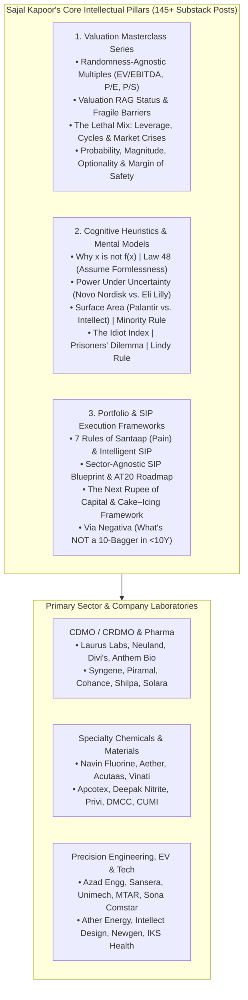

# Part 1: Sajal Kapoor's Antifragile Thinking Substack Archive (Dec 2024 – Sep 2026) — Raw Links & Structured Master Index

## 📁 Document & Session Metadata

- **Format Version (`formatVersion`):** `1`
- **Export Time (`exportTime`):** `2026-11-06T15:06:22.617Z`
- **Chat Session Name (`chat.name`):** `collections/default_collection/engines/gemini-enterprise-sec-dx-swa/sessions/9286957380505800928`
- **Chat Title (`chat.title`):** `Antifragile Investing Topics`
- **Session Start Time (`chat.startTime`):** `2026-09-23T14:49:02.781Z`
- **Session End Time (`chat.endTime`):** `2026-09-24T16:02:31.225Z`
- **Document Part:** Part 1 of 7
- **Turns Included in This File:** Turns 1 (of 12 Total Turns)

---

## 🕒 Turn 1 (Timestamp: `2026-09-23T14:49:44.490817461Z`)

### ❓ User Query (Verbatim)

Clean it make it in tabular form . keep 3 col - Topic , sub topic , stocks ,other  
**[What Are You Actually Looking At?](https://antifragilethinking.substack.com/p/what-are-you-actually-looking-at)**

[The Business Behind the Numbers](https://antifragilethinking.substack.com/p/what-are-you-actually-looking-at)

**Sep 2** • **[Sajal Kapoor](https://substack.com/@antifragilethinking)**

**26:50**

**[Azad Engg. vs Anthem Bio](https://antifragilethinking.substack.com/p/azad-engg-vs-anthem-bio)**

[Two hard businesses. Two different paths to economic proof.](https://antifragilethinking.substack.com/p/azad-engg-vs-anthem-bio)

**Sep 1** • **[Sajal Kapoor](https://substack.com/@antifragilethinking)**

**26:20**

### **August 2026**

**[Ather Energy: Five Fables at an Inflection Point](https://antifragilethinking.substack.com/p/ather-energy-five-fables-at-an-inflection)**

[What the Numbers Say About the Next Eighteen Months](https://antifragilethinking.substack.com/p/ather-energy-five-fables-at-an-inflection)

**Aug 31** • **[Sajal Kapoor](https://substack.com/@antifragilethinking)**

**45:36**

**[Shilpa, Neuland, Navin: The Next Rupee of Capital](https://antifragilethinking.substack.com/p/shilpa-neuland-navin-the-next-rupee)**

[Shilpa Medicare Q1 FY27](https://antifragilethinking.substack.com/p/shilpa-neuland-navin-the-next-rupee)

**Aug 5** • **[Sajal Kapoor](https://substack.com/@antifragilethinking)**

**37:59**

### **May 2026**

**[Sansera Isn't Diversifying. It's Compounding Capabilities.](https://antifragilethinking.substack.com/p/sansera-isnt-diversifying-its-compounding)**

[Please don’t miss the attached audio that accompanies this update.](https://antifragilethinking.substack.com/p/sansera-isnt-diversifying-its-compounding)

**May 29** • **[Sajal Kapoor](https://substack.com/@antifragilethinking)**

**13:57**

**[Conviction Is Not Binary](https://antifragilethinking.substack.com/p/conviction-is-not-binary)**

[AZAD Engg. | Aarti Pharma | Aether Industries](https://antifragilethinking.substack.com/p/conviction-is-not-binary)

**May 27** • **[Sajal Kapoor](https://substack.com/@antifragilethinking)**

**27:25**

**[4 Unique Companies: Near-Term Noise, Long-Term Systems](https://antifragilethinking.substack.com/p/4-unique-companies-near-term-noise)**

[Timken India](https://antifragilethinking.substack.com/p/4-unique-companies-near-term-noise)

**May 20** • **[Sajal Kapoor](https://substack.com/@antifragilethinking)**

**44:09**

**[9 Companies in PF: Beyond the Quarter](https://antifragilethinking.substack.com/p/9-companies-in-pf-beyond-the-quarter)**

[Questions or Comments?](https://antifragilethinking.substack.com/p/9-companies-in-pf-beyond-the-quarter)

**May 18** • **[Sajal Kapoor](https://substack.com/@antifragilethinking)**

**1:14:30**

**[Cohance Lifesciences FY26: Reset, Rebuild, Recover](https://antifragilethinking.substack.com/p/cohance-lifesciences-fy26-reset-rebuild)**

[Cohance spent much of the last 18 months dealing with falling revenues, weaker margins and leadership changes.](https://antifragilethinking.substack.com/p/cohance-lifesciences-fy26-reset-rebuild)

**May 12** • **[Sajal Kapoor](https://substack.com/@antifragilethinking)**

**22:42**

**[Cash Flow, Debt, and Decision-Making: A Tale of Two Companies (Apcotex and Pharma)](https://antifragilethinking.substack.com/p/cash-flow-debt-and-decision-making)**

[When I was accumulating Indoco below 200, my base case was a 2x over two years.](https://antifragilethinking.substack.com/p/cash-flow-debt-and-decision-making)

**May 7** • **[Sajal Kapoor](https://substack.com/@antifragilethinking)**

**20:52**

**[From Commodity Films to a Specialty Materials Platform](https://antifragilethinking.substack.com/p/from-commodity-films-to-a-specialty)**

[Bonus slide: Apcotex Industries business level break-out (operating cash flows).](https://antifragilethinking.substack.com/p/from-commodity-films-to-a-specialty)

**May 6** • **[Sajal Kapoor](https://substack.com/@antifragilethinking)**

**20:37**

**[Ather Energy: Complexity as Advantage](https://antifragilethinking.substack.com/p/ather-energy-complexity-as-advantage)**

[Watch now |](https://antifragilethinking.substack.com/p/ather-energy-complexity-as-advantage)

**May 4** • **[Sajal Kapoor](https://substack.com/@antifragilethinking)**

**26:32**

**[Laurus Labs: A View on 2030–2035](https://antifragilethinking.substack.com/p/laurus-labs-a-view-on-20302035)**

[At times, questions on earnings calls slip into a quieter pattern.](https://antifragilethinking.substack.com/p/laurus-labs-a-view-on-20302035)

**May 2** • **[Sajal Kapoor](https://substack.com/@antifragilethinking)**

**52:17**

### **April 2026**

**[Navin Fluorine: From Building the Engine to Running It](https://antifragilethinking.substack.com/p/navin-fluorine-from-building-the)**

[Listen now |](https://antifragilethinking.substack.com/p/navin-fluorine-from-building-the)

**Apr 30** • **[Sajal Kapoor](https://substack.com/@antifragilethinking)**

**17:34**

**[Granules steady; Piramal strong cash, weak growth](https://antifragilethinking.substack.com/p/granules-steady-piramal-strong-cash)**

[Listen now |](https://antifragilethinking.substack.com/p/granules-steady-piramal-strong-cash)

**Apr 29** • **[Sajal Kapoor](https://substack.com/@antifragilethinking)**

**21:38**

**[Jagsonpal: A Machine Holding Steady Under Constraint](https://antifragilethinking.substack.com/p/jagsonpal-a-machine-holding-steady)**

[Listen now |](https://antifragilethinking.substack.com/p/jagsonpal-a-machine-holding-steady)

**Apr 28** • **[Sajal Kapoor](https://substack.com/@antifragilethinking)**

**11:48**

**[Cohance Life: A Moral Victory, Not a Turning Point ...](https://antifragilethinking.substack.com/p/cohance-life-a-moral-victory-not)**

[Listen now |](https://antifragilethinking.substack.com/p/cohance-life-a-moral-victory-not)

**Apr 28** • **[Sajal Kapoor](https://substack.com/@antifragilethinking)**

**24:32**

**[IKS–TruBridge: A Strategic Shift with Execution Risk](https://antifragilethinking.substack.com/p/ikstrubridge-a-strategic-shift-with)**

[Listen now |](https://antifragilethinking.substack.com/p/ikstrubridge-a-strategic-shift-with)

**Apr 25** • **[Sajal Kapoor](https://substack.com/@antifragilethinking)**

**18:53**

**[Tata Elxsi: A Flywheel Business… With Friction](https://antifragilethinking.substack.com/p/tata-elxsi-a-flywheel-business-with)**

[Q4FY26 Earnings Call - Quick Takeaway](https://antifragilethinking.substack.com/p/tata-elxsi-a-flywheel-business-with)

**Apr 21** • **[Sajal Kapoor](https://substack.com/@antifragilethinking)**

**15:52**

**[Understanding TARIL’s Growth (Transformers & Rectifiers)](https://antifragilethinking.substack.com/p/understanding-tarils-growth-transformers)**

[Q4 and FY26 results.](https://antifragilethinking.substack.com/p/understanding-tarils-growth-transformers)

**Apr 21** • **[Sajal Kapoor](https://substack.com/@antifragilethinking)**

**6:32**

**[Net Cash, Free Cash Flow, Optionality](https://antifragilethinking.substack.com/p/net-cash-free-cash-flow-optionality)**

[Note: FCF = Operating Cash - Mandatory (Maintenance) CAPEX.](https://antifragilethinking.substack.com/p/net-cash-free-cash-flow-optionality)

**Apr 20** • **[Sajal Kapoor](https://substack.com/@antifragilethinking)**

**22:13**

**[The Cost of Conviction — Understanding Aether Industries’ Growth Runway](https://antifragilethinking.substack.com/p/the-cost-of-conviction-understanding)**

[Listen now |](https://antifragilethinking.substack.com/p/the-cost-of-conviction-understanding)

**Apr 15** • **[Sajal Kapoor](https://substack.com/@antifragilethinking)**

**14:16**

**[Disclosure - One Trade That Played Out Perfectly, One Thesis That Got Disturbed (Chambal, Coal)](https://antifragilethinking.substack.com/p/disclosure-one-trade-that-played)**

**Apr 13** • **[Sajal Kapoor](https://substack.com/@antifragilethinking)**

**6:15**

**[From Commodities to Solutions: A Simple Way to Understand CUMI (Cognitive Heuristic Series)](https://antifragilethinking.substack.com/p/from-commodities-to-solutions-a-simple)**

**Apr 10** • **[Sajal Kapoor](https://substack.com/@antifragilethinking)**

**26:48**

**[Data Centres Opportunity & Management Quality](https://antifragilethinking.substack.com/p/data-centres-opportunity-and-management)**

[KRN Heat Exchanger](https://antifragilethinking.substack.com/p/data-centres-opportunity-and-management)

**Apr 9** • **[Sajal Kapoor](https://substack.com/@antifragilethinking)**

**23:10**

**[MTAR Tech - Why No R&D Expenses?](https://antifragilethinking.substack.com/p/mtar-tech-why-no-r-and-d-expenses)**

[This is the question I answered.](https://antifragilethinking.substack.com/p/mtar-tech-why-no-r-and-d-expenses)

**Apr 8** • **[Sajal Kapoor](https://substack.com/@antifragilethinking)**

**11:52**

**[Private Equity Playbook: Sector-Agnostic in Theory, Fragile in Practice](https://antifragilethinking.substack.com/p/private-equity-playbook-sector-agnostic)**

[Watch now |](https://antifragilethinking.substack.com/p/private-equity-playbook-sector-agnostic)

**Apr 1** • **[Sajal Kapoor](https://substack.com/@antifragilethinking)**

**52:15**

### **March 2026**

**[Navin vs Vinati: Law 48 (Assume Formlessness)](https://antifragilethinking.substack.com/p/navin-vs-vinati-law-48-assume-formlessness)**

[CDMO/Precision Engg. vs Commodity Manufacturing](https://antifragilethinking.substack.com/p/navin-vs-vinati-law-48-assume-formlessness)

**Mar 19** • **[Sajal Kapoor](https://substack.com/@antifragilethinking)**

**24:36**

**[Boss Buying + Business Cleanup + Lowest Valuation = Powerful Signal](https://antifragilethinking.substack.com/p/boss-buying-business-cleanup-lowest)**

[Details in the attached audible …](https://antifragilethinking.substack.com/p/boss-buying-business-cleanup-lowest)

**Mar 18** • **[Sajal Kapoor](https://substack.com/@antifragilethinking)**

**7:52**

**[Net Cash and ‘Capacity Ready’ Chemicals](https://antifragilethinking.substack.com/p/net-cash-and-capacity-ready-chemicals)**

[Frame: x is not f(x) | NOCIL as a case in point](https://antifragilethinking.substack.com/p/net-cash-and-capacity-ready-chemicals)

**Mar 16** • **[Sajal Kapoor](https://substack.com/@antifragilethinking)**

**24:29**

**[Valuing Chambal Fertilisers Using Talebian Heuristics](https://antifragilethinking.substack.com/p/valuing-chambal-fertilisers-using)**

[Cognitive Heuristics Series](https://antifragilethinking.substack.com/p/valuing-chambal-fertilisers-using)

**Mar 11** • **[Sajal Kapoor](https://substack.com/@antifragilethinking)**

**26:28**

**[Azad Engineering: Management Lens](https://antifragilethinking.substack.com/p/azad-engineering-management-lens)**

[Listen now | Previous Presentation:](https://antifragilethinking.substack.com/p/azad-engineering-management-lens)

**Mar 11** • **[Sajal Kapoor](https://substack.com/@antifragilethinking)**

**14:10**

**[Viyash Scientific: Management Parsing](https://antifragilethinking.substack.com/p/viyash-scientific-management-parsing)**

**Mar 6** • **[Sajal Kapoor](https://substack.com/@antifragilethinking)**

**19:23**

### **February 2026**

**[AI, the Psychology of Hype — and the Discipline of Results](https://antifragilethinking.substack.com/p/ai-the-psychology-of-hype-and-the)**

[Watch now | This is Part 2 of our three-part series.](https://antifragilethinking.substack.com/p/ai-the-psychology-of-hype-and-the)

**Feb 27** • **[Sajal Kapoor](https://substack.com/@antifragilethinking)**

**1:03:45**

**[AI x Life Sciences: The Structural Shift – Part 1](https://antifragilethinking.substack.com/p/part-1)**

[Listen now | This is Part 1 of a three part series.](https://antifragilethinking.substack.com/p/part-1)

**Feb 25** • **[Sajal Kapoor](https://substack.com/@antifragilethinking)**

**21:55**

**[Stable Core, Disruptive Edge: The Laurus Labs Playbook](https://antifragilethinking.substack.com/p/stable-core-disruptive-edge-the-laurus)**

**Feb 20** • **[Sajal Kapoor](https://substack.com/@antifragilethinking)**

**1:31:17**

**[Lessons from The Black Swan for Unimech Aerospace](https://antifragilethinking.substack.com/p/lessons-from-the-black-swan-for-unimech)**

[Here is my Nov’25 long-note on Unimech (The Lindy rule for new IPOs!)](https://antifragilethinking.substack.com/p/lessons-from-the-black-swan-for-unimech)

**Feb 18** • **[Sajal Kapoor](https://substack.com/@antifragilethinking)**

**26:26**

**[Howard Marks: The Most Important Thing | Case Study: Shivalik Rasayan, Apcotex Industries](https://antifragilethinking.substack.com/p/howard-marks-the-most-important-thing)**

[Watch now |](https://antifragilethinking.substack.com/p/howard-marks-the-most-important-thing)

**Feb 16** • **[Sajal Kapoor](https://substack.com/@antifragilethinking)**

**28:37**

**[Sansera Engineering: The Map. The Territory. The One Thing.](https://antifragilethinking.substack.com/p/sansera-engineering-the-map-theterritory)**

**Feb 14** • **[Sajal Kapoor](https://substack.com/@antifragilethinking)**

**49:22**

**[Common Sense: Who Wins in GenAI race? SaaS Survivors or AI Consumers?](https://antifragilethinking.substack.com/p/common-sense-who-wins-in-genai-race)**

[Intellect Design Arena, Newgen Software, Nucleus Software, Sagility, Sansera Engineering, Sona, Hikal, Aether Industries, Acutaas Chemicals, Navin…](https://antifragilethinking.substack.com/p/common-sense-who-wins-in-genai-race)

**Feb 12** • **[Sajal Kapoor](https://substack.com/@antifragilethinking)**

**18:27**

**[(Hopefully) a Temporary Exit from Interarch](https://antifragilethinking.substack.com/p/hopefully-a-temporary-exit-from-interarch)**

[Read the disclaimer please!](https://antifragilethinking.substack.com/p/hopefully-a-temporary-exit-from-interarch)

**Feb 11** • **[Sajal Kapoor](https://substack.com/@antifragilethinking)**

**15:31**

**[Fair Play (Disclosures) ...](https://antifragilethinking.substack.com/p/fair-play-disclosures)**

[Interarch Building](https://antifragilethinking.substack.com/p/fair-play-disclosures)

**Feb 10** • **[Sajal Kapoor](https://substack.com/@antifragilethinking)**

**9:16**

**[Neuland’s Earnings Stay ‘Lumpy’ but Predictable](https://antifragilethinking.substack.com/p/neulands-earnings-stay-lumpy-but)**

[Watch now |](https://antifragilethinking.substack.com/p/neulands-earnings-stay-lumpy-but)

**Feb 9** • **[Sajal Kapoor](https://substack.com/@antifragilethinking)**

**29:01**

**[Navin Fluorine: Positioned for Disciplined, High-Quality Growth](https://antifragilethinking.substack.com/p/navin-fluorine-positioned-for-disciplined)**

**Feb 9** • **[Sajal Kapoor](https://substack.com/@antifragilethinking)**

**26:13**

**[Solara Pharma: The Signal and the Noise](https://antifragilethinking.substack.com/p/solara-pharma-the-signal-and-the)**

**Feb 7** • **[Sajal Kapoor](https://substack.com/@antifragilethinking)**

**30:09**

**[Clarity, Optionality, Growth: The SeQuent-Viyash Transformation](https://antifragilethinking.substack.com/p/clarity-optionality-growth-the-sequent)**

[Prune, Pivot, Profit: Dr. Hari Babu’s Growth Playbook](https://antifragilethinking.substack.com/p/clarity-optionality-growth-the-sequent)

**Feb 6** • **[Sajal Kapoor](https://substack.com/@antifragilethinking)**

**42:01**

**[Anthem Bio and the Art of Second-Level Thinking: Marks Meets Taleb](https://antifragilethinking.substack.com/p/anthem-bio-and-the-art-of-second)**

[Anthem Bio: 3Q FY26 Earning Reaction](https://antifragilethinking.substack.com/p/anthem-bio-and-the-art-of-second)

**Feb 5** • **[Sajal Kapoor](https://substack.com/@antifragilethinking)**

**26:57**

**[Interarch Building Solutions: Start With Why](https://antifragilethinking.substack.com/p/interarch-building-solutions-start)**

[Watch now |](https://antifragilethinking.substack.com/p/interarch-building-solutions-start)

**Feb 3** • **[Sajal Kapoor](https://substack.com/@antifragilethinking)**

**26:21**

**[Newgen Software: Fooled By Randomness](https://antifragilethinking.substack.com/p/newgen-software-fooled-by-randomness)**

**Feb 2** • **[Sajal Kapoor](https://substack.com/@antifragilethinking)**

**27:51**

### **January 2026**

**[Cognitive Heuristic: Why x is not f(x) | Piramal Pharma | Neuland Labs | Navin Fluorine | Laurus Labs | Sai Life | Anthem Bio | Gland Pharma…](https://antifragilethinking.substack.com/p/cognitive-heuristic-why-x-is-not)**

**Jan 29** • **[Sajal Kapoor](https://substack.com/@antifragilethinking)**

**57:17**

**[The Cake–Icing Framework: OneSource Specialty and Gland Pharma](https://antifragilethinking.substack.com/p/the-cakeicing-framework-onesource)**

[I like cooking meals I’m happy to eat, and eat with the family.](https://antifragilethinking.substack.com/p/the-cakeicing-framework-onesource)

**Jan 28** • **[Sajal Kapoor](https://substack.com/@antifragilethinking)**

**30:33**

**[The Sona Comstar Flywheel: Turning Challenges into Cash Flow](https://antifragilethinking.substack.com/p/the-sona-comstar-flywheel-turning)**

[Bonus heads-up: Syngene upfront, Laurus Labs takes over mid-to-late](https://antifragilethinking.substack.com/p/the-sona-comstar-flywheel-turning)

**Jan 26** • **[Sajal Kapoor](https://substack.com/@antifragilethinking)**

**58:35**

**[Clean Balance Sheets, Cash That Endures: Alivus Life and Jagsonpal Pharma](https://antifragilethinking.substack.com/p/clean-balance-sheets-cash-that-endures)**

**Jan 22** • **[Sajal Kapoor](https://substack.com/@antifragilethinking)**

**16:46**

**[Psychology of Money: Real Price of Investing …](https://antifragilethinking.substack.com/p/psychology-of-money-real-price-of)**

[Watch now |](https://antifragilethinking.substack.com/p/psychology-of-money-real-price-of)

**Jan 21** • **[Sajal Kapoor](https://substack.com/@antifragilethinking)**

**24:14**

**[Chemicals: Not America First (Part 3)](https://antifragilethinking.substack.com/p/chemicals-not-america-first-part-4a0)**

**Jan 20** • **[Sajal Kapoor](https://substack.com/@antifragilethinking)**

**1:09:32**

**[Chemicals: Not America First (Part 2)](https://antifragilethinking.substack.com/p/chemicals-not-america-first-part-35f)**

[Law 48: Assume Formlessness](https://antifragilethinking.substack.com/p/chemicals-not-america-first-part-35f)

**Jan 15** • **[Sajal Kapoor](https://substack.com/@antifragilethinking)**

**42:35**

**[Chemicals: Not America First (Part 1)](https://antifragilethinking.substack.com/p/chemicals-not-america-first-part)**

**Jan 13** • **[Sajal Kapoor](https://substack.com/@antifragilethinking)**

**43:03**

**[Don’t Buy This & That](https://antifragilethinking.substack.com/p/dont-buy-this-and-that)**

**Jan 13** • **[Sajal Kapoor](https://substack.com/@antifragilethinking)**

**15:30**

**[Shilpa Medicare vs Divis Labs: Part 2 and 3 (‘Why’ and ‘How’)](https://antifragilethinking.substack.com/p/shilpa-medicare-vs-divis-labs-part)**

**Jan 9** • **[Sajal Kapoor](https://substack.com/@antifragilethinking)**

**1:12:07**

**[Medi Assist: A Mini-Masterclass on Insurance, Scale, and Limits](https://antifragilethinking.substack.com/p/medi-assist-a-mini-masterclass-on)**

[Listen now |](https://antifragilethinking.substack.com/p/medi-assist-a-mini-masterclass-on)

**Jan 8** • **[Sajal Kapoor](https://substack.com/@antifragilethinking)**

**27:05**

**[Building Value That Lasts](https://antifragilethinking.substack.com/p/building-value-that-lasts)**

[Eureka Forbes, Cohance Lifesciences, and Piramal Pharma as illustrations.](https://antifragilethinking.substack.com/p/building-value-that-lasts)

**Jan 7** • **[Sajal Kapoor](https://substack.com/@antifragilethinking)**

**18:53**

**[Peter Lynch’s Core Principles of Small Investors](https://antifragilethinking.substack.com/p/peter-lynchs-core-principles-of-small)**

**Jan 2** • **[Sajal Kapoor](https://substack.com/@antifragilethinking)**

**1:19:25**

### **December 2025**

**[Shilpa Medicare | Divis Labs: The What Why and How (Part 1)](https://antifragilethinking.substack.com/p/shilpa-medicare-divis-labs-the-what)**

[Supriya Life, Laurus Labs, Neuland Labs and Solara Active as illustrations](https://antifragilethinking.substack.com/p/shilpa-medicare-divis-labs-the-what)

**Dec 26, 2025** • **[Sajal Kapoor](https://substack.com/@antifragilethinking)**

**38:24**

**[Windlas Bio: Clear Thinking – Shane Parrish](https://antifragilethinking.substack.com/p/windlas-bio-clear-thinking-shane)**

**Dec 18, 2025** • **[Sajal Kapoor](https://substack.com/@antifragilethinking)**

**45:38**

**[Hospitals - Separating Fundamentals from Frenzy: Part 1](https://antifragilethinking.substack.com/p/separating-fundamentals-from-frenzy)**

[Krsnaa Diagnostics, Park Medi World, Narayana Hrudayalaya](https://antifragilethinking.substack.com/p/separating-fundamentals-from-frenzy)

**Dec 17, 2025** • **[Sajal Kapoor](https://substack.com/@antifragilethinking)**

**51:09**

**[Cognitive Heuristics Sequel Part 2: Power Under Uncertainty (Novo Nordisk vs. Eli Lilly)](https://antifragilethinking.substack.com/p/cognitive-heuristics-sequel-part-079)**

**Dec 16, 2025** • **[Sajal Kapoor](https://substack.com/@antifragilethinking)**

**21:01**

**[Cognitive Heuristics Sequel Part 1: Power Under Uncertainty (Novo Nordisk vs. Eli Lilly)](https://antifragilethinking.substack.com/p/cognitive-heuristics-sequel-part)**

[Power Law 18](https://antifragilethinking.substack.com/p/cognitive-heuristics-sequel-part)

**Dec 15, 2025** • **[Sajal Kapoor](https://substack.com/@antifragilethinking)**

**23:05**

**[NephroPlus/NephroCare IPO vs CKD Universe (Narayana Health)](https://antifragilethinking.substack.com/p/nephroplusnephrocare-ipo-vs-healthcare)**

**Dec 11, 2025** • **[Sajal Kapoor](https://substack.com/@antifragilethinking)**

**1:01:34**

**[Laurus labs: Screaming (“चीख”) Valuation Heuristic](https://antifragilethinking.substack.com/p/laurus-labs-screaming-valuation-heuristic)**

**Dec 10, 2025** • **[Sajal Kapoor](https://substack.com/@antifragilethinking)**

**12:58**

**[Cognitive Heuristic: Surface Area (Palantir vs. Intellect Design Area)](https://antifragilethinking.substack.com/p/cognitive-heuristic-surface-area)**

**Dec 9, 2025** • **[Sajal Kapoor](https://substack.com/@antifragilethinking)**

**56:29**

**[Piramal Pharma’s Path Forward: Navigating Near-Term Volatility to Unlock Long-Term Growth](https://antifragilethinking.substack.com/p/piramal-pharmas-path-forward-navigating)**

[Watch now |](https://antifragilethinking.substack.com/p/piramal-pharmas-path-forward-navigating)

**Dec 4, 2025** • **[Sajal Kapoor](https://substack.com/@antifragilethinking)**

**42:47**

**[Investing Masterclass: Analysing volatility and asset quality for 'randomness-agnostic’ valuation-multiple selection (EV/EBITDA, P/E, P/S…](https://antifragilethinking.substack.com/p/investing-masterclass-analysing-volatility)**

**Dec 2, 2025** • **[Sajal Kapoor](https://substack.com/@antifragilethinking)**

**1:00:41**

### **November 2025**

**[Investing Masterclass: Valuation RAG Status (Fragile Barriers)](https://antifragilethinking.substack.com/p/investing-masterclass-valuation-rag)**

**Nov 26, 2025** • **[Sajal Kapoor](https://substack.com/@antifragilethinking)**

**37:22**

**[The Lethal Mix: Leverage, Cycles, and Market Crises (Valuation Masterclass Series)](https://antifragilethinking.substack.com/p/the-lethal-mix-leverage-cycles-and)**

**Nov 23, 2025** • **[Sajal Kapoor](https://substack.com/@antifragilethinking)**

**47:47**

**[Deepak Nitrite, Aether Industries, Ingrevia, Acutaas Chemicals and Hurricane!](https://antifragilethinking.substack.com/p/deepak-nitrite-aether-industries)**

**Nov 21, 2025** • **[Sajal Kapoor](https://substack.com/@antifragilethinking)**

**22:34**

**[Running the CDMO Race: SeQuent-Viyash Merger](https://antifragilethinking.substack.com/p/running-the-cdmo-race-sequent-viyash)**

**Nov 18, 2025** • **[Sajal Kapoor](https://substack.com/@antifragilethinking)**

**36:32**

**[Eureka Forbes: Driving Growth with Innovation and Record Profits](https://antifragilethinking.substack.com/p/eureka-forbes-driving-growth-with)**

**Nov 15, 2025** • **[Sajal Kapoor](https://substack.com/@antifragilethinking)**

**18:29**

**[The Never-Performers: Hikal and Kopran](https://antifragilethinking.substack.com/p/the-never-performers-hikal-and-kopran)**

**Nov 14, 2025** • **[Sajal Kapoor](https://substack.com/@antifragilethinking)**

**35:07**

**[Antifragility in Action: KOEL’s Strategic Evolution](https://antifragilethinking.substack.com/p/antifragility-in-action-koels-strategic)**

**Nov 13, 2025** • **[Sajal Kapoor](https://substack.com/@antifragilethinking)**

**20:12**

**[Digesting Advanced Enzymes’ H1 FY26 Performance](https://antifragilethinking.substack.com/p/digesting-advanced-enzymes-h1-fy26)**

**Nov 12, 2025** • **[Sajal Kapoor](https://substack.com/@antifragilethinking)**

**37:26**

**[Aarti Pharma Labs: Don’t miss the climax !](https://antifragilethinking.substack.com/p/aarti-pharma-labs-dont-miss-the-climax)**

**Nov 12, 2025** • **[Sajal Kapoor](https://substack.com/@antifragilethinking)**

**19:57**

**[CRDMO Showdown: Anthem Bio vs Sai Life vs Syngene](https://antifragilethinking.substack.com/p/crdmo-showdown-anthem-bio-vs-sai)**

**Nov 11, 2025** • **[Sajal Kapoor](https://substack.com/@antifragilethinking)**

**42:21**

**[Interarch: Assessing Moats, Value, and Future Potential](https://antifragilethinking.substack.com/p/interarch-assessing-moats-value-and)**

[Take Control Of Your Finances | The Money Show With Anil Lamba](https://antifragilethinking.substack.com/p/interarch-assessing-moats-value-and)

**Nov 9, 2025** • **[Sajal Kapoor](https://substack.com/@antifragilethinking)**

**22:56**

**[7 Rules of Santaap (Pain) & Intelligent SIP](https://antifragilethinking.substack.com/p/7-rules-of-santaap-pain-and-intelligent)**

**Nov 8, 2025** • **[Sajal Kapoor](https://substack.com/@antifragilethinking)**

**35:00**

**[FDC: Terminal Problem or Turkey Problem?](https://antifragilethinking.substack.com/p/fdc-terminal-problem-or-turkey-problem)**

**Nov 6, 2025** • **[Sajal Kapoor](https://substack.com/@antifragilethinking)**

**16:16**

**[Solara: Navigating Uncertainty, Unlocking Opportunity (5 Nov 2025)](https://antifragilethinking.substack.com/p/solara-navigating-uncertainty-unlocking)**

**Nov 5, 2025** • **[Sajal Kapoor](https://substack.com/@antifragilethinking)**

**28:07**

**[Blue Jet Healthcare: CDMO Flight?](https://antifragilethinking.substack.com/p/blue-jet-healthcare-cdmo-flight)**

**Nov 5, 2025** • **[Sajal Kapoor](https://substack.com/@antifragilethinking)**

**18:12**

**[Jagsonpal Pharma SIP or Trading/Punting?](https://antifragilethinking.substack.com/p/jagsonpal-pharma-sip-or-tradingpunting)**

**Nov 4, 2025** • **[Sajal Kapoor](https://substack.com/@antifragilethinking)**

**21:35**

**[Jeena Sikho Ayurveda vs. Allopathy](https://antifragilethinking.substack.com/p/jeena-sikho-ayurveda-vs-allopathy)**

**Nov 3, 2025** • **[Sajal Kapoor](https://substack.com/@antifragilethinking)**

**13:33**

**[Opportunistic Cyclicals 2.0 (November 2025)](https://antifragilethinking.substack.com/p/opportunistic-cyclicals-20-november)**

**Nov 2, 2025** • **[Sajal Kapoor](https://substack.com/@antifragilethinking)**

**29:36**

**[Inside Intellect’s Design DNA: The Power of First Principles Thinking](https://antifragilethinking.substack.com/p/inside-intellects-design-dna-the)**

**Nov 1, 2025** • **[Sajal Kapoor](https://substack.com/@antifragilethinking)**

**44:09**

### **October 2025**

**[Jubilant Pharmova: 3x in 3 years from "re-rating" alone!](https://antifragilethinking.substack.com/p/jubilant-pharmova-3x-in-3-years-from)**

**Oct 31, 2025** • **[Sajal Kapoor](https://substack.com/@antifragilethinking)**

**27:21**

**[IKS Health: Antifragility and Skin in the Game in Action!](https://antifragilethinking.substack.com/p/iks-health-antifragility-and-skin)**

**Oct 31, 2025** • **[Sajal Kapoor](https://substack.com/@antifragilethinking)**

**15:40**

**[Navin Fluorine: How are they Antifragile by design?](https://antifragilethinking.substack.com/p/navin-fluorine-how-are-they-antifragile)**

**Oct 30, 2025** • **[Sajal Kapoor](https://substack.com/@antifragilethinking)**

**22:38**

**[Newgen Software: IP/R&D and stressors/chaos => Asymmetry](https://antifragilethinking.substack.com/p/newgen-software-ipr-and-d-and-stressorschaos)**

**Oct 29, 2025** • **[Sajal Kapoor](https://substack.com/@antifragilethinking)**

**21:04**

**[Sona Comstar, SRF and Ingrevia: Q2/H1 FY26 Analysis](https://antifragilethinking.substack.com/p/sona-comstar-srf-and-ingrevia-q2h1)**

**Oct 27, 2025** • **[Sajal Kapoor](https://substack.com/@antifragilethinking)**

**32:09**

**[Persistent Systems vs. Tata Elxsi: a thought experiment](https://antifragilethinking.substack.com/p/persistent-systems-vs-tata-elxsi)**

**Oct 25, 2025** • **[Sajal Kapoor](https://substack.com/@antifragilethinking)**

**45:31**

**[Laurus Labs H1 FY 2026](https://antifragilethinking.substack.com/p/laurus-labs-h1-fy-2026)**

**Oct 23, 2025** • **[Sajal Kapoor](https://substack.com/@antifragilethinking)**

**24:41**

**[IEX: Monopoly and Compounding Machine?](https://antifragilethinking.substack.com/p/iex-monopoly-and-compounding-machine)**

**Oct 22, 2025** • **[Sajal Kapoor](https://substack.com/@antifragilethinking)**

**19:49**

**[Azad Engg. vs Sai Life: CDMO Lens](https://antifragilethinking.substack.com/p/azad-engg-vs-sai-life-cdmo-lens)**

**Oct 20, 2025** • **[Sajal Kapoor](https://substack.com/@antifragilethinking)**

**45:44**

**[Laurus Labs: Thriving on Randomness and Setbacks](https://antifragilethinking.substack.com/p/laurus-labs-thriving-on-randomness)**

**Oct 19, 2025** • **[Sajal Kapoor](https://substack.com/@antifragilethinking)**

**28:12**

**[From Optionality to Dominance: A Tale of Two Electric Pioneers (Ather Energy vs Ola Electric Mobility)](https://antifragilethinking.substack.com/p/from-optionality-to-dominance-a-tale)**

**Oct 17, 2025** • **[Sajal Kapoor](https://substack.com/@antifragilethinking)**

**46:13**

**[Dassault Systèmes: Evolving in Chaos, Dominating Through Change](https://antifragilethinking.substack.com/p/dassault-systemes-evolving-in-chaos)**

**Oct 16, 2025** • **[Sajal Kapoor](https://substack.com/@antifragilethinking)**

**39:49**

**[Chemicals: Economics of Science and Randomness](https://antifragilethinking.substack.com/p/chemicals-economics-of-science-and)**

**Oct 15, 2025** • **[Sajal Kapoor](https://substack.com/@antifragilethinking)**

**24:56**

**[ॐ भवति भिक्षां देहि (2 Pharma Companies)](https://antifragilethinking.substack.com/p/2-pharma-companies)**

[Aarti Drugs, Akums](https://antifragilethinking.substack.com/p/2-pharma-companies)

**Oct 14, 2025** • **[Sajal Kapoor](https://substack.com/@antifragilethinking)**

**19:34**

**[Different Worlds, One Lens: Cash Flow and Common Sense in Four Businesses](https://antifragilethinking.substack.com/p/different-worlds-one-lens-cash-flow)**

**Oct 13, 2025** • **[Sajal Kapoor](https://substack.com/@antifragilethinking)**

**43:47**

**[Syngene and AT20 (Important Update)](https://antifragilethinking.substack.com/p/syngene-and-at20-important-update)**

**Oct 12, 2025** • **[Sajal Kapoor](https://substack.com/@antifragilethinking)**

**28:49**

**[Chemical Case Study: Fooled By The Randomness of Intangibles](https://antifragilethinking.substack.com/p/chemical-case-study-fooled-by-the)**

**Oct 12, 2025** • **[Sajal Kapoor](https://substack.com/@antifragilethinking)**

**11:20**

**[Economies of Scope: The CDMO Edge (SeQuent | Alivus | Solara)](https://antifragilethinking.substack.com/p/economies-of-scope-the-cdmo-edge)**

**Oct 8, 2025** • **[Sajal Kapoor](https://substack.com/@antifragilethinking)**

**46:21**

**[Substack’s Subscription Grandfathering](https://antifragilethinking.substack.com/p/substacks-subscription-grandfathering)**

**Oct 8, 2025** • **[Sajal Kapoor](https://substack.com/@antifragilethinking)**

**4:08**

**[Skin in the Game & Owner-Operator Advantage](https://antifragilethinking.substack.com/p/skin-in-the-game-and-owner-operator)**

[Watch now |](https://antifragilethinking.substack.com/p/skin-in-the-game-and-owner-operator)

**Oct 4, 2025** • **[Sajal Kapoor](https://substack.com/@antifragilethinking)**

**33:39**

**[Valuing the Metals Universe: The Hidden Rare Earth of Fat-Tails](https://antifragilethinking.substack.com/p/valuing-the-metals-universe-the-hidden)**

**Oct 2, 2025** • **[Sajal Kapoor](https://substack.com/@antifragilethinking)**

**57:05**

### **September 2025**

**[AT20: Don’t panic, pivot!](https://antifragilethinking.substack.com/p/at20-dont-panic-pivot)**

[Watch now |](https://antifragilethinking.substack.com/p/at20-dont-panic-pivot)

**Sep 29, 2025** • **[Sajal Kapoor](https://substack.com/@antifragilethinking)**

**20:10**

**[Donald Trump You're Fired: Pharma Edition!](https://antifragilethinking.substack.com/p/donald-trump-youre-fired-pharma-edition)**

**Sep 26, 2025** • **[Sajal Kapoor](https://substack.com/@antifragilethinking)**

**28:23**

**[Revolutionising Supply Chains: A Deep Dive into Technology-Enabled Logistics](https://antifragilethinking.substack.com/p/revolutionising-supply-chains-a-deep)**

**Sep 24, 2025** • **[Sajal Kapoor](https://substack.com/@antifragilethinking)**

**16:42**

**[Betting on Promise: a Small-cap, Two Nano-caps, and a Micro-Cap with Visionary Leadership](https://antifragilethinking.substack.com/p/betting-on-promise-a-small-cap-two)**

**Sep 23, 2025** • **[Sajal Kapoor](https://substack.com/@antifragilethinking)**

**37:15**

**[Via Negativa: Chemicals, Autos, Technology/IT, Logistics, Textiles](https://antifragilethinking.substack.com/p/via-negativa-chemicals-autos-technologyit)**

**Sep 20, 2025** • **[Sajal Kapoor](https://substack.com/@antifragilethinking)**

**25:23**

**[15 Down, 5 to Go: The Road to 20](https://antifragilethinking.substack.com/p/15-down-5-to-go-the-road-to-20)**

**Sep 17, 2025** • **[Sajal Kapoor](https://substack.com/@antifragilethinking)**

**27:53**

**[Rare Earth Elements (REEs)](https://antifragilethinking.substack.com/p/rare-earth-elements-rees)**

**Sep 11, 2025** • **[Sajal Kapoor](https://substack.com/@antifragilethinking)**

**14:20**

**[Cognitive Heuristic: Isolation breeds vulnerability](https://antifragilethinking.substack.com/p/cognitive-heuristic-isolation-breeds)**

**Sep 9, 2025** • **[Sajal Kapoor](https://substack.com/@antifragilethinking)**

**14:57**

**[Shivalik Rasayan: Emerging from the Tunnel of Darkness?](https://antifragilethinking.substack.com/p/shivalik-rasayan-emerging-from-the)**

**Sep 8, 2025** • **[Sajal Kapoor](https://substack.com/@antifragilethinking)**

**31:23**

**[9 Down, 11 to Go: The Road to 20](https://antifragilethinking.substack.com/p/9-down-11-to-go-the-road-to-20)**

[Addendum / clarification](https://antifragilethinking.substack.com/p/9-down-11-to-go-the-road-to-20)

**Sep 7, 2025** • **[Sajal Kapoor](https://substack.com/@antifragilethinking)**

**21:38**

**[4 Down, 16 to Go: The Road to 20](https://antifragilethinking.substack.com/p/4-down-16-to-go-the-road-to-20)**

[Disclaimer](https://antifragilethinking.substack.com/p/4-down-16-to-go-the-road-to-20)

**Sep 4, 2025** • **[Sajal Kapoor](https://substack.com/@antifragilethinking)**

**20:15**

**[Quick Overview: Neuland’s Fractals: the repeating patterns of 40 years](https://antifragilethinking.substack.com/p/quick-overview-neulands-fractals)**

[For Q&A, refer to my latest Substack post—just released—covering Neuland Labs and other examples from the CDMO universe, along with the full…](https://antifragilethinking.substack.com/p/quick-overview-neulands-fractals)

**Sep 2, 2025** • **[Sajal Kapoor](https://substack.com/@antifragilethinking)**

**17:55**

### **August 2025**

**[Fungibility of Fractals!](https://antifragilethinking.substack.com/p/fungibility-of-fractals)**

[Fractals Are Industry Agnostic!](https://antifragilethinking.substack.com/p/fungibility-of-fractals)

**Aug 24, 2025** • **[Sajal Kapoor](https://substack.com/@antifragilethinking)**

**20:22**

**[Asking Run Rate? Deepak Nitrite, Neuland, Divis, Laurus, Praj, Aarti](https://antifragilethinking.substack.com/p/asking-run-rate-deepak-nitrite-neuland)**

[Aka 'Expectations Investing'](https://antifragilethinking.substack.com/p/asking-run-rate-deepak-nitrite-neuland)

**Aug 14, 2025** • **[Sajal Kapoor](https://substack.com/@antifragilethinking)**

**40:13**

**[Quick update: DMCC, FDC, Neuland, Laurus, Hikal and Solara](https://antifragilethinking.substack.com/p/quick-update-dmcc-fdc-neuland-laurus)**

[Disclaimer: This note is purely an unbiased representation of my management interaction in June 2025.](https://antifragilethinking.substack.com/p/quick-update-dmcc-fdc-neuland-laurus)

**Aug 7, 2025** • **[Sajal Kapoor](https://substack.com/@antifragilethinking)**

**7:19**

**[RQT: Backward Integration and Chemical vs Pharma Fixed Asset Turns](https://antifragilethinking.substack.com/p/rqt-backward-integration-and-chemical)**

[Side note: all comments and questions can be added here (central location helps track and trace for faster turnaround):](https://antifragilethinking.substack.com/p/rqt-backward-integration-and-chemical)

**Aug 3, 2025** • **[Sajal Kapoor](https://substack.com/@antifragilethinking)**

**21:01**

### **July 2025**

**[Addendum: Sector Agnostic SIP Framework](https://antifragilethinking.substack.com/p/addendum-sector-agnostic-sip-framework)**

[Listen now | Main presentation link:](https://antifragilethinking.substack.com/p/addendum-sector-agnostic-sip-framework)

**Jul 29, 2025** • **[Sajal Kapoor](https://substack.com/@antifragilethinking)**

**11:42**

**[Sector Agnostic SIP Framework](https://antifragilethinking.substack.com/p/sector-agnostic-sip-framework)**

[Disclaimer: This analysis is purely an unbiased opinion to the best of my ability.](https://antifragilethinking.substack.com/p/sector-agnostic-sip-framework)

**Jul 27, 2025** • **[Sajal Kapoor](https://substack.com/@antifragilethinking)**

**59:34**

**[My Trust with Biosciences: Panacea Bio](https://antifragilethinking.substack.com/p/my-trust-with-biosciences-panacea)**

[Disclaimer: This analysis is purely an unbiased opinion to the best of my ability.](https://antifragilethinking.substack.com/p/my-trust-with-biosciences-panacea)

**Jul 17, 2025** • **[Sajal Kapoor](https://substack.com/@antifragilethinking)**

**15:09**

**[Valuation Masterclass Series: Role of Reframing and Rethinking! (Part - 2)](https://antifragilethinking.substack.com/p/valuation-masterclass-series-role)**

[Disclaimer: This analysis is purely an unbiased opinion to the best of my ability.](https://antifragilethinking.substack.com/p/valuation-masterclass-series-role)

**Jul 17, 2025** • **[Sajal Kapoor](https://substack.com/@antifragilethinking)**

**1:12:04**

**[Valuation Masterclass Series: The Art of Parsing the Management (Part 1)](https://antifragilethinking.substack.com/p/valuation-masterclass-series-the)**

[Part 1 of the four-hour session that was delivered live in Chennai on 6 July 2025](https://antifragilethinking.substack.com/p/valuation-masterclass-series-the)

**Jul 14, 2025** • **[Sajal Kapoor](https://substack.com/@antifragilethinking)**

**1:14:08**

**[Piramal Pharma: Why and When?](https://antifragilethinking.substack.com/p/piramal-pharma-why-and-when)**

[Table of contents](https://antifragilethinking.substack.com/p/piramal-pharma-why-and-when)

**Jul 11, 2025** • **[Sajal Kapoor](https://substack.com/@antifragilethinking)**

**15:43**

**[Anthem Biosciences: IPO and Scenario Analysis](https://antifragilethinking.substack.com/p/anthem-biosciences-ipo-and-scenario)**

[Disclaimer: This analysis is purely an unbiased opinion to the best of my ability.](https://antifragilethinking.substack.com/p/anthem-biosciences-ipo-and-scenario)

**Jul 9, 2025** • **[Sajal Kapoor](https://substack.com/@antifragilethinking)**

**53:10**

**[Valuation Masterclass Series: Role of Reframing and Rethinking! (Part - 1)](https://antifragilethinking.substack.com/p/role-of-reframing-and-rethinking)**

[Disclaimer: This analysis is purely an unbiased opinion to the best of my ability.](https://antifragilethinking.substack.com/p/role-of-reframing-and-rethinking)

**Jul 7, 2025** • **[Sajal Kapoor](https://substack.com/@antifragilethinking)**

**31:57**

### **June 2025**

**[Narayana Health vs Yatharth Hospital](https://antifragilethinking.substack.com/p/narayana-health-vs-yatharth-hospital)**

[Disclaimer: This analysis is purely an unbiased opinion to the best of my ability.](https://antifragilethinking.substack.com/p/narayana-health-vs-yatharth-hospital)

**Jun 29, 2025** • **[Sajal Kapoor](https://substack.com/@antifragilethinking)**

**14:49**

**[CDMO outlook!](https://antifragilethinking.substack.com/p/cdmo-outlook)**

[Disclaimer: This analysis is purely an unbiased opinion to the best of my ability.](https://antifragilethinking.substack.com/p/cdmo-outlook)

**Jun 27, 2025** • **[Sajal Kapoor](https://substack.com/@antifragilethinking)**

**16:44**

**[Update On: Privi Speciality Chemicals](https://antifragilethinking.substack.com/p/update-on-privi-speciality-chemicals)**

[Reference and timestamp (start around 15 mins in the link below).The associated voice note and presentation includes a disclaimer!](https://antifragilethinking.substack.com/p/update-on-privi-speciality-chemicals)

**Jun 18, 2025** • **[Sajal Kapoor](https://substack.com/@antifragilethinking)**

**7:48**

**[Cognitive Heuristic - Minority Rule (MR)](https://antifragilethinking.substack.com/p/cognitive-heuristic-minority-rule)**

[Slides from this presentation](https://antifragilethinking.substack.com/p/cognitive-heuristic-minority-rule)

**Jun 16, 2025** • **[Sajal Kapoor](https://substack.com/@antifragilethinking)**

**26:27**

### **May 2025**

**[Cognitive Heuristic: The genius inside the "idiot index"](https://antifragilethinking.substack.com/p/cognitive-heuristic-the-genius-inside)**

[Slide 1:](https://antifragilethinking.substack.com/p/cognitive-heuristic-the-genius-inside)

**May 18, 2025** • **[Sajal Kapoor](https://substack.com/@antifragilethinking)**

**29:47**

**[Part 2: what’s Not 10-bagger in <10Y](https://antifragilethinking.substack.com/p/part-2-whats-not-10-bagger-in-10y)**

[Part 1:](https://antifragilethinking.substack.com/p/part-2-whats-not-10-bagger-in-10y)

**May 14, 2025** • **[Sajal Kapoor](https://substack.com/@antifragilethinking)**

**35:29**

**[What’s Not a 10-bagger?](https://antifragilethinking.substack.com/p/whats-not-a-10-bagger)**

**May 10, 2025** • **[Sajal Kapoor](https://substack.com/@antifragilethinking)**

**13:40**

**[4Q F25 opinion: Max India (rights isssue), JPL, DMCC, Newgen, Kajaria and IT Services](https://antifragilethinking.substack.com/p/4q-f25-opinion-max-india-rights-isssue)**

**May 8, 2025** • **[Sajal Kapoor](https://substack.com/@antifragilethinking)**

**15:56**

**[Views and updates: Privi, RPG and Incredible India!](https://antifragilethinking.substack.com/p/views-and-updates-privi-rpg-and-incredible)**

[Standard disclaimer: None of this is a buy/sell recommendation.](https://antifragilethinking.substack.com/p/views-and-updates-privi-rpg-and-incredible)

**May 6, 2025** • **[Sajal Kapoor](https://substack.com/@antifragilethinking)**

**16:10**

**[Mental Model Illustration: Prisoners' Dilemma](https://antifragilethinking.substack.com/p/mental-model-illustration-prisoners)**

**May 2, 2025** • **[Sajal Kapoor](https://substack.com/@antifragilethinking)**

**29:00**

### **April 2025**

**[Syngene 4Q F25, F26 Outlook and Hidden Fragility](https://antifragilethinking.substack.com/p/syngene-4q-f25-f26-outlook-and-hidden)**

[Any questions?](https://antifragilethinking.substack.com/p/syngene-4q-f25-f26-outlook-and-hidden)

**Apr 24, 2025** • **[Sajal Kapoor](https://substack.com/@antifragilethinking)**

**50:47**

**[Laurus Labs: Medium Term Outlook F26 – F28](https://antifragilethinking.substack.com/p/laurus-labs-medium-term-outlook-f26)**

[Contents (detailing my 7 March 2025 in person meeting)](https://antifragilethinking.substack.com/p/laurus-labs-medium-term-outlook-f26)

**Apr 23, 2025** • **[Sajal Kapoor](https://substack.com/@antifragilethinking)**

**55:19**

**[Intelligent SIP ‘+’ Opportunistic Bets (17 Apr 2025)](https://antifragilethinking.substack.com/p/intelligent-sip-opportunistic-bets)**

[Q&A is open, but please restrict your questions to 1 per person.](https://antifragilethinking.substack.com/p/intelligent-sip-opportunistic-bets)

**Apr 17, 2025** • **[Sajal Kapoor](https://substack.com/@antifragilethinking)**

**1:16:23**

**[Heads or Tails: Potential Out-performers (13 April 2025)](https://antifragilethinking.substack.com/p/heads-or-tails-potential-out-performers)**

**Apr 13, 2025** • **[Sajal Kapoor](https://substack.com/@antifragilethinking)**

**33:10**

**[CDMO Insights - Tariffs, US Manufacturing (11 April 2025)](https://antifragilethinking.substack.com/p/cdmo-insights-tariffs-us-manufacturing-e71)**

[Any further questions, please use this link:](https://antifragilethinking.substack.com/p/cdmo-insights-tariffs-us-manufacturing-e71)

**Apr 11, 2025** • **[Sajal Kapoor](https://substack.com/@antifragilethinking)**

**1:05:58**

**[Tariffs—the corridor of extreme uncertainty and randomness](https://antifragilethinking.substack.com/p/tariffsthe-corridor-of-extreme-uncertainty)**

**Apr 6, 2025** • **[Sajal Kapoor](https://substack.com/@antifragilethinking)**

**1:33:22**

### **March 2025**

**[Free Q&A (30 March) Response - Part 1](https://antifragilethinking.substack.com/p/free-q-and-a-30-march-response-part)**

[Important disclaimer: Uncertainty and risk are inherent in investment decisions.](https://antifragilethinking.substack.com/p/free-q-and-a-30-march-response-part)

**Mar 31, 2025** • **[Sajal Kapoor](https://substack.com/@antifragilethinking)**

**32:18**

**[Full 3.5 hours recording: Antifragile – SOIC, ISKCON Auditorium – 22 March 2025](https://antifragilethinking.substack.com/p/full-35-hours-recording-antifragile)**

**Mar 27, 2025** • **[Sajal Kapoor](https://substack.com/@antifragilethinking)**

**3:32:01**

**[Neuland Labs - 6th March 2025](https://antifragilethinking.substack.com/p/neuland-labs-6th-march-2025)**

[•Big Picture](https://antifragilethinking.substack.com/p/neuland-labs-6th-march-2025)

**Mar 15, 2025** • **[Sajal Kapoor](https://substack.com/@antifragilethinking)**

**11:27**

**[Genome Valley R&D Site Visit - Laurus Labs](https://antifragilethinking.substack.com/p/genome-valley-r-and-d-site-visit)**

**Mar 4, 2025** • **[Sajal Kapoor](https://substack.com/@antifragilethinking)**

**10:52**

### **February 2025**

**[Wild Randomness – Real Time Analysis!](https://antifragilethinking.substack.com/p/wild-randomness-real-time-analysis)**

**Feb 14, 2025** • **[Sajal Kapoor](https://substack.com/@antifragilethinking)**

**36:04**

**[Happy Valentine's Day!](https://antifragilethinking.substack.com/p/happy-valentines-day)**

**Feb 14, 2025** • **[Sajal Kapoor](https://substack.com/@antifragilethinking)**

**4:59**

**[That's a promise!](https://antifragilethinking.substack.com/p/thats-a-promise)**

**Feb 14, 2025** • **[Sajal Kapoor](https://substack.com/@antifragilethinking)**

**2:06**

**[Natco Pharma - another random opinion](https://antifragilethinking.substack.com/p/natco-pharma-another-random-opinion)**

[Important disclaimer: Uncertainty and risk are inherent in investment decisions.](https://antifragilethinking.substack.com/p/natco-pharma-another-random-opinion)

**Feb 13, 2025** • **[Sajal Kapoor](https://substack.com/@antifragilethinking)**

**10:18**

**[3Q FY25 analysis and next steps: FDC, Fairchem, Orchid Pharma, Vimta Labs, DMCC](https://antifragilethinking.substack.com/p/3q-fy25-analysis-and-next-steps-fdc)**

**Feb 13, 2025** • **[Sajal Kapoor](https://substack.com/@antifragilethinking)**

**40:26**

**[3Q FY25 - these 3 and more later.](https://antifragilethinking.substack.com/p/3q-fy25-these-3-and-more-later)**

**Feb 12, 2025** • **[Sajal Kapoor](https://substack.com/@antifragilethinking)**

**3:31**

**[3Q FY25 analysis and next steps: Advanced Enzymes, Windlas, Kopran, Neuland, Eureka, SeQuent, Aarti Pharma, Shivalik](https://antifragilethinking.substack.com/p/3q-fy25-analysis-and-next-steps-advanced)**

[Rule 1: Positive forward rate of change](https://antifragilethinking.substack.com/p/3q-fy25-analysis-and-next-steps-advanced)

**Feb 11, 2025** • **[Sajal Kapoor](https://substack.com/@antifragilethinking)**

**36:20**

**[Syngene: My view of Jonathan Hunt's resignation](https://antifragilethinking.substack.com/p/syngene-my-view-of-jonathan-hunts)**

**Feb 10, 2025** • **[Sajal Kapoor](https://substack.com/@antifragilethinking)**

**3:56**

**[Types of Black Swans—few illustrations and valuations](https://antifragilethinking.substack.com/p/types-of-black-swansfew-illustrations)**

**Feb 10, 2025** • **[Sajal Kapoor](https://substack.com/@antifragilethinking)**

**12:14**

**[Valuation Masterclass Series: Probability, Magnitude, Optionality, Margin of Safety over Time](https://antifragilethinking.substack.com/p/valuation-masterclass-series-probability)**

[Slides](https://antifragilethinking.substack.com/p/valuation-masterclass-series-probability)

**Feb 8, 2025** • **[Sajal Kapoor](https://substack.com/@antifragilethinking)**

**1:12:12**

**[Senores Pharma: Q&A from Antifragile Thinking](https://antifragilethinking.substack.com/p/senores-pharma-q-and-a-from-antifragile)**

[Table of contents](https://antifragilethinking.substack.com/p/senores-pharma-q-and-a-from-antifragile)

**Feb 7, 2025** • **[Sajal Kapoor](https://substack.com/@antifragilethinking)**

**19:34**

**[Simple antidote to tackle volatility and disorder.](https://antifragilethinking.substack.com/p/simple-antidote-to-tackle-volatility)**

[Agenda 1.](https://antifragilethinking.substack.com/p/simple-antidote-to-tackle-volatility)

**Feb 6, 2025** • **[Sajal Kapoor](https://substack.com/@antifragilethinking)**

**26:25**

**[Reimagining Laurus Labs 2030 (Part 2A)](https://antifragilethinking.substack.com/p/reimagining-laurus-labs-2030-part-0c4)**

[Reimagining Laurus Labs 2030 (Part 2B)](https://antifragilethinking.substack.com/p/reimagining-laurus-labs-2030-part-0c4)

**Feb 2, 2025** • **[Sajal Kapoor](https://substack.com/@antifragilethinking)**

**1:39:47**

### **January 2025**

**[No Nonsense SIP works across cycles](https://antifragilethinking.substack.com/p/no-nonsense-sip-works-across-cycles)**

**Jan 28, 2025** • **[Sajal Kapoor](https://substack.com/@antifragilethinking)**

**41:37**

**[Laurus Labs: Antifragility Unfolding (Part 1)](https://antifragilethinking.substack.com/p/laurus-labs-antifragility-unfolding)**

[The first question analysts asked when Laurus Labs announced the acquisition of Richcore Lifesciences was, “What is the current capacity?”](https://antifragilethinking.substack.com/p/laurus-labs-antifragility-unfolding)

**Jan 26, 2025** • **[Sajal Kapoor](https://substack.com/@antifragilethinking)**

**1:09:52**

**[Q&A: Think noise. Think Terminal Value!](https://antifragilethinking.substack.com/p/q-and-a-think-noise-think-terminal)**

**Jan 22, 2025** • **[Sajal Kapoor](https://substack.com/@antifragilethinking)**

**20:08**

**[Shivalik Rasayan: Santaap Mein Sukh—Stoicism Lens](https://antifragilethinking.substack.com/p/shivalik-rasayan-santaap-mein-sukhstoicism)**

**Jan 19, 2025** • **[Sajal Kapoor](https://substack.com/@antifragilethinking)**

**59:14**

**[Fragile or antifragile, Eureka Forbes?](https://antifragilethinking.substack.com/p/fragile-or-antifragile-eureka-forbes)**

**Jan 17, 2025** • **[Sajal Kapoor](https://substack.com/@antifragilethinking)**

**53:09**

**[Pulse Check: SIP and Common Sense](https://antifragilethinking.substack.com/p/pulse-check-sip-and-common-sense)**

[The confluence of economics, psychology, and market volatility](https://antifragilethinking.substack.com/p/pulse-check-sip-and-common-sense)

**Jan 14, 2025** • **[Sajal Kapoor](https://substack.com/@antifragilethinking)**

**39:45**

**[Thermodynamics of the Japan-US-India triangle: CDMO Case Study (focus on Hikal)](https://antifragilethinking.substack.com/p/thermodynamics-of-the-japan-us-india)**

**Jan 11, 2025** • **[Sajal Kapoor](https://substack.com/@antifragilethinking)**

**1:18:58**

**[1 Minute ROTI: Sai Life, Aether, Tiles & Ceramics Industry](https://antifragilethinking.substack.com/p/1-minute-roti-sai-life-aether-tiles)**

[Note: New subscribers only get to catch up with all posts uploaded in the last 10 days on a rolling basis.](https://antifragilethinking.substack.com/p/1-minute-roti-sai-life-aether-tiles)

**Jan 5, 2025** • **[Sajal Kapoor](https://substack.com/@antifragilethinking)**

**13:08**

**[Indegene vs. CRDMO and Traditional IT](https://antifragilethinking.substack.com/p/indegene-vs-crdmo-and-traditional)**

[“If you're not prepared to be wrong, you'll never come up with anything original.”](https://antifragilethinking.substack.com/p/indegene-vs-crdmo-and-traditional)

**Jan 4, 2025** • **[Sajal Kapoor](https://substack.com/@antifragilethinking)**

**53:19**

**[Case study: Quasi-FMCG with growth and ROCE vs. traditional FMCG with no/low growth and only ROCE!](https://antifragilethinking.substack.com/p/case-study-quasi-fmcg-with-growth)**

[Please use the comments button below to interact. When one asks a question or disagrees with my hypothesis, then many (including me) learn…](https://antifragilethinking.substack.com/p/case-study-quasi-fmcg-with-growth)

**Jan 1, 2025** • **[Sajal Kapoor](https://substack.com/@antifragilethinking)**

**53:57**

### **December 2024**

**[Makers Labs: will it ever 'make' profits?](https://antifragilethinking.substack.com/p/makers-labs-will-it-ever-make-profits)**

[Leave a comment button added.](https://antifragilethinking.substack.com/p/makers-labs-will-it-ever-make-profits)

**Dec 31, 2024** • **[Sajal Kapoor](https://substack.com/@antifragilethinking)**

**19:08**

**[3Q FY 2025 expectations (part 2): Jubilant Ingrevia & Jubilant Pharmova](https://antifragilethinking.substack.com/p/3q-fy-2025-expectations-part-2-jubilant)**

[Leave a comment button added.](https://antifragilethinking.substack.com/p/3q-fy-2025-expectations-part-2-jubilant)

**Dec 30, 2024** • **[Sajal Kapoor](https://substack.com/@antifragilethinking)**

**23:25**

**[3Q FY 2025 expectations (part 1): Kajaria, Laurus, and Shivalik Rasayan](https://antifragilethinking.substack.com/p/3q-fy-2025-expectations-part-1-kajaria)**

[Disclaimer slide is most critical in this deck. Please read carefully!](https://antifragilethinking.substack.com/p/3q-fy-2025-expectations-part-1-kajaria)

**Dec 29, 2024** • **[Sajal Kapoor](https://substack.com/@antifragilethinking)**

**30:58**

**[Solara Active: Applying Peter Thiel's Lens](https://antifragilethinking.substack.com/p/solara-active-applying-peter-thiels)**

[Think CDMO. Think bamboo plantations. Think long gestation!](https://antifragilethinking.substack.com/p/solara-active-applying-peter-thiels)

**Dec 25, 2024** • **[Sajal Kapoor](https://substack.com/@antifragilethinking)**

**1:37:22**

**[Scientists are our national assets. Jai Hind!](https://antifragilethinking.substack.com/p/scientists-are-our-national-assets)**

**Dec 19, 2024** • **[Sajal Kapoor](https://substack.com/@antifragilethinking)**

**5:25**

**[Kajaria Ceramics: Is the tide turning?](https://antifragilethinking.substack.com/p/kajaria-ceramics-is-the-tide-turning)**

[Read the disclaimer carefully: this is not an investment recommendation. Attachments include video recording and a detailed research report.](https://antifragilethinking.substack.com/p/kajaria-ceramics-is-the-tide-turning)

**Dec 18, 2024** • **[Sajal Kapoor](https://substack.com/@antifragilethinking)**

**24:52**

**[Fooled by the IPO Narrative](https://antifragilethinking.substack.com/p/fooled-by-the-ipo-narrative)**

[Numbers must match the narrative, and blue-sky narrative must also match the numbers (OCF, CCC, Inventory days, etc)](https://antifragilethinking.substack.com/p/fooled-by-the-ipo-narrative)

**Dec 15, 2024** • **[Sajal Kapoor](https://substack.com/@antifragilethinking)**

**33:45**

**[Let your actions do all the talking](https://antifragilethinking.substack.com/p/let-your-actions-do-all-the-talking)**

**Dec 14, 2024** • **[Sajal Kapoor](https://substack.com/@antifragilethinking)**

**3:26**

**[Go! Solara 3.0](https://antifragilethinking.substack.com/p/go-solara-30)**

[Why was Solara so fragile in the past, and what's changing now? Detailed written report to follow this short audio update. Standard disclaimer: none of…](https://antifragilethinking.substack.com/p/go-solara-30)

**Dec 13, 2024** • **[Sajal Kapoor](https://substack.com/@antifragilethinking)**

**7:31**

**[US Biosecure: What's Next?](https://antifragilethinking.substack.com/p/us-biosecure-whats-next)**

[A quick update!](https://antifragilethinking.substack.com/p/us-biosecure-whats-next)

**Dec 9, 2024** • **[Sajal Kapoor](https://substack.com/@antifragilethinking)**

---

### 💡 Research Analysis & Answer (Verbatim)

Here is the cleaned and structured tabular representation of the articles from Sajal Kapoor's Substack. 

The content has been organized logically by **Topic** (e.g., specific business updates, masterclasses, frameworks, cognitive heuristics, or industry-wide analyses), with relevant **Sub-topics**, **Stocks/Companies** mentioned, and **Other** critical details (such as dates, audio duration, and specific themes) mapped out.

---

### **Investment Updates, Analyses, and Masterclasses (2024–2026)**

| Topic | Sub-topic | Stocks | Other |
| :--- | :--- | :--- | :--- |
| **Business Analysis** | Comparing economic proof in complex businesses | Azad Engineering, Anthem Biosciences | Sep 1, 2026 • 26:20 |
| **Business Analysis** | Business model, fables, and 18-month outlook | Ather Energy | Aug 31, 2026 • 45:36 |
| **Earnings Update** | Q1 FY27 earnings & capital allocation | Shilpa Medicare, Neuland Labs, Navin Fluorine | Aug 5, 2026 • 37:59 |
| **Business Analysis** | Compounding capabilities instead of diversifying | Sansera Engineering | May 29, 2026 • 13:57 |
| **Investment Strategy** | Level of investment conviction | Azad Engineering, Aarti Pharmalabs, Aether Industries | May 27, 2026 • 27:25 |
| **Portfolio Analysis** | Long-term systems versus near-term noise | Timken India | May 20, 2026 • 44:09 |
| **Portfolio Update** | Multi-company portfolio deep dive | 9 Portfolio Companies | May 18, 2026 • 1:14:30 |
| **Business Analysis** | Business recovery, leadership changes, and margins | Cohance Lifesciences | May 12, 2026 • 22:42 |
| **Financial Analysis** | Cash flow, debt, and investment decision-making | Apcotex Industries, Indoco Remedies | May 7, 2026 • 20:52 |
| **Business Analysis** | Specialty materials platform & cash flow breakdown | Apcotex Industries | May 6, 2026 • 20:37 |
| **Business Analysis** | Managing complexity as a competitive advantage | Ather Energy | May 4, 2026 • 26:32 |
| **Business Analysis** | Long-term strategic view (2030–2035) | Laurus Labs | May 2, 2026 • 52:17 |
| **Business Analysis** | Transition from building to running the business engine | Navin Fluorine | Apr 30, 2026 • 17:34 |
| **Earnings Update** | Steady performance vs strong cash with weak growth | Granules India, Piramal Pharma | Apr 29, 2026 • 21:38 |
| **Business Analysis** | Business performance under operational constraints | Jagsonpal Pharmaceuticals | Apr 28, 2026 • 11:48 |
| **Business Analysis** | Assessing minor positive operational turns | Cohance Lifesciences | Apr 28, 2026 • 24:32 |
| **Business Analysis** | Strategic shift with underlying execution risk | IKS Health (TruBridge) | Apr 25, 2026 • 18:53 |
| **Earnings Update** | Flywheel business model facing frictional headwinds | Tata Elxsi | Q4FY26 • Apr 21, 2026 • 15:52 |
| **Earnings Update** | Growth analysis and financial results | Transformers and Rectifiers India (TARIL) | Q4/FY26 • Apr 21, 2026 • 06:32 |
| **Investment Framework** | Net cash, free cash flow (FCF), and operational optionality | General Market | Apr 20, 2026 • 22:13 |
| **Business Analysis** | Understanding conviction and long-term growth runways | Aether Industries | Apr 15, 2026 • 14:16 |
| **Portfolio Disclosures** | Highlighting successful trades and thesis disruptions | Chambal Fertilisers, Coal India | Apr 13, 2026 • 06:15 |
| **Business Analysis** | Sector transition from commodities to solutions | Carborundum Universal (CUMI) | Apr 10, 2026 • 26:48 |
| **Sector Analysis** | Data centers opportunity & management evaluation | KRN Heat Exchanger | Apr 9, 2026 • 23:10 |
| **Business Analysis** | Inquiry into R&D expense structures | MTAR Technologies | Apr 8, 2026 • 11:52 |
| **Industry Analysis** | Criticisms of the private equity playbook in practice | Sector-Agnostic | Apr 1, 2026 • 52:15 |
| **Cognitive Heuristic** | Precision engineering/CDMO vs commodity manufacturing | Navin Fluorine, Vinati Organics | Mar 19, 2026 • 24:36 |
| **Investment Signals** | Insider buying, business cleanups, and low valuations | General Market | Mar 18, 2026 • 07:52 |
| **Financial Analysis** | Evaluating net cash & capacity in chemical sectors | NOCIL | Mar 16, 2026 • 24:29 |
| **Valuation Framework** | Valuation using Talebian cognitive heuristics | Chambal Fertilisers | Mar 11, 2026 • 26:28 |
| **Management Analysis** | Parsing management style and operating execution | Azad Engineering | Mar 11, 2026 • 14:10 |
| **Management Analysis** | Parsing and analyzing management transcripts | Viyash Scientific | Mar 6, 2026 • 19:23 |
| **Tech & Market Analysis** | Part 2: The psychology of hype vs the discipline of results | AI / Tech Sector | Feb 27, 2026 • 1:03:45 |
| **Tech & Market Analysis** | Part 1: Structural shift driven by AI in life sciences | AI / Life Sciences | Feb 25, 2026 • 21:55 |
| **Business Analysis** | Playbook featuring a stable core and disruptive edge | Laurus Labs | Feb 20, 2026 • 1:31:17 |
| **Valuation Framework** | Application of 'The Lindy Rule' to recent IPOs | Unimech Aerospace | Feb 18, 2026 • 26:26 |
| **Valuation Framework** | Applying Howard Marks concepts to second-level thinking | Shivalik Rasayan, Apcotex Industries | Feb 16, 2026 • 28:37 |
| **Business Analysis** | Comprehensive review of business plans and execution | Sansera Engineering | Feb 14, 2026 • 49:22 |
| **Tech & Market Analysis** | GenAI race: SaaS survivors vs AI consumers | Intellect Design Arena, Newgen Software, Nucleus Software, Sagility, Sansera, Sona, Hikal, Aether Industries, Acutaas Chemicals, Navin Fluorine | Feb 12, 2026 • 18:27 |
| **Portfolio Disclosures** | Detailed transaction disclosures and exit thesis | Interarch Building Solutions | Feb 11, 2026 • 15:31 |
| **Portfolio Disclosures** | Operational and holding disclosures | Interarch Building Solutions | Feb 10, 2026 • 09:16 |
| **Earnings Update** | Managing lumpy but fundamentally predictable earnings | Neuland Labs | Feb 9, 2026 • 29:01 |
| **Business Analysis** | Strategic positioning for disciplined growth | Navin Fluorine | Feb 9, 2026 • 26:13 |
| **Business Analysis** | Distinguishing core operating signals from noise | Solara Active Pharma Sciences | Feb 7, 2026 • 30:09 |
| **Business Analysis** | Assessing corporate turnaround playbooks | SeQuent Scientific, Viyash Scientific | Feb 6, 2026 • 42:01 |
| **Valuation Framework** | Second-level thinking: where Howard Marks meets Nassim Taleb | Anthem Biosciences | Q3 FY26 • Feb 5, 2026 • 26:57 |
| **Business Analysis** | Strategic introduction and commercial analysis | Interarch Building Solutions | Feb 3, 2026 • 26:21 |
| **Valuation Framework** | The role of randomness and cognitive bias in tech investing | Newgen Software | Feb 2, 2026 • 27:51 |
| **Cognitive Heuristic** | Understanding why "x is not f(x)" in valuation models | Piramal Pharma, Neuland Labs, Navin Fluorine, Laurus Labs, Sai Life Sciences, Anthem Bio, Gland Pharma | Jan 29, 2026 • 57:17 |
| **Investment Framework** | The "Cake-Icing" framework for business models | OneSource Specialty, Gland Pharma | Jan 28, 2026 • 30:33 |
| **Business Analysis** | Turning industrial headwinds into free cash flow flywheels | Sona Comstar, Syngene, Laurus Labs | Jan 26, 2026 • 58:35 |
| **Financial Analysis** | Identifying clean balance sheets and enduring cash reserves | Alivus Life, Jagsonpal Pharmaceuticals | Jan 22, 2026 • 16:46 |
| **Investment Strategy** | The psychological price of long-term investing | General Market | Jan 21, 2026 • 24:14 |
| **Sector Analysis** | Part 3: Geopolitical impacts on chemical manufacturing | Chemical Sector (Non-US Focus) | Jan 20, 2026 • 1:09:32 |
| **Sector Analysis** | Part 2: Formlessness and adaptation in chemicals | Chemical Sector | Jan 15, 2026 • 42:35 |
| **Sector Analysis** | Part 1: Macro trends and production capacities in chemicals | Chemical Sector | Jan 13, 2026 • 43:03 |
| **Investment Strategy** | Strict exclusion rules and avoiding bad choices | General Market | Jan 13, 2026 • 15:30 |
| **Business Analysis** | Structural comparative analysis (Parts 2 & 3) | Shilpa Medicare, Divi’s Laboratories | Jan 9, 2026 • 1:12:07 |
| **Sector Analysis** | Scalability, insurance frameworks, and growth limits | Medi Assist | Jan 8, 2026 • 27:05 |
| **Valuation Framework** | Strategies for building long-lasting corporate value | Eureka Forbes, Cohance Lifesciences, Piramal Pharma | Jan 7, 2026 • 18:53 |
| **Investment Strategy** | Practical application of Peter Lynch's small investor rules | General Market | Jan 2, 2026 • 1:19:25 |
| **Business Analysis** | Part 1: Structural corporate comparison | Shilpa Medicare, Divi’s Laboratories, Supriya Lifescience, Laurus Labs, Neuland Labs, Solara Active | Dec 26, 2025 • 38:24 |
| **Investment Strategy** | Applying Shane Parrish's "Clear Thinking" mental models | Windlas Biotech | Dec 18, 2025 • 45:38 |
| **Sector Analysis** | Part 1: Separating healthcare fundamentals from sector frenzy | Krsnaa Diagnostics, Park Medi World, Narayana Hrudayalaya | Dec 17, 2025 • 51:09 |
| **Cognitive Heuristic** | Part 2: Operating power under uncertainty | Novo Nordisk, Eli Lilly | Dec 16, 2025 • 21:01 |
| **Cognitive Heuristic** | Part 1: Operating power under uncertainty | Novo Nordisk, Eli Lilly | Dec 15, 2025 • 23:05 |
| **Sector Analysis** | Sector-wide analysis of the chronic kidney disease market | NephroPlus, NephroCare, Narayana Health | Dec 11, 2025 • 1:01:34 |
| **Valuation Framework** | Utilizing the screaming ("चीख") valuation heuristic | Laurus Labs | Dec 10, 2025 • 12:58 |
| **Cognitive Heuristic** | Evaluating surface area and target markets | Palantir, Intellect Design Arena | Dec 9, 2025 • 56:29 |
| **Business Analysis** | Navigating volatility to unlock long-term growth pipelines | Piramal Pharma | Dec 4, 2025 • 42:47 |
| **Valuation Masterclass** | Selecting valuation multiples (EV/EBITDA, P/E, P/S) under uncertainty | Valuation Masterclass Series | Dec 2, 2025 • 1:00:41 |
| **Valuation Masterclass** | Valuation RAG (Red-Amber-Green) status and barriers | Valuation Masterclass Series | Nov 26, 2025 • 37:22 |
| **Valuation Masterclass** | Managing the mixture of leverage, business cycles, and market crises | Valuation Masterclass Series | Nov 23, 2025 • 47:47 |
| **Sector Analysis** | Examining operational impacts of environmental disasters | Deepak Nitrite, Aether Industries, Jubilant Ingrevia, Acutaas Chemicals | Nov 21, 2025 • 22:34 |
| **M&A Analysis** | Assessing industrial synergy in the CDMO landscape | SeQuent Scientific, Viyash Scientific | Nov 18, 2025 • 36:32 |
| **Business Analysis** | Driving operational growth through innovation | Eureka Forbes | Nov 15, 2025 • 18:29 |
| **Business Analysis** | Chronic underperformance versus operational recovery | Hikal, Kopran | Nov 14, 2025 • 35:07 |
| **Business Analysis** | Assessing antifragility and adaptive strategic design | Kirloskar Oil Engines (KOEL) | Nov 13, 2025 • 20:12 |
| **Earnings Update** | Digesting structural margins and volume trends | Advanced Enzymes | H1 FY26 • Nov 12, 2025 • 37:26 |
| **Business Analysis** | Volume recovery and inflection points | Aarti Pharma Labs | Nov 12, 2025 • 19:57 |
| **Sector Analysis** | Strategic comparisons in the CDMO/CRDMO landscape | Anthem Biosciences, Sai Life Sciences, Syngene | Nov 11, 2025 • 42:21 |
| **Valuation Framework** | Assessing economic moats, value, and future scale | Interarch Building Solutions | Nov 9, 2025 • 22:56 |
| **Investment Framework** | The "7 Rules of Santaap" and structured SIP investing | General Market | Nov 8, 2025 • 35:00 |
| **Business Analysis** | Dinguishing chronic structural terminal problems from temporary "Turkey" problems | FDC | Nov 6, 2025 • 16:16 |
| **Business Analysis** | Action plan for navigating extreme uncertainty | Solara Active Pharma Sciences | Nov 5, 2025 • 28:07 |
| **Business Analysis** | Sector tailwinds and structural growth pathways | Blue Jet Healthcare | Nov 5, 2025 • 18:12 |
| **Investment Strategy** | Evaluating disciplined SIP strategies versus short-term punting | Jagsonpal Pharmaceuticals | Nov 4, 2025 • 21:35 |
| **Sector Analysis** | Sector comparative analysis: Ayurveda vs Allopathy | Jeena Sikho | Nov 3, 2025 • 13:33 |
| **Investment Strategy** | Opportunistic cyclicals and market timing updates | Cyclical Sectors | Nov 2, 2025 • 29:36 |
| **Valuation Framework** | Evaluating intellectual capital via first principles thinking | Intellect Design Arena | Nov 1, 2025 • 44:09 |
| **Valuation Framework** | Potential valuation re-rating pathways | Jubilant Pharmova | Oct 31, 2025 • 27:21 |
| **Valuation Framework** | Evaluating corporate antifragility and skin in the game | IKS Health | Oct 31, 2025 • 15:40 |
| **Business Analysis** | How corporate operations are built to be antifragile by design | Navin Fluorine | Oct 30, 2025 • 22:38 |
| **Valuation Framework** | Harnessing intellectual property, R&D, and market stressors | Newgen Software | Oct 29, 2025 • 21:04 |
| **Earnings Update** | Financial results and forward trajectory evaluations | Sona Comstar, SRF, Jubilant Ingrevia | Q2/H1 FY26 • Oct 27, 2025 • 32:09 |
| **Business Analysis** | Comparative analysis and operational thought experiment | Persistent Systems, Tata Elxsi | Oct 25, 2025 • 45:31 |
| **Earnings Update** | Reviewing structural margins and API volume recovery | Laurus Labs | H1 FY26 • Oct 23, 2025 • 24:41 |
| **Business Analysis** | Assessing regulatory/market monopolies and compounding power | Indian Energy Exchange (IEX) | Oct 22, 2025 • 19:49 |
| **Sector Analysis** | Strategic comparison through the CDMO lens | Azad Engineering, Sai Life Sciences | Oct 20, 2025 • 45:44 |
| **Business Analysis** | Operational adaptation and turning setbacks into advantages | Laurus Labs | Oct 19, 2025 • 28:12 |
| **Sector Analysis** | Sector comparative analysis in electric mobility | Ather Energy, Ola Electric Mobility | Oct 17, 2025 • 46:13 |
| **Business Analysis** | Capitalizing on market chaos and enterprise structural shifts | Dassault Systèmes | Oct 16, 2025 • 39:49 |
| **Sector Analysis** | The underlying economics of scientific discovery and randomness | Chemical Sector | Oct 15, 2025 • 24:56 |
| **Sector Analysis** | Opportunities and risks in localized pharmaceutical players | Aarti Drugs, Akums Drugs & Pharmaceuticals | Oct 14, 2025 • 19:34 |
| **Valuation Framework** | Unifying cash flow analysis across completely diverse business models | 4 Diverse Businesses | Oct 13, 2025 • 43:47 |
| **Portfolio Update** | Important operational updates on the active portfolio | Syngene | Oct 12, 2025 • 28:49 |
| **Sector Analysis** | The risk of being fooled by randomness in chemical valuation models | Chemical Sector | Oct 12, 2025 • 11:20 |
| **Sector Analysis** | Assessing CDMO competitive edges through economies of scope | SeQuent Scientific, Alivus, Solara Active | Oct 8, 2025 • 46:21 |
| **Subscription Update** | Substack pricing and grandfathering strategy | Substack Platform | Oct 8, 2025 • 04:08 |
| **Management Analysis** | Analyzing corporate performance of owner-operators | General Market | Oct 4, 2025 • 33:39 |
| **Sector Analysis** | Strategic metal valuations and fat-tailed distributions | Metals Sector | Oct 2, 2025 • 57:05 |
| **Investment Strategy** | Navigating asset volatility and adapting active portfolio allocations | AT20 | Sep 29, 2025 • 20:10 |
| **Sector Analysis** | Potential impacts of geopolitical shifts on localized pharma | Pharma Sector (US/India) | Sep 26, 2025 • 28:23 |
| **Sector Analysis** | Assessing tech-enabled logistics and supply chain systems | Logistics Sector | Sep 24, 2025 • 16:42 |
| **Investment Strategy** | Finding value across small, micro, and nano-cap structures | 4 Small/Micro-caps | Sep 23, 2025 • 37:15 |
| **Investment Strategy** | Risk reduction and omission strategy (Via Negativa) | Chemicals, Autos, IT, Logistics, Textiles | Sep 20, 2025 • 25:23 |
| **Investment Strategy** | Progress tracking against long-term strategic benchmarks | Active Portfolio | Sep 17, 2025 • 27:53 |
| **Sector Analysis** | Global supply chains and valuation in critical elements | Rare Earth Elements (REEs) | Sep 11, 2025 • 14:20 |
| **Cognitive Heuristic** | Structural vulnerabilities of single-source isolation | General Market | Sep 9, 2025 • 14:57 |
| **Business Analysis** | Signs of operational recovery after structural downturns | Shivalik Rasayan | Sep 8, 2025 • 31:23 |
| **Investment Strategy** | Portfolio rebalancing milestones and progress checks | Active Portfolio | Sep 7, 2025 • 21:38 |
| **Investment Strategy** | Initiating structural portfolio transitions | Active Portfolio | Sep 4, 2025 • 20:15 |
| **Business Analysis** | Recurring historical patterns and fractals over 40 years | Neuland Labs | Sep 2, 2025 • 17:55 |
| **Cognitive Heuristic** | The industry-agnostic nature of fractal business models | General Market | Aug 24, 2025 • 20:22 |
| **Valuation Framework** | Expectations investing and determining corporate run-rates | Deepak Nitrite, Neuland Labs, Divi’s Laboratories, Laurus Labs, Praj Industries, Aarti Industries | Aug 14, 2025 • 40:13 |
| **Management Analysis** | Critical insights from localized corporate interactions | DMCC, FDC, Neuland Labs, Laurus Labs, Hikal, Solara Active | Aug 7, 2025 • 07:19 |
| **Financial Analysis** | Evaluating asset turn ratios and backward integration dynamics | Chemical vs Pharma Sectors | Aug 3, 2025 • 21:01 |
| **Investment Framework** | Building a sector-agnostic SIP blueprint | General Market | Jul 29, 2025 • 11:42 |
| **Investment Framework** | Strategic rules for long-term sector-agnostic SIPs | General Market | Jul 27, 2025 • 59:34 |
| **Business Analysis** | Operational risk and long-term views on biosciences | Panacea Biotec | Jul 17, 2025 • 15:09 |
| **Valuation Masterclass** | Reframing and rethinking traditional valuation paradigms | Valuation Masterclass Series (Part 2) | Jul 17, 2025 • 1:12:04 |
| **Valuation Masterclass** | Live session on parsing and interpreting management signals | Valuation Masterclass Series (Part 1) | Jul 14, 2025 • 1:14:08 |
| **Business Analysis** | Timing entry points and identifying underlying value catalysts | Piramal Pharma | Jul 11, 2025 • 15:43 |
| **M&A Analysis** | Valuation modeling and scenario planning | Anthem Biosciences | Jul 9, 2025 • 53:10 |
| **Valuation Masterclass** | Live session on conceptual reframing and business models | Valuation Masterclass Series (Part 1) | Jul 7, 2025 • 31:57 |
| **Sector Analysis** | Operational, financial, and regulatory comparative analysis | Narayana Health, Yatharth Hospital | Jun 29, 2025 • 14:49 |
| **Sector Analysis** | Macro demand trends and long-term outlook | CDMO Sector | Jun 27, 2025 • 16:44 |
| **Business Analysis** | Operational update on capacity expansions | Privi Speciality Chemicals | Jun 18, 2025 • 07:48 |
| **Cognitive Heuristic** | The disproportionate market influence of the minority rule (MR) | General Market | Jun 16, 2025 • 26:27 |
| **Cognitive Heuristic** | Deconstructing simple metrics with the "Idiot Index" | General Market | May 18, 2025 • 29:47 |
| **Investment Strategy** | Eliminating businesses unlikely to scale 10x (Part 2) | General Market | May 14, 2025 • 35:29 |
| **Investment Strategy** | General rules on what prevents a stock from scaling 10x | General Market | May 10, 2025 • 13:40 |
| **Earnings Update** | Financial performance and localized outlook assessments | Max India, JPL, DMCC, Newgen Software, Kajaria Ceramics, IT Services | Q4FY25 • May 8, 2025 • 15:56 |
| **Business Analysis** | Operational updates and business assessments | Privi Speciality Chemicals, RPG Life Sciences | May 6, 2025 • 16:10 |
| **Cognitive Heuristic** | Visualizing competitive dynamics using game theory | Prisoners' Dilemma | May 2, 2025 • 29:00 |
| **Earnings Update** | Identifying hidden structural risks and mid-term outlooks | Syngene International | Q4FY25 • Apr 24, 2025 • 50:47 |
| **Business Analysis** | Ground-level updates on mid-term capacity rollouts | Laurus Labs | Apr 23, 2025 • 55:19 |
| **Investment Strategy** | Balancing defensive SIP paths with higher-risk tactical allocations | General Market | Apr 17, 2025 • 1:16:23 |
| **Investment Strategy** | Probability mapping of stocks poised for structural outperformance | General Market | Apr 13, 2025 • 33:10 |
| **Sector Analysis** | CDMO insights on global tariffs and shifting manufacturing | CDMO Sector | Apr 11, 2025 • 1:05:58 |
| **Sector Analysis** | Macroeconomics of tariffs and structural uncertainty | General Market | Apr 6, 2025 • 1:33:22 |
| **Investment Strategy** | Responses to localized member Q&A (Part 1) | General Market | Mar 31, 2025 • 32:18 |
| **Education** | Complete recording of live Antifragile session | SOIC, ISKCON Auditorium | Mar 27, 2025 • 3:32:01 |
| **Business Analysis** | Ground-level business deep dive | Neuland Labs | Mar 15, 2025 • 11:27 |
| **Business Analysis** | On-site plant and R&D facility visit notes | Laurus Labs | Mar 4, 2025 • 10:52 |
| **Valuation Framework** | Real-time analysis of systemic shocks and asset prices | General Market | Feb 14, 2025 • 36:04 |
| **General Update** | Valentine’s Day message to subscribers | Substack Community | Feb 14, 2025 • 04:59 |
| **General Update** | Focus on long-term commitment and research promises | Substack Community | Feb 14, 2025 • 02:06 |
| **Business Analysis** | Unbiased personal perspective on regulatory approvals | Natco Pharma | Feb 13, 2025 • 10:18 |
| **Earnings Update** | In-depth operational results and strategic transitions | FDC, Fairchem Organics, Orchid Pharma, Vimta Labs, DMCC | Q3FY25 • Feb 13, 2025 • 40:26 |
| **Earnings Update** | Early structural thoughts on the latest earnings season | General Market | Q3FY25 • Feb 12, 2025 • 03:31 |
| **Earnings Update** | Evaluating rate of change in operational performance | Advanced Enzymes, Windlas Biotech, Kopran, Neuland Labs, Eureka Forbes, SeQuent Scientific, Aarti Pharma, Shivalik Rasayan | Q3FY25 • Feb 11, 2025 • 36:20 |
| **Business Analysis** | Strategic review of high-level management departures | Syngene International | Feb 10, 2025 • 03:56 |
| **Cognitive Heuristic** | Conceptual valuations of highly improbable structural events | Black Swans | Feb 10, 2025 • 12:14 |
| **Valuation Masterclass** | Managing margin of safety, probability, and optionality over time | Valuation Masterclass Series | Feb 8, 2025 • 1:12:12 |
| **Business Analysis** | Parsing structured Q&A on upcoming IPO pipelines | Senores Pharma | Feb 7, 2025 • 19:34 |
| **Investment Strategy** | Designing a simple psychological defense against market volatility | General Market | Feb 6, 2025 • 26:25 |
| **Business Analysis** | Reimagining long-term operational targets (Part 2A/2B) | Laurus Labs | Feb 2, 2025 • 1:39:47 |
| **Investment Strategy** | The mechanical reliability of disciplined SIP plans across full market cycles | General Market | Jan 28, 2025 • 41:37 |
| **Business Analysis** | Assessing capabilities in high-growth biochemical acquisitions (Part 1) | Laurus Labs | Jan 26, 2025 • 1:09:52 |
| **Valuation Framework** | Identifying noise versus long-term terminal value calculations | General Market | Jan 22, 2025 • 20:08 |
| **Valuation Framework** | A Stoic philosophical framework for managing down cycles | Shivalik Rasayan | Jan 19, 2025 • 59:14 |
| **Business Analysis** | Structural assessment of operational fragility vs antifragility | Eureka Forbes | Jan 17, 2025 • 53:09 |
| **Investment Strategy** | Unifying core economic logic with portfolio psychology | General Market | Jan 14, 2025 • 39:45 |
| **Sector Analysis** | CDMO Case Study: Exploring international supply chains | Hikal | Jan 11, 2025 • 1:18:58 |
| **Sector Analysis** | 1-minute rate-of-return evaluations across industrial sectors | Sai Life Sciences, Aether Industries, Tiles & Ceramics | Jan 5, 2025 • 13:08 |
| **Sector Analysis** | Comparing healthcare IT services with traditional CRDMO models | Indegene | Jan 4, 2025 • 53:19 |
| **Sector Analysis** | FMCG vs Quasi-FMCG: Growth profiles versus return on capital (ROCE) | FMCG Sector | Jan 1, 2025 • 53:57 |
| **Business Analysis** | Exploring pathway parameters for long-delayed profitability | Makers Labs | Dec 31, 2024 • 19:08 |
| **Earnings Update** | Pre-earnings analysis and future margin expectations (Part 2) | Jubilant Ingrevia, Jubilant Pharmova | Q3FY25 • Dec 30, 2024 • 23:25 |
| **Earnings Update** | Pre-earnings analysis and volume trends (Part 1) | Kajaria Ceramics, Laurus Labs, Shivalik Rasayan | Q3FY25 • Dec 29, 2024 • 30:58 |
| **Business Analysis** | Applying Peter Thiel’s structural "zero to one" frameworks | Solara Active Pharma Sciences | Dec 25, 2024 • 1:37:22 |
| **Editorial** | Tribute to the national importance of research scientists | General Interest | Dec 19, 2024 • 05:25 |
| **Business Analysis** | Investigating capacity utilizations and housing cycles | Kajaria Ceramics | Dec 18, 2024 • 24:52 |
| **Valuation Framework** | Debunking common valuation traps in upcoming listings | IPO Sector | Dec 15, 2024 • 33:45 |
| **General Update** | Short thoughts on prioritizing actions over statements | Substack Community | Dec 14, 2024 • 03:26 |
| **Business Analysis** | Reviewing historical fragility and structural pivots (Version 3.0) | Solara Active Pharma Sciences | Dec 13, 2024 • 07:31 |
| **Sector Analysis** | Navigating changes in international life sciences regulations | US Biosecure Act | Dec 9, 2024 • — |

---

### **Key Takeaways & Structure Breakdown** 
* **Topic**: Categorizes the primary nature of the post (e.g., Valuation Masterclass, Sector Analysis, Earnings Updates, Cognitive Heuristics, or Business-specific deep dives).
* **Sub-topic**: Summarizes the specific thesis, focal metric, or operational perspective analyzed in the article.
* **Stocks**: Identifies the primary companies scrutinized in the note.
* **Other**: Captures publication dates, underlying audio/video recording lengths, and structural focus areas (e.g., specific quarters like Q3FY25).


---


---

## 📊 Enhanced Visual Illustrations & Diagrams (Part 1)

### Mermaid Architecture: Sajal Kapoor's "Antifragile Thinking" Substack Ecosystem (2024–2026)


### Enhanced ASCII Timeline Dashboard: Substack Publication Cadence & Thematic Evolution (Dec 2024 – Sep 2026)
```
====================================================================================
   ANTIFRAGILE THINKING SUBSTACK ARCHIVE: THEMATIC EVOLUTION (DEC 2024 – SEP 2026)
====================================================================================
   Dec 2024 – Mar 2025 │ Foundation: US Biosecure, Solara 3.0, Laurus 2030, SOIC 3.5h
   Apr 2025 – Jul 2025 │ Tariffs & Masterclasses: Parsing Mgmt, Reframing, SIP Rules
   Aug 2025 – Nov 2025 │ Heuristics & Santaap: Fractals, AT20, 7 Rules of Santaap, RAG
   Dec 2025 – Mar 2026 │ Scale & Formlessness: Shilpa vs Divi's, x != f(x), Law 48
   Apr 2026 – Sep 2026 │ Economic Proof: Next Rupee of Capital, Ather, Azad vs Anthem
====================================================================================
```
