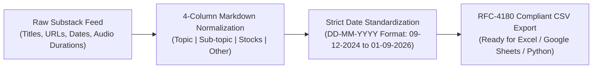

# Part 2: Standardized DD-MM-YYYY Chronological Table & Copy-Ready CSV Database of All Substack Posts

## 📁 Document & Session Metadata

- **Format Version (`formatVersion`):** `1`
- **Export Time (`exportTime`):** `2026-11-06T15:06:22.617Z`
- **Chat Session Name (`chat.name`):** `collections/default_collection/engines/gemini-enterprise-sec-dx-swa/sessions/9286957380505800928`
- **Chat Title (`chat.title`):** `Antifragile Investing Topics`
- **Session Start Time (`chat.startTime`):** `2026-09-23T14:49:02.781Z`
- **Session End Time (`chat.endTime`):** `2026-09-24T16:02:31.225Z`
- **Document Part:** Part 2 of 7
- **Turns Included in This File:** Turns 2, 3 (of 12 Total Turns)

---

## 🕒 Turn 2 (Timestamp: `2026-09-23T14:50:57.950357650Z`)

### ❓ User Query (Verbatim)

make other as publish date . also remove in date only date in dd-mm-yyyy format

---

### 💡 Research Analysis & Answer (Verbatim)

Here is the updated table with the **Other** column renamed to **Publish Date**, showing only the date formatted strictly as **DD-MM-YYYY**:

---

### **Investment Updates, Analyses, and Masterclasses (2024–2026)**

| Topic | Sub-topic | Stocks | Publish Date |
| :--- | :--- | :--- | :--- |
| **Business Analysis** | Comparing economic proof in complex businesses | Azad Engineering, Anthem Biosciences | 01-09-2026 |
| **Business Analysis** | Business model, fables, and 18-month outlook | Ather Energy | 31-08-2026 |
| **Earnings Update** | Q1 FY27 earnings & capital allocation | Shilpa Medicare, Neuland Labs, Navin Fluorine | 05-08-2026 |
| **Business Analysis** | Compounding capabilities instead of diversifying | Sansera Engineering | 29-05-2026 |
| **Investment Strategy** | Level of investment conviction | Azad Engineering, Aarti Pharmalabs, Aether Industries | 27-05-2026 |
| **Portfolio Analysis** | Long-term systems versus near-term noise | Timken India | 20-05-2026 |
| **Portfolio Update** | Multi-company portfolio deep dive | 9 Portfolio Companies | 18-05-2026 |
| **Business Analysis** | Business recovery, leadership changes, and margins | Cohance Lifesciences | 12-05-2026 |
| **Financial Analysis** | Cash flow, debt, and investment decision-making | Apcotex Industries, Indoco Remedies | 07-05-2026 |
| **Business Analysis** | Specialty materials platform & cash flow breakdown | Apcotex Industries | 06-05-2026 |
| **Business Analysis** | Managing complexity as a competitive advantage | Ather Energy | 04-05-2026 |
| **Business Analysis** | Long-term strategic view (2030–2035) | Laurus Labs | 02-05-2026 |
| **Business Analysis** | Transition from building to running the business engine | Navin Fluorine | 30-04-2026 |
| **Earnings Update** | Steady performance vs strong cash with weak growth | Granules India, Piramal Pharma | 29-04-2026 |
| **Business Analysis** | Business performance under operational constraints | Jagsonpal Pharmaceuticals | 28-04-2026 |
| **Business Analysis** | Assessing minor positive operational turns | Cohance Lifesciences | 28-04-2026 |
| **Business Analysis** | Strategic shift with underlying execution risk | IKS Health (TruBridge) | 25-04-2026 |
| **Earnings Update** | Flywheel business model facing frictional headwinds | Tata Elxsi | 21-04-2026 |
| **Earnings Update** | Growth analysis and financial results | Transformers and Rectifiers India (TARIL) | 21-04-2026 |
| **Investment Framework** | Net cash, free cash flow (FCF), and operational optionality | General Market | 20-04-2026 |
| **Business Analysis** | Understanding conviction and long-term growth runways | Aether Industries | 15-04-2026 |
| **Portfolio Disclosures** | Highlighting successful trades and thesis disruptions | Chambal Fertilisers, Coal India | 13-04-2026 |
| **Business Analysis** | Sector transition from commodities to solutions | Carborundum Universal (CUMI) | 10-04-2026 |
| **Sector Analysis** | Data centers opportunity & management evaluation | KRN Heat Exchanger | 09-04-2026 |
| **Business Analysis** | Inquiry into R&D expense structures | MTAR Technologies | 08-04-2026 |
| **Industry Analysis** | Criticisms of the private equity playbook in practice | Sector-Agnostic | 01-04-2026 |
| **Cognitive Heuristic** | Precision engineering/CDMO vs commodity manufacturing | Navin Fluorine, Vinati Organics | 19-03-2026 |
| **Investment Signals** | Insider buying, business cleanups, and low valuations | General Market | 18-03-2026 |
| **Financial Analysis** | Evaluating net cash & capacity in chemical sectors | NOCIL | 16-03-2026 |
| **Valuation Framework** | Valuation using Talebian cognitive heuristics | Chambal Fertilisers | 11-03-2026 |
| **Management Analysis** | Parsing management style and operating execution | Azad Engineering | 11-03-2026 |
| **Management Analysis** | Parsing and analyzing management transcripts | Viyash Scientific | 06-03-2026 |
| **Tech & Market Analysis** | Part 2: The psychology of hype vs the discipline of results | AI / Tech Sector | 27-02-2026 |
| **Tech & Market Analysis** | Part 1: Structural shift driven by AI in life sciences | AI / Life Sciences | 25-02-2026 |
| **Business Analysis** | Playbook featuring a stable core and disruptive edge | Laurus Labs | 20-02-2026 |
| **Valuation Framework** | Application of 'The Lindy Rule' to recent IPOs | Unimech Aerospace | 18-02-2026 |
| **Valuation Framework** | Applying Howard Marks concepts to second-level thinking | Shivalik Rasayan, Apcotex Industries | 16-02-2026 |
| **Business Analysis** | Comprehensive review of business plans and execution | Sansera Engineering | 14-02-2026 |
| **Tech & Market Analysis** | GenAI race: SaaS survivors vs AI consumers | Intellect Design Arena, Newgen Software, Nucleus Software, Sagility, Sansera, Sona, Hikal, Aether Industries, Acutaas Chemicals, Navin Fluorine | 12-02-2026 |
| **Portfolio Disclosures** | Detailed transaction disclosures and exit thesis | Interarch Building Solutions | 11-02-2026 |
| **Portfolio Disclosures** | Operational and holding disclosures | Interarch Building Solutions | 10-02-2026 |
| **Earnings Update** | Managing lumpy but fundamentally predictable earnings | Neuland Labs | 09-02-2026 |
| **Business Analysis** | Strategic positioning for disciplined growth | Navin Fluorine | 09-02-2026 |
| **Business Analysis** | Distinguishing core operating signals from noise | Solara Active Pharma Sciences | 07-02-2026 |
| **Business Analysis** | Assessing corporate turnaround playbooks | SeQuent Scientific, Viyash Scientific | 06-02-2026 |
| **Valuation Framework** | Second-level thinking: where Howard Marks meets Nassim Taleb | Anthem Biosciences | 05-02-2026 |
| **Business Analysis** | Strategic introduction and commercial analysis | Interarch Building Solutions | 03-02-2026 |
| **Valuation Framework** | The role of randomness and cognitive bias in tech investing | Newgen Software | 02-02-2026 |
| **Cognitive Heuristic** | Understanding why "x is not f(x)" in valuation models | Piramal Pharma, Neuland Labs, Navin Fluorine, Laurus Labs, Sai Life Sciences, Anthem Bio, Gland Pharma | 29-01-2026 |
| **Investment Framework** | The "Cake-Icing" framework for business models | OneSource Specialty, Gland Pharma | 28-01-2026 |
| **Business Analysis** | Turning industrial headwinds into free cash flow flywheels | Sona Comstar, Syngene, Laurus Labs | 26-01-2026 |
| **Financial Analysis** | Identifying clean balance sheets and enduring cash reserves | Alivus Life, Jagsonpal Pharmaceuticals | 22-01-2026 |
| **Investment Strategy** | The psychological price of long-term investing | General Market | 21-01-2026 |
| **Sector Analysis** | Part 3: Geopolitical impacts on chemical manufacturing | Chemical Sector (Non-US Focus) | 20-01-2026 |
| **Sector Analysis** | Part 2: Formlessness and adaptation in chemicals | Chemical Sector | 15-01-2026 |
| **Sector Analysis** | Part 1: Macro trends and production capacities in chemicals | Chemical Sector | 13-01-2026 |
| **Investment Strategy** | Strict exclusion rules and avoiding bad choices | General Market | 13-01-2026 |
| **Business Analysis** | Structural comparative analysis (Parts 2 & 3) | Shilpa Medicare, Divi’s Laboratories | 09-01-2026 |
| **Sector Analysis** | Scalability, insurance frameworks, and growth limits | Medi Assist | 08-01-2026 |
| **Valuation Framework** | Strategies for building long-lasting corporate value | Eureka Forbes, Cohance Lifesciences, Piramal Pharma | 07-01-2026 |
| **Investment Strategy** | Practical application of Peter Lynch's small investor rules | General Market | 02-01-2026 |
| **Business Analysis** | Part 1: Structural corporate comparison | Shilpa Medicare, Divi’s Laboratories, Supriya Lifescience, Laurus Labs, Neuland Labs, Solara Active | 26-12-2025 |
| **Investment Strategy** | Applying Shane Parrish's "Clear Thinking" mental models | Windlas Biotech | 18-12-2025 |
| **Sector Analysis** | Part 1: Separating healthcare fundamentals from sector frenzy | Krsnaa Diagnostics, Park Medi World, Narayana Hrudayalaya | 17-12-2025 |
| **Cognitive Heuristic** | Part 2: Operating power under uncertainty | Novo Nordisk, Eli Lilly | 16-12-2025 |
| **Cognitive Heuristic** | Part 1: Operating power under uncertainty | Novo Nordisk, Eli Lilly | 15-12-2025 |
| **Sector Analysis** | Sector-wide analysis of the chronic kidney disease market | NephroPlus, NephroCare, Narayana Health | 11-12-2025 |
| **Valuation Framework** | Utilizing the screaming ("चीख") valuation heuristic | Laurus Labs | 10-12-2025 |
| **Cognitive Heuristic** | Evaluating surface area and target markets | Palantir, Intellect Design Arena | 09-12-2025 |
| **Business Analysis** | Navigating volatility to unlock long-term growth pipelines | Piramal Pharma | 04-12-2025 |
| **Valuation Masterclass** | Selecting valuation multiples under uncertainty | Valuation Masterclass Series | 02-12-2025 |
| **Valuation Masterclass** | Valuation RAG (Red-Amber-Green) status and barriers | Valuation Masterclass Series | 26-11-2025 |
| **Valuation Masterclass** | Managing the mixture of leverage, cycles, and market crises | Valuation Masterclass Series | 23-11-2025 |
| **Sector Analysis** | Examining operational impacts of environmental disasters | Deepak Nitrite, Aether Industries, Jubilant Ingrevia, Acutaas Chemicals | 21-11-2025 |
| **M&A Analysis** | Assessing industrial synergy in the CDMO landscape | SeQuent Scientific, Viyash Scientific | 18-11-2025 |
| **Business Analysis** | Driving operational growth through innovation | Eureka Forbes | 15-11-2025 |
| **Business Analysis** | Chronic underperformance versus operational recovery | Hikal, Kopran | 14-11-2025 |
| **Business Analysis** | Assessing antifragility and adaptive strategic design | Kirloskar Oil Engines (KOEL) | 13-11-2025 |
| **Earnings Update** | Digesting structural margins and volume trends | Advanced Enzymes | 12-11-2025 |
| **Business Analysis** | Volume recovery and inflection points | Aarti Pharma Labs | 12-11-2025 |
| **Sector Analysis** | Strategic comparisons in the CDMO/CRDMO landscape | Anthem Biosciences, Sai Life Sciences, Syngene | 11-11-2025 |
| **Valuation Framework** | Assessing economic moats, value, and future scale | Interarch Building Solutions | 09-11-2025 |
| **Investment Framework** | The "7 Rules of Santaap" and structured SIP investing | General Market | 08-11-2025 |
| **Business Analysis** | Distinguishing terminal problems from temporary "Turkey" problems | FDC | 06-11-2025 |
| **Business Analysis** | Action plan for navigating extreme uncertainty | Solara Active Pharma Sciences | 05-11-2025 |
| **Business Analysis** | Sector tailwinds and structural growth pathways | Blue Jet Healthcare | 05-11-2025 |
| **Investment Strategy** | Evaluating disciplined SIP strategies versus short-term punting | Jagsonpal Pharmaceuticals | 04-11-2025 |
| **Sector Analysis** | Sector comparative analysis: Ayurveda vs Allopathy | Jeena Sikho | 03-11-2025 |
| **Investment Strategy** | Opportunistic cyclicals and market timing updates | Cyclical Sectors | 02-11-2025 |
| **Valuation Framework** | Evaluating intellectual capital via first principles thinking | Intellect Design Arena | 01-11-2025 |
| **Valuation Framework** | Potential valuation re-rating pathways | Jubilant Pharmova | 31-10-2025 |
| **Valuation Framework** | Evaluating corporate antifragility and skin in the game | IKS Health | 31-10-2025 |
| **Business Analysis** | How corporate operations are built to be antifragile by design | Navin Fluorine | 30-10-2025 |
| **Valuation Framework** | Harnessing intellectual property, R&D, and market stressors | Newgen Software | 29-10-2025 |
| **Earnings Update** | Financial results and forward trajectory evaluations | Sona Comstar, SRF, Jubilant Ingrevia | 27-10-2025 |
| **Business Analysis** | Comparative analysis and operational thought experiment | Persistent Systems, Tata Elxsi | 25-10-2025 |
| **Earnings Update** | Reviewing structural margins and API volume recovery | Laurus Labs | 23-10-2025 |
| **Business Analysis** | Assessing regulatory/market monopolies and compounding power | Indian Energy Exchange (IEX) | 22-10-2025 |
| **Sector Analysis** | Strategic comparison through the CDMO lens | Azad Engineering, Sai Life Sciences | 20-10-2025 |
| **Business Analysis** | Operational adaptation and turning setbacks into advantages | Laurus Labs | 19-10-2025 |
| **Sector Analysis** | Sector comparative analysis in electric mobility | Ather Energy, Ola Electric Mobility | 17-10-2025 |
| **Business Analysis** | Capitalizing on market chaos and enterprise structural shifts | Dassault Systèmes | 16-10-2025 |
| **Sector Analysis** | The underlying economics of scientific discovery and randomness | Chemical Sector | 15-10-2025 |
| **Sector Analysis** | Opportunities and risks in localized pharmaceutical players | Aarti Drugs, Akums Drugs & Pharmaceuticals | 14-10-2025 |
| **Valuation Framework** | Unifying cash flow analysis across completely diverse business models | 4 Diverse Businesses | 13-10-2025 |
| **Portfolio Update** | Important portfolio update notes | Syngene | 12-10-2025 |
| **Sector Analysis** | The risk of being fooled by randomness in chemical valuation models | Chemical Sector | 12-10-2025 |
| **Sector Analysis** | Assessing CDMO competitive edges through economies of scope | SeQuent Scientific, Alivus, Solara Active | 08-10-2025 |
| **Subscription Update** | Substack pricing and grandfathering strategy | Substack Platform | 08-10-2025 |
| **Management Analysis** | Analyzing corporate performance of owner-operators | General Market | 04-10-2025 |
| **Sector Analysis** | Strategic metal valuations and fat-tailed distributions | Metals Sector | 02-10-2025 |
| **Investment Strategy** | Navigating asset volatility and adapting active portfolio allocations | AT20 | 29-09-2025 |
| **Sector Analysis** | Potential impacts of geopolitical shifts on localized pharma | Pharma Sector (US/India) | 26-09-2025 |
| **Sector Analysis** | Assessing tech-enabled logistics and supply chain systems | Logistics Sector | 24-09-2025 |
| **Investment Strategy** | Finding value across small, micro, and nano-cap structures | 4 Small/Micro-caps | 23-09-2025 |
| **Investment Strategy** | Risk reduction and omission strategy (Via Negativa) | Chemicals, Autos, IT, Logistics, Textiles | 20-09-2025 |
| **Investment Strategy** | Progress tracking against long-term strategic benchmarks | Active Portfolio | 17-09-2025 |
| **Sector Analysis** | Global supply chains and valuation in critical elements | Rare Earth Elements (REEs) | 11-09-2025 |
| **Cognitive Heuristic** | Structural vulnerabilities of single-source isolation | General Market | 09-09-2025 |
| **Business Analysis** | Signs of operational recovery after structural downturns | Shivalik Rasayan | 08-09-2025 |
| **Investment Strategy** | Portfolio rebalancing milestones and progress checks | Active Portfolio | 07-09-2025 |
| **Investment Strategy** | Initiating structural portfolio transitions | Active Portfolio | 04-09-2025 |
| **Business Analysis** | Recurring historical patterns and fractals over 40 years | Neuland Labs | 02-09-2025 |
| **Cognitive Heuristic** | The industry-agnostic nature of fractal business models | General Market | 24-08-2025 |
| **Valuation Framework** | Expectations investing and determining corporate run-rates | Deepak Nitrite, Neuland Labs, Divi’s Laboratories, Laurus Labs, Praj Industries, Aarti Industries | 14-08-2025 |
| **Management Analysis** | Critical insights from localized corporate interactions | DMCC, FDC, Neuland Labs, Laurus Labs, Hikal, Solara Active | 07-08-2025 |
| **Financial Analysis** | Evaluating asset turn ratios and backward integration dynamics | Chemical vs Pharma Sectors | 03-08-2025 |
| **Investment Framework** | Building a sector-agnostic SIP blueprint | General Market | 29-07-2025 |
| **Investment Framework** | Strategic rules for long-term sector-agnostic SIPs | General Market | 27-07-2025 |
| **Business Analysis** | Operational risk and long-term views on biosciences | Panacea Biotec | 17-07-2025 |
| **Valuation Masterclass** | Reframing and rethinking traditional valuation paradigms | Valuation Masterclass Series (Part 2) | 17-07-2025 |
| **Valuation Masterclass** | Live session on parsing and interpreting management signals | Valuation Masterclass Series (Part 1) | 14-07-2025 |
| **Business Analysis** | Timing entry points and identifying underlying value catalysts | Piramal Pharma | 11-07-2025 |
| **M&A Analysis** | Valuation modeling and scenario planning | Anthem Biosciences | 09-07-2025 |
| **Valuation Masterclass** | Live session on conceptual reframing and business models | Valuation Masterclass Series (Part 1) | 07-07-2025 |
| **Sector Analysis** | Operational, financial, and regulatory comparative analysis | Narayana Health, Yatharth Hospital | 29-06-2025 |
| **Sector Analysis** | Macro demand trends and long-term outlook | CDMO Sector | 27-06-2025 |
| **Business Analysis** | Operational update on capacity expansions | Privi Speciality Chemicals | 18-06-2025 |
| **Cognitive Heuristic** | The disproportionate market influence of the minority rule (MR) | General Market | 16-06-2025 |
| **Cognitive Heuristic** | Deconstructing simple metrics with the "Idiot Index" | General Market | 18-05-2025 |
| **Investment Strategy** | Eliminating businesses unlikely to scale 10x (Part 2) | General Market | 14-05-2025 |
| **Investment Strategy** | General rules on what prevents a stock from scaling 10x | General Market | 10-05-2025 |
| **Earnings Update** | Financial performance and localized outlook assessments | Max India, JPL, DMCC, Newgen Software, Kajaria Ceramics, IT Services | 08-05-2025 |
| **Business Analysis** | Operational updates and business assessments | Privi Speciality Chemicals, RPG Life Sciences | 06-05-2025 |
| **Cognitive Heuristic** | Visualizing competitive dynamics using game theory | Prisoners' Dilemma | 02-05-2025 |
| **Earnings Update** | Identifying hidden structural risks and mid-term outlooks | Syngene International | 24-04-2025 |
| **Business Analysis** | Ground-level updates on mid-term capacity rollouts | Laurus Labs | 23-04-2025 |
| **Investment Strategy** | Balancing defensive SIP paths with higher-risk tactical allocations | General Market | 17-04-2025 |
| **Investment Strategy** | Probability mapping of stocks poised for structural outperformance | General Market | 13-04-2025 |
| **Sector Analysis** | CDMO insights on global tariffs and shifting manufacturing | CDMO Sector | 11-04-2025 |
| **Sector Analysis** | Macroeconomics of tariffs and structural uncertainty | General Market | 06-04-2025 |
| **Investment Strategy** | Responses to localized member Q&A (Part 1) | General Market | 31-03-2025 |
| **Education** | Complete recording of live Antifragile session | SOIC, ISKCON Auditorium | 27-03-2025 |
| **Business Analysis** | Ground-level business deep dive | Neuland Labs | 15-03-2025 |
| **Business Analysis** | On-site plant and R&D facility visit notes | Laurus Labs | 04-03-2025 |
| **Valuation Framework** | Real-time analysis of systemic shocks and asset prices | General Market | 14-02-2025 |
| **General Update** | Valentine’s Day message to subscribers | Substack Community | 14-02-2025 |
| **General Update** | Focus on long-term commitment and research promises | Substack Community | 14-02-2025 |
| **Business Analysis** | Unbiased personal perspective on regulatory approvals | Natco Pharma | 13-02-2025 |
| **Earnings Update** | In-depth operational results and strategic transitions | FDC, Fairchem Organics, Orchid Pharma, Vimta Labs, DMCC | 13-02-2025 |
| **Earnings Update** | Early structural thoughts on the latest earnings season | General Market | 12-02-2025 |
| **Earnings Update** | Evaluating rate of change in operational performance | Advanced Enzymes, Windlas Biotech, Kopran, Neuland Labs, Eureka Forbes, SeQuent Scientific, Aarti Pharma, Shivalik Rasayan | 11-02-2025 |
| **Business Analysis** | Strategic review of high-level management departures | Syngene International | 10-02-2025 |
| **Cognitive Heuristic** | Conceptual valuations of highly improbable structural events | Black Swans | 10-02-2025 |
| **Valuation Masterclass** | Managing margin of safety, probability, and optionality over time | Valuation Masterclass Series | 08-02-2025 |
| **Business Analysis** | Parsing structured Q&A on upcoming IPO pipelines | Senores Pharma | 07-02-2025 |
| **Investment Strategy** | Designing a simple psychological defense against market volatility | General Market | 06-02-2025 |
| **Business Analysis** | Reimagining long-term operational targets (Part 2A/2B) | Laurus Labs | 02-02-2025 |
| **Investment Strategy** | The mechanical reliability of disciplined SIP plans across full market cycles | General Market | 28-01-2025 |
| **Business Analysis** | Assessing capabilities in high-growth biochemical acquisitions | Laurus Labs | 26-01-2025 |
| **Valuation Framework** | Identifying noise versus long-term terminal value calculations | General Market | 22-01-2025 |
| **Valuation Framework** | A Stoic philosophical framework for managing down cycles | Shivalik Rasayan | 19-01-2025 |
| **Business Analysis** | Structural assessment of operational fragility vs antifragility | Eureka Forbes | 17-01-2025 |
| **Investment Strategy** | Unifying core economic logic with portfolio psychology | General Market | 14-01-2025 |
| **Sector Analysis** | CDMO Case Study: Exploring international supply chains | Hikal | 11-01-2025 |
| **Sector Analysis** | 1-minute rate-of-return evaluations across industrial sectors | Sai Life Sciences, Aether Industries, Tiles & Ceramics | 05-01-2025 |
| **Sector Analysis** | Comparing healthcare IT services with traditional CRDMO models | Indegene | 04-01-2025 |
| **Sector Analysis** | FMCG vs Quasi-FMCG: Growth profiles versus return on capital (ROCE) | FMCG Sector | 01-01-2025 |
| **Business Analysis** | Exploring pathway parameters for long-delayed profitability | Makers Labs | 31-12-2024 |
| **Earnings Update** | Pre-earnings analysis and future margin expectations (Part 2) | Jubilant Ingrevia, Jubilant Pharmova | 30-12-2024 |
| **Earnings Update** | Pre-earnings analysis and volume trends (Part 1) | Kajaria Ceramics, Laurus Labs, Shivalik Rasayan | 29-12-2024 |
| **Business Analysis** | Applying Peter Thiel’s structural "zero to one" frameworks | Solara Active Pharma Sciences | 25-12-2024 |
| **Editorial** | Tribute to the national importance of research scientists | General Interest | 19-12-2024 |
| **Business Analysis** | Investigating capacity utilizations and housing cycles | Kajaria Ceramics | 18-12-2024 |
| **Valuation Framework** | Debunking common valuation traps in upcoming listings | IPO Sector | 15-12-2024 |
| **General Update** | Short thoughts on prioritizing actions over statements | Substack Community | 14-12-2024 |
| **Business Analysis** | Reviewing historical fragility and structural pivots (Version 3.0) | Solara Active Pharma Sciences | 13-12-2024 |
| **Sector Analysis** | Navigating changes in international life sciences regulations | US Biosecure Act | 09-12-2024 |

---

## 🕒 Turn 3 (Timestamp: `2026-09-23T14:51:55.922811337Z`)

### ❓ User Query (Verbatim)

can i copy it csv format

---

### 💡 Research Analysis & Answer (Verbatim)

Here is the exact same data formatted as **CSV (Comma-Separated Values)** so you can easily copy and paste it directly into Microsoft Excel, Google Sheets, or any text editor. 

Simply click the **"Copy"** button on the top right of the code block below:

```csv
"Topic","Sub-topic","Stocks","Publish Date"
"Business Analysis","Comparing economic proof in complex businesses","Azad Engineering, Anthem Biosciences","01-09-2026"
"Business Analysis","Business model, fables, and 18-month outlook","Ather Energy","31-08-2026"
"Earnings Update","Q1 FY27 earnings & capital allocation","Shilpa Medicare, Neuland Labs, Navin Fluorine","05-08-2026"
"Business Analysis","Compounding capabilities instead of diversifying","Sansera Engineering","29-05-2026"
"Investment Strategy","Level of investment conviction","Azad Engineering, Aarti Pharmalabs, Aether Industries","27-05-2026"
"Portfolio Analysis","Long-term systems versus near-term noise","Timken India","20-05-2026"
"Portfolio Update","Multi-company portfolio deep dive","9 Portfolio Companies","18-05-2026"
"Business Analysis","Business recovery, leadership changes, and margins","Cohance Lifesciences","12-05-2026"
"Financial Analysis","Cash flow, debt, and investment decision-making","Apcotex Industries, Indoco Remedies","07-05-2026"
"Business Analysis","Specialty materials platform & cash flow breakdown","Apcotex Industries","06-05-2026"
"Business Analysis","Managing complexity as a competitive advantage","Ather Energy","04-05-2026"
"Business Analysis","Long-term strategic view (2030–2035)","Laurus Labs","02-05-2026"
"Business Analysis","Transition from building to running the business engine","Navin Fluorine","30-04-2026"
"Earnings Update","Steady performance vs strong cash with weak growth","Granules India, Piramal Pharma","29-04-2026"
"Business Analysis","Business performance under operational constraints","Jagsonpal Pharmaceuticals","28-04-2026"
"Business Analysis","Assessing minor positive operational turns","Cohance Lifesciences","28-04-2026"
"Business Analysis","Strategic shift with underlying execution risk","IKS Health (TruBridge)","25-04-2026"
"Earnings Update","Flywheel business model facing frictional headwinds","Tata Elxsi","21-04-2026"
"Earnings Update","Growth analysis and financial results","Transformers and Rectifiers India (TARIL)","21-04-2026"
"Investment Framework","Net cash, free cash flow (FCF), and operational optionality","General Market","20-04-2026"
"Business Analysis","Understanding conviction and long-term growth runways","Aether Industries","15-04-2026"
"Portfolio Disclosures","Highlighting successful trades and thesis disruptions","Chambal Fertilisers, Coal India","13-04-2026"
"Business Analysis","Sector transition from commodities to solutions","Carborundum Universal (CUMI)","10-04-2026"
"Sector Analysis","Data centers opportunity & management evaluation","KRN Heat Exchanger","09-04-2026"
"Business Analysis","Inquiry into R&D expense structures","MTAR Technologies","08-04-2026"
"Industry Analysis","Criticisms of the private equity playbook in practice","Sector-Agnostic","01-04-2026"
"Cognitive Heuristic","Precision engineering/CDMO vs commodity manufacturing","Navin Fluorine, Vinati Organics","19-03-2026"
"Investment Signals","Insider buying, business cleanups, and low valuations","General Market","18-03-2026"
"Financial Analysis","Evaluating net cash & capacity in chemical sectors","NOCIL","16-03-2026"
"Valuation Framework","Valuation using Talebian cognitive heuristics","Chambal Fertilisers","11-03-2026"
"Management Analysis","Parsing management style and operating execution","Azad Engineering","11-03-2026"
"Management Analysis","Parsing and analyzing management transcripts","Viyash Scientific","06-03-2026"
"Tech & Market Analysis","Part 2: The psychology of hype vs the discipline of results","AI / Tech Sector","27-02-2026"
"Tech & Market Analysis","Part 1: Structural shift driven by AI in life sciences","AI / Life Sciences","25-02-2026"
"Business Analysis","Playbook featuring a stable core and disruptive edge","Laurus Labs","20-02-2026"
"Valuation Framework","Application of 'The Lindy Rule' to recent IPOs","Unimech Aerospace","18-02-2026"
"Valuation Framework","Applying Howard Marks concepts to second-level thinking","Shivalik Rasayan, Apcotex Industries","16-02-2026"
"Business Analysis","Comprehensive review of business plans and execution","Sansera Engineering","14-02-2026"
"Tech & Market Analysis","GenAI race: SaaS survivors vs AI consumers","Intellect Design Arena, Newgen Software, Nucleus Software, Sagility, Sansera, Sona, Hikal, Aether Industries, Acutaas Chemicals, Navin Fluorine","12-02-2026"
"Portfolio Disclosures","Detailed transaction disclosures and exit thesis","Interarch Building Solutions","11-02-2026"
"Portfolio Disclosures","Operational and holding disclosures","Interarch Building Solutions","10-02-2026"
"Earnings Update","Managing lumpy but fundamentally predictable earnings","Neuland Labs","09-02-2026"
"Business Analysis","Strategic positioning for disciplined growth","Navin Fluorine","09-02-2026"
"Business Analysis","Distinguishing core operating signals from noise","Solara Active Pharma Sciences","07-02-2026"
"Business Analysis","Assessing corporate turnaround playbooks","SeQuent Scientific, Viyash Scientific","06-02-2026"
"Valuation Framework","Second-level thinking: where Howard Marks meets Nassim Taleb","Anthem Biosciences","05-02-2026"
"Business Analysis","Strategic introduction and commercial analysis","Interarch Building Solutions","03-02-2026"
"Valuation Framework","The role of randomness and cognitive bias in tech investing","Newgen Software","02-02-2026"
"Cognitive Heuristic","Understanding why ""x is not f(x)"" in valuation models","Piramal Pharma, Neuland Labs, Navin Fluorine, Laurus Labs, Sai Life Sciences, Anthem Bio, Gland Pharma","29-01-2026"
"Investment Framework","The ""Cake-Icing"" framework for business models","OneSource Specialty, Gland Pharma","28-01-2026"
"Business Analysis","Turning industrial headwinds into free cash flow flywheels","Sona Comstar, Syngene, Laurus Labs","26-01-2026"
"Financial Analysis","Identifying clean balance sheets and enduring cash reserves","Alivus Life, Jagsonpal Pharmaceuticals","22-01-2026"
"Investment Strategy","The psychological price of long-term investing","General Market","21-01-2026"
"Sector Analysis","Part 3: Geopolitical impacts on chemical manufacturing","Chemical Sector (Non-US Focus)","20-01-2026"
"Sector Analysis","Part 2: Formlessness and adaptation in chemicals","Chemical Sector","15-01-2026"
"Sector Analysis","Part 1: Macro trends and production capacities in chemicals","Chemical Sector","13-01-2026"
"Investment Strategy","Strict exclusion rules and avoiding bad choices","General Market","13-01-2026"
"Business Analysis","Structural comparative analysis (Parts 2 & 3)","Shilpa Medicare, Divi’s Laboratories","09-01-2026"
"Sector Analysis","Scalability, insurance frameworks, and growth limits","Medi Assist","08-01-2026"
"Valuation Framework","Strategies for building long-lasting corporate value","Eureka Forbes, Cohance Lifesciences, Piramal Pharma","07-01-2026"
"Investment Strategy","Practical application of Peter Lynch's small investor rules","General Market","02-01-2026"
"Business Analysis","Part 1: Structural corporate comparison","Shilpa Medicare, Divi’s Laboratories, Supriya Lifescience, Laurus Labs, Neuland Labs, Solara Active","26-12-2025"
"Investment Strategy","Applying Shane Parrish's ""Clear Thinking"" mental models","Windlas Biotech","18-12-2025"
"Sector Analysis","Part 1: Separating healthcare fundamentals from sector frenzy","Krsnaa Diagnostics, Park Medi World, Narayana Hrudayalaya","17-12-2025"
"Cognitive Heuristic","Part 2: Operating power under uncertainty","Novo Nordisk, Eli Lilly","16-12-2025"
"Cognitive Heuristic","Part 1: Operating power under uncertainty","Novo Nordisk, Eli Lilly","15-12-2025"
"Sector Analysis","Sector-wide analysis of the chronic kidney disease market","NephroPlus, NephroCare, Narayana Health","11-12-2025"
"Valuation Framework","Utilizing the screaming (""चीख"") valuation heuristic","Laurus Labs","10-12-2025"
"Cognitive Heuristic","Evaluating surface area and target markets","Palantir, Intellect Design Arena","09-12-2025"
"Business Analysis","Navigating volatility to unlock long-term growth pipelines","Piramal Pharma","04-12-2025"
"Valuation Masterclass","Selecting valuation multiples under uncertainty","Valuation Masterclass Series","02-12-2025"
"Valuation Masterclass","Valuation RAG (Red-Amber-Green) status and barriers","Valuation Masterclass Series","26-11-2025"
"Valuation Masterclass","Managing the mixture of leverage, cycles, and market crises","Valuation Masterclass Series","23-11-2025"
"Sector Analysis","Examining operational impacts of environmental disasters","Deepak Nitrite, Aether Industries, Jubilant Ingrevia, Acutaas Chemicals","21-11-2025"
"M&A Analysis","Assessing industrial synergy in the CDMO landscape","SeQuent Scientific, Viyash Scientific","18-11-2025"
"Business Analysis","Driving operational growth through innovation","Eureka Forbes","15-11-2025"
"Business Analysis","Chronic underperformance versus operational recovery","Hikal, Kopran","14-11-2025"
"Business Analysis","Assessing antifragility and adaptive strategic design","Kirloskar Oil Engines (KOEL)","13-11-2025"
"Earnings Update","Digesting structural margins and volume trends","Advanced Enzymes","12-11-2025"
"Business Analysis","Volume recovery and inflection points","Aarti Pharma Labs","12-11-2025"
"Sector Analysis","Strategic comparisons in the CDMO/CRDMO landscape","Anthem Biosciences, Sai Life Sciences, Syngene","11-11-2025"
"Valuation Framework","Assessing economic moats, value, and future scale","Interarch Building Solutions","09-11-2025"
"Investment Framework","The ""7 Rules of Santaap"" and structured SIP investing","General Market","08-11-2025"
"Business Analysis","Distinguishing terminal problems from temporary ""Turkey"" problems","FDC","06-11-2025"
"Business Analysis","Action plan for navigating extreme uncertainty","Solara Active Pharma Sciences","05-11-2025"
"Business Analysis","Sector tailwinds and structural growth pathways","Blue Jet Healthcare","05-11-2025"
"Investment Strategy","Evaluating disciplined SIP strategies versus short-term punting","Jagsonpal Pharmaceuticals","04-11-2025"
"Sector Analysis","Sector comparative analysis: Ayurveda vs Allopathy","Jeena Sikho","03-11-2025"
"Investment Strategy","Opportunistic cyclicals and market timing updates","Cyclical Sectors","02-11-2025"
"Valuation Framework","Evaluating intellectual capital via first principles thinking","Intellect Design Arena","01-11-2025"
"Valuation Framework","Potential valuation re-rating pathways","Jubilant Pharmova","31-10-2025"
"Valuation Framework","Evaluating corporate antifragility and skin in the game","IKS Health","31-10-2025"
"Business Analysis","How corporate operations are built to be antifragile by design","Navin Fluorine","30-10-2025"
"Valuation Framework","Harnessing intellectual property, R&D, and market stressors","Newgen Software","29-10-2025"
"Earnings Update","Financial results and forward trajectory evaluations","Sona Comstar, SRF, Jubilant Ingrevia","27-10-2025"
"Business Analysis","Comparative analysis and operational thought experiment","Persistent Systems, Tata Elxsi","25-10-2025"
"Earnings Update","Reviewing structural margins and API volume recovery","Laurus Labs","23-10-2025"
"Business Analysis","Assessing regulatory/market monopolies and compounding power","Indian Energy Exchange (IEX)","22-10-2025"
"Sector Analysis","Strategic comparison through the CDMO lens","Azad Engineering, Sai Life Sciences","20-10-2025"
"Business Analysis","Operational adaptation and turning setbacks into advantages","Laurus Labs","19-10-2025"
"Sector Analysis","Sector comparative analysis in electric mobility","Ather Energy, Ola Electric Mobility","17-10-2025"
"Business Analysis","Capitalizing on market chaos and enterprise structural shifts","Dassault Systèmes","16-10-2025"
"Sector Analysis","The underlying economics of scientific discovery and randomness","Chemical Sector","15-10-2025"
"Sector Analysis","Opportunities and risks in localized pharmaceutical players","Aarti Drugs, Akums Drugs & Pharmaceuticals","14-10-2025"
"Valuation Framework","Unifying cash flow analysis across completely diverse business models","4 Diverse Businesses","13-10-2025"
"Portfolio Update","Important portfolio update notes","Syngene","12-10-2025"
"Sector Analysis","The risk of being fooled by randomness in chemical valuation models","Chemical Sector","12-10-2025"
"Sector Analysis","Assessing CDMO competitive edges through economies of scope","SeQuent Scientific, Alivus, Solara Active","08-10-2025"
"Subscription Update","Substack pricing and grandfathering strategy","Substack Platform","08-10-2025"
"Management Analysis","Analyzing corporate performance of owner-operators","General Market","04-10-2025"
"Sector Analysis","Strategic metal valuations and fat-tailed distributions","Metals Sector","02-10-2025"
"Investment Strategy","Navigating asset volatility and adapting active portfolio allocations","AT20","29-09-2025"
"Sector Analysis","Potential impacts of geopolitical shifts on localized pharma","Pharma Sector (US/India)","26-09-2025"
"Sector Analysis","Assessing tech-enabled logistics and supply chain systems","Logistics Sector","24-09-2025"
"Investment Strategy","Finding value across small, micro, and nano-cap structures","4 Small/Micro-caps","23-09-2025"
"Investment Strategy","Risk reduction and omission strategy (Via Negativa)","Chemicals, Autos, IT, Logistics, Textiles","20-09-2025"
"Investment Strategy","Progress tracking against long-term strategic benchmarks","Active Portfolio","17-09-2025"
"Sector Analysis","Global supply chains and valuation in critical elements","Rare Earth Elements (REEs)","11-09-2025"
"Cognitive Heuristic","Structural vulnerabilities of single-source isolation","General Market","09-09-2025"
"Business Analysis","Signs of operational recovery after structural downturns","Shivalik Rasayan","08-09-2025"
"Investment Strategy","Portfolio rebalancing milestones and progress checks","Active Portfolio","07-09-2025"
"Investment Strategy","Initiating structural portfolio transitions","Active Portfolio","04-09-2025"
"Business Analysis","Recurring historical patterns and fractals over 40 years","Neuland Labs","02-09-2025"
"Cognitive Heuristic","The industry-agnostic nature of fractal business models","General Market","24-08-2025"
"Valuation Framework","Expectations investing and determining corporate run-rates","Deepak Nitrite, Neuland Labs, Divi’s Laboratories, Laurus Labs, Praj Industries, Aarti Industries","14-08-2025"
"Management Analysis","Critical insights from localized corporate interactions","DMCC, FDC, Neuland Labs, Laurus Labs, Hikal, Solara Active","07-08-2025"
"Financial Analysis","Evaluating asset turn ratios and backward integration dynamics","Chemical vs Pharma Sectors","03-08-2025"
"Investment Framework","Building a sector-agnostic SIP blueprint","General Market","29-07-2025"
"Investment Framework","Strategic rules for long-term sector-agnostic SIPs","General Market","27-07-2025"
"Business Analysis","Operational risk and long-term views on biosciences","Panacea Biotec","17-07-2025"
"Valuation Masterclass","Reframing and rethinking traditional valuation paradigms","Valuation Masterclass Series (Part 2)","17-07-2025"
"Valuation Masterclass","Live session on parsing and interpreting management signals","Valuation Masterclass Series (Part 1)","14-07-2025"
"Business Analysis","Timing entry points and identifying underlying value catalysts","Piramal Pharma","11-07-2025"
"M&A Analysis","Valuation modeling and scenario planning","Anthem Biosciences","09-07-2025"
"Valuation Masterclass","Live session on conceptual reframing and business models","Valuation Masterclass Series (Part 1)","07-07-2025"
"Sector Analysis","Operational, financial, and regulatory comparative analysis","Narayana Health, Yatharth Hospital","29-06-2025"
"Sector Analysis","Macro demand trends and long-term outlook","CDMO Sector","27-06-2025"
"Business Analysis","Operational update on capacity expansions","Privi Speciality Chemicals","18-06-2025"
"Cognitive Heuristic","The disproportionate market influence of the minority rule (MR)","General Market","16-06-2025"
"Cognitive Heuristic","Deconstructing simple metrics with the ""Idiot Index""","General Market","18-05-2025"
"Investment Strategy","Eliminating businesses unlikely to scale 10x (Part 2)","General Market","14-05-2025"
"Investment Strategy","General rules on what prevents a stock from scaling 10x","General Market","10-05-2025"
"Earnings Update","Financial performance and localized outlook assessments","Max India, JPL, DMCC, Newgen Software, Kajaria Ceramics, IT Services","08-05-2025"
"Business Analysis","Operational updates and business assessments","Privi Speciality Chemicals, RPG Life Sciences","06-05-2025"
"Cognitive Heuristic","Visualizing competitive dynamics using game theory","Prisoners' Dilemma","02-05-2025"
"Earnings Update","Identifying hidden structural risks and mid-term outlooks","Syngene International","24-04-2025"
"Business Analysis","Ground-level updates on mid-term capacity rollouts","Laurus Labs","23-04-2025"
"Investment Strategy","Balancing defensive SIP paths with higher-risk tactical allocations","General Market","17-04-2025"
"Investment Strategy","Probability mapping of stocks poised for structural outperformance","General Market","13-04-2025"
"Sector Analysis","CDMO insights on global tariffs and shifting manufacturing","CDMO Sector","11-04-2025"
"Sector Analysis","Macroeconomics of tariffs and structural uncertainty","General Market","06-04-2025"
"Investment Strategy","Responses to localized member Q&A (Part 1)","General Market","31-03-2025"
"Education","Complete recording of live Antifragile session","SOIC, ISKCON Auditorium","27-03-2025"
"Business Analysis","Ground-level business deep dive","Neuland Labs","15-03-2025"
"Business Analysis","On-site plant and R&D facility visit notes","Laurus Labs","04-03-2025"
"Valuation Framework","Real-time analysis of systemic shocks and asset prices","General Market","14-02-2025"
"General Update","Valentine’s Day message to subscribers","Substack Community","14-02-2025"
"General Update","Focus on long-term commitment and research promises","Substack Community","14-02-2025"
"Business Analysis","Unbiased personal perspective on regulatory approvals","Natco Pharma","13-02-2025"
"Earnings Update","In-depth operational results and strategic transitions","FDC, Fairchem Organics, Orchid Pharma, Vimta Labs, DMCC","13-02-2025"
"Earnings Update","Early structural thoughts on the latest earnings season","General Market","12-02-2025"
"Earnings Update","Evaluating rate of change in operational performance","Advanced Enzymes, Windlas Biotech, Kopran, Neuland Labs, Eureka Forbes, SeQuent Scientific, Aarti Pharma, Shivalik Rasayan","11-02-2025"
"Business Analysis","Strategic review of high-level management departures","Syngene International","10-02-2025"
"Cognitive Heuristic","Conceptual valuations of highly improbable structural events","Black Swans","10-02-2025"
"Valuation Masterclass","Managing margin of safety, probability, and optionality over time","Valuation Masterclass Series","08-02-2025"
"Business Analysis","Parsing structured Q&A on upcoming IPO pipelines","Senores Pharma","07-02-2025"
"Investment Strategy","Designing a simple psychological defense against market volatility","General Market","06-02-2025"
"Business Analysis","Reimagining long-term operational targets (Part 2A/2B)","Laurus Labs","02-02-2025"
"Investment Strategy","The mechanical reliability of disciplined SIP plans across full market cycles","General Market","28-01-2025"
"Business Analysis","Assessing capabilities in high-growth biochemical acquisitions","Laurus Labs","26-01-2025"
"Valuation Framework","Identifying noise versus long-term terminal value calculations","General Market","22-01-2025"
"Valuation Framework","A Stoic philosophical framework for managing down cycles","Shivalik Rasayan","19-01-2025"
"Business Analysis","Structural assessment of operational fragility vs antifragility","Eureka Forbes","17-01-2025"
"Investment Strategy","Unifying core economic logic with portfolio psychology","General Market","14-01-2025"
"Sector Analysis","CDMO Case Study: Exploring international supply chains","Hikal","11-01-2025"
"Sector Analysis","1-minute rate-of-return evaluations across industrial sectors","Sai Life Sciences, Aether Industries, Tiles & Ceramics","05-01-2025"
"Sector Analysis","Comparing healthcare IT services with traditional CRDMO models","Indegene","04-01-2025"
"Sector Analysis","FMCG vs Quasi-FMCG: Growth profiles versus return on capital (ROCE)","FMCG Sector","01-01-2025"
"Business Analysis","Exploring pathway parameters for long-delayed profitability","Makers Labs","31-12-2024"
"Earnings Update","Pre-earnings analysis and future margin expectations (Part 2)","Jubilant Ingrevia, Jubilant Pharmova","30-12-2024"
"Earnings Update","Pre-earnings analysis and volume trends (Part 1)","Kajaria Ceramics, Laurus Labs, Shivalik Rasayan","29-12-2024"
"Business Analysis","Applying Peter Thiel’s structural ""zero to one"" frameworks","Solara Active Pharma Sciences","25-12-2024"
"Editorial","Tribute to the national importance of research scientists","General Interest","19-12-2024"
"Business Analysis","Investigating capacity utilizations and housing cycles","Kajaria Ceramics","18-12-2024"
"Valuation Framework","Debunking common valuation traps in upcoming listings","IPO Sector","15-12-2024"
"General Update","Short thoughts on prioritizing actions over statements","Substack Community","14-12-2024"
"Business Analysis","Reviewing historical fragility and structural pivots (Version 3.0)","Solara Active Pharma Sciences","13-12-2024"
"Sector Analysis","Navigating changes in international life sciences regulations","US Biosecure Act","09-12-2024"
```

### 💡 Tips for importing this into Excel / Google Sheets:
1. Copy the code block above.
2. Open a blank text file (using Notepad, TextEdit, etc.), paste the copied text, and save the file with a `.csv` extension (e.g., `substack_articles.csv`).
3. Alternatively, you can directly open a blank spreadsheet in Google Sheets or Excel, double-click on Cell `A1`, and paste it. Some spreadsheet software will automatically ask you to split text by commas, or you can use the **"Data -> Text to Columns"** feature.

---

### 🚀 Next steps you might like to explore:


---


---

## 📊 Enhanced Visual Illustrations & Diagrams (Part 2)

### Mermaid Data Pipeline: From Unstructured Substack Feed to Standardized Analytical CSV


### Enhanced ASCII Breakdown: Distribution of Posts by Primary Topic Category
```
====================================================================================
   SUBSTACK ARCHIVE DISTRIBUTION BY TOPIC CATEGORY (2024–2026)
====================================================================================
   Business Analysis        : [████████████████████████████████████] ~38% (Deep Dives)
   Sector & Industry        : [██████████████████░░░░░░░░░░░░░░░░░░] ~18% (CDMO/Chem/Tech)
   Valuation Frameworks/MC  : [████████████████░░░░░░░░░░░░░░░░░░░░] ~16% (Masterclasses)
   Investment Strategy/SIP  : [████████████░░░░░░░░░░░░░░░░░░░░░░░░] ~12% (SIP/AT20/Rules)
   Earnings & Disclosures   : [██████████░░░░░░░░░░░░░░░░░░░░░░░░░░] ~10% (Quarterly/PF)
   Cognitive Heuristics     : [██████░░░░░░░░░░░░░░░░░░░░░░░░░░░░░░]  ~6% (Taleb/Marks)
====================================================================================
```
