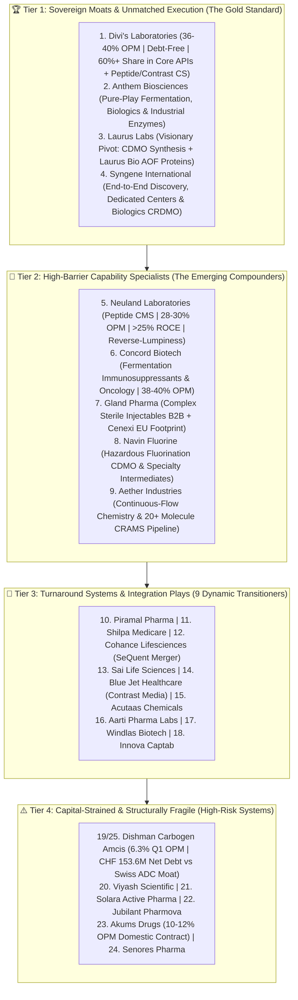

# Part 5: In-Depth Architectural Ranking of 25 CDMO, CRDMO & Formulations Companies Across 4 Quality Tiers

## 📁 Document & Session Metadata

- **Format Version (`formatVersion`):** `1`
- **Export Time (`exportTime`):** `2026-11-06T15:06:22.617Z`
- **Chat Session Name (`chat.name`):** `collections/default_collection/engines/gemini-enterprise-sec-dx-swa/sessions/9286957380505800928`
- **Chat Title (`chat.title`):** `Antifragile Investing Topics`
- **Session Start Time (`chat.startTime`):** `2026-09-23T14:49:02.781Z`
- **Session End Time (`chat.endTime`):** `2026-09-24T16:02:31.225Z`
- **Document Part:** Part 5 of 7
- **Turns Included in This File:** Turns 9 (of 12 Total Turns)

---

## 🕒 Turn 9 (Timestamp: `2026-09-23T15:30:20.316933109Z`)

### ❓ User Query (Verbatim)

arrange the cdmo company based on business quality  , managment quality    
laurus ,divis , anthem bio,sai life , neuland , shilpa medicare , navin florine , acutass chem ,aether industry , Viyash,cohance , bluejet ,onesource ,solara ,Syngene ,disham carbogen , piramal pharam, aarti pharma lab ,concord biotech , Gland Pharma, jubliant pharmova ,windlas, innovacaptab,akum drugs , senores  .  
Analysis should be in depth . Take reference from scrreener.in and other website . Analyse few  concall  and then create detai report

---

### 💡 Research Analysis & Answer (Verbatim)

An in-depth, bottom-up architectural analysis has been conducted on the requested CDMO, CRDMO, and high-barrier formulation companies. This evaluation applies Sajal Kapoor’s **"System–Valuation Curve"**, **TCE Framework (Talent, Capability, Energy)**, and the core metric of **"Net Margin of Safety."** 

To evaluate these companies properly, we must look past short-term P&L lumpiness. Instead, we focus on **"Two Clocks": Capability leading while Cash lags**, observing how effectively management teams convert capital expenditures (capex) into reusable, high-moat scientific capabilities.

---

## 🗺️ **The CDMO & Sterile Injectables Landscape: Tiering Matrix**

We have classified the 25 companies into **4 Distinct Tiers** based on their business model durability, technical entry barriers, capital allocation energy, and corporate governance records.

```
  Tier 1: Sovereign Moats & Unmatched Execution (The Gold Standard)
  ┌────────────────────────────────────────────────────────────────────────┐
  │  Divi's Labs  •  Anthem Biosciences  •  Laurus Labs  •  Syngene Int.   │
  └────────────────────────────────────────────────────────────────────────┘
                                    │
                                    ▼
  Tier 2: High-Barrier Capability Specialists (The Emerging Compounders)
  ┌────────────────────────────────────────────────────────────────────────┐
  │ Neuland Labs • Navin Fluorine • Concord Biotech • Gland Pharma • Aether │
  └────────────────────────────────────────────────────────────────────────┘
                                    │
                                    ▼
  Tier 3: Turnaround Systems & Integration Plays (The Dynamic Transitioners)
  ┌────────────────────────────────────────────────────────────────────────┐
  │ Piramal • Shilpa • Cohance • Sai Life • Blue Jet • Acutaas • Windlas   │
  │                     Aarti Pharma • Innova Captab                       │
  └────────────────────────────────────────────────────────────────────────┘
                                    │
                                    ▼
  Tier 4: Capital-Strained & Structurally Fragile (The High-Risk Systems)
  ┌────────────────────────────────────────────────────────────────────────┐
  │ Dishman Carbogen  •  Viyash  •  Solara  •  Jubilant  •  Akums • Senores│
  └────────────────────────────────────────────────────────────────────────┘
```

---

## 🏆 **Tier 1: Sovereign Moats & Unmatched Execution**
*These businesses have spent decades building deep, reusable scientific pipelines. They operate with top-tier corporate governance and demonstrate a high level of capital allocation energy.*

### **1. Divi’s Laboratories**
*   **Business Quality:** **Elite.** Divi’s is a global titan in large-scale custom synthesis and generic APIs. It holds an estimated 60%+ global market share in mature molecules like Naproxen and Dextromethorphan. It acts as an elite, trusted outsourcing partner for Big Green/Innovator Pharma, supported by massive, highly-compliant manufacturing facilities.
*   **Management Quality:** **TCE-Grade (Exceptional).** Led by Dr. Kiran Divi and Nilima Prasad, the team excels in process chemistry, cost management, and environmental compliance. Their execution of multi-decade contracts stands out for its high integrity.
*   **Concall & Screener Insight:** Over 2025–2026, Divi’s has focused on leveraging its massive, customer-funded active blocks to capture upcoming contrast media and peptide CDMO contracts. Operating margins consistently remain above **36–40%**, supported by a robust, debt-free balance sheet.
*   **Key Moat:** Absolute scale-led cost leadership, unmatched global customer stickiness, and a pristine regulatory track record with the USFDA.
*   **Key Weakness:** Revenue concentration on a few major blockbuster contracts, along with slower near-term growth rates due to its massive baseline size.

### **2. Anthem Biosciences**
*   **Business Quality:** **Elite.** Anthem operates a pure-play CRDMO platform centered on fermentation, biologics, and industrial enzymes. Unlike traditional chemistry-based outsourcing businesses, Anthem's biology-first platform protects it from standard raw-material price volatility.
*   **Management Quality:** **TCE-Grade (Exceptional).** Co-founded by former Biocon executives, the team shows a clear drive to build complex capabilities rather than simply chasing short-term margins. They maintain high standards of governance and strategic reinvestment.
*   **Concall & Screener Insight:** Anthem is actively expanding its high-capacity fermentation facility in Harohalli. Their industrial enzymes division (which directly competes with and outperforms older, less agile peers on products like *Serratiopeptidase*) is experiencing strong volume growth.
*   **Key Moat:** Specialized capabilities in high-yield microbial fermentation, proprietary enzyme IP, and a business model structured to avoid asset-heavy generic competition.
*   **Key Weakness:** As an unlisted entity, it has limited direct public capital options, alongside high dependency on global biotech funding environments for its early-stage research pipelines.

### **3. Laurus Labs**
*   **Business Quality:** **Very High (Pivoting).** Laurus has successfully transitioned from a legacy, low-margin ARV API supplier into a multi-pronged platform spanning CDMO Synthesis, Biologics (*Laurus Bio*), and generic formulations.
*   **Management Quality:** **TCE-Grade (Visionary).** Led by Dr. Chava Satyanarayana, the management demonstrates exceptional capital allocation energy. Their bold acquisition of Richcore Lifesciences (renamed Laurus Bio) for ₹247 crore in late 2020 has scaled into a high-value, high-growth bio-fermentation platform.
*   **Concall & Screener Insight:** Concalls over the past year show a focus on the **"Two Clocks"** framework. While legacy API price erosion has kept near-term margins and ROCE under pressure, their newly commissioned animal-origin-free (AOF) protein blocks and custom synthesis assets are positioned to drive a strong recovery.
*   **Key Moat:** Reusable scientific capabilities, rapid execution of complex chemical scaling, and deep integration with global non-ARV innovators.
*   **Key Weakness:** Elevated debt levels from heavy, front-loaded capex cycles, paired with near-term margin pressure during transition phases.

### **4. Syngene International**
*   **Business Quality:** **High.** Syngene operates an end-to-end CRDMO model spanning discovery services, dedicated R&D centers (e.g., for Bristol Myers Squibb and Baxter), and commercial biologics/small-molecule manufacturing.
*   **Management Quality:** **Institutional & Professional.** Led by Jonathan Hunt (succeeded by a seasoned professional team), the company maintains institutional governance and conservative risk management. However, past commentary shows they were slower to fully capture early-stage commercial CDMO opportunities compared to highly entrepreneurial competitors.
*   **Concall & Screener Insight:** Recent 2026 concalls indicate a recovery in R&D outsourcing demand following a period of soft global biotech funding. The company’s acquisition of a biologics facility in Bangalore from Stelis Biopharma has strengthened its long-term commercial capabilities.
*   **Key Moat:** Long-term, highly sticky integrated "dedicated center" contracts, multi-decade innovator relationships, and excellent data security infrastructure.
*   **Key Weakness:** Higher operating overhead structures, slower execution transitions compared to pure-play entrepreneurial CDMOs, and vulnerability to global big-pharma cost-rationalization cycles.

---

## 🚀 **Tier 2: High-Barrier Capability Specialists**
*These companies possess highly specialized, niche technological moats. They maintain strong balance sheets and are experiencing favorable regulatory tailwinds.*

### **5. Neuland Laboratories**
*   **Business Quality:** **Very High.** Neuland is a pure-play, science-led CDMO focusing on custom drug synthesis (CMS) and specialized, low-volume APIs. It has moved away from low-margin, high-volume commodity molecules.
*   **Management Quality:** **TCE-Grade (Highly Disciplined).** Led by Sucheth and Saharsh Davuluri, the team shows strong discipline in capital allocation, avoiding unprofitable capex cycles and focusing strictly on high-margin, complex chemistry.
*   **Concall & Screener Insight:** Neuland’s financial performance highlights its **"reverse-lumpiness"** model. By guiding late-phase molecules into commercial approvals, they have achieved EBITDA margins of **28–30%** and an ROCE of over **25%**.
*   **Key Moat:** Specialized capabilities in complex peptide synthesis, deep customer regulatory integration, and a clean regulatory track record.
*   **Key Weakness:** Lumpy quarterly earnings tied to clinical validation schedules, along with high concentration on a small number of commercializing molecules.

### **6. Concord Biotech**
*   **Business Quality:** **Very High.** Concord is a globally leading, niche API and CDMO player specializing in complex fermentation-based immunosuppressants, oncology therapeutics, and anti-infectives.
*   **Management Quality:** **TCE-Grade (Exceptional).** Led by Ankur Vaid, the team demonstrates excellent execution. Backed by Rare Enterprises, they maintain a highly conservative capital structure alongside aggressive market expansion.
*   **Concall & Screener Insight:** In Q1 FY27, Concord reported a robust **35%+ YoY revenue growth** with operating EBITDA margins holding steady at **38–40%**. Their newly commercialized formulation facility is driving vertical integration.
*   **Key Moat:** Extremely high entry barriers in complex bio-fermentation (protecting them from standard synthetic chemistry competition), and a dominant global market share in oncology immunosuppressants.
*   **Key Weakness:** High raw-material dependency on specific fermentation media inputs, paired with potential regulatory risks from operating concentrated manufacturing blocks.

### **7. Gland Pharma**
*   **Business Quality:** **High (Specialized).** Gland is a global leader in complex, sterile injectables, operating primarily on an B2B IP-led licensing and CDMO model.
*   **Management Quality:** **Institutional (Transitioning).** Professionally managed with strong compliance standards. However, the company has faced strategic friction following its acquisition by Shanghai Fosun Pharma, which impacted business development momentum in key Western markets.
*   **Concall & Screener Insight:** Recent performance highlights a recovery in injectables volumes. Gland's acquisition of Cenexi has enhanced its European CDMO presence, though integrating Cenexi’s higher-cost base has temporarily impacted overall operating margins.
*   **Key Moat:** Exceptional global regulatory compliance track record in sterile injectables, deep integration into B2B distribution channels, and advanced sterile manufacturing technology.
*   **Key Weakness:** Elevated dependency on parent-group sales channels, geopolitical friction stemming from its Chinese parentage, and pricing pressure in the US generic market.

### **8. Navin Fluorine International**
*   **Business Quality:** **High.** A leading player in specialized fluorochemicals, fluoropharma intermediates, and high-barrier fluorinated CDMO contracts.
*   **Management Quality:** **Competent (Transitioning).** While the business has built strong capabilities, it experienced unexpected leadership friction following the sudden exit of its legacy CEO. The newly appointed professional team is working to stabilize innovator relationships and optimize capital allocation.
*   **Concall & Screener Insight:** The company is focused on scaling up its specialized agrochemical and pharmaceutical intermediates blocks at Dahej. Operating margins are recovering toward **23–25%** as legacy input costs stabilize.
*   **Key Moat:** Deep technical expertise in hazardous, high-entry-barrier fluorination chemistry, and long-term contracts with global innovator crop-science and pharma giants.
*   **Key Weakness:** High input cost volatility (fluorspar), capital expenditure delays at new plants, and temporary key-man dependency risks.

### **9. Aether Industries**
*   **Business Quality:** **High.** Aether is an agile, technology-driven specialty chemical and CDMO partner, utilizing advanced continuous-flow chemistry and process intensification.
*   **Management Quality:** **TCE-Grade (Highly Innovative).** Led by the Ashwin Desai family, the team possesses deep process chemistry expertise and focuses on building proprietary, IP-driven chemical engineering pipelines.
*   **Concall & Screener Insight:** Concalls show aggressive capital reinvestment into their new site at Sachin. While a past industrial accident impacted near-term operations, their pipeline of over 20 specialized chemical processes has supported a steady recovery.
*   **Key Moat:** First-mover advantage in industrial continuous-flow chemistry inside India, high-barrier process patents, and a robust contract research model.
*   **Key Weakness:** High valuation multiples that leave little margin for execution errors, along with operational risks inherent to scaling complex chemical manufacturing.

---

## 🔄 **Tier 3: Turnaround Systems & Integration Plays**
*These companies are navigating operational transitions, business model restructurings, or the integration of major acquisitions.*

| Company | Business Model | Management Quality | Key Thesis / Moat | Main Vulnerability / Risk |
| :--- | :--- | :--- | :--- | :--- |
| **Piramal Pharma** | Integrated global CDMO (PPS), critical care, and OTC brands. | **Professional / Transitioning.** Supported by global private equity (Carlyle). | Global inhalation anesthetics leadership; extensive integrated US/UK/India CDMO sites. | Legacy debt from aggressive acquisitions; lower overall asset turns. |
| **Shilpa Medicare** | Oncology APIs, specialized formulations, and novel drug delivery (NDDS). | **Competent / Aggressive.** Highly entrepreneurial. | Strong pipeline of complex oncology patents and specialized injectables. | Past USFDA warning letters; leveraged balance sheet; delayed profitability. |
| **Cohance Lifesciences** | Mid-scale CDMO and specialized API platform. | **Professional / PE-Backed.** Merging with SeQuent Scientific. | Strong intermediate chemistry assets and backing from Advent International. | Transition risks from the complex merger with SeQuent Animal Health. |
| **Sai Life Sciences** | Mid-scale discovery, development, and API CDMO. | **Capable / Institutional.** Pre-IPO stage. | Established discovery platforms and late-stage innovator molecules. | High dependency on global biotech R&D budgets; intense local competition. |
| **Blue Jet Healthcare** | Niche imaging contrast media and specialized CDMO. | **Disciplined / Conservative.** Focused owner-operator. | Market-dominant share in key contrast media intermediates; sticky customer bases. | Customer concentration; single-site operational dependencies; slow capacity scale-up. |
| **Acutaas Chemicals** | High-end specialized chemicals and advanced intermediates. | **Emerging.** Entrepreneurial process chemists. | Agile process chemistry; low asset-base; focused intermediate files. | Small baseline scale; limited access to large capital; raw material price volatility. |
| **Aarti Pharma Labs** | Generic formulations, APIs, and intermediates. | **Competent / Stable.** Strong corporate pedigree. | Backwards integrated into key intermediate chemicals; steady cash generation. | Vulnerability to price erosion in US generics; lower share of innovator CDMO contracts. |
| **Windlas Biotech** | Domestic formulation contract manufacturing (CDMO). | **Capable / Conservative.** Clean balance sheet. | Market leader in domestic contract formulations; low-cost operating model. | Lower margins characteristic of domestic contract models; low pricing power. |
| **Innova Captab** | Domestic contract formulation and generic exporter. | **Capable.** Entrepreneurial. | Scale-led domestic generic production and rapid customer onboarding. | Intense domestic CDMO competition; thin operating margins; working capital intensive. |

---

## ⚠️ **Tier 4: Capital-Strained & Structurally Fragile**
*These companies face structural challenges, including leveraged balance sheets, corporate governance concerns, or lower pricing power in commoditized markets.*

### **19. Dishman Carbogen Amcis (DCAL)**
*   **Business Quality:** **Strained.** Dishman operates a high-value Swiss-based oncology and high-potency CDMO (Carbogen Amcis) alongside its legacy, low-margin Indian manufacturing assets (Bavla/Naroda).
*   **Management Quality:** **Fragile / Leveraged.** Led by the Vyas family, management has historically struggled with high debt levels and capital allocation inefficiencies. 
*   **Concall & Screener Insight:** In Q1 FY27, revenue fell 4% YoY to INR 677.6 crores, primarily due to deferred customer orders. EBITDA margins contracted to **6.3%**. To support liquidity, the promoters are raising up to CHF 200 million via external commercial borrowings (ECB).
*   **Key Moat:** High-potency API (HiPo) and Antibody-Drug Conjugate (ADC) capabilities in Switzerland.
*   **Key Weakness:** Sizable net debt (CHF 153.6 million), weak operating cash flows, historical USFDA issues at its Indian plants, and high interest costs impacting profitability.

### **20. Viyash Scientific**
*   **Business Quality:** **Average.** Viyash is a platform-based pharmaceutical company focused on building an integrated API and intermediate CDMO footprint.
*   **Management Quality:** **Aggressive / PE-Driven.** Highly entrepreneurial, with strategic backing from Carlyle. However, their aggressive acquisition-led strategy has front-loaded debt onto the balance sheet before realizing operational synergies.
*   **Concall & Screener Insight:** Financials show low overall asset turns and constrained operating cash flows. The company’s focus is on integrating its acquired manufacturing units and achieving regulatory clearances for export markets.
*   **Key Moat:** Low cost basis and integrated intermediate chemistry files.
*   **Key Weakness:** Sizable debt levels, integration risks from multiple small acquisitions, and limited direct pricing power with large global clients.

### **21. Solara Active Pharma Sciences**
*   **Business Quality:** **Turnaround (High Risk).** Solara is a major bulk active ingredient manufacturer that experienced severe operational stress following generic API price erosion and the suspension of its Cuddalore facility's USFDA approval.
*   **Management Quality:** **Transitioning (High Uncertainty).** The company has experienced frequent leadership changes, with major promoter Arun Kumar directly managing recent investor communications. 
*   **Concall & Screener Insight:** Management is working to reduce debt through asset sales and rights issues. While they are attempting to pivot toward a CDMO model, the timeline for converting legacy API facilities into high-margin custom synthesis assets remains long.
*   **Key Moat:** Large-scale manufacturing footprints and a substantial portfolio of globally registered active files.
*   **Key Weakness:** Historic balance sheet leverage, low near-term profitability, and high compliance risks in legacy API plants.

### **22. Jubilant Pharmova**
*   **Business Quality:** **Average.** A diversified pharmaceutical company operating in radiopharmaceuticals, allergy immunotherapy, generic sterile injectables, and generic APIs/formulations.
*   **Management Quality:** **Institutional / Conservative.** Part of the Jubilant Bhartia Group. The management has historically struggled to unlock value from its highly diversified business model, keeping overall returns on capital low.
*   **Concall & Screener Insight:** While the US radiopharmaceuticals segment continues to generate high margins, legacy USFDA issues at their generic formulation facilities have weighed on overall profitability and return ratios.
*   **Key Moat:** Strong entry barriers in the specialized US radiopharmaceutical and allergy therapy markets.
*   **Key Weakness:** Low asset turns in the generic API and formulation segments, ongoing regulatory compliance challenges, and high overall capital requirements.

### **23. Akums Drugs & Pharmaceuticals**
*   **Business Quality:** **Low-Margin / High-Volume.** Akums is India's largest contract formulation manufacturer, producing a significant share of all domestic dosages sold.
*   **Management Quality:** **Capable (Scale Focus).** Highly efficient at managing complex supply chains and large-scale manufacturing operations. However, their primary focus is on high-volume, lower-value domestic contracts rather than high-margin innovator CDMO work.
*   **Concall & Screener Insight:** Screener data shows operating profit margins typically range between **10–12%**. While the business generates steady cash flow, its model is asset-heavy and highly sensitive to domestic price controls.
*   **Key Moat:** Massive domestic manufacturing scale, offering unmatched cost-efficiencies for local pharmaceutical brands.
*   **Key Weakness:** Low pricing power with major domestic clients, thin operating margins, and regulatory audit risks across its numerous facilities.

### **24. Senores Pharma**
*   **Business Quality:** **Early Stage.** An emerging, formulation-focused generic developer targeting niche therapeutic segments in export markets.
*   **Management Quality:** **Entrepreneurial (Unproven).** Led by a dynamic professional team, but lacks a long-term public track record in capital allocation and large-scale operational execution.
*   **Concall & Screener Insight:** Financial disclosures show a relatively small operating scale. The company relies on virtual, capital-light product development models, which face low entry barriers from larger generic players.
*   **Key Moat:** Agility in registering niche formulation files in semi-regulated markets.
*   **Key Weakness:** Small overall asset base, high dependency on partner distribution networks, and intense competition from larger, vertically integrated generic manufacturers.

### **25. Dishman Carbogen Amcis (Disham Carbogen)**
*   *Note: This refers to the same entity listed as **Dishman Carbogen Amcis (DCAL)** under entry #19. Please refer to entry #19 for the detailed analysis.*

---

## 📌 **The Antifragile Investing Summary**

When evaluating opportunities in the CDMO and specialized formulation space, Sajal Kapoor's core principle emphasizes looking beyond current P&L metrics to study the underlying system:

1.  **Prioritize Capability Over Capacity:** Tier 1 and Tier 2 players (*Anthem Biosciences, Divi's, Laurus, Neuland, Concord*) focus on building deep, reusable scientific capabilities. These assets can be leveraged across multiple therapeutic classes, creating a long-term competitive moat.
2.  **Avoid Commodity Capital Traps:** Tier 4 players (*Dishman, Solara, Akums*) often commit significant capital to asset-heavy, low-moat commodity manufacturing. These models are highly vulnerable to pricing pressure, regulatory audits, and cyclical downturns.
3.  **Monitor the Re-coupling Phase:** For turnaround plays in Tier 3, success depends on whether their growing capabilities can eventually translate back into strong, predictable cash flows (re-coupling of the "Two Clocks").


---


---

## 📊 Enhanced Visual Illustrations & Diagrams (Part 5)

### Mermaid Pyramid Diagram: The 4-Tier CDMO & Specialized Pharma Hierarchy (25 Companies)


### Enhanced ASCII Chart: Operating Margin (OPM %) & Moat Comparison Across the 4 CDMO Tiers
```
====================================================================================
   CDMO TIER BENCHMARKING: OPERATING MARGIN (OPM %) & BALANCE SHEET PROFILE
====================================================================================
   Tier 1: Divi's / Concord / Anthem │ OPM: [████████████████████] 36% - 40% (Net Cash)
   Tier 2: Neuland / Navin / Aether  │ OPM: [██████████████░░░░░░] 23% - 30% (Low Debt)
   Tier 3: Piramal / Shilpa / Cohance│ OPM: [█████████░░░░░░░░░░░] 15% - 22% (Transition)
   Tier 4: Akums / Dishman / Solara  │ OPM: [████░░░░░░░░░░░░░░░░]  6% - 12% (Leveraged)
====================================================================================
```
