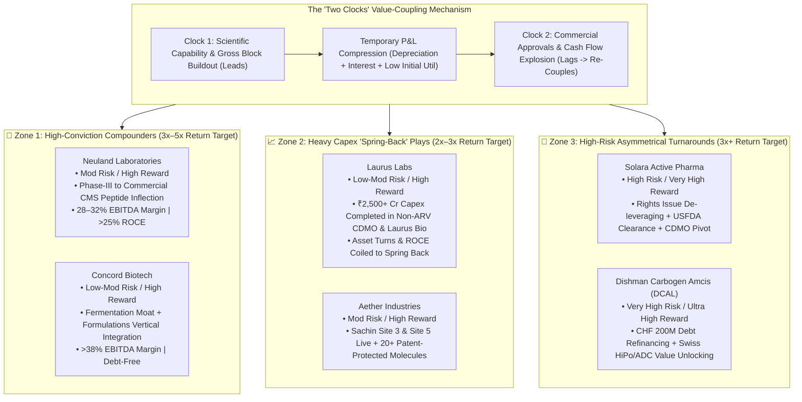

# Part 6: Identifying the Highest Return Potential in the CDMO Universe — Value-Coupling & The 'Two Clocks' Framework

## 📁 Document & Session Metadata

- **Format Version (`formatVersion`):** `1`
- **Export Time (`exportTime`):** `2026-11-06T15:06:22.617Z`
- **Chat Session Name (`chat.name`):** `collections/default_collection/engines/gemini-enterprise-sec-dx-swa/sessions/9286957380505800928`
- **Chat Title (`chat.title`):** `Antifragile Investing Topics`
- **Session Start Time (`chat.startTime`):** `2026-09-23T14:49:02.781Z`
- **Session End Time (`chat.endTime`):** `2026-09-24T16:02:31.225Z`
- **Document Part:** Part 6 of 7
- **Turns Included in This File:** Turns 10 (of 12 Total Turns)

---

## 🕒 Turn 10 (Timestamp: `2026-09-23T16:36:18.674844474Z`)

### ❓ User Query (Verbatim)

Which have hiher return potential in the above cdmo list

---

### 💡 Research Analysis & Answer (Verbatim)

To identify which companies in the CDMO list have the **highest potential investment returns**, we must look beyond current valuations and analyze where the greatest **value-coupling inflections** are taking place. 

Based on Sajal Kapoor's **"Two Clocks" framework**—where scientific capabilities lead while cash flows temporarily lag—the highest returns typically do not come from stable, already fully-valued giants. Instead, they are found in two specific zones:
1. **The Compounding Specialists (Tier 2):** High-moat businesses experiencing a structural operating surge as their late-stage pipelines transition into commercial approvals.
2. **The Under-the-Radar Turnarounds (Tier 3/4):** Asset-heavy systems where major operational bottlenecks (such as regulatory bans or high leverage) are clearing, creating a sharp re-rating opportunity.

Below is an analysis of the companies in the CDMO list with the highest potential return profiles, categorized by their investment risk-reward dynamics.

---

## 🚀 1. The High-Conviction Compounders (Target: 3x–5x Return Potential)
*These companies possess clean balance sheets, highly specialized technical moats, and are actively scaling high-margin, multi-decade contracts.*

### **Neuland Laboratories**
*   **The Inflection Thesis:** Neuland has transitioned from a generic API player into a high-value, peptide-focused CDMO. Their **"reverse-lumpiness"** model is highly potent. They have multiple molecules in Phase III clinical trials. As these molecules secure commercial approval, Neuland shifts from low-volume clinical batches to high-volume commercial manufacturing, causing a sharp, non-linear jump in cash flows.
*   **Operating Leverage:** Because Neuland has already completed its primary capital expenditure cycles, incremental revenues from commercialized CDMO molecules flow directly to the bottom line, keeping EBITDA margins in the **28%–32%** range with ROCE exceeding **25%**.
*   **Screener & Concall Key Focus:** Watch their CMS (Custom Manufacturing Solutions) pipeline growth. Any regulatory approval of a client's drug containing a Neuland-made intermediate serves as a major structural catalyst.

### **Concord Biotech**
*   **The Inflection Thesis:** Concord is a global leader in high-barrier **fermentation-based biotechnology** (immunosuppressants and oncology APIs). Fermentation-based manufacturing is incredibly difficult to replicate, protecting Concord from the aggressive price erosion common in synthetic chemistry.
*   **Operating Leverage:** The company is vertically integrating by launching its own finished dosage formulation blocks. By moving from supplying raw bulk active ingredients to providing the final, packaged drug, they capture a significantly larger portion of the value chain.
*   **Screener & Concall Key Focus:** Their margins consistently hold above **38%**, and they maintain a debt-free balance sheet. They are currently scaling up their non-immunosuppressant fermentation portfolio, which is poised to drive their next major leg of growth.

---

## 📈 2. The Heavy Capex "Spring-Back" Plays (Target: 2x–3x Return Potential)
*These are high-quality businesses that have spent massive amounts of capital over the last 3–4 years. While their near-term P&L looks temporarily depressed due to depreciation and interest, their new assets are about to begin generating high-margin revenues.*

### **Laurus Labs**
*   **The Inflection Thesis:** Laurus is currently the textbook definition of the **"Two Clocks"** framework. Over the last three years, the company has spent over **₹2,500 crore** on capital expenditures to build non-ARV CDMO synthesis blocks and scale up *Laurus Bio* (their precision fermentation and animal-origin-free protein division). 
*   **The Valuation Disconnect:** Because legacy ARV API prices collapsed, their near-term ROCE looked temporarily depressed, causing the stock to consolidate. However, their newly built CDMO and Bio assets are actively onboarding global innovators.
*   **Screener & Concall Key Focus:** As these high-margin CDMO blocks begin commercial production over the next 12–18 months, asset turns will rise, driving a sharp recovery in operating margins and ROCE.

### **Aether Industries**
*   **The Inflection Thesis:** Aether is a pioneer in continuous-flow chemistry inside India. They operate on a CRAMS (Contract Research and Manufacturing) model that embeds them directly into the chemistry pipelines of global agrochemical and pharmaceutical innovators.
*   **Operating Leverage:** After temporary setbacks from an industrial accident in late 2023, Aether’s newly built Sachin Site 3 and Site 5 are fully operational. They have a pipeline of over 20 highly specialized, patent-protected molecules that are transitioning to commercial scale.
*   **Screener & Concall Key Focus:** Watch for the commercial execution of their large-scale contract manufacturing agreements, which are positioned to drive an operating leverage surge over the next few fiscal quarters.

---

## 🔄 3. The High-Risk, High-Reward Turnarounds (Target: 3x+ Return Potential)
*These are deep value opportunities where the business is currently facing operational stress, but a successful turnaround of its capital structure or regulatory status could spark an asymmetrical upward re-rating.*

### **Solara Active Pharma Sciences**
*   **The Inflection Thesis:** Solara was severely impacted by high debt, legacy generic API price erosion, and a USFDA warning letter at its Cuddalore site. However, under the direct stewardship of promoter Arun Kumar, the company is undergoing a aggressive restructuring program.
*   **The Turnaround Catalyst:** Solara has completed a rights issue to significantly reduce its debt. More importantly, they are pivoting their high-capacity infrastructure away from commoditized generic APIs and toward specialized contract synthesis and CDMO services.
*   **Screener & Concall Key Focus:** If the USFDA clearances for their key export sites are fully resolved and their high-margin CDMO client onboardings begin to scale, the business will transition from a low-margin capital trap into a lean, cash-generating CDMO system.

### **Dishman Carbogen Amcis (DCAL)**
*   **The Inflection Thesis:** DCAL owns *Carbogen Amcis*, an elite, highly valuable Swiss-based CDMO specializing in high-potency APIs (HiPo) and Antibody-Drug Conjugates (ADCs) used in cutting-edge oncology. However, the stock has been severely depressed due to massive debt and low-margin legacy assets in India.
*   **The Turnaround Catalyst:** The company is currently restructuring its capital. They are raising up to CHF 200 million in low-cost debt to refinance their expensive domestic borrowings. Additionally, any potential spin-off or value unlocking of the highly profitable Swiss *Carbogen Amcis* business represents an asymmetrical valuation catalyst.
*   **Screener & Concall Key Focus:** Watch for net debt reduction and margin expansion in their Indian operations (Bavla/Naroda sites) as they scale up supply of intermediates to their Swiss parent entity.

---

## ⚖️ **The High-Return Comparison Matrix**

| Company | Risk-Reward Profile | Primary Return Driver | Key Metric to Track |
| :--- | :--- | :--- | :--- |
| **Neuland Labs** | **Moderate Risk / High Reward** | Commercialization of late-stage CMS pipeline molecules. | CMS revenue segment contribution % |
| **Concord Biotech** | **Low-Moderate Risk / High Reward** | Vertical integration into formulation and scaling non-immunosuppressant fermentation APIs. | Formulations block asset utilization rates |
| **Laurus Labs** | **Low-Moderate Risk / High Reward** | Operating leverage kick-in from newly built CDMO and Biologics (Laurus Bio) blocks. | Asset turn ratio improvement and non-ARV EBITDA margins |
| **Solara Active** | **High Risk / Very High Reward** | Successful debt reduction via rights issue and transition from generic APIs to CDMO. | USFDA site clearance and debt-to-equity ratio reduction |
| **Dishman Carbogen**| **Very High Risk / Ultra High Reward**| Capital restructuring, debt refinancing, and potential value-unlocking of Swiss operations. | Refinancing progress of expensive domestic debt |

---

### **⚠️ Critical Risk Warning**
While **Solara** and **Dishman** offer mathematically higher percentage return potential due to their depressed, low-valuation baselines, they carry **significantly higher structural risks**. For a more balanced, high-conviction approach, **Neuland Labs, Concord Biotech, and Laurus Labs** represent the most robust combinations of deep competitive moats, solid management quality, and powerful operating leverage inflections.

---


---


---

## 📊 Enhanced Visual Illustrations & Diagrams (Part 6)

### Mermaid Decision Matrix: Sajal Kapoor's "Two Clocks" Re-Coupling & Return Potential Zones


### Enhanced ASCII Risk-Reward Spectrum: The 6 High-Return CDMO Candidates
```
====================================================================================
   CDMO HIGH-RETURN CANDIDATES: RISK vs. RETURN POTENTIAL SPECTRUM
====================================================================================
   Low-Mod Risk / High Conviction (3x-5x) │ ★ Concord Biotech   | ★ Neuland Labs
   Capex Spring-Back Inflection (2x-3x)   │ ★ Laurus Labs       | ★ Aether Industries
   High-Beta Deep Turnaround (3x+ or bust)│ ⚠️ Solara Active    | ⚠️ Dishman Carbogen
====================================================================================
```
