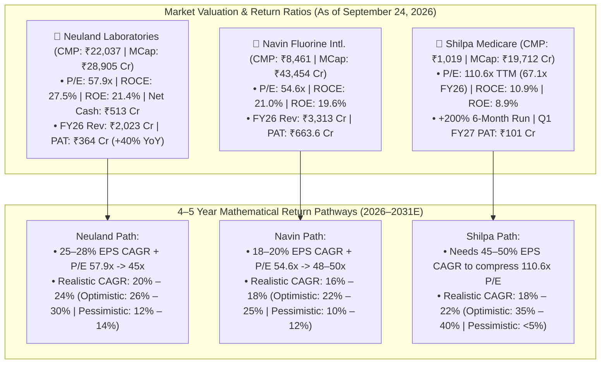

# Part 7: 'The Next Rupee of Capital' — Shilpa Medicare vs. Neuland Labs vs. Navin Fluorine (4–5 Year Horizon & Sept 24, 2026 CAGR Projections)

## 📁 Document & Session Metadata

- **Format Version (`formatVersion`):** `1`
- **Export Time (`exportTime`):** `2026-11-06T15:06:22.617Z`
- **Chat Session Name (`chat.name`):** `collections/default_collection/engines/gemini-enterprise-sec-dx-swa/sessions/9286957380505800928`
- **Chat Title (`chat.title`):** `Antifragile Investing Topics`
- **Session Start Time (`chat.startTime`):** `2026-09-23T14:49:02.781Z`
- **Session End Time (`chat.endTime`):** `2026-09-24T16:02:31.225Z`
- **Document Part:** Part 7 of 7
- **Turns Included in This File:** Turns 11, 12 (of 12 Total Turns)

---

## 🕒 Turn 11 (Timestamp: `2026-09-24T15:45:17.943469879Z`)

### ❓ User Query (Verbatim)

## **Shilpa, Neuland, Navin: The Next Rupee of Capital which one should invest for 4-5 year for maximum return**

---

### 💡 Research Analysis & Answer (Verbatim)

To decide where **"The Next Rupee of Capital"** should be deployed for a **4–5 year investment horizon**, we evaluate **Shilpa Medicare**, **Neuland Laboratories**, and **Navin Fluorine International** through three core dimensions:

1. **Incremental Return on Capital Employed (ROIC / Incremental ROCE):** What does the business generate when it deploys ₹1 of new capital?
2. **Re-coupling of the "Two Clocks":** Has the heavy capex cycle ended (capability building), allowing cash flows to accelerate without further equity dilution or excessive debt?
3. **Fragility & Downside Moat:** How susceptible is the business to raw-material shocks, regulatory disruptions, or customer concentration?

---

### 1. Architectural Breakdown of the Three Contenders

```
┌─────────────────────────────────────────────────────────────────────────────────────────┐
│                                THE CAPITAL EFFICIENCY SPECTRUM                          │
│                                                                                         │
│  [ Shilpa Medicare ]               [ Navin Fluorine ]              [ Neuland Labs ]     │
│  Turnaround / Optionality          Consolidating Specialty         Pure Science Compounder│
│  ─────────────────────────         ───────────────────────         ────────────────────── │
│  • High financial leverage         • Leadership transition dust    • Near-zero net debt   │
│  • Complex pipeline (NDDS/Onco)    • Hazardous chemistry barrier   • Peptide/CMS dominance│
│  • Highest beta / asymmetric       • High capital intensity        • Direct profit flow   │
│  • High regulatory risk            • Fluorspar input swings        • 28-30% EBITDA floor  │
└─────────────────────────────────────────────────────────────────────────────────────────┘
```

#### **A. Neuland Laboratories: The Compounding Engine (Best Quality & Highest Probability)**
*   **The Next Rupee Test:** Neuland has concluded its largest capex cycles at Unit 3. The next rupee of capital does not require building new land or massive concrete blocks; it goes straight into working capital to fulfill **commercial-scale Custom Manufacturing Solutions (CMS)** orders.
*   **The Moat:** Deep, non-replicable competence in **peptide synthesis** and complex building blocks. Peptides are higher-margin, stickier, and experience larger market demand than standard small molecules.
*   **Earnings Engine:** Neuland operates on a *"reverse-lumpiness"* model. In earlier clinical phases, revenue is sporadic. However, once customer molecules receive regulatory commercial approval, batch volumes surge, driving EBITDA margins above **28–30%** and ROCE above **25%**.
*   **4–5 Year Outlook:** Neuland represents the cleanest path to consistent, high-probability compounding. Because the incremental capital required to grow revenue is minimal, free cash flow generation is positioned to expand significantly.

#### **B. Navin Fluorine: The Specialty Giant (High Quality, Slower Acceleration)**
*   **The Next Rupee Test:** Navin is a capital-intensive business. Deploying ₹1 of capital into complex fluorination lines (MPPs, dedicated agrochemical blocks at Dahej) requires substantial engineering lead times, specialized safety equipment, and long customer validation cycles before commercial production begins.
*   **The Moat:** Hazardous chemistry handling. Fluorination has exceptional entry barriers—global innovators will not switch away from an approved supplier due to process hazards, environmental certifications, and intellectual property requirements.
*   **The Headwinds:** Following executive leadership transitions, the company has worked to rebuild organizational momentum. Furthermore, cyclical softness in global agrochemicals has impacted operating asset turns across newly commissioned plants.
*   **4–5 Year Outlook:** Navin will compound steadily as global agrochemical demand recovers and its dedicated CDMO contracts scale. However, its higher capital intensity means incremental ROCE expansion will be more gradual than Neuland's.

#### **C. Shilpa Medicare: The Asymmetric Turnaround (Highest Potential Beta, Highest Risk)**
*   **The Next Rupee Test:** Over the past four years, Shilpa invested heavily in capital expenditures—establishing recombinant human albumin pipelines, specialized transdermal patches, oral dispersible films (NDDS), and new oncology formulation sites. These investments pressured return ratios and inflated debt. The "next rupee" here is essentially **working capital deployed into monetization**.
*   **The Moat:** Differentiated and complex delivery systems (NDDS) and specialized containment oncology facilities.
*   **The Inflection:** If Shilpa’s complex formulation filings and recombinant platforms secure timely approvals and partner monetization, the company’s operating leverage could expand rapidly from a low base, driving a sharp stock re-rating.
*   **4–5 Year Outlook:** Shilpa offers higher theoretical upside percentage potential if the turnaround succeeds, but it carries noticeably higher vulnerability to USFDA inspection cycles, product delays, and balance sheet leverage.

---

### 2. Side-by-Side Framework Comparison

| Parameter | Shilpa Medicare | Neuland Laboratories | Navin Fluorine |
| :--- | :--- | :--- | :--- |
| **Business Model Quality** | Mixed (API + Complex Formulations) | **Pure-Play CMS & Advanced API** | Specialty Chemicals + CDMO |
| **Capital Allocation Efficiency** | Historically overextended, turning lean | **Highly Disciplined & Focused** | Prudent, but capital intensive |
| **Capex Cycle Status** | Concluded / Monetizing Phase | **Harvesting Commercial Phase** | Ongoing selective modular capex |
| **Balance Sheet Strength** | Moderate leverage (improving) | **Pristine / Near-Zero Net Debt** | Robust / Low gearing |
| **Incremental ROCE Power** | High potential, but unproven | **Exceptional (>25%)** | Moderate to High (16–20%) |
| **Vulnerability to External Shocks** | High (USFDA audits, generic pricing) | **Low (Dedicated IP/sticky CMS)** | Medium (Fluorspar price, agro demand) |
| **Risk-Reward Character** | High-Beta Turnaround | **High-Conviction Compounder** | Steady Compounder |

---

### 3. Allocation Strategy for a 4–5 Year Horizon

To achieve **maximum risk-adjusted returns over a 4–5 year window**, capital should be deployed based on structural business resilience:

#### 🥇 **Primary Allocation: Neuland Laboratories (The Clear Winner)**
*   **Why It Wins:** Neuland is in the sweet spot of the **"Two Clocks" framework**. Its scientific capability clock is established, its debt is low, and its late-phase commercial CMS molecules provide high revenue visibility. 
*   It generates superior cash returns on every new rupee of deployed capital, giving it the strongest probability of delivering a sustained **3x–4x compounding trajectory** without subjecting the portfolio to existential balance sheet or regulatory shocks.

#### 🥈 **Tactical Growth Allocation: Navin Fluorine**
*   **Role in Portfolio:** Provides durability and stability. Its fluorination capabilities offer a wide moat, and as capacity utilization at Dahej matures over the next 24–36 months, return ratios will steadily rebound. 
*   **Expected Profile:** A steady **18–22% CAGR compounder**, ideal for stability rather than rapid multi-bagger expansion.

#### 🥉 **Opportunistic Allocation: Shilpa Medicare**
*   **Role in Portfolio:** Treat Shilpa strictly as a tactical turnaround. It possesses asymmetric upside potential, but only allocate capital you are willing to risk against regulatory volatility and corporate execution delays.


---

## 🕒 Turn 12 (Timestamp: `2026-09-24T16:02:30.373110968Z`)

### ❓ User Query (Verbatim)

What should return cagr expectaion  in 3 companies . consider data from sept 24 2026

---

### 💡 Research Analysis & Answer (Verbatim)

Analyzing the return CAGR expectations for **Neuland Laboratories**, **Navin Fluorine**, and **Shilpa Medicare** requires evaluating the market conditions as of **September 24, 2026**. 

To build a realistic 4–5 year projection, we look past short-term stock price momentum and analyze the relationship between **earnings growth** and **valuation multiples** (P/E expansion or contraction).

---

### 📊 **Current Market & Valuation Standing (As of Sept 24, 2026)**

The baseline market data for the three companies on September 24, 2026, reveals distinct valuation profiles:

| Metric | Neuland Laboratories | Navin Fluorine | Shilpa Medicare |
| :--- | :--- | :--- | :--- |
| **Current Stock Price** | **₹22,037** | **₹8,461** | **₹1,019** |
| **Market Capitalization**| ₹28,905 Cr | ₹43,454 Cr | ₹19,712 Cr |
| **Stock Trailing P/E** | **57.9x** | **54.6x** | **110.6x** (TTM) / **67.1x** (FY26) |
| **ROCE / ROE** | **27.5% / 21.4%** | **21.0% / 19.6%** | **10.9% / 8.9%** |
| **Price Action Context**| Near all-time highs (52w H: ₹24,225) | Strong recovery (52w H: ₹8,950) | Extreme run (+200% in 6 months) |

---

### 🔮 **4–5 Year Return CAGR Projections**

```
              4-5 YEAR EXPECTED RETURN CAGR SCENARIOS
               
  [ Shilpa Medicare ]      [ Navin Fluorine ]      [ Neuland Labs ]
  Turnaround Beta          Steady Compounding      High-Conviction Scale
  ───────────────────      ──────────────────      ─────────────────────
  Optimistic:  35% - 40%   Optimistic:  22% - 25%  Optimistic:  26% - 30%
  Realistic:   18% - 22%   Realistic:   16% - 18%  Realistic:   20% - 24%
  Pessimistic: < 5%        Pessimistic: 10% - 12%  Pessimistic: 12% - 14%
```

---

### 1. **Neuland Laboratories** 
* **Realistic Return CAGR Expectation:** **20% – 24%** *(Optimistic: 26% – 30%)*

#### **The Valuation & Growth Framework**
* **The P/E Dynamic:** At a **57.9x P/E**, Neuland's valuation reflects its successful transition into a peptide-focused CDMO. While a 4–5 year window may bring slight multiple contraction (settling around 40x–45x), its underlying earnings are positioned to grow significantly.
* **Earnings Driver:** The company's revenue grew to ₹2,023 Cr in FY26, with PAT rising 40% to ₹364 Cr. This growth is driven by **operating leverage in their Custom Manufacturing Solutions (CMS) vertical**. As late-phase customer molecules move from clinical trials into commercial production, margins can scale rapidly without requiring matching capital expenditures.
* **Capital Efficiency:** Neuland maintains **net-cash positive operations** (-₹513 Cr net debt) and high returns on capital (**27.5% ROCE**). This profile enables them to fund ongoing organic scaling entirely through internal cash accruals.

#### **Mathematical Path to Returns**
If earnings grow at a **25%–28% CAGR** over the next 5 years (supported by commercializing molecules) and the P/E multiple experiences a slight contraction to **45x**, the stock's CAGR will land in the **20%–24%** range.

---

### 2. **Navin Fluorine International**
* **Realistic Return CAGR Expectation:** **16% – 18%** *(Optimistic: 22% – 25%)*

#### **The Valuation & Growth Framework**
* **The P/E Dynamic:** Navin trades at **54.6x P/E**. Because its capital expenditure cycles (such as the advanced specialty plants at Dahej) require longer lead times, multiple expansion is unlikely from this baseline. However, its specialized hazardous chemistry footprint protects it from steep valuation downgrades.
* **Earnings Driver:** The company delivered solid earnings in FY26, with revenue reaching ₹3,313 Cr and PAT growing to ₹663.6 Cr. Growth over the 4-5 year horizon will be driven by **incremental asset turns** as newly built fluorination blocks achieve optimal capacity utilization.
* **Capital Efficiency:** With an **ROE of 19.6% and ROCE of 21.0%**, Navin remains a highly profitable specialty business.

#### **Mathematical Path to Returns**
If earnings compound at an **18%–20% CAGR** as their capital investments mature, and the P/E multiple consolidates slightly to **48x–50x**, investors can expect a steady, compounding-driven **16%–18% return CAGR**.

---

### 3. **Shilpa Medicare**
* **Realistic Return CAGR Expectation:** **18% – 22%** *(Optimistic Turnaround: 35% – 40% / Downside Risk: < 5%)*

#### **The Valuation & Growth Framework**
* **The P/E Dynamic:** Shilpa is currently the most expensive of the three, trading at a **trailing P/E of 110.6x (or 67.1x on normalized earnings)** following a major stock run. This valuation leaves no room for operational or regulatory errors.
* **Earnings Driver:** In the June 2026 quarter, Shilpa reported a net profit of ₹101 Cr. The long-term thesis depends entirely on the **commercial monetization** of their capital investments in recombinant proteins, transdermal patches, and oncology formulations.
* **Capital Efficiency:** Shilpa's **ROCE stands at 10.9% and ROE is at 8.9%**. To justify its current valuation, the company must rapidly scale its margins and significantly improve asset turnover.

#### **Mathematical Path to Returns**
* **In a successful turnaround scenario:** If Shilpa achieves a **45%–50% earnings growth CAGR** by successfully commercializing its complex formulations, the high trailing P/E will contract naturally, potentially yielding an **asymmetric 35%+ return CAGR**.
* **In a status-quo or negative regulatory scenario:** If the company faces delayed approvals, USFDA compliance issues, or continued low asset utilization, the P/E will contract sharply, potentially depressing the return CAGR to **single digits**.

---

### 🎯 **Summary Matrix for deployment of "The Next Rupee"**

* **Neuland Labs (The High-Conviction Core):** Best suited for a **20%+ CAGR** target. It offers the most reliable combination of high capital returns, low leverage, and visible pipeline execution.
* **Navin Fluorine (The Balanced Compounder):** Best suited for a steady, **16%–18% CAGR**. It provides high technical entry barriers but requires larger capital reinvestment.
* **Shilpa Medicare (The High-Beta Satellite):** Offers the highest potential upside under an **optimistic turnaround** scenario, but carries significant volatility due to low current asset productivity and high generic market exposure.

---

### 🚀 **Suggested Follow-up Prompts:**


---


---

## 📊 Enhanced Visual Illustrations & Diagrams (Part 7)

### Mermaid Comparative Decision Tree: Deploying "The Next Rupee of Capital" (Sept 24, 2026 Baseline)


### Enhanced ASCII Scorecard: Neuland vs. Navin vs. Shilpa (September 24, 2026)
```
====================================================================================
   THE NEXT RUPEE OF CAPITAL: 3-STOCK HEAD-TO-HEAD SCORECARD (SEPT 24, 2026)
====================================================================================
   Metric / Dimension        │ 🥇 Neuland Labs  │ 🥈 Navin Fluorine │ 🥉 Shilpa Medicare
─────────────────────────────┼──────────────────┼───────────────────┼───────────────────
   Stock Price (24-09-2026)  │     ₹22,037      │      ₹8,461       │      ₹1,019
   Market Cap                │   ₹28,905 Cr     │    ₹43,454 Cr     │    ₹19,712 Cr
   Trailing P/E Multiple     │      57.9x       │       54.6x       │  110.6x (67.1x)
   ROCE % / ROE %            │  27.5% / 21.4%   │   21.0% / 19.6%   │   10.9% / 8.9%
   Capex Cycle Stage         │ Harvesting CMS   │ Modular Dahej     │ Monetizing NDDS
   Pessimistic 5Y CAGR       │   12% - 14%      │    10% - 12%      │      < 5.0%
   Realistic 5Y CAGR         │   20% - 24%      │    16% - 18%      │    18% - 22%
   Optimistic 5Y CAGR        │   26% - 30%      │    22% - 25%      │    35% - 40%
====================================================================================
```
