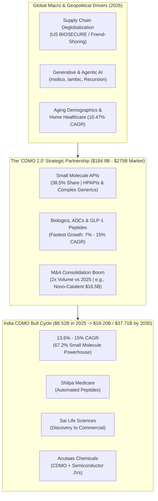

# Part 1: Global Pharma & Healthcare Landscape & India's CDMO Bull Cycle

## 📁 Document & Session Metadata

- **Format Version (`formatVersion`):** `1`
- **Export Time (`exportTime`):** `2026-11-06T15:06:12.871Z`
- **Chat Session Name (`chat.name`):** `collections/default_collection/engines/gemini-enterprise-sec-dx-swa/sessions/17520757415312887215`
- **Chat Title (`chat.title`):** `Pharma & Healthcare Research`
- **Session Start Time (`chat.startTime`):** `2026-09-25T12:11:00.226Z`
- **Session End Time (`chat.endTime`):** `2026-10-07T12:51:37.340Z`
- **Document Part:** Part 1 of 7

---

## 🕒 Turn 1 (Timestamp: `2026-09-25T12:11:24.412476308Z`)

### ❓ User Query (Verbatim)

Pharma and Healthcare Reasearch:-

---

### 💡 Research Analysis & Answer (Verbatim)

I will search our internal knowledge database to retrieve relevant research, insights, and documents on the pharma and healthcare sector.
[[section:Internal Research Search]]### **Executive Summary**
The global pharmaceutical and healthcare sectors in 2026 are experiencing a profound structural transformation. Propelled by rapid technological leaps, the democratization of artificial intelligence, and a fundamental shift in supply-chain geopolitics, the industry is transitioning from transactional operational models to highly integrated, asset-light, and tech-driven ecosystems. 

At the heart of this transition is the **Contract Development and Manufacturing Organization (CDMO)** sector, which has evolved from a simple outsourcing utility into a strategic partner ("CDMO 2.0") capable of navigating complex biological modalities, strict global regulatory changes, and intense onshoring pressures.

---

### **1. Global Healthcare Services Market Landscape**
The global healthcare services market is experiencing steady expansion, driven by aging demographics, digital transformation, and an escalating chronic disease burden. 

* **Market Valuation:** Estimated at **\$9.94 Trillion in 2026**, the global healthcare services market is projected to reach **\$19.62 Trillion by 2034**, growing at an 8.86% CAGR. 
* **Regional & Segment Dominance:** North America continues to lead the market (holding ~39.24% of global share), while hospital services remain the largest service component (accounting for ~44.68% of the market). 
* **The Rise of Home Healthcare:** Driven by an aging population and remote-monitoring technologies, home healthcare is the fastest-growing sector, projected to expand at a 10.47% CAGR.

---

### **2. Core Industry Trends Driving 2026 & Beyond**

#### **📌 Trend 1: The "CDMO 2.0" Strategic Partnership Model**
Drug sponsors are increasingly divesting physical factories to focus purely on portfolio strategy, R&D, and commercialization. This has forced contract manufacturers to consolidate and scale up into "one-stop shops".
* **Value & Scale:** The global CDMO market is valued between **\$184.9 Billion and \$275 Billion in 2026**, with projections scaling up to over **\$342–\$580 Billion by the mid-2030s**. 
* **Consolidation Boom:** Driven by private equity involvement and major asset acquisitions (e.g., Novo Holdings' \$16.5B acquisition of Catalent), CDMO M&As entered 2026 at twice the volume seen in early 2025. 
* **Modality Shift:** While small molecule APIs still command the largest absolute market share (~38.5% of the market, driven by complex generics and high-potency APIs), **biologics, antibody-drug conjugates (ADCs), and peptide-based therapies (such as GLP-1s)** are growing at a much faster rate (7% to 15% CAGR).

#### **📌 Trend 2: AI Drug Discovery and Automated Workflows**
The deployment of Generative and Agentic AI is moving from conceptual pilot programs to repeatable, end-to-end drug development pipelines.
* **Clinical Pipeline Maturation:** Companies like Insilico, Iambic, and Recursion are moving entirely AI-discovered molecules into mid-stage clinical trials. 
* **Automated Clinical Trials:** Decentralized trials and AI-driven matching platforms (utilizing Natural Language Processing to screen Electronic Health Records) have compressed patient recruitment timelines and enhanced trial diversity. 

#### **📌 Trend 3: Macroeconomic, Pricing, and Geopolitical Pressures**
The global life sciences sector is heavily caught in geopolitical crosscurrents.
* **Supply Chain Deglobalization:** Strong protectionist policies and regulatory volatility in the U.S. and Europe are accelerating onshoring or "friend-shoring" of active pharmaceutical ingredients (APIs) and finished drug manufacturing to de-risk supply chains.
* **Margin Compression:** Healthcare systems are prioritizing aggressive cost-containment, margin improvement, and outpatient care models to battle systemic inflation and labor shortages.

---

### **3. Spotlight: India's Pharma and CDMO Bull Cycle**
India's pharmaceutical sector is outperforming global peers, moving away from being merely the "pharmacy of the generic world" to a premium, high-value innovation hub.

```
                INDIA'S CDMO MARKET GROWTH TRAJECTORY (Projected)
  
  $40B |------------------------------------------------------------- $37.71B (2030)
  $30B |--------------------------------------------------
  $20B |--------------------------------------- $18-20B (2030 McKinsey Target)
  $10B |--- $8.52B (2025)
    $0 |_____________________________________________________________
           2025                                2030 (CAGR: 13.6% - 15%)
```

* **Competitive Growth Rates:** While the global CDMO market grows at a steady 6% to 10% CAGR, the **India CDMO market is expanding at a CAGR of 13.6% to 15%**, poised to reach **\$18–\$20 Billion by 2030** (up from \$8.52 Billion in 2025).
* **Small Molecule Powerhouse:** Small molecules represent 67.2% of the Indian CDMO market, supported by deep chemistry capabilities in complex synthesis, green chemistry, and continuous manufacturing.
* **The "China + 1" Catalyst & Long-Term Contracts:** Global pharmaceutical companies are actively diversifying their supply chains away from China. This has resulted in multinational firms signing multi-year, dedicated facility agreements with Indian CDMOs, safeguarding Intellectual Property (IP) and ensuring quality compliance.
* **Diverse Market Competitors:**
  1. *Shilpa Medicare:* Focusing heavily on transitioning away from commodity generics toward high-margin automated peptide manufacturing.
  2. *Sai Life Sciences:* Expanding capabilities along the value chain, specifically targeting the gap between discovery chemistry and late-stage commercial manufacturing.
  3. *Acutaas Chemicals:* Broadening its CDMO pipeline while simultaneously leveraging joint ventures (with South Korean firms) to expand into semiconductor chemicals.

---

### **⚠️ Watch Out For: Key Industry Pitfalls & Risks**
1. **The "Patent Cliff" Scramble:** With several blockbuster drugs facing patent expirations, developers are scrambling to secure commercial-scale biologics manufacturing capacity. CDMOs without sterile fill-finish or specialized containment setups risk missing this surge.
2. **Workforce and Talent Burnout:** Severe global shortages of clinical, laboratory, and digital-analytics talent are driving up operational costs.
3. **Cybersecurity Vulnerabilities:** As digital medicine, remote trials, and automated supply chains connect deeper, healthcare institutions remain prime targets for ransomware, jeopardizing patient privacy and clinical IP.

---

### **💡 Recommended Strategic Actions**
* **For Investors:** Prioritize CDMO players in the Asia-Pacific region (specifically India) that are shifting toward the **CDMO 2.0 integrated model**. Focus on those with existing USFDA-approved facilities capable of manufacturing peptides, complex formulations, and biologics.
* **For Pharmaceutical Developers:** Shift toward asset-light, fully outsourced models but secure manufacturing capacities early through long-term strategic contracts, particularly for specialty therapies and complex biologics.
* **For Healthcare Operators:** Transition care models toward outpatient, digital-first, and preventive structures to offset workforce constraints and financial margin pressures.


---

## 📊 Enhanced Visual Illustrations & Diagrams

### Mermaid Flowchart: Global CDMO 2.0 Ecosystem & Supply Chain Realignment


### Enhanced ASCII Illustration: Global Healthcare Services vs. CDMO Trajectory (2025–2034)
```
====================================================================================
   GLOBAL HEALTHCARE SERVICES MARKET ($9.94T in 2026 ──► $19.62T by 2034 | 8.86% CAGR)
====================================================================================
   Regional Share:   [████████████████████░░░░░░░░░░░░░░░░░░░░░░░░░░░░░░] 39.24% North America
   Hospital Segment: [██████████████████████░░░░░░░░░░░░░░░░░░░░░░░░░░░░] 44.68% Hospital Services
   Fastest Growth:   Home Healthcare @ 10.47% CAGR (Remote Monitoring & Aging Demographics)

====================================================================================
   CDMO GROWTH RATE COMPARISON (CAGR %)
====================================================================================
   Global CDMO Market : [██████░░░░░░░░░░░░░░]  6.0% - 10.0% CAGR
   India CDMO Market  : [███████████████░░░░░] 13.6% - 15.0% CAGR (2x Global Pace)
====================================================================================
```
