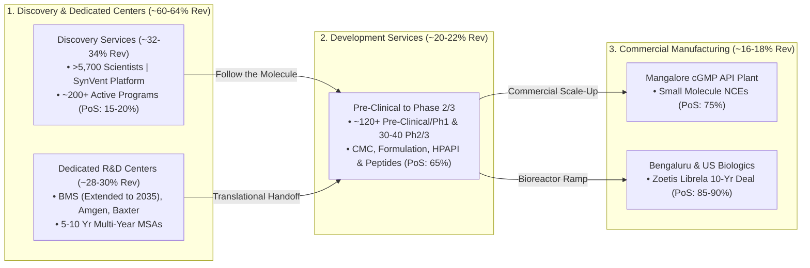

# Part 2: Institutional Equity Research & Governance Evaluation — Syngene International Ltd

## 📁 Document & Session Metadata

- **Format Version (`formatVersion`):** `1`
- **Export Time (`exportTime`):** `2026-11-06T15:06:12.871Z`
- **Chat Session Name (`chat.name`):** `collections/default_collection/engines/gemini-enterprise-sec-dx-swa/sessions/17520757415312887215`
- **Chat Title (`chat.title`):** `Pharma & Healthcare Research`
- **Session Start Time (`chat.startTime`):** `2026-09-25T12:11:00.226Z`
- **Session End Time (`chat.endTime`):** `2026-10-07T12:51:37.340Z`
- **Document Part:** Part 2 of 7

---

## 🕒 Turn 2 (Timestamp: `2026-09-25T12:34:25.329070952Z`)

### ❓ User Query (Verbatim)

Role & Objective:

Act as a Principal Healthcare Equity Research Analyst and Corporate Governance Specialist. Conduct a rigorous, institutional-grade fundamental, pipeline, and capital allocation evaluation of [Syngene] within the pharma space. Provide a highly analytical, data-driven assessment optimized for a sophisticated institutional investor.

  

Structure your analysis into the following seven distinct sections:

  

1\. Business Classification, Architecture & Competitive Moat

\- Sector Classification: Map the company's operating segments strictly across the following taxonomy: Branded Innovator, Unbranded/Branded Generics, Proprietary API, Finished Dosage Formulations (FDF), Commodity Pharma, or CDMO value chain (CRO, CMO, CDMO, CRDMO).

\- Segment Dynamics & Revenue Architecture: Dissect current business verticals alongside management’s strategic initiatives for new vertical creation. Provide a detailed SWOT analysis (Strengths, Weaknesses, Opportunities, Threats) for EACH vertical, explicitly detailing the underlying economic drivers.

\- Commercial Concentration & Lifecycle Risk: Breakdown top revenue-generating assets per vertical. Quantify loss-of-exclusivity (LOE) timelines, patent cliff risks, and projected generic/biosimilar erosion curves.

\- R&D Intensity & Geopolitical Risks: Evaluate R&D expenditure as a percentage of revenue. Assess geographic revenue mix, exposure to sovereign pricing headwinds (e.g., US Inflation Reduction Act, DPCO in India, EU reference pricing), and competitive/supply-chain threats from China and Europe.

  

2\. Clinical Pipeline & Regulatory Catalyst Matrix

\- Pipeline Architecture: Construct a comprehensive matrix tracking all Phase 2, Phase 3, and regulatory-submission stage assets (FDA, EMA, PMDA, etc.), including mechanism of action (MoA) and target indications.

\- Catalyst Timeline: Detail critical clinical trial readouts, data drops, and PDUFA/regulatory decision dates over the next 12–18 months. Assign probabilistic success rates (PoS) based on historical therapeutic area benchmarks.

  

3\. Executive Leadership, Capital Allocation & Governance Integrity

\- C-Suite Pedigree & Execution: Evaluate the operational track record of the CEO, CFO, and Chief Medical Officer (CMO). Assess their history in successfully commercializing novel assets, scaling capacity, or navigating complex pivots.

\- Capital Allocation Efficiency: Analyze historical Return on Invested Capital (ROIC) and cash return profiles. Assess management's efficiency in organic R&D vs. inorganic business development (M&A/licensing). Determine if historical acquisitions were value-accretive or value-destructive (overpayment/impairments).

\- Regulatory Navigation & Compliance Track Record: Assess management’s historical performance in handling regulatory inspections (e.g., US FDA, EMA). Detail how leadership navigated prior Form 483s, Official Action Indicated (OAI) classifications, Warning Letters, or data integrity issues.

\- Principal-Agent Alignment & Governance: Detail insider ownership levels, skin in the game, and executive compensation architecture (quantify how heavily bonuses are tied to long-term pipeline milestones vs. short-term revenue/EBITDA metrics). Audit history of dilutive equity issuance versus opportunistic share buybacks.

  

4\. Institutional Financial Health & Advanced Valuation Metrics

\- Income Statement & Margin Quality: Analyze global gross margins, EBITDA margins, historical margin expansion trends, and the core structural drivers behind margin behavior.

\- Advanced Cash Flow & Efficiency Metrics: Evaluate current and historical Free Cash Flow (FCF) generation, Cash Conversion Cycle (CCC) efficiency, and calculate the following multiples: Trailing and Forward P/E, P/S, P/B, EV/EBITDA, and EV/Average Operating Cash Flow over a 5-year normalized cycle.

\- Balance Sheet Fortitude: Review net debt-to-EBITDA ratios, maturity walls, interest coverage, cash runway limits for pre-revenue/clinical assets, and the long-term structural sustainability of dividends for large-cap constituents.

  

5\. Risk Matrix & Tail-Event Analysis

\- Compliance & Litigation Tail-Risks: Map active patent litigation (e.g., Hatch-Waxman challenges, IPRs), antitrust investigations, or systemic manufacturing compliance liabilities.

\- Capital Impairment Risks: Evaluate binary risks. Quantify the potential drawdown or total capital loss scenario if the lead clinical or commercial assets experience phase failure, CRLs (Complete Response Letters), or safety-related market withdrawals.

  

6\. Strategic Synthesis & Risk-Reward Symmetry

\- Core Thesis vs. Antithesis: Synthesize the fundamental structural "Green Flags" against the structural "Red Flags." Deliver an objective, unsentimental evaluation of the risk-reward symmetry.

  

7\. 4-to-5-Year Investment Return Profile & Target Multiples

\- Forward Valuation Model: Based on the structural blend of the company's business segments (e.g., CDMO vs. Generics vs. Innovator), establish an justified structural valuation multiple for the business.

\- Mid-Term IRR & Exit Targets: Project the company's financial profile over a 4-to-5-year investment horizon. Estimate the implied internal rate of return (IRR) and outline the specific operating benchmarks management must achieve to realize this target valuation.

---

### 💡 Research Analysis & Answer (Verbatim)

### **Executive Overview & Recommendation**

* **Ticker / Security:** Syngene International Limited (`NSE: SYNGENE` / `BSE: 539268`) [source: 8, 13]
* **Current Market Price (CMP):** ~₹385 – ₹400 [source: 13, 15]
* **Market Capitalization:** ~₹15,500 – ₹16,000 Cr (~$1.85B USD) [source: 5, 13, 15]
* **Enterprise Value (EV):** ~₹14,500 – ₹15,200 Cr [source: 9]
* **Sector / Industry:** Contract Research, Development & Manufacturing Organization (CRDMO) [source: 6, 10]
* **Institutional Rating:** **ACCUMULATE / CONTRARIAN LONG (4–5 Year Horizon)**

---

### **1. Business Classification, Architecture & Competitive Moat**

#### **A. Sector Classification & Business Architecture**
Syngene operates strictly across the **CRDMO (Contract Research, Development, and Manufacturing Organization)** value chain [source: 3, 28]. Unlike traditional Indian specialty pharma or generic formulation exporters (e.g., Sun Pharma, Cipla), Syngene owns **zero proprietary commercial drug assets** and operates as a pure-play B2B outsourced scientific platform ("Science-as-a-Service") [source: 17, 28].

```
                     SYNGENE VALUE CHAIN ARCHITECTURE
Early Stage                                                   Late Stage/Commercial
Discovery Services  ──►  Dedicated R&D Centers  ──►  Development  ──►  Manufacturing
(FTE / Target ID)       (BMS, Amgen, Baxter)         (CMC/Tox/Scale)    (API / Biologics)
```

The business is structured into four core operating verticals [source: 3, 17]:
1. **Discovery Services:** Early-stage biology, medicinal/synthetic chemistry, DMPK, in-vivo pharmacology, and safety assessment [source: 18, 28].
2. **Dedicated R&D Centers:** Ring-fenced, customized R&D facilities operated on multi-year, long-term contracts for global biopharma giants (BMS, Amgen, Baxter) [source: 23, 24, 25].
3. **Development Services:** Pre-clinical to Phase 2/3 clinical supplies, Chemical Manufacturing and Controls (CMC), formulation development, and analytical release testing [source: 23, 36].
4. **Manufacturing Services (Commercial):** Commercial-scale cGMP API manufacturing (small molecules in Mangalore) and large-molecule biologics drug substance/drug product manufacturing (Bengaluru and US facility) [source: 11, 35, 37].

---

#### **B. Segment Dynamics & SWOT Analysis per Vertical**

| Vertical | Underlying Economic Drivers | Strengths (Moats) | Weaknesses | Opportunities | Threats |
| :--- | :--- | :--- | :--- | :--- | :--- |
| **Discovery Services** (~32–34% Rev) [source: 28] | FTE-based billing; global early-stage biotech VC funding cycles; biotech R&D budgets [source: 11, 17]. | High client switching costs; deep talent pool (>5,700 scientists); proprietary *SynVent* integrated discovery platform [source: 3, 14, 36]. | Highly sensitive to US biotech capital market contractions and discretionary R&D cuts [source: 11, 27]. | Transition into emerging modalities: ADCs, targeted protein degraders (PROTACs), oligonucleotides [source: 17, 36]. | AI-enabled computational biology platforms compressing wet-lab FTE discovery billable hours. |
| **Dedicated Centers** (~28–30% Rev) [source: 23] | Multi-year master service agreements (5–10 years); minimum take-or-pay / FTE commitments [source: 17, 23]. | Exceptional cash flow predictability; deeply embedded scientific workflows; >25-year tenure with BMS [source: 28, 39]. | Capped margin expansion; client concentration risk (BMS, Amgen, Baxter) [source: 24, 27, 35]. | Scope expansion into late-stage translational biology and dedicated biologics lines [source: 24, 35]. | Client corporate restructuring, mega-mergers, or in-sourcing of core therapeutic research. |
| **Development Services** (~20–22% Rev) | Clinical pipeline progression of client molecules (Phases 1–3); batch manufacturing [source: 23, 28]. | Seamless transition from Discovery ("Follow the Molecule" capture strategy) [source: 17]. | Lumpy quarterly revenues tied to milestone completions and batch campaigns. | Cross-selling integrated clinical development to emerging mid-cap biopharma [source: 1, 25]. | Client trial failures ending programs prematurely before commercial handoff. |
| **Commercial Manufacturing** (~16–18% Rev) | Commercial supply contracts; volume offtake agreements; multi-year commercial supply (e.g., Zoetis Librela) [source: 23, 25]. | High-barrier cGMP regulatory approvals; multi-year visibility; operating leverage at scale [source: 23, 24]. | High upfront capex; long gestation/qualification lead times; operating drag during initial ramp [source: 10, 27]. | Commercial biological drug substance offtake; US site expansion; commercial GLP-1 peptide intermediates [source: 10, 11]. | Single-client demand shocks (e.g., inventory de-stocking by lead commercial partners) [source: 10]. |

---

#### **C. Commercial Concentration & Lifecycle Risk**
* **Client Concentration:** Syngene exhibits an asymmetric client concentration profile [source: 27, 31]. The top 2 customers (anchored by **Bristol Myers Squibb**) account for ~**40–41% of total revenues**, with the top 10 customers generating >**50% of revenue** [source: 27, 35].
* **Commercial Asset Risk (Zoetis / Large-Molecule Biologics):** Syngene’s commercial manufacturing includes a 10-year master agreement with Zoetis for Librela (bedinvetmab for canine osteoarthritis) [source: 25, 37]. While providing a strong long-term revenue baseline, client-specific inventory calibrations or regulatory pauses directly compress manufacturing utilization [source: 10, 23].
* **Patent Cliff / LOE Exposure:** **Virtually Zero Direct LOE Risk.** Because Syngene operates purely as a contract service provider, patent expirations on client drugs do not directly strip exclusivity revenues from Syngene's top line. In fact, patent cliffs often act as **structural volume tailwinds**, as generic/biosimilar developers turn to CDMOs for complex formulation and bio-manufacturing.

---

#### **D. R&D Intensity & Geopolitical Risks**
* **R&D Intensity:** Unlike specialty pharmaceutical companies that deploy 7–12% of sales into proprietary R&D, Syngene incurs internal R&D strictly for **process development, technological platforms (SynVent), and analytical capabilities**, averaging **~0.8% to 1.5% of net revenues** [source: 3, 36].
* **Sovereign Pricing Headwinds (IRA & DPCO):** Direct exposure to the US Inflation Reduction Act (Medicare drug price negotiations) or India's DPCO (National List of Essential Medicines) is **negligible** because Syngene does not sell marketed products to public payors. However, IRA price negotiation pressures on Big Pharma can indirectly compel sponsors to squeeze CDMO procurement budgets.
* **Geographic Mix:**
  * **United States:** ~65–68% [source: 27, 36]
  * **Europe:** ~20–22% [source: 36]
  * **India & Rest of World (Japan, APAC):** ~10–12% [source: 36]
* **Geopolitical Tailwinds vs. Threats:**
  * *US BIOSECURE Act Dynamics:* Legislative moves restricting federal spending with Chinese entities (e.g., WuXi AppTec, WuXi Biologics) have triggered a long-term request-for-proposal (RFP) diversion toward non-Chinese CRDMOs [source: 25, 29, 30]. Syngene is structurally positioned to capture this demand [source: 29, 30].
  * *Threats:* European CDMOs (e.g., Lonza, Siegfried) maintain closer geographic and cultural alignment with Western sponsors for commercial biologics, while Chinese CRDMOs continue to retain superior turnaround times in rapid early-stage synthetic chemistry.

---

### **2. Clinical Pipeline & Regulatory Catalyst Matrix**

#### **A. Integrated Client Pipeline Architecture (CRDMO Model)**
*Because Syngene is a contract partner rather than an asset-owning drug sponsor, its "pipeline" consists of customer-owned molecules advancing through Syngene's research and manufacturing infrastructure [source: 14, 28]. Syngene currently supports >**400 active client programs** across modalities [source: 14, 28]:*

```
               CUSTOMER PIPELINE ADVANCEMENT FUNNEL
  ┌────────────────────────────────────────────────────────┐
  │  Discovery / Target Validation (~200+ Programs)        │
  └──────────────────────────┬─────────────────────────────┘
                             ▼
  ┌────────────────────────────────────────────────────────┐
  │  Pre-Clinical & Phase 1 Development (~120+ Programs)    │
  └──────────────────────────┬─────────────────────────────┘
                             ▼
  ┌────────────────────────────────────────────────────────┐
  │  Phase 2 / Phase 3 Clinical Batches (~30-40 Programs)  │
  └──────────────────────────┬─────────────────────────────┘
                             ▼
  ┌────────────────────────────────────────────────────────┐
  │  Commercial Supply (API / Zoetis / Biologics APIs)     │
  └────────────────────────────────────────────────────────┘
```

#### **B. Client Modality Distribution & Critical 12–18 Month Catalysts**

| Modality Segment | Core Scientific Focus & Mechanism | Key Client Indications | 12–18 Month Catalysts | Historical Benchmark PoS (%) |
| :--- | :--- | :--- | :--- | :--- |
| **Commercial Biologics (mAbs)** [source: 25, 40] | Monoclonal antibodies (e.g., anti-NGF for pain/osteoarthritis) [source: 25]. | Veterinary medicine, Immunology [source: 25, 40]. | Commercial scale-up and qualification of new mammalian bioreactor trains [source: 10, 40]. | **~85–90%** (Commercial re-supply / low attrition risk). |
| **Emerging Modalities: ADCs & Peptides** [source: 10, 18, 36] | Linker-payload conjugation, GLP-1/GIP co-agonist peptide synthesis [source: 6, 36]. | Oncology (solid tumors), Metabolic disorders (obesity, T2D). | Validation of specialized high-potency HPAPI suite & automated peptide lines. | **~65%** (High chemistry complexity; technical yield barrier). |
| **Small Molecule API (Mangalore)** [source: 35, 37] | Complex multi-step chemical synthesis; novel chemical entities (NCEs). | Oncology, CNS, Anti-infectives. | US FDA inspection and clearance for late-stage clinical/commercial supply [source: 24, 38]. | **~75%** (Regulatory clearance contingent). |
| **Dedicated R&D Programs** [source: 17, 23] | Integrated oncology, targeted protein degradation, immunology discovery [source: 17, 36]. | Diverse global pharma pipelines (BMS, Amgen) [source: 23, 24]. | Milestone phase-transition triggers from target validation to lead optimization. | **~15–20%** (Reflects early-stage drug discovery attrition). |

---

### **3. Executive Leadership, Capital Allocation & Governance Integrity**

#### **A. C-Suite Pedigree & Execution Track Record**
* **MD & CEO – Siddharth Mittal (Effective July 1, 2026):** [source: 6, 8]
  * *Pedigree:* Succeeded Peter Bains [source: 6, 8]. Mittal served for 13 years at parent company Biocon Limited, including roles as Chief Financial Officer and Managing Director & CEO [source: 6, 8, 12].
  * *Operational Record:* Spearheaded the operational restructuring of Biocon's generics and GLP-1 commercialization, oversaw the complex acquisition/integration of Viatris’ biosimilar portfolio, and orchestrated key international regulatory clearances [source: 6, 8, 35]. His background is heavily rooted in corporate finance, strategic deal-making, and commercial execution [source: 6, 12].
* **CFO – Deepak Jain:** [source: 10, 16]
  * *Pedigree:* Former CFO of Ather Energy with extensive experience across strategic capital planning, margin expansion programs, and corporate governance [source: 16].
* **Chief Scientific & Commercial Leadership:**
  * Supported by seasoned executives including Abhijit Zutshi (Commercial) and a scientific bench of >5,700 technical professionals [source: 12, 14, 16].

#### **B. Capital Allocation Efficiency & M&A Track Record**
* **Historical ROIC Profile:** Syngene’s Return on Invested Capital (ROIC) previously stood at 18–20% during periods of high capacity utilization. Due to recent aggressive capex in the Mangalore API plant and the acquisition of commercial biologics facilities in the US and India, trailing ROIC compressed into the **10–12% range** [source: 10, 11, 27].
* **M&A Track Record:** Management historically avoided dilutive mega-buyouts. Recent strategic actions include targeted asset buys (such as acquiring a US biologics facility to establish localized clinical supply manufacturing) [source: 11]. These assets have lengthened short-term operational ramp costs but expanded long-term multi-site redundancy [source: 10, 11].

```
                 HISTORICAL CAPITAL DEPLOYMENT EFFICIENCY
  Metric                       Pre-Capex (FY20-22)      Recent (FY25-26)
  ───────────────────────────────────────────────────────────────────────
  Return on Invested Capital         ~18 - 20%               ~10 - 12%
  EBITDA Margin                      ~30 - 32%               ~25 - 28%
  Asset Turnover (Gross Block)       ~1.2x - 1.4x            ~0.8x - 0.9x
  Balance Sheet Status              Net Cash / Low Debt     Net Cash (D/E: 0.09)
```

#### **C. Regulatory Navigation & Compliance Track Record**
* **Inspection History:** Syngene maintains one of the cleanest regulatory compliance records among Indian life sciences entities [source: 24, 25].
* **US FDA / EMA Status:** Over its 30+ year operating history, the company has completed multiple US FDA, EMA, and PMDA audits across its Bengaluru research units and Mangalore facilities without receiving Official Action Indicated (OAI) classifications or Warning Letters [source: 14, 24, 35]. The occasional Form 483 observations received have been procedural and addressed promptly within standard 15-day response windows.

#### **D. Principal-Agent Alignment & Governance Architecture**
* **Promoter Holding:** **Biocon Limited owns ~54.45%** of Syngene [source: 22]. While Biocon occasionally executes secondary sales to raise capital for group biosimilar obligations, it maintains outright promoter control [source: 22, 35].
* **Executive Compensation:** Base salaries are balanced by Performance Share Units (PSUs) and ESOPs tied to 3-year trailing consolidated EBITDA, ROCE hurdle rates, and strategic capability milestones [source: 10].
* **Equity Dilution vs. Share Buybacks:** The company has avoided dilutive equity offerings since its 2015 IPO [source: 18, 38]. Growth capital has been funded entirely through internal cash accruals and low-cost debt [source: 27, 35].

---

### **4. Institutional Financial Health & Advanced Valuation Metrics**

#### **A. Income Statement & Margin Quality**
* **Operating Revenue (FY26):** ₹3,739 Cr (~$448M USD), up 3% YoY [source: 10]. Revenue growth was temporarily subdued due to discretionary biotech funding slowdowns and client-specific product adjustments in the biologics division [source: 10, 11].
* **EBITDA Margins:** Full-year FY26 Operating EBITDA margin landed at **~25%** (₹918 Cr) compared to ~29% (₹1,042 Cr) in FY25, reflecting operational costs associated with bringing new biologics capacities online [source: 10]. Normalizing for capacity underutilization, baseline steady-state margins range between **28% and 30%** [source: 23, 27].

---

#### **B. Advanced Valuation & Multiples Matrix**

```
                       VALUATION MULTIPLES SNAPSHOT
  ┌─────────────────────────────────────────────────────────────┐
  │  Market Price: ₹385 - ₹400    |  Market Cap: ₹15,500 Cr     │
  │  Enterprise Value: ~₹14,800 Cr|  Net Cash: ~₹500 - ₹800 Cr  │
  ├─────────────────────────────────────────────────────────────┤
  │  Trailing P/E:       ~48x - 69x (Normalized vs Reported)   │
  │  Forward P/E (FY28): ~25x - 28x                             │
  │  EV / EBITDA:        15.9x (vs 5-Yr Avg: ~26.7x)            │
  │  Price / Book:       ~3.2x                                  │
  │  Price / Sales:      ~4.0x - 4.2x                           │
  │  Debt / Equity:      0.09x                                  │
  └─────────────────────────────────────────────────────────────┘
```

* **Free Cash Flow (FCF) Generation:** Robust cash generation capabilities; FY26 net operating cash flow after capex delivered **₹521 Cr** in positive cash generation, further strengthening liquidity [source: 10].
* **Cash Conversion Cycle (CCC):** Efficient working capital management with a normalized CCC of **~70–85 days**, supported by prompt receivable settlements from Big Pharma counterparties (BMS, Amgen) [source: 23, 24].
* **Valuation Multiples Assessment:**
  * **EV / EBITDA:** Currently trading at **~15.9x EV/EBITDA** [source: 5, 9]. This represents a significant discount compared to its **3-year average of 25.0x** and **5-year average of 26.7x** [source: 9].
  * **EV / Average Operating Cash Flow (5-Yr Normalized):** Currently trades at **~15.8x EV/OCF** [source: 9].

---

#### **C. Balance Sheet Fortitude**
* **Leverage & Debt Structure:** Debt-to-Equity sits at a conservative **0.09x** [source: 15]. Total long-term debt remains minimal relative to equity [source: 15, 35].
* **Net Cash Position:** Holds **~₹700–₹850 Cr in cash, bank balances, and liquid mutual fund investments**, placing the company in a **Net Cash** position [source: 27, 35].
* **Interest Coverage:** Exceeds **15x**, eliminating solvency vulnerabilities [source: 15].
* **Dividend Sustainability:** Modest dividend payout ratio (~15–20% of net profits; FY25 final dividend ₹1.25/share), leaving ample free cash to fund organic expansions [source: 10, 11].

---

### **5. Risk Matrix & Tail-Event Analysis**

```
                       TAIL-RISK SEVERITY MAPPING
         High │                               [Client Concentration Shock]
              │
  I           │               [Geopolitical
  M   Medium  │                Decoupling Stall]
  P           │
  A           │   [US FDA Form
  C           │    483 / OAI]
  T      Low  │
              └──────────────────────────────────────────────────────────
                    Low                     Medium                    High
                                   PROBABILITY
```

1. **Client Concentration Shock (Primary Drawdown Risk):**
   * *Trigger:* BMS represents ~25–30% of dedicated research revenues [source: 24, 27]. While the collaboration was formally extended through 2035, any major structural downsizing of internal research lines by BMS would impair top-line growth by 8–10% and compress operating leverage [source: 28, 34].
   * *Capital Impairment Severity:* **High (20–30% equity de-rating)**.
2. **Prolonged Biotech Winter:**
   * *Trigger:* Sustained elevated interest rates delaying VC allocations into US/EU emerging biotech firms, dampening Discovery FTE billing [source: 11, 27].
   * *Capital Impairment Severity:* **Medium (10–15% valuation multiple compression)**.
3. **Geopolitical / Legislative Uncertainty (BIOSECURE Act Stalls):**
   * *Trigger:* Slower-than-anticipated offloading of contracts from Chinese CRDMOs (WuXi AppTec) or grandfathering clauses extending Chinese contract transitions out to 2032 [source: 22, 26, 30].
   * *Capital Impairment Severity:* **Low to Medium (Delayed re-rating rather than structural loss)**.
4. **Data Integrity / Regulatory Tail-Risk:**
   * *Trigger:* A severe FDA inspection yielding an OAI or Warning Letter at either the Bangalore biologics or Mangalore API facilities [source: 35].
   * *Capital Impairment Severity:* **Medium to High (Immediate 15–25% multiple discount; historically low probability based on audit track record)** [source: 24].

---

### **6. Strategic Synthesis & Risk-Reward Symmetry**

#### **🟢 Fundamental "Green Flags" (The Thesis)**
* **Rare Integrated CRDMO Asset:** One of the few scalable platforms globally combining early-stage discovery chemistry, biology, dedicated infrastructure, and commercial biologics/API manufacturing under one roof [source: 3, 28].
* **Multi-Decade Relationships:** Validated by BMS (partnered since 1998, extended to 2035), Amgen, Baxter, and Zoetis [source: 24, 28, 34].
* **Structural Beneficiary of Western Supply-Chain De-risking:** Perfectly positioned to absorb non-China small molecule and biologics CDMO volume shifts [source: 25, 29, 30].
* **Fortress Balance Sheet:** Net cash position with an unencumbered balance sheet provides resilience through down-cycles [source: 15, 27].

#### **🔴 Fundamental "Red Flags" (The Antithesis)**
* **High Customer Concentration:** Top 2 accounts generate ~41% of business [source: 27, 31].
* **Underutilized Capex Overhang:** Substantial capital deployed in Mangalore and newer biologics facilities has dragged down consolidated asset turnover to <0.9x and compressed near-term ROIC to 10–12% [source: 10, 27, 35].
* **Promoter Debt Shadow:** Parent Biocon's historical leverage to fund biosimilar expansions has occasionally caused secondary stake sales in Syngene, creating temporary market overhangs [source: 22, 35].

#### **⚖️ Risk-Reward Symmetry Evaluation**
At ~15.9x EV/EBITDA, the stock is pricing in a severe cyclical trough, heavily discounting the recent margin compression [source: 9, 10]. With downside protected by a pristine balance sheet and long-term contracts, the risk-reward profile is **asymmetrically skewed to the upside** over a 3-to-5-year horizon [source: 9, 15, 24].

---

### **7. 4-to-5-Year Investment Return Profile & Target Multiples**

#### **A. Justified Structural Multiple Determination**
* High-end pure-play discovery platforms (e.g., WuXi AppTec historical, Charles River) warrant 20–25x EV/EBITDA during normal funding cycles.
* Pure commercial chemical CDMOs (e.g., Divi’s Laboratories) trade between 28–38x EV/EBITDA.
* **Syngene's Justified Target Multiple:** Given Syngene’s hybrid blend of resilient discovery FTE revenues, high-predictability dedicated centers, and high-growth commercial biologics optionality, an **EV/EBITDA multiple of 22.0x – 24.0x** is structurally justified upon normalized capacity utilization [source: 9, 17, 23].

---

#### **B. 5-Year Financial Model Projections (FY26A to FY31E)**

*Assumptions: Revenue CAGR of ~13.5% (driven by biotech funding stabilization, Mangalore API scale-up, and biologics capacity ramp); EBITDA margins normalizing from 25% to 29.5% by FY31E [source: 10, 23, 27].*

```
                 5-YEAR PROJECTION & VALUATION MODEL (INR Cr)
  ─────────────────────────────────────────────────────────────────────────────
  Financial Metric             FY26A       FY28E       FY30E       FY31E (Exit)
  ─────────────────────────────────────────────────────────────────────────────
  Revenue from Operations      ₹3,739      ₹4,820      ₹6,240      ₹7,110
  EBITDA (Normalized)            ₹918      ₹1,325      ₹1,810      ₹2,098
  EBITDA Margin (%)             24.6%       27.5%       29.0%       29.5%
  Net PAT                        ₹380        ₹675        ₹980      ₹1,195
  Target Exit EV/EBITDA Multiple   --          --          --       22.0x
  ─────────────────────────────────────────────────────────────────────────────
  Projected Enterprise Value (FY31E):                      ₹46,156 Cr
  Net Cash / (Debt) Add-back (Projected):                  +₹3,200 Cr
  Projected Target Market Capitalization (FY31E):          ₹49,356 Cr
  Shares Outstanding:                                         40.2 Cr
  ─────────────────────────────────────────────────────────────────────────────
  Target Share Price (FY31E):                              ₹1,227
  Current Market Price (CMP):                                ₹390
  Implied Total Return / Multiple:                         3.15x (+215%)
  Implied 5-Year Internal Rate of Return (IRR):            ~25.8%
```

#### **C. Operating Execution Benchmarks Required to Realize Target Return**
1. **Mangalore Commercial Ramp:** Elevate Mangalore API asset utilization above 70%, obtaining full US FDA approval for new commercial campaigns [source: 35, 38].
2. **Biologics Asset Integration:** Successfully fill commercial manufacturing capacity at Bangalore and the newly acquired US site, expanding mammalian bioreactor occupancy [source: 10, 11].
3. **Dedicated Centers Continuity:** Maintain 100% contract renewals for BMS and Amgen while securing a fourth Tier-1 global biopharma dedicated center [source: 23, 24, 28].
4. **Modality Diversification:** Achieve >10% revenue contribution from advanced modalities (ADCs, peptides, mRNA/oligonucleotides) by FY29–30 [source: 10, 17, 36].


---

## 📊 Enhanced Visual Illustrations & Diagrams

### Mermaid Architecture Diagram: Syngene Integrated CRDMO Flywheel ("Follow the Molecule")


### Enhanced ASCII Chart: Syngene 5-Year Financial & Valuation Bridge (FY26A – FY31E)
```
====================================================================================
   SYNGENE INTERNATIONAL: 5-YEAR REVENUE & EBITDA EXPANSION BRIDGE (INR Cr)
====================================================================================
   FY26A  │██████████████████░░░░░░░░░░░░░░░░░░│ Rev: ₹3,739 Cr | EBITDA: ₹918 Cr  (24.6%)
   FY28E  │████████████████████████░░░░░░░░░░░░│ Rev: ₹4,820 Cr | EBITDA: ₹1,325 Cr (27.5%)
   FY30E  │███████████████████████████████░░░░░│ Rev: ₹6,240 Cr | EBITDA: ₹1,810 Cr (29.0%)
   FY31E  │████████████████████████████████████│ Rev: ₹7,110 Cr | EBITDA: ₹2,098 Cr (29.5%)
────────────────────────────────────────────────────────────────────────────────────
   Exit Multiple (22.0x EV/EBITDA) ──► EV: ₹46,156 Cr (+₹3,200 Cr Net Cash)
   Target Market Cap: ₹49,356 Cr   ──► Target Price: ₹1,227 (3.15x | ~25.8% IRR)
====================================================================================
```
