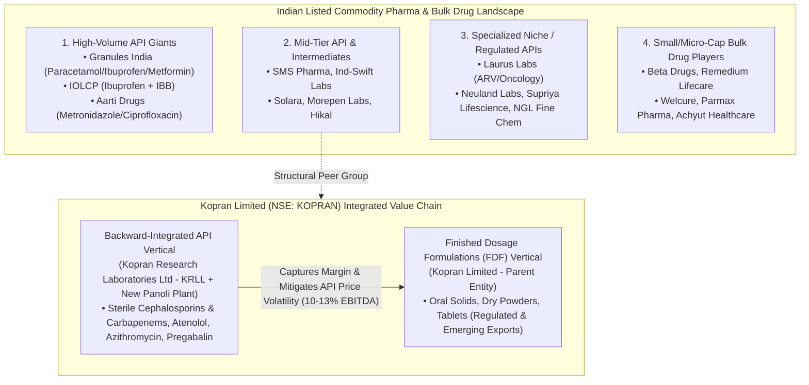

# Part 3: Indian Commodity Pharma Directory & Kopran Limited Business Classification

## 📁 Document & Session Metadata

- **Format Version (`formatVersion`):** `1`
- **Export Time (`exportTime`):** `2026-11-06T15:06:12.871Z`
- **Chat Session Name (`chat.name`):** `collections/default_collection/engines/gemini-enterprise-sec-dx-swa/sessions/17520757415312887215`
- **Chat Title (`chat.title`):** `Pharma & Healthcare Research`
- **Session Start Time (`chat.startTime`):** `2026-09-25T12:11:00.226Z`
- **Session End Time (`chat.endTime`):** `2026-10-07T12:51:37.340Z`
- **Document Part:** Part 3 of 7

---

## 🕒 Turn 3 (Timestamp: `2026-09-25T13:28:16.716454235Z`)

### ❓ User Query (Verbatim)

Name all listed commodity pharma company like sms ,pharma , IOLCP pharma ,aarti drugs , beta drugs etc

---

### 💡 Research Analysis & Answer (Verbatim)

I will search for listed commodity pharmaceutical, active pharmaceutical ingredient (API), bulk drug, and intermediate manufacturers in India to compile a comprehensive, categorized list.
[[section:Commodity Pharma Search]]To map out the landscape of **commodity pharmaceuticals**, it is essential to first define what separates a "commodity" player from a "specialty" or "innovator" player [source: 19]. 

In the pharmaceutical value chain, **commodity pharma** is characterized by high-volume, low-margin manufacturing of off-patent active pharmaceutical ingredients (APIs), bulk drugs, intermediates, and basic generic formulations [source: 1, 16, 19]. These companies typically compete on price, scale, and cost-efficient chemical synthesis rather than patent exclusivity or novel clinical pipelines [source: 16, 19, 20].

Below is a comprehensive directory of prominent **listed commodity pharma, API, and bulk drug companies in India**, categorized by their primary product profiles and operational scales [source: 1, 16].

---

### **1. High-Volume / "First-Line of Defense" API Giants**
These are large-scale, vertically integrated companies famous for producing massive global volumes of everyday commodity molecules like **Paracetamol, Ibuprofen, and Metformin** [source: 11, 16].

*   **Granules India Ltd (NSE: GRANULES)** [source: 9, 16]
    *   *Core Commodity Profile:* A global powerhouse in high-volume, low-margin "core" molecules: **Paracetamol** (operates one of the world's largest single-site plants), **Ibuprofen**, and **Metformin** [source: 11, 13].
*   **IOL Chemicals and Pharmaceuticals Ltd (NSE: IOLCP)** [source: 4, 7]
    *   *Core Commodity Profile:* One of the world’s largest producers of **Ibuprofen** (API) and its key raw material, Isobutyl Benzene (IBB). It also manufactures commodity chemicals like Ethyl Acetate.
*   **Aarti Drugs Ltd (NSE: AARTIDRUGS)** [source: 6, 7]
    *   *Core Commodity Profile:* A highly diversified bulk drug manufacturer focusing on high-volume generic APIs like **Metronidazole, Ketoconazole** (anti-fungals), and **Ciprofloxacin** (antibiotics) [source: 12].

---

### **2. Mid-Tier API, Intermediate & Specialty Chemical Entities**
These companies focus on multi-step chemical synthesis, supplying intermediates and generic bulk drugs to both domestic and international markets [source: 8, 17, 18].

*   **SMS Pharmaceuticals Ltd (NSE: SMSPHARMA)** [source: 7]
    *   *Core Commodity Profile:* Primarily manufactures APIs and intermediates for therapeutic areas like cardiovascular, anti-migraine, and anti-ulcer drugs.
*   **Ind-Swift Laboratories Ltd (NSE: INDSWFTLAB)** [source: 6]
    *   *Core Commodity Profile:* Produces bulk drugs across a wide array of generic therapeutic segments, including macrolide antibiotics, cardiovasculars, and antihistamines [source: 18].
*   **Solara Active Pharma Sciences Ltd (NSE: SOLARA)** [source: 6, 11]
    *   *Core Commodity Profile:* A pure-play API manufacturer producing bulk active ingredients in therapeutic areas such as central nervous system (CNS) agents and anti-inflammatory drugs [source: 11].
*   **Morepen Laboratories Ltd (NSE: MOREPENLAB)** [source: 7]
    *   *Core Commodity Profile:* Known for high-volume production of generic APIs such as **Loratadine, Montelukast, and Atorvastatin**, alongside diagnostic medical devices.
*   **Hikal Ltd (NSE: HIKAL)** [source: 4]
    *   *Core Commodity Profile:* Operates across both crop protection (agrochemicals) and pharmaceutical APIs/intermediates.

---

### **3. Specialized Niche & Regulatory-Market API Companies**
While still bulk drug manufacturers, these companies command slightly better margins by specializing in highly regulated markets or niche chemistry (e.g., oncology, sterile APIs, and custom synthesis) [source: 9, 11, 15].

*   **Laurus Labs Ltd (NSE: LAURUSLABS)** [source: 7, 9]
    *   *Core Commodity Profile:* A major leader in **Antiretroviral (ARV)** APIs (HIV treatment) and oncology ingredients [source: 9, 11]. Although migrating toward a CDMO model, it historically commands massive commodity API volumes [source: 9, 19].
*   **Neuland Laboratories Ltd (NSE: NEULANDLAB)** [source: 9]
    *   *Core Commodity Profile:* A highly regarded developer of complex APIs, moving steadily from generic bulk drugs into custom manufacturing (CDMO) services [source: 9].
*   **Supriya Lifescience Ltd (NSE: SUPRIYA)** [source: 7, 11]
    *   *Core Commodity Profile:* Focuses on niche API categories such as antihistamines, anti-allergics, and anesthetics, with a strong export footprint [source: 11].
*   **NGL Fine Chem Ltd (NSE: NGLFINECHM)** [source: 4]
    *   *Core Commodity Profile:* Focuses heavily on the niche commodity veterinary API segment.

---

### **4. Small-Cap, Micro-Cap & Regional Bulk Drug Players**
These micro-to-small cap public companies represent the highly fragmented tail of the Indian pharmaceutical chemical sector [source: 19].

*   **Beta Drugs Ltd (NSE: BETA)**
    *   *Core Commodity Profile:* Primarily focused on oncology formulations, APIs, and cytotoxic contract manufacturing.
*   **Remedium Lifecare Ltd (BSE: 539561)** [source: 8]
    *   *Core Commodity Profile:* Engaged in trading and manufacturing of active pharmaceutical ingredients (APIs) and advanced intermediates [source: 8].
*   **Welcure Drugs and Pharmaceuticals Ltd (BSE: 524662)** [source: 8]
    *   *Core Commodity Profile:* Manufactures multi-therapeutic generic bulk drugs and basic formulations (antibiotics, analgesics) [source: 8].
*   **Parmax Pharma Ltd (BSE: 540359)** [source: 17]
    *   *Core Commodity Profile:* A micro-cap manufacturer focusing on bulk drugs, drug intermediates, and select basic formulations [source: 17].
*   **Achyut Healthcare Ltd (BSE: 543499)** [source: 8]
    *   *Core Commodity Profile:* Develops generic APIs, intermediate chemicals, and nutraceutical products [source: 8].

---

### **Economic Realities of Commodity Pharma Stocks**
If you are evaluating these companies for investment, keep these structural realities in mind:
*   **Margin Volatility:** These companies are highly sensitive to price fluctuations of **Key Starting Materials (KSMs)** and crude-oil derivatives, most of which are imported from China [source: 13, 18, 19].
*   **The "China + 1" Shift:** Many mid-tier Indian API players are experiencing a secular tailwind as global drug product manufacturers seek alternative, non-Chinese chemical supply chains [source: 18, 19].
*   **Low Valuation Multiples:** Unlike premium CDMOs (which can trade at 20–25x EV/EBITDA), pure-play commodity API businesses often trade at much lower multiples (**8–12x EV/EBITDA**) due to their intense competitive environments and cyclical earnings [source: 19].

---


## 🕒 Turn 4 (Timestamp: `2026-09-25T13:34:14.015324378Z`)

### ❓ User Query (Verbatim)

kopran comes in which category

---

### 💡 Research Analysis & Answer (Verbatim)

I will search the web to analyze the business profile of Kopran Limited and classify it into the correct category within the pharmaceutical taxonomy.
[[section:Kopran Business Classification]]Based on a fundamental and operational assessment, **Kopran Limited** (NSE: `KOPRAN` / BSE: `524280`) belongs to the **integrated Commodity Pharma (API + Bulk Generic Formulations)** category [source: 1, 5, 8, 14].

Rather than operating as a pure-play contract manufacturer (CDMO) or an asset-owning innovator, Kopran focuses on manufacturing off-patent, high-volume, price-sensitive active pharmaceutical ingredients (APIs) and finished generic dosage forms (FDFs) [source: 1, 8, 14].

Below is the structured classification of Kopran across its operational segments, financial dynamics, and asset mix:

---

### **1. Business Segment Breakdown**
The company operates an integrated pharmaceutical value chain structured into two primary operating verticals [source: 1, 14, 16]:

*   **API Vertical (Kopran Research Laboratories Ltd - KRLL):** Operating as a wholly owned subsidiary, KRLL focuses on the backward-integrated synthesis of bulk drug intermediates and APIs [source: 1, 16].
*   **Formulation Vertical (Kopran Limited):** Focuses on manufacturing finished dosage forms (FDFs) such as oral solids, dry powders, and tablets for domestic and export markets [source: 1, 14, 16].

---

### **2. Core Product Portfolio Taxonomy**
Kopran's portfolio is heavily geared toward off-patent therapeutic classes, placing it firmly within the **bulk generic / commodity** ecosystem [source: 1, 14]:

*   **Antibiotics & Sterile Bulk Actives:** A major strength lies in sterile **Cephalosporins** (e.g., Cefepime, Cefotaxime, Ceftriaxone) and sterile **Carbapenems** (e.g., Meropenem) [source: 1, 5, 10]. These are high-volume, capital-intensive anti-infectives [source: 1, 10].
*   **Cardiovascular & Lifestyle Drugs:** Focuses on mature molecules like **Atenolol** (an established anti-hypertensive where Kopran historically held massive global market share) [source: 1, 5, 10].
*   **Macrolides & Neuromodulators:** Manufactures bulk **Azithromycin** and **Pregabalin** [source: 1, 5, 10]. 

---

### **3. Strategic Financial & Operational Analysis**
*   **Integrated Business Model:** Its primary economic driver is its backward integration [source: 1, 14]. By manufacturing the APIs internally (via KRLL) and converting them into Finished Dosage Formulations, Kopran captures a larger portion of the generic margin, mitigating the extreme price volatility that pure-play API manufacturers face [source: 1, 12, 14].
*   **Lower-Margin Commodity Drag:** In fiscal cycles where the lower-margin API segment dominates the revenue mix, consolidated operating profitability moderates [source: 12]. Conversely, when formulation exports to regulated and emerging markets scale up, consolidated margins expand [source: 1, 12, 14].
*   **Asset Expansion (Panoli Plant):** Showing the typical footprint of a growing commodity player, Kopran has invested heavily in capital expenditure, recently commissioning its new **Panoli API facility in Gujarat** [source: 13, 15]. The near-term investment thesis relies on ramping up capacity utilization at this plant to capture global "China + 1" supply chain shifts [source: 14, 15].
*   **Corporate Consolidation:** To streamline its corporate structure, the company is undergoing an NCLT-monitored amalgamation scheme to merge Kopran Laboratories with the parent listed entity [source: 13, 15].

---

### **📊 Summary Classification Matrix**

| Metric | Kopran's Profile | Classification Group |
| :--- | :--- | :--- |
| **Primary Value Chain Segment** | Integrated manufacturer of generic APIs and FDFs [source: 1, 8, 14]. | **Integrated Commodity Pharma / Bulk Generics** |
| **Key Competitive Moat** | Backwards integration, large-scale sterile Carbapenem/Cephalosporin synthesis, and global regulatory DMF/CEP filing access [source: 1, 4, 14]. | **Low-to-Medium (Scale & cost-efficiency driven)** |
| **Operating Margin Profile** | EBITDA margins historically fluctuate between **10% and 13%** depending on API price cycles [source: 1, 3, 12]. | **Commodity Asset Class** |
| **Structural peer comps** | Aarti Drugs, SMS Pharmaceuticals, and Ind-Swift Laboratories [source: 1, 12]. | **Mid-cap API / Formulation peers** |


---

## 📊 Enhanced Visual Illustrations & Diagrams

### Mermaid Taxonomy Diagram: Indian Commodity Pharma & Kopran's Integrated Architecture


### Enhanced ASCII Comparison: Commodity API vs. Premium CDMO Economic Spectrum
```
====================================================================================
   STRUCTURAL ECONOMICS: COMMODITY PHARMA vs. INTEGRATED COMMODITY vs. CDMO
====================================================================================
   Pure-Play Commodity API   │ KSM China Exposure: HIGH │ EBITDA:  8-12% │ EV/EBITDA:  8-12x
   Integrated (e.g., Kopran) │ Backward Integrated (KRLL)│ EBITDA: 10-13% │ Mitigates Volatility
   Premium CRDMO (e.g., Divi)│ Custom Synthesis / IP     │ EBITDA: 25-30% │ EV/EBITDA: 20-25x+
====================================================================================
```
