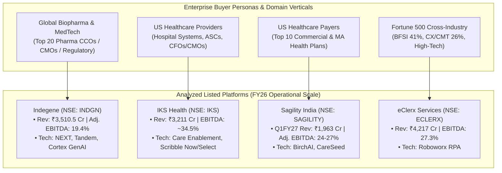

# Part 4: Offshore Healthcare & Enterprise KPO/BPM — Industry Structure & Business Models (Indegene, IKS Health, Sagility, eClerx)

## 📁 Document & Session Metadata

- **Format Version (`formatVersion`):** `1`
- **Export Time (`exportTime`):** `2026-11-06T15:06:12.871Z`
- **Chat Session Name (`chat.name`):** `collections/default_collection/engines/gemini-enterprise-sec-dx-swa/sessions/17520757415312887215`
- **Chat Title (`chat.title`):** `Pharma & Healthcare Research`
- **Session Start Time (`chat.startTime`):** `2026-09-25T12:11:00.226Z`
- **Session End Time (`chat.endTime`):** `2026-10-07T12:51:37.340Z`
- **Document Part:** Part 4 of 7

---

## 🕒 Turn 5 (Timestamp: `2026-10-07T12:21:23.578167911Z`)

### ❓ User Query (Verbatim)

compare industry strucrure and business modal for company   
- indegene   
- IKS health   
- eclerx   
- sagility india   
Any other company related to this   
After discussing that ,explain the competive advatage ,weakness and threat of business .

---

### 💡 Research Analysis & Answer (Verbatim)

To compare **Indegene**, **IKS Health (Inventurus Knowledge Solutions)**, **eClerx Services**, and **Sagility India**, we need to place them in the broader context of the **offshore IT/BPM (Business Process Management) and Knowledge Services industry** [source: 1]. 

While all four rely on offshore delivery models (primarily India and the Philippines) to deliver high-margin services to Western enterprises, their **industry structures, target buyer personas, regulatory moats, and core value propositions are completely distinct** [source: 1, 2].

---

### **1. Industry Structure & Taxonomy Mapping**

The overarching industry is divided across three key dimensions: **Buyer Persona**, **Process Criticality**, and **Domain Specialization** [source: 1, 2].

```
                 OFFSHORE KNOWLEDGE & PROCESS MANAGEMENT LANDSCAPE
  ┌─────────────────────────────────┬───────────────────────────────────────────┐
  │   Life Sciences / Biopharma     │  Indegene                                 │
  ├─────────────────────────────────┼───────────────────────────────────────────┤
  │   US Healthcare Providers       │  IKS Health, R1 RCM                       │
  ├─────────────────────────────────┼───────────────────────────────────────────┤
  │   US Healthcare Payers          │  Sagility India, Firstsource (FSL)        │
  ├─────────────────────────────────┼───────────────────────────────────────────┤
  │   Cross-Industry / BFSI / Tech  │  eClerx Services, Genpact, EXL            │
  └─────────────────────────────────┴───────────────────────────────────────────┘
```

#### **A. Life Sciences Commercialization & Tech Services (Indegene)**
* **Target Buyer:** Global Biopharma, Emerging Biotech, and MedTech companies (e.g., Pfizer, Novartis, AstraZeneca) [source: 4, 11].
* **Core Function:** Helps pharmaceutical companies commercialize drugs, run regulatory submissions, manage pharmacovigilance (safety tracking), medical communications, and omnichannel marketing [source: 4, 11].

#### **B. Healthcare Provider Care Enablement & RCM (IKS Health)**
* **Target Buyer:** US Healthcare Providers — large hospital systems, ambulatory physician networks, and Academic Medical Centers [source: 3, 9].
* **Core Function:** Administrative and clinical burden reduction — Revenue Cycle Management (RCM), medical coding, virtual medical scribing (ambient AI), and value-based care analytics [source: 3, 9, 20].

#### **C. Healthcare Payer Business Process Management (Sagility India)**
* **Target Buyer:** US Healthcare Payers — commercial health insurance companies (e.g., UnitedHealth/Optum, Humana, Elevance, Blue Cross Blue Shield plans) [source: 1, 2, 8].
* **Core Function:** Core insurance processes: claims adjudication, member enrollment, benefits administration, prior authorization, clinical utilization management, and payment integrity [source: 2, 5, 8].

#### **D. Specialized Enterprise KPO / Digital Operations (eClerx Services)**
* **Target Buyer:** Fortune 500 Chief Operating Officers and Chief Marketing Officers across **Financial Markets (BFSI)**, **Customer Experience (CX)**, and **Digital Commerce / High-Tech** [source: 12].
* **Core Function:** Non-healthcare focused domain-intensive operations — derivative trade reconciliation, KYC/anti-money laundering compliance, digital marketing analytics, and e-commerce content operations [source: 12].

---

### **2. Deep-Dive Business Model Comparison**

| Metric / Dimension | **Indegene** | **IKS Health** | **Sagility India** | **eClerx Services** |
| :--- | :--- | :--- | :--- | :--- |
| **Primary Industry Focus** | Life Sciences & Biopharma (100%) [source: 4, 11] | Healthcare Providers / Health Systems (~95%+) [source: 3, 9] | Healthcare Payers / Health Plans (~90%) [source: 1, 2] | BFSI, E-commerce, High-Tech, Cable/Telecom [source: 12] |
| **Primary Economic Buyer** | Chief Commercial Officer, Chief Medical Officer, Head of Regulatory [source: 4] | Chief Medical Officer, CFO (Hospital/Provider Systems) [source: 3, 10] | Head of Claims Operations, Chief Operating Officer (Insurers) [source: 2, 5] | Head of Trade Operations, Chief Marketing Officer, Head of Risk [source: 12] |
| **Monetization Architecture** | Managed services, recurring multi-year contracts, fixed-fee deliverables, FTE blended billing [source: 4, 11] | Fee-per-encounter, % of collections (RCM), subscription platform fee (SaaS/PaaS) [source: 3, 12, 19] | Per-claim processed, per-member-per-month (PMPM), FTE hourly billing [source: 2, 5] | Time & Material (T&M), fixed-capacity managed service agreements [source: 12] |
| **Workforce Clinical / Domain Depth** | High: Medical doctors, PhDs, pharmacovigilance specialists, regulatory writers [source: 12] | High: Certified coders (AAPC), clinical documentation specialists, clinical nurses [source: 3, 10, 12] | Medium: Claims adjudicators, nurse reviewers, member service reps [source: 2, 12] | Technical/Financial: Financial analysts, data engineers, digital content specialists [source: 12] |
| **Proprietary Technology Platforms** | *NEXT Platforms*, *Cortex* (GenAI commercial engine) [source: 4, 16] | *Care Enablement Platform*, *Scribble Now* (ambient scribe) [source: 10, 20] | *BirchAI* (Generative AI voice/chat automation) [source: 14] | *Roboworx* (RPA automation), customized client bots |
| **Operating Margin Profile (EBITDA)** | ~19% – 22% [source: 1, 12] | ~24% – 28% [source: 1, 12] | ~22% – 25% [source: 1, 5, 8] | ~24% – 28% [source: 1, 12] |

---

### **3. Related Companies in the Ecosystem**

If you are evaluating this cohort from an institutional research perspective, the following companies operate in overlapping value chains:

1. **Firstsource Solutions (NSE: FSL):** A diversified Indian BPM player with a very strong US healthcare vertical (competes directly with Sagility on payer workflows and with IKS on hospital collections) [source: 1, 9].
2. **R1 RCM (US):** The global benchmark for end-to-end, hospital-wide revenue cycle management (direct competitor to IKS Health) [source: 12].
3. **EXL Service (NASDAQ: EXLS) & WNS (NYSE: WNS):** US-listed BPM majors with massive dedicated healthcare payer analytics and operations units [source: 12].
4. **Cognizant (TriZetto):** The dominant technology backend for US health insurers via its *Facets* and *QNXT* core claims processing software platforms, which Sagility's teams often operate [source: 12].
5. **Omega Healthcare / Access Healthcare:** Large unlisted Indian healthcare service providers focused on medical billing, coding, and provider workflows.

---

### **4. Competitive Advantage, Weakness & Threats Matrix**

```
                            STRATEGIC POSITIONING MATRIX
  High │
       │                      [Indegene]               [IKS Health]
  D    │                      (Deep Biopharma Domain)  (Clinical & Workflow Integration)
  O    │
  M    │
  A    │
  I    │                      [Sagility India]         [eClerx]
  N    │                      (High Payer Moat)        (Cross-Domain Process Depth)
       │
   Low └─────────────────────────────────────────────────────────────────────────────
         Transactional BPO                               High-Value Tech/PaaS
                                   BUSINESS SOPHISTICATION
```

#### **A. Indegene**
* **Competitive Advantages (Moats):**
  * *High Regulatory Moats:* Regulatory submissions to the FDA/EMA and pharmacovigilance safety auditing cannot be performed by generic IT shops; they require certified clinical experts [source: 4, 11, 12].
  * *Deep Enterprise Client Relationships:* Serves 20 of the top 20 biopharmaceutical companies globally, creating massive institutional stickiness [source: 4].
  * *First-Mover in Life Sciences AI:* Custom LLMs fine-tuned on medical, clinical trial, and medical legal review (MLR) data [source: 4, 16, 18].
* **Weaknesses:**
  * *Client Concentration & Budget Dependency:* Biopharma R&D and commercial marketing budgets are cyclical [source: 11]. Mergers among Big Pharma clients often lead to marketing budget freezes.
  * *Talent Cost Pressure:* Recruiting clinicians, pharmacists, and bio-statisticians requires significantly higher wage packages than standard BPO voice agents.
* **Threats:**
  * In-house generative AI suites deployed directly by pharmaceutical giants (e.g., partnerships between Big Pharma and hyperscalers like Microsoft/AWS) automating marketing asset generation and medical summarization [source: 16].

---

#### **B. IKS Health (Inventurus Knowledge Solutions)**
* **Competitive Advantages (Moats):**
  * *High Switching Costs:* Once IKS integrates its workflow into a health system’s Electronic Health Record (EHR) such as Epic, Cerner, or Athenahealth, replacing them is operationally hazardous for a hospital CFO [source: 3, 10, 19].
  * *Comprehensive Clinical Solution:* With the acquisition of AQuity Solutions, IKS is one of the few platforms offering both administrative RCM and direct clinical documentation (virtual scribing) [source: 3, 10].
  * *Strong Financial Execution:* Industry-leading operating profitability (EBITDA margins often exceeding 26%) [source: 1, 7].
* **Weaknesses:**
  * *High US Geographic Concentration:* Nearly 100% reliant on the US healthcare provider landscape [source: 9].
  * *Hospital Balance Sheet Fragility:* US non-profit and regional health systems regularly face operating margin compression, occasionally pushing back on service fee increases.
* **Threats:**
  * *Ambient AI Scribe Disruption:* Emerging AI voice-to-text platforms (e.g., Nuance DAX Copilot by Microsoft, Abridge) can listen to doctor-patient conversations and draft clinical notes automatically, threatening legacy human-assisted scribing models [source: 20].

---

#### **C. Sagility India**
* **Competitive Advantages (Moats):**
  * *Dominant Payer Concentration:* Unlike most competitors who chased the provider side, Sagility built deep operational relationships with 5 of the top 10 US health insurance payers [source: 1, 2].
  * *Complex Regulatory Navigation:* US health insurance is heavily regulated (CMS Medicare Advantage star-ratings, state-specific Medicaid rules, ACA compliance) [source: 2]. Payer systems take years to train external vendors on their claims logic [source: 2].
  * *Global Scalability:* Balanced delivery footprint across India, the Philippines, Jamaica, Colombia, and onshore US [source: 2].
* **Weaknesses:**
  * *Extreme Client Concentration Risk:* A handful of large US commercial payers generate a dominant percentage of revenue [source: 1, 2]. Losing one contract could alter financial performance.
  * *Promoter Overhang:* Formerly owned by EQT Private Capital, which has steadily trimmed its post-IPO stake via secondary share sales (Offer for Sale), occasionally creating short-term equity supply overhangs in the stock market [source: 2, 14, 15].
* **Threats:**
  * *US Healthcare Policy Volatility:* Changes to Medicare Advantage reimbursement rates or changes in Medicaid eligibility directly influence insurer processing volumes [source: 2].
  * *In-house Offshoring by Payers (Captive Units):* Giant US health plans (e.g., UnitedHealth's Optum Global Solutions, Elevance's Carelon) have established massive captive centers in India, competing directly for talent and processes [source: 1].

---

#### **D. eClerx Services**
* **Competitive Advantages (Moats):**
  * *Diversified Revenue Engine:* Unlike the other three, eClerx is not tethered to US healthcare cycles [source: 2, 12]. It is insulated against medical policy shifts and US hospital balance-sheet issues.
  * *Complex Capital Markets Knowledge:* Expertise in trade clearing, complex derivatives data reconciliation, and regulatory audits for global Tier-1 investment banks [source: 12].
  * *Capital Allocation Excellence:* A long historical track record of steady ROE/ROIC (>20%), consistent dividend payouts, and regular share buybacks [source: 12].
* **Weaknesses:**
  * *Lower Structural Growth Ceiling:* Enterprise digital operations and banking support grow at steady, mature rates (8–12%) rather than the rapid double-digit compound expansion seen in specialized healthcare BPM [source: 1, 8, 12].
  * *Higher Exposure to Discretionary Tech/Marketing Spend:* Its Digital/Analytics business segment is sensitive to global retail, luxury, and technology enterprise marketing cutbacks.
* **Threats:**
  * *Workflow Automation:* RPA and AI agent workflows are automating basic data reconciliation, catalog indexing, and customer ticket triaging faster than in heavily regulated healthcare clinical pathways.

---

### **💡 Strategic Summary for Investors & Evaluators**

* **Choose Indegene if:** You want pure-play exposure to the **global biopharma R&D/Commercialization supercycle**, driven by the commercialization of novel biological assets, GLP-1s, and tech-driven marketing [source: 4, 11].
* **Choose IKS Health if:** You want exposure to the **acute administrative burden and physician burnout crisis** in US healthcare, backed by high-margin sticky software/service integration [source: 3, 10, 20].
* **Choose Sagility India if:** You want a play on the **expanding US health insurance/payer administration** market, benefiting from Medicare/Medicaid volume tailwinds and offshore cost arbitrage [source: 1, 2, 8].
* **Choose eClerx if:** You want a **resilient, non-healthcare, cash-rich business** with a history of buybacks, high ROE, and exposure to Tier-1 financial and high-tech enterprises [source: 12].


## 🕒 Turn 6 (Timestamp: `2026-10-07T12:22:15.579217684Z`)

### ❓ User Query (Verbatim)

compare industry strucrure and business modal for company

* indegene

* IKS health

* eclerx

* sagility india  
  Any other company related to this  
  After discussing that ,explain the competive advatage ,weakness and threat of business .  Do analysis on latest indformation i.e date 7 oct 2026

*

---

### 💡 Research Analysis & Answer (Verbatim)

I will search for the latest FY25–FY26 market performance, strategic developments, and financial data for these companies.
[[section:Current Market Analysis]]An institutional-grade comparative assessment of **Indegene**, **IKS Health (Inventurus Knowledge Solutions)**, **eClerx Services**, and **Sagility India** incorporates the companies' reported FY26 full-year and recent FY27 financial data and operational milestones [source: 2, 5, 10, 13, 14].

---

### **1. Industry Structure & Peer Classification**

While these four players all operate high-margin offshore delivery platforms (predominantly in India, the Philippines, and the Americas), they cater to distinct enterprise buyers and operate under different industry economics [source: 5, 7, 13, 19]:

```
                     OFFSHORE SPECIALIZED KNOWLEDGE & BPM VALUE CHAIN
  ┌─────────────────────────────────┬───────────────────────────────────────────────────────┐
  │ 1. Life Sciences / Commercial   │  Indegene                                             │
  │    (Biopharma / MedTech)        │                                                       │
  ├─────────────────────────────────┼───────────────────────────────────────────────────────┤
  │ 2. US Healthcare Providers      │  IKS Health (Inventurus Knowledge Solutions)          │
  │    (Hospital Systems / Groups)  │                                                       │
  ├─────────────────────────────────┼───────────────────────────────────────────────────────┤
  │ 3. US Healthcare Payers         │  Sagility India                                       │
  │    (Health Plans / Insurers)    │                                                       │
  ├─────────────────────────────────┼───────────────────────────────────────────────────────┤
  │ 4. Cross-Industry Enterprise    │  eClerx Services                                      │
  │    (BFSI, High-Tech, Digital)   │                                                       │
  └─────────────────────────────────┴───────────────────────────────────────────────────────┘
```

#### **A. Life Sciences Commercialization & Tech Services (Indegene)**
* **Target Buyer:** Chief Commercial Officers, Chief Medical Officers, and Regulatory Heads at global biopharmaceutical and medical device enterprises [source: 2, 4].
* **Mandate:** Pharmacovigilance (safety analytics), regulatory writing, medical legal review (MLR), omnichannel drug commercialization, and digital HCP engagement [source: 2, 4].

#### **B. Healthcare Provider Care Enablement & RCM (IKS Health)**
* **Target Buyer:** US Healthcare Providers — large health systems (e.g., Mass General Brigham), multi-specialty physician practices, and Ambulatory Surgical Centers (ASCs) [source: 5, 15].
* **Mandate:** Mid-to-back revenue cycle management (RCM), medical coding, clinical documentation, and virtual/ambient AI medical scribing [source: 5, 15].

#### **C. Healthcare Payer Business Process Management (Sagility India)**
* **Target Buyer:** US Healthcare Payers — commercial health insurance companies (e.g., Blue Cross Blue Shield plans, Humana, Elevance, national Medicare Advantage plans) [source: 6, 11, 16].
* **Mandate:** Core administrative insurance functions: claims adjudication, member enrollment, payment integrity, prior authorization, and clinical utilization management [source: 6, 11].

#### **D. Specialized Enterprise KPO / Digital Operations (eClerx Services)**
* **Target Buyer:** Fortune 500 COOs and CMOs across Financial Markets (Tier-1 Investment Banks), Customer Experience (CX), and Digital Commerce / High-Tech [source: 7, 19].
* **Mandate:** Trade reconciliation, derivative settlement, KYC/AML audits, complex data management, and digital marketing operations [source: 7, 19].

---

### **2. Business Model & Financial Comparison**

| Metric / Dimension | **Indegene Ltd** [source: 2, 3] | **IKS Health (Inventurus)** [source: 5, 10] | **Sagility India Ltd** [source: 6, 11, 13] | **eClerx Services Ltd** [source: 7, 14] |
| :--- | :--- | :--- | :--- | :--- |
| **Listing Status** | Listed (NSE/BSE: `INDGN`) [source: 2, 3] | Listed (NSE/BSE: `IKS`) [source: 5, 10] | Listed (NSE/BSE: `SAGILITY`) [source: 11, 13] | Listed (NSE/BSE: `ECLERX`) [source: 7, 14] |
| **Primary Industry** | Life Sciences (100%) [source: 2, 8] | US Healthcare Providers (~95%+) [source: 5, 10] | US Healthcare Payers (~90%) [source: 11, 13] | BFSI (41%), CX/CMT (26%), High-Tech [source: 19] |
| **FY26 Operational Scale** | **Revenue:** ₹3,510.5 Cr (~$420M) [source: 2] <br> **Adj. EBITDA:** ₹679.3 Cr (19.4%) [source: 2] <br> **PAT:** ₹401.1 Cr [source: 2, 3] | **Revenue:** ₹3,211 Cr (~$385M) [source: 10] <br> **EBITDA Margin:** ~34.5% [source: 10] <br> **PAT:** ₹722 Cr (+48% YoY) [source: 10] | **Revenue:** ~₹62,000+ Cr run-rate <br> (Q1FY27: ₹1,963 Cr) [source: 13] <br> **Adj. EBITDA Margin:** 24–27% [source: 6, 11] | **Revenue:** ₹4,217 Cr (~$469M) [source: 14] <br> **EBITDA:** ₹1,152.6 Cr (27.3%) [source: 14] <br> **PAT:** ₹706.2 Cr (+30.5% YoY) [source: 14] |
| **Commercial Model** | Managed services, fixed-deliverable contracts, FTE blended rates, and recurring SaaS/PaaS platforms [source: 2, 4]. | Fee-per-encounter, percentage of collections (RCM), and technology platform fees [source: 5, 10]. | Per-claim processed, Per-Member-Per-Month (PMPM), and FTE hourly billing [source: 6, 11]. | Time & Material (T&M), fixed-capacity managed service agreements [source: 7, 19]. |
| **Proprietary Technology Stack** | *NEXT Platforms*, *Tandem*, *Cortex* (GenAI engine) [source: 2, 4]. | *Care Enablement Platform*, *Scribble Select* (ambient AI scribe) [source: 5, 15]. | *BirchAI* (speech-to-text GenAI), *CareSeed* [source: 13]. | *Roboworx* (RPA suite), custom automation bots [source: 7, 19]. |
| **Capital Allocation Focus** | Strategic bolt-ons (e.g., Biopharm for \$99.8M, Warn & Co) [source: 3, 4]. | Large-scale M&A (e.g., Aquity, TruBridge for \$557M) [source: 10, 15]. | Payer capability tuck-ins (BroadPath, CareSeed) [source: 6, 13, 16]. | Aggressive capital return via frequent share buybacks & regular dividends [source: 7, 18, 19]. |

---

### **3. Strategic Positioning: Moats, Weaknesses & Threats**

#### **A. Indegene**
*   **Competitive Moat:** High institutional stickiness across biopharma; partner to all 20 of the top 20 global pharmaceutical players [source: 8]. Deep domain-specific clinical and regulatory knowledge (pharmacovigilance, medical writing) forms a strong barrier against traditional generic IT vendors [source: 2, 4].
*   **Weakness:** Lower reported margins (~18–19% EBITDA) relative to specialized BPM peers, compressed by aggressive ongoing R&D investments in proprietary LLM infrastructure and M&A integration costs [source: 2, 4].
*   **Threat:** Pharma marketing budget compression during large M&A integrations, alongside Big Pharma deploying internal proprietary AI co-pilots developed with hyperscalers [source: 2, 4].

#### **B. IKS Health (Inventurus Knowledge Solutions)**
*   **Competitive Moat:** Deep integration within hospital clinical workflows and Electronic Health Record (EHR) systems (Epic, Cerner) [source: 5, 15]. Exceptional operating profitability (EBITDA margins exceeding 34%) driven by offshored delivery and automation [source: 5, 10].
*   **Weakness:** Substantial client concentration (top 10 accounts contribute >60% of revenue) [source: 5]. High execution and balance-sheet risk associated with integrating large-scale acquisitions (TruBridge and Aquity) [source: 10, 15].
*   **Threat:** Emergence of fully autonomous ambient AI scribes (e.g., Microsoft DAX Copilot, Abridge) potentially compressing the need for human-in-the-loop clinical documentation over time [source: 5, 15, 21].

#### **C. Sagility India**
*   **Competitive Moat:** Established relationships with 5 of the top 10 US health plans, covering Medicare, Medicaid, and commercial lines [source: 6, 11, 16]. Deep familiarity with complex US insurance adjudication logic creates high switching costs [source: 6, 11].
*   **Weakness:** Seasonally uneven revenues (peaking during US Open Enrollment in Q3/Q4) [source: 11, 17]. High voluntary employee turnover (~28%) requires continuous training outlays [source: 13].
*   **Threat:** Sovereign and regulatory headwinds from US health insurance policy changes (e.g., Medicare Advantage reimbursement pressure) and captive off-shoring by large payers (such as UnitedHealth/Optum and Elevance/Carelon) [source: 6, 11].

#### **D. eClerx Services**
*   **Competitive Moat:** High barriers to entry in capital markets trade support, risk modeling, and complex derivative reconciliation [source: 14, 19]. Disciplined capital allocation track record, delivering high ROE/ROIC (>22%) and consistent cash returns via share buybacks [source: 7, 14, 19].
*   **Weakness:** Heavy exposure to discretionary spending in digital commerce and marketing operations, which slows during broader economic downturns [source: 19].
*   **Threat:** Accelerated workflow automation in back-office financial reconciliation via autonomous AI agents and enterprise ERP modernization [source: 7, 19].

---

### **4. Related Companies in the Extended Ecosystem**

1.  **Firstsource Solutions (NSE: FSL):** A direct Indian peer to Sagility and IKS, with deep US healthcare payer operations and an expanding provider RCM business [source: 6, 11].
2.  **R1 RCM (US):** The global institutional benchmark for end-to-end, acute-care hospital revenue cycle management (direct competitor to IKS Health) [source: 5, 10].
3.  **EXL Service (NASDAQ: EXLS) & WNS (NYSE: WNS):** Leading US-listed BPM operations with extensive healthcare payer analytics and digital claims infrastructure [source: 6, 11].
4.  **Access Healthcare & Omega Healthcare:** Major privately held Indian healthcare operations servicing US provider billing, medical coding, and collections [source: 5, 15].

---

### **💡 Strategic Summary**
* **For High Growth & Life Sciences Super-Cycles:** **Indegene** leads in early-stage commercialization and AI-driven pharma workflows [source: 2, 4].
* **For High Margins & Provider Burden Relief:** **IKS Health** captures the provider operational bottleneck, turning clinical notes and billing into high cash yields [source: 5, 10].
* **For Volume Scale & Policy-Driven Work:** **Sagility** is the pure-play on US health insurance claims and non-discretionary payer administration [source: 6, 11].
* **For Cash-Rich Capital Discipline:** **eClerx** remains the top play for enterprise non-healthcare domain complexity, regular buybacks, and balance-sheet stability [source: 7, 14, 19].


---

## 📊 Enhanced Visual Illustrations & Diagrams

### Mermaid Ecosystem Map: Offshore Knowledge & Healthcare BPM Value Chain (Oct 2026)


### Enhanced ASCII Chart: FY26 Revenue Scale & Profitability Comparison
```
====================================================================================
   FY26 REVENUE & EBITDA MARGIN BENCHMARKING (AS OF OCTOBER 7, 2026)
====================================================================================
   Indegene     │ Rev: ₹3,510.5 Cr │ PAT: ₹401.1 Cr │ EBITDA: [██████████░░░░░░░░░░] 19.4%
   IKS Health   │ Rev: ₹3,211.0 Cr │ PAT: ₹722.0 Cr │ EBITDA: [█████████████████░░░] 34.5%
   Sagility     │ Q1FY27: ₹1,963Cr │ Run-rate Scale │ EBITDA: [█████████████░░░░░░░] 24-27%
   eClerx       │ Rev: ₹4,217.0 Cr │ PAT: ₹706.2 Cr │ EBITDA: [██████████████░░░░░░] 27.3%
====================================================================================
```
