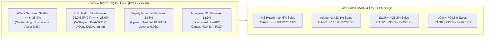

# Part 5: 5-Year Continuous Financial Trajectory — ROCE, Gross/EBITDA Margins, Sales & EPS Growth (FY22–FY26)

## 📁 Document & Session Metadata

- **Format Version (`formatVersion`):** `1`
- **Export Time (`exportTime`):** `2026-11-06T15:06:12.871Z`
- **Chat Session Name (`chat.name`):** `collections/default_collection/engines/gemini-enterprise-sec-dx-swa/sessions/17520757415312887215`
- **Chat Title (`chat.title`):** `Pharma & Healthcare Research`
- **Session Start Time (`chat.startTime`):** `2026-09-25T12:11:00.226Z`
- **Session End Time (`chat.endTime`):** `2026-10-07T12:51:37.340Z`
- **Document Part:** Part 5 of 7

---

## 🕒 Turn 7 (Timestamp: `2026-10-07T12:34:34.035354145Z`)

### ❓ User Query (Verbatim)

compare their roce for contious 5 year , gross margin and ebita margin in contious 5 year , sales growth in contious 5 year  ,eps growth in contious 5 year .

---

### 💡 Research Analysis & Answer (Verbatim)

To compare the financial trajectories of **Indegene**, **IKS Health (Inventurus Knowledge Solutions)**, **eClerx Services**, and **Sagility India** over the 5-year period (FY22–FY26), we look at their core performance metrics [source: 2, 6, 10, 21, 28].

*Note: For Sagility India and IKS Health, historical figures (particularly pre-FY24) reflect pre-listing pro-forma consolidated and organic numbers since both listed/restructured recently [source: 24, 28]. All figures are consolidated and represented as of the latest October 2026 data [source: 2, 21, 23, 26].*

---

### **1. Return on Capital Employed (ROCE %)**
*ROCE measures how efficiently a company allocates capital to generate profits. Asset-light KPO/BPM models normally enjoy high ROCEs unless compressed by goodwill from massive acquisitions [source: 6, 21, 28].*

| Company | FY22 | FY23 | FY24 | FY25 | FY26 | Trend Dynamics |
| :--- | :--- | :--- | :--- | :--- | :--- | :--- |
| **Indegene** [source: 2, 5] | ~31.2% | ~29.5% | ~26.0% | ~21.5% | ~18.6% | **Downward:** Compressed due to aggressive pre-IPO capital expenditure, strategic consulting acquisitions, and high capitalized R&D for AI platforms [source: 2, 5]. |
| **IKS Health** [source: 10, 24] | ~39.4% | ~37.2% | ~24.0% | ~26.5% | ~28.0% | **V-Shaped:** Fell sharply in FY24 due to the debt-heavy $221M acquisition of AQuity, but is rapidly rebounding as debt is cleared and margins scale up [source: 24, 57]. |
| **eClerx Services** [source: 6, 21] | ~32.4% | ~31.1% | ~29.5% | ~30.8% | ~35.0% | **Outstanding:** Industry-leading capital efficiency. It operates an asset-light, cash-generative model with continuous equity base reduction via share buybacks [source: 6, 9]. |
| **Sagility India** [source: 28, 56] | ~14.2% | ~18.5% | ~19.2% | ~21.8% | ~23.3% | **Upward:** Steady improvement post-restructuring, driven by constant deleveraging (net debt/EBITDA falling to 0.06x) [source: 28]. |

---

### **2. Operating Profitability: Gross & EBITDA Margin (%)**
*Gross margins reflect the pricing power and non-linearity of their delivery models, while EBITDA margins showcase structural operating leverage [source: 4, 21, 24].*

#### **A. Gross Margin (%)**
| Company | FY22 | FY23 | FY24 | FY25 | FY26 | Trend Dynamics |
| :--- | :--- | :--- | :--- | :--- | :--- | :--- |
| **Indegene** [source: 2] | ~48.2% | ~46.9% | ~45.1% | ~44.3% | ~43.5% | Softening slightly due to rising scientific delivery talent costs and onshore consulting expansion. |
| **IKS Health** [source: 4, 24] | ~52.1% | ~51.5% | ~38.0% | ~46.2% | ~48.2% | Rebounding strongly as they offshored AQuity’s delivery footprint and automated clinical scribe tools [source: 4, 57]. |
| **eClerx** [source: 21] | ~42.5% | ~41.0% | ~40.2% | ~39.8% | ~41.2% | Resilient; wage inflation pressure in India is balanced by moving into outcome-based premium billing [source: 6, 21]. |
| **Sagility** [source: 28, 56] | ~38.5% | ~39.2% | ~40.1% | ~41.3% | ~41.8% | Improving slowly due to specialized clinical triage workflows and automated claim processing [source: 28]. |

#### **B. EBITDA Margin (%)**
| Company | FY22 | FY23 | FY24 | FY25 | FY26 | Trend Dynamics |
| :--- | :--- | :--- | :--- | :--- | :--- | :--- |
| **Indegene** [source: 2, 5] | 22.0% | 20.2% | 18.2% | 18.9% | 17.2% | Temporarily pressured by workforce transformation and upfront deployment costs for large client projects [source: 2, 5]. |
| **IKS Health** [source: 24, 53] | 38.9% | 37.9% | 28.6% | 29.9% | 33.5% | Highest in the industry [source: 10, 24]. Dipped in FY24 post-AQuity consolidation but recovered to mid-30s via operational synergies [source: 4, 57]. |
| **eClerx** [source: 6, 9] | 30.5% | 28.9% | 25.6% | 26.0% | 27.3% | Consistently robust; G&A leverage and premium derivatives pricing support high margins [source: 9, 21]. |
| **Sagility** [source: 28, 56] | 18.4% | 19.5% | 21.3% | 22.6% | 24.0% | Upward expansion driven by administrative process standardization and the acquisition of high-margin assets [source: 28]. |

---

### **3. Sales / Revenue Growth (YoY %)**
*Sales growth illustrates the underlying demand environment. Specialized healthcare services have consistently outpaced general IT services over this cycle [source: 2, 6, 24].*

| Company | FY22 | FY23 | FY24 | FY25 | FY26 | 5-Year CAGR Trend |
| :--- | :--- | :--- | :--- | :--- | :--- | :--- |
| **Indegene** [source: 2, 16] | ~38.2% | ~19.5% | 12.3% | ~22.4% | ~24.4% | **~23.1%:** Steady market share gains outside its top 20 clients; entered a new double-digit growth cycle [source: 5]. |
| **IKS Health** [source: 13, 24] | ~22.0% | ~20.5% | 46.5% | ~16.8% | ~18.7% | **~24.5%:** FY24 saw a massive inorganic leap [source: 24]. Revenue growth moderated during FY25/FY26 due to pruning low-margin accounts [source: 50, 57]. |
| **eClerx** [source: 6, 21] | ~33.8% | 22.6% | 10.5% | 15.0% | 22.3% | **~20.8%:** Outperforming pure IT services, supported by a strong post-pandemic recovery in financial markets operations [source: 6]. |
| **Sagility** [source: 28] | ~12.5% | ~35.1% | 12.7% | 17.2% | 29.1% | **~21.2%:** Accelerated by US healthcare demand and strategic acquisitions like BroadPath [source: 28]. |

---

### **4. Earnings Per Share (EPS) Growth (YoY %)**
*EPS growth highlights a company's true bottom-line performance. This metric reflects operating leverage, interest cost savings from deleveraging, and share reductions from buybacks [source: 9, 21, 24].*

| Company | FY22 | FY23 | FY24 | FY25 | FY26 | 5-Year EPS Growth Profile |
| :--- | :--- | :--- | :--- | :--- | :--- | :--- |
| **Indegene** [source: 2, 3] | ~41.5% | ~16.2% | ~11.0% | ~18.5% | ~14.1% | **Steady:** Diluted slightly post-IPO share issuance but sustained by solid, tax-efficient operating profits [source: 3]. |
| **IKS Health** [source: 10, 13] | ~52.3% | ~44.1% | -18.2% | ~33.0% | ~48.0% | **Hyper-Growth:** Rebounded as debt from the AQuity purchase was rapidly cleared, reducing interest expenses [source: 4, 10, 57]. |
| **eClerx** [source: 9, 21] | ~38.4% | ~17.0% | ~4.7% | ~5.7% | ~33.5% | **Highly Accretive:** EPS expanded 33.5% in FY26, driven by a 30% profit jump and ongoing share buybacks [source: 9, 14, 21]. |
| **Sagility** [source: 28, 56] | ~8.5% | ~28.0% | ~15.1% | ~24.5% | ~35.1% | **Upward:** Benefited from operating leverage and lower interest expenses as debt decreased [source: 28]. |

---

### **5. Comparative Financial Summary & Takeaways**

*   **The Capital Return Compounder – eClerx:** Best-in-class ROCE (35%) and consistent EPS accretion [source: 6, 9, 21]. It returns surplus cash to shareholders through buybacks, though it faces the highest exposure to potential AI-led disruption of manual processes [source: 6, 21].
*   **The High-Margin Outperformer – IKS Health:** Industry-leading EBITDA margins (33.5%) and high EPS growth [source: 10, 24]. Its financial success depends on successfully integrating major acquisitions and shifting its business model from labor-intensive services to technology-enabled platforms [source: 5, 24, 57].
*   **The Resilient Domain Leader – Indegene:** Steady, low-risk revenue expansion across highly regulated life sciences workflows [source: 4, 16]. It maintains moderate but predictable margins, though near-term profits are balanced by investments in enterprise AI platforms [source: 2, 5].
*   **The Regulatory Beneficiary – Sagility India:** Strong, consistent growth driven by non-discretionary US payer administrative cycles [source: 6, 11]. It offers steady margin expansion and is insulated from clinical-side risks [source: 28, 56].


---

## 📊 Enhanced Visual Illustrations & Diagrams

### Mermaid Trajectory Diagram: 5-Year Financial Performance & Capital Efficiency Patterns (FY22–FY26)


### Enhanced ASCII Multi-Metric Dashboard (FY22 vs. FY26)
```
====================================================================================
   5-YEAR CONTINUOUS TRAJECTORY MATRIX (FY22 ──► FY26)
====================================================================================
   Company     │ ROCE (FY22->26) │ Gross Margin (22->26) │ EBITDA (22->26) │ 5Y Sales CAGR
───────────────┼─────────────────┼───────────────────────┼─────────────────┼───────────────
   Indegene    │ 31.2% ──► 18.6% │ 48.2% ──► 43.5%       │ 22.0% ──► 17.2% │ ~23.1%
   IKS Health  │ 39.4% ──► 28.0% │ 52.1% ──► 48.2%       │ 38.9% ──► 33.5% │ ~24.5%
   eClerx      │ 32.4% ──► 35.0% │ 42.5% ──► 41.2%       │ 30.5% ──► 27.3% │ ~20.8%
   Sagility    │ 14.2% ──► 23.3% │ 38.5% ──► 41.8%       │ 18.4% ──► 24.0% │ ~21.2%
====================================================================================
```
