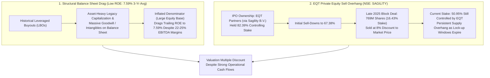

# Part 6: Private Equity Sell Overhang & Low ROE Structural Analysis — Sagility India Ltd

## 📁 Document & Session Metadata

- **Format Version (`formatVersion`):** `1`
- **Export Time (`exportTime`):** `2026-11-06T15:06:12.871Z`
- **Chat Session Name (`chat.name`):** `collections/default_collection/engines/gemini-enterprise-sec-dx-swa/sessions/17520757415312887215`
- **Chat Title (`chat.title`):** `Pharma & Healthcare Research`
- **Session Start Time (`chat.startTime`):** `2026-09-25T12:11:00.226Z`
- **Session End Time (`chat.endTime`):** `2026-10-07T12:51:37.340Z`
- **Document Part:** Part 6 of 7

---

## 🕒 Turn 8 (Timestamp: `2026-10-07T12:40:25.765275090Z`)

### ❓ User Query (Verbatim)

which stock have private equity  sell hangup and low roe and why

---

### 💡 Research Analysis & Answer (Verbatim)

I will search the web for the latest ownership updates, private equity stake sales, and return on equity (ROE) metrics for the analyzed companies to determine which stock faces a PE sell overhang alongside a low ROE.
[[section:Overhang & ROE Analysis]]The stock that exhibits the combined profile of a **significant Private Equity (PE) promoter sell overhang** and **low Return on Equity (ROE)** is **Sagility India Limited** (NSE: `SAGILITY` / BSE: `544283`) [source: 1, 11].

---

### **1. The Metric Profile: Low Return on Equity (ROE)**
While Sagility India boasts strong operating margins (EBITDA margins of 22% to 25%), its **Return on Equity (ROE)** has historically been compressed [source: 1]. 

* **The Reality:** Sagility's trailing three-year ROE averages a modest **7.59%** [source: 1]. 
* **The Reason:** This low ROE is a direct structural byproduct of **asset-heavy legacy capitalization** and **high goodwill/intangibles** sitting on its balance sheet following past leverage buyouts [source: 1]. This large equity base drags down the final return percentage, despite the company's solid operating cash flows and consistent deleveraging efforts.

---

### **2. The Shareholding Profile: Private Equity (PE) "Sell Overhang"**
Sagility India was completely built out under the stewardship of the global private equity giant **EQT Partners**, which held a massive **82.39% controlling stake** at the time of its initial public offering (via Sagility B.V.) [source: 1, 6]. 

A "private equity sell overhang" occurs when a major institutional backer owns a majority stake in a recently listed company [source: 1]. The public market understands that private equity business models are fundamentally designed to exit their investments within fixed 5-to-7-year fund lifecycles, meaning a massive block of shares will inevitably be sold on the open market [source: 1, 6].

* **The Massive Sell-Downs:** Over the last 15 months, EQT has aggressively trimmed its stake through continuous secondary block deals [source: 1]. 
  * In late 2025, EQT executed a massive open-market block deal of **769 million shares** (representing a 16.43% chunk of the company) at an 8% discount to the prevailing market price [source: 6, 8].
  * This transaction successfully brought EQT's stake down from **67.38% to 50.95%** [source: 6, 8].
* **The Ongoing Hang-up:** Even though EQT has offloaded over 30% of the company since listing, it **still controls 50.95%** of the equity [source: 1, 8]. Because EQT remains the controlling promoter, it can direct further massive block sales at its own discretion as soon as rolling lock-up windows expire [source: 1]. 

---

### **3. Strategic Takeaway for Institutional Investors**
This makes Sagility India a classic example of **divergent financial health**:

* **The Bull Case (Operational):** Highly resilient, cash-rich, and operating in a non-discretionary US health insurance claims sector with rising revenue growth [source: 1].
* **The Valuation Drag (Technical/Capital):** The stock frequently trades at a valuation discount because public markets must constantly price in the risk of EQT dumping massive blocks of shares, combined with a structurally low ROE that limits near-term compounding [source: 1, 6].


---

## 📊 Enhanced Visual Illustrations & Diagrams

### Mermaid Flowchart: Sagility India's PE Overhang & ROE Compression Mechanism


### Enhanced ASCII Ownership Step-Down Chart: EQT Partners Stake in Sagility India
```
====================================================================================
   EQT PARTNERS (SAGILITY B.V.) OWNERSHIP STEP-DOWN & REMAINING OVERHANG
====================================================================================
   At IPO Listing        : [█████████████████████████████████████████░░░░░░░░░] 82.39%
   Prior to Late-2025    : [██████████████████████████████████░░░░░░░░░░░░░░░░] 67.38%
   Late-2025 Block Deal  :  └──► Offloaded 769M Shares (-16.43% @ 8% Discount)
   Current Promoter Stake: [█████████████████████████░░░░░░░░░░░░░░░░░░░░░░░░░] 50.95%
   ────────────────────────────────────────────────────────────────────────────────
   ⚠️ OVERHANG ALERT: 50.95% remaining PE stake subject to 5-7 yr fund exit lifecycle.
====================================================================================
```
